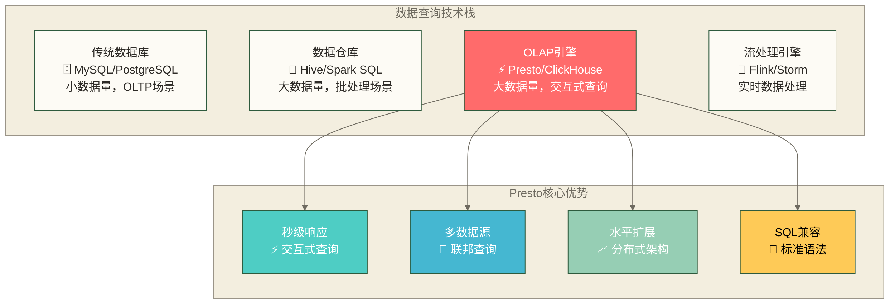
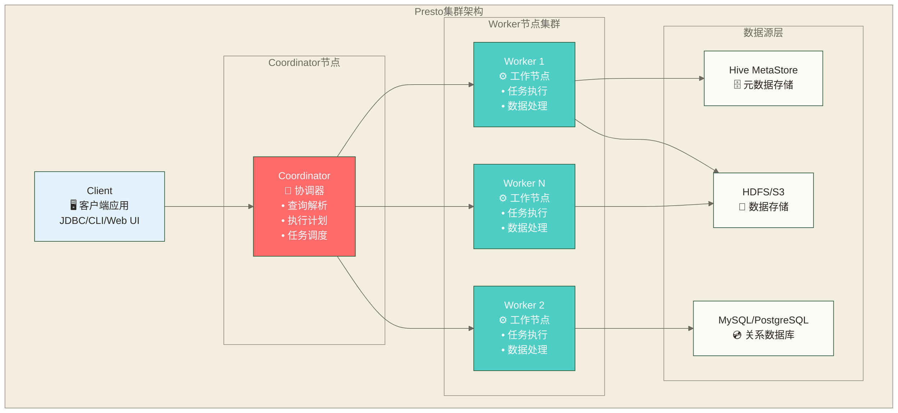
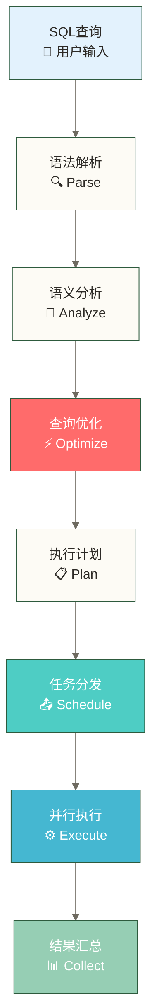
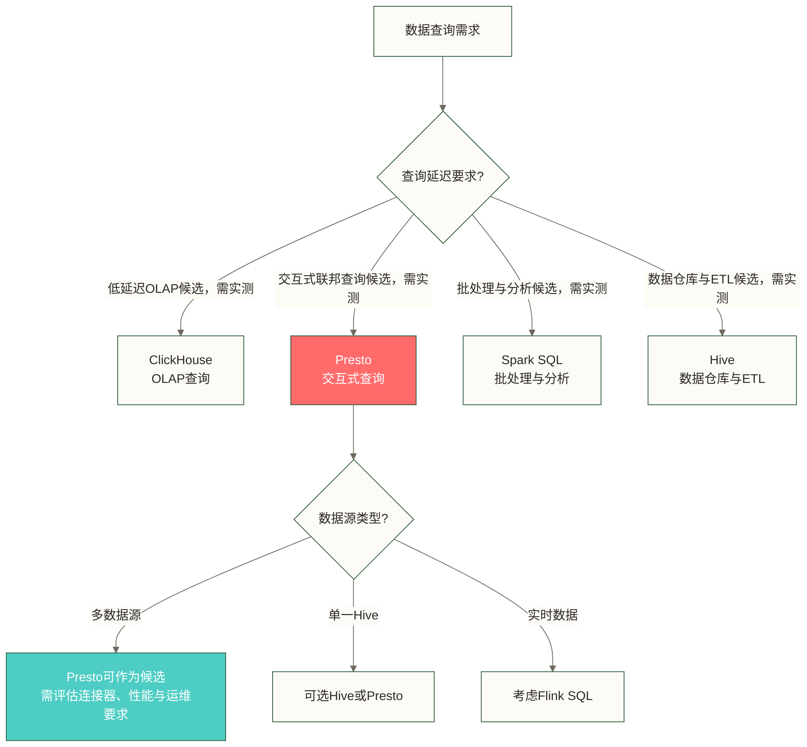
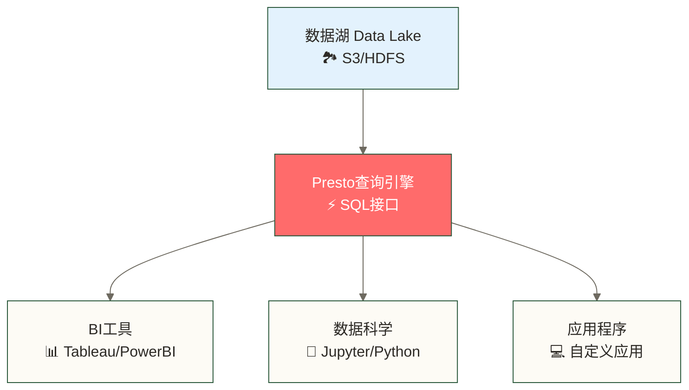

# Presto概述与特性 - 分布式SQL查询引擎的技术革命

> [!abstract] 📋 本节概览
> - 🎯 学习目标：全面理解Presto的核心概念、技术特性和应用场景
> - 📚 前置知识：SQL基础 和 分布式系统基本概念
> - ⏱️ 预计用时：45分钟

## 🚀 什么是Presto？

> [!tip] 💡 核心定义
> Presto是一个开源的分布式SQL查询引擎，专为快速分析查询而设计。它面向交互式分析，可用于GB到PB级数据环境，并支持通过连接器进行多数据源联邦查询；是否达到秒级响应取决于实际扫描量、查询复杂度、数据布局与集群资源。

### 📊 Presto技术定位图



## ⚡ Facebook的查询难题与解决方案

以下是以2012年Facebook海量数据分析需求为背景的假设性教学情境，具体经历和耗时未提供来源，不作为已核实史实：

假设数据分析师每天需要查询海量数据，并遇到以下限制：
- **Hadoop MapReduce**：某条SQL在假设条件下需要20分钟，这不是实测结论或普遍耗时
- **传统数据库**：现有部署的容量或扩展方式难以满足PB级数据需求，不代表所有关系数据库都无法处理该规模
- **Hive**：现有执行配置下的查询延迟无法满足交互式分析需求

这个情境引出的需求是：**能不能使用一个面向交互式分析、又能连接多种数据源的查询引擎？**

针对上述教学情境，**Presto**可作为候选方案——它是一个面向交互式分析的分布式SQL查询引擎；PB级数据环境中的查询耗时取决于具体工作负载，不能据此保证几秒内完成。

Facebook、Netflix、Airbnb、Uber在此作为待核实的企业使用线索列出；本文未提供来源与使用时间，不能据此确认这些企业当前使用Presto的情况。
### 💼 典型应用场景

| 场景类型 | 具体应用 | Presto优势 |
|---------|---------|------------|
| **即席查询** | 数据探索、业务分析 | 秒级响应，交互式体验 |
| **数据联邦** | 跨系统数据整合查询 | 一条SQL访问多个数据源 |
| **ETL替代** | 轻量级数据转换 | 无需复杂的MapReduce作业 |
| **报表生成** | BI工具后端查询引擎 | 高并发，低延迟 |

## 🏗️ Presto核心架构

### 📊 架构组件图



### 🔄 查询执行流程



## 🆚 技术对比分析

### Presto vs 其他查询引擎

| 特性维度 | Presto | Spark SQL | Hive | ClickHouse |
|---------|---------|-----------|------|------------|
| **查询延迟** | 面向交互式分析，实际延迟依赖工作负载 | 实际延迟依赖工作负载与执行配置 | 实际延迟依赖工作负载与执行引擎 | 实际延迟依赖工作负载与数据布局 |
| **数据源支持** | 丰富 🌟 | 丰富 🌟 | 有限 ⭐ | 有限 ⭐ |
| **SQL兼容性** | 标准SQL 📝 | 方言SQL 📄 | HiveQL 📜 | 方言SQL 📄 |
| **集群管理** | 依赖部署规模、连接器与运维要求 | 依赖部署模式与资源管理方式 | 依赖执行引擎与平台配置 | 依赖部署拓扑与运维要求 |
| **内存使用** | 依赖查询计划、并发与资源配置 | 依赖查询计划与执行配置 | 依赖执行引擎与查询配置 | 依赖查询计划、数据布局与资源配置 |

### 🎯 技术选型建议



## 🌟 Presto核心特性详解

### ⚡ 1. 内存计算引擎

**技术原理**：
- 数据流水线处理，中间结果保存在内存中
- 避免传统MapReduce的磁盘I/O开销
- 支持复杂查询的多阶段内存计算

**性能优势**：
```text
传统Hive查询: 磁盘读取 → MapReduce → 磁盘写入 → 读取 → Reduce → 结果
Presto查询:   数据读取 → 内存计算 → 流水线处理 → 直接返回结果

假设性时间对比（仅用于教学示意，并非实测）: Hive (10分钟) vs Presto (30秒)；实际结果需在明确数据、查询、硬件与配置条件后测量。
```

### 🔗 2. 联邦查询能力

**多数据源JOIN示例**：
```sql
-- 一条SQL跨越三个不同的数据源
SELECT 
    h.customer_id,
    h.order_amount,
    m.customer_name,
    r.preference_score
FROM hive.sales.orders h
JOIN mysql.crm.customers m ON h.customer_id = m.id
JOIN redis.cache.preferences r ON m.id = r.customer_id
WHERE h.order_date >= '2024-01-01';
```

### 📈 3. 水平扩展架构

**扩展特性**：
- **动态添加节点**：无需停机即可扩展集群
- **任务调度**：根据调度策略和节点状态分配查询任务，不保证每次分配到全局最优节点
- **故障影响与恢复**：单节点故障可能影响正在执行的查询，具体影响与恢复能力取决于节点角色、执行模式和容错配置

### 🎛️ 4. 企业级管控

**资源管理**：
```sql
-- 查询级别的资源限制
SET SESSION query_max_memory = '10GB';
SET SESSION query_max_total_memory = '50GB';
SET SESSION query_max_execution_time = '1h';
```

**安全认证**：
- LDAP集成企业用户体系
- Kerberos支持大数据安全
- 基于用户的查询权限控制

## 📊 应用场景深度解析

### 🔍 1. 即席查询（Ad-hoc Query）

**业务需求**：
- 数据分析师需要快速探索数据
- 业务人员需要实时获取指标
- 开发人员需要调试数据管道

**Presto解决方案**：
```sql
-- 业务分析查询示例；是否秒级返回取决于数据规模、布局、查询计划与集群资源
SELECT 
    region,
    product_category,
    SUM(sales_amount) as total_sales,
    AVG(sales_amount) as avg_sales,
    COUNT(DISTINCT customer_id) as unique_customers
FROM sales_data 
WHERE sale_date BETWEEN '2024-01-01' AND '2024-03-31'
GROUP BY region, product_category
ORDER BY total_sales DESC
LIMIT 100;
```

### 🌐 2. 数据湖查询

**技术架构**：


### 🏢 3. 企业数据平台

**典型架构**：
- **数据接入层**：Kafka、Flume等实时/批量数据接入
- **存储层**：HDFS、S3等大数据存储
- **计算层**：Presto提供交互式查询能力
- **应用层**：BI报表、数据科学、API服务

## 🎯 学习目标检验

### ✅ 基础概念掌握
- [ ] 能够解释Presto的核心价值主张
- [ ] 理解Presto与其他查询引擎的区别
- [ ] 掌握Presto的基本架构组件
- [ ] 了解Presto的典型应用场景

### 🚀 技术理解深度
- [ ] 能够分析Presto的技术优势和限制
- [ ] 理解联邦查询的概念和价值
- [ ] 掌握Presto的查询执行流程
- [ ] 了解企业级特性的重要性

## 🔗 学习连接

### 📚 本节知识点
- **核心概念**：分布式SQL查询引擎、内存计算、联邦查询
- **技术特性**：秒级响应、多数据源、水平扩展、SQL兼容
- **应用价值**：即席查询、数据湖分析、企业数据平台

### 🎯 下一步学习
**前置知识检查**：
- ✅ 是否熟悉基本的SQL语法？
- ✅ 是否了解分布式系统的基本概念？
- ✅ 是否理解大数据生态的技术栈？

**继续学习路径**：
- **深入架构**：[[【技术与工具】/Presto/02-Presto架构原理|Presto架构]] - 详细了解系统设计
- **动手实践**：[[【技术与工具】/Presto/03-Presto环境搭建|Presto环境搭建]] - 搭建学习环境
- **快速上手**：[[【技术与工具】/Presto/04-第一个Presto查询|第一个Presto查询]] - 实际操作体验

---

> [!tip] 💡 关键要点总结
> 
> 🎯 **Presto核心价值**：
> - ⚡ **交互式查询目标** - 在合适的数据、查询与资源条件下可实现秒级响应
> - 🔗 **多数据源联邦** - 一条SQL可访问已配置连接器且具备访问权限的数据源
> - 📈 **水平扩展能力** - 从GB到PB级数据处理
> - 🏢 **企业级特性** - 安全、资源管理、高可用
> 
> 🚀 **开始实践**：理论学习完成后，立即进入 [[【技术与工具】/Presto/02-Presto架构原理|Presto架构]] 深入了解技术细节！