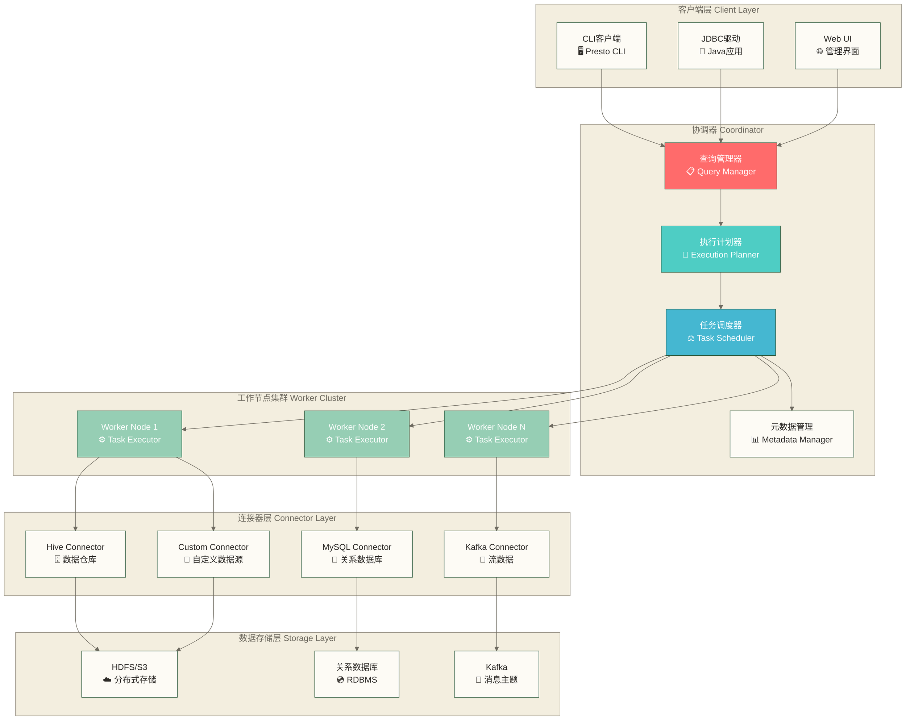
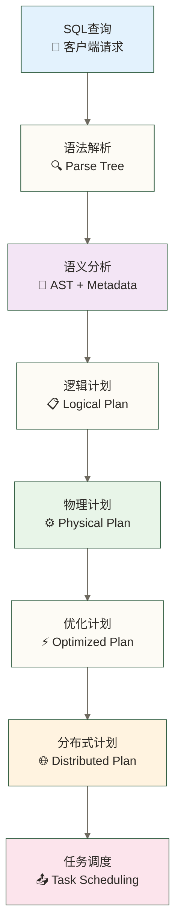
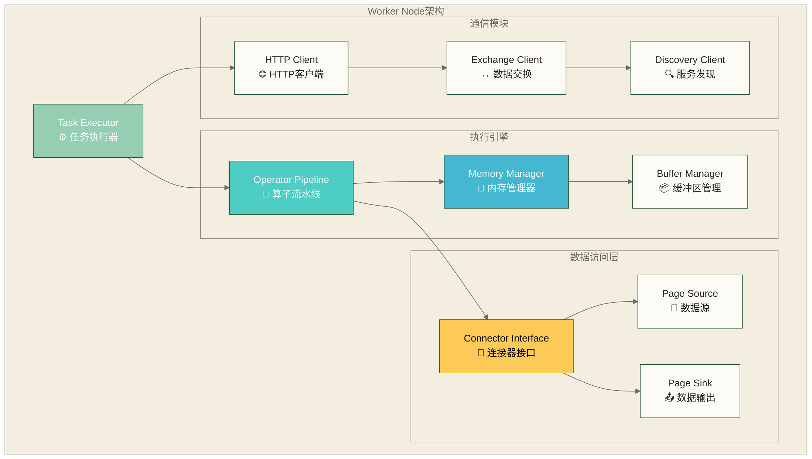
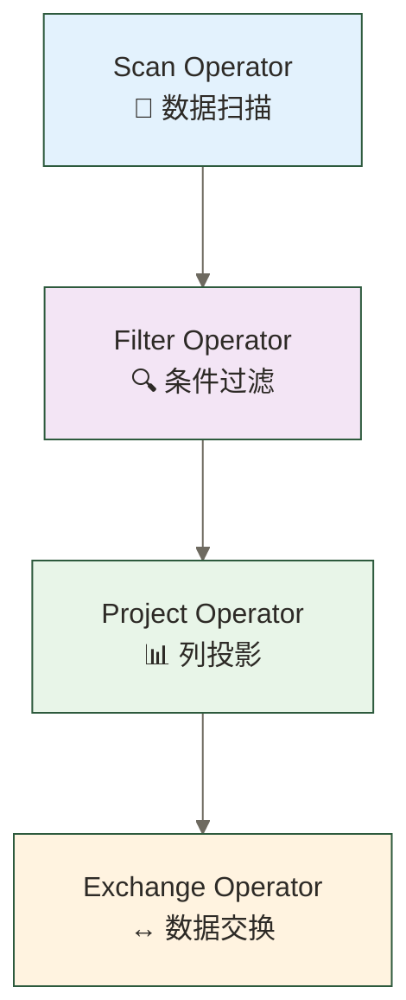
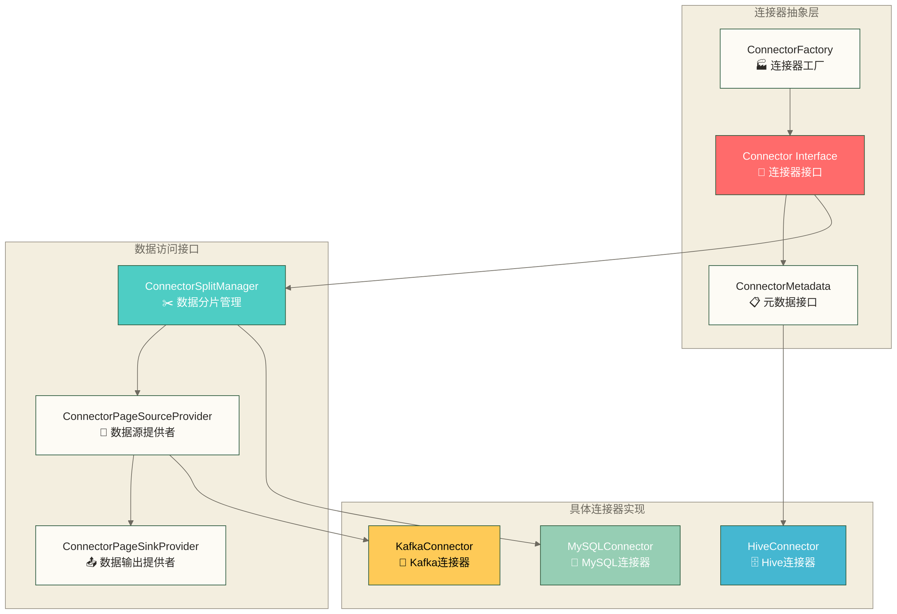
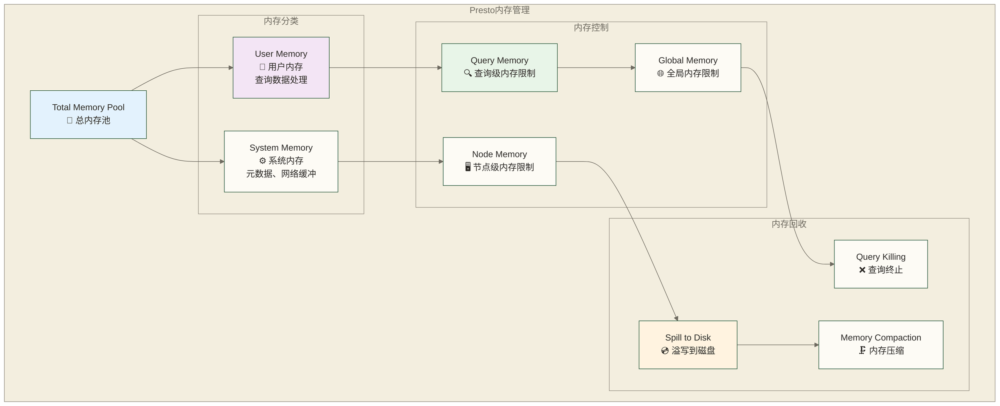
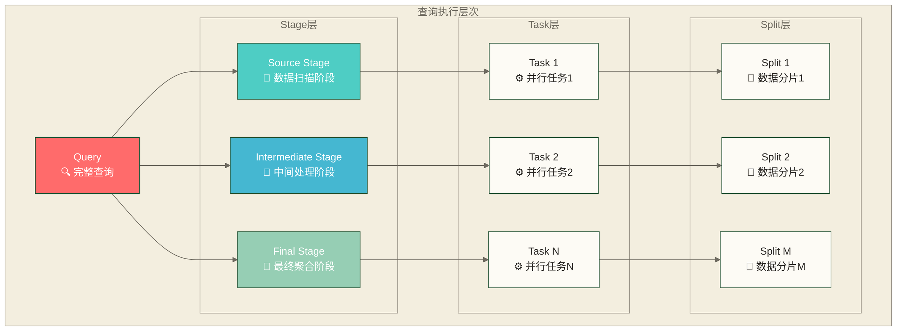
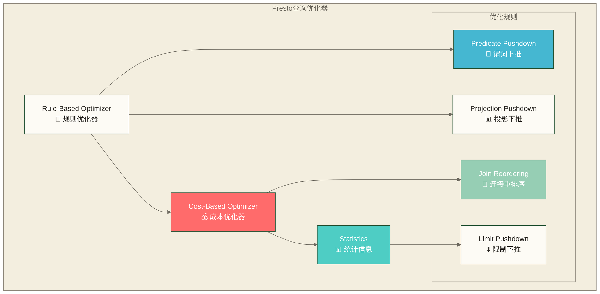

# Presto架构原理 - 深入理解分布式查询引擎设计

> [!abstract] 📋 本节概览
> - 🎯 学习目标：深入理解Presto的架构设计原理和核心机制
> - 📚 前置知识：01-Presto概述与特性|Presto概述与特性 和 分布式系统基础概念
> - ⏱️ 预计用时：60分钟

## 🏗️ 整体架构设计

### 📊 Presto分布式架构全景



### 🎯 架构设计原则

**1. 主从架构（Master-Slave）**
- **Coordinator**：单点协调，负责查询解析、计划生成、任务调度
- **Worker**：多节点并行，负责具体的数据处理和计算任务

**2. 无共享架构（Shared-Nothing）**
- 每个Worker节点独立处理数据，无需共享状态
- 通过网络进行数据交换，避免资源竞争

**3. 流水线处理（Pipeline Processing）**
- 查询阶段并行执行，数据流式传输
- 避免中间结果落盘，提高处理效率

## 🎯 Coordinator详解

### 📋 核心组件架构

```mermaid
%%{init: {"theme":"base","themeVariables":{"fontFamily":"PingFang SC, -apple-system, Source Han Serif SC, serif","fontSize":"16px","background":"#FDFBF5","primaryColor":"#FDFBF5","primaryTextColor":"#2D2A26","primaryBorderColor":"#6E6A60","secondaryColor":"#E8EFE8","secondaryBorderColor":"#8FA890","secondaryTextColor":"#2D2A26","tertiaryColor":"#FDFBF5","tertiaryBorderColor":"#9A9488","tertiaryTextColor":"#6E6A60","lineColor":"#6E6A60","textColor":"#2D2A26","mainBkg":"#FDFBF5","nodeBorder":"#2D5A3D","clusterBkg":"#F3EEDF","clusterBorder":"#9A9488","edgeLabelBackground":"#FDFBF5"},"flowchart":{"htmlLabels":true,"curve":"basis","padding":20,"nodeSpacing":60,"rankSpacing":70,"useMaxWidth":false},"themeCSS":".node rect, .node polygon, .node circle { stroke-width: 1.5px; } .edgePath .path { stroke-width: 1.5px; } .cluster-label .nodeLabel, .cluster-label foreignObject { color: #2D2A26 !important; } .edgeLabel, .edgeLabel foreignObject { color: #2D2A26 !important; background-color: #FDFBF5; } .edgeLabel rect { fill: #FDFBF5; }"}}%%
flowchart TB
    subgraph "Coordinator内部架构"
        A[HTTP Server<br/>🌐 接收客户端请求]
        subgraph "查询处理引擎"
            B[SQL Parser<br/>📝 语法解析器]
            C[Analyzer<br/>🧠 语义分析器]
            D[Planner<br/>🎯 执行计划器]
            E[Optimizer<br/>⚡ 查询优化器]
        end
        subgraph "执行管理"
            F[Query Manager<br/>📊 查询管理器]
            G[Task Manager<br/>⚙️ 任务管理器]
            H[Node Manager<br/>🖥️ 节点管理器]
        end
        subgraph "元数据服务"
            I[Metadata Manager<br/>📋 元数据管理]
            J[Security Manager<br/>🔐 安全管理]
            K[Resource Manager<br/>💾 资源管理]
        end
    A --> B --> C --> D --> E --> F --> G --> H
    F --> I --> J --> K
    style A fill:#e3f2fd
    style F fill:#ff6b6b,color:#fff
    style G fill:#4ecdc4,color:#fff
    style I fill:#45b7d1,color:#fff

    end
```



### 🔄 查询处理流程



### 🎛️ 关键功能详解

**1. 查询解析与分析**
```java
// SQL解析示例流程
SQL: "SELECT customer_id, SUM(amount) FROM orders GROUP BY customer_id"

1. 语法解析 → Parse Tree
2. 语义分析 → 验证表/列存在性，类型检查
3. 生成AST → 抽象语法树
4. 元数据绑定 → 绑定表结构信息
```

**2. 执行计划生成**
- **逻辑计划**：描述查询的逻辑操作（scan, filter, join, aggregate）
- **物理计划**：选择具体的算法实现（hash join vs merge join）
- **分布式计划**：将计划分解为可并行执行的任务

**3. 任务调度策略**
- **数据本地性**：优先调度到数据所在节点
- **负载均衡**：考虑节点CPU、内存使用情况
- **资源限制**：遵守查询级别的资源约束

## ⚙️ Worker节点详解

### 🏗️ Worker内部架构



### 📊 数据处理模型

**1. Page-Based处理模型**
```java
// Presto的Page数据结构
class Page {
    Block[] blocks;        // 列数据块
    int positionCount;     // 行数
    long sizeInBytes;      // 内存大小
}

// 典型处理流程
InputPage → Operator.process() → OutputPage
```

**2. 向量化执行**
- 一次处理一批数据（通常1000-8000行）
- 利用CPU向量化指令集提高性能
- 减少函数调用开销

**3. 流水线执行**


## 🔗 连接器架构

### 📊 连接器设计模式



### 🔧 连接器核心接口

**1. 元数据接口**
```java
public interface ConnectorMetadata {
    // 列举schema和table
    List<String> listSchemaNames();
    List<SchemaTableName> listTables(String schemaName);
    
    // 获取表元数据
    ConnectorTableMetadata getTableMetadata(ConnectorTableHandle table);
    
    // 获取列信息
    Map<String, ColumnHandle> getColumnHandles(ConnectorTableHandle table);
}
```

**2. 数据分片接口**
```java
public interface ConnectorSplitManager {
    // 生成数据分片
    ConnectorSplitSource getSplits(
        ConnectorTransactionHandle transaction,
        ConnectorSession session,
        ConnectorTableHandle table,
        SplitSchedulingStrategy splitSchedulingStrategy
    );
}
```

## 💾 内存管理机制

### 📊 内存架构设计



### ⚖️ 内存控制策略

**1. 分层内存限制**
```properties
# 节点级内存配置
query.max-memory-per-node=8GB
query.max-total-memory-per-node=10GB

# 查询级内存配置  
query.max-memory=50GB
query.max-total-memory=100GB

# 每节点堆内存预留配置（示例值）
memory.heap-headroom-per-node=2GB
```

**2. 内存回收机制**
- **条件性溢写**：在启用溢写且相关算子支持时，可将部分中间数据溢写到磁盘；并非所有大查询都会自动溢写
- **查询终止**：超过限制的查询被强制终止
- **内存压缩**：动态压缩中间结果数据

## 🔄 查询执行模型

### 📊 Stage和Task层次结构



### ⚡ 并行执行策略

**1. 数据并行**
- 按数据分片并行：不同Worker处理不同的数据分片
- 算子并行：同一算子的多个实例并行执行

**2. 流水线并行**
- 上游算子产生数据，下游算子立即消费
- 避免等待整个阶段完成，提高执行效率

**3. 动态调度**
```java
// 动态Split调度示例
if (worker.isIdle() && splits.hasMore()) {
    Split split = splits.getNext();
    scheduleTaskToWorker(worker, split);
}
```

## 🚀 性能优化机制

### 📊 查询优化器架构



### 🎯 关键优化技术

**1. 谓词下推（Predicate Pushdown）**
```sql
-- 原始查询
SELECT * FROM (
    SELECT customer_id, order_amount 
    FROM orders
) t 
WHERE customer_id = 12345;

-- 优化后：将WHERE条件下推到子查询
SELECT customer_id, order_amount 
FROM orders 
WHERE customer_id = 12345;
```

**2. 动态过滤（Dynamic Filtering）**
- 运行时生成过滤条件，减少数据扫描量
- 特别适用于星型模式的JOIN查询

**3. 向量化执行**
- 批量处理数据，提高CPU缓存利用率
- 利用SIMD指令集进行并行计算

## 🔗 学习检验与实践

### ✅ 架构理解检查
- [ ] 能够画出Presto的整体架构图
- [ ] 理解Coordinator和Worker的职责分工
- [ ] 掌握查询执行的完整流程
- [ ] 了解连接器的设计模式

### 🚀 深度理解验证
- [ ] 能够解释Stage、Task、Split的关系
- [ ] 理解内存管理的分层机制
- [ ] 掌握查询优化的核心技术
- [ ] 了解并行执行的策略

### 💡 实践应用思考
- [ ] 如何根据查询特点选择合适的内存配置？
- [ ] 如何设计自定义连接器？
- [ ] 如何诊断和优化慢查询？
- [ ] 如何规划Presto集群的资源配置？

## 🔗 学习连接

### 📚 本节核心概念
- **架构模式**：主从架构、无共享架构、流水线处理
- **执行模型**：Page-based处理、向量化执行、并行调度
- **内存管理**：分层限制、动态回收、溢写机制
- **查询优化**：规则优化、成本优化、动态过滤

### 🎯 后续学习路径
**理论基础巩固**：
- ✅ 是否理解了分布式查询的核心挑战？
- ✅ 是否掌握了Presto的设计思想？

**实践环节准备**：
- [[【技术与工具】/Presto/03-Presto环境搭建|Presto环境搭建]] - 环境搭建
- [[【技术与工具】/Presto/04-第一个Presto查询|第一个Presto查询]] - 查询实践
- [[【技术与工具】/Presto/05-Presto SQL语法基础|Presto SQL语法]] - SQL开发

---

> [!tip] 💡 架构设计精髓
> 
> 🏗️ **Presto架构核心价值**：
> - 🎯 **协调与执行分离** - Coordinator专注调度，Worker专注计算
> - 💾 **内存优先策略** - 流水线处理，避免磁盘I/O
> - 🔗 **插件化连接器** - 统一接口，灵活扩展数据源
> - ⚡ **向量化执行** - 批量处理，充分利用现代CPU特性
> 
> 🚀 **深入实践**：架构理解为实践奠定基础，接下来通过 03-Presto环境搭建|Presto环境搭建 动手验证理论知识！