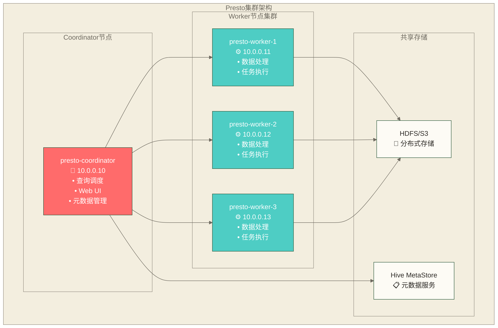

# Presto环境搭建 - 从单机到集群的完整部署指南

> [!abstract] 📋 本节概览
> - 🎯 学习目标：掌握Presto的完整安装和配置过程，搭建可用的开发和生产环境
> - 📚 前置知识：[[【技术与工具】/Presto/02-Presto架构原理|Presto架构]] 和 Linux基础操作
> - ⏱️ 预计用时：90分钟

## 🛠️ 环境准备

### 📋 系统要求

**硬件要求**：
- **CPU**：至少4核，推荐8核以上
- **内存**：最小8GB，推荐16GB以上
- **磁盘**：SSD推荐，至少100GB可用空间
- **网络**：千兆以太网，低延迟

**软件要求**：
```bash
操作系统: Linux (CentOS 7+, Ubuntu 18.04+)
Java版本: OpenJDK 11+ 或 Oracle JDK 11+
Python版本: Python 2.7+ 或 Python 3.6+
```

### 🔧 环境检查清单

```bash
# 1. 检查操作系统版本
cat /etc/os-release

# 2. 检查Java版本
java -version

# 3. 检查内存和CPU
free -h
lscpu

# 4. 检查磁盘空间
df -h

# 5. 检查网络连接
ping -c 3 google.com
```

## ☕ Java环境配置

### 📦 安装OpenJDK 11

**CentOS/RHEL**：
```bash
# 安装OpenJDK 11
sudo yum install -y java-11-openjdk java-11-openjdk-devel

# 设置JAVA_HOME
echo 'export JAVA_HOME=/usr/lib/jvm/java-11-openjdk' >> ~/.bashrc
echo 'export PATH=$JAVA_HOME/bin:$PATH' >> ~/.bashrc
source ~/.bashrc
```

**Ubuntu/Debian**：
```bash
# 安装OpenJDK 11
sudo apt-get update
sudo apt-get install -y openjdk-11-jdk

# 设置JAVA_HOME
echo 'export JAVA_HOME=/usr/lib/jvm/java-11-openjdk-amd64' >> ~/.bashrc
echo 'export PATH=$JAVA_HOME/bin:$PATH' >> ~/.bashrc
source ~/.bashrc
```

### ✅ Java配置验证

```bash
# 验证Java安装
java -version
javac -version
echo $JAVA_HOME

# 预期输出示例
# openjdk version "11.0.x" 2021-xx-xx
# OpenJDK Runtime Environment (build 11.0.x+x)
```

## 🚀 Presto单机安装

### 📥 下载Presto

```bash
# 创建安装目录
sudo mkdir -p /opt/presto
cd /opt/presto

# 下载Presto服务器包 (以0.279版本为例)
sudo wget https://repo1.maven.org/maven2/com/facebook/presto/presto-server/0.279/presto-server-0.279.tar.gz

# 下载Presto CLI
sudo wget https://repo1.maven.org/maven2/com/facebook/presto/presto-cli/0.279/presto-cli-0.279-executable.jar

# 解压服务器包
sudo tar -xzf presto-server-0.279.tar.gz
sudo mv presto-server-0.279 server

# 配置CLI
sudo mv presto-cli-0.279-executable.jar presto-cli
sudo chmod +x presto-cli
```

### 📁 目录结构说明

| 路径 | 说明 |
|------|------|
| `/opt/presto/server/` | Presto 服务器目录 |
| `/opt/presto/server/bin/` | 启动脚本 |
| `/opt/presto/server/lib/` | 依赖库 |
| `/opt/presto/server/plugin/` | 插件目录 |
| `/opt/presto/server/etc/` | 配置文件目录 |
| `/opt/presto/presto-cli` | CLI 工具 |

### ⚙️ 基础配置

**1. 创建配置目录**：
```bash
sudo mkdir -p /opt/presto/server/etc
sudo mkdir -p /opt/presto/server/etc/catalog
sudo mkdir -p /opt/presto/data
```

**2. 节点配置 (node.properties)**：
```bash
sudo tee /opt/presto/server/etc/node.properties > /dev/null << 'EOF'
node.environment=production
node.id=ffffffff-ffff-ffff-ffff-ffffffffffff
node.data-dir=/opt/presto/data
EOF
```

**3. JVM配置 (jvm.config)**：
```bash
sudo tee /opt/presto/server/etc/jvm.config > /dev/null << 'EOF'
-server
-Xmx8G
-XX:+UseG1GC
-XX:G1HeapRegionSize=32M
-XX:+UseGCOverheadLimit
-XX:+ExplicitGCInvokesConcurrent
-XX:+HeapDumpOnOutOfMemoryError
-XX:+ExitOnOutOfMemoryError
-Djdk.attach.allowAttachSelf=true
EOF
```

**4. 配置属性 (config.properties)**：
```bash
sudo tee /opt/presto/server/etc/config.properties > /dev/null << 'EOF'
coordinator=true
node-scheduler.include-coordinator=true
http-server.http.port=8080
query.max-memory=5GB
query.max-memory-per-node=1GB
query.max-total-memory-per-node=2GB
discovery-server.enabled=true
discovery.uri=http://localhost:8080
EOF
```

**5. 日志配置 (log.properties)**：
```bash
sudo tee /opt/presto/server/etc/log.properties > /dev/null << 'EOF'
com.facebook.presto=INFO
com.facebook.presto.server.PluginManager=DEBUG
EOF
```

### 🗄️ Hive连接器配置

**创建Hive连接器**：
```bash
sudo tee /opt/presto/server/etc/catalog/hive.properties > /dev/null << 'EOF'
connector.name=hive-hadoop2
hive.metastore.uri=thrift://localhost:9083
hive.config.resources=/etc/hadoop/conf/core-site.xml,/etc/hadoop/conf/hdfs-site.xml
hive.allow-drop-table=true
hive.allow-rename-table=true
EOF
```

### 💾 内存连接器配置

**创建内存连接器用于测试**：
```bash
sudo tee /opt/presto/server/etc/catalog/memory.properties > /dev/null << 'EOF'
connector.name=memory
EOF
```

## 🚀 启动Presto服务

### 🔧 启动脚本

```bash
# 启动Presto服务器
sudo /opt/presto/server/bin/launcher start

# 检查服务状态
sudo /opt/presto/server/bin/launcher status

# 查看日志
tail -f /opt/presto/data/var/log/server.log
```

### 🌐 Web UI访问

打开浏览器访问：`http://localhost:8080`

Web UI界面包含：
- **概览页面**：集群状态和查询统计
- **查询页面**：正在运行和历史查询
- **工作节点**：节点状态和资源使用
- **连接器**：已配置的数据源连接器

### 🖥️ CLI连接测试

```bash
# 连接到Presto
/opt/presto/presto-cli --server localhost:8080

# 测试基本查询
presto> SELECT 'Hello, Presto!' as greeting;
presto> SHOW CATALOGS;
presto> SHOW SCHEMAS FROM memory;
```

## 🏢 Presto集群部署

### 📊 集群架构规划



### 🎯 Coordinator节点配置

**config.properties**：
```bash
coordinator=true
node-scheduler.include-coordinator=false
http-server.http.port=8080
query.max-memory=50GB
query.max-total-memory=100GB
query.max-memory-per-node=8GB
query.max-total-memory-per-node=16GB
discovery-server.enabled=true
discovery.uri=http://10.0.0.10:8080
```

**node.properties**：
```bash
node.environment=production
node.id=coordinator-1
node.data-dir=/opt/presto/data
```

**jvm.config**：
```bash
-server
-Xmx16G
-XX:+UseG1GC
-XX:G1HeapRegionSize=32M
-XX:+UseGCOverheadLimit
-XX:+ExplicitGCInvokesConcurrent
-XX:+HeapDumpOnOutOfMemoryError
-XX:+ExitOnOutOfMemoryError
-Djdk.attach.allowAttachSelf=true
```

### ⚙️ Worker节点配置

**config.properties**：
```bash
coordinator=false
http-server.http.port=8080
query.max-memory-per-node=8GB
query.max-total-memory-per-node=16GB
discovery.uri=http://10.0.0.10:8080
```

**node.properties** (每个Worker节点唯一)：
```bash
node.environment=production
# 每个Worker使用唯一标识，例如worker-1、worker-2、worker-3
node.id=worker-1
node.data-dir=/opt/presto/data
```

### 🔄 集群部署脚本

```bash
#!/bin/bash
# deploy-presto-cluster.sh

COORDINATOR_IP="10.0.0.10"
WORKER_IPS=("10.0.0.11" "10.0.0.12" "10.0.0.13")
PRESTO_VERSION="0.279"

# 函数：部署到单个节点
deploy_node() {
    local ip=$1
    local node_type=$2
    local node_id=$3
    
    echo "部署Presto到节点: $ip ($node_type)"
    
    # 复制Presto包到目标节点
    scp presto-server-${PRESTO_VERSION}.tar.gz root@$ip:/tmp/
    
    # 远程执行安装命令
    ssh root@$ip << EOF
        # 创建目录
        mkdir -p /opt/presto
        cd /opt/presto
        
        # 解压安装包
        tar -xzf /tmp/presto-server-${PRESTO_VERSION}.tar.gz
        mv presto-server-${PRESTO_VERSION} server
        
        # 创建配置目录
        mkdir -p server/etc/catalog
        mkdir -p data
        
        # 生成节点配置
        cat > server/etc/node.properties << EOL
node.environment=production
node.id=$node_id
node.data-dir=/opt/presto/data
EOL

        # 生成JVM配置
        cat > server/etc/jvm.config << EOL
-server
-Xmx16G
-XX:+UseG1GC
-XX:G1HeapRegionSize=32M
-XX:+UseGCOverheadLimit
-XX:+ExplicitGCInvokesConcurrent
-XX:+HeapDumpOnOutOfMemoryError
-XX:+ExitOnOutOfMemoryError
-Djdk.attach.allowAttachSelf=true
EOL

        # 生成主配置文件
        if [ "$node_type" = "coordinator" ]; then
            cat > server/etc/config.properties << EOL
coordinator=true
node-scheduler.include-coordinator=false
http-server.http.port=8080
query.max-memory=50GB
query.max-total-memory=100GB
query.max-memory-per-node=8GB
query.max-total-memory-per-node=16GB
discovery-server.enabled=true
discovery.uri=http://$COORDINATOR_IP:8080
EOL
        else
            cat > server/etc/config.properties << EOL
coordinator=false
http-server.http.port=8080
query.max-memory-per-node=8GB
query.max-total-memory-per-node=16GB
discovery.uri=http://$COORDINATOR_IP:8080
EOL
        fi
        
        # 生成日志配置
        cat > server/etc/log.properties << EOL
com.facebook.presto=INFO
EOL
        
        # 创建Hive连接器配置
        cat > server/etc/catalog/hive.properties << EOL
connector.name=hive-hadoop2
hive.metastore.uri=thrift://your-hive-metastore:9083
hive.config.resources=/etc/hadoop/conf/core-site.xml,/etc/hadoop/conf/hdfs-site.xml
EOL
EOF
    
    echo "节点 $ip 部署完成"
}

# 部署Coordinator
deploy_node $COORDINATOR_IP "coordinator" "coordinator-1"

# 部署Worker节点
for i in "${!WORKER_IPS[@]}"; do
    worker_id=$((i + 1))
    deploy_node ${WORKER_IPS[$i]} "worker" "worker-$worker_id"
done

echo "集群部署完成！"
```

## 🔧 高级配置选项

### ⚡ 性能调优配置

**查询优化配置**：
```properties
# 启用基于成本的优化器
optimizer.join-reordering-strategy=COST_BASED
optimizer.join-distribution-type=AUTOMATIC

# 启用动态过滤
enable-dynamic-filtering=true
dynamic-filtering.max-per-driver-row-count=2000
dynamic-filtering.max-per-driver-size=100MB

# 查询资源限制
query.max-run-time=24h
query.max-execution-time=1h
query.max-planning-time=10m
```

**内存管理配置**：
```properties
# 内存池配置
memory.heap-headroom-per-node=2GB
query.max-memory=50GB
query.max-total-memory=100GB
query.max-memory-per-node=8GB
query.max-total-memory-per-node=16GB

# 溢出到磁盘配置
spill-enabled=true
spill-compression-enabled=true
spill-encryption-enabled=false
spiller-spill-path=/tmp/presto-spill
spiller-threads=4
```

### 🔐 安全配置

**HTTPS配置**：
```properties
http-server.https.enabled=true
http-server.https.port=8443
http-server.https.keystore.path=/path/to/keystore.jks
http-server.https.keystore.key=keystore-password
```

**认证配置**：
```properties
http-server.authentication.type=PASSWORD
http-server.https.enabled=true
http-server.process-forwarded=true
```

### 📊 监控配置

**JMX监控**：
```properties
jmx.rmiregistry.port=9080
jmx.rmiserver.port=9081
```

**事件监听器**：
```properties
event-listener.name=event-logger
event-listener.log-file=/opt/presto/data/var/log/event.log
```

## 🐳 Docker容器化部署

### 📦 Dockerfile示例

```dockerfile
FROM openjdk:11-jre-slim

# 安装必要工具
RUN apt-get update && apt-get install -y \
    curl \
    python \
    && rm -rf /var/lib/apt/lists/*

# 创建presto用户
RUN groupadd -r presto && useradd -r -g presto presto

# 设置工作目录
WORKDIR /opt/presto

# 下载并安装Presto
RUN curl -L https://repo1.maven.org/maven2/com/facebook/presto/presto-server/0.279/presto-server-0.279.tar.gz \
    | tar -xz --strip-components=1

# 创建配置目录
RUN mkdir -p etc/catalog data

# 复制配置文件
COPY config.properties etc/
COPY node.properties etc/
COPY jvm.config etc/
COPY log.properties etc/
COPY catalog/ etc/catalog/

# 设置权限
RUN chown -R presto:presto /opt/presto

# 切换用户
USER presto

# 暴露端口
EXPOSE 8080

# 启动命令
CMD ["bin/launcher", "run"]
```

### 🚀 Docker Compose部署

```yaml
version: '3.8'

services:
  presto-coordinator:
    build: .
    hostname: presto-coordinator
    ports:
      - "8080:8080"
    volumes:
      - ./coordinator/config.properties:/opt/presto/etc/config.properties
      - ./coordinator/node.properties:/opt/presto/etc/node.properties
      - presto-data:/opt/presto/data
    environment:
      - JAVA_TOOL_OPTIONS=-Xmx8G
    networks:
      - presto-network

  presto-worker-1:
    build: .
    hostname: presto-worker-1
    volumes:
      - ./worker/config.properties:/opt/presto/etc/config.properties
      - ./worker/node.properties:/opt/presto/etc/node.properties
      - presto-data:/opt/presto/data
    environment:
      - JAVA_TOOL_OPTIONS=-Xmx8G
    depends_on:
      - presto-coordinator
    networks:
      - presto-network

  presto-worker-2:
    build: .
    hostname: presto-worker-2
    volumes:
      - ./worker/config.properties:/opt/presto/etc/config.properties
      - ./worker/node.properties:/opt/presto/etc/node.properties
      - presto-data:/opt/presto/data
    environment:
      - JAVA_TOOL_OPTIONS=-Xmx8G
    depends_on:
      - presto-coordinator
    networks:
      - presto-network

volumes:
  presto-data:

networks:
  presto-network:
    driver: bridge
```

## 🔧 故障排查指南

### 📋 常见问题诊断

**1. 服务启动失败**：
```bash
# 检查Java版本
java -version

# 检查端口占用
netstat -tlnp | grep 8080

# 查看启动日志
tail -f /opt/presto/data/var/log/server.log

# 检查配置文件语法
/opt/presto/server/bin/launcher --config-check
```

**2. 内存不足错误**：
```bash
# 查看系统内存
free -h

# 检查JVM配置
cat /opt/presto/server/etc/jvm.config

# 调整内存配置
# 修改jvm.config中的-Xmx参数
```

**3. 连接器配置问题**：
```bash
# 检查连接器配置
ls -la /opt/presto/server/etc/catalog/

# 验证Hive MetaStore连接
telnet your-hive-metastore 9083

# 检查HDFS配置文件路径
ls -la /etc/hadoop/conf/
```

### 🔄 服务管理脚本

```bash
#!/bin/bash
# presto-service.sh

PRESTO_HOME="/opt/presto/server"
PRESTO_USER="presto"

case "$1" in
    start)
        echo "启动Presto服务..."
        sudo -u $PRESTO_USER $PRESTO_HOME/bin/launcher start
        ;;
    stop)
        echo "停止Presto服务..."
        sudo -u $PRESTO_USER $PRESTO_HOME/bin/launcher stop
        ;;
    restart)
        echo "重启Presto服务..."
        sudo -u $PRESTO_USER $PRESTO_HOME/bin/launcher restart
        ;;
    status)
        echo "检查Presto服务状态..."
        sudo -u $PRESTO_USER $PRESTO_HOME/bin/launcher status
        ;;
    logs)
        echo "查看Presto日志..."
        tail -f /opt/presto/data/var/log/server.log
        ;;
    *)
        echo "用法: $0 {start|stop|restart|status|logs}"
        exit 1
        ;;
esac
```

## ✅ 环境验证清单

### 🎯 单机环境验证

- [ ] Java环境正确配置，版本11或以上
- [ ] Presto服务成功启动，端口8080可访问
- [ ] Web UI正常显示集群信息
- [ ] CLI可以连接并执行基本查询
- [ ] 内存连接器正常工作
- [ ] 日志文件正常生成，无错误信息

### 🏢 集群环境验证

- [ ] 所有节点Java环境一致
- [ ] Coordinator节点正常启动
- [ ] 所有Worker节点成功注册到Coordinator
- [ ] Web UI显示所有节点状态为Active
- [ ] 集群间网络连通性正常
- [ ] 共享存储(HDFS/S3)连接正常
- [ ] Hive MetaStore连接正常

### 🚀 性能基准测试

```bash
# 创建测试数据
presto> CREATE TABLE memory.default.test_table AS
SELECT rand() as col1, 'test_data_' || cast(rand() * 1000 as varchar) as col2
FROM (VALUES (1)) t(x) CROSS JOIN UNNEST(sequence(1, 1000000)) t2(y);

# 执行性能测试查询
presto> SELECT count(*) FROM memory.default.test_table;
presto> SELECT col2, count(*) FROM memory.default.test_table GROUP BY col2 LIMIT 10;
```

## 🔗 学习连接

### 📚 本节核心技能

- **环境搭建**：Java配置、Presto安装、配置文件管理
- **单机部署**：基础配置、连接器设置、服务启动
- **集群部署**：多节点架构、网络配置、负载分布
- **高级配置**：性能调优、安全设置、监控配置

### 🎯 下一步学习

**环境就绪检查**：
- ✅ Presto服务是否正常运行？
- ✅ Web UI是否可以正常访问？
- ✅ CLI是否能够执行查询？

**继续学习路径**：
- **快速上手**：[[【技术与工具】/Presto/04-第一个Presto查询|第一个Presto查询]] - 体验查询功能
- **SQL开发**：[[【技术与工具】/Presto/05-Presto SQL语法基础|Presto SQL语法]] - 学习查询语法
- **连接器配置**：[[【技术与工具】/Presto/07-连接器详解|连接器]] - 配置多数据源

---

> [!tip] 💡 部署成功要点
> 
> 🛠️ **环境搭建核心要素**：
> - ☕ **Java环境** - 正确的JDK版本是基础
> - ⚙️ **内存配置** - 合理的JVM参数设置
> - 🌐 **网络连通** - 集群节点间通信畅通
> - 📋 **配置管理** - 统一的配置文件管理
> 
> 🚀 **开始查询**：环境搭建完成后，立即进入 [[【技术与工具】/Presto/04-第一个Presto查询|第一个Presto查询]] 体验查询的强大功能！