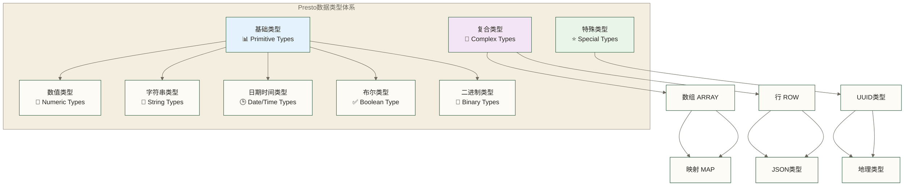

# Presto数据类型与函数 - 完整的类型系统和函数库指南

> [!abstract] 📋 本节概览
> - 🎯 学习目标：全面掌握Presto的数据类型系统和丰富的内置函数库
> - 📚 前置知识：05-Presto SQL语法基础|Presto SQL语法基础 和 数据库基础概念
> - ⏱️ 预计用时：120分钟

## 🏗️ Presto数据类型系统

### 📊 类型系统概览



## 🔢 数值类型

### 📋 整数类型

```sql
-- 整数类型范围和示例
SELECT 
    CAST(127 AS TINYINT) AS tiny_int,           -- -128 到 127 (1字节)
    CAST(32767 AS SMALLINT) AS small_int,       -- -32,768 到 32,767 (2字节)
    CAST(2147483647 AS INTEGER) AS int_val,     -- -2^31 到 2^31-1 (4字节)
    CAST(9223372036854775807 AS BIGINT) AS big_int; -- -2^63 到 2^63-1 (8字节)

-- 整数运算
CREATE TABLE memory.default.integer_examples AS
SELECT * FROM (VALUES
    (1, 100, 'Small number'),
    (2, 1000000, 'Million'),
    (3, 1000000000, 'Billion'),
    (4, 1000000000000, 'Trillion')
) AS t(id, value, description);

-- 整数函数
SELECT 
    value,
    ABS(value) AS absolute_value,
    SIGN(value) AS sign_value,
    value % 3 AS modulo_3,
    POWER(value, 2) AS squared,
    SQRT(value) AS square_root
FROM memory.default.integer_examples;
```

### 💰 小数类型

```sql
-- 小数类型精度控制
CREATE TABLE memory.default.decimal_examples AS
SELECT * FROM (VALUES
    (1, DECIMAL '123.45', 'Basic decimal'),
    (2, DECIMAL '999999.999999', 'High precision'),
    (3, DECIMAL '0.000001', 'Small decimal'),
    (4, DECIMAL '1234567890.12', 'Large decimal')
) AS t(id, amount, description);

-- 小数运算和函数
SELECT 
    amount,
    ROUND(amount, 2) AS rounded_2,
    ROUND(amount, 0) AS rounded_integer,
    CEIL(amount) AS ceiling,
    FLOOR(amount) AS floor,
    TRUNCATE(amount, 1) AS truncated,
    MOD(amount, 100) AS mod_100
FROM memory.default.decimal_examples;

-- 浮点类型 (近似数值)
SELECT 
    CAST(3.14159 AS REAL) AS real_pi,      -- 单精度浮点 (4字节)
    CAST(3.14159 AS DOUBLE) AS double_pi;   -- 双精度浮点 (8字节)
```

### 🧮 数学函数

```sql
-- 基础数学函数
SELECT 
    PI() AS pi_value,
    E() AS e_value,
    SQRT(16) AS square_root,
    POWER(2, 10) AS power_2_10,
    EXP(1) AS exp_1,
    LN(E()) AS natural_log,
    LOG10(100) AS log_base_10,
    LOG(2, 8) AS log_base_2;

-- 三角函数
SELECT 
    SIN(PI()/2) AS sine_90_degrees,
    COS(0) AS cosine_0_degrees,
    TAN(PI()/4) AS tangent_45_degrees,
    ASIN(1) AS arcsine_1,
    ACOS(0) AS arccosine_0,
    ATAN(1) AS arctangent_1,
    ATAN2(1, 1) AS atan2_result;

-- 取整和随机函数
SELECT 
    RANDOM() AS random_0_to_1,
    RANDOM() * 100 AS random_0_to_100,
    FLOOR(RANDOM() * 100) AS random_integer,
    ROUND(RANDOM() * 1000, 2) AS random_rounded,
    GREATEST(10, 20, 30) AS greatest_value,
    LEAST(10, 20, 30) AS least_value;
```

## 📝 字符串类型

### 🔤 字符串基础类型

```sql
-- 字符串类型示例
CREATE TABLE memory.default.string_examples AS
SELECT * FROM (VALUES
    (1, 'Hello World', 'Basic string'),
    (2, 'Presto分布式查询引擎', 'Unicode string'),
    (3, '', 'Empty string'),
    (4, NULL, 'Null string'),
    (5, '   Padded   ', 'String with spaces')
) AS t(id, text_value, description);

-- VARCHAR vs CHAR
SELECT 
    CAST('Hello' AS VARCHAR(10)) AS varchar_type,  -- 可变长度
    CAST('Hello' AS CHAR(10)) AS char_type,        -- 固定长度，右填充空格
    LENGTH(CAST('Hello' AS VARCHAR(10))) AS varchar_length,
    LENGTH(CAST('Hello' AS CHAR(10))) AS char_length;
```

### ✂️ 字符串操作函数

```sql
-- 基础字符串函数
SELECT 
    text_value,
    LENGTH(text_value) AS string_length,
    CHAR_LENGTH(text_value) AS char_length,
    UPPER(text_value) AS uppercase,
    LOWER(text_value) AS lowercase,
    INITCAP(text_value) AS proper_case,
    REVERSE(text_value) AS reversed
FROM memory.default.string_examples
WHERE text_value IS NOT NULL;

-- 字符串截取和连接
SELECT 
    text_value,
    SUBSTR(text_value, 1, 5) AS first_5_chars,
    SUBSTR(text_value, -5) AS last_5_chars,
    LEFT(text_value, 3) AS left_3,
    RIGHT(text_value, 3) AS right_3,
    CONCAT(text_value, ' - Extended') AS concatenated,
    text_value || ' - Extended' AS concat_operator
FROM memory.default.string_examples
WHERE text_value IS NOT NULL;
```

### 🔍 字符串查找和替换

```sql
-- 字符串查找函数
SELECT 
    text_value,
    POSITION('o' IN text_value) AS position_of_o,
    STRPOS(text_value, 'o') AS strpos_of_o,
    CONTAINS(text_value, 'Hello') AS contains_hello,
    STARTS_WITH(text_value, 'Hello') AS starts_with_hello,
    ENDS_WITH(text_value, 'World') AS ends_with_world
FROM memory.default.string_examples
WHERE text_value IS NOT NULL;

-- 字符串替换和修剪
SELECT 
    text_value,
    REPLACE(text_value, 'o', '@') AS replace_o_with_at,
    TRIM(text_value) AS trimmed,
    LTRIM(text_value) AS left_trimmed,
    RTRIM(text_value) AS right_trimmed,
    TRIM(' ' FROM text_value) AS trim_spaces,
    LPAD(text_value, 20, '*') AS left_padded,
    RPAD(text_value, 20, '*') AS right_padded
FROM memory.default.string_examples
WHERE text_value IS NOT NULL;
```

### 🔧 正则表达式函数

```sql
-- 正则表达式示例数据
CREATE TABLE memory.default.regex_examples AS
SELECT * FROM (VALUES
    (1, 'john.doe@company.com', 'email'),
    (2, '(555) 123-4567', 'phone'),
    (3, 'ABC-123-XYZ', 'product_code'),
    (4, '2024-03-15', 'date'),
    (5, 'Hello123World456', 'mixed_text')
) AS t(id, text_value, type);

-- 正则表达式函数
SELECT 
    text_value,
    type,
    REGEXP_LIKE(text_value, '[a-zA-Z0-9._%+-]+@[a-zA-Z0-9.-]+\.[a-zA-Z]{2,}') AS is_email,
    REGEXP_EXTRACT(text_value, '([0-9]{4})-([0-9]{2})-([0-9]{2})', 1) AS extract_year,
    REGEXP_EXTRACT(text_value, '([0-9]{4})-([0-9]{2})-([0-9]{2})', 2) AS extract_month,
    REGEXP_REPLACE(text_value, '[0-9]+', 'NUM') AS replace_numbers,
    REGEXP_SPLIT(text_value, '[^a-zA-Z]+') AS split_non_letters
FROM memory.default.regex_examples;
```

## 🕒 日期时间类型

### 📅 日期时间类型详解

```sql
-- 日期时间类型示例
CREATE TABLE memory.default.datetime_examples AS
SELECT * FROM (VALUES
    (1, DATE '2024-03-15', TIME '14:30:00', TIMESTAMP '2024-03-15 14:30:00'),
    (2, DATE '2023-12-31', TIME '23:59:59', TIMESTAMP '2023-12-31 23:59:59'),
    (3, CURRENT_DATE, CURRENT_TIME, CURRENT_TIMESTAMP)
) AS t(id, date_col, time_col, timestamp_col);

-- 带时区的时间戳
SELECT 
    TIMESTAMP '2024-03-15 14:30:00' AS local_timestamp,
    TIMESTAMP '2024-03-15 14:30:00 UTC' AS utc_timestamp,
    TIMESTAMP '2024-03-15 14:30:00 America/New_York' AS ny_timestamp,
    TIMESTAMP '2024-03-15 14:30:00 Asia/Shanghai' AS shanghai_timestamp;
```

### 🛠️ 日期时间函数

```sql
-- 当前日期时间函数
SELECT 
    CURRENT_DATE AS current_date,
    CURRENT_TIME AS current_time,
    CURRENT_TIMESTAMP AS current_timestamp,
    NOW() AS now_function,
    LOCALTIMESTAMP AS local_timestamp;

-- 日期提取函数
SELECT 
    timestamp_col,
    EXTRACT(YEAR FROM timestamp_col) AS year,
    EXTRACT(MONTH FROM timestamp_col) AS month,
    EXTRACT(DAY FROM timestamp_col) AS day,
    EXTRACT(HOUR FROM timestamp_col) AS hour,
    EXTRACT(MINUTE FROM timestamp_col) AS minute,
    EXTRACT(SECOND FROM timestamp_col) AS second,
    EXTRACT(DOW FROM timestamp_col) AS day_of_week,
    EXTRACT(DOY FROM timestamp_col) AS day_of_year,
    EXTRACT(WEEK FROM timestamp_col) AS week_of_year
FROM memory.default.datetime_examples;

-- 年、月、日、小时等函数
SELECT 
    timestamp_col,
    YEAR(timestamp_col) AS year_func,
    MONTH(timestamp_col) AS month_func,
    DAY(timestamp_col) AS day_func,
    HOUR(timestamp_col) AS hour_func,
    MINUTE(timestamp_col) AS minute_func,
    SECOND(timestamp_col) AS second_func,
    DAY_OF_WEEK(timestamp_col) AS dow_func,
    DAY_OF_YEAR(timestamp_col) AS doy_func,
    WEEK_OF_YEAR(timestamp_col) AS woy_func
FROM memory.default.datetime_examples;
```

### ⏰ 日期时间计算

```sql
-- 日期加减运算
SELECT 
    date_col,
    date_col + INTERVAL '1' DAY AS plus_1_day,
    date_col + INTERVAL '1' MONTH AS plus_1_month,
    date_col + INTERVAL '1' YEAR AS plus_1_year,
    date_col - INTERVAL '7' DAY AS minus_7_days,
    timestamp_col + INTERVAL '2' HOUR AS plus_2_hours,
    timestamp_col - INTERVAL '30' MINUTE AS minus_30_minutes
FROM memory.default.datetime_examples;

-- DATE_ADD 和 DATE_DIFF 函数
SELECT 
    date_col,
    DATE_ADD('day', 10, date_col) AS add_10_days,
    DATE_ADD('month', 3, date_col) AS add_3_months,
    DATE_ADD('year', 1, date_col) AS add_1_year,
    DATE_DIFF('day', date_col, CURRENT_DATE) AS days_from_now,
    DATE_DIFF('month', date_col, CURRENT_DATE) AS months_from_now,
    DATE_DIFF('year', date_col, CURRENT_DATE) AS years_from_now
FROM memory.default.datetime_examples;

-- 日期截断
SELECT 
    timestamp_col,
    DATE_TRUNC('second', timestamp_col) AS trunc_second,
    DATE_TRUNC('minute', timestamp_col) AS trunc_minute,
    DATE_TRUNC('hour', timestamp_col) AS trunc_hour,
    DATE_TRUNC('day', timestamp_col) AS trunc_day,
    DATE_TRUNC('month', timestamp_col) AS trunc_month,
    DATE_TRUNC('quarter', timestamp_col) AS trunc_quarter,
    DATE_TRUNC('year', timestamp_col) AS trunc_year
FROM memory.default.datetime_examples;
```

### 🌍 时区处理

```sql
-- 时区转换函数
SELECT 
    TIMESTAMP '2024-03-15 14:30:00' AS original_time,
    AT_TIMEZONE(TIMESTAMP '2024-03-15 14:30:00', 'UTC') AS to_utc,
    AT_TIMEZONE(TIMESTAMP '2024-03-15 14:30:00', 'America/New_York') AS to_ny,
    AT_TIMEZONE(TIMESTAMP '2024-03-15 14:30:00', 'Asia/Shanghai') AS to_shanghai,
    AT_TIMEZONE(TIMESTAMP '2024-03-15 14:30:00', 'Europe/London') AS to_london;

-- 格式化日期时间
SELECT 
    timestamp_col,
    DATE_FORMAT(timestamp_col, '%Y-%m-%d') AS iso_date,
    DATE_FORMAT(timestamp_col, '%Y-%m-%d %H:%i:%s') AS iso_datetime,
    DATE_FORMAT(timestamp_col, '%M %d, %Y') AS readable_date,
    DATE_FORMAT(timestamp_col, '%W, %M %d, %Y at %h:%i %p') AS full_format
FROM memory.default.datetime_examples;
```

## ✅ 布尔类型

```sql
-- 布尔类型示例
CREATE TABLE memory.default.boolean_examples AS
SELECT * FROM (VALUES
    (1, TRUE, 'Active'),
    (2, FALSE, 'Inactive'),
    (3, NULL, 'Unknown')
) AS t(id, is_active, status);

-- 布尔运算
SELECT 
    is_active,
    NOT is_active AS negated,
    is_active AND TRUE AS and_true,
    is_active OR FALSE AS or_false,
    COALESCE(is_active, FALSE) AS null_to_false,
    CASE WHEN is_active THEN 'Yes' ELSE 'No' END AS yes_no
FROM memory.default.boolean_examples;

-- 布尔聚合
SELECT 
    BOOL_AND(is_active) AS all_active,
    BOOL_OR(is_active) AS any_active,
    COUNT(CASE WHEN is_active THEN 1 END) AS active_count,
    COUNT(CASE WHEN NOT is_active THEN 1 END) AS inactive_count
FROM memory.default.boolean_examples;
```

## 🗃️ 复合类型

### 📊 数组类型 (ARRAY)

```sql
-- 数组创建和基础操作
CREATE TABLE memory.default.array_examples AS
SELECT * FROM (VALUES
    (1, ARRAY[1, 2, 3, 4, 5], 'Numbers'),
    (4, ARRAY[1, NULL, 3], 'Array with null')
) AS t(id, array_col, description);

-- 不同元素类型的数组分别存储，避免同一列类型不兼容
CREATE TABLE memory.default.fruit_array_examples AS
SELECT * FROM (VALUES
    (2, ARRAY['apple', 'banana', 'cherry'], 'Fruits')
) AS t(id, array_col, description);

CREATE TABLE memory.default.nested_array_examples AS
SELECT * FROM (VALUES
    (3, ARRAY[ARRAY[1, 2], ARRAY[3, 4]], 'Nested arrays')
) AS t(id, array_col, description);

-- 数组函数
SELECT 
    array_col,
    description,
    CARDINALITY(array_col) AS array_length,
    array_col[1] AS first_element,
    array_col[CARDINALITY(array_col)] AS last_element,
    CONTAINS(array_col, 2) AS contains_2,
    ARRAY_POSITION(array_col, 3) AS position_of_3
FROM memory.default.array_examples
WHERE description != 'Nested arrays';

-- UNNEST - 展开数组
SELECT 
    id,
    description,
    element
FROM memory.default.array_examples
CROSS JOIN UNNEST(array_col) AS t(element)
WHERE description = 'Numbers';

-- 数组聚合
SELECT 
    'Aggregated' AS type,
    ARRAY_AGG(id) AS id_array,
    ARRAY_AGG(description) AS desc_array
FROM memory.default.array_examples;
```

### 🗝️ 映射类型 (MAP)

```sql
-- MAP类型示例
CREATE TABLE memory.default.map_examples AS
SELECT * FROM (VALUES
    (1, MAP(ARRAY['name', 'age', 'city'], ARRAY['John', '30', 'NYC']), 'Person info'),
    (2, MAP(ARRAY['apple', 'banana'], ARRAY['red', 'yellow']), 'Fruit colors'),
    (3, MAP(ARRAY['x', 'y'], ARRAY['10', '20']), 'Coordinates')
) AS t(id, map_col, description);

-- MAP函数
SELECT 
    map_col,
    description,
    CARDINALITY(map_col) AS map_size,
    MAP_KEYS(map_col) AS keys,
    MAP_VALUES(map_col) AS values,
    ELEMENT_AT(map_col, 'name') AS name_value,
    ELEMENT_AT(map_col, 'age') AS age_value
FROM memory.default.map_examples;

-- MAP和UNNEST结合
SELECT 
    id,
    description,
    key,
    value
FROM memory.default.map_examples
CROSS JOIN UNNEST(map_col) AS t(key, value);
```

### 🏗️ 行类型 (ROW)

```sql
-- ROW类型示例
CREATE TABLE memory.default.row_examples AS
SELECT * FROM (VALUES
    (1, ROW('John', 30, 'Engineer'), 'Employee 1'),
    (2, ROW('Jane', 25, 'Manager'), 'Employee 2'),
    (3, ROW('Bob', 35, 'Analyst'), 'Employee 3')
) AS t(id, employee_row, description);

-- ROW字段访问
SELECT 
    id,
    employee_row,
    employee_row.field0 AS name,      -- 按位置访问
    employee_row.field1 AS age,
    employee_row.field2 AS role
FROM memory.default.row_examples;

-- 创建命名ROW类型
SELECT 
    ROW('Alice', 28, 'Designer') AS person,
    CAST(ROW('Alice', 28, 'Designer') AS ROW(name VARCHAR, age INTEGER, job VARCHAR)) AS typed_person;
```

## 🔄 类型转换

### 🔧 CAST函数

```sql
-- 基础类型转换
SELECT 
    '123' AS string_value,
    CAST('123' AS INTEGER) AS to_integer,
    CAST('123.45' AS DOUBLE) AS to_double,
    CAST('123.45' AS DECIMAL(10,2)) AS to_decimal,
    CAST(123 AS VARCHAR) AS to_string,
    CAST('true' AS BOOLEAN) AS to_boolean,
    CAST('2024-03-15' AS DATE) AS to_date,
    CAST('2024-03-15 14:30:00' AS TIMESTAMP) AS to_timestamp;

-- 安全类型转换 (TRY_CAST)
SELECT 
    'invalid_number' AS invalid_string,
    TRY_CAST('invalid_number' AS INTEGER) AS safe_to_integer,  -- 返回NULL而不是错误
    TRY_CAST('123' AS INTEGER) AS valid_conversion,
    TRY_CAST('2024-02-30' AS DATE) AS invalid_date,           -- 返回NULL
    TRY_CAST('2024-02-28' AS DATE) AS valid_date;
```

### 🎯 类型判断和处理

```sql
-- 创建混合类型示例数据
CREATE TABLE memory.default.mixed_data AS
SELECT * FROM (VALUES
    (1, '123', 'number_string'),
    (2, 'hello', 'text_string'), 
    (3, '2024-03-15', 'date_string'),
    (4, 'true', 'boolean_string'),
    (5, '123.45', 'decimal_string')
) AS t(id, value, type);

-- 条件类型转换
SELECT 
    value,
    type,
    CASE 
        WHEN type = 'number_string' THEN TRY_CAST(value AS INTEGER)
        ELSE NULL 
    END AS as_integer,
    CASE 
        WHEN type = 'decimal_string' THEN TRY_CAST(value AS DOUBLE)
        ELSE NULL 
    END AS as_double,
    CASE 
        WHEN type = 'date_string' THEN TRY_CAST(value AS DATE)
        ELSE NULL 
    END AS as_date,
    CASE 
        WHEN type = 'boolean_string' THEN TRY_CAST(value AS BOOLEAN)
        ELSE NULL 
    END AS as_boolean
FROM memory.default.mixed_data;
```

## 🌟 特殊函数

### 🔍 条件函数

```sql
-- NULL处理函数
CREATE TABLE memory.default.null_examples AS
SELECT * FROM (VALUES
    (1, 'John', NULL, 30),
    (2, 'Jane', 'Smith', NULL),
    (3, NULL, 'Brown', 25),
    (4, 'Bob', 'Johnson', 35)
) AS t(id, first_name, last_name, age);

SELECT 
    first_name,
    last_name,
    age,
    COALESCE(first_name, 'Unknown') AS safe_first_name,
    COALESCE(last_name, 'Unknown') AS safe_last_name,
    COALESCE(age, 0) AS safe_age,
    NULLIF(first_name, 'Unknown') AS nullif_example,
    IF(age IS NULL, 'Age unknown', CAST(age AS VARCHAR)) AS age_status,
    NVL(last_name, 'No last name') AS nvl_example
FROM memory.default.null_examples;
```

### 🔢 聚合函数高级用法

```sql
-- 创建销售数据
CREATE TABLE memory.default.sales_data AS
SELECT * FROM (VALUES
    (1, 'Product A', 'Q1', 1000),
    (2, 'Product A', 'Q2', 1200),
    (3, 'Product A', 'Q3', 900),
    (4, 'Product B', 'Q1', 800),
    (5, 'Product B', 'Q2', 950),
    (6, 'Product B', 'Q3', NULL)
) AS t(id, product, quarter, sales);

-- 高级聚合函数
SELECT 
    product,
    COUNT(*) AS record_count,
    COUNT(sales) AS non_null_sales,
    SUM(sales) AS total_sales,
    AVG(sales) AS avg_sales,
    MIN(sales) AS min_sales,
    MAX(sales) AS max_sales,
    STDDEV(sales) AS sales_stddev,
    VARIANCE(sales) AS sales_variance,
    APPROX_PERCENTILE(sales, 0.5) AS median_sales,
    APPROX_PERCENTILE(sales, 0.25) AS q1_sales,
    APPROX_PERCENTILE(sales, 0.75) AS q3_sales
FROM memory.default.sales_data
GROUP BY product;

-- 字符串聚合
SELECT 
    quarter,
    ARRAY_AGG(product) AS products,
    ARRAY_JOIN(ARRAY_AGG(product), ', ') AS product_list,
    LISTAGG(product, ', ') WITHIN GROUP (ORDER BY product) AS ordered_products
FROM memory.default.sales_data
WHERE sales IS NOT NULL
GROUP BY quarter;
```

### 🔤 编码和哈希函数

```sql
-- 编码和哈希函数
SELECT 
    'Hello World' AS original_text,
    TO_BASE64(TO_UTF8('Hello World')) AS base64_encoded,
    FROM_UTF8(FROM_BASE64(TO_BASE64(TO_UTF8('Hello World')))) AS base64_decoded,
    TO_HEX(TO_UTF8('Hello World')) AS hex_encoded,
    FROM_UTF8(FROM_HEX(TO_HEX(TO_UTF8('Hello World')))) AS hex_decoded,
    MD5(TO_UTF8('Hello World')) AS md5_hash,
    SHA1(TO_UTF8('Hello World')) AS sha1_hash,
    SHA256(TO_UTF8('Hello World')) AS sha256_hash,
    SHA512(TO_UTF8('Hello World')) AS sha512_hash;

-- URL编码
SELECT 
    'Hello World!' AS original,
    URL_ENCODE('Hello World!') AS url_encoded,
    URL_DECODE(URL_ENCODE('Hello World!')) AS url_decoded;
```

## ✅ 实践练习

### 🎯 综合数据处理案例

```sql
-- 创建员工详细信息表
CREATE TABLE memory.default.employee_details AS
SELECT * FROM (VALUES
    (1, '{"name": "John Doe", "age": 30, "skills": ["Java", "Python", "SQL"]}', 'john.doe@company.com', '2023-01-15', 75000.50),
    (2, '{"name": "Jane Smith", "age": 28, "skills": ["JavaScript", "React", "Node.js"]}', 'jane.smith@company.com', '2023-03-20', 68000.00),
    (3, '{"name": "Bob Johnson", "age": 35, "skills": ["Python", "Machine Learning", "SQL"]}', 'bob.johnson@company.com', '2022-11-10', 82000.75),
    (4, '{"name": "Alice Brown", "age": 32, "skills": ["Java", "Spring Boot", "Microservices"]}', 'alice.brown@company.com', '2023-05-08', 78500.25)
) AS t(id, profile_json, email, hire_date, salary);

-- 综合数据处理查询
SELECT 
    id,
    -- JSON处理
    JSON_EXTRACT_SCALAR(profile_json, '$.name') AS name,
    CAST(JSON_EXTRACT_SCALAR(profile_json, '$.age') AS INTEGER) AS age,
    JSON_EXTRACT(profile_json, '$.skills') AS skills_json,
    
    -- 字符串处理
    UPPER(SUBSTR(email, 1, POSITION('@' IN email) - 1)) AS username,
    SUBSTR(email, POSITION('@' IN email) + 1) AS domain,
    
    -- 日期处理
    hire_date,
    DATE_DIFF('day', CAST(hire_date AS DATE), CURRENT_DATE) AS days_employed,
    DATE_FORMAT(CAST(hire_date AS DATE), '%Y-%m') AS hire_month,
    
    -- 数值处理
    salary,
    ROUND(salary / 12, 2) AS monthly_salary,
    CASE 
        WHEN salary >= 80000 THEN 'Senior'
        WHEN salary >= 70000 THEN 'Mid-level'
        ELSE 'Junior'
    END AS salary_level,
    
    -- 条件处理
    CASE 
        WHEN CAST(JSON_EXTRACT_SCALAR(profile_json, '$.age') AS INTEGER) >= 30 THEN 'Experienced'
        ELSE 'Young Professional'
    END AS experience_category
    
FROM memory.default.employee_details
ORDER BY salary DESC;
```

### 🔍 类型转换和验证

```sql
-- 数据质量检查查询
WITH data_validation AS (
    SELECT 
        id,
        profile_json,
        email,
        hire_date,
        salary,
        
        -- JSON有效性检查
        TRY(CAST(JSON_EXTRACT_SCALAR(profile_json, '$.age') AS INTEGER)) IS NOT NULL AS valid_age,
        
        -- 邮箱格式检查
        COALESCE(REGEXP_LIKE(email, '^[a-zA-Z0-9._%+-]+@[a-zA-Z0-9.-]+\.[a-zA-Z]{2,}$'), FALSE) AS valid_email,
        
        -- 日期有效性检查
        TRY_CAST(hire_date AS DATE) IS NOT NULL AS valid_hire_date,
        
        -- 薪资范围检查
        COALESCE(salary BETWEEN 0 AND 1000000, FALSE) AS valid_salary
        
    FROM memory.default.employee_details
)
SELECT 
    id,
    valid_age,
    valid_email,
    valid_hire_date,
    valid_salary,
    (valid_age AND valid_email AND valid_hire_date AND valid_salary) AS all_valid,
    CASE 
        WHEN NOT valid_age THEN 'Invalid age in JSON'
        WHEN NOT valid_email THEN 'Invalid email format'
        WHEN NOT valid_hire_date THEN 'Invalid hire date'
        WHEN NOT valid_salary THEN 'Invalid salary range'
        ELSE 'All fields valid'
    END AS validation_status
FROM data_validation;
```

## 🔗 学习连接

### 📚 本节核心技能

- **类型系统**：掌握Presto完整的数据类型体系
- **数值处理**：整数、小数、数学函数的使用
- **字符串操作**：文本处理、正则表达式、格式化
- **日期时间**：时间计算、格式化、时区处理
- **复合类型**：ARRAY、MAP、ROW的操作技巧
- **类型转换**：安全的类型转换和验证方法

### 🎯 下一步学习

**类型掌握检查**：
- ✅ 能够选择合适的数据类型存储数据？
- ✅ 掌握复合类型的操作方法？
- ✅ 理解类型转换的安全实践？

**继续学习路径**：
- [[【技术与工具】/Presto/07-连接器详解|连接器]] - 连接器应用
- [[【技术与工具】/Presto/08-表操作与DDL|表操作与DDL]] - 表结构设计
- [[【技术与工具】/Presto/09-查询优化基础|查询优化]] - 查询优化

---

> [!tip] 💡 数据类型掌握要点
> 
> 🏗️ **类型系统精髓**：
> - 🔢 **精确数值** - 金融计算用DECIMAL，科学计算用DOUBLE
> - 📝 **灵活字符串** - VARCHAR用于变长文本，正则表达式处理复杂模式
> - 🕒 **时间处理** - 时区感知的TIMESTAMP，精确的日期计算
> - 🗃️ **复合结构** - ARRAY处理列表，MAP处理键值对，ROW处理结构化数据
> 
> 🚀 **数据连接**：类型系统掌握后，进入 07-连接器详解|连接器详解 学习如何连接各种数据源！