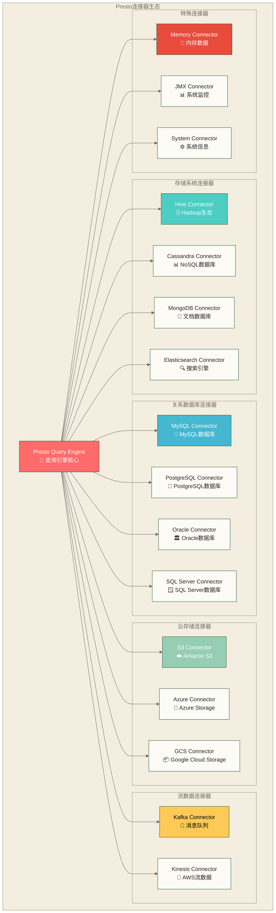

# Presto连接器详解 - 多数据源统一查询的核心技术

> [!abstract] 📋 本节概览
> - 🎯 学习目标：深入理解Presto连接器架构，掌握主流连接器的配置和使用
> - 📚 前置知识：06-数据类型与函数|数据类型与函数 和 数据库基础概念
> - ⏱️ 预计用时：100分钟

## 🔌 连接器架构概述

### 📊 连接器生态全景



### 🏗️ 连接器架构设计

```mermaid
%%{init: {"theme":"base","themeVariables":{"fontFamily":"PingFang SC, -apple-system, Source Han Serif SC, serif","fontSize":"16px","background":"#FDFBF5","primaryColor":"#FDFBF5","primaryTextColor":"#2D2A26","primaryBorderColor":"#6E6A60","secondaryColor":"#E8EFE8","secondaryBorderColor":"#8FA890","secondaryTextColor":"#2D2A26","tertiaryColor":"#FDFBF5","tertiaryBorderColor":"#9A9488","tertiaryTextColor":"#6E6A60","lineColor":"#6E6A60","textColor":"#2D2A26","mainBkg":"#FDFBF5","nodeBorder":"#2D5A3D","clusterBkg":"#F3EEDF","clusterBorder":"#9A9488","edgeLabelBackground":"#FDFBF5"},"flowchart":{"htmlLabels":true,"curve":"basis","padding":20,"nodeSpacing":60,"rankSpacing":70,"useMaxWidth":false},"themeCSS":".node rect, .node polygon, .node circle { stroke-width: 1.5px; } .edgePath .path { stroke-width: 1.5px; } .cluster-label .nodeLabel, .cluster-label foreignObject { color: #2D2A26 !important; } .edgeLabel, .edgeLabel foreignObject { color: #2D2A26 !important; background-color: #FDFBF5; } .edgeLabel rect { fill: #FDFBF5; }"}}%%
flowchart TB
    subgraph "连接器架构层次"
        A[Presto Engine<br/>🎯 查询引擎]
        subgraph "连接器抽象层"
            B[Connector Interface<br/>🔌 连接器接口]
            C[ConnectorFactory<br/>🏭 连接器工厂]
            D[ConnectorMetadata<br/>📊 元数据接口]
        end
        subgraph "数据访问层"
            E[SplitManager<br/>✂️ 数据分片管理]
            F[PageSourceProvider<br/>📄 数据源提供者]
            G[PageSinkProvider<br/>📤 数据输出提供者]
            H[RecordSetProvider<br/>📋 记录集提供者]
        end
        subgraph "存储适配层"
            I[Storage Driver<br/>💾 存储驱动]
            J[Protocol Handler<br/>🔗 协议处理器]
            K[Serialization<br/>📦 序列化处理]
        end
        subgraph "外部数据源"
            L[HDFS/S3<br/>📁 文件系统]
            M[Database<br/>🗄️ 关系数据库]
            N[NoSQL<br/>📊 非关系数据库]
        end
    A --> B --> C
    B --> D
    C --> E
    D --> F
    E --> G
    F --> H
    G --> I
    H --> J
    I --> K
    J --> L
    K --> M
    I --> N
    style A fill:#e3f2fd
    style B fill:#f3e5f5
    style E fill:#e8f5e8
    style I fill:#fff3e0

    end
```



## 🗄️ Hive连接器

### ⚙️ Hive连接器配置

**基础配置文件** (`etc/catalog/hive.properties`):
```properties
connector.name=hive-hadoop2
hive.metastore.uri=thrift://metastore-server:9083
hive.config.resources=/etc/hadoop/conf/core-site.xml,/etc/hadoop/conf/hdfs-site.xml

# 表操作权限
hive.allow-drop-table=true
hive.allow-rename-table=true
hive.allow-add-column=true

# 性能优化配置
hive.max-split-size=128MB
hive.max-initial-splits=200
hive.split-loader-concurrency=4

# 压缩配置
hive.compression-codec=GZIP
hive.force-local-scheduling=false
```

**高级配置选项**:
```properties
# 分区管理
hive.metastore-cache-ttl=1h
hive.metastore-refresh-interval=1m
hive.assume-canonical-partition-keys=false

# 事务支持
hive.insert-existing-partitions-behavior=APPEND
hive.target-max-file-size=1GB

# 安全配置
hive.hdfs.authentication.type=KERBEROS
hive.hdfs.impersonation.enabled=true
hive.hdfs.presto.principal=presto@REALM.COM
hive.hdfs.presto.keytab=/etc/presto/presto.keytab

# 云存储配置 (S3)
hive.s3.aws-access-key=YOUR_ACCESS_KEY
hive.s3.aws-secret-key=YOUR_SECRET_KEY
hive.s3.endpoint=s3.amazonaws.com
hive.s3.ssl.enabled=true
```

### 📊 Hive表操作示例

```sql
-- 查看Hive catalog下的schema
SHOW SCHEMAS FROM hive;

-- 查看表
SHOW TABLES FROM hive.default;

-- 查看表结构
DESCRIBE hive.default.sales_data;

-- 创建外部表
CREATE TABLE hive.default.external_sales (
    order_id BIGINT,
    customer_id BIGINT,
    product_name VARCHAR,
    quantity INTEGER,
    price DECIMAL(10,2),
    order_date DATE
)
WITH (
    external_location = 's3://my-bucket/sales-data/',
    format = 'PARQUET'
);

-- 创建分区表
CREATE TABLE hive.default.partitioned_sales (
    order_id BIGINT,
    customer_id BIGINT,
    product_name VARCHAR,
    quantity INTEGER,
    price DECIMAL(10,2),
    year BIGINT,
    month BIGINT
)
WITH (
    format = 'PARQUET',
    partitioned_by = ARRAY['year', 'month']
);

-- 插入分区数据
INSERT INTO hive.default.partitioned_sales
SELECT 
    order_id,
    customer_id,
    product_name,
    quantity,
    price,
    YEAR(order_date) as year,
    MONTH(order_date) as month
FROM hive.default.sales_data
WHERE order_date >= DATE '2024-01-01';
```

### 🔧 文件格式支持

```sql
-- 支持的文件格式
CREATE TABLE hive.default.parquet_table (...) WITH (format = 'PARQUET');
CREATE TABLE hive.default.orc_table (...) WITH (format = 'ORC');
CREATE TABLE hive.default.avro_table (...) WITH (format = 'AVRO');
CREATE TABLE hive.default.json_table (...) WITH (format = 'JSON');
CREATE TABLE hive.default.csv_table (...) WITH (format = 'CSV');

-- 压缩选项
CREATE TABLE hive.default.compressed_table (...)
WITH (
    format = 'PARQUET',
    parquet_compression = 'SNAPPY'  -- NONE, SNAPPY, GZIP, LZO
);

-- 存储属性
CREATE TABLE hive.default.optimized_table (...)
WITH (
    format = 'ORC',
    orc_bloom_filter_columns = ARRAY['customer_id', 'product_name'],
    orc_bloom_filter_fpp = 0.01
);
```

## 💾 关系数据库连接器

### 🐬 MySQL连接器

**配置文件** (`etc/catalog/mysql.properties`):
```properties
connector.name=mysql
connection-url=jdbc:mysql://mysql-server:3306
connection-user=presto_user
connection-password=secure_password

# 连接池配置
mysql.max-connections=300
mysql.connection-timeout=30s

# 查询优化
mysql.auto-reconnect=true
mysql.use-unicode=true
mysql.character-encoding=utf8mb4

# SSL配置
mysql.ssl=true
# 该示例关闭服务器证书验证，不应作为生产安全默认配置
mysql.ssl-verify-server-certificate=false
```

**MySQL查询示例**:
```sql
-- 查看MySQL数据库
SHOW SCHEMAS FROM mysql;

-- 跨数据源JOIN查询
SELECT 
    h.customer_id,
    h.order_amount,
    m.customer_name,
    m.customer_email,
    m.registration_date
FROM hive.sales.orders h
JOIN mysql.crm.customers m ON h.customer_id = m.customer_id
WHERE h.order_date >= DATE '2024-01-01'
  AND m.customer_status = 'ACTIVE'
ORDER BY h.order_amount DESC
LIMIT 100;

-- 数据类型映射示例
SELECT 
    -- MySQL数据类型映射到Presto类型
    customer_id,                    -- INT -> INTEGER
    customer_name,                  -- VARCHAR -> VARCHAR
    registration_date,              -- DATE -> DATE
    last_login_timestamp,           -- TIMESTAMP -> TIMESTAMP
    account_balance,                -- DECIMAL(10,2) -> DECIMAL(10,2)
    is_premium,                     -- BOOLEAN -> BOOLEAN
    preferences                     -- JSON -> VARCHAR (需要JSON函数解析)
FROM mysql.crm.customers;
```

### 🐘 PostgreSQL连接器

**配置文件** (`etc/catalog/postgresql.properties`):
```properties
connector.name=postgresql
connection-url=jdbc:postgresql://postgres-server:5432/database_name
connection-user=presto_user
connection-password=secure_password

# PostgreSQL特定配置
postgresql.include-system-tables=false
postgresql.array-mapping=ARRAY
postgresql.experimental.array-mapping=true

# 数组和JSON支持
postgresql.experimental.json-type=true
postgresql.experimental.timestamp-precision=MICROSECONDS
```

**PostgreSQL高级特性**:
```sql
-- PostgreSQL数组支持
SELECT 
    customer_id,
    customer_tags,                  -- PostgreSQL数组映射到Presto ARRAY
    CARDINALITY(customer_tags) AS tag_count,
    ARRAY_POSITION(customer_tags, 'VIP') AS vip_position
FROM postgresql.analytics.customer_profiles;

-- JSON数据处理
SELECT 
    customer_id,
    profile_data,                   -- PostgreSQL JSON/JSONB
    JSON_EXTRACT_SCALAR(profile_data, '$.preferences.language') AS preferred_language,
    JSON_EXTRACT(profile_data, '$.purchase_history') AS purchase_history
FROM postgresql.analytics.customer_profiles;

-- 时间序列数据查询
SELECT 
    DATE_TRUNC('hour', event_timestamp) AS hour_bucket,
    event_type,
    COUNT(*) AS event_count,
    AVG(event_value) AS avg_value
FROM postgresql.events.time_series_data
WHERE event_timestamp >= TIMESTAMP '2024-01-01 00:00:00'
GROUP BY DATE_TRUNC('hour', event_timestamp), event_type
ORDER BY hour_bucket, event_type;
```

## ☁️ 云存储连接器

### 📦 S3连接器

**配置文件** (`etc/catalog/s3.properties`):
```properties
connector.name=hive-hadoop2
hive.metastore.uri=thrift://metastore-server:9083

# S3配置
hive.s3.aws-access-key=YOUR_ACCESS_KEY
hive.s3.aws-secret-key=YOUR_SECRET_KEY
hive.s3.region=us-east-1
hive.s3.endpoint=s3.amazonaws.com
hive.s3.ssl.enabled=true

# S3性能优化
hive.s3.max-connections=50
hive.s3.multipart.min-file-size=16MB
hive.s3.multipart.min-part-size=5MB

# 路径样式配置
hive.s3.path-style-access=false
hive.s3.use-instance-credentials=true
```

**S3数据查询示例**:
```sql
-- 创建指向S3的外部表
CREATE TABLE s3.analytics.web_logs (
    timestamp TIMESTAMP,
    ip_address VARCHAR,
    user_agent VARCHAR,
    request_path VARCHAR,
    response_code INTEGER,
    response_size BIGINT,
    year INTEGER,
    month INTEGER,
    day INTEGER
)
WITH (
    external_location = 's3://my-data-lake/web-logs/',
    format = 'PARQUET',
    partitioned_by = ARRAY['year', 'month', 'day']
);

-- 高效的分区查询
SELECT 
    HOUR(timestamp) AS hour,
    COUNT(*) AS request_count,
    COUNT(DISTINCT ip_address) AS unique_visitors,
    AVG(response_size) AS avg_response_size
FROM s3.analytics.web_logs
WHERE year = 2024 
  AND month = 3 
  AND day = 15
  AND response_code = 200
GROUP BY HOUR(timestamp)
ORDER BY hour;

-- 跨多个S3存储桶的联合查询
SELECT 
    l.request_path,
    COUNT(*) AS hit_count,
    AVG(u.session_duration) AS avg_session_duration
FROM s3.logs.access_logs l
JOIN s3.user_data.sessions u ON l.session_id = u.session_id
WHERE l.partition_date >= DATE '2024-03-01'
  AND u.partition_date >= DATE '2024-03-01'
GROUP BY l.request_path
HAVING COUNT(*) > 1000
ORDER BY hit_count DESC;
```

## 🍃 MongoDB连接器

### 📄 MongoDB连接器配置

**配置文件** (`etc/catalog/mongodb.properties`):
```properties
connector.name=mongodb
mongodb.connection-url=mongodb://mongo-server:27017
mongodb.credentials=username:password@database

# 连接配置
mongodb.max-connections-per-host=100
mongodb.min-connections-per-host=0
mongodb.connection-timeout=10s
mongodb.socket-timeout=0s

# 读取配置
mongodb.read-preference=PRIMARY
mongodb.required-replica-set-name=replica-set-name

# 类型映射
mongodb.object-id-timestamp-seconds-precision=true
```

**MongoDB查询示例**:
```sql
-- 查看MongoDB集合
SHOW TABLES FROM mongodb.ecommerce;

-- 文档查询 (MongoDB文档映射为行)
SELECT 
    _id,
    customer_id,
    order_items,
    total_amount,
    order_status,
    created_at
FROM mongodb.ecommerce.orders
WHERE order_status = 'completed'
  AND created_at >= TIMESTAMP '2024-01-01 00:00:00'
LIMIT 100;

-- 嵌套文档和数组处理
SELECT 
    _id,
    customer_id,
    shipping_address.city,
    shipping_address.country,
    CARDINALITY(order_items) AS item_count,
    order_items[1].product_name AS first_item
FROM mongodb.ecommerce.orders
WHERE shipping_address.country = 'US';

-- 聚合管道风格的查询
SELECT 
    customer_id,
    COUNT(*) AS order_count,
    SUM(total_amount) AS total_spent,
    AVG(total_amount) AS avg_order_value,
    MAX(created_at) AS last_order_date
FROM mongodb.ecommerce.orders
WHERE order_status = 'completed'
GROUP BY customer_id
HAVING COUNT(*) >= 5
ORDER BY total_spent DESC;
```

## 🔍 Elasticsearch连接器

### 🔎 Elasticsearch连接器配置

**配置文件** (`etc/catalog/elasticsearch.properties`):
```properties
connector.name=elasticsearch
elasticsearch.host=elasticsearch-cluster
elasticsearch.port=9200
elasticsearch.default-schema=logs

# 集群配置
elasticsearch.cluster-name=my-cluster
elasticsearch.ignore-unavailable=false
elasticsearch.scroll-timeout=20s
elasticsearch.scroll-size=1000

# 认证配置
elasticsearch.security=PASSWORD
elasticsearch.auth.user=elastic_user
elasticsearch.auth.password=secure_password

# TLS配置
elasticsearch.tls.enabled=true
# 该示例关闭主机名验证，不应作为生产安全默认配置
elasticsearch.tls.verify-hostnames=false
```

**Elasticsearch查询示例**:
```sql
-- 日志分析查询
SELECT 
    timestamp,
    level,
    logger,
    message,
    host
FROM elasticsearch.logs.application_logs
WHERE timestamp >= TIMESTAMP '2024-03-15 00:00:00'
  AND level IN ('ERROR', 'WARN')
ORDER BY timestamp DESC
LIMIT 1000;

-- 全文搜索和聚合
SELECT 
    DATE_TRUNC('hour', timestamp) AS hour_bucket,
    level,
    COUNT(*) AS log_count
FROM elasticsearch.logs.application_logs
WHERE match(message, 'database connection')
  AND timestamp >= TIMESTAMP '2024-03-15 00:00:00'
GROUP BY DATE_TRUNC('hour', timestamp), level
ORDER BY hour_bucket, level;

-- 多索引查询
SELECT 
    'application' AS log_type,
    timestamp,
    level,
    message
FROM elasticsearch.logs.application_logs
WHERE level = 'ERROR'

UNION ALL

SELECT 
    'access' AS log_type,
    timestamp,
    'INFO' AS level,
    CONCAT(method, ' ', url, ' ', CAST(status_code AS VARCHAR)) AS message
FROM elasticsearch.logs.access_logs
WHERE status_code >= 400

ORDER BY timestamp DESC;
```

## 🚰 Kafka连接器

### 📨 Kafka连接器配置

**配置文件** (`etc/catalog/kafka.properties`):
```properties
connector.name=kafka
kafka.table-names=orders,customers,products
kafka.nodes=kafka-broker1:9092,kafka-broker2:9092,kafka-broker3:9092

# 安全配置
kafka.security-protocol=SASL_SSL
kafka.sasl-mechanism=PLAIN
kafka.sasl-username=kafka_user
kafka.sasl-password=secure_password

# 消费者配置
kafka.buffer-size=64KB
kafka.consumer-timeout=1s

# Schema Registry (如果使用Avro)
kafka.confluent-schema-registry-url=http://schema-registry:8081
```

**表定义文件** (`etc/kafka/orders.json`):
```json
{
  "tableName": "orders",
  "topicName": "order_events",
  "key": {
    "dataFormat": "json",
    "fields": [
      {
        "name": "order_id",
        "type": "BIGINT"
      }
    ]
  },
  "message": {
    "dataFormat": "json",
    "fields": [
      {
        "name": "order_id",
        "type": "BIGINT"
      },
      {
        "name": "customer_id",
        "type": "BIGINT"
      },
      {
        "name": "product_name",
        "type": "VARCHAR"
      },
      {
        "name": "quantity",
        "type": "INTEGER"
      },
      {
        "name": "price",
        "type": "DECIMAL(10,2)"
      },
      {
        "name": "event_time",
        "type": "TIMESTAMP"
      }
    ]
  }
}
```

**Kafka流数据查询**:
```sql
-- 实时订单流分析
SELECT 
    DATE_TRUNC('minute', event_time) AS minute_bucket,
    COUNT(*) AS order_count,
    SUM(quantity * price) AS total_revenue,
    COUNT(DISTINCT customer_id) AS unique_customers
FROM kafka.default.orders
WHERE event_time >= CURRENT_TIMESTAMP - INTERVAL '1' HOUR
GROUP BY DATE_TRUNC('minute', event_time)
ORDER BY minute_bucket DESC;

-- 流数据与历史数据结合分析
SELECT 
    k.customer_id,
    k.event_time,
    k.quantity * k.price AS order_value,
    h.total_historical_orders,
    h.avg_order_value
FROM kafka.default.orders k
JOIN (
    SELECT 
        customer_id,
        COUNT(*) AS total_historical_orders,
        AVG(quantity * price) AS avg_order_value
    FROM hive.analytics.order_history
    GROUP BY customer_id
) h ON k.customer_id = h.customer_id
WHERE k.event_time >= CURRENT_TIMESTAMP - INTERVAL '10' MINUTE;
```

## 🔧 自定义连接器开发

### 🏗️ 连接器开发框架

**连接器工厂实现**:
```java
public class CustomConnectorFactory implements ConnectorFactory {
    private static final String CONNECTOR_NAME = "custom";
    
    @Override
    public String getName() {
        return CONNECTOR_NAME;
    }
    
    @Override  
    public ConnectorHandleResolver getHandleResolver() {
        return new CustomHandleResolver();
    }
    
    @Override
    public Connector create(String catalogName, Map<String, String> config, ConnectorContext context) {
        return new CustomConnector(catalogName, config);
    }
}
```

**元数据管理实现**:
```java
public class CustomMetadata implements ConnectorMetadata {
    
    @Override
    public List<String> listSchemaNames(ConnectorSession session) {
        // 返回schema列表
        return Arrays.asList("default", "analytics");
    }
    
    @Override
    public List<SchemaTableName> listTables(ConnectorSession session, String schemaName) {
        // 返回表列表
        return getTablesFromDataSource(schemaName);
    }
    
    @Override
    public ConnectorTableMetadata getTableMetadata(ConnectorSession session, ConnectorTableHandle table) {
        // 返回表元数据
        return buildTableMetadata(table);
    }
}
```

### 📊 数据访问实现

**分片管理器**:
```java
public class CustomSplitManager implements ConnectorSplitManager {
    
    @Override
    public ConnectorSplitSource getSplits(
            ConnectorTransactionHandle transaction,
            ConnectorSession session,
            ConnectorTableHandle table,
            SplitSchedulingStrategy splitSchedulingStrategy) {
        
        List<ConnectorSplit> splits = createSplits(table);
        return new FixedSplitSource(splits);
    }
    
    private List<ConnectorSplit> createSplits(ConnectorTableHandle table) {
        // 根据数据源特性创建分片
        return splitDataIntoChunks(table);
    }
}
```

**数据读取提供者**:
```java
public class CustomPageSourceProvider implements ConnectorPageSourceProvider {
    
    @Override
    public ConnectorPageSource createPageSource(
            ConnectorTransactionHandle transaction,
            ConnectorSession session,
            ConnectorSplit split,
            ConnectorTableHandle table,
            List<ColumnHandle> columns) {
            
        return new CustomPageSource(split, table, columns);
    }
}
```

## 🎯 连接器最佳实践

### ⚡ 性能优化策略

**1. 智能分片策略**:
```sql
-- 配置合适的分片大小
hive.max-split-size=256MB  -- 根据集群资源调整
hive.max-initial-splits=1000

-- 利用分区pruning
SELECT * FROM hive.sales.orders 
WHERE partition_date BETWEEN DATE '2024-03-01' AND DATE '2024-03-31'
  AND partition_hour BETWEEN 9 AND 17;
```

**2. 谓词下推优化**:
```sql
-- 下推候选查询：条件是否下推取决于连接器、版本及表达式支持，应结合执行计划判断
SELECT customer_id, order_amount
FROM mysql.crm.customers
WHERE registration_date >= DATE '2024-01-01'
  AND customer_status = 'ACTIVE';

-- 函数表达式查询：计算是否发生在Presto层取决于连接器的下推支持，应结合执行计划判断
SELECT customer_id, order_amount
FROM mysql.crm.customers
WHERE UPPER(customer_status) = 'ACTIVE';  -- 函数表达式可能限制下推，具体取决于连接器支持
```

**3. 投影下推**:
```sql
-- 只选择需要的列，减少数据传输
SELECT customer_id, customer_name  -- 而不是 SELECT *
FROM mysql.crm.customers
WHERE customer_status = 'ACTIVE';
```

### 🔒 安全配置

**1. 认证配置**:
```properties
# Kerberos认证
hive.hdfs.authentication.type=KERBEROS
hive.hdfs.presto.principal=presto/_HOST@REALM.COM
hive.hdfs.presto.keytab=/etc/presto/presto.keytab

# LDAP认证
mysql.credential-name=mysql-credentials
mysql.use-credential-cache=true
```

**2. 网络安全**:
```properties
# SSL/TLS配置
mysql.ssl=true
postgresql.ssl=true
elasticsearch.tls.enabled=true

# 连接超时配置
mysql.connection-timeout=30s
postgresql.login-timeout=30s
```

### 📊 监控和调试

**1. 连接器状态监控**:
```sql
-- 查看连接器状态
SELECT 
    catalog_name,
    connector_name,
    node_id
FROM system.runtime.nodes
CROSS JOIN system.metadata.catalogs;

-- 监控查询性能
SELECT 
    query_id,
    state,
    elapsed,
    query
FROM system.runtime.queries
WHERE query LIKE '%mysql.%'
ORDER BY created DESC;
```

**2. 错误诊断**:
```bash
# 查看连接器日志
tail -f /opt/presto/data/var/log/server.log | grep -i "connector\|mysql\|hive"

# 检查连接器配置
cat /opt/presto/server/etc/catalog/*.properties

# 测试连接器连接
presto-cli --server localhost:8080 --execute "SHOW TABLES FROM mysql.information_schema"
```

## ✅ 实践练习

### 🎯 多数据源联合查询案例

```sql
-- 复杂的多数据源分析场景
WITH customer_orders AS (
    -- Hive中的历史订单数据
    SELECT 
        customer_id,
        COUNT(*) AS historical_orders,
        SUM(order_amount) AS historical_revenue,
        MAX(order_date) AS last_historical_order
    FROM hive.analytics.order_history
    WHERE order_date >= DATE '2023-01-01'
    GROUP BY customer_id
),
customer_profile AS (
    -- MySQL中的客户档案
    SELECT 
        customer_id,
        customer_name,
        customer_email,
        registration_date,
        customer_segment,
        preferred_category
    FROM mysql.crm.customers
    WHERE customer_status = 'ACTIVE'
),
recent_activity AS (
    -- Kafka中的实时活动
    SELECT 
        customer_id,
        COUNT(*) AS recent_activities,
        MAX(event_time) AS last_activity
    FROM kafka.default.customer_events
    WHERE event_time >= CURRENT_TIMESTAMP - INTERVAL '7' DAY
    GROUP BY customer_id
),
search_behavior AS (
    -- Elasticsearch中的搜索行为
    SELECT 
        customer_id,
        COUNT(*) AS search_count,
        ARRAY_AGG(DISTINCT search_term) AS search_terms
    FROM elasticsearch.analytics.search_logs
    WHERE timestamp >= TIMESTAMP '2024-03-01 00:00:00'
    GROUP BY customer_id
)
-- 综合分析查询
SELECT 
    cp.customer_name,
    cp.customer_email,
    cp.customer_segment,
    cp.registration_date,
    COALESCE(co.historical_orders, 0) AS historical_orders,
    COALESCE(co.historical_revenue, 0) AS historical_revenue,
    COALESCE(ra.recent_activities, 0) AS recent_activities,
    ra.last_activity,
    COALESCE(sb.search_count, 0) AS search_count,
    sb.search_terms,
    CASE 
        WHEN ra.recent_activities > 10 AND co.historical_revenue > 1000 THEN 'High Value Active'
        WHEN ra.recent_activities > 5 THEN 'Active'
        WHEN co.historical_orders > 0 THEN 'Dormant'
        ELSE 'New'
    END AS customer_status
FROM customer_profile cp
LEFT JOIN customer_orders co ON cp.customer_id = co.customer_id
LEFT JOIN recent_activity ra ON cp.customer_id = ra.customer_id  
LEFT JOIN search_behavior sb ON cp.customer_id = sb.customer_id
WHERE cp.registration_date >= DATE '2023-01-01'
ORDER BY 
    COALESCE(co.historical_revenue, 0) + COALESCE(ra.recent_activities, 0) DESC
LIMIT 1000;
```

## 🔗 学习连接

### 📚 本节核心技能

- **连接器架构**：理解Presto连接器的设计原理和工作机制
- **主流连接器**：掌握Hive、MySQL、PostgreSQL、S3等连接器配置
- **特殊连接器**：MongoDB、Elasticsearch、Kafka等非关系型数据源
- **性能优化**：分片策略、谓词下推、投影下推等优化技巧
- **安全配置**：认证、加密、网络安全的最佳实践

### 🎯 下一步学习

**连接器掌握检查**：
- ✅ 能够配置和使用主流数据源连接器？
- ✅ 理解联邦查询的性能优化策略？
- ✅ 掌握多数据源安全配置方法？

**继续学习路径**：
- [[【技术与工具】/Presto/08-表操作与DDL|表操作与DDL]] - 表结构管理
- [[【技术与工具】/Presto/09-查询优化基础|查询优化]] - 查询优化
- [[【技术与工具】/Presto/10-JOIN优化与子查询|JOIN优化与子查询]] - 高级连接

---

> [!tip] 💡 连接器精通要点
> 
> 🔌 **连接器核心价值**：
> - 🌐 **统一接口** - 一套SQL访问所有数据源
> - ⚡ **智能优化** - 谓词下推、投影下推提升性能  
> - 🔒 **企业安全** - 完整的认证和加密支持
> - 📊 **实时联邦** - 历史数据与实时数据无缝结合
> 
> 🚀 **数据操作**：连接器配置完成后，进入 08-表操作与DDL|表操作与DDL 学习数据定义和管理操作！