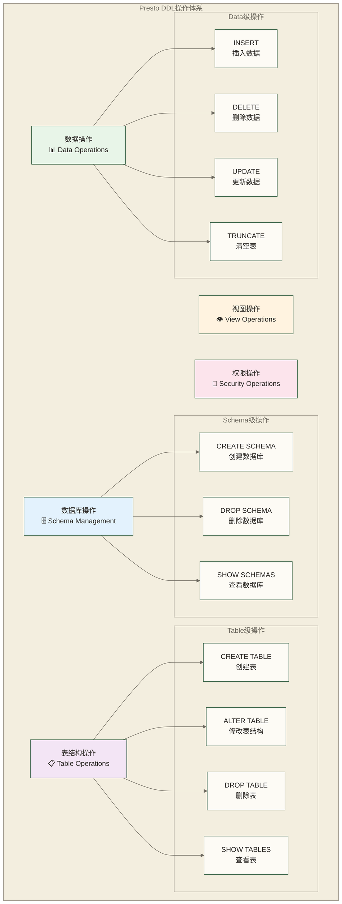

# Presto表操作与DDL - 数据定义语言完全指南

> [!abstract] 📋 本节概览
> - 🎯 学习目标：全面掌握Presto中的数据定义语言(DDL)和表管理操作
> - 📚 前置知识：07-连接器详解|连接器详解 和 数据库DDL基础概念
> - ⏱️ 预计用时：90分钟

## 🏗️ DDL操作概述

### 📊 Presto DDL能力矩阵



### 🔄 连接器DDL支持对比

| 连接器类型 | CREATE TABLE | ALTER TABLE | INSERT | DELETE | UPDATE | 备注 |
|-----------|--------------|-------------|--------|--------|--------|------|
| **Memory** | ✅ | ✅ | ✅ | ✅ | ❌ | 内存临时表 |
| **Hive** | ✅ | 部分 | ✅ | 部分 | ❌ | 依赖Hive MetaStore |
| **MySQL** | ❌ | ❌ | ✅ | ✅ | ✅ | 只能操作现有表 |
| **PostgreSQL** | ❌ | ❌ | ✅ | ✅ | ✅ | 只能操作现有表 |
| **MongoDB** | ❌ | ❌ | ✅ | ✅ | ❌ | 文档数据库 |
| **Elasticsearch** | ❌ | ❌ | ❌ | ❌ | ❌ | 只读连接器 |
| **Kafka** | ❌ | ❌ | ❌ | ❌ | ❌ | 流数据只读 |

## 🗄️ Schema操作

### 📊 Schema管理

```sql
-- 查看所有catalog
SHOW CATALOGS;

-- 查看指定catalog下的schema
SHOW SCHEMAS FROM hive;
SHOW SCHEMAS FROM memory;

-- 创建schema (需要连接器支持)
CREATE SCHEMA hive.analytics
WITH (location = 's3://my-bucket/analytics/');

CREATE SCHEMA memory.test_data;

-- 删除schema (谨慎操作)
DROP SCHEMA hive.temp_analysis;
DROP SCHEMA memory.test_data CASCADE;  -- CASCADE删除所有表

-- 查看schema详细信息
DESCRIBE SCHEMA hive.analytics;
```

### 🔍 Schema属性配置

```sql
-- 创建带属性的schema
CREATE SCHEMA hive.data_lake
WITH (
    location = 's3://data-lake/warehouse/',
    owner = 'data_team'
);

-- 创建带注释的schema
CREATE SCHEMA memory.experiments
COMMENT '实验性数据存储区域';

-- 查看schema属性
SELECT 
    catalog_name,
    schema_name,
    schema_owner,
    comment
FROM information_schema.schemata
WHERE catalog_name = 'hive';
```

## 📋 表创建操作

### 🏗️ 基础表创建

```sql
-- 内存表创建 (临时测试用)
CREATE TABLE memory.default.employees (
    employee_id BIGINT,
    first_name VARCHAR(50),
    last_name VARCHAR(50),
    email VARCHAR(100),
    department VARCHAR(30),
    salary DECIMAL(10,2),
    hire_date DATE,
    is_active BOOLEAN
);

-- 从查询结果创建表 (CTAS)
CREATE TABLE memory.default.high_earners AS
SELECT 
    employee_id,
    first_name,
    last_name,
    department,
    salary
FROM memory.default.employees
WHERE salary > 80000;

-- 创建空表但复制结构
CREATE TABLE memory.default.employees_backup AS
SELECT * FROM memory.default.employees
WHERE FALSE;  -- 条件永远不满足，只复制结构
```

### 🗄️ Hive表创建

```sql
-- 创建Hive内部表
CREATE TABLE hive.analytics.customer_orders (
    order_id BIGINT,
    customer_id BIGINT,
    product_name VARCHAR,
    quantity INTEGER,
    unit_price DECIMAL(10,2),
    order_date DATE,
    order_timestamp TIMESTAMP,
    year INTEGER,
    month INTEGER
)
WITH (
    format = 'PARQUET',
    partitioned_by = ARRAY['year', 'month']
);

-- 创建外部表
CREATE TABLE hive.analytics.web_logs (
    timestamp TIMESTAMP,
    ip_address VARCHAR,
    user_agent VARCHAR,
    request_path VARCHAR,
    response_code INTEGER,
    response_size BIGINT,
    year INTEGER,
    month INTEGER,
    day INTEGER
)
WITH (
    external_location = 's3://logs-bucket/web-logs/',
    format = 'JSON',
    partitioned_by = ARRAY['year', 'month', 'day']
);

-- 创建带压缩的表
CREATE TABLE hive.analytics.compressed_sales (
    sale_id BIGINT,
    product_id BIGINT,
    customer_id BIGINT,
    sale_amount DECIMAL(12,2),
    sale_date DATE
)
WITH (
    format = 'PARQUET',
    parquet_compression = 'SNAPPY',
    partitioned_by = ARRAY['sale_date']
);
```

### 📊 表属性详解

```sql
-- ORC格式表
CREATE TABLE hive.analytics.orc_table (
    id BIGINT,
    name VARCHAR,
    data VARCHAR
)
WITH (
    format = 'ORC',
    orc_bloom_filter_columns = ARRAY['id', 'name'],
    orc_bloom_filter_fpp = 0.01,
    orc_compression = 'ZLIB'
);

-- Avro格式表
CREATE TABLE hive.analytics.avro_table (
    id BIGINT,
    record_data VARCHAR
)
WITH (
    format = 'AVRO',
    avro_schema_url = 's3://schemas/record_schema.avsc'
);

-- 分桶表
CREATE TABLE hive.analytics.bucketed_table (
    customer_id BIGINT,
    transaction_id BIGINT,
    amount DECIMAL(10,2)
)
WITH (
    format = 'PARQUET',
    bucketed_by = ARRAY['customer_id'],
    bucket_count = 50
);
```

## 🔧 表结构修改

### 📝 ALTER TABLE操作

```sql
-- 添加列 (Hive连接器支持)
ALTER TABLE hive.analytics.customer_orders 
ADD COLUMN discount_amount DECIMAL(8,2);

ALTER TABLE hive.analytics.customer_orders
ADD COLUMN tax_amount DECIMAL(8,2);

ALTER TABLE hive.analytics.customer_orders
ADD COLUMN shipping_cost DECIMAL(8,2);

-- 重命名表
ALTER TABLE hive.analytics.customer_orders 
RENAME TO hive.analytics.orders_history;

-- 修改表属性
ALTER TABLE hive.analytics.orders_history 
SET TBLPROPERTIES('classification' = 'sensitive');

-- 添加分区
ALTER TABLE hive.analytics.partitioned_sales 
ADD PARTITION (year = 2024, month = 3)
LOCATION 's3://data-bucket/sales/year=2024/month=3/';

-- 删除分区
ALTER TABLE hive.analytics.partitioned_sales 
DROP PARTITION (year = 2023, month = 1);
```

### 🔄 列操作详解

```sql
-- Memory连接器的列操作
ALTER TABLE memory.default.employees 
ADD COLUMN middle_name VARCHAR(50);

ALTER TABLE memory.default.employees 
ADD COLUMN phone_number VARCHAR(20);

-- DROP COLUMN是否可用取决于所用Presto实现及连接器支持
-- 不支持删除列时，可按需重建表并迁移数据

-- 列重命名 (部分连接器支持)
ALTER TABLE memory.default.employees 
RENAME COLUMN phone_number TO contact_number;
```

## 📊 数据操作 (DML)

### ➕ INSERT操作

```sql
-- 基础插入
INSERT INTO memory.default.employees (employee_id, first_name, last_name, email, department, salary, hire_date, is_active) VALUES
(1, 'John', 'Doe', 'john.doe@company.com', 'Engineering', 75000.00, DATE '2023-01-15', true),
(2, 'Jane', 'Smith', 'jane.smith@company.com', 'Marketing', 65000.00, DATE '2023-02-20', true),
(3, 'Bob', 'Johnson', 'bob.j@company.com', 'Sales', 70000.00, DATE '2023-03-10', true);

-- 指定列插入
INSERT INTO memory.default.employees (employee_id, first_name, last_name, department, salary, hire_date, is_active)
VALUES (4, 'Alice', 'Brown', 'Engineering', 80000.00, DATE '2023-04-05', true);

-- 从查询结果插入
INSERT INTO memory.default.high_earners
SELECT 
    employee_id,
    first_name,
    last_name,
    department,
    salary
FROM memory.default.employees
WHERE salary >= 75000;

-- Hive分区表插入
INSERT INTO hive.analytics.partitioned_sales
SELECT 
    sale_id,
    product_id,
    customer_id,
    sale_amount,
    YEAR(sale_date) as year,
    MONTH(sale_date) as month
FROM hive.raw.sales_data
WHERE sale_date >= DATE '2024-03-01';
```

### 🔄 分区表操作

```sql
-- 动态分区插入
SET SESSION hive.insert-existing-partitions-behavior = 'APPEND';

INSERT INTO hive.analytics.daily_metrics
SELECT 
    metric_name,
    metric_value,
    measurement_time,
    YEAR(measurement_time) as year,
    MONTH(measurement_time) as month,
    DAY(measurement_time) as day
FROM hive.raw.metrics_stream
WHERE measurement_time >= TIMESTAMP '2024-03-01 00:00:00';

-- 静态分区插入
INSERT INTO hive.analytics.daily_metrics 
PARTITION (year = 2024, month = 3, day = 15)
SELECT 
    metric_name,
    metric_value,
    measurement_time
FROM hive.raw.metrics_stream
WHERE DATE(measurement_time) = DATE '2024-03-15';

-- 覆盖分区数据
INSERT OVERWRITE hive.analytics.daily_metrics 
PARTITION (year = 2024, month = 3)
SELECT 
    metric_name,
    metric_value,
    measurement_time,
    DAY(measurement_time) as day
FROM hive.raw.metrics_stream
WHERE YEAR(measurement_time) = 2024 
  AND MONTH(measurement_time) = 3;
```

### ❌ DELETE操作

```sql
-- Memory连接器支持DELETE
DELETE FROM memory.default.employees
WHERE is_active = false;

DELETE FROM memory.default.employees
WHERE hire_date < DATE '2020-01-01';

-- MySQL连接器DELETE
DELETE FROM mysql.crm.customers
WHERE last_login_date < DATE '2022-01-01'
  AND customer_status = 'INACTIVE';

-- 条件删除
DELETE FROM mysql.orders.order_items
WHERE order_id IN (
    SELECT order_id 
    FROM mysql.orders.orders 
    WHERE order_status = 'CANCELLED'
);
```

### 🔄 UPDATE操作

```sql
-- MySQL连接器UPDATE操作
UPDATE mysql.crm.customers 
SET customer_status = 'VIP'
WHERE total_spent > 10000;

UPDATE mysql.crm.customers 
SET 
    last_updated = CURRENT_TIMESTAMP,
    customer_tier = CASE 
        WHEN total_spent > 50000 THEN 'PLATINUM'
        WHEN total_spent > 20000 THEN 'GOLD'
        WHEN total_spent > 5000 THEN 'SILVER'
        ELSE 'BRONZE'
    END
WHERE customer_status = 'ACTIVE';

-- PostgreSQL连接器UPDATE
UPDATE postgresql.analytics.user_profiles 
SET profile_completeness = (
    CASE WHEN email IS NOT NULL THEN 1 ELSE 0 END +
    CASE WHEN phone IS NOT NULL THEN 1 ELSE 0 END +
    CASE WHEN address IS NOT NULL THEN 1 ELSE 0 END +
    CASE WHEN birth_date IS NOT NULL THEN 1 ELSE 0 END
) * 25.0
WHERE profile_completeness IS NULL;
```

## 👁️ 视图操作

### 🔍 视图创建和管理

```sql
-- 创建视图
CREATE VIEW memory.default.active_employees AS
SELECT 
    employee_id,
    CONCAT(first_name, ' ', last_name) AS full_name,
    email,
    department,
    salary,
    hire_date
FROM memory.default.employees
WHERE is_active = true;

-- 创建复杂分析视图
CREATE VIEW hive.analytics.customer_summary AS
SELECT 
    c.customer_id,
    c.customer_name,
    c.registration_date,
    COUNT(o.order_id) AS total_orders,
    SUM(o.order_amount) AS total_spent,
    AVG(o.order_amount) AS avg_order_value,
    MAX(o.order_date) AS last_order_date,
    CASE 
        WHEN SUM(o.order_amount) > 10000 THEN 'High Value'
        WHEN SUM(o.order_amount) > 1000 THEN 'Medium Value'
        ELSE 'Low Value'
    END AS customer_segment
FROM hive.crm.customers c
LEFT JOIN hive.sales.orders o ON c.customer_id = o.customer_id
WHERE c.customer_status = 'ACTIVE'
GROUP BY c.customer_id, c.customer_name, c.registration_date;

-- 创建联邦查询视图
CREATE VIEW analytics.cross_platform_metrics AS
SELECT 
    'hive' AS source,
    COUNT(*) AS record_count,
    SUM(amount) AS total_amount
FROM hive.sales.transactions
WHERE transaction_date >= DATE '2024-01-01'

UNION ALL

SELECT 
    'mysql' AS source,
    COUNT(*) AS record_count,
    SUM(amount) AS total_amount
FROM mysql.payments.transactions
WHERE transaction_date >= DATE '2024-01-01';
```

### 📊 视图查询和管理

```sql
-- 查看视图定义
SHOW CREATE VIEW memory.default.active_employees;

-- 查询视图
SELECT 
    department,
    COUNT(*) AS employee_count,
    AVG(salary) AS avg_salary
FROM memory.default.active_employees
GROUP BY department
ORDER BY avg_salary DESC;

-- 删除视图
DROP VIEW memory.default.active_employees;

-- 替换视图
CREATE OR REPLACE VIEW memory.default.active_employees AS
SELECT 
    employee_id,
    CONCAT(first_name, ' ', last_name) AS full_name,
    email,
    department,
    salary,
    hire_date,
    date_diff('day', hire_date, CURRENT_DATE) AS days_employed
FROM memory.default.employees
WHERE is_active = true;
```

## 🔍 元数据查询

### 📊 系统信息表

```sql
-- 查看所有表
SELECT 
    table_catalog,
    table_schema,
    table_name,
    table_type
FROM information_schema.tables
WHERE table_schema = 'default'
ORDER BY table_name;

-- 查看表结构
SELECT 
    column_name,
    data_type,
    is_nullable,
    column_default,
    ordinal_position
FROM information_schema.columns
WHERE table_schema = 'default' 
  AND table_name = 'employees'
ORDER BY ordinal_position;

-- 查看列定义与注释（不是表统计信息）
SELECT 
    table_catalog,
    table_schema,
    table_name,
    column_name,
    data_type,
    comment
FROM information_schema.columns
WHERE table_catalog = 'hive'
  AND table_schema = 'analytics'
ORDER BY table_name, ordinal_position;
```

### 🔧 表属性查询

```sql
-- 查看Hive表属性
SELECT 
    table_name,
    column_name,
    data_type,
    extra_info
FROM information_schema.columns
WHERE table_catalog = 'hive'
  AND table_schema = 'analytics'
  AND table_name = 'partitioned_sales';

-- 查看分区信息
SHOW PARTITIONS hive.analytics.partitioned_sales;

-- 查看表创建语句
SHOW CREATE TABLE hive.analytics.orders_history;

-- 查看表统计信息
SHOW STATS FOR hive.analytics.orders_history;
```

## 🎯 高级DDL技巧

### 📊 CTAS高级用法

```sql
-- 创建优化后的表结构
CREATE TABLE hive.analytics.optimized_sales
WITH (
    format = 'PARQUET',
    parquet_compression = 'SNAPPY',
    partitioned_by = ARRAY['sale_year', 'sale_month'],
    bucketed_by = ARRAY['customer_id'],
    bucket_count = 32
)
AS
SELECT 
    sale_id,
    customer_id,
    product_id,
    sale_amount,
    sale_date,
    YEAR(sale_date) AS sale_year,
    MONTH(sale_date) AS sale_month
FROM hive.raw.sales_data
WHERE sale_date >= DATE '2023-01-01';

-- 创建预聚合表
CREATE TABLE hive.analytics.daily_sales_summary
WITH (
    format = 'PARQUET',
    partitioned_by = ARRAY['summary_date']
)
AS
SELECT 
    COUNT(*) AS total_orders,
    COUNT(DISTINCT customer_id) AS unique_customers,
    SUM(sale_amount) AS total_revenue,
    AVG(sale_amount) AS avg_order_value,
    MIN(sale_amount) AS min_order_value,
    MAX(sale_amount) AS max_order_value,
    sale_date AS summary_date
FROM hive.raw.sales_data
WHERE sale_date >= DATE '2024-01-01'
GROUP BY sale_date;
```

### 🔄 数据迁移和备份

```sql
-- 数据备份
CREATE TABLE hive.backup.customer_orders_backup_20240315
AS
SELECT * FROM hive.analytics.orders_history
WHERE order_date >= DATE '2024-01-01';

-- 跨连接器数据迁移
CREATE TABLE hive.analytics.mysql_customers_archive
AS
SELECT 
    customer_id,
    customer_name,
    customer_email,
    registration_date,
    customer_status,
    CURRENT_TIMESTAMP AS migrated_at
FROM mysql.crm.customers
WHERE registration_date < DATE '2023-01-01';

-- 增量数据同步
INSERT INTO hive.analytics.customer_activity_log
SELECT 
    customer_id,
    activity_type,
    activity_timestamp,
    activity_details,
    'mysql_sync' AS data_source,
    CURRENT_TIMESTAMP AS sync_timestamp
FROM mysql.analytics.customer_activities
WHERE activity_timestamp >= (
    SELECT MAX(activity_timestamp) 
    FROM hive.analytics.customer_activity_log 
    WHERE data_source = 'mysql_sync'
);
```

## ⚠️ DDL最佳实践

### 🛡️ 安全和权限考虑

```sql
-- 创建敏感数据表时的安全考虑
CREATE TABLE hive.secure.customer_pii (
    customer_id BIGINT,
    encrypted_ssn VARCHAR,  -- 存储加密后的敏感信息
    hashed_email VARCHAR,   -- 存储哈希后的邮箱
    masked_phone VARCHAR,   -- 存储脱敏后的电话
    data_created_date DATE
)
WITH (
    format = 'PARQUET',
    parquet_compression = 'SNAPPY'
);

-- 创建访问日志表
CREATE TABLE hive.audit.table_access_log (
    access_timestamp TIMESTAMP,
    user_name VARCHAR,
    table_name VARCHAR,
    operation_type VARCHAR,
    query_id VARCHAR,
    access_date DATE
)
WITH (
    format = 'PARQUET',
    partitioned_by = ARRAY['access_date']
);
```

### 🚀 性能优化策略

```sql
-- 创建针对查询优化的表
CREATE TABLE hive.analytics.customer_metrics_optimized (
    customer_id BIGINT,
    customer_segment VARCHAR,
    total_orders INTEGER,
    total_revenue DECIMAL(12,2),
    avg_order_value DECIMAL(8,2),
    last_order_date DATE,
    customer_lifetime_value DECIMAL(12,2)
)
WITH (
    format = 'PARQUET',
    parquet_compression = 'SNAPPY',
    -- 按查询模式分桶
    bucketed_by = ARRAY['customer_segment'],
    bucket_count = 16,
    -- 按常用过滤条件排序
    sorted_by = ARRAY['total_revenue DESC', 'last_order_date DESC']
);

-- 创建时间序列优化表
CREATE TABLE hive.analytics.time_series_metrics (
    metric_timestamp TIMESTAMP,
    metric_name VARCHAR,
    metric_value DOUBLE,
    dimensions MAP(VARCHAR, VARCHAR),
    metric_date DATE,
    metric_hour INTEGER
)
WITH (
    format = 'PARQUET',
    -- 时间分区提高查询效率
    partitioned_by = ARRAY['metric_date', 'metric_hour'],
    -- Bloom filter加速点查询
    parquet_bloom_filter_columns = ARRAY['metric_name']
);
```

### 📋 命名规范

```sql
-- 推荐的表命名规范
-- 原始数据表: raw_<source>_<entity>
CREATE TABLE hive.raw.raw_mysql_customers AS ...;

-- 清洗后的表: clean_<entity>
CREATE TABLE hive.staging.clean_customers AS ...;

-- 聚合表: agg_<granularity>_<entity>
CREATE TABLE hive.analytics.agg_daily_sales AS ...;

-- 维度表: dim_<entity>
CREATE TABLE hive.warehouse.dim_customer AS ...;

-- 事实表: fact_<process>
CREATE TABLE hive.warehouse.fact_orders AS ...;

-- 临时表: temp_<purpose>_<date>
CREATE TABLE hive.temp.temp_migration_20240315 AS ...;
```

## ✅ 实践练习

### 🎯 综合DDL项目案例

```sql
-- 项目：构建电商数据仓库

-- 1. 创建原始数据层
CREATE SCHEMA hive.raw_data
COMMENT '原始数据存储层';

-- 2. 创建原始订单表
CREATE TABLE hive.raw_data.orders_raw (
    order_id VARCHAR,
    customer_id VARCHAR,
    product_id VARCHAR,
    quantity VARCHAR,
    price VARCHAR,
    order_timestamp VARCHAR,
    order_status VARCHAR,
    raw_data VARCHAR
)
WITH (
    external_location = 's3://raw-data/orders/',
    format = 'JSON'
);

-- 3. 创建清洗后的订单表
CREATE TABLE hive.staging.orders_cleaned
WITH (
    format = 'PARQUET',
    partitioned_by = ARRAY['order_date']
)
AS
SELECT 
    CAST(order_id AS BIGINT) AS order_id,
    CAST(customer_id AS BIGINT) AS customer_id,
    CAST(product_id AS BIGINT) AS product_id,
    CAST(quantity AS INTEGER) AS quantity,
    CAST(price AS DECIMAL(10,2)) AS price,
    CAST(order_timestamp AS TIMESTAMP) AS order_timestamp,
    order_status,
    DATE(CAST(order_timestamp AS TIMESTAMP)) AS order_date
FROM hive.raw_data.orders_raw
WHERE TRY_CAST(order_id AS BIGINT) IS NOT NULL
  AND TRY_CAST(customer_id AS BIGINT) IS NOT NULL
  AND TRY_CAST(product_id AS BIGINT) IS NOT NULL
  AND TRY_CAST(quantity AS INTEGER) IS NOT NULL
  AND TRY_CAST(price AS DECIMAL(10,2)) IS NOT NULL
  AND TRY_CAST(order_timestamp AS TIMESTAMP) IS NOT NULL;

-- 4. 创建聚合分析表
CREATE TABLE hive.analytics.daily_order_metrics
WITH (
    format = 'PARQUET',  
    partitioned_by = ARRAY['metric_date']
)
AS
SELECT 
    COUNT(*) AS total_orders,
    COUNT(DISTINCT customer_id) AS unique_customers,
    SUM(quantity * price) AS total_revenue,
    AVG(quantity * price) AS avg_order_value,
    COUNT(CASE WHEN order_status = 'completed' THEN 1 END) AS completed_orders,
    COUNT(CASE WHEN order_status = 'cancelled' THEN 1 END) AS cancelled_orders,
    order_date AS metric_date
FROM hive.staging.orders_cleaned
GROUP BY order_date;

-- 5. 创建客户分析视图
CREATE VIEW hive.analytics.customer_analysis AS
SELECT 
    c.customer_id,
    c.customer_name,
    c.registration_date,
    om.total_orders,
    om.total_spent,
    om.avg_order_value,
    om.last_order_date,
    date_diff('day', om.last_order_date, CURRENT_DATE) AS days_since_last_order,
    CASE 
        WHEN om.total_spent > 10000 THEN 'High Value'
        WHEN om.total_spent > 1000 THEN 'Medium Value'
        ELSE 'Low Value'
    END AS customer_segment
FROM mysql.crm.customers c
JOIN (
    SELECT 
        customer_id,
        COUNT(*) AS total_orders,
        SUM(quantity * price) AS total_spent,
        AVG(quantity * price) AS avg_order_value,
        MAX(order_date) AS last_order_date
    FROM hive.staging.orders_cleaned
    GROUP BY customer_id
) om ON c.customer_id = om.customer_id;
```

## 🔗 学习连接

### 📚 本节核心技能

- **Schema管理**：数据库的创建、删除和属性配置
- **表结构设计**：CREATE TABLE、ALTER TABLE的完整用法
- **数据操作**：INSERT、DELETE、UPDATE在不同连接器中的应用
- **视图管理**：创建和管理复杂的分析视图
- **元数据查询**：利用系统表进行元数据管理
- **最佳实践**：命名规范、安全考虑、性能优化

### 🎯 下一步学习

**DDL掌握检查**：
- ✅ 能够创建和管理不同类型的表结构？
- ✅ 理解各连接器的DDL能力差异？
- ✅ 掌握分区表和优化表的创建方法？

**继续学习路径**：
- [[【技术与工具】/Presto/09-查询优化基础|查询优化]] - 查询优化
- [[【技术与工具】/Presto/10-JOIN优化与子查询|JOIN优化与子查询]] - 复杂查询
- [[【技术与工具】/Presto/11-内存配置与调优|内存配置与调优]] - 系统调优

---

> [!tip] 💡 DDL操作精髓
> 
> 🏗️ **表设计核心原则**：
> - 📊 **连接器特性** - 根据数据源选择合适的DDL操作
> - 🎯 **分区策略** - 合理设计分区提升查询性能
> - 💾 **存储格式** - 选择最适合的文件格式和压缩方式
> - 🔒 **安全设计** - 敏感数据的加密和脱敏处理
> 
> 🚀 **性能优化**：表结构设计完成后，进入 09-查询优化基础|查询优化基础 学习查询性能调优技巧！