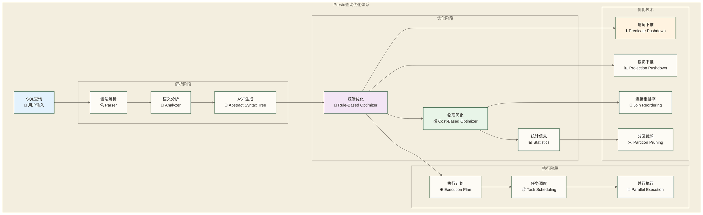

# Presto查询优化基础 - 提升分布式查询性能的核心技术

> [!abstract] 📋 本节概览
> - 🎯 学习目标：深入理解Presto查询优化原理，掌握性能调优的核心技术和最佳实践
> - 📚 前置知识：08-表操作与DDL|表操作与DDL 和 SQL查询优化基础概念
> - ⏱️ 预计用时：110分钟

## ⚡ 查询优化概述

### 📊 Presto查询优化架构



### 🎯 优化器工作原理

**1. 规则优化器 (Rule-Based Optimizer)**
- 基于预定义的优化规则
- 独立于数据统计信息
- 快速应用通用优化技术

**2. 成本优化器 (Cost-Based Optimizer)**
- 基于表统计信息和数据分布
- 评估不同执行路径的成本
- 在候选计划中选择估算成本较低的计划，不保证实际执行最优

## 📊 执行计划分析

### 🔍 EXPLAIN命令详解

```sql
-- 基础执行计划查看
EXPLAIN
SELECT 
    customer_id,
    COUNT(*) as order_count,
    SUM(order_amount) as total_amount
FROM orders
WHERE order_date >= DATE '2024-01-01'
GROUP BY customer_id
ORDER BY total_amount DESC
LIMIT 100;

-- 分布式执行计划
EXPLAIN (TYPE DISTRIBUTED)
SELECT 
    c.customer_name,
    o.order_amount
FROM customers c
JOIN orders o ON c.customer_id = o.customer_id
WHERE c.customer_status = 'ACTIVE'
  AND o.order_date >= DATE '2024-01-01';

-- 详细执行计划分析
EXPLAIN (TYPE DISTRIBUTED, FORMAT TEXT)
SELECT 
    department,
    AVG(salary) as avg_salary,
    COUNT(*) as emp_count
FROM employees
WHERE hire_date >= DATE '2023-01-01'
GROUP BY department
HAVING COUNT(*) > 5;
```

### 📈 执行计划解读

```sql
-- 创建示例表用于分析
CREATE TABLE memory.default.sales_data AS
SELECT 
    (random() * 10000 + 1)::BIGINT as customer_id,
    'Product_' || CAST(random() * 100 + 1 AS VARCHAR) as product_name,
    (random() * 1000 + 10)::DECIMAL(10,2) as amount,
    DATE '2024-01-01' + (random() * 90)::INTEGER * INTERVAL '1' DAY as sale_date
FROM (SELECT 1 FROM UNNEST(SEQUENCE(1, 100000)) t(x));

-- 分析复杂查询的执行计划
EXPLAIN (TYPE DISTRIBUTED, FORMAT TEXT)
WITH customer_metrics AS (
    SELECT 
        customer_id,
        COUNT(*) as purchase_count,
        SUM(amount) as total_spent,
        AVG(amount) as avg_order_value
    FROM memory.default.sales_data
    WHERE sale_date >= DATE '2024-02-01'
    GROUP BY customer_id
),
top_customers AS (
    SELECT 
        customer_id,
        total_spent,
        RANK() OVER (ORDER BY total_spent DESC) as spending_rank
    FROM customer_metrics
    WHERE purchase_count >= 3
)
SELECT 
    tc.customer_id,
    tc.total_spent,
    tc.spending_rank,
    sd.product_name,
    sd.amount
FROM top_customers tc
JOIN memory.default.sales_data sd ON tc.customer_id = sd.customer_id
WHERE tc.spending_rank <= 100
ORDER BY tc.spending_rank, sd.amount DESC;
```

### 🔧 执行计划优化分析

```sql
-- 使用EXPLAIN ANALYZE查看实际执行统计
EXPLAIN ANALYZE
SELECT 
    customer_id,
    product_name,
    SUM(amount) as total_amount,
    COUNT(*) as purchase_count
FROM memory.default.sales_data
WHERE sale_date BETWEEN DATE '2024-02-01' AND DATE '2024-02-29'
  AND amount > 100
GROUP BY customer_id, product_name
HAVING SUM(amount) > 1000
ORDER BY total_amount DESC
LIMIT 50;

-- 对比优化前后的执行计划
-- 优化前：函数阻止谓词下推
EXPLAIN
SELECT * FROM memory.default.sales_data
WHERE YEAR(sale_date) = 2024 AND MONTH(sale_date) = 2;

-- 优化后：使用范围条件
EXPLAIN  
SELECT * FROM memory.default.sales_data
WHERE sale_date >= DATE '2024-02-01' 
  AND sale_date < DATE '2024-03-01';
```

## 🔄 核心优化技术

### ⬇️ 谓词下推 (Predicate Pushdown)

```sql
-- 谓词下推示例
-- 好的查询：WHERE条件会下推到扫描阶段
SELECT 
    customer_id,
    product_name,
    amount
FROM hive.sales.orders
WHERE sale_date >= DATE '2024-01-01'
  AND customer_status = 'ACTIVE'
  AND amount > 100;

-- 避免的查询：函数阻止谓词下推
SELECT 
    customer_id,
    product_name,
    amount
FROM hive.sales.orders
WHERE UPPER(customer_status) = 'ACTIVE'  -- 函数阻止下推
  AND YEAR(sale_date) = 2024;             -- 函数阻止下推

-- 对比测试谓词下推效果
-- 创建分区表用于测试
CREATE TABLE hive.test.partitioned_sales (
    order_id BIGINT,
    customer_id BIGINT,
    amount DECIMAL(10,2),
    order_status VARCHAR,
    order_year INTEGER,
    order_month INTEGER
)
WITH (
    format = 'PARQUET',
    partitioned_by = ARRAY['order_year', 'order_month']
);

-- 好的分区查询：分区裁剪生效
EXPLAIN
SELECT * FROM hive.test.partitioned_sales
WHERE order_year = 2024 
  AND order_month = 3
  AND order_status = 'COMPLETED';

-- 不好的分区查询：无法进行分区裁剪
EXPLAIN
SELECT * FROM hive.test.partitioned_sales
WHERE order_year + order_month = 2027;  -- 表达式阻止分区裁剪
```

### 📊 投影下推 (Projection Pushdown)

```sql
-- 投影下推优化
-- 好的查询：只选择需要的列
SELECT 
    customer_id,
    order_amount
FROM hive.sales.large_orders
WHERE order_date >= DATE '2024-01-01';

-- 避免的查询：选择不必要的列
SELECT *  -- 传输大量不需要的数据
FROM hive.sales.large_orders
WHERE order_date >= DATE '2024-01-01';

-- 复杂查询中的投影优化
-- 优化前：子查询选择过多列
SELECT 
    customer_id,
    total_amount
FROM (
    SELECT *  -- 选择了所有列
    FROM hive.sales.orders
    WHERE order_date >= DATE '2024-01-01'
) subquery
WHERE customer_status = 'VIP';

-- 优化后：只选择需要的列
SELECT 
    customer_id,
    total_amount
FROM (
    SELECT 
        customer_id,
        total_amount,
        customer_status  -- 只选择需要的列
    FROM hive.sales.orders
    WHERE order_date >= DATE '2024-01-01'
) subquery
WHERE customer_status = 'VIP';
```

### 🔄 连接重排序 (Join Reordering)

```sql
-- 连接顺序优化示例
CREATE TABLE memory.default.customers AS
SELECT 
    (row_number() OVER ())::BIGINT as customer_id,
    'Customer_' || CAST(row_number() OVER () AS VARCHAR) as customer_name,
    CAST(random() * 5 + 1 AS INTEGER) as segment_id
FROM (SELECT 1 FROM UNNEST(SEQUENCE(1, 10000)) t(x));

CREATE TABLE memory.default.segments AS  
SELECT 
    segment_id,
    'Segment_' || CAST(segment_id AS VARCHAR) as segment_name
FROM (VALUES (1), (2), (3), (4), (5)) t(segment_id);

CREATE TABLE memory.default.orders AS
SELECT 
    (row_number() OVER ())::BIGINT as order_id,
    (random() * 10000 + 1)::BIGINT as customer_id,
    (random() * 1000 + 10)::DECIMAL(10,2) as amount
FROM (SELECT 1 FROM UNNEST(SEQUENCE(1, 50000)) t(x));

-- CBO在相关优化启用且统计信息可用时，可依据成本估算选择连接顺序；估算结果不保证实际执行最优
EXPLAIN (TYPE DISTRIBUTED)
SELECT 
    c.customer_name,
    s.segment_name,
    o.amount
FROM memory.default.customers c
JOIN memory.default.segments s ON c.segment_id = s.segment_id
JOIN memory.default.orders o ON c.customer_id = o.customer_id
WHERE s.segment_id IN (1, 2)
  AND o.amount > 500;

-- 手动优化：小表放在JOIN的右侧
SELECT 
    c.customer_name,
    s.segment_name,
    o.amount
FROM memory.default.orders o
JOIN memory.default.customers c ON o.customer_id = c.customer_id
JOIN memory.default.segments s ON c.segment_id = s.segment_id
WHERE s.segment_id IN (1, 2)
  AND o.amount > 500;
```

### ✂️ 分区裁剪 (Partition Pruning)

```sql
-- 分区裁剪优化
-- 创建按日期分区的表
CREATE TABLE hive.analytics.daily_transactions (
    transaction_id BIGINT,
    customer_id BIGINT,
    amount DECIMAL(10,2),
    transaction_time TIMESTAMP,
    transaction_date DATE
)
WITH (
    format = 'PARQUET',
    partitioned_by = ARRAY['transaction_date']
);

-- 好的分区查询：静态分区裁剪
EXPLAIN
SELECT 
    customer_id,
    SUM(amount) as total_amount
FROM hive.analytics.daily_transactions
WHERE transaction_date = DATE '2024-03-15'  -- 静态分区值
GROUP BY customer_id;

-- 好的分区查询：范围分区裁剪
EXPLAIN
SELECT 
    customer_id,
    COUNT(*) as transaction_count
FROM hive.analytics.daily_transactions
WHERE transaction_date BETWEEN DATE '2024-03-01' AND DATE '2024-03-31'
GROUP BY customer_id;

-- 避免的查询：无法进行分区裁剪
EXPLAIN
SELECT 
    customer_id,
    COUNT(*) as transaction_count
FROM hive.analytics.daily_transactions
WHERE DATE_ADD('day', 1, transaction_date) > DATE '2024-03-16'  -- 函数阻止裁剪
GROUP BY customer_id;
```

## 📊 统计信息管理

### 🔢 表统计信息

```sql
-- 查看表统计信息
SHOW STATS FOR memory.default.sales_data;

-- 查看列统计信息
SHOW STATS FOR (
    SELECT customer_id, amount 
    FROM memory.default.sales_data 
    WHERE sale_date >= DATE '2024-01-01'
);

-- 为Hive表收集统计信息
ANALYZE hive.analytics.customer_orders;

-- 为特定列收集统计信息
ANALYZE hive.analytics.customer_orders
WITH (columns = ARRAY['customer_id', 'order_amount', 'order_date']);

-- 查看统计信息对查询计划的影响
EXPLAIN (TYPE DISTRIBUTED)
SELECT 
    customer_id,
    COUNT(*) as order_count
FROM hive.analytics.customer_orders
WHERE customer_id < 1000  -- 统计信息帮助估算选择性
GROUP BY customer_id;
```

### 📈 成本估算

```sql
-- 创建用于成本分析的表
CREATE TABLE memory.default.large_customers AS
SELECT 
    customer_id,
    'Customer_' || customer_id::VARCHAR as customer_name,
    CAST(random() * 100000 AS DECIMAL(10,2)) as total_spent
FROM (
    SELECT row_number() OVER () as customer_id
    FROM UNNEST(SEQUENCE(1, 1000000)) t(x)
);

CREATE TABLE memory.default.small_products AS
SELECT 
    product_id,
    'Product_' || CAST(product_id AS VARCHAR) as product_name
FROM (
    SELECT row_number() OVER () as product_id  
    FROM UNNEST(SEQUENCE(1, 1000)) t(x)
);

-- 对比不同连接策略的成本
-- Hash Join适合大表关联小表
EXPLAIN (TYPE DISTRIBUTED)
SELECT 
    c.customer_name,
    p.product_name
FROM memory.default.large_customers c
JOIN memory.default.small_products p ON c.customer_id % 1000 = p.product_id;

-- 查看优化器选择的连接算法
SET SESSION join_distribution_type = 'AUTOMATIC';
EXPLAIN (TYPE DISTRIBUTED)
SELECT 
    c.customer_name,
    COUNT(DISTINCT p.product_id) as product_count
FROM memory.default.large_customers c
JOIN memory.default.small_products p ON c.customer_id % 1000 = p.product_id
GROUP BY c.customer_name;
```

## 🎛️ 查询优化配置

### ⚙️ 优化器设置

```sql
-- 在支持该会话属性的部署中启用基于成本的连接重排序；成本估算还依赖可用统计信息
SET SESSION join_reordering_strategy = 'AUTOMATIC';

-- 配置连接分发策略
SET SESSION join_distribution_type = 'AUTOMATIC';  -- BROADCAST, PARTITIONED, AUTOMATIC

-- 启用动态过滤
SET SESSION enable_dynamic_filtering = true;
SET SESSION dynamic_filtering_max_per_driver_row_count = 2000;
SET SESSION dynamic_filtering_max_per_driver_size = '100MB';

-- 配置聚合优化
SET SESSION use_partial_aggregation = true;
SET SESSION partial_aggregation_strategy = 'AUTOMATIC';

-- 示例：查看优化设置对查询的影响
-- 禁用动态过滤
SET SESSION enable_dynamic_filtering = false;
EXPLAIN ANALYZE
SELECT 
    o.order_id,
    o.amount
FROM memory.default.orders o
JOIN (
    SELECT customer_id 
    FROM memory.default.customers 
    WHERE segment_id = 1
) c ON o.customer_id = c.customer_id;

-- 启用动态过滤
SET SESSION enable_dynamic_filtering = true;
EXPLAIN ANALYZE
SELECT 
    o.order_id,
    o.amount
FROM memory.default.orders o
JOIN (
    SELECT customer_id 
    FROM memory.default.customers 
    WHERE segment_id = 1
) c ON o.customer_id = c.customer_id;
```

### 🔧 查询级别优化

```sql
-- 设置查询超时时间
SET SESSION query_max_run_time = '1h';
SET SESSION query_max_execution_time = '30m';

-- 内存控制设置
SET SESSION query_max_memory = '10GB';
SET SESSION query_max_memory_per_node = '2GB';

-- 查询总内存限制（不是并发控制）
SET SESSION query_max_total_memory = '20GB';

-- 示例：大查询的资源控制
SET SESSION query_max_memory = '5GB';
SET SESSION query_max_execution_time = '10m';

SELECT 
    customer_id,
    product_name,
    COUNT(*) as purchase_count,
    SUM(amount) as total_spent,
    AVG(amount) as avg_amount,
    MIN(sale_date) as first_purchase,
    MAX(sale_date) as last_purchase
FROM memory.default.sales_data
GROUP BY customer_id, product_name
HAVING COUNT(*) > 5
ORDER BY total_spent DESC;
```

## 🚀 高级优化技术

### 🔄 动态过滤 (Dynamic Filtering)

```sql
-- 动态过滤的典型应用场景
-- 创建事实表和维度表
CREATE TABLE memory.default.fact_sales AS
SELECT 
    CAST(random() * 1000000 + 1 AS BIGINT) as sale_id,
    (random() * 10000 + 1)::BIGINT as customer_id,
    CAST(random() * 1000 + 1 AS BIGINT) as product_id,
    (random() * 1000 + 10)::DECIMAL(10,2) as amount,
    DATE '2024-01-01' + (random() * 90)::INTEGER * INTERVAL '1' DAY as sale_date
FROM (SELECT 1 FROM UNNEST(SEQUENCE(1, 5000000)) t(x));

CREATE TABLE memory.default.dim_customers AS
SELECT 
    customer_id,
    'Customer_' || customer_id::VARCHAR as customer_name,
    CASE WHEN random() < 0.1 THEN 'VIP' ELSE 'REGULAR' END as customer_type
FROM (
    SELECT row_number() OVER () as customer_id
    FROM UNNEST(SEQUENCE(1, 10000)) t(x)
);

-- 启用动态过滤的查询
SET SESSION enable_dynamic_filtering = true;
EXPLAIN ANALYZE
SELECT 
    f.sale_id,
    f.amount,
    c.customer_name
FROM memory.default.fact_sales f
JOIN memory.default.dim_customers c ON f.customer_id = c.customer_id
WHERE c.customer_type = 'VIP';  -- 若连接器与执行计划支持利用动态过滤，可能减少fact_sales的扫描；应以实际执行统计确认

-- 禁用动态过滤对比
SET SESSION enable_dynamic_filtering = false;
EXPLAIN ANALYZE
SELECT 
    f.sale_id,
    f.amount,
    c.customer_name
FROM memory.default.fact_sales f
JOIN memory.default.dim_customers c ON f.customer_id = c.customer_id
WHERE c.customer_type = 'VIP';
```

### 📊 聚合优化

```sql
-- 部分聚合优化
SET SESSION use_partial_aggregation = true;

-- 大基数聚合查询
EXPLAIN ANALYZE
SELECT 
    customer_id,
    product_name,
    COUNT(*) as purchase_count,
    SUM(amount) as total_amount,
    COUNT(DISTINCT sale_date) as active_days
FROM memory.default.sales_data
GROUP BY customer_id, product_name;

-- DISTINCT聚合优化
SET SESSION use_mark_distinct = true;
EXPLAIN ANALYZE
SELECT 
    COUNT(DISTINCT customer_id) as unique_customers,
    COUNT(DISTINCT product_name) as unique_products,
    COUNT(*) as total_transactions
FROM memory.default.sales_data;

-- 近似聚合函数提升性能
SELECT 
    APPROX_DISTINCT(customer_id) as approx_unique_customers,
    APPROX_PERCENTILE(amount, 0.5) as median_amount,
    APPROX_PERCENTILE(amount, 0.95) as p95_amount,
    COUNT(*) as total_count
FROM memory.default.sales_data;
```

### 🔧 窗口函数优化

```sql
-- 窗口函数的分区和排序优化
-- 示例一：窗口函数使用相同分区，但排序需求不同
SELECT 
    customer_id,
    sale_date,
    amount,
    ROW_NUMBER() OVER (PARTITION BY customer_id ORDER BY sale_date) as rn1,
    RANK() OVER (PARTITION BY customer_id ORDER BY amount DESC) as rn2,
    SUM(amount) OVER (PARTITION BY customer_id ORDER BY sale_date) as running_total
FROM memory.default.sales_data;

-- 示例二：用命名窗口表达相同的分区与排序；amount_rank仍有独立排序需求，是否共用执行步骤须查看计划。本查询新增了LAG并改变输出列，不是等价性能对照
SELECT 
    customer_id,
    sale_date,
    amount,
    ROW_NUMBER() OVER w as row_num,
    RANK() OVER (PARTITION BY customer_id ORDER BY amount DESC) as amount_rank,
    SUM(amount) OVER w as running_total,
    LAG(amount, 1) OVER w as prev_amount
FROM memory.default.sales_data
WINDOW w AS (PARTITION BY customer_id ORDER BY sale_date);
```

## 🔍 性能诊断和调试

### 📊 查询性能分析

```sql
-- 使用系统表监控查询性能
SELECT 
    query_id,
    state,
    user_name,
    source,
    query,
    created,
    started,
    "end",
    elapsed_time,
    execution_time,
    planning_time,
    analysis_time,
    queued_time
FROM system.runtime.queries
WHERE state = 'FINISHED'
  AND created >= CURRENT_TIMESTAMP - INTERVAL '1' HOUR
ORDER BY elapsed_time DESC
LIMIT 10;

-- 查看慢查询详细信息
SELECT 
    query_id,
    stage_id,
    task_id,
    split_completed_count,
    split_queued_count,
    split_running_count,
    raw_input_bytes,
    raw_input_rows,
    processed_input_bytes,
    processed_input_rows,
    output_bytes,
    output_rows
FROM system.runtime.tasks
WHERE query_id = 'your_query_id'
ORDER BY stage_id, task_id;
```

### 🔧 性能瓶颈识别

```sql
-- 识别数据倾斜问题
-- 检查分区数据分布
SELECT 
    partition_key,
    COUNT(*) as partition_count,
    SUM(record_count) as total_records,
    AVG(record_count) as avg_records,
    MIN(record_count) as min_records,
    MAX(record_count) as max_records
FROM (
    SELECT 
        SUBSTR(customer_id::VARCHAR, 1, 1) as partition_key,
        COUNT(*) as record_count
    FROM memory.default.sales_data
    GROUP BY customer_id
) partition_stats
GROUP BY partition_key
ORDER BY partition_key;

-- 检查JOIN键的数据分布
SELECT 
    customer_id,
    COUNT(*) as order_count
FROM memory.default.sales_data
GROUP BY customer_id
ORDER BY order_count DESC
LIMIT 20;

-- 识别热点数据
WITH customer_distribution AS (
    SELECT 
        customer_id,
        COUNT(*) as transaction_count,
        SUM(amount) as total_amount
    FROM memory.default.sales_data
    GROUP BY customer_id
)
SELECT 
    CASE 
        WHEN transaction_count >= 100 THEN 'High Volume'
        WHEN transaction_count >= 50 THEN 'Medium Volume'
        ELSE 'Low Volume'
    END as volume_category,
    COUNT(*) as customer_count,
    SUM(transaction_count) as total_transactions
FROM customer_distribution
GROUP BY 1
ORDER BY 1;
```

## 🎯 优化最佳实践

### 📋 查询编写规范

```sql
-- 1. 尽早过滤数据
-- 好的做法：WHERE条件靠近数据源
SELECT 
    c.customer_name,
    o.order_amount
FROM (
    SELECT customer_id, customer_name
    FROM customers 
    WHERE customer_status = 'ACTIVE'  -- 尽早过滤
) c
JOIN (
    SELECT customer_id, order_amount
    FROM orders
    WHERE order_date >= DATE '2024-01-01'  -- 尽早过滤
) o ON c.customer_id = o.customer_id;

-- 2. 避免SELECT *
-- 好的做法：只选择需要的列
SELECT 
    customer_id,
    customer_name,
    total_spent
FROM customer_summary
WHERE total_spent > 1000;

-- 3. 合理使用LIMIT
-- 好的做法：在复杂查询中适当使用LIMIT
SELECT 
    customer_id,
    order_count,
    total_amount
FROM (
    SELECT 
        customer_id,
        COUNT(*) as order_count,
        SUM(amount) as total_amount,
        RANK() OVER (ORDER BY SUM(amount) DESC) as spending_rank
    FROM orders
    GROUP BY customer_id
) ranked_customers
WHERE spending_rank <= 100;  -- 比LIMIT更精确的控制
```

### 🔧 索引和分区策略

```sql
-- 分区设计最佳实践
-- 1. 按查询模式设计分区
CREATE TABLE hive.analytics.web_events (
    event_id BIGINT,
    user_id BIGINT,
    event_type VARCHAR,
    event_timestamp TIMESTAMP,
    page_url VARCHAR,
    event_date DATE,
    event_hour INTEGER
)
WITH (
    format = 'PARQUET',
    partitioned_by = ARRAY['event_date', 'event_hour']  -- 按时间分区
);

-- 2. 避免过多小分区
-- 好的分区粒度：每个分区文件大小在128MB-1GB之间
INSERT INTO hive.analytics.web_events
SELECT 
    event_id,
    user_id,
    event_type,
    event_timestamp,
    page_url,
    DATE(event_timestamp) as event_date,
    HOUR(event_timestamp) as event_hour
FROM raw_events
WHERE DATE(event_timestamp) = DATE '2024-03-15';

-- 3. 分桶策略优化JOIN性能
CREATE TABLE hive.analytics.customer_transactions (
    transaction_id BIGINT,
    customer_id BIGINT,
    amount DECIMAL(10,2),
    transaction_date DATE
)
WITH (
    format = 'PARQUET',
    bucketed_by = ARRAY['customer_id'],  -- 按JOIN键分桶
    bucket_count = 64,
    partitioned_by = ARRAY['transaction_date']
);
```

### ⚡ 内存和资源优化

```sql
-- 大查询的资源配置
SET SESSION query_max_memory = '20GB';
SET SESSION query_max_memory_per_node = '4GB';
SET SESSION join_distribution_type = 'PARTITIONED';  -- 大表JOIN使用分区策略

-- 复杂分析查询示例
WITH customer_segments AS (
    SELECT 
        customer_id,
        CASE 
            WHEN total_spent > 10000 THEN 'Premium'
            WHEN total_spent > 1000 THEN 'Standard'
            ELSE 'Basic'
        END as segment,
        total_spent,
        order_count
    FROM (
        SELECT 
            customer_id,
            SUM(amount) as total_spent,
            COUNT(*) as order_count
        FROM memory.default.sales_data
        WHERE sale_date >= DATE '2024-01-01'
        GROUP BY customer_id
    )
),
segment_metrics AS (
    SELECT 
        segment,
        COUNT(*) as customer_count,
        AVG(total_spent) as avg_spent,
        SUM(total_spent) as segment_revenue
    FROM customer_segments
    GROUP BY segment
)
SELECT 
    cs.segment,
    cs.customer_id,
    cs.total_spent,
    sm.avg_spent,
    cs.total_spent / sm.avg_spent as spend_ratio
FROM customer_segments cs
JOIN segment_metrics sm ON cs.segment = sm.segment
WHERE cs.total_spent > sm.avg_spent
ORDER BY cs.segment, spend_ratio DESC;
```

## ✅ 优化实践案例

### 🎯 端到端优化示例

```sql
-- 场景：电商平台的客户价值分析
-- 优化前的查询（存在多个性能问题）
SELECT 
    c.*,  -- 选择了过多不需要的列
    o.order_count,
    o.total_amount,
    o.avg_amount,
    p.category_preference
FROM customers c
LEFT JOIN (
    SELECT 
        customer_id,
        COUNT(*) as order_count,
        SUM(order_amount) as total_amount,
        AVG(order_amount) as avg_amount
    FROM orders
    WHERE YEAR(order_date) = 2024  -- 函数阻止分区裁剪
    GROUP BY customer_id
) o ON c.customer_id = o.customer_id
LEFT JOIN (
    SELECT 
        customer_id,
        LISTAGG(DISTINCT category, ', ') as category_preference
    FROM order_items oi
    JOIN products p ON oi.product_id = p.product_id
    WHERE oi.order_date >= '2024-01-01'  -- 字符串比较
    GROUP BY customer_id
) p ON c.customer_id = p.customer_id
WHERE UPPER(c.customer_status) = 'ACTIVE';  -- 函数阻止谓词下推

-- 优化思路示例：以下查询调整了输出列、NULL处理和排序，并假设状态值已规范化，不是严格等价的性能对照
WITH active_customers AS (
    -- 尽早过滤，避免函数阻止谓词下推
    SELECT 
        customer_id,
        customer_name,
        registration_date,
        customer_tier
    FROM customers
    WHERE customer_status = 'ACTIVE'  -- 假设状态值已统一为大写；否则与原UPPER比较不等价，下推还取决于连接器
),
customer_orders AS (
    -- 使用日期范围而非函数，支持分区裁剪
    SELECT 
        customer_id,
        COUNT(*) as order_count,
        SUM(order_amount) as total_amount,
        AVG(order_amount) as avg_amount
    FROM orders
    WHERE order_date >= DATE '2024-01-01' 
      AND order_date < DATE '2025-01-01'  -- 范围查询支持分区裁剪
    GROUP BY customer_id
),
customer_preferences AS (
    SELECT 
        oi.customer_id,
        ARRAY_JOIN(ARRAY_AGG(DISTINCT p.category), ', ') as category_preference
    FROM order_items oi
    JOIN products p ON oi.product_id = p.product_id
    WHERE oi.order_date >= DATE '2024-01-01'  -- 使用DATE类型
    GROUP BY oi.customer_id
)
-- 只选择需要的列
SELECT 
    ac.customer_id,
    ac.customer_name,
    ac.customer_tier,
    COALESCE(co.order_count, 0) as order_count,
    COALESCE(co.total_amount, 0) as total_amount,
    COALESCE(co.avg_amount, 0) as avg_amount,
    cp.category_preference
FROM active_customers ac
LEFT JOIN customer_orders co ON ac.customer_id = co.customer_id
LEFT JOIN customer_preferences cp ON ac.customer_id = cp.customer_id
ORDER BY co.total_amount DESC NULLS LAST;
```

## 🔗 学习连接

### 📚 本节核心技能

- **执行计划分析**：使用EXPLAIN分析查询执行路径
- **核心优化技术**：谓词下推、投影下推、连接重排序、分区裁剪
- **统计信息管理**：表统计信息对优化器的影响
- **高级优化技术**：动态过滤、聚合优化、窗口函数优化
- **性能诊断**：识别和解决查询性能瓶颈
- **最佳实践**：查询编写规范和资源配置策略

### 🎯 下一步学习

**优化能力检查**：
- ✅ 能够分析和理解查询执行计划？
- ✅ 掌握核心的查询优化技术？
- ✅ 理解统计信息对性能的影响？

**继续学习路径**：
- [[【技术与工具】/Presto/10-JOIN优化与子查询|JOIN优化与子查询]] - 高级优化
- [[【技术与工具】/Presto/11-内存配置与调优|内存配置与调优]] - 系统调优
- [[【技术与工具】/Presto/13-集群部署与管理|集群部署与]] - 运维管理

---

> [!tip] 💡 查询优化核心要点
> 
> ⚡ **优化思维框架**：
> - 🔍 **执行计划优先** - 理解查询执行路径是优化的基础
> - ⬇️ **推送优化** - 谓词和投影下推减少数据传输
> - 📊 **统计驱动** - 准确的统计信息是CBO的关键
> - 🎯 **分区意识** - 合理利用分区提升查询性能
> 
> 🚀 **深入优化**：基础优化掌握后，进入 10-JOIN优化与子查询|JOIN优化与子查询 学习更高级的查询优化技巧！