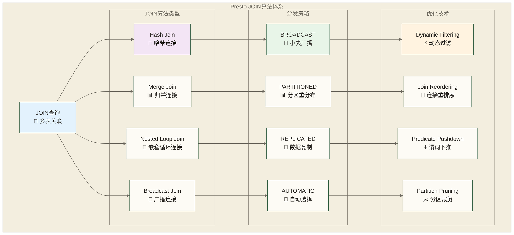

# Presto JOIN优化与子查询 - 复杂查询性能调优实战

> [!abstract] 📋 本节概览
> - 🎯 学习目标：掌握Presto中JOIN操作和子查询的高级优化技术和最佳实践
> - 📚 前置知识：[[【技术与工具】/Presto/09-查询优化基础|查询优化]] 和 SQL JOIN/子查询基础
> - ⏱️ 预计用时：120分钟

## 🔗 JOIN优化架构

### 📊 JOIN算法类型



### 🎯 JOIN性能决策矩阵

| JOIN类型 | 小表(<1GB) | 中表(1-10GB) | 大表(>10GB) | 最佳策略 |
|----------|------------|--------------|-------------|----------|
| **Inner Join** | Broadcast | Partitioned | Partitioned | 基于表大小自动选择 |
| **Left Join** | Broadcast | Partitioned | Partitioned | 保持左表分布 |
| **Right Join** | Partitioned | Partitioned | Partitioned | 保持右表分布 |
| **Full Outer Join** | Partitioned | Partitioned | Partitioned | 双表重分布 |
| **Cross Join** | 避免使用 | 谨慎使用 | 避免使用 | 添加适当JOIN条件 |

## 🔑 Hash Join优化

### 📊 Hash Join基础配置

```sql
-- 设置JOIN分发策略
SET SESSION join_distribution_type = 'AUTOMATIC';  -- BROADCAST, PARTITIONED, AUTOMATIC

-- 创建测试数据用于JOIN优化演示
CREATE TABLE memory.default.customers_large AS
SELECT 
    customer_id,
    'Customer_' || customer_id::VARCHAR as customer_name,
    CAST(random() * 100000 AS DECIMAL(10,2)) as lifetime_value,
    CASE WHEN random() < 0.1 THEN 'VIP' 
         WHEN random() < 0.3 THEN 'Premium' 
         ELSE 'Standard' END as customer_type
FROM (
    SELECT row_number() OVER () as customer_id
    FROM UNNEST(SEQUENCE(1, 1000000)) t(x)
);

CREATE TABLE memory.default.orders_large AS
SELECT 
    order_id,
    CAST(random() * 1000000 + 1 AS BIGINT) as customer_id,
    (random() * 1000 + 10)::DECIMAL(10,2) as order_amount,
    DATE '2024-01-01' + (random() * 90)::INTEGER * INTERVAL '1' DAY as order_date
FROM (
    SELECT row_number() OVER () as order_id
    FROM UNNEST(SEQUENCE(1, 5000000)) t(x)
);

CREATE TABLE memory.default.products_small AS
SELECT 
    product_id,
    'Product_' || product_id::VARCHAR as product_name,
    (random() * 100 + 10)::DECIMAL(8,2) as unit_price
FROM (
    SELECT row_number() OVER () as product_id
    FROM UNNEST(SEQUENCE(1, 1000)) t(x)
);
```

### 🎯 Broadcast Join优化

```sql
-- 小表JOIN大表：使用Broadcast策略
SET SESSION join_distribution_type = 'BROADCAST';

EXPLAIN (TYPE DISTRIBUTED)
SELECT 
    c.customer_name,
    c.customer_type,
    COUNT(o.order_id) as order_count,
    SUM(o.order_amount) as total_amount
FROM memory.default.customers_large c
JOIN memory.default.orders_large o ON c.customer_id = o.customer_id
WHERE c.customer_type = 'VIP'  -- 过滤条件减少广播数据量
GROUP BY c.customer_name, c.customer_type;

-- 查看实际执行效果
EXPLAIN ANALYZE
SELECT 
    p.product_name,
    COUNT(DISTINCT o.customer_id) as unique_customers,
    SUM(o.order_amount) as total_sales
FROM memory.default.products_small p  -- 小表
JOIN memory.default.orders_large o ON p.product_id % 1000 = o.customer_id % 1000
GROUP BY p.product_name
ORDER BY total_sales DESC
LIMIT 100;

-- 优化广播JOIN的技巧
-- 1. 预过滤小表数据
WITH filtered_products AS (
    SELECT product_id, product_name
    FROM memory.default.products_small
    WHERE unit_price > 50  -- 预先过滤减少广播数据
)
SELECT 
    p.product_name,
    COUNT(o.order_id) as order_count
FROM filtered_products p
JOIN memory.default.orders_large o ON p.product_id = o.customer_id % 1000
GROUP BY p.product_name;
```

### 📊 Partitioned Join优化

```sql
-- 大表JOIN大表：使用Partitioned策略
SET SESSION join_distribution_type = 'PARTITIONED';

EXPLAIN (TYPE DISTRIBUTED)
SELECT 
    c.customer_type,
    DATE_TRUNC('month', o.order_date) as order_month,
    COUNT(*) as order_count,
    AVG(o.order_amount) as avg_amount
FROM memory.default.customers_large c
JOIN memory.default.orders_large o ON c.customer_id = o.customer_id
WHERE o.order_date >= DATE '2024-02-01'
GROUP BY c.customer_type, DATE_TRUNC('month', o.order_date)
ORDER BY order_month, c.customer_type;

-- 优化分区JOIN的技巧
-- 1. 使用相同的分区键
-- 2. 预聚合减少JOIN数据量
WITH customer_summary AS (
    SELECT 
        customer_id,
        customer_type,
        lifetime_value
    FROM memory.default.customers_large
    WHERE customer_type IN ('VIP', 'Premium')  -- 预过滤
),
order_summary AS (
    SELECT 
        customer_id,
        COUNT(*) as order_count,
        SUM(order_amount) as total_spent,
        MAX(order_date) as last_order_date
    FROM memory.default.orders_large
    WHERE order_date >= DATE '2024-01-01'
    GROUP BY customer_id  -- 预聚合
)
SELECT 
    cs.customer_type,
    COUNT(*) as active_customers,
    AVG(os.order_count) as avg_orders_per_customer,
    AVG(os.total_spent) as avg_spent_per_customer
FROM customer_summary cs
JOIN order_summary os ON cs.customer_id = os.customer_id
GROUP BY cs.customer_type;
```

## 🔄 JOIN重排序优化

### 📊 多表JOIN顺序优化

```sql
-- 创建不同大小的表用于JOIN顺序测试
CREATE TABLE memory.default.table_small AS
SELECT 
    id,
    'Small_' || id::VARCHAR as name
FROM (SELECT row_number() OVER () as id FROM UNNEST(SEQUENCE(1, 1000)) t(x));

CREATE TABLE memory.default.table_medium AS
SELECT 
    id,
    'Medium_' || id::VARCHAR as name
FROM (SELECT row_number() OVER () as id FROM UNNEST(SEQUENCE(1, 100000)) t(x));

CREATE TABLE memory.default.table_large AS
SELECT 
    id,
    'Large_' || id::VARCHAR as name
FROM (SELECT row_number() OVER () as id FROM UNNEST(SEQUENCE(1, 1000000)) t(x));

-- 多表JOIN：让优化器自动选择最佳顺序
SET SESSION optimizer.join_reordering_strategy = 'COST_BASED';

EXPLAIN (TYPE DISTRIBUTED)
SELECT 
    s.name as small_name,
    m.name as medium_name,
    l.name as large_name
FROM memory.default.table_large l      -- 大表
JOIN memory.default.table_medium m ON l.id = m.id * 10  -- 中表
JOIN memory.default.table_small s ON m.id = s.id * 100  -- 小表
WHERE s.id <= 100;  -- 选择性高的过滤条件

-- 手动优化JOIN顺序：从小表开始
SELECT 
    s.name as small_name,
    m.name as medium_name,
    l.name as large_name
FROM memory.default.table_small s      -- 从最小的表开始
JOIN memory.default.table_medium m ON s.id * 100 = m.id
JOIN memory.default.table_large l ON m.id * 10 = l.id
WHERE s.id <= 100;
```

### 🎯 星型模式JOIN优化

```sql
-- 典型的星型模式：事实表JOIN多个维度表
-- 创建星型模式测试数据
CREATE TABLE memory.default.fact_sales AS
SELECT 
    sale_id,
    (random() * 10000 + 1)::BIGINT as customer_id,
    (random() * 1000 + 1)::BIGINT as product_id,
    CAST(random() * 100 + 1 AS BIGINT) as store_id,
    (random() * 1000 + 10)::DECIMAL(10,2) as amount,
    DATE '2024-01-01' + (random() * 90)::INTEGER * INTERVAL '1' DAY as sale_date
FROM (
    SELECT row_number() OVER () as sale_id
    FROM UNNEST(SEQUENCE(1, 2000000)) t(x)
);

CREATE TABLE memory.default.dim_customers AS
SELECT 
    customer_id,
    'Customer_' || customer_id::VARCHAR as customer_name,
    CASE WHEN random() < 0.2 THEN 'Premium' ELSE 'Standard' END as tier
FROM (
    SELECT row_number() OVER () as customer_id
    FROM UNNEST(SEQUENCE(1, 10000)) t(x)
);

CREATE TABLE memory.default.dim_products AS
SELECT 
    product_id,
    'Product_' || product_id::VARCHAR as product_name,
    'Category_' || CAST(product_id % 10 AS VARCHAR) as category
FROM (
    SELECT row_number() OVER () as product_id
    FROM UNNEST(SEQUENCE(1, 1000)) t(x)
);

CREATE TABLE memory.default.dim_stores AS
SELECT 
    store_id,
    'Store_' || CAST(store_id AS VARCHAR) as store_name,
    'Region_' || CAST(store_id % 5 AS VARCHAR) as region
FROM (
    SELECT row_number() OVER () as store_id
    FROM UNNEST(SEQUENCE(1, 100)) t(x)
);

-- 星型模式查询优化
SET SESSION join_distribution_type = 'AUTOMATIC';
SET SESSION enable_dynamic_filtering = true;

EXPLAIN ANALYZE
SELECT 
    dc.tier,
    dp.category,
    ds.region,
    COUNT(*) as sale_count,
    SUM(fs.amount) as total_amount,
    AVG(fs.amount) as avg_amount
FROM memory.default.fact_sales fs
JOIN memory.default.dim_customers dc ON fs.customer_id = dc.customer_id
JOIN memory.default.dim_products dp ON fs.product_id = dp.product_id  
JOIN memory.default.dim_stores ds ON fs.store_id = ds.store_id
WHERE dc.tier = 'Premium'
  AND dp.category IN ('Category_1', 'Category_2')
  AND fs.sale_date >= DATE '2024-02-01'
GROUP BY dc.tier, dp.category, ds.region
ORDER BY total_amount DESC;
```

## 🔍 子查询优化

### 📊 相关子查询优化

```sql
-- 创建用于子查询优化的测试数据
CREATE TABLE memory.default.employees AS
SELECT 
    emp_id,
    'Employee_' || emp_id::VARCHAR as emp_name,
    'Dept_' || CAST(emp_id % 10 AS VARCHAR) as department,
    CAST(random() * 50000 + 30000 AS DECIMAL(8,2)) as salary,
    DATE '2020-01-01' + CAST(random() * 1460 AS INTEGER) * INTERVAL '1' DAY as hire_date
FROM (
    SELECT row_number() OVER () as emp_id
    FROM UNNEST(SEQUENCE(1, 100000)) t(x)
);

-- 相关子查询示例：查找高于部门平均薪资的员工
-- 对照版本：相关子查询；性能取决于优化器改写及实际执行计划
SELECT 
    emp_name,
    department,
    salary,
    (SELECT AVG(salary) FROM memory.default.employees e2 
     WHERE e2.department = e1.department) as dept_avg_salary
FROM memory.default.employees e1
WHERE salary > (
    SELECT AVG(salary) 
    FROM memory.default.employees e2 
    WHERE e2.department = e1.department
)
ORDER BY department, salary DESC;

-- 优化版本：使用窗口函数替代相关子查询
SELECT 
    emp_name,
    department,
    salary,
    dept_avg_salary
FROM (
    SELECT 
        emp_name,
        department,
        salary,
        AVG(salary) OVER (PARTITION BY department) as dept_avg_salary
    FROM memory.default.employees
) t
WHERE salary > dept_avg_salary
ORDER BY department, salary DESC;

-- 进一步优化：使用JOIN替代相关子查询
WITH dept_avg AS (
    SELECT 
        department,
        AVG(salary) as avg_salary
    FROM memory.default.employees
    GROUP BY department
)
SELECT 
    e.emp_name,
    e.department,
    e.salary,
    da.avg_salary as dept_avg_salary
FROM memory.default.employees e
JOIN dept_avg da ON e.department = da.department
WHERE e.salary > da.avg_salary
ORDER BY e.department, e.salary DESC;
```

### 🎯 EXISTS/IN子查询优化

```sql
-- 创建订单和订单项目数据
CREATE TABLE memory.default.orders AS
SELECT 
    order_id,
    (random() * 100000 + 1)::BIGINT as customer_id,
    DATE '2024-01-01' + (random() * 90)::INTEGER * INTERVAL '1' DAY as order_date,
    CASE WHEN random() < 0.1 THEN 'CANCELLED' ELSE 'COMPLETED' END as status
FROM (
    SELECT row_number() OVER () as order_id
    FROM UNNEST(SEQUENCE(1, 500000)) t(x)
);

CREATE TABLE memory.default.order_items AS
SELECT 
    item_id,
    CAST(random() * 500000 + 1 AS BIGINT) as order_id,
    (random() * 1000 + 1)::BIGINT as product_id,
    CAST(random() * 5 + 1 AS INTEGER) as quantity,
    (random() * 100 + 10)::DECIMAL(8,2) as unit_price
FROM (
    SELECT row_number() OVER () as item_id
    FROM UNNEST(SEQUENCE(1, 2000000)) t(x)
);

-- EXISTS子查询优化
-- 查找有订单项目的订单
-- 使用EXISTS（推荐）
EXPLAIN ANALYZE
SELECT 
    order_id,
    customer_id,
    order_date
FROM memory.default.orders o
WHERE EXISTS (
    SELECT 1 
    FROM memory.default.order_items oi 
    WHERE oi.order_id = o.order_id
)
  AND status = 'COMPLETED';

-- 使用IN子查询（注意性能）
EXPLAIN ANALYZE
SELECT 
    order_id,
    customer_id,
    order_date
FROM memory.default.orders o
WHERE order_id IN (
    SELECT order_id 
    FROM memory.default.order_items
)
  AND status = 'COMPLETED';

-- 使用JOIN加DISTINCT替代EXISTS作为对照方案；是否更高效需比较实际执行计划与资源消耗
EXPLAIN ANALYZE
SELECT DISTINCT
    o.order_id,
    o.customer_id,
    o.order_date
FROM memory.default.orders o
JOIN memory.default.order_items oi ON o.order_id = oi.order_id
WHERE o.status = 'COMPLETED';

-- NOT EXISTS優化
-- 查找没有订单项目的订单
SELECT 
    order_id,
    customer_id,
    order_date
FROM memory.default.orders o
WHERE NOT EXISTS (
    SELECT 1 
    FROM memory.default.order_items oi 
    WHERE oi.order_id = o.order_id
)
  AND status = 'COMPLETED';

-- 使用LEFT JOIN替代NOT EXISTS
SELECT 
    o.order_id,
    o.customer_id,
    o.order_date
FROM memory.default.orders o
LEFT JOIN memory.default.order_items oi ON o.order_id = oi.order_id
WHERE oi.order_id IS NULL
  AND o.status = 'COMPLETED';
```

### 📊 标量子查询优化

```sql
-- 标量子查询优化示例
-- 未优化：多次执行标量子查询
SELECT 
    emp_name,
    department,
    salary,
    (SELECT AVG(salary) FROM memory.default.employees) as company_avg,
    (SELECT MAX(salary) FROM memory.default.employees WHERE department = e.department) as dept_max,
    (SELECT COUNT(*) FROM memory.default.employees WHERE department = e.department) as dept_count
FROM memory.default.employees e
WHERE hire_date >= DATE '2023-01-01';

-- 优化：使用CTE预计算
WITH company_stats AS (
    SELECT AVG(salary) as company_avg
    FROM memory.default.employees
),
dept_stats AS (
    SELECT 
        department,
        MAX(salary) as dept_max,
        COUNT(*) as dept_count
    FROM memory.default.employees
    GROUP BY department
)
SELECT 
    e.emp_name,
    e.department,
    e.salary,
    cs.company_avg,
    ds.dept_max,
    ds.dept_count
FROM memory.default.employees e
CROSS JOIN company_stats cs
JOIN dept_stats ds ON e.department = ds.department
WHERE e.hire_date >= DATE '2023-01-01';
```

## 🎯 复杂查询优化案例

### 📊 窗口函数与JOIN结合优化

```sql
-- 复杂分析查询：客户排名与订单分析
-- 创建更真实的业务数据
CREATE TABLE memory.default.customer_orders AS
SELECT 
    order_id,
    customer_id,
    product_category,
    order_amount,
    order_date,
    -- 添加一些业务逻辑字段
    CASE WHEN order_amount > 500 THEN 'High' 
         WHEN order_amount > 100 THEN 'Medium' 
         ELSE 'Low' END as order_value_tier
FROM (
    SELECT 
        row_number() OVER () as order_id,
        CAST(random() * 50000 + 1 AS BIGINT) as customer_id,
        'Category_' || CAST(CAST(random() * 10 + 1 AS INTEGER) AS VARCHAR) as product_category,
        CAST(random() * 1000 + 10 AS DECIMAL(8,2)) as order_amount,
        DATE '2024-01-01' + (random() * 90)::INTEGER * INTERVAL '1' DAY as order_date
    FROM UNNEST(SEQUENCE(1, 1000000)) t(x)
);

-- 复杂查询：结合窗口函数、JOIN和聚合
-- 目标：分析每个客户的购买模式和排名
WITH customer_metrics AS (
    -- 第一步：计算客户级别指标
    SELECT 
        customer_id,
        COUNT(*) as total_orders,
        SUM(order_amount) as total_spent,
        AVG(order_amount) as avg_order_value,
        COUNT(DISTINCT product_category) as category_diversity,
        MIN(order_date) as first_order_date,
        MAX(order_date) as last_order_date,
        -- 计算每个客户的消费排名
        RANK() OVER (ORDER BY SUM(order_amount) DESC) as spending_rank,
        NTILE(5) OVER (ORDER BY SUM(order_amount)) as spending_quintile
    FROM memory.default.customer_orders
    WHERE order_date >= DATE '2024-02-01'
    GROUP BY customer_id
),
category_preferences AS (
    -- 第二步：分析客户的品类偏好
    SELECT 
        customer_id,
        product_category,
        COUNT(*) as category_orders,
        SUM(order_amount) as category_spent,
        ROW_NUMBER() OVER (PARTITION BY customer_id ORDER BY COUNT(*) DESC) as category_rank
    FROM memory.default.customer_orders
    WHERE order_date >= DATE '2024-02-01'
    GROUP BY customer_id, product_category
),
top_category_per_customer AS (
    -- 第三步：获取每个客户的主要品类
    SELECT 
        customer_id,
        product_category as primary_category,
        category_orders,
        category_spent
    FROM category_preferences
    WHERE category_rank = 1
)
-- 最终查询：综合分析
SELECT 
    cm.customer_id,
    cm.total_orders,
    cm.total_spent,
    cm.avg_order_value,
    cm.category_diversity,
    cm.spending_rank,
    cm.spending_quintile,
    tcp.primary_category,
    tcp.category_spent as primary_category_spent,
    -- 计算主要品类占比
    ROUND(100.0 * tcp.category_spent / cm.total_spent, 2) as primary_category_pct,
    -- 客户生命周期天数
    DATE_DIFF('day', cm.first_order_date, cm.last_order_date) as customer_lifecycle_days,
    -- 客户价值评分
    CASE 
        WHEN cm.spending_quintile = 5 AND cm.category_diversity >= 5 THEN 'High Value Multi-Category'
        WHEN cm.spending_quintile = 5 THEN 'High Value'
        WHEN cm.category_diversity >= 7 THEN 'Multi-Category Explorer'
        ELSE 'Standard'
    END as customer_segment
FROM customer_metrics cm
JOIN top_category_per_customer tcp ON cm.customer_id = tcp.customer_id
WHERE cm.total_orders >= 5  -- 只关注活跃客户
ORDER BY cm.spending_rank
LIMIT 1000;
```

### 🔄 递归式查询优化

```sql
-- 层次数据查询优化（模拟组织架构）
CREATE TABLE memory.default.employee_hierarchy AS
SELECT 
    emp_id,
    'Employee_' || emp_id::VARCHAR as emp_name,
    CASE WHEN emp_id <= 10 THEN NULL 
         ELSE (emp_id - 1) / 10 + 1 END as manager_id,
    'Level_' || CASE WHEN emp_id <= 10 THEN '1'
                     WHEN emp_id <= 100 THEN '2'
                     ELSE '3' END as level
FROM (
    SELECT row_number() OVER () as emp_id
    FROM UNNEST(SEQUENCE(1, 1000)) t(x)
);

-- 使用自连接替代递归查询
-- 查找每个员工最多两级上级；不适用于任意深度的完整管理链路
SELECT 
    e.emp_id,
    e.emp_name,
    e.level,
    m1.emp_name as direct_manager,
    m2.emp_name as senior_manager,
    CASE 
        WHEN m2.emp_id IS NOT NULL THEN 3
        WHEN m1.emp_id IS NOT NULL THEN 2
        ELSE 1
    END as hierarchy_depth
FROM memory.default.employee_hierarchy e
LEFT JOIN memory.default.employee_hierarchy m1 ON e.manager_id = m1.emp_id
LEFT JOIN memory.default.employee_hierarchy m2 ON m1.manager_id = m2.emp_id
ORDER BY e.emp_id;

-- 使用窗口函数进行层次分析
WITH hierarchy_analysis AS (
    SELECT 
        emp_id,
        emp_name,
        manager_id,
        level,
        -- 计算每个级别的员工数量
        COUNT(*) OVER (PARTITION BY level) as level_employee_count,
        -- 计算直接下属数量
        (SELECT COUNT(*) FROM memory.default.employee_hierarchy r WHERE r.manager_id = employee_hierarchy.emp_id) as direct_reports,
        -- 级别内排名
        ROW_NUMBER() OVER (PARTITION BY level ORDER BY emp_id) as level_rank
    FROM memory.default.employee_hierarchy
)
SELECT 
    emp_id,
    emp_name,
    level,
    level_employee_count,
    direct_reports,
    level_rank,
    CASE 
        WHEN direct_reports >= 10 THEN 'Senior Manager'
        WHEN direct_reports >= 5 THEN 'Manager'
        WHEN direct_reports > 0 THEN 'Team Lead'
        ELSE 'Individual Contributor'
    END as role_type
FROM hierarchy_analysis
ORDER BY level, level_rank;
```

## 🚀 高级优化技术

### ⚡ 动态过滤在JOIN中的应用

```sql
-- 动态过滤优化大事实表JOIN
SET SESSION enable_dynamic_filtering = true;
SET SESSION dynamic_filtering_max_per_driver_row_count = 5000;

-- 创建大事实表
CREATE TABLE memory.default.fact_transactions AS
SELECT 
    txn_id,
    (random() * 100000 + 1)::BIGINT as customer_id,
    (random() * 10000 + 1)::BIGINT as merchant_id,
    (random() * 1000 + 10)::DECIMAL(10,2) as amount,
    TIMESTAMP '2024-01-01 00:00:00' + 
        CAST(random() * 7776000 AS INTEGER) * INTERVAL '1' SECOND as txn_timestamp
FROM (
    SELECT row_number() OVER () as txn_id
    FROM UNNEST(SEQUENCE(1, 10000000)) t(x)  -- 1000万记录
);

-- 创建小维度表
CREATE TABLE memory.default.high_value_customers AS
SELECT 
    customer_id,
    'HighValue_' || customer_id::VARCHAR as customer_name
FROM (
    SELECT (random() * 100000 + 1)::BIGINT as customer_id
    FROM UNNEST(SEQUENCE(1, 1000)) t(x)  -- 只有1000个高价值客户
);

-- 动态过滤可能减少探测侧读取或处理的数据量；效果取决于过滤选择性、连接器支持及执行计划
EXPLAIN ANALYZE
SELECT 
    DATE_TRUNC('day', f.txn_timestamp) as txn_date,
    COUNT(*) as transaction_count,
    SUM(f.amount) as total_amount,
    COUNT(DISTINCT f.customer_id) as unique_customers
FROM memory.default.fact_transactions f
JOIN memory.default.high_value_customers h ON f.customer_id = h.customer_id
WHERE f.txn_timestamp >= TIMESTAMP '2024-03-01 00:00:00'
GROUP BY DATE_TRUNC('day', f.txn_timestamp)
ORDER BY txn_date;
```

### 📊 分区感知JOIN优化

```sql
-- 分区表JOIN优化
-- 假设在Hive中有按日期分区的表
-- 这里用Memory连接器演示日期过滤与JOIN，不模拟真实存储分区裁剪

-- 创建模拟的分区数据
CREATE TABLE memory.default.sales_march AS
SELECT 
    sale_id,
    customer_id,
    amount,
    sale_date
FROM (
    SELECT 
        row_number() OVER () as sale_id,
        (random() * 10000 + 1)::BIGINT as customer_id,
        CAST(random() * 500 + 10 AS DECIMAL(8,2)) as amount,
        DATE '2024-03-01' + CAST(random() * 30 AS INTEGER) * INTERVAL '1' DAY as sale_date
    FROM UNNEST(SEQUENCE(1, 500000)) t(x)
);

CREATE TABLE memory.default.customer_segments AS
SELECT 
    customer_id,
    segment,
    segment_score
FROM (
    SELECT 
        row_number() OVER () as customer_id,
        CASE WHEN random() < 0.2 THEN 'Premium'
             WHEN random() < 0.5 THEN 'Standard'
             ELSE 'Basic' END as segment,
        CAST(random() * 100 AS INTEGER) as segment_score
    FROM UNNEST(SEQUENCE(1, 10000)) t(x)
);

-- 日期过滤与JOIN对照查询
-- 此Memory表示例不展示真实存储分区裁剪
SELECT 
    cs.segment,
    COUNT(*) as sale_count,
    SUM(s.amount) as total_amount,
    AVG(s.amount) as avg_amount
FROM (
    SELECT customer_id, amount, sale_date
    FROM memory.default.sales_march
    WHERE sale_date BETWEEN DATE '2024-03-15' AND DATE '2024-03-31'  -- 日期过滤；此Memory表示例不证明分区裁剪
) s
JOIN (
    SELECT customer_id, segment
    FROM memory.default.customer_segments
    WHERE segment IN ('Premium', 'Standard')  -- 预过滤
) cs ON s.customer_id = cs.customer_id
GROUP BY cs.segment
ORDER BY total_amount DESC;
```

## 💡 性能调优最佳实践

### 📋 JOIN性能检查清单

```sql
-- 1. 检查JOIN键的数据分布
SELECT 
    customer_id,
    COUNT(*) as frequency,
    COUNT(*) * 100.0 / SUM(COUNT(*)) OVER () as percentage
FROM memory.default.customer_orders
GROUP BY customer_id
ORDER BY frequency DESC
LIMIT 20;

-- 2. 检查NULL值对JOIN的影响
SELECT 
    'customer_orders' as table_name,
    COUNT(*) as total_rows,
    COUNT(customer_id) as non_null_customer_ids,
    COUNT(*) - COUNT(customer_id) as null_customer_ids
FROM memory.default.customer_orders
UNION ALL
SELECT 
    'customers_large' as table_name,
    COUNT(*) as total_rows,
    COUNT(customer_id) as non_null_customer_ids,
    COUNT(*) - COUNT(customer_id) as null_customer_ids
FROM memory.default.customers_large;

-- 3. 分析JOIN选择性
WITH join_stats AS (
    SELECT 
        COUNT(DISTINCT co.customer_id) as left_distinct,
        COUNT(DISTINCT cl.customer_id) as right_distinct,
        COUNT(*) as join_result_count
    FROM memory.default.customer_orders co
    JOIN memory.default.customers_large cl ON co.customer_id = cl.customer_id
)
SELECT 
    left_distinct,
    right_distinct,
    join_result_count,
    join_result_count * 1.0 / left_distinct as avg_matches_per_left,
    join_result_count * 1.0 / right_distinct as avg_matches_per_right
FROM join_stats;
```

### 🎯 子查询性能优化建议

```sql
-- 子查询优化决策树示例

-- 场景1：相关子查询 → 窗口函数
-- 不推荐
SELECT emp_name, salary
FROM memory.default.employees e1
WHERE salary > (
    SELECT AVG(salary) 
    FROM memory.default.employees e2 
    WHERE e2.department = e1.department
);

-- 推荐
SELECT emp_name, salary
FROM (
    SELECT 
        emp_name, 
        salary,
        AVG(salary) OVER (PARTITION BY department) as dept_avg
    FROM memory.default.employees
) t
WHERE salary > dept_avg;

-- 场景2：EXISTS与JOIN加DISTINCT对照；不预设性能优劣
-- EXISTS方案
SELECT o.order_id
FROM memory.default.orders o
WHERE EXISTS (
    SELECT 1 FROM memory.default.order_items oi 
    WHERE oi.order_id = o.order_id AND oi.quantity > 5
);

-- JOIN加DISTINCT对照方案；需比较实际执行计划与资源消耗
SELECT DISTINCT o.order_id
FROM memory.default.orders o
JOIN memory.default.order_items oi ON o.order_id = oi.order_id
WHERE oi.quantity > 5;

-- 场景3：标量子查询 → CTE
-- 以下假设已有customer_totals表，包含customer_id和total_spent；本节未创建该表
-- 不推荐
SELECT 
    customer_id,
    total_spent,
    total_spent / (SELECT SUM(total_spent) FROM customer_totals) as pct_of_total
FROM customer_totals;

-- 推荐
WITH total_sum AS (
    SELECT SUM(total_spent) as grand_total FROM customer_totals
)
SELECT 
    customer_id,
    total_spent,
    total_spent / ts.grand_total as pct_of_total
FROM customer_totals ct
CROSS JOIN total_sum ts;
```

## 🔗 学习连接

### 📚 本节核心技能

- **JOIN算法理解**：Hash Join、Merge Join、Nested Loop Join的适用场景
- **分发策略掌握**：BROADCAST、PARTITIONED策略的选择原则
- **JOIN重排序**：多表JOIN的最优执行顺序
- **子查询优化**：相关子查询、EXISTS/IN子查询的性能优化
- **复杂查询设计**：窗口函数与JOIN结合的高级查询模式
- **动态过滤应用**：大表JOIN的性能提升技术

### 🎯 下一步学习

**高级优化检查**：
- ✅ 能够分析和优化复杂的多表JOIN查询？
- ✅ 掌握子查询到JOIN的转换技巧？
- ✅ 理解动态过滤等高级优化技术？

**继续学习路径**：
- **系统调优**：[[【技术与工具】/Presto/11-内存配置与调优|内存配置与调优]] - 集群资源管理优化
- **安全管理**：[[【技术与工具】/Presto/12-安全配置与权限管理|安全配置与权限]] - 企业级安全方案
- **运维实践**：[[【技术与工具】/Presto/13-集群部署与管理|集群部署与]] - 生产环境管理

---

> [!tip] 💡 JOIN与子查询优化精髓
> 
> 🔗 **JOIN优化核心原则**：
> - 📊 **小表驱动** - 小表广播，大表分区重分布
> - 🎯 **过滤前置** - 在JOIN之前尽可能过滤数据
> - 📈 **统计驱动** - 依赖准确的表统计信息选择最优策略
> - ⚡ **动态过滤** - 利用运行时信息减少大表扫描
> 
> 🚀 **系统优化**：JOIN优化掌握后，进入 [[【技术与工具】/Presto/11-内存配置与调优|内存配置与调优]] 学习系统级性能调优！