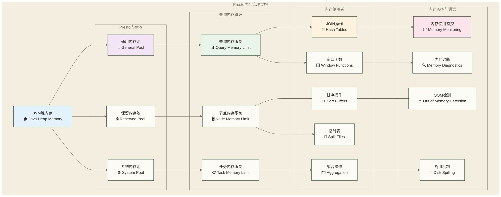

# Presto内存配置与调优 - 企业级性能优化实战指南

> [!abstract] 📋 本节概览
> - 🎯 学习目标：深度掌握Presto内存管理机制，实现企业级性能调优和资源优化
> - 📚 前置知识：10-JOIN优化与子查询|JOIN优化与子查询 和 Linux系统管理基础
> - ⏱️ 预计用时：150分钟

## 🧠 Presto内存架构

### 📊 内存管理体系架构



### 🎯 内存池类型详解

| 内存池类型 | 用途 | 大小配置 | 主要特征 |
|-----------|------|----------|----------|
| **General Pool** | 普通查询内存 | 依目标发行分支的节点内存池实现与配置确定，不能由query.max-memory乘固定比例推得 | 大部分查询使用 |
| **Reserved Pool** | 大查询专用内存 | 是否存在及大小取决于目标发行分支与配置，不能由query.max-memory乘固定比例推得 | 仅适用于具有该池机制的实现 |
| **System Pool** | 系统级操作内存 | resources.reserved-system-memory | 元数据、连接器等 |

## ⚙️ 核心内存配置

### 🔧 JVM内存配置

**JVM启动参数配置** (`etc/jvm.config`):
```bash
# 堆内存配置
-Xms16G                          # 初始堆大小
-Xmx16G                          # 最大堆大小
-XX:+UseG1GC                     # 使用G1垃圾收集器
-XX:G1HeapRegionSize=32M         # G1区域大小
-XX:+UseGCOverheadLimit          # GC开销限制
-XX:+ExplicitGCInvokesConcurrent # 并发GC调用

# 非堆内存配置
-XX:MaxMetaspaceSize=512M        # 元空间大小
-XX:ReservedCodeCacheSize=256M   # 代码缓存
-XX:MaxDirectMemorySize=2G       # 直接内存大小

# GC调优参数
-XX:+UnlockExperimentalVMOptions
-XX:+UseTransparentHugePages
-XX:+UseCompressedOops
-XX:+HeapDumpOnOutOfMemoryError
-XX:HeapDumpPath=/opt/presto/logs
-XX:OnOutOfMemoryError=kill -9 %p

# 性能监控
-XX:+PrintGC
-XX:+PrintGCDetails
-XX:+PrintGCTimeStamps
-XX:+PrintGCApplicationStoppedTime
-Xloggc:/opt/presto/logs/gc.log
-XX:+UseGCLogFileRotation
-XX:NumberOfGCLogFiles=5
-XX:GCLogFileSize=10M
```

### 📊 Presto内存配置

**核心内存配置** (`etc/config.properties`):
```properties
# 查询内存配置
query.max-memory=50GB                           # 单个查询最大内存
query.max-memory-per-node=8GB                   # 单节点查询最大内存
query.max-total-memory=100GB                    # 集群查询总内存限制

# 内存池配置
memory.heap-headroom-per-node=2GB               # 每节点堆内存预留
resources.reserved-system-memory=4GB            # 系统保留内存

# Spill配置
spill-enabled=true                              # 启用磁盘溢出
spiller-spill-path=/tmp/presto-spill            # 溢出文件路径
spiller-max-used-space-threshold=0.8            # 磁盘使用阈值
spiller-threads=4                               # 溢出线程数

# 任务并发配置
task.max-worker-threads=200                     # 最大工作线程
task.http-response-threads=100                  # HTTP响应线程
task.http-timeout-threads=3                     # HTTP超时线程

# 连接器内存配置
connector.max-connections-per-node=50           # 每节点最大连接数
```

## 💡 内存使用优化策略

### 🔗 JOIN操作内存优化

```sql
-- 创建用于内存优化测试的大表
CREATE TABLE memory.default.large_table_a AS
SELECT 
    customer_id,
    'Customer_' || CAST(customer_id AS VARCHAR) as customer_name,
    CAST(random() * 100000 AS DECIMAL(10,2)) as total_spent,
    CAST(random() * 1000 + 1 AS BIGINT) as order_count
FROM (
    SELECT row_number() OVER () as customer_id
    FROM UNNEST(SEQUENCE(1, 5000000)) t(x)
);

CREATE TABLE memory.default.large_table_b AS
SELECT 
    customer_id,
    CAST(random() * 1000 + 1 AS BIGINT) as product_id,
    CAST(random() * 100 + 10 AS DECIMAL(8,2)) as order_amount,
    DATE '2024-01-01' + CAST(random() * 90 AS INTEGER) * INTERVAL '1' DAY as order_date
FROM (
    SELECT row_number() OVER () as customer_id
    FROM UNNEST(SEQUENCE(1, 10000000)) t(x)
);

-- 内存密集型JOIN查询示例
-- 配置JOIN分发策略减少内存使用
SET SESSION join_distribution_type = 'PARTITIONED';
SET SESSION task_concurrency = 8;
SET SESSION query_max_memory_per_node = '4GB';

-- 优化的大表JOIN
EXPLAIN ANALYZE
SELECT 
    a.customer_name,
    a.total_spent,
    COUNT(b.customer_id) as order_count,
    SUM(b.order_amount) as recent_orders_amount
FROM memory.default.large_table_a a
JOIN memory.default.large_table_b b ON a.customer_id = b.customer_id
WHERE b.order_date >= DATE '2024-02-01'
GROUP BY a.customer_name, a.total_spent
HAVING COUNT(b.customer_id) > 10
ORDER BY recent_orders_amount DESC
LIMIT 1000;
```

### 📊 聚合操作内存管理

```sql
-- 高基数聚合内存优化
-- 启用部分聚合减少内存使用
SET SESSION use_partial_aggregation = true;
SET SESSION partial_aggregation_strategy = 'AUTOMATIC';
SET SESSION aggregation_operator_unspill_memory_limit = '100MB';

-- 内存友好的聚合查询
WITH customer_segments AS (
    SELECT 
        customer_id,
        total_spent,
        order_count,
        CASE 
            WHEN total_spent > 50000 THEN 'VIP'
            WHEN total_spent > 10000 THEN 'Premium'
            WHEN total_spent > 1000 THEN 'Standard'
            ELSE 'Basic'
        END AS segment
    FROM memory.default.large_table_a
),
segment_stats AS (
    SELECT 
        segment,
        COUNT(*) as customer_count,
        AVG(total_spent) as avg_spent,
        MIN(total_spent) as min_spent,
        MAX(total_spent) as max_spent,
        APPROX_PERCENTILE(total_spent, 0.5) as median_spent,
        APPROX_PERCENTILE(total_spent, 0.95) as p95_spent
    FROM customer_segments
    GROUP BY segment
)
SELECT 
    segment,
    customer_count,
    ROUND(avg_spent, 2) as avg_spent,
    ROUND(min_spent, 2) as min_spent,
    ROUND(max_spent, 2) as max_spent,
    ROUND(median_spent, 2) as median_spent,
    ROUND(p95_spent, 2) as p95_spent,
    ROUND(customer_count * 100.0 / SUM(customer_count) OVER (), 2) as segment_percentage
FROM segment_stats
ORDER BY avg_spent DESC;
```

### 🪟 窗口函数内存优化

```sql
-- 窗口函数内存优化配置
SET SESSION window_operator_buffer_size = '100MB';
SET SESSION max_drivers_per_task = 4;

-- 内存高效的窗口函数查询
WITH ranked_customers AS (
    SELECT 
        customer_id,
        customer_name,
        total_spent,
        order_count,
        -- 以下排名函数按排序计算；后续移动平均使用ROWS窗口
        ROW_NUMBER() OVER (ORDER BY total_spent DESC) as spending_rank,
        NTILE(10) OVER (ORDER BY total_spent) as spending_decile,
        -- 限制窗口范围减少内存使用
        AVG(total_spent) OVER (
            ORDER BY total_spent 
            ROWS BETWEEN 1000 PRECEDING AND 1000 FOLLOWING
        ) as moving_avg_spent,
        LAG(total_spent, 1) OVER (ORDER BY total_spent) as prev_spent
    FROM memory.default.large_table_a
    WHERE total_spent > 1000  -- 预过滤减少数据量
),
top_customers AS (
    SELECT 
        customer_id,
        customer_name,
        total_spent,
        spending_rank,
        spending_decile,
        ROUND(moving_avg_spent, 2) as moving_avg_spent,
        ROUND(total_spent - COALESCE(prev_spent, 0), 2) as spent_diff
    FROM ranked_customers
    WHERE spending_rank <= 10000  -- 限制结果集大小
)
SELECT 
    spending_decile,
    COUNT(*) as customer_count,
    AVG(total_spent) as avg_spent,
    MIN(total_spent) as min_spent,
    MAX(total_spent) as max_spent
FROM top_customers
GROUP BY spending_decile
ORDER BY spending_decile;
```

## 🔧 Spill机制配置

### 💾 磁盘溢出设置

**Spill配置详解**:
```properties
# 启用Spill机制
spill-enabled=true

# Spill路径配置（可配置多个路径负载均衡）
spiller-spill-path=/data1/presto-spill,/data2/presto-spill,/data3/presto-spill

# Spill阈值配置
spiller-max-used-space-threshold=0.75           # 磁盘使用率阈值
memory-revocation-target=0.5                    # 内存回收目标比例
memory-revocation-threshold=0.9                 # 内存回收触发阈值

# Spill性能配置
spiller-threads=8                               # Spill线程数
spiller-max-file-size=1GB                      # 单个Spill文件最大大小
spiller-compression-enabled=true                # 启用Spill文件压缩
spiller-compression-codec=LZ4                  # 压缩算法

# 操作符级别Spill配置
spill-operators=JOIN,ORDER_BY,WINDOW,AGGREGATION,DISTINCT
aggregation-operator-unspill-memory-limit=512MB
join-operator-unspill-memory-limit=1GB
order-by-operator-unspill-memory-limit=512MB
```

### 📊 Spill监控和诊断

```sql
-- 监控Spill使用情况
SELECT 
    query_id,
    node_id,
    stage_id,
    task_id,
    operator_type,
    spilled_bytes,
    spilled_rows,
    spill_time_ms,
    memory_revocation_count
FROM system.runtime.tasks
WHERE spilled_bytes > 0
ORDER BY spilled_bytes DESC;

-- 查看当前活跃查询的内存使用
SELECT 
    query_id,
    state,
    user_time,
    total_memory_reservation,
    peak_user_memory_reservation,
    peak_total_memory_reservation,
    spilled_bytes
FROM system.runtime.queries
WHERE state IN ('QUEUED', 'PLANNING', 'STARTING', 'RUNNING')
ORDER BY peak_total_memory_reservation DESC;

-- 内存相关的查询统计
SELECT 
    DATE_TRUNC('hour', created) as hour,
    COUNT(*) as query_count,
    AVG(peak_total_memory_reservation) as avg_peak_memory,
    MAX(peak_total_memory_reservation) as max_peak_memory,
    SUM(spilled_bytes) as total_spilled_bytes,
    COUNT(CASE WHEN spilled_bytes > 0 THEN 1 END) as spilled_query_count
FROM system.runtime.queries
WHERE created >= CURRENT_TIMESTAMP - INTERVAL '24' HOUR
GROUP BY DATE_TRUNC('hour', created)
ORDER BY hour DESC;
```

## 📈 内存性能监控

### 🔍 系统级内存监控

**内存监控脚本** (`monitor_memory.sh`):
```bash
#!/bin/bash

# Presto内存监控脚本
PRESTO_PID=$(pgrep -f "io.prestosql.server.PrestoServer")
LOG_FILE="/opt/presto/logs/memory_monitor.log"

while true; do
    timestamp=$(date '+%Y-%m-%d %H:%M:%S')
    
    # JVM内存使用情况
    heap_used=$(jstat -gc $PRESTO_PID | tail -1 | awk '{sum=$3+$4+$6+$8; print sum}')
    heap_capacity=$(jstat -gc $PRESTO_PID | tail -1 | awk '{sum=$1+$2+$5+$7; print sum}')
    
    # 系统内存使用
    sys_mem=$(free -m | grep "Mem:" | awk '{printf "%.2f", ($3/$2)*100}')
    
    # GC统计
    gc_count=$(jstat -gc $PRESTO_PID | tail -1 | awk '{print $5+$7}')
    gc_time=$(jstat -gc $PRESTO_PID | tail -1 | awk '{print $6+$8}')
    
    echo "$timestamp,HEAP_USED:${heap_used}KB,HEAP_CAPACITY:${heap_capacity}KB,SYS_MEM:${sys_mem}%,GC_COUNT:$gc_count,GC_TIME:${gc_time}ms" >> $LOG_FILE
    
    sleep 30
done
```

### 📊 Presto内存API监控

```bash
# 获取集群内存使用情况
curl -s http://coordinator:8080/v1/cluster | jq '.runningQueries, .blockedQueries, .queuedQueries'

# 获取节点内存统计
curl -s http://coordinator:8080/v1/node | jq '.[] | {nodeId: .nodeId, memoryInfo: .memoryInfo}'

# 获取查询内存详情
curl -s http://coordinator:8080/v1/query/{query-id} | jq '.memoryPool, .totalMemoryReservation'

# 获取系统内存池状态
curl -s http://coordinator:8080/v1/cluster/memory | jq '.'
```

### 🎯 自定义内存监控查询

```sql
-- 创建内存监控仪表板视图
CREATE VIEW system.monitoring.memory_dashboard AS
WITH current_queries AS (
    SELECT 
        query_id,
        state,
        user_name,
        query,
        created,
        total_memory_reservation / 1024.0 / 1024.0 / 1024.0 as memory_gb,
        peak_total_memory_reservation / 1024.0 / 1024.0 / 1024.0 as peak_memory_gb,
        spilled_bytes / 1024.0 / 1024.0 / 1024.0 as spilled_gb
    FROM system.runtime.queries
    WHERE state IN ('QUEUED', 'PLANNING', 'STARTING', 'RUNNING')
),
memory_stats AS (
    SELECT 
        COUNT(*) as active_queries,
        COALESCE(SUM(memory_gb), 0) as total_memory_gb,
        COALESCE(MAX(peak_memory_gb), 0) as max_peak_memory_gb,
        COALESCE(SUM(spilled_gb), 0) as total_spilled_gb,
        COUNT(CASE WHEN spilled_gb > 0 THEN 1 END) as spilled_queries
    FROM current_queries
)
SELECT 
    'CURRENT_STATUS' as metric_type,
    active_queries,
    ROUND(total_memory_gb, 2) as total_memory_gb,
    ROUND(max_peak_memory_gb, 2) as max_peak_memory_gb,
    ROUND(total_spilled_gb, 2) as total_spilled_gb,
    spilled_queries,
    ROUND(spilled_queries * 100.0 / NULLIF(active_queries, 0), 2) as spill_percentage
FROM memory_stats;

-- 内存使用趋势分析
WITH hourly_memory AS (
    SELECT 
        DATE_TRUNC('hour', created) as hour,
        COUNT(*) as queries,
        AVG(peak_total_memory_reservation) / 1024.0 / 1024.0 / 1024.0 as avg_peak_memory_gb,
        MAX(peak_total_memory_reservation) / 1024.0 / 1024.0 / 1024.0 as max_peak_memory_gb,
        SUM(spilled_bytes) / 1024.0 / 1024.0 / 1024.0 as total_spilled_gb
    FROM system.runtime.queries
    WHERE created >= CURRENT_TIMESTAMP - INTERVAL '24' HOUR
    GROUP BY DATE_TRUNC('hour', created)
)
SELECT 
    hour,
    queries,
    ROUND(avg_peak_memory_gb, 2) as avg_peak_memory_gb,
    ROUND(max_peak_memory_gb, 2) as max_peak_memory_gb,
    ROUND(total_spilled_gb, 2) as total_spilled_gb,
    ROUND(LAG(avg_peak_memory_gb) OVER (ORDER BY hour), 2) as prev_avg_memory_gb,
    ROUND(
        (avg_peak_memory_gb - LAG(avg_peak_memory_gb) OVER (ORDER BY hour)) * 100.0 / 
        NULLIF(LAG(avg_peak_memory_gb) OVER (ORDER BY hour), 0), 2
    ) as memory_growth_percent
FROM hourly_memory
ORDER BY hour DESC;
```

## 🚀 高级内存调优技术

### ⚡ 动态内存管理

**动态内存调整策略**:
```sql
-- 基于查询类型的内存配置
-- 大型分析查询配置
SET SESSION query_max_memory = '20GB';
SET SESSION query_max_memory_per_node = '4GB';
SET SESSION task_concurrency = 4;
SET SESSION join_distribution_type = 'PARTITIONED';

-- 实时分析查询配置  
SET SESSION query_max_memory = '5GB';
SET SESSION query_max_memory_per_node = '1GB';
SET SESSION task_concurrency = 16;
SET SESSION join_distribution_type = 'BROADCAST';

-- ETL批处理查询配置
SET SESSION query_max_memory = '50GB';
SET SESSION query_max_memory_per_node = '8GB';  
SET SESSION task_concurrency = 2;
SET SESSION spill_enabled = true;
```

### 🎛️ 资源组内存管理

**资源组配置** (`etc/resource-groups.properties`):
```properties
resource-groups.configuration-manager=file
resource-groups.config-file=etc/resource-groups.json
```

**资源组JSON配置** (`etc/resource-groups.json`):
```json
{
  "rootGroups": [
    {
      "name": "adhoc",
      "softMemoryLimit": "50%",
      "hardConcurrencyLimit": 50,
      "maxQueued": 100,
      "schedulingPolicy": "fair",
      "schedulingWeight": 1,
      "jmxExport": true,
      "subGroups": [
        {
          "name": "small",
          "softMemoryLimit": "30%",
          "hardConcurrencyLimit": 30,
          "maxQueued": 50,
          "schedulingPolicy": "fair"
        },
        {
          "name": "large", 
          "softMemoryLimit": "70%",
          "hardConcurrencyLimit": 5,
          "maxQueued": 10,
          "schedulingPolicy": "fair"
        }
      ]
    },
    {
      "name": "etl",
      "softMemoryLimit": "40%",
      "hardConcurrencyLimit": 10,
      "maxQueued": 20,
      "schedulingPolicy": "fifo",
      "schedulingWeight": 2,
      "jmxExport": true
    },
    {
      "name": "reporting",
      "softMemoryLimit": "30%", 
      "hardConcurrencyLimit": 20,
      "maxQueued": 50,
      "schedulingPolicy": "fair",
      "schedulingWeight": 1,
      "jmxExport": true
    }
  ],
  "selectors": [
    {
      "user": "analytics_team",
      "group": "adhoc.large"
    },
    {
      "user": "etl_service", 
      "group": "etl"
    },
    {
      "source": "reporting_tool",
      "group": "reporting"
    },
    {
      "group": "adhoc.small"
    }
  ]
}
```

### 🔄 内存回收策略

```sql
-- 创建内存回收监控存储过程
CREATE OR REPLACE FUNCTION system.monitoring.analyze_memory_pressure()
RETURNS TABLE(
    recommendation VARCHAR,
    current_usage DOUBLE,
    threshold DOUBLE,
    action_required BOOLEAN
)
LANGUAGE SQL
AS $$
WITH memory_analysis AS (
    SELECT 
        SUM(total_memory_reservation) / 1024.0 / 1024.0 / 1024.0 as current_memory_gb,
        COUNT(*) as active_queries,
        COUNT(CASE WHEN spilled_bytes > 0 THEN 1 END) as spilled_queries,
        AVG(total_memory_reservation) / 1024.0 / 1024.0 / 1024.0 as avg_query_memory_gb
    FROM system.runtime.queries
    WHERE state IN ('QUEUED', 'PLANNING', 'STARTING', 'RUNNING')
),
thresholds AS (
    SELECT 
        50.0 as memory_warning_threshold_gb,
        80.0 as memory_critical_threshold_gb,
        0.3 as spill_ratio_warning,
        10.0 as avg_memory_warning_gb
)
SELECT 
    CASE 
        WHEN ma.current_memory_gb > t.memory_critical_threshold_gb THEN 
            'CRITICAL: Consider killing large queries or adding nodes'
        WHEN ma.current_memory_gb > t.memory_warning_threshold_gb THEN 
            'WARNING: Monitor memory usage closely'
        WHEN ma.spilled_queries * 1.0 / NULLIF(ma.active_queries, 0) > t.spill_ratio_warning THEN
            'INFO: High spill ratio, consider memory tuning'
        WHEN ma.avg_query_memory_gb > t.avg_memory_warning_gb THEN
            'INFO: Queries using high memory, optimize query patterns'
        ELSE 'OK: Memory usage within normal range'
    END as recommendation,
    ma.current_memory_gb as current_usage,
    CASE 
        WHEN ma.current_memory_gb > t.memory_critical_threshold_gb THEN t.memory_critical_threshold_gb
        ELSE t.memory_warning_threshold_gb
    END as threshold,
    ma.current_memory_gb > t.memory_warning_threshold_gb as action_required
FROM memory_analysis ma, thresholds t
$$;

-- 使用内存分析函数
SELECT * FROM system.monitoring.analyze_memory_pressure();
```

## 🛡️ 内存故障处理

### ⚠️ OOM故障诊断

**内存溢出诊断脚本**:
```bash
#!/bin/bash
# oom_diagnosis.sh - OOM故障诊断脚本

PRESTO_LOG_DIR="/opt/presto/logs"
DIAGNOSIS_DIR="/opt/presto/diagnosis"
TIMESTAMP=$(date +%Y%m%d_%H%M%S)

mkdir -p $DIAGNOSIS_DIR

echo "=== Presto OOM Diagnosis Report - $TIMESTAMP ===" > $DIAGNOSIS_DIR/oom_diagnosis_$TIMESTAMP.txt

# 检查HeapDump文件
echo "1. Checking for heap dumps..." >> $DIAGNOSIS_DIR/oom_diagnosis_$TIMESTAMP.txt
find $PRESTO_LOG_DIR -name "*.hprof" -mtime -1 >> $DIAGNOSIS_DIR/oom_diagnosis_$TIMESTAMP.txt

# 分析GC日志
echo -e "\n2. GC Analysis (last 1000 lines)..." >> $DIAGNOSIS_DIR/oom_diagnosis_$TIMESTAMP.txt
tail -1000 $PRESTO_LOG_DIR/gc.log | grep -E "(OutOfMemoryError|Full GC|concurrent mark-sweep|G1)" >> $DIAGNOSIS_DIR/oom_diagnosis_$TIMESTAMP.txt

# 系统内存状态
echo -e "\n3. System Memory Status..." >> $DIAGNOSIS_DIR/oom_diagnosis_$TIMESTAMP.txt
free -h >> $DIAGNOSIS_DIR/oom_diagnosis_$TIMESTAMP.txt
echo -e "\nMemory usage by process:" >> $DIAGNOSIS_DIR/oom_diagnosis_$TIMESTAMP.txt
ps aux --sort=-%mem | head -20 >> $DIAGNOSIS_DIR/oom_diagnosis_$TIMESTAMP.txt

# Presto日志中的内存错误
echo -e "\n4. Presto Memory Errors (last 24 hours)..." >> $DIAGNOSIS_DIR/oom_diagnosis_$TIMESTAMP.txt
find $PRESTO_LOG_DIR -name "server.log*" -mtime -1 -exec grep -l "OutOfMemoryError\|Memory\|exceeded" {} \; | \
while read file; do
    echo "File: $file" >> $DIAGNOSIS_DIR/oom_diagnosis_$TIMESTAMP.txt
    grep -E "(OutOfMemoryError|Memory.*exceeded|Query.*killed|Memory pool)" "$file" | tail -50 >> $DIAGNOSIS_DIR/oom_diagnosis_$TIMESTAMP.txt
done

# 获取当前查询状态
echo -e "\n5. Current Query Status..." >> $DIAGNOSIS_DIR/oom_diagnosis_$TIMESTAMP.txt
curl -s http://localhost:8080/v1/query | jq '.[] | {queryId: .queryId, state: .state, memoryReservation: .memoryPool}' >> $DIAGNOSIS_DIR/oom_diagnosis_$TIMESTAMP.txt 2>/dev/null

echo "Diagnosis complete. Report saved to: $DIAGNOSIS_DIR/oom_diagnosis_$TIMESTAMP.txt"
```

### 🔧 内存泄漏检测

```sql
-- 内存泄漏检测查询
WITH long_running_queries AS (
    SELECT 
        query_id,
        state,
        user_name,
        source,
        created,
        started,
        "end",
        elapsed_time,
        execution_time,
        total_memory_reservation / 1024.0 / 1024.0 / 1024.0 as memory_gb,
        peak_total_memory_reservation / 1024.0 / 1024.0 / 1024.0 as peak_memory_gb,
        DATE_DIFF('minute', created, COALESCE("end", CURRENT_TIMESTAMP)) as runtime_minutes
    FROM system.runtime.queries
    WHERE (state IN ('RUNNING', 'QUEUED') AND created < CURRENT_TIMESTAMP - INTERVAL '30' MINUTE)
       OR (state = 'FINISHED' AND execution_time > INTERVAL '1' HOUR)
),
memory_growth_analysis AS (
    SELECT 
        query_id,
        state,
        user_name,
        runtime_minutes,
        memory_gb,
        peak_memory_gb,
        memory_gb / NULLIF(runtime_minutes, 0) as memory_per_minute,
        CASE 
            WHEN runtime_minutes > 60 AND memory_gb > 5 THEN 'POTENTIAL_LEAK'
            WHEN runtime_minutes > 120 THEN 'LONG_RUNNING'
            WHEN peak_memory_gb > 20 THEN 'HIGH_MEMORY'
            ELSE 'NORMAL'
        END as risk_level
    FROM long_running_queries
)
SELECT 
    query_id,
    state,
    user_name,
    runtime_minutes,
    ROUND(memory_gb, 2) as current_memory_gb,
    ROUND(peak_memory_gb, 2) as peak_memory_gb,
    ROUND(memory_per_minute, 4) as current_memory_per_runtime_minute,
    risk_level,
    CASE risk_level
        WHEN 'POTENTIAL_LEAK' THEN 'Investigate memory trends and workload before considering termination'
        WHEN 'LONG_RUNNING' THEN 'Monitor closely for memory growth'
        WHEN 'HIGH_MEMORY' THEN 'Check if memory usage is justified'
        ELSE 'No immediate action required'
    END as recommendation
FROM memory_growth_analysis
ORDER BY 
    CASE risk_level 
        WHEN 'POTENTIAL_LEAK' THEN 1
        WHEN 'LONG_RUNNING' THEN 2
        WHEN 'HIGH_MEMORY' THEN 3
        ELSE 4
    END,
    memory_gb DESC;
```

## 🎯 性能基准测试

### 📊 内存性能基准

```sql
-- 内存性能基准测试套件
-- 1. JOIN内存基准测试
WITH benchmark_config AS (
    SELECT 
        'JOIN_BENCHMARK' as test_name,
        CURRENT_TIMESTAMP as start_time
)
SELECT 
    bc.test_name,
    bc.start_time,
    COUNT(*) as result_count,
    -- 这里会消耗大量内存进行Hash JOIN
    COUNT(DISTINCT a.customer_id) as unique_customers,
    SUM(a.total_spent) as total_spent,
    AVG(b.order_amount) as avg_order_amount
FROM benchmark_config bc
CROSS JOIN memory.default.large_table_a a
JOIN memory.default.large_table_b b ON a.customer_id = b.customer_id
WHERE a.total_spent > 1000
GROUP BY bc.test_name, bc.start_time;

-- 2. 聚合内存基准测试
WITH aggregation_benchmark AS (
    SELECT 
        customer_id,
        COUNT(*) as order_count,
        SUM(order_amount) as total_amount,
        AVG(order_amount) as avg_amount,
        MIN(order_amount) as min_amount,
        MAX(order_amount) as max_amount,
        STDDEV(order_amount) as stddev_amount,
        APPROX_PERCENTILE(order_amount, 0.5) as median_amount,
        APPROX_PERCENTILE(order_amount, 0.95) as p95_amount,
        APPROX_DISTINCT(product_id) as unique_products
    FROM memory.default.large_table_b
    GROUP BY customer_id
    HAVING COUNT(*) > 5
)
SELECT 
    'AGGREGATION_BENCHMARK' as test_name,
    CURRENT_TIMESTAMP as timestamp,
    COUNT(*) as customer_count,
    SUM(order_count) as total_orders,
    AVG(total_amount) as avg_customer_value,
    MAX(unique_products) as max_product_diversity
FROM aggregation_benchmark;

-- 3. 窗口函数内存基准测试
SELECT 
    'WINDOW_BENCHMARK' as test_name,
    CURRENT_TIMESTAMP as timestamp,
    COUNT(*) as processed_rows,
    AVG(customer_rank) as avg_rank,
    AVG(running_total) as avg_running_total
FROM (
    SELECT 
        customer_id,
        order_amount,
        ROW_NUMBER() OVER (PARTITION BY customer_id ORDER BY order_amount DESC) as customer_rank,
        SUM(order_amount) OVER (PARTITION BY customer_id ORDER BY order_date ROWS UNBOUNDED PRECEDING) as running_total,
        AVG(order_amount) OVER (PARTITION BY customer_id ORDER BY order_date ROWS BETWEEN 10 PRECEDING AND 10 FOLLOWING) as moving_avg
    FROM memory.default.large_table_b
    WHERE order_date >= DATE '2024-02-01'
) windowed_data
WHERE customer_rank <= 100;
```

### 🏃‍♂️ 性能回归测试

```bash
#!/bin/bash
# memory_regression_test.sh - 内存性能回归测试

TEST_DIR="/opt/presto/tests"
RESULTS_DIR="/opt/presto/test_results"
TIMESTAMP=$(date +%Y%m%d_%H%M%S)

mkdir -p $RESULTS_DIR

# 测试配置
declare -A TEST_CONFIGS=(
    ["small_memory"]="query_max_memory=2GB,query_max_memory_per_node=512MB"
    ["medium_memory"]="query_max_memory=8GB,query_max_memory_per_node=2GB"
    ["large_memory"]="query_max_memory=32GB,query_max_memory_per_node=8GB"
)

# 运行内存基准测试
run_memory_test() {
    local config_name=$1
    local config_params=$2
    local result_file="$RESULTS_DIR/memory_test_${config_name}_$TIMESTAMP.json"
    
    echo "Running memory test with config: $config_name"
    echo "Parameters: $config_params"
    
    # 设置会话参数并运行测试查询
    presto-cli --server localhost:8080 --execute "
        SET SESSION $config_params;
        
        WITH test_execution AS (
            SELECT 
                '$config_name' as config_name,
                CURRENT_TIMESTAMP as start_time,
                COUNT(*) as row_count,
                SUM(a.total_spent * b.order_amount) as computation_result
            FROM memory.default.large_table_a a
            JOIN memory.default.large_table_b b ON a.customer_id = b.customer_id
            WHERE a.total_spent > 5000
        )
        SELECT 
            config_name,
            start_time,
            CURRENT_TIMESTAMP as end_time,
            DATE_DIFF('second', start_time, CURRENT_TIMESTAMP) as execution_seconds,
            row_count,
            computation_result
        FROM test_execution;
    " --output-format JSON > $result_file
    
    echo "Test completed. Results saved to: $result_file"
}

# 执行所有测试配置
for config_name in "${!TEST_CONFIGS[@]}"; do
    run_memory_test "$config_name" "${TEST_CONFIGS[$config_name]}"
    sleep 60  # 等待内存回收
done

# 生成汇总报告
echo "Generating summary report..."
python3 << EOF
import json
import glob
import pandas as pd
from datetime import datetime

# 读取所有测试结果
result_files = glob.glob('$RESULTS_DIR/memory_test_*_$TIMESTAMP.json')
results = []

for file in result_files:
    with open(file, 'r') as f:
        data = json.load(f)
        if data:
            results.extend(data)

# 创建DataFrame并分析
df = pd.DataFrame(results)
if not df.empty:
    summary = df.groupby('config_name').agg({
        'execution_seconds': ['mean', 'min', 'max'],
        'row_count': 'mean',
        'computation_result': 'mean'
    }).round(2)
    
    print("Memory Performance Test Summary:")
    print("=" * 50)
    print(summary)
    
    # 保存详细报告
    with open('$RESULTS_DIR/memory_test_summary_$TIMESTAMP.txt', 'w') as f:
        f.write("Memory Performance Test Summary - $TIMESTAMP\n")
        f.write("=" * 50 + "\n")
        f.write(str(summary))
        f.write("\n\nDetailed Results:\n")
        f.write(str(df))
else:
    print("No test results found.")
EOF

echo "Memory regression testing completed."
echo "Results available in: $RESULTS_DIR"
```

## 🔗 学习连接

### 📚 本节核心技能

- **内存架构理解**：掌握Presto内存管理的完整架构和工作原理
- **配置优化**：JVM配置、Presto内存配置的最佳实践
- **性能调优**：JOIN、聚合、窗口函数的内存优化策略
- **Spill机制**：磁盘溢出的配置和监控技巧
- **故障诊断**：OOM问题的诊断和解决方法
- **监控体系**：建立完善的内存监控和告警机制

### 🎯 下一步学习

**内存管理检查**：
- ✅ 能够配置和优化Presto集群的内存使用？
- ✅ 掌握不同查询类型的内存调优策略？
- ✅ 理解Spill机制和故障处理方法？

**继续学习路径**：
- [[【技术与工具】/Presto/12-安全配置与权限管理|安全配置与权限]] - 安全管理
- [[【技术与工具】/Presto/13-集群部署与管理|集群部署与]] - 集群管理
- [[【技术与工具】/Presto/14-监控与告警|监控与告警]] - 监控告警

---

> [!tip] 💡 内存管理精髓
> 
> 🧠 **内存优化核心原则**：
> - 📊 **合理分配** - 根据工作负载特征配置内存池大小
> - ⚡ **预防为主** - 通过监控和限制避免OOM问题
> - 💾 **优雅降级** - 在操作符支持、磁盘资源充足且未触及其他限制时，Spill机制可缓解内存压力，但不保证查询完成
> - 🔍 **持续监控** - 建立完善的内存使用监控和告警体系
> 
> 🚀 **安全加固**：内存调优完成后，进入 12-安全配置与权限管理|安全配置与权限管理 学习企业级安全配置！