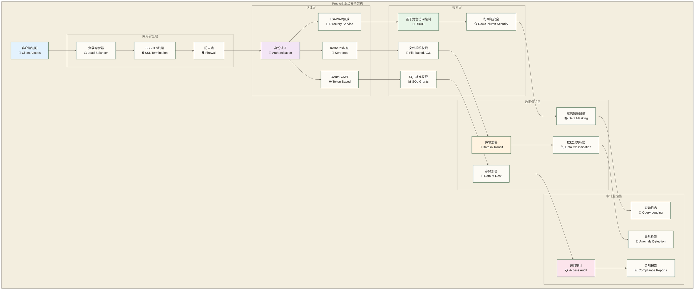

# Presto安全配置与权限管理 - 企业级安全防护完全指南

> [!abstract] 📋 本节概览
> - 🎯 学习目标：构建企业级Presto安全体系，掌握认证、授权、加密和审计的完整方案
> - 📚 前置知识：11-内存配置与调优|内存配置与调优 和 网络安全基础概念
> - ⏱️ 预计用时：140分钟

## 🔐 Presto安全架构概览

### 🏛️ 企业级安全体系架构



### 🔒 安全威胁模型

| 威胁类型 | 风险等级 | 防护措施 | 监控指标 |
|----------|----------|----------|----------|
| **未授权访问** | 高 | 强身份认证 + RBAC | 登录失败率、异常IP |
| **SQL注入攻击** | 高 | 参数化查询 + 输入验证 | 恶意查询模式检测 |
| **数据泄露** | 极高 | 加密 + 脱敏 + 访问控制 | 敏感数据访问频率 |
| **权限提升** | 中 | 最小权限原则 + 定期审计 | 权限变更记录 |
| **内部威胁** | 中 | 行为监控 + 审计日志 | 异常查询行为 |
| **网络攻击** | 高 | 网络隔离 + 加密传输 | 网络流量异常 |

## 🔑 身份认证配置

### 🎫 Kerberos认证

**Kerberos配置** (`etc/config.properties`):
```properties
# 启用Kerberos认证
http-server.authentication.type=KERBEROS

# Kerberos配置
http.authentication.krb5.config=/etc/krb5.conf
http.server.authentication.krb5.service-name=presto
http.server.authentication.krb5.principal-hostname=presto.company.com
http.server.authentication.krb5.keytab=/etc/presto/presto.keytab

# 客户端到服务器认证
http.authentication.krb5.client-keytab=/etc/presto/presto.keytab
http.authentication.krb5.client-principal=presto@COMPANY.COM

# 服务器间认证
internal-communication.authentication.type=KERBEROS
internal-communication.kerberos.service-name=presto
internal-communication.kerberos.principal-hostname=presto.company.com
internal-communication.kerberos.keytab=/etc/presto/presto.keytab
```

**Kerberos配置文件** (`/etc/krb5.conf`):
```ini
[libdefaults]
    default_realm = COMPANY.COM
    dns_lookup_realm = false
    dns_lookup_kdc = false
    ticket_lifetime = 24h
    renew_lifetime = 7d
    forwardable = true

[realms]
    COMPANY.COM = {
        kdc = kdc1.company.com
        kdc = kdc2.company.com
        admin_server = kdc1.company.com
        default_domain = company.com
    }

[domain_realm]
    .company.com = COMPANY.COM
    company.com = COMPANY.COM

[logging]
    default = FILE:/var/log/krb5libs.log
    kdc = FILE:/var/log/krb5kdc.log
    admin_server = FILE:/var/log/kadmind.log
```

### 📁 LDAP认证集成

**LDAP认证配置** (`etc/config.properties`):
```properties
# 启用LDAP认证
http-server.authentication.type=PASSWORD

# LDAP配置
authentication.ldap.url=ldaps://ldap.company.com:636
authentication.ldap.user-bind-pattern=${USER}@company.com
authentication.ldap.user-base-dn=ou=users,dc=company,dc=com
authentication.ldap.group-base-dn=ou=groups,dc=company,dc=com

# LDAP连接配置
authentication.ldap.bind-dn=cn=presto,ou=service,dc=company,dc=com
authentication.ldap.bind-password=secure_password
authentication.ldap.connection-timeout=30s
authentication.ldap.read-timeout=30s

# TLS配置
authentication.ldap.ssl-trust-certificate=/etc/ssl/certs/ldap-ca.crt
authentication.ldap.ssl-key-store-path=/etc/presto/ldap-keystore.jks
authentication.ldap.ssl-key-store-password=keystore_password
```

**LDAP组映射配置** (`etc/group-provider.properties`):
```properties
group-provider.name=ldap.url=ldaps://ldap.company.com:636
ldap.user-bind-pattern=${USER}@company.com
ldap.group-auth-pattern=(&(objectClass=group)(member=${USER}))
ldap.user-attributes=sAMAccountName:userName,mail:email,displayName:fullName
ldap.group-attributes=cn:groupName,description:groupDescription
```

### 🎟️ JWT/OAuth2认证

**JWT认证配置** (`etc/config.properties`):
```properties
# 启用JWT认证
http-server.authentication.type=JWT

# JWT配置
http-server.authentication.jwt.key-file=/etc/presto/jwt-public-key.pem
http-server.authentication.jwt.required-issuer=company-auth-service
http-server.authentication.jwt.required-audience=presto-cluster
http-server.authentication.jwt.user-mapping.pattern=(.*)@company\.com
http-server.authentication.jwt.user-mapping.format=$1

# JWT高级配置
http-server.authentication.jwt.principal-field=sub
http-server.authentication.jwt.group-field=groups
http-server.authentication.jwt.token-cache-size=1000
http-server.authentication.jwt.token-cache-ttl=1h
```

**JWT Token验证示例**:
```bash
#!/bin/bash
# jwt_auth_test.sh - JWT认证测试脚本

JWT_TOKEN="eyJhbGciOiJSUzI1NiIsInR5cCI6IkpXVCJ9..."
PRESTO_ENDPOINT="https://presto.company.com:8443"

# 使用JWT Token访问Presto
curl -H "Authorization: Bearer $JWT_TOKEN" \
     -H "X-Presto-User: john.doe" \
     -H "X-Presto-Source: jwt-client" \
     -X POST \
     -d "SELECT CURRENT_USER, CURRENT_TIMESTAMP" \
     "$PRESTO_ENDPOINT/v1/statement"
```

## 👤 基于角色的访问控制 (RBAC)

### 🔧 文件系统访问控制

**访问控制配置** (`etc/access-control.properties`):
```properties
access-control.name=file
security.config-file=etc/access-control.json
security.refresh-period=1s
```

**访问控制规则** (`etc/access-control.json`):
```json
{
  "catalogs": [
    {
      "catalog": "hive",
      "allow": true,
      "principals": ["role:data_analysts", "user:admin"]
    },
    {
      "catalog": "mysql", 
      "allow": true,
      "principals": ["role:db_users", "role:data_analysts"]
    },
    {
      "catalog": "system",
      "allow": false,
      "principals": ["user:admin", "role:system_admin"]
    }
  ],
  "schemas": [
    {
      "catalog": "hive",
      "schema": "sensitive_data",
      "owner": true,
      "principals": ["role:data_stewards", "user:admin"]
    },
    {
      "catalog": "hive",
      "schema": "public_data", 
      "owner": false,
      "principals": ["role:data_analysts", "role:business_users"]
    }
  ],
  "tables": [
    {
      "catalog": "hive",
      "schema": "hr",
      "table": "employee_salaries",
      "privileges": ["SELECT"],
      "principals": ["role:hr_managers", "user:ceo"]
    },
    {
      "catalog": "hive", 
      "schema": "sales",
      "table": "customer_data",
      "privileges": ["SELECT", "INSERT"],
      "principals": ["role:sales_team", "role:data_analysts"]
    }
  ],
  "columns": [
    {
      "catalog": "hive",
      "schema": "hr", 
      "table": "employees",
      "column": "ssn",
      "allow": false,
      "principals": ["role:hr_admin"]
    },
    {
      "catalog": "mysql",
      "schema": "crm",
      "table": "customers", 
      "column": "credit_card",
      "allow": false,
      "principals": ["role:finance_team"]
    }
  ],
  "queries": [
    {
      "query": "CREATE.*",
      "allow": false,
      "principals": ["role:data_engineers", "user:admin"]
    },
    {
      "query": "DROP.*",
      "allow": false, 
      "principals": ["user:admin"]
    }
  ]
}
```

### 🏷️ 动态访问控制

**基于属性的访问控制** (`etc/attribute-access-control.json`):
```json
{
  "rules": [
    {
      "name": "department_data_access",
      "description": "Users can only access their department data",
      "condition": {
        "catalog": "hive",
        "schema": "employee_data",
        "user_attribute": "department",
        "table_filter": "department = '${user.department}'"
      }
    },
    {
      "name": "time_based_access",
      "description": "Restrict access to sensitive data during business hours",
      "condition": {
        "catalog": "hive", 
        "schema": "financial_data",
        "time_range": "09:00-17:00",
        "timezone": "America/New_York",
        "principals": ["role:finance_analysts"]
      }
    },
    {
      "name": "data_classification_access",
      "description": "Access based on data classification levels",
      "condition": {
        "data_classification": ["PUBLIC", "INTERNAL"],
        "user_clearance_level": ">=INTERNAL",
        "audit_required": true
      }
    }
  ]
}
```

### 🔍 行级安全 (Row-Level Security)

**行级安全实现示例**:
```sql
-- 创建安全视图实现行级安全
CREATE VIEW hive.secure.employee_view_rls AS
SELECT 
    employee_id,
    first_name,
    last_name,
    email,
    department,
    CASE 
        WHEN CURRENT_USER IN ('hr_manager', 'admin') 
        THEN salary 
        ELSE NULL 
    END as salary,
    hire_date
FROM hive.hr.employees
WHERE 
    -- 部门经理只能看到自己部门的员工
    (CURRENT_USER LIKE '%_manager' AND department = REGEXP_EXTRACT(CURRENT_USER, '(.*)_manager', 1))
    OR 
    -- HR可以看到所有员工
    CURRENT_USER IN ('hr_admin', 'admin')
    OR
    -- 员工只能看到自己的信息
    employee_id = (
        SELECT employee_id 
        FROM hive.hr.user_mapping 
        WHERE username = CURRENT_USER
    );

-- 创建带数据脱敏的安全视图
CREATE VIEW hive.secure.customer_view_masked AS
SELECT 
    customer_id,
    customer_name,
    -- 邮箱脱敏
    CASE 
        WHEN HAS_ROLE('customer_service') 
        THEN email
        ELSE CONCAT(
            SUBSTR(email, 1, 2), 
            '***@', 
            SUBSTR(email, POSITION('@' IN email) + 1)
        )
    END as email,
    -- 电话号码脱敏
    CASE 
        WHEN HAS_ROLE('sales_manager')
        THEN phone_number
        ELSE CONCAT('***-***-', RIGHT(phone_number, 4))
    END as phone_number,
    -- 地址部分脱敏
    CASE 
        WHEN HAS_ROLE('shipping_team')
        THEN full_address
        ELSE CONCAT(city, ', ', state)
    END as address,
    registration_date
FROM hive.crm.customers;
```

## 🔐 数据加密配置

### 🌐 传输加密 (TLS/SSL)

**HTTPS配置** (`etc/config.properties`):
```properties
# 启用HTTPS
http-server.https.enabled=true
http-server.https.port=8443
http-server.https.keystore.path=/etc/presto/keystore.jks
http-server.https.keystore.key=keystore_password

# SSL配置
http-server.https.truststore.path=/etc/presto/truststore.jks
http-server.https.truststore.key=truststore_password

# 禁用HTTP监听；此配置不提供HTTP到HTTPS重定向
http-server.http.enabled=false

# 内部通信加密
internal-communication.https.required=true
internal-communication.https.keystore.path=/etc/presto/internal-keystore.jks
internal-communication.https.keystore.key=internal_keystore_password
```

**证书生成脚本**:
```bash
#!/bin/bash
# generate_ssl_certs.sh - SSL证书生成脚本

KEYSTORE_PATH="/etc/presto"
DOMAIN="presto.company.com"
KEYSTORE_PASSWORD="secure_keystore_password"
VALIDITY_DAYS=365

# 创建目录
mkdir -p $KEYSTORE_PATH

# 生成私钥和证书
keytool -genkeypair \
    -alias presto-server \
    -keyalg RSA \
    -keysize 2048 \
    -validity $VALIDITY_DAYS \
    -keystore $KEYSTORE_PATH/keystore.jks \
    -storepass $KEYSTORE_PASSWORD \
    -keypass $KEYSTORE_PASSWORD \
    -dname "CN=$DOMAIN,OU=Data Engineering,O=Company,L=City,ST=State,C=US" \
    -ext SAN=dns:$DOMAIN,dns:localhost,ip:127.0.0.1

# 导出证书
keytool -exportcert \
    -alias presto-server \
    -keystore $KEYSTORE_PATH/keystore.jks \
    -storepass $KEYSTORE_PASSWORD \
    -file $KEYSTORE_PATH/presto-server.crt

# 创建信任库
keytool -importcert \
    -alias presto-server \
    -keystore $KEYSTORE_PATH/truststore.jks \
    -storepass $KEYSTORE_PASSWORD \
    -file $KEYSTORE_PATH/presto-server.crt \
    -noprompt

echo "SSL certificates generated successfully"
echo "Keystore: $KEYSTORE_PATH/keystore.jks"
echo "Truststore: $KEYSTORE_PATH/truststore.jks"
```

### 💾 存储加密集成

**Hive连接器加密配置** (`etc/catalog/hive.properties`):
```properties
# S3加密配置
hive.s3.sse.enabled=true
# 示例使用S3；采用KMS时需按连接器支持的配置调整
hive.s3.sse.type=S3
hive.s3.sse.kms-key-id=arn:aws:kms:us-east-1:123456789012:key/12345678-1234-1234-1234-123456789012

# HDFS传输加密；以下配置不代表已启用静态数据加密区域
hive.hdfs.wire-encryption.enabled=true
hive.hdfs.wire-encryption.algorithm=3des

# Parquet加密
hive.parquet.encryption.enabled=true
hive.parquet.encryption.key-management=KMS
hive.parquet.encryption.kms-instance-id=presto-parquet-encryption
```

**数据脱敏函数库**:
```sql
-- 创建数据脱敏函数
CREATE OR REPLACE FUNCTION mask_email(email VARCHAR)
RETURNS VARCHAR
LANGUAGE SQL
DETERMINISTIC
AS $$
SELECT 
    CASE 
        WHEN email IS NULL OR email = '' THEN email
        WHEN POSITION('@' IN email) = 0 THEN '***'
        ELSE CONCAT(
            LEFT(email, 2),
            REPEAT('*', GREATEST(0, POSITION('@' IN email) - 3)),
            RIGHT(email, LENGTH(email) - POSITION('@' IN email) + 1)
        )
    END
$$;

CREATE OR REPLACE FUNCTION mask_phone(phone VARCHAR)
RETURNS VARCHAR  
LANGUAGE SQL
DETERMINISTIC
AS $$
SELECT 
    CASE 
        WHEN phone IS NULL OR LENGTH(phone) < 4 THEN phone
        ELSE CONCAT('***-***-', RIGHT(phone, 4))
    END
$$;

CREATE OR REPLACE FUNCTION mask_ssn(ssn VARCHAR)
RETURNS VARCHAR
LANGUAGE SQL  
DETERMINISTIC
AS $$
SELECT 
    CASE 
        WHEN ssn IS NULL OR LENGTH(ssn) < 4 THEN ssn
        ELSE CONCAT('***-**-', RIGHT(ssn, 4))
    END
$$;

-- 使用脱敏函数的示例
SELECT 
    customer_id,
    customer_name,
    mask_email(email) as email,
    mask_phone(phone_number) as phone_number,
    mask_ssn(social_security_number) as ssn
FROM hive.crm.customers
WHERE registration_date >= DATE '2024-01-01';
```

## 📋 审计和监控

### 🔍 查询审计配置

**审计日志配置** (`etc/event-listener.properties`):
```properties
event-listener.name=audit-logger
audit.log-path=/var/log/presto/audit.log
audit.log-format=JSON
audit.log-level=INFO

# 审计事件配置
audit.log-created=true
audit.log-completed=true  
audit.log-failed=true
audit.log-split-completed=false

# 敏感查询审计
audit.log-sensitive-queries=true
audit.sensitive-patterns=.*password.*,.*ssn.*,.*credit_card.*
```

**自定义审计监听器** (`AuditEventListener.java`):
```java
public class CustomAuditEventListener implements EventListener {
    private static final Logger logger = LoggerFactory.getLogger(CustomAuditEventListener.class);
    private final ObjectMapper objectMapper = new ObjectMapper();
    
    @Override
    public void queryCreated(QueryCreatedEvent event) {
        AuditRecord record = AuditRecord.builder()
            .eventType("QUERY_CREATED")
            .queryId(event.getMetadata().getQueryId())
            .user(event.getContext().getUser())
            .source(event.getContext().getSource().orElse("unknown"))
            .clientInfo(event.getContext().getClientInfo().orElse("unknown"))
            .query(event.getMetadata().getQuery())
            .timestamp(event.getCreateTime())
            .remoteClientAddress(event.getContext().getRemoteClientAddress().orElse("unknown"))
            .userAgent(event.getContext().getUserAgent().orElse("unknown"))
            .build();
            
        logAuditRecord(record);
    }
    
    @Override
    public void queryCompleted(QueryCompletedEvent event) {
        QueryStatistics stats = event.getStatistics();
        
        AuditRecord record = AuditRecord.builder()
            .eventType("QUERY_COMPLETED")
            .queryId(event.getMetadata().getQueryId())
            .user(event.getContext().getUser())
            .query(event.getMetadata().getQuery())
            .executionTimeMs(stats.getExecutionTime().toMillis())
            .totalRows(stats.getOutputRows())
            .totalBytes(stats.getOutputBytes())
            .peakMemoryBytes(stats.getPeakUserMemoryBytes())
            .cpuTimeMs(stats.getTotalCpuTime().toMillis())
            .wallTimeMs(stats.getElapsedTime().toMillis())
            .queryState(event.getMetadata().getQueryState().toString())
            .timestamp(event.getEndTime())
            .build();
            
        logAuditRecord(record);
        
        // 检测异常查询模式
        detectAnomalousQuery(record);
    }
    
    private void logAuditRecord(AuditRecord record) {
        try {
            String json = objectMapper.writeValueAsString(record);
            logger.info("AUDIT: {}", json);
        } catch (Exception e) {
            logger.error("Failed to serialize audit record", e);
        }
    }
    
    private void detectAnomalousQuery(AuditRecord record) {
        // 检测长时间运行的查询
        if (record.getExecutionTimeMs() > Duration.ofHours(2).toMillis()) {
            alertLongRunningQuery(record);
        }
        
        // 检测大量数据访问
        if (record.getTotalBytes() > 100L * 1024 * 1024 * 1024) { // 100GB
            alertLargeDataAccess(record);
        }
        
        // 检测敏感数据访问
        if (containsSensitivePatterns(record.getQuery())) {
            alertSensitiveDataAccess(record);
        }
    }
}
```

### 📊 安全监控仪表板

```sql
-- 创建安全监控视图
CREATE VIEW system.security.access_summary AS
WITH user_activity AS (
    SELECT 
        user_name,
        DATE_TRUNC('hour', created) as hour,
        COUNT(*) as query_count,
        COUNT(DISTINCT query) as unique_queries,
        SUM(CASE WHEN state = 'FAILED' THEN 1 ELSE 0 END) as failed_queries,
        AVG(total_bytes) as avg_bytes_processed,
        MAX(total_bytes) as max_bytes_processed,
        SUM(execution_time) as total_execution_time
    FROM system.runtime.queries
    WHERE created >= CURRENT_TIMESTAMP - INTERVAL '24' HOUR
    GROUP BY user_name, DATE_TRUNC('hour', created)
),
security_metrics AS (
    SELECT 
        hour,
        COUNT(DISTINCT user_name) as active_users,
        SUM(query_count) as total_queries,
        SUM(failed_queries) as total_failed_queries,
        AVG(avg_bytes_processed) as avg_data_processed,
        MAX(max_bytes_processed) as max_data_access,
        -- 计算异常指标
        COUNT(CASE WHEN query_count > 100 THEN 1 END) as high_activity_users,
        COUNT(CASE WHEN failed_queries > 10 THEN 1 END) as users_with_many_failures,
        COUNT(CASE WHEN max_bytes_processed > 10737418240 THEN 1 END) as large_data_access_users -- 10GB
    FROM user_activity
    GROUP BY hour
)
SELECT 
    hour,
    active_users,
    total_queries,
    total_failed_queries,
    ROUND(total_failed_queries * 100.0 / NULLIF(total_queries, 0), 2) as failure_rate_percent,
    high_activity_users,
    users_with_many_failures,
    large_data_access_users,
    ROUND(avg_data_processed / 1024.0 / 1024.0 / 1024.0, 2) as avg_data_processed_gb,
    ROUND(max_data_access / 1024.0 / 1024.0 / 1024.0, 2) as max_data_access_gb,
    -- 安全评分 (0-100)
    GREATEST(0, 100 - 
        (high_activity_users * 10) - 
        (users_with_many_failures * 20) - 
        (large_data_access_users * 15) -
        (ROUND(total_failed_queries * 100.0 / NULLIF(total_queries, 0), 2) * 2)
    ) as security_score
FROM security_metrics
ORDER BY hour DESC;

-- 异常用户行为检测
CREATE VIEW system.security.anomaly_detection AS
WITH user_baselines AS (
    SELECT 
        user_name,
        AVG(query_count_per_hour) as avg_hourly_queries,
        STDDEV(query_count_per_hour) as stddev_hourly_queries,
        AVG(avg_bytes_per_query) as avg_bytes_per_query,
        STDDEV(avg_bytes_per_query) as stddev_bytes_per_query,
        AVG(failure_rate) as avg_failure_rate
    FROM (
        SELECT 
            user_name,
            DATE_TRUNC('hour', created) as hour,
            COUNT(*) as query_count_per_hour,
            AVG(total_bytes) as avg_bytes_per_query,
            COUNT(CASE WHEN state = 'FAILED' THEN 1 END) * 100.0 / COUNT(*) as failure_rate
        FROM system.runtime.queries
        WHERE created >= CURRENT_TIMESTAMP - INTERVAL '7' DAY
          AND created < CURRENT_TIMESTAMP - INTERVAL '1' DAY
        GROUP BY user_name, DATE_TRUNC('hour', created)
    ) historical_data
    GROUP BY user_name
),
recent_activity AS (
    SELECT 
        user_name,
        COUNT(*) as recent_queries,
        AVG(total_bytes) as recent_avg_bytes,
        COUNT(CASE WHEN state = 'FAILED' THEN 1 END) * 100.0 / COUNT(*) as recent_failure_rate,
        MAX(created) as last_activity
    FROM system.runtime.queries
    WHERE created >= CURRENT_TIMESTAMP - INTERVAL '1' HOUR
    GROUP BY user_name
)
SELECT 
    ra.user_name,
    ra.recent_queries,
    ROUND(ra.recent_avg_bytes / 1024.0 / 1024.0, 2) as recent_avg_mb,
    ROUND(ra.recent_failure_rate, 2) as recent_failure_rate,
    ra.last_activity,
    -- 异常检测
    CASE 
        WHEN ra.recent_queries > (ub.avg_hourly_queries + 3 * COALESCE(ub.stddev_hourly_queries, 0))
        THEN 'HIGH_QUERY_VOLUME'
        WHEN ra.recent_avg_bytes > (ub.avg_bytes_per_query + 3 * COALESCE(ub.stddev_bytes_per_query, 0))
        THEN 'UNUSUAL_DATA_ACCESS'
        WHEN ra.recent_failure_rate > (ub.avg_failure_rate + 20)
        THEN 'HIGH_FAILURE_RATE'
        ELSE 'NORMAL'
    END as anomaly_type,
    -- 异常严重程度
    CASE 
        WHEN ra.recent_queries > (ub.avg_hourly_queries + 5 * COALESCE(ub.stddev_hourly_queries, 0))
             OR ra.recent_avg_bytes > (ub.avg_bytes_per_query + 5 * COALESCE(ub.stddev_bytes_per_query, 0))
        THEN 'CRITICAL'
        WHEN ra.recent_queries > (ub.avg_hourly_queries + 3 * COALESCE(ub.stddev_hourly_queries, 0))
             OR ra.recent_avg_bytes > (ub.avg_bytes_per_query + 3 * COALESCE(ub.stddev_bytes_per_query, 0))
        THEN 'HIGH'
        ELSE 'LOW'
    END as severity
FROM recent_activity ra
LEFT JOIN user_baselines ub ON ra.user_name = ub.user_name
WHERE ra.recent_queries > 0
ORDER BY 
    CASE 
        WHEN severity = 'CRITICAL' THEN 1
        WHEN severity = 'HIGH' THEN 2
        ELSE 3
    END,
    ra.recent_queries DESC;
```

## 🚨 安全事件响应

### ⚡ 自动化安全响应

**安全事件处理脚本**:
```bash
#!/bin/bash
# security_incident_response.sh - 安全事件自动响应脚本

PRESTO_API="http://localhost:8080"
ALERT_WEBHOOK="https://alerts.company.com/webhook"
LOG_FILE="/var/log/presto/security_incidents.log"

# 检测可疑查询
detect_suspicious_queries() {
    local suspicious_queries=$(curl -s "$PRESTO_API/v1/query" | \
        jq -r '.[] | select(.state == "RUNNING" and (.elapsedTime | tonumber) > 7200000) | .queryId' | \
        head -10)
    
    if [ ! -z "$suspicious_queries" ]; then
        echo "$(date): Detected long-running queries: $suspicious_queries" >> $LOG_FILE
        
        # 发送告警
        curl -X POST "$ALERT_WEBHOOK" \
            -H "Content-Type: application/json" \
            -d "{
                \"alert_type\": \"LONG_RUNNING_QUERY\",
                \"severity\": \"WARNING\",
                \"query_ids\": \"$suspicious_queries\",
                \"timestamp\": \"$(date -u +%Y-%m-%dT%H:%M:%SZ)\"
            }"
    fi
}

# 检测异常数据访问
detect_data_access_anomalies() {
    local large_queries=$(curl -s "$PRESTO_API/v1/query" | \
        jq -r '.[] | select(.memoryPool.totalMemoryReservation > 21474836480) | .queryId' | \
        head -5)  # > 20GB内存使用
    
    if [ ! -z "$large_queries" ]; then
        echo "$(date): Detected high memory usage queries: $large_queries" >> $LOG_FILE
        
        curl -X POST "$ALERT_WEBHOOK" \
            -H "Content-Type: application/json" \
            -d "{
                \"alert_type\": \"HIGH_MEMORY_USAGE\",
                \"severity\": \"HIGH\", 
                \"query_ids\": \"$large_queries\",
                \"timestamp\": \"$(date -u +%Y-%m-%dT%H:%M:%SZ)\"
            }"
    fi
}

# 终止可疑查询
kill_suspicious_query() {
    local query_id=$1
    local reason=$2
    
    echo "$(date): Killing suspicious query $query_id. Reason: $reason" >> $LOG_FILE
    
    curl -X DELETE "$PRESTO_API/v1/query/$query_id" \
        -H "X-Presto-User: security_system"
    
    # 记录终止操作
    curl -X POST "$ALERT_WEBHOOK" \
        -H "Content-Type: application/json" \
        -d "{
            \"alert_type\": \"QUERY_TERMINATED\",
            \"severity\": \"INFO\",
            \"query_id\": \"$query_id\", 
            \"reason\": \"$reason\",
            \"timestamp\": \"$(date -u +%Y-%m-%dT%H:%M:%SZ)\"
        }"
}

# 主监控循环
while true; do
    detect_suspicious_queries
    detect_data_access_anomalies
    sleep 60
done
```

### 📊 安全合规报告

```sql
-- 生成安全合规报告
CREATE OR REPLACE VIEW system.security.compliance_report AS
WITH access_summary AS (
    SELECT 
        DATE_TRUNC('day', created) as date,
        user_name,
        source,
        COUNT(*) as total_queries,
        COUNT(DISTINCT query) as unique_queries,
        SUM(CASE WHEN query LIKE '%SELECT%' THEN 1 ELSE 0 END) as select_queries,
        SUM(CASE WHEN query LIKE '%INSERT%' THEN 1 ELSE 0 END) as insert_queries,
        SUM(CASE WHEN query LIKE '%UPDATE%' THEN 1 ELSE 0 END) as update_queries,
        SUM(CASE WHEN query LIKE '%DELETE%' THEN 1 ELSE 0 END) as delete_queries,
        SUM(CASE WHEN query LIKE '%CREATE%' THEN 1 ELSE 0 END) as create_queries,
        SUM(CASE WHEN query LIKE '%DROP%' THEN 1 ELSE 0 END) as drop_queries,
        SUM(total_bytes) as total_bytes_accessed,
        MAX(total_bytes) as max_single_query_bytes,
        AVG(execution_time) as avg_execution_time
    FROM system.runtime.queries
    WHERE created >= CURRENT_DATE - INTERVAL '30' DAY
    GROUP BY DATE_TRUNC('day', created), user_name, source
),
sensitive_access AS (
    SELECT 
        DATE_TRUNC('day', created) as date,
        user_name,
        COUNT(*) as sensitive_queries
    FROM system.runtime.queries
    WHERE created >= CURRENT_DATE - INTERVAL '30' DAY
      AND (
          LOWER(query) LIKE '%salary%' OR
          LOWER(query) LIKE '%ssn%' OR
          LOWER(query) LIKE '%credit_card%' OR
          LOWER(query) LIKE '%personal%' OR
          LOWER(query) LIKE '%confidential%'
      )
    GROUP BY DATE_TRUNC('day', created), user_name
),
failed_access AS (
    SELECT 
        DATE_TRUNC('day', created) as date,
        user_name,
        COUNT(*) as failed_queries,
        ARRAY_AGG(DISTINCT error_type) as error_types
    FROM system.runtime.queries
    WHERE created >= CURRENT_DATE - INTERVAL '30' DAY
      AND state = 'FAILED'
    GROUP BY DATE_TRUNC('day', created), user_name
)
SELECT 
    a.date,
    a.user_name,
    a.source,
    a.total_queries,
    a.unique_queries,
    a.select_queries,
    a.insert_queries + a.update_queries + a.delete_queries as modification_queries,
    a.create_queries + a.drop_queries as ddl_queries,
    ROUND(a.total_bytes_accessed / 1024.0 / 1024.0 / 1024.0, 2) as total_gb_accessed,
    ROUND(a.max_single_query_bytes / 1024.0 / 1024.0 / 1024.0, 2) as max_single_query_gb,
    ROUND(a.avg_execution_time / 1000.0, 2) as avg_execution_seconds,
    COALESCE(s.sensitive_queries, 0) as sensitive_data_queries,
    COALESCE(f.failed_queries, 0) as failed_queries,
    f.error_types,
    -- 合规性评分
    CASE 
        WHEN COALESCE(s.sensitive_queries, 0) > 10 THEN 'HIGH_SENSITIVE_ACCESS'
        WHEN a.create_queries + a.drop_queries > 5 THEN 'HIGH_DDL_ACTIVITY'
        WHEN COALESCE(f.failed_queries, 0) > 20 THEN 'HIGH_FAILURE_RATE'
        WHEN a.total_bytes_accessed > 1099511627776 THEN 'HIGH_DATA_VOLUME' -- 1TB
        ELSE 'NORMAL'
    END as risk_category
FROM access_summary a
LEFT JOIN sensitive_access s ON a.date = s.date AND a.user_name = s.user_name
LEFT JOIN failed_access f ON a.date = f.date AND a.user_name = f.user_name
ORDER BY a.date DESC, a.total_queries DESC;

-- 数据访问审计报告
CREATE OR REPLACE VIEW system.security.data_access_audit AS
SELECT 
    DATE_TRUNC('week', created) as week,
    user_name,
    -- 按catalog统计访问
    SUM(CASE WHEN query LIKE '%hive.hr.%' THEN 1 ELSE 0 END) as hr_data_access,
    SUM(CASE WHEN query LIKE '%hive.finance.%' THEN 1 ELSE 0 END) as finance_data_access,
    SUM(CASE WHEN query LIKE '%hive.sales.%' THEN 1 ELSE 0 END) as sales_data_access,
    SUM(CASE WHEN query LIKE '%mysql.crm.%' THEN 1 ELSE 0 END) as crm_data_access,
    
    -- 敏感表访问统计
    SUM(CASE WHEN LOWER(query) LIKE '%employee_salaries%' THEN 1 ELSE 0 END) as salary_table_access,
    SUM(CASE WHEN LOWER(query) LIKE '%customer_pii%' THEN 1 ELSE 0 END) as pii_table_access,
    SUM(CASE WHEN LOWER(query) LIKE '%financial_records%' THEN 1 ELSE 0 END) as financial_table_access,
    
    -- 权限相关统计
    COUNT(*) as total_queries,
    COUNT(CASE WHEN state = 'FAILED' AND error_message LIKE '%Access Denied%' THEN 1 END) as access_denied_count,
    
    -- 数据量统计
    SUM(total_bytes) / 1024.0 / 1024.0 / 1024.0 as total_gb_processed,
    MAX(total_bytes) / 1024.0 / 1024.0 / 1024.0 as max_query_gb
FROM system.runtime.queries
WHERE created >= CURRENT_DATE - INTERVAL '12' WEEK
GROUP BY DATE_TRUNC('week', created), user_name
HAVING COUNT(*) > 10  -- 只显示活跃用户
ORDER BY week DESC, total_queries DESC;
```

## 🔧 安全最佳实践

### 🛡️ 安全加固清单

**生产环境安全配置检查清单**:
```bash
#!/bin/bash
# security_hardening_check.sh - 安全加固检查脚本

echo "=== Presto Security Hardening Check ==="
echo "Date: $(date)"
echo

# 1. 检查认证配置
echo "1. Authentication Configuration:"
if grep -q "http-server.authentication.type" /opt/presto/etc/config.properties; then
    auth_type=$(grep "http-server.authentication.type" /opt/presto/etc/config.properties | cut -d'=' -f2)
    echo "   ✓ Authentication enabled: $auth_type"
else
    echo "   ✗ WARNING: No authentication configured!"
fi

# 2. 检查HTTPS配置
echo "2. HTTPS Configuration:"
if grep -q "http-server.https.enabled=true" /opt/presto/etc/config.properties; then
    echo "   ✓ HTTPS enabled"
else
    echo "   ✗ WARNING: HTTPS not enabled!"
fi

# 3. 检查访问控制
echo "3. Access Control:"
if [ -f "/opt/presto/etc/access-control.properties" ]; then
    echo "   ✓ Access control configured"
else
    echo "   ✗ WARNING: No access control configured!"
fi

# 4. 检查审计日志
echo "4. Audit Logging:"
if [ -f "/opt/presto/etc/event-listener.properties" ]; then
    echo "   ✓ Audit logging configured"
else
    echo "   ✗ WARNING: No audit logging configured!"
fi

# 5. 检查JVM安全参数
echo "5. JVM Security Parameters:"
if grep -q "java.security.policy" /opt/presto/etc/jvm.config; then
    echo "   ✓ Security policy configured"
else
    echo "   ⚠ INFO: Consider configuring Java security policy"
fi

# 6. 检查文件权限
echo "6. File Permissions:"
config_perms=$(stat -c "%a" /opt/presto/etc/config.properties 2>/dev/null)
if [ "$config_perms" = "600" ] || [ "$config_perms" = "640" ]; then
    echo "   ✓ Config file permissions secure: $config_perms"
else
    echo "   ✗ WARNING: Config file permissions too open: $config_perms"
fi

# 7. 检查网络端口
echo "7. Network Security:"
open_ports=$(netstat -tlnp | grep :8080 | wc -l)
if [ "$open_ports" -gt 0 ]; then
    echo "   ⚠ WARNING: HTTP port 8080 is open (should use HTTPS only)"
else
    echo "   ✓ HTTP port not exposed"
fi

echo "=== Security Hardening Recommendations ==="
echo "1. Enable strong authentication (Kerberos/LDAP)"
echo "2. Use HTTPS with valid certificates"
echo "3. Configure comprehensive access control"
echo "4. Enable audit logging for all queries"
echo "5. Implement network security (firewalls, VPNs)"
echo "6. Regular security updates and patches"
echo "7. Monitor for suspicious activities"
```

### 🔐 密码和密钥管理

**密钥轮换脚本**:
```bash
#!/bin/bash
# key_rotation.sh - 密钥轮换管理脚本

KEYSTORE_PATH="/etc/presto"
BACKUP_PATH="/etc/presto/backups"
DATE=$(date +%Y%m%d_%H%M%S)

# 创建备份目录
mkdir -p $BACKUP_PATH

# 备份现有密钥
backup_keys() {
    echo "Backing up existing keys..."
    cp $KEYSTORE_PATH/keystore.jks $BACKUP_PATH/keystore_$DATE.jks
    cp $KEYSTORE_PATH/truststore.jks $BACKUP_PATH/truststore_$DATE.jks
    echo "Keys backed up to $BACKUP_PATH"
}

# 生成新的SSL证书
generate_new_certs() {
    echo "Generating new SSL certificates..."
    
    # 生成新的keystore
    keytool -genkeypair \
        -alias presto-server-new \
        -keyalg RSA \
        -keysize 4096 \
        -validity 365 \
        -keystore $KEYSTORE_PATH/keystore_new.jks \
        -storepass $(openssl rand -base64 32) \
        -keypass $(openssl rand -base64 32) \
        -dname "CN=presto.company.com,OU=Data Engineering,O=Company,L=City,ST=State,C=US"
}

# 更新Kerberos keytab
rotate_kerberos_keys() {
    echo "Rotating Kerberos keys..."
    
    # 生成新的keytab
    kadmin -p admin/admin@COMPANY.COM -w admin_password << EOF
change_password -randkey presto/presto.company.com@COMPANY.COM
ktadd -k $KEYSTORE_PATH/presto_new.keytab presto/presto.company.com@COMPANY.COM
EOF
    
    echo "New Kerberos keytab generated"
}

# 更新配置并重启服务
update_config_and_restart() {
    echo "Updating configuration..."
    
    # 原子替换密钥文件
    mv $KEYSTORE_PATH/keystore_new.jks $KEYSTORE_PATH/keystore.jks
    mv $KEYSTORE_PATH/presto_new.keytab $KEYSTORE_PATH/presto.keytab
    
    # 重启服务
    systemctl restart presto
    
    echo "Configuration updated and service restarted"
}

# 验证密钥轮换
verify_rotation() {
    echo "Verifying key rotation..."
    
    # 检查SSL证书
    openssl s_client -connect localhost:8443 -servername presto.company.com < /dev/null 2>/dev/null | \
        openssl x509 -noout -dates
    
    # 检查Kerberos
    klist -k $KEYSTORE_PATH/presto.keytab
    
    echo "Key rotation verification complete"
}

# 主执行流程
main() {
    echo "Starting key rotation process..."
    
    backup_keys
    generate_new_certs
    rotate_kerberos_keys
    update_config_and_restart
    verify_rotation
    
    echo "Key rotation workflow finished; success requires checking command results, service health, client trust, and authentication"
}

# 执行主流程
main
```

## 🔗 学习连接

### 📚 本节核心技能

- **认证体系**：掌握Kerberos、LDAP、JWT等认证方法的配置
- **授权管理**：实现RBAC、行列级安全、动态访问控制
- **数据保护**：配置传输加密、存储加密、数据脱敏
- **审计监控**：建立完整的查询审计和异常检测体系
- **事件响应**：自动化安全事件检测和响应机制
- **合规管理**：生成安全合规报告和风险评估

### 🎯 下一步学习

**安全配置检查**：
- ✅ 能够配置企业级认证和授权体系？
- ✅ 掌握数据加密和脱敏的最佳实践？
- ✅ 理解安全审计和合规要求？

**继续学习路径**：
- [[【技术与工具】/Presto/13-集群部署与管理|集群部署与]] - 集群管理
- [[【技术与工具】/Presto/14-监控与告警|监控与告警]] - 监控告警
- [[【技术与工具】/Presto/15-故障诊断与调试|故障诊断与调试]] - 故障处理

---

> [!tip] 💡 安全配置精髓
> 
> 🔐 **企业安全核心原则**：
> - 🎯 **纵深防御** - 多层安全措施确保全面防护
> - 🔑 **最小权限** - 用户只获得完成工作所需的最小权限
> - 📋 **持续审计** - 全程记录和监控所有数据访问活动
> - ⚡ **快速响应** - 自动化检测和响应安全威胁
> 
> 🚀 **运维管理**：安全体系建立后，进入 13-集群部署与管理|集群部署与管理 学习生产环境的集群管理！