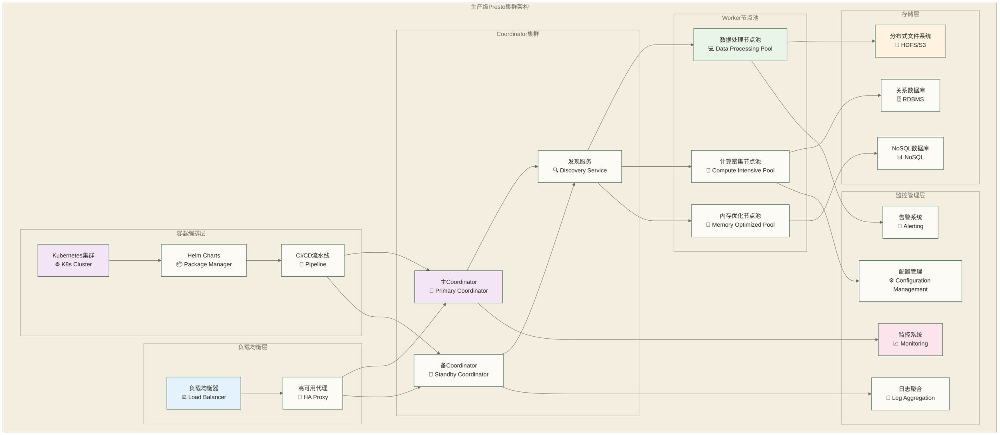

# Presto集群部署与管理 - 生产环境运维实战指南

> [!abstract] 📋 本节概览
> - 🎯 学习目标：掌握Presto集群的完整部署、配置、扩缩容和运维管理
> - 📚 前置知识：[[【技术与工具】/Presto/12-安全配置与权限管理|安全配置与权限]] 和 Linux系统管理、容器技术基础
> - ⏱️ 预计用时：160分钟

## 🏗️ 集群架构设计

### 📊 生产环境集群架构



### 🎯 集群规模规划矩阵（假设性示例，非实测容量结论）

| 场景类型 | 用户规模 | QPS | Coordinator | Worker节点 | 总内存 | 存储 |
|----------|----------|-----|-------------|------------|--------|------|
| **小型团队** | <50 | <10 | 1-2台 | 3-5台 | 200-500GB | 10-50TB |
| **中型企业** | 50-200 | 10-50 | 2-3台 | 10-20台 | 1-2TB | 50-200TB |
| **大型企业** | 200-1000 | 50-200 | 3-5台 | 30-100台 | 3-10TB | 200TB-1PB |
| **超大规模** | >1000 | >200 | 5-10台 | 100-500台 | >10TB | >1PB |

## 🚀 传统部署方式

### 📋 集群节点准备

**系统环境准备脚本**:
```bash
#!/bin/bash
# prepare_presto_cluster.sh - Presto集群环境准备脚本

set -e

# 配置变量
PRESTO_USER="presto"
PRESTO_VERSION="450"
JAVA_VERSION="17"
PRESTO_HOME="/opt/presto"
DATA_DIR="/data/presto"

# 系统优化参数
optimize_system() {
    echo "Optimizing system parameters..."
    
    # 内核参数优化
    cat >> /etc/sysctl.conf << EOF
# Presto优化参数
vm.max_map_count=262144
vm.swappiness=1
net.core.somaxconn=65535
net.core.netdev_max_backlog=5000
net.ipv4.tcp_keepalive_time=300
net.ipv4.tcp_keepalive_intvl=30
net.ipv4.tcp_keepalive_probes=3
net.ipv4.tcp_fin_timeout=30
fs.file-max=1000000
EOF
    
    sysctl -p
    
    # 用户限制优化
    cat >> /etc/security/limits.conf << EOF
$PRESTO_USER soft nofile 1000000
$PRESTO_USER hard nofile 1000000
$PRESTO_USER soft nproc 32768
$PRESTO_USER hard nproc 32768
$PRESTO_USER soft memlock unlimited
$PRESTO_USER hard memlock unlimited
EOF
    
    # 禁用透明大页
    echo never > /sys/kernel/mm/transparent_hugepage/enabled
    echo never > /sys/kernel/mm/transparent_hugepage/defrag
}

# 安装Java
install_java() {
    echo "Installing Java $JAVA_VERSION..."
    
    # Amazon Corretto安装
    curl -L https://corretto.aws/downloads/latest/amazon-corretto-$JAVA_VERSION-x64-linux-jdk.tar.gz -o java.tar.gz
    tar -xzf java.tar.gz -C /opt/
    ln -sf /opt/amazon-corretto-$JAVA_VERSION.* /opt/java
    
    # 环境变量设置
    cat >> /etc/environment << EOF
JAVA_HOME=/opt/java
PATH=$PATH:/opt/java/bin
EOF
    
    source /etc/environment
}

# 创建Presto用户和目录
setup_user_and_dirs() {
    echo "Setting up Presto user and directories..."
    
    # 创建用户
    useradd -r -m -s /bin/bash $PRESTO_USER
    
    # 创建必要目录
    mkdir -p $PRESTO_HOME/{bin,lib,plugin,etc/catalog}
    mkdir -p $DATA_DIR/{data,logs,tmp}
    mkdir -p /var/log/presto
    
    # 设置权限
    chown -R $PRESTO_USER:$PRESTO_USER $PRESTO_HOME $DATA_DIR /var/log/presto
    chmod -R 755 $PRESTO_HOME
    chmod -R 750 $DATA_DIR
}

# 安装Presto
install_presto() {
    echo "Installing Presto $PRESTO_VERSION..."
    
    # 下载Presto
    cd /tmp
    curl -L https://repo1.maven.org/maven2/io/prestosql/presto-server/$PRESTO_VERSION/presto-server-$PRESTO_VERSION.tar.gz -o presto-server.tar.gz
    
    # 解压安装
    tar -xzf presto-server.tar.gz
    cp -r presto-server-$PRESTO_VERSION/* $PRESTO_HOME/
    
    # 下载CLI
    curl -L https://repo1.maven.org/maven2/io/prestosql/presto-cli/$PRESTO_VERSION/presto-cli-$PRESTO_VERSION-executable.jar -o $PRESTO_HOME/bin/presto-cli
    chmod +x $PRESTO_HOME/bin/presto-cli
    
    # 设置权限
    chown -R $PRESTO_USER:$PRESTO_USER $PRESTO_HOME
}

# 主执行流程
main() {
    echo "Starting Presto cluster preparation..."
    
    optimize_system
    install_java
    setup_user_and_dirs
    install_presto
    
    echo "Presto cluster preparation completed!"
    echo "Next steps:"
    echo "1. Configure coordinator and workers"
    echo "2. Set up catalogs"
    echo "3. Start the services"
}

# 检查是否为root用户
if [ "$EUID" -ne 0 ]; then
    echo "Please run as root"
    exit 1
fi

main
```

### ⚙️ Coordinator配置

**Coordinator配置文件** (`etc/config.properties`):
```properties
# 协调器基础配置
coordinator=true
node-scheduler.include-coordinator=false
http-server.http.port=8080
query.max-memory=50GB
query.max-memory-per-node=1GB
query.max-total-memory=50GB
discovery-server.enabled=true
discovery.uri=http://coordinator1.company.com:8080

# 高可用配置
http-server.https.enabled=true
http-server.https.port=8443
http-server.https.keystore.path=/etc/presto/keystore.jks
http-server.https.keystore.key=keystore_password

# 集群发现配置
node.environment=production
node.id=coordinator-1
node.data-dir=/data/presto/data

# 内存和并发配置
query.max-memory=100GB
query.max-memory-per-node=8GB
query.max-total-memory=500GB
memory.heap-headroom-per-node=2GB

# 资源组配置
resource-groups.configuration-manager=file
resource-groups.config-file=etc/resource-groups.json

# 事件监听器
event-listener.name=audit-logger
audit.log-path=/var/log/presto/audit.log

# 会话属性
session-property-managers=system

# 安全配置
http-server.authentication.type=KERBEROS
http.authentication.krb5.config=/etc/krb5.conf
```

### 🖥️ Worker配置

**Worker配置文件** (`etc/config.properties`):
```properties
# Worker基础配置
coordinator=false
http-server.http.port=8080
query.max-memory-per-node=8GB
discovery.uri=http://coordinator1.company.com:8080,http://coordinator2.company.com:8080

# 节点标识
node.environment=production
node.id=worker-${HOSTNAME}
node.data-dir=/data/presto/data

# 性能配置
task.max-worker-threads=200
task.min-drivers=50
task.max-drivers-per-task=20

# 内存配置
memory.heap-headroom-per-node=2GB
resources.reserved-system-memory=4GB

# Spill配置
spill-enabled=true
spiller-spill-path=/data/presto/spill
spiller-max-used-space-threshold=0.8

# 网络配置
task.http-response-threads=100
task.http-timeout-threads=10

# 连接器线程配置
task.writer-count=4
task.task-notification-threads=10

# 健康检查
http-server.log.enabled=true
http-server.log.path=/var/log/presto/http-request.log
```

### 🔄 服务管理

**Systemd服务配置** (`/etc/systemd/system/presto.service`):
```ini
[Unit]
Description=Presto Distributed SQL Query Engine
After=network.target
Wants=network.target

[Service]
Type=forking
User=presto
Group=presto
ExecStart=/opt/presto/bin/launcher start
ExecStop=/opt/presto/bin/launcher stop
ExecReload=/bin/kill -HUP $MAINPID
PIDFile=/data/presto/data/var/run/launcher.pid
Restart=always
RestartSec=10
LimitNOFILE=1000000
LimitNPROC=32768

# 环境变量
Environment=JAVA_HOME=/opt/java
Environment=PATH=/opt/java/bin:/usr/local/bin:/usr/bin:/bin

# 工作目录
WorkingDirectory=/opt/presto

# 安全设置
NoNewPrivileges=yes
ProtectHome=yes
ProtectSystem=strict
ReadWritePaths=/data/presto /var/log/presto

[Install]
WantedBy=multi-user.target
```

**集群启动脚本**:
```bash
#!/bin/bash
# start_presto_cluster.sh - Presto集群启动脚本

COORDINATORS=("coordinator1.company.com" "coordinator2.company.com")
WORKERS=("worker1.company.com" "worker2.company.com" "worker3.company.com" "worker4.company.com" "worker5.company.com")

# 启动Coordinator
start_coordinators() {
    echo "Starting Presto coordinators..."
    
    for coordinator in "${COORDINATORS[@]}"; do
        echo "Starting coordinator on $coordinator..."
        ssh $coordinator "sudo systemctl start presto"
        
        # 等待启动完成
        sleep 30
        
        # 检查状态
        if ssh $coordinator "curl -f http://localhost:8080/v1/info" > /dev/null 2>&1; then
            echo "✓ Coordinator $coordinator started successfully"
        else
            echo "✗ Failed to start coordinator $coordinator"
        fi
    done
}

# 启动Workers
start_workers() {
    echo "Starting Presto workers..."
    
    for worker in "${WORKERS[@]}"; do
        echo "Starting worker on $worker..."
        ssh $worker "sudo systemctl start presto" &
    done
    
    # 等待所有worker启动
    wait
    sleep 60
    
    # 检查worker状态
    for worker in "${WORKERS[@]}"; do
        if ssh $worker "curl -f http://localhost:8080/v1/info" > /dev/null 2>&1; then
            echo "✓ Worker $worker started successfully"
        else
            echo "✗ Failed to start worker $worker"
        fi
    done
}

# 验证集群状态
verify_cluster() {
    echo "Verifying cluster status..."
    
    # 检查节点发现
    active_nodes=$(curl -s http://coordinator1.company.com:8080/v1/node | jq '. | length')
    expected_nodes=$((${#COORDINATORS[@]} + ${#WORKERS[@]}))
    
    echo "Active nodes: $active_nodes / $expected_nodes"
    
    if [ "$active_nodes" -eq "$expected_nodes" ]; then
        echo "✓ All nodes are active"
    else
        echo "⚠ Some nodes may not be active"
    fi
    
    # 运行测试查询
    echo "Running test query..."
    /opt/presto/bin/presto-cli --server coordinator1.company.com:8080 --execute "SELECT 'Cluster is ready!' as status"
}

# 主执行流程
main() {
    echo "Starting Presto cluster deployment..."
    
    start_coordinators
    start_workers
    verify_cluster
    
    echo "Presto cluster started successfully!"
    echo "Coordinator URLs:"
    for coordinator in "${COORDINATORS[@]}"; do
        echo "  - http://$coordinator:8080"
    done
}

main
```

## ☸️ Kubernetes部署

### 📦 Helm Chart部署

**Presto Helm Values** (`values.yaml`):
```yaml
# Presto Helm配置
image:
  repository: prestosql/presto
  tag: "450"
  pullPolicy: IfNotPresent

# Coordinator配置
coordinator:
  enabled: true
  replicas: 2
  
  resources:
    requests:
      memory: "8Gi"
      cpu: "2"
    limits:
      memory: "16Gi"
      cpu: "4"
  
  nodeSelector:
    node-type: coordinator
  
  tolerations:
    - key: "coordinator"
      operator: "Equal"
      value: "true"
      effect: "NoSchedule"
  
  affinity:
    podAntiAffinity:
      requiredDuringSchedulingIgnoredDuringExecution:
        - labelSelector:
            matchExpressions:
              - key: "app"
                operator: "In"
                values: ["presto-coordinator"]
          topologyKey: "kubernetes.io/hostname"

# Worker配置
worker:
  enabled: true
  replicas: 10
  
  resources:
    requests:
      memory: "16Gi"
      cpu: "4"
    limits:
      memory: "32Gi"
      cpu: "8"
  
  nodeSelector:
    node-type: worker
  
  tolerations:
    - key: "worker"
      operator: "Equal"
      value: "true"
      effect: "NoSchedule"
  
  # 水平自动扩缩容
  autoscaling:
    enabled: true
    minReplicas: 5
    maxReplicas: 50
    targetCPUUtilizationPercentage: 70
    targetMemoryUtilizationPercentage: 80

# 服务配置
service:
  type: LoadBalancer
  port: 8080
  httpsPort: 8443
  annotations:
    service.beta.kubernetes.io/aws-load-balancer-type: "nlb"
    service.beta.kubernetes.io/aws-load-balancer-cross-zone-load-balancing-enabled: "true"

# Ingress配置
ingress:
  enabled: true
  className: "nginx"
  annotations:
    nginx.ingress.kubernetes.io/ssl-redirect: "true"
    nginx.ingress.kubernetes.io/backend-protocol: "HTTP"
    cert-manager.io/cluster-issuer: "letsencrypt-prod"
  
  hosts:
    - host: presto.company.com
      paths:
        - path: /
          pathType: Prefix
  
  tls:
    - secretName: presto-tls
      hosts:
        - presto.company.com

# 存储配置
persistence:
  enabled: true
  storageClass: "fast-ssd"
  size: 100Gi
  accessMode: ReadWriteOnce

# ConfigMap配置
config:
  coordinator:
    query.max-memory: "50GB"
    query.max-memory-per-node: "8GB"
    query.max-total-memory: "500GB"
    discovery-server.enabled: "true"
    http-server.http.port: "8080"
    
  worker:
    query.max-memory-per-node: "16GB"
    task.max-worker-threads: "200"
    task.min-drivers: "50"

# 监控配置
monitoring:
  enabled: true
  serviceMonitor:
    enabled: true
    interval: "30s"
    path: "/v1/status"
  
  prometheusRule:
    enabled: true
    rules:
      - alert: PrestoCoordinatorDown
        expr: up{job="presto-coordinator"} == 0
        for: 5m
        labels:
          severity: critical
        annotations:
          summary: "Presto coordinator is down"
      
      - alert: PrestoWorkerDown
        expr: up{job="presto-worker"} == 0
        for: 10m
        labels:
          severity: warning
        annotations:
          summary: "Presto worker is down"

# 安全配置
security:
  enabled: true
  authentication:
    type: "oauth2"
    oauth2:
      clientId: "presto-client"
      clientSecret: "presto-secret"
      issuerUrl: "https://auth.company.com"
```

**Kubernetes部署脚本**:
```bash
#!/bin/bash
# deploy_presto_k8s.sh - Kubernetes上部署Presto集群

set -e

NAMESPACE="presto"
RELEASE_NAME="presto-cluster"
CHART_VERSION="1.0.0"

# 创建命名空间
create_namespace() {
    echo "Creating namespace $NAMESPACE..."
    
    kubectl create namespace $NAMESPACE --dry-run=client -o yaml | kubectl apply -f -
    
    # 设置资源配额
    cat <<EOF | kubectl apply -f -
apiVersion: v1
kind: ResourceQuota
metadata:
  name: presto-quota
  namespace: $NAMESPACE
spec:
  hard:
    requests.cpu: "100"
    requests.memory: "500Gi"
    limits.cpu: "200"
    limits.memory: "1000Gi"
    persistentvolumeclaims: "50"
EOF
}

# 创建密钥
create_secrets() {
    echo "Creating secrets..."
    
    # Presto内部通信密钥
    kubectl create secret generic presto-internal-secret \
        --from-literal=internal-shared-secret=$(openssl rand -hex 32) \
        --namespace=$NAMESPACE \
        --dry-run=client -o yaml | kubectl apply -f -
    
    # SSL证书密钥
    kubectl create secret tls presto-tls \
        --cert=presto.crt \
        --key=presto.key \
        --namespace=$NAMESPACE \
        --dry-run=client -o yaml | kubectl apply -f -
}

# 配置节点标签
label_nodes() {
    echo "Labeling nodes..."
    
    # 标记coordinator节点
    kubectl label nodes node1 node2 node-type=coordinator --overwrite
    kubectl taint nodes node1 node2 coordinator=true:NoSchedule --overwrite
    
    # 标记worker节点
    kubectl label nodes node3 node4 node5 node6 node7 node-type=worker --overwrite
    kubectl taint nodes node3 node4 node5 node6 node7 worker=true:NoSchedule --overwrite
}

# 部署Presto
deploy_presto() {
    echo "Deploying Presto with Helm..."
    
    # 添加Helm仓库
    helm repo add presto https://prestosql.github.io/presto-helm-charts
    helm repo update
    
    # 安装/升级Presto
    helm upgrade --install $RELEASE_NAME presto/presto \
        --namespace=$NAMESPACE \
        --version=$CHART_VERSION \
        --values=values.yaml \
        --wait \
        --timeout=20m
}

# 验证部署
verify_deployment() {
    echo "Verifying deployment..."
    
    # 检查Pod状态
    kubectl get pods -n $NAMESPACE
    
    # 检查服务状态
    kubectl get svc -n $NAMESPACE
    
    # 等待所有Pod就绪
    kubectl wait --for=condition=ready pod -l app=presto-coordinator -n $NAMESPACE --timeout=600s
    kubectl wait --for=condition=ready pod -l app=presto-worker -n $NAMESPACE --timeout=600s
    
    # 运行测试查询
    coordinator_pod=$(kubectl get pods -n $NAMESPACE -l app=presto-coordinator -o jsonpath='{.items[0].metadata.name}')
    kubectl exec -n $NAMESPACE $coordinator_pod -- presto-cli --execute "SELECT 'Kubernetes deployment successful!' as status"
}

# 设置监控
setup_monitoring() {
    echo "Setting up monitoring..."
    
    # 部署Prometheus ServiceMonitor
    cat <<EOF | kubectl apply -f -
apiVersion: monitoring.coreos.com/v1
kind: ServiceMonitor
metadata:
  name: presto-monitor
  namespace: $NAMESPACE
spec:
  selector:
    matchLabels:
      app: presto
  endpoints:
  - port: http
    path: /v1/status
    interval: 30s
EOF
    
    # 部署Grafana Dashboard ConfigMap
    kubectl create configmap presto-dashboard \
        --from-file=presto-dashboard.json \
        --namespace=$NAMESPACE \
        --dry-run=client -o yaml | kubectl apply -f -
}

# 主执行流程
main() {
    echo "Starting Presto Kubernetes deployment..."
    
    create_namespace
    create_secrets
    label_nodes
    deploy_presto
    verify_deployment
    setup_monitoring
    
    echo "Presto Kubernetes deployment completed successfully!"
    echo "Access URLs:"
    kubectl get ingress -n $NAMESPACE
}

main
```

## 🔄 集群扩缩容管理

### 📈 自动扩缩容配置

**Horizontal Pod Autoscaler**:
```yaml
apiVersion: autoscaling/v2
kind: HorizontalPodAutoscaler
metadata:
  name: presto-worker-hpa
  namespace: presto
spec:
  scaleTargetRef:
    apiVersion: apps/v1
    kind: Deployment
    name: presto-worker
  minReplicas: 10
  maxReplicas: 100
  metrics:
  - type: Resource
    resource:
      name: cpu
      target:
        type: Utilization
        averageUtilization: 70
  - type: Resource
    resource:
      name: memory
      target:
        type: Utilization
        averageUtilization: 80
  - type: Pods
    pods:
      metric:
        name: presto_active_queries_per_node
      target:
        type: AverageValue
        averageValue: "5"
  behavior:
    scaleUp:
      stabilizationWindowSeconds: 300
      policies:
      - type: Percent
        value: 50
        periodSeconds: 60
      - type: Pods
        value: 5
        periodSeconds: 60
    scaleDown:
      stabilizationWindowSeconds: 600
      policies:
      - type: Percent
        value: 10
        periodSeconds: 60
      - type: Pods
        value: 2
        periodSeconds: 60
```

**基于负载的扩缩容脚本**:
```bash
#!/bin/bash
# autoscale_presto.sh - Presto集群自动扩缩容脚本

NAMESPACE="presto"
MIN_WORKERS=10
MAX_WORKERS=50
SCALE_UP_THRESHOLD=80    # CPU使用率阈值
SCALE_DOWN_THRESHOLD=30  # CPU使用率阈值
CHECK_INTERVAL=60        # 检查间隔(秒)

# 获取当前worker数量
get_current_workers() {
    kubectl get deployment presto-worker -n $NAMESPACE -o jsonpath='{.spec.replicas}'
}

# 获取平均CPU使用率
get_cpu_usage() {
    kubectl top pods -n $NAMESPACE -l app=presto-worker --no-headers | \
    awk '{cpu+=$2} END {if(NR>0) print cpu/NR; else print 0}' | \
    sed 's/m$//'
}

# 获取当前查询负载
get_query_load() {
    # 通过Presto API获取当前运行的查询数
    coordinator_service=$(kubectl get svc presto-coordinator -n $NAMESPACE -o jsonpath='{.spec.clusterIP}')
    curl -s "http://$coordinator_service:8080/v1/cluster" | jq '.runningQueries // 0'
}

# 扩容操作
scale_up() {
    local current_workers=$1
    local new_workers=$(( current_workers + 2 ))
    
    if [ $new_workers -le $MAX_WORKERS ]; then
        echo "$(date): Scaling up from $current_workers to $new_workers workers"
        kubectl scale deployment presto-worker --replicas=$new_workers -n $NAMESPACE
        
        # 等待新Pod就绪
        kubectl wait --for=condition=ready pod -l app=presto-worker -n $NAMESPACE --timeout=600s
        echo "$(date): Scale up completed"
    else
        echo "$(date): Maximum workers ($MAX_WORKERS) reached, cannot scale up"
    fi
}

# 缩容操作
scale_down() {
    local current_workers=$1
    local new_workers=$(( current_workers - 1 ))
    
    if [ $new_workers -ge $MIN_WORKERS ]; then
        echo "$(date): Scaling down from $current_workers to $new_workers workers"
        
        # 示例延迟：等待30秒不代表任务已排空，不能据此保证优雅缩容
        sleep 30
        
        kubectl scale deployment presto-worker --replicas=$new_workers -n $NAMESPACE
        echo "$(date): Scale down completed"
    else
        echo "$(date): Minimum workers ($MIN_WORKERS) reached, cannot scale down"
    fi
}

# 主监控循环
monitor_and_scale() {
    while true; do
        current_workers=$(get_current_workers)
        cpu_usage=$(get_cpu_usage)
        query_load=$(get_query_load)
        
        echo "$(date): Workers: $current_workers, CPU: ${cpu_usage}%, Queries: $query_load"
        
        # 扩容条件：CPU使用率高或查询数量多
        if [ "$cpu_usage" -gt "$SCALE_UP_THRESHOLD" ] || [ "$query_load" -gt 20 ]; then
            scale_up $current_workers
        # 缩容条件：CPU使用率低且查询数量少
        elif [ "$cpu_usage" -lt "$SCALE_DOWN_THRESHOLD" ] && [ "$query_load" -lt 5 ]; then
            scale_down $current_workers
        else
            echo "$(date): No scaling action needed"
        fi
        
        sleep $CHECK_INTERVAL
    done
}

# 启动监控
echo "Starting Presto autoscaling monitor..."
echo "Scale up threshold: ${SCALE_UP_THRESHOLD}% CPU"
echo "Scale down threshold: ${SCALE_DOWN_THRESHOLD}% CPU"
echo "Worker range: $MIN_WORKERS - $MAX_WORKERS"

monitor_and_scale
```

### 🔧 手动扩缩容操作

```bash
#!/bin/bash
# manual_scale_presto.sh - Presto集群手动扩缩容

NAMESPACE="presto"

# 添加Worker节点
add_workers() {
    local count=$1
    local current_workers=$(kubectl get deployment presto-worker -n $NAMESPACE -o jsonpath='{.spec.replicas}')
    local new_workers=$(( current_workers + count ))
    
    echo "Adding $count workers (current: $current_workers, new: $new_workers)"
    
    kubectl scale deployment presto-worker --replicas=$new_workers -n $NAMESPACE
    
    # 等待新节点就绪
    echo "Waiting for new workers to be ready..."
    kubectl wait --for=condition=ready pod -l app=presto-worker -n $NAMESPACE --timeout=600s
    
    # 验证节点已加入集群
    coordinator_service=$(kubectl get svc presto-coordinator -n $NAMESPACE -o jsonpath='{.spec.clusterIP}')
    active_nodes=$(curl -s "http://$coordinator_service:8080/v1/node" | jq '. | length')
    
    echo "Active nodes in cluster: $active_nodes"
    echo "Workers added successfully"
}

# 移除Worker节点
remove_workers() {
    local count=$1
    local current_workers=$(kubectl get deployment presto-worker -n $NAMESPACE -o jsonpath='{.spec.replicas}')
    local new_workers=$(( current_workers - count ))
    
    if [ $new_workers -lt 1 ]; then
        echo "Error: Cannot remove all workers"
        exit 1
    fi
    
    echo "Removing $count workers (current: $current_workers, new: $new_workers)"
    
    # 优雅关闭：等待当前查询完成
    echo "Waiting for running queries to complete..."
    coordinator_service=$(kubectl get svc presto-coordinator -n $NAMESPACE -o jsonpath='{.spec.clusterIP}')
    
    while true; do
        running_queries=$(curl -s "http://$coordinator_service:8080/v1/cluster" | jq '.runningQueries // 0')
        if [ "$running_queries" -eq 0 ]; then
            break
        fi
        echo "Waiting for $running_queries queries to complete..."
        sleep 10
    done
    
    kubectl scale deployment presto-worker --replicas=$new_workers -n $NAMESPACE
    echo "Workers removed successfully"
}

# 使用方法
case "$1" in
    add)
        if [ -z "$2" ]; then
            echo "Usage: $0 add <count>"
            exit 1
        fi
        add_workers $2
        ;;
    remove)
        if [ -z "$2" ]; then
            echo "Usage: $0 remove <count>"
            exit 1
        fi
        remove_workers $2
        ;;
    *)
        echo "Usage: $0 {add|remove} <count>"
        echo "Examples:"
        echo "  $0 add 5      # Add 5 workers"
        echo "  $0 remove 2   # Remove 2 workers"
        exit 1
        ;;
esac
```

## 🔄 集群升级管理

### 📦 滚动升级策略

```bash
#!/bin/bash
# rolling_upgrade_presto.sh - Presto集群滚动升级脚本

set -e

OLD_VERSION="450"
NEW_VERSION="451"
NAMESPACE="presto"
UPGRADE_TIMEOUT="20m"

# 预升级检查
pre_upgrade_checks() {
    echo "Performing pre-upgrade checks..."
    
    # 检查集群健康状态
    coordinator_service=$(kubectl get svc presto-coordinator -n $NAMESPACE -o jsonpath='{.spec.clusterIP}')
    if ! curl -f "http://$coordinator_service:8080/v1/info" > /dev/null 2>&1; then
        echo "Error: Coordinator is not healthy"
        exit 1
    fi
    
    # 检查运行中的查询
    running_queries=$(curl -s "http://$coordinator_service:8080/v1/cluster" | jq '.runningQueries // 0')
    if [ "$running_queries" -gt 0 ]; then
        echo "Warning: $running_queries queries are currently running"
        read -p "Continue with upgrade? (y/N): " -n 1 -r
        echo
        if [[ ! $REPLY =~ ^[Yy]$ ]]; then
            echo "Upgrade cancelled"
            exit 1
        fi
    fi
    
    # 备份配置
    echo "Backing up current configuration..."
    kubectl get configmap -n $NAMESPACE -o yaml > "presto-config-backup-$(date +%Y%m%d-%H%M%S).yaml"
    
    echo "Pre-upgrade checks completed"
}

# 升级Coordinator
upgrade_coordinators() {
    echo "Upgrading coordinators..."
    
    # 设置新镜像
    kubectl set image deployment/presto-coordinator \
        presto=prestosql/presto:$NEW_VERSION \
        -n $NAMESPACE
    
    # 等待滚动更新完成
    kubectl rollout status deployment/presto-coordinator \
        -n $NAMESPACE \
        --timeout=$UPGRADE_TIMEOUT
    
    # 验证coordinator健康状态
    sleep 30
    coordinator_service=$(kubectl get svc presto-coordinator -n $NAMESPACE -o jsonpath='{.spec.clusterIP}')
    if curl -f "http://$coordinator_service:8080/v1/info" > /dev/null 2>&1; then
        echo "✓ Coordinators upgraded successfully"
    else
        echo "✗ Coordinator upgrade failed"
        rollback_upgrade "coordinator"
        exit 1
    fi
}

# 升级Workers
upgrade_workers() {
    echo "Upgrading workers..."
    
    # 分批升级workers以保持服务可用性
    local total_workers=$(kubectl get deployment presto-worker -n $NAMESPACE -o jsonpath='{.spec.replicas}')
    local batch_size=$(( total_workers / 3 + 1 ))  # 每批升级1/3的节点
    
    # 设置升级策略
    kubectl patch deployment presto-worker -n $NAMESPACE -p '{
        "spec": {
            "strategy": {
                "type": "RollingUpdate",
                "rollingUpdate": {
                    "maxUnavailable": '$batch_size',
                    "maxSurge": 0
                }
            }
        }
    }'
    
    # 设置新镜像
    kubectl set image deployment/presto-worker \
        presto=prestosql/presto:$NEW_VERSION \
        -n $NAMESPACE
    
    # 等待滚动更新完成
    kubectl rollout status deployment/presto-worker \
        -n $NAMESPACE \
        --timeout=$UPGRADE_TIMEOUT
    
    # 验证所有workers已加入集群
    sleep 60
    coordinator_service=$(kubectl get svc presto-coordinator -n $NAMESPACE -o jsonpath='{.spec.clusterIP}')
    active_nodes=$(curl -s "http://$coordinator_service:8080/v1/node" | jq '. | length')
    expected_nodes=$(( $(kubectl get deployment presto-coordinator -n $NAMESPACE -o jsonpath='{.spec.replicas}') + total_workers ))
    
    if [ "$active_nodes" -eq "$expected_nodes" ]; then
        echo "✓ Workers upgraded successfully"
    else
        echo "✗ Worker upgrade failed (expected: $expected_nodes, actual: $active_nodes)"
        rollback_upgrade "worker"
        exit 1
    fi
}

# 回滚升级
rollback_upgrade() {
    local component=$1
    echo "Rolling back $component upgrade..."
    
    case $component in
        "coordinator")
            kubectl rollout undo deployment/presto-coordinator -n $NAMESPACE
            kubectl rollout status deployment/presto-coordinator -n $NAMESPACE
            ;;
        "worker")
            kubectl rollout undo deployment/presto-worker -n $NAMESPACE
            kubectl rollout status deployment/presto-worker -n $NAMESPACE
            ;;
        *)
            kubectl rollout undo deployment/presto-coordinator -n $NAMESPACE
            kubectl rollout undo deployment/presto-worker -n $NAMESPACE
            ;;
    esac
    
    echo "Rollback completed"
}

# 升级后验证
post_upgrade_verification() {
    echo "Performing post-upgrade verification..."
    
    # 检查版本
    coordinator_pod=$(kubectl get pods -n $NAMESPACE -l app=presto-coordinator -o jsonpath='{.items[0].metadata.name}')
    actual_version=$(kubectl exec -n $NAMESPACE $coordinator_pod -- java -cp /usr/lib/presto/lib/presto-main-*.jar io.prestosql.server.PrestoServer --version 2>/dev/null | grep -o '[0-9]\+' | head -1)
    
    if [ "$actual_version" = "$NEW_VERSION" ]; then
        echo "✓ Version verification passed: $NEW_VERSION"
    else
        echo "✗ Version verification failed: expected $NEW_VERSION, got $actual_version"
        return 1
    fi
    
    # 运行测试查询
    echo "Running test queries..."
    if kubectl exec -n $NAMESPACE $coordinator_pod -- presto-cli --execute "SELECT 'Upgrade verification successful!' as status" > /dev/null 2>&1; then
        echo "✓ Test query passed"
    else
        echo "✗ Test query failed"
        return 1
    fi
    
    echo "Post-upgrade verification completed successfully"
}

# 主升级流程
main() {
    echo "Starting Presto cluster upgrade from $OLD_VERSION to $NEW_VERSION..."
    
    pre_upgrade_checks
    upgrade_coordinators
    upgrade_workers
    post_upgrade_verification
    
    echo "Presto cluster upgrade completed successfully!"
    echo "All nodes are now running version $NEW_VERSION"
}

# 错误处理
trap 'echo "Upgrade failed! Check logs and consider rollback."; exit 1' ERR

main
```

## 🔗 学习连接

### 📚 本节核心技能

- **集群架构设计**：掌握生产级Presto集群的架构规划和节点配置
- **传统部署**：完整的物理机/虚拟机部署流程和系统优化
- **容器化部署**：Kubernetes环境下的Helm部署和管理
- **扩缩容管理**：自动和手动扩缩容策略的实现
- **滚动升级**：集群升级流程示例；能否降低停机时间取决于版本兼容、任务排空和路由机制，不保证零停机
- **运维自动化**：生产环境的自动化运维脚本和监控

### 🎯 下一步学习

**集群管理检查**：
- ✅ 能够设计和部署生产级Presto集群？
- ✅ 掌握Kubernetes环境下的容器化部署？
- ✅ 理解集群扩缩容和升级的最佳实践？

**继续学习路径**：
- [[【技术与工具】/Presto/14-监控与告警|监控与告警]] - 监控告警
- [[【技术与工具】/Presto/15-故障诊断与调试|故障诊断与调试]] - 故障处理
- [[【技术与工具】/Presto/16-企业级应用实践|企业级应用实践]] - 企业实践

---

> [!tip] 💡 集群部署精髓
> 
> 🏗️ **生产部署核心原则**：
> - 📊 **合理规划** - 根据业务需求设计集群规模和节点配置
> - 🔄 **高可用设计** - 多Coordinator架构规划示例；自动故障切换依赖目标发行版及额外机制，本文未提供完整实现
> - ☸️ **容器化优势** - 利用Kubernetes的自动化管理能力
> - 📈 **弹性扩缩容** - 基于负载自动调整集群规模
> 
> 🚀 **运维监控**：集群部署完成后，进入 14-监控与告警|监控与告警 学习完整的监控告警体系！