# Presto监控与告警 - 企业级运维监控体系构建

> [!abstract] 📋 本节概览
> - 🎯 学习目标：构建完整的Presto监控告警体系，实现主动式运维和故障预防
> - 📚 前置知识：13-集群部署与管理|集群部署与管理 和 Prometheus、Grafana基础概念
> - ⏱️ 预计用时：150分钟

## 📊 监控体系架构

### 🏗️ 企业级监控架构

```mermaid
%%{init: {"theme":"base","themeVariables":{"fontFamily":"PingFang SC, -apple-system, Source Han Serif SC, serif","fontSize":"16px","background":"#FDFBF5","primaryColor":"#FDFBF5","primaryTextColor":"#2D2A26","primaryBorderColor":"#6E6A60","secondaryColor":"#E8EFE8","secondaryBorderColor":"#8FA890","secondaryTextColor":"#2D2A26","tertiaryColor":"#FDFBF5","tertiaryBorderColor":"#9A9488","tertiaryTextColor":"#6E6A60","lineColor":"#6E6A60","textColor":"#2D2A26","mainBkg":"#FDFBF5","nodeBorder":"#2D5A3D","clusterBkg":"#F3EEDF","clusterBorder":"#9A9488","edgeLabelBackground":"#FDFBF5"},"flowchart":{"htmlLabels":true,"curve":"basis","padding":20,"nodeSpacing":60,"rankSpacing":70,"useMaxWidth":false},"themeCSS":".node rect, .node polygon, .node circle { stroke-width: 1.5px; } .edgePath .path { stroke-width: 1.5px; } .cluster-label .nodeLabel, .cluster-label foreignObject { color: #2D2A26 !important; } .edgeLabel, .edgeLabel foreignObject { color: #2D2A26 !important; background-color: #FDFBF5; } .edgeLabel rect { fill: #FDFBF5; }"}}%%
flowchart TB
    subgraph "Presto监控体系架构"
        subgraph "数据采集层"
            A[Presto Metrics<br/>📊 内置指标]
            B[JVM Metrics<br/>☕ JVM监控]
            C[System Metrics<br/>🖥️ 系统指标]
            D[Custom Metrics<br/>🎯 自定义指标]
        end
        subgraph "指标存储层"
            E[Prometheus<br/>📈 时序数据库]
            F[InfluxDB<br/>💾 时序存储]
            G[Elasticsearch<br/>🔍 日志存储]
        end
        subgraph "数据处理层"
            H[Prometheus Rules<br/>📋 规则引擎]
            I[Alert Manager<br/>🚨 告警管理]
            J[Log Aggregation<br/>📝 日志聚合]
        end
        subgraph "可视化层"
            K[Grafana Dashboard<br/>📊 数据可视化]
            L[Kibana<br/>📋 日志分析]
            M[Custom Web UI<br/>🌐 自定义界面]
        end
        subgraph "通知层"
            N[邮件通知<br/>📧 Email]
            O[短信通知<br/>📱 SMS]
            P[Slack集成<br/>💬 Chat Ops]
            Q[钉钉/企微<br/>🔔 企业通讯]
        end
        subgraph "智能分析层"
            R[异常检测<br/>🤖 ML Detection]
            S[根因分析<br/>🔍 Root Cause]
            T[预测分析<br/>🔮 Forecasting]
            U[自动化响应<br/>⚡ Auto Response]
        end
    A --> E
    B --> E
    C --> F
    D --> G
    E --> H
    F --> I
    G --> J
    H --> K
    I --> L
    J --> M
    K --> N
    L --> O
    M --> P
    N --> Q
    O --> R
    P --> S
    Q --> T
    R --> U
    S --> U
    T --> U
    style A fill:#e3f2fd
    style E fill:#f3e5f5
    style H fill:#e8f5e8
    style K fill:#fff3e0
    style N fill:#fce4ec
    style R fill:#f1f8e9

    end
```



### 🎯 监控指标分类

| 指标类型 | 监控维度 | 关键指标 | 告警阈值 |
|----------|----------|----------|----------|
| **集群健康** | 可用性 | 节点状态、心跳检测 | 节点离线>5min |
| **查询性能** | 响应时间 | 查询延迟、QPS | P95延迟>30s |
| **资源使用** | 利用率 | CPU、内存、磁盘 | CPU>80%, 内存>85% |
| **错误率** | 稳定性 | 查询失败率、异常数 | 错误率>5% |
| **吞吐量** | 处理能力 | 数据处理量、并发数 | 处理量下降>30% |
| **业务指标** | 用户体验 | 活跃用户数、业务成功率 | 用户数下降>20% |

## 📈 Prometheus集成

### ⚙️ Prometheus配置

**Prometheus配置文件** (`prometheus.yml`):
```yaml
global:
  scrape_interval: 15s
  evaluation_interval: 15s
  external_labels:
    cluster: 'presto-production'
    environment: 'prod'

# 告警规则文件
rule_files:
  - "presto_alerts.yml"
  - "system_alerts.yml"
  - "business_alerts.yml"

# 抓取配置
scrape_configs:
  # Presto Coordinator监控
  - job_name: 'presto-coordinator'
    static_configs:
      - targets:
          - 'coordinator1:8080'
          - 'coordinator2:8080'
          - 'coordinator3:8080'
    metrics_path: '/v1/status'
    scrape_interval: 30s
    scrape_timeout: 10s
    params:
      format: ['prometheus']
    
  # Presto Worker监控
  - job_name: 'presto-worker'
    static_configs:
      - targets:
          - 'worker1:8080'
          - 'worker2:8080'
          - 'worker3:8080'
          - 'worker4:8080'
          - 'worker5:8080'
    metrics_path: '/v1/status'
    scrape_interval: 30s
    params:
      format: ['prometheus']

  # JVM监控 (通过JMX Exporter)
  - job_name: 'presto-jvm'
    static_configs:
      - targets:
          - 'coordinator1:9404'
          - 'coordinator2:9404'
          - 'worker1:9404'
          - 'worker2:9404'
          - 'worker3:9404'
    scrape_interval: 30s

  # 系统监控 (Node Exporter)
  - job_name: 'presto-nodes'
    static_configs:
      - targets:
          - 'coordinator1:9100'
          - 'coordinator2:9100'
          - 'worker1:9100'
          - 'worker2:9100'
          - 'worker3:9100'
    scrape_interval: 30s

  # Kubernetes监控 (如果使用K8s部署)
  - job_name: 'kubernetes-pods'
    kubernetes_sd_configs:
      - role: pod
        namespaces:
          names:
            - presto
    relabel_configs:
      - source_labels: [__meta_kubernetes_pod_annotation_prometheus_io_scrape]
        action: keep
        regex: true
      - source_labels: [__meta_kubernetes_pod_annotation_prometheus_io_path]
        action: replace
        target_label: __metrics_path__
        regex: (.+)

# Alertmanager配置
alerting:
  alertmanagers:
    - static_configs:
        - targets:
          - "alertmanager:9093"
```

### 📊 自定义指标导出器

**Presto自定义指标收集器** (`presto_metrics_collector.py`):
```python
#!/usr/bin/env python3
"""
Presto自定义指标收集器
收集Presto集群的业务指标和性能数据
"""

import time
import json
import requests
import logging
from prometheus_client import start_http_server, Gauge, Counter, Histogram
from concurrent.futures import ThreadPoolExecutor
from typing import List, Dict, Any

# 配置日志
logging.basicConfig(level=logging.INFO)
logger = logging.getLogger(__name__)

class PrestoMetricsCollector:
    def __init__(self, coordinators: List[str], port: int = 8000):
        self.coordinators = coordinators
        self.port = port
        
        # Prometheus指标定义
        self.cluster_nodes = Gauge('presto_cluster_nodes_total', 'Total number of nodes in cluster')
        self.active_queries = Gauge('presto_active_queries_total', 'Number of active queries')
        self.queued_queries = Gauge('presto_queued_queries_total', 'Number of queued queries')
        self.blocked_queries = Gauge('presto_blocked_queries_total', 'Number of blocked queries')
        self.completed_queries = Counter('presto_completed_queries_total', 'Total completed queries')
        self.failed_queries = Counter('presto_failed_queries_total', 'Total failed queries')
        
        # 查询性能指标
        self.query_execution_time = Histogram(
            'presto_query_execution_seconds',
            'Query execution time in seconds',
            buckets=[0.1, 0.5, 1, 5, 10, 30, 60, 300, 600, 1800, 3600]
        )
        
        # 资源使用指标
        self.memory_usage = Gauge(
            'presto_memory_usage_bytes',
            'Memory usage by pool',
            ['pool_type', 'node']
        )
        
        self.cpu_usage = Gauge(
            'presto_cpu_usage_percent',
            'CPU usage percentage',
            ['node']
        )
        
        # 数据处理指标
        self.data_processed = Counter(
            'presto_data_processed_bytes_total',
            'Total bytes processed',
            ['node']
        )
        
        self.rows_processed = Counter(
            'presto_rows_processed_total',
            'Total rows processed',
            ['node']
        )
        
        # 用户活跃度指标
        self.active_users = Gauge('presto_active_users_total', 'Number of active users')
        self.user_queries = Counter(
            'presto_user_queries_total',
            'Total queries by user',
            ['user', 'source']
        )

    def get_cluster_info(self, coordinator: str) -> Dict[str, Any]:
        """获取集群信息"""
        try:
            response = requests.get(f"http://{coordinator}/v1/cluster", timeout=10)
            response.raise_for_status()
            return response.json()
        except Exception as e:
            logger.error(f"Failed to get cluster info from {coordinator}: {e}")
            return {}

    def get_node_info(self, coordinator: str) -> List[Dict[str, Any]]:
        """获取节点信息"""
        try:
            response = requests.get(f"http://{coordinator}/v1/node", timeout=10)
            response.raise_for_status()
            return response.json()
        except Exception as e:
            logger.error(f"Failed to get node info from {coordinator}: {e}")
            return []

    def get_query_info(self, coordinator: str) -> List[Dict[str, Any]]:
        """获取查询信息"""
        try:
            response = requests.get(f"http://{coordinator}/v1/query", timeout=10)
            response.raise_for_status()
            return response.json()
        except Exception as e:
            logger.error(f"Failed to get query info from {coordinator}: {e}")
            return []

    def collect_cluster_metrics(self, coordinator: str):
        """收集集群级别指标"""
        cluster_info = self.get_cluster_info(coordinator)
        if not cluster_info:
            return
            
        # 集群状态指标
        self.active_queries.set(cluster_info.get('runningQueries', 0))
        self.queued_queries.set(cluster_info.get('queuedQueries', 0))
        self.blocked_queries.set(cluster_info.get('blockedQueries', 0))
        
        # 节点数量
        nodes = self.get_node_info(coordinator)
        self.cluster_nodes.set(len(nodes))
        
        # 收集节点级别指标
        for node in nodes:
            node_id = node.get('nodeId', 'unknown')
            
            # 内存使用情况
            memory_info = node.get('memoryInfo', {})
            for pool_type, pool_info in memory_info.items():
                if isinstance(pool_info, dict) and 'reserved' in pool_info:
                    self.memory_usage.labels(
                        pool_type=pool_type,
                        node=node_id
                    ).set(pool_info['reserved'])

    def collect_query_metrics(self, coordinator: str):
        """收集查询级别指标"""
        queries = self.get_query_info(coordinator)
        if not queries:
            return
            
        active_users = set()
        
        for query in queries:
            user = query.get('session', {}).get('user', 'unknown')
            source = query.get('session', {}).get('source', 'unknown')
            state = query.get('state', 'UNKNOWN')
            
            # 用户活跃度
            if state in ['RUNNING', 'QUEUED', 'PLANNING']:
                active_users.add(user)
            
            # 用户查询统计
            if state in ['FINISHED', 'FAILED']:
                self.user_queries.labels(user=user, source=source).inc()
                
                if state == 'FINISHED':
                    self.completed_queries.inc()
                else:
                    self.failed_queries.inc()
                
                # 查询执行时间
                stats = query.get('queryStats', {})
                execution_time = stats.get('executionTime', 0)
                if execution_time:
                    # 转换为秒
                    execution_seconds = execution_time / 1000.0
                    self.query_execution_time.observe(execution_seconds)
                
                # 数据处理量
                processed_bytes = stats.get('processedBytes', 0)
                processed_rows = stats.get('processedRows', 0)
                
                if processed_bytes > 0:
                    self.data_processed.labels(node=coordinator).inc(processed_bytes)
                if processed_rows > 0:
                    self.rows_processed.labels(node=coordinator).inc(processed_rows)
        
        self.active_users.set(len(active_users))

    def collect_metrics(self):
        """收集所有指标"""
        with ThreadPoolExecutor(max_workers=5) as executor:
            futures = []
            
            for coordinator in self.coordinators:
                # 并行收集不同类型的指标
                futures.append(executor.submit(self.collect_cluster_metrics, coordinator))
                futures.append(executor.submit(self.collect_query_metrics, coordinator))
            
            # 等待所有任务完成
            for future in futures:
                try:
                    future.result(timeout=30)
                except Exception as e:
                    logger.error(f"Metrics collection failed: {e}")

    def run(self):
        """启动指标收集服务"""
        logger.info(f"Starting Presto metrics collector on port {self.port}")
        start_http_server(self.port)
        
        while True:
            try:
                self.collect_metrics()
                logger.info("Metrics collection completed")
            except Exception as e:
                logger.error(f"Metrics collection error: {e}")
            
            time.sleep(30)  # 每30秒收集一次

if __name__ == "__main__":
    coordinators = [
        "coordinator1.company.com:8080",
        "coordinator2.company.com:8080"
    ]
    
    collector = PrestoMetricsCollector(coordinators)
    collector.run()
```

### 📋 告警规则配置

**Presto告警规则** (`presto_alerts.yml`):
```yaml
groups:
  - name: presto_cluster
    rules:
      # 集群可用性告警
      - alert: PrestoCoordinatorDown
        expr: up{job="presto-coordinator"} == 0
        for: 2m
        labels:
          severity: critical
          service: presto
          component: coordinator
        annotations:
          summary: "Presto coordinator is down"
          description: "Presto coordinator {{ $labels.instance }} has been down for more than 2 minutes"
          runbook_url: "https://wiki.company.com/presto/runbooks/coordinator-down"

      - alert: PrestoWorkerDown
        expr: up{job="presto-worker"} == 0
        for: 5m
        labels:
          severity: warning
          service: presto
          component: worker
        annotations:
          summary: "Presto worker is down"
          description: "Presto worker {{ $labels.instance }} has been down for more than 5 minutes"

      - alert: PrestoClusterNodesReduced
        expr: presto_cluster_nodes_total < 8
        for: 10m
        labels:
          severity: warning
          service: presto
        annotations:
          summary: "Presto cluster has reduced number of nodes"
          description: "Presto cluster has only {{ $value }} nodes available, expected at least 8"

  - name: presto_performance
    rules:
      # 性能告警
      - alert: PrestoHighQueryLatency
        expr: histogram_quantile(0.95, presto_query_execution_seconds_bucket) > 300
        for: 10m
        labels:
          severity: warning
          service: presto
        annotations:
          summary: "Presto queries are taking too long"
          description: "95th percentile query execution time is {{ $value }}s, which is above 300s threshold"

      - alert: PrestoHighQueryFailureRate
        expr: rate(presto_failed_queries_total[5m]) / (rate(presto_completed_queries_total[5m]) + rate(presto_failed_queries_total[5m])) > 0.05
        for: 5m
        labels:
          severity: critical
          service: presto
        annotations:
          summary: "High query failure rate"
          description: "Query failure rate is {{ $value | humanizePercentage }}, above 5% threshold"

      - alert: PrestoQueuedQueriesHigh
        expr: presto_queued_queries_total > 50
        for: 5m
        labels:
          severity: warning
          service: presto
        annotations:
          summary: "Too many queued queries"
          description: "{{ $value }} queries are currently queued, indicating resource contention"

  - name: presto_resources
    rules:
      # 资源使用告警
      - alert: PrestoHighMemoryUsage
        expr: (presto_memory_usage_bytes{pool_type="general"} / presto_memory_usage_bytes{pool_type="total"}) > 0.85
        for: 10m
        labels:
          severity: warning
          service: presto
        annotations:
          summary: "Presto memory usage is high"
          description: "Memory usage on {{ $labels.node }} is {{ $value | humanizePercentage }}"

      - alert: PrestoHighCPUUsage
        expr: presto_cpu_usage_percent > 80
        for: 15m
        labels:
          severity: warning
          service: presto
        annotations:
          summary: "Presto CPU usage is high"
          description: "CPU usage on {{ $labels.node }} is {{ $value }}%"

      - alert: PrestoLowDataThroughput
        expr: rate(presto_data_processed_bytes_total[10m]) < 1000000  # 1MB/s
        for: 20m
        labels:
          severity: warning
          service: presto
        annotations:
          summary: "Low data processing throughput"
          description: "Data processing rate is {{ $value | humanize1024 }}/s, below expected threshold"

  - name: presto_business
    rules:
      # 业务指标告警
      - alert: PrestoActiveUsersLow
        expr: presto_active_users_total < 10
        for: 30m
        labels:
          severity: info
          service: presto
        annotations:
          summary: "Low number of active users"
          description: "Only {{ $value }} users are currently active on Presto"

      - alert: PrestoNoQueriesRunning
        expr: presto_active_queries_total == 0
        for: 1h
        labels:
          severity: info
          service: presto
        annotations:
          summary: "No queries running"
          description: "No queries have been running for the past hour"

  - name: presto_system
    rules:
      # 系统级告警
      - alert: PrestoJVMOldGenHigh
        expr: jvm_memory_bytes_used{area="heap", job="presto-jvm"} / jvm_memory_bytes_max{area="heap", job="presto-jvm"} > 0.8
        for: 10m
        labels:
          severity: warning
          service: presto
        annotations:
          summary: "JVM heap usage is high"
          description: "JVM heap usage on {{ $labels.instance }} is {{ $value | humanizePercentage }}"

      - alert: PrestoGCTimeHigh
        expr: rate(jvm_gc_collection_seconds_sum{job="presto-jvm"}[5m]) > 0.1
        for: 10m
        labels:
          severity: warning
          service: presto
        annotations:
          summary: "High GC time"
          description: "GC time on {{ $labels.instance }} is {{ $value }}s per second"

      - alert: PrestoFileDescriptorsHigh
        expr: process_open_fds{job="presto-jvm"} / process_max_fds{job="presto-jvm"} > 0.8
        for: 10m
        labels:
          severity: warning
          service: presto
        annotations:
          summary: "High file descriptor usage"
          description: "File descriptor usage on {{ $labels.instance }} is {{ $value | humanizePercentage }}"
```

## 📊 Grafana仪表板

### 🎨 主监控仪表板配置

**Grafana仪表板JSON** (`presto-overview-dashboard.json`):
```json
{
  "dashboard": {
    "id": null,
    "title": "Presto Cluster Overview",
    "tags": ["presto", "cluster", "overview"],
    "timezone": "browser",
    "panels": [
      {
        "id": 1,
        "title": "Cluster Health",
        "type": "stat",
        "targets": [
          {
            "expr": "up{job=\"presto-coordinator\"}",
            "legendFormat": "Coordinators",
            "refId": "A"
          },
          {
            "expr": "up{job=\"presto-worker\"}",
            "legendFormat": "Workers",
            "refId": "B"
          }
        ],
        "fieldConfig": {
          "defaults": {
            "color": {
              "mode": "thresholds"
            },
            "thresholds": {
              "steps": [
                {"color": "red", "value": 0},
                {"color": "yellow", "value": 0.8},
                {"color": "green", "value": 1}
              ]
            }
          }
        },
        "gridPos": {"h": 8, "w": 12, "x": 0, "y": 0}
      },
      {
        "id": 2,
        "title": "Active Queries",
        "type": "graph",
        "targets": [
          {
            "expr": "presto_active_queries_total",
            "legendFormat": "Running",
            "refId": "A"
          },
          {
            "expr": "presto_queued_queries_total",
            "legendFormat": "Queued",
            "refId": "B"
          },
          {
            "expr": "presto_blocked_queries_total",
            "legendFormat": "Blocked",
            "refId": "C"
          }
        ],
        "yAxes": [
          {
            "label": "Query Count",
            "min": 0
          }
        ],
        "gridPos": {"h": 8, "w": 12, "x": 12, "y": 0}
      },
      {
        "id": 3,
        "title": "Query Performance",
        "type": "graph",
        "targets": [
          {
            "expr": "histogram_quantile(0.50, presto_query_execution_seconds_bucket)",
            "legendFormat": "P50",
            "refId": "A"
          },
          {
            "expr": "histogram_quantile(0.95, presto_query_execution_seconds_bucket)",
            "legendFormat": "P95",
            "refId": "B"
          },
          {
            "expr": "histogram_quantile(0.99, presto_query_execution_seconds_bucket)",
            "legendFormat": "P99",
            "refId": "C"
          }
        ],
        "yAxes": [
          {
            "label": "Execution Time (seconds)",
            "logBase": 2
          }
        ],
        "gridPos": {"h": 8, "w": 24, "x": 0, "y": 8}
      },
      {
        "id": 4,
        "title": "Memory Usage by Node",
        "type": "graph",
        "targets": [
          {
            "expr": "presto_memory_usage_bytes{pool_type=\"general\"}",
            "legendFormat": "{{node}} - General Pool",
            "refId": "A"
          },
          {
            "expr": "presto_memory_usage_bytes{pool_type=\"reserved\"}",
            "legendFormat": "{{node}} - Reserved Pool",
            "refId": "B"
          }
        ],
        "yAxes": [
          {
            "label": "Memory (bytes)",
            "logBase": 1024
          }
        ],
        "gridPos": {"h": 8, "w": 12, "x": 0, "y": 16}
      },
      {
        "id": 5,
        "title": "Data Throughput",
        "type": "graph",
        "targets": [
          {
            "expr": "rate(presto_data_processed_bytes_total[5m])",
            "legendFormat": "{{node}}",
            "refId": "A"
          }
        ],
        "yAxes": [
          {
            "label": "Bytes/sec",
            "logBase": 1024
          }
        ],
        "gridPos": {"h": 8, "w": 12, "x": 12, "y": 16}
      },
      {
        "id": 6,
        "title": "Query Success Rate",
        "type": "singlestat",
        "targets": [
          {
            "expr": "rate(presto_completed_queries_total[5m]) / (rate(presto_completed_queries_total[5m]) + rate(presto_failed_queries_total[5m])) * 100",
            "refId": "A"
          }
        ],
        "valueName": "current",
        "format": "percent",
        "thresholds": "80,95",
        "colorBackground": true,
        "gridPos": {"h": 4, "w": 6, "x": 0, "y": 24}
      },
      {
        "id": 7,
        "title": "Active Users",
        "type": "singlestat",
        "targets": [
          {
            "expr": "presto_active_users_total",
            "refId": "A"
          }
        ],
        "valueName": "current",
        "gridPos": {"h": 4, "w": 6, "x": 6, "y": 24}
      },
      {
        "id": 8,
        "title": "JVM Heap Usage",
        "type": "graph",
        "targets": [
          {
            "expr": "jvm_memory_bytes_used{area=\"heap\", job=\"presto-jvm\"} / jvm_memory_bytes_max{area=\"heap\", job=\"presto-jvm\"} * 100",
            "legendFormat": "{{instance}}",
            "refId": "A"
          }
        ],
        "yAxes": [
          {
            "label": "Heap Usage (%)",
            "max": 100,
            "min": 0
          }
        ],
        "gridPos": {"h": 8, "w": 12, "x": 12, "y": 24}
      }
    ],
    "time": {
      "from": "now-1h",
      "to": "now"
    },
    "refresh": "30s"
  }
}
```

### 🔍 详细性能仪表板

**查询分析仪表板脚本**:
```python
#!/usr/bin/env python3
"""
Grafana仪表板自动生成脚本
生成Presto的详细监控仪表板
"""

import json
from typing import Dict, List, Any

class GrafanaDashboardGenerator:
    def __init__(self):
        self.dashboard_template = {
            "dashboard": {
                "id": None,
                "title": "",
                "tags": [],
                "timezone": "browser",
                "panels": [],
                "time": {
                    "from": "now-1h",
                    "to": "now"
                },
                "refresh": "30s",
                "schemaVersion": 30
            }
        }

    def create_graph_panel(self, panel_id: int, title: str, targets: List[Dict], 
                          grid_pos: Dict, y_label: str = "Value") -> Dict:
        """创建图表面板"""
        return {
            "id": panel_id,
            "title": title,
            "type": "graph",
            "targets": targets,
            "yAxes": [
                {
                    "label": y_label,
                    "show": True
                },
                {
                    "show": True
                }
            ],
            "xAxis": {
                "show": True
            },
            "gridPos": grid_pos,
            "legend": {
                "show": True,
                "values": True,
                "current": True,
                "max": True,
                "min": True
            },
            "nullPointMode": "null",
            "fill": 1,
            "linewidth": 2
        }

    def create_stat_panel(self, panel_id: int, title: str, targets: List[Dict], 
                         grid_pos: Dict, unit: str = "short") -> Dict:
        """创建统计面板"""
        return {
            "id": panel_id,
            "title": title,
            "type": "stat",
            "targets": targets,
            "gridPos": grid_pos,
            "fieldConfig": {
                "defaults": {
                    "unit": unit,
                    "color": {
                        "mode": "thresholds"
                    },
                    "thresholds": {
                        "steps": [
                            {"color": "green", "value": None},
                            {"color": "red", "value": 80}
                        ]
                    }
                }
            }
        }

    def create_query_performance_dashboard(self) -> Dict:
        """创建查询性能仪表板"""
        dashboard = self.dashboard_template.copy()
        dashboard["dashboard"]["title"] = "Presto Query Performance Analysis"
        dashboard["dashboard"]["tags"] = ["presto", "query", "performance"]
        
        panels = []
        
        # 查询执行时间分布
        panels.append(self.create_graph_panel(
            panel_id=1,
            title="Query Execution Time Distribution",
            targets=[
                {
                    "expr": "histogram_quantile(0.50, presto_query_execution_seconds_bucket)",
                    "legendFormat": "P50",
                    "refId": "A"
                },
                {
                    "expr": "histogram_quantile(0.90, presto_query_execution_seconds_bucket)",
                    "legendFormat": "P90",
                    "refId": "B"
                },
                {
                    "expr": "histogram_quantile(0.95, presto_query_execution_seconds_bucket)",
                    "legendFormat": "P95",
                    "refId": "C"
                },
                {
                    "expr": "histogram_quantile(0.99, presto_query_execution_seconds_bucket)",
                    "legendFormat": "P99",
                    "refId": "D"
                }
            ],
            grid_pos={"h": 8, "w": 12, "x": 0, "y": 0},
            y_label="Execution Time (seconds)"
        ))
        
        # 查询QPS
        panels.append(self.create_graph_panel(
            panel_id=2,
            title="Query Rate (QPS)",
            targets=[
                {
                    "expr": "rate(presto_completed_queries_total[5m])",
                    "legendFormat": "Completed",
                    "refId": "A"
                },
                {
                    "expr": "rate(presto_failed_queries_total[5m])",
                    "legendFormat": "Failed",
                    "refId": "B"
                }
            ],
            grid_pos={"h": 8, "w": 12, "x": 12, "y": 0},
            y_label="Queries/sec"
        ))
        
        # 按用户分组的查询统计
        panels.append(self.create_graph_panel(
            panel_id=3,
            title="Queries by User",
            targets=[
                {
                    "expr": "topk(10, rate(presto_user_queries_total[5m]))",
                    "legendFormat": "{{user}} - {{source}}",
                    "refId": "A"
                }
            ],
            grid_pos={"h": 8, "w": 24, "x": 0, "y": 8},
            y_label="Queries/sec"
        ))
        
        # 数据处理量
        panels.append(self.create_graph_panel(
            panel_id=4,
            title="Data Processing Rate",
            targets=[
                {
                    "expr": "rate(presto_data_processed_bytes_total[5m])",
                    "legendFormat": "{{node}}",
                    "refId": "A"
                }
            ],
            grid_pos={"h": 8, "w": 12, "x": 0, "y": 16},
            y_label="Bytes/sec"
        ))
        
        # 行处理量
        panels.append(self.create_graph_panel(
            panel_id=5,
            title="Rows Processing Rate",
            targets=[
                {
                    "expr": "rate(presto_rows_processed_total[5m])",
                    "legendFormat": "{{node}}",
                    "refId": "A"
                }
            ],
            grid_pos={"h": 8, "w": 12, "x": 12, "y": 16},
            y_label="Rows/sec"
        ))
        
        dashboard["dashboard"]["panels"] = panels
        return dashboard

    def create_resource_monitoring_dashboard(self) -> Dict:
        """创建资源监控仪表板"""
        dashboard = self.dashboard_template.copy()
        dashboard["dashboard"]["title"] = "Presto Resource Monitoring"
        dashboard["dashboard"]["tags"] = ["presto", "resources", "system"]
        
        panels = []
        
        # CPU使用率
        panels.append(self.create_graph_panel(
            panel_id=1,
            title="CPU Usage by Node",
            targets=[
                {
                    "expr": "100 - (avg by (instance) (irate(node_cpu_seconds_total{mode=\"idle\", job=\"presto-nodes\"}[5m])) * 100)",
                    "legendFormat": "{{instance}}",
                    "refId": "A"
                }
            ],
            grid_pos={"h": 8, "w": 12, "x": 0, "y": 0},
            y_label="CPU Usage (%)"
        ))
        
        # 内存使用率
        panels.append(self.create_graph_panel(
            panel_id=2,
            title="Memory Usage by Node",
            targets=[
                {
                    "expr": "(1 - (node_memory_MemAvailable_bytes{job=\"presto-nodes\"} / node_memory_MemTotal_bytes{job=\"presto-nodes\"})) * 100",
                    "legendFormat": "{{instance}}",
                    "refId": "A"
                }
            ],
            grid_pos={"h": 8, "w": 12, "x": 12, "y": 0},
            y_label="Memory Usage (%)"
        ))
        
        # 磁盘I/O
        panels.append(self.create_graph_panel(
            panel_id=3,
            title="Disk I/O",
            targets=[
                {
                    "expr": "rate(node_disk_read_bytes_total{job=\"presto-nodes\"}[5m])",
                    "legendFormat": "{{instance}} - Read",
                    "refId": "A"
                },
                {
                    "expr": "rate(node_disk_written_bytes_total{job=\"presto-nodes\"}[5m])",
                    "legendFormat": "{{instance}} - Write",
                    "refId": "B"
                }
            ],
            grid_pos={"h": 8, "w": 12, "x": 0, "y": 8},
            y_label="Bytes/sec"
        ))
        
        # 网络I/O
        panels.append(self.create_graph_panel(
            panel_id=4,
            title="Network I/O",
            targets=[
                {
                    "expr": "rate(node_network_receive_bytes_total{job=\"presto-nodes\", device!=\"lo\"}[5m])",
                    "legendFormat": "{{instance}} - {{device}} RX",
                    "refId": "A"
                },
                {
                    "expr": "rate(node_network_transmit_bytes_total{job=\"presto-nodes\", device!=\"lo\"}[5m])",
                    "legendFormat": "{{instance}} - {{device}} TX",
                    "refId": "B"
                }
            ],
            grid_pos={"h": 8, "w": 12, "x": 12, "y": 8},
            y_label="Bytes/sec"
        ))
        
        dashboard["dashboard"]["panels"] = panels
        return dashboard

    def generate_dashboards(self, output_dir: str = "."):
        """生成所有仪表板"""
        dashboards = {
            "presto-query-performance.json": self.create_query_performance_dashboard(),
            "presto-resource-monitoring.json": self.create_resource_monitoring_dashboard()
        }
        
        for filename, dashboard in dashboards.items():
            with open(f"{output_dir}/{filename}", 'w') as f:
                json.dump(dashboard, f, indent=2)
            print(f"Generated dashboard: {filename}")

if __name__ == "__main__":
    generator = GrafanaDashboardGenerator()
    generator.generate_dashboards()
```

## 🚨 AlertManager配置

### 📧 告警通知配置

**AlertManager配置文件** (`alertmanager.yml`):
```yaml
global:
  smtp_smarthost: 'smtp.company.com:587'
  smtp_from: 'alerts@company.com'
  smtp_auth_username: 'alerts@company.com'
  smtp_auth_password: 'secure_password'
  
  # Slack配置
  slack_api_url: 'https://hooks.slack.com/services/YOUR/SLACK/WEBHOOK'
  
  # 企微/钉钉Webhook
  wechat_api_url: 'https://qyapi.weixin.qq.com/cgi-bin/webhook/send?key=YOUR_KEY'

# 路由配置
route:
  group_by: ['alertname', 'service', 'severity']
  group_wait: 10s
  group_interval: 10s
  repeat_interval: 12h
  receiver: 'default'
  
  routes:
    # 关键告警立即通知
    - match:
        severity: critical
      receiver: 'critical-alerts'
      group_wait: 0s
      repeat_interval: 5m
    
    # Presto相关告警
    - match:
        service: presto
      receiver: 'presto-team'
      group_interval: 5m
    
    # 业务告警
    - match_re:
        alertname: '^Presto.*Business.*'
      receiver: 'business-team'
      repeat_interval: 4h

# 接收器配置
receivers:
  - name: 'default'
    email_configs:
      - to: 'ops@company.com'
        subject: '[ALERT] {{ .GroupLabels.alertname }}'
        body: |
          {{ range .Alerts }}
          Alert: {{ .Annotations.summary }}
          Description: {{ .Annotations.description }}
          Labels: {{ range .Labels.SortedPairs }}{{ .Name }}={{ .Value }} {{ end }}
          {{ end }}

  - name: 'critical-alerts'
    email_configs:
      - to: 'oncall@company.com,manager@company.com'
        subject: '[CRITICAL] {{ .GroupLabels.alertname }}'
        body: |
          CRITICAL ALERT - Immediate Action Required
          
          {{ range .Alerts }}
          Alert: {{ .Annotations.summary }}
          Description: {{ .Annotations.description }}
          Runbook: {{ .Annotations.runbook_url }}
          Labels: {{ range .Labels.SortedPairs }}{{ .Name }}={{ .Value }} {{ end }}
          {{ end }}
    
    slack_configs:
      - channel: '#alerts-critical'
        title: 'Critical Presto Alert'
        text: |
          {{ range .Alerts }}
          *{{ .Annotations.summary }}*
          {{ .Annotations.description }}
          {{ end }}
        color: 'danger'
    
    webhook_configs:
      - url: 'https://api.pagerduty.com/incidents'
        send_resolved: true

  - name: 'presto-team'
    email_configs:
      - to: 'presto-team@company.com'
        subject: '[Presto] {{ .GroupLabels.alertname }}'
    
    slack_configs:
      - channel: '#presto-alerts'
        title: 'Presto Alert - {{ .GroupLabels.alertname }}'
        text: |
          {{ range .Alerts }}
          {{ .Annotations.summary }}
          {{ .Annotations.description }}
          {{ end }}
        color: '{{ if eq .Status "firing" }}warning{{ else }}good{{ end }}'

  - name: 'business-team'
    email_configs:
      - to: 'business-team@company.com'
        subject: '[Business Impact] {{ .GroupLabels.alertname }}'
    
    webhook_configs:
      - url: 'https://qyapi.weixin.qq.com/cgi-bin/webhook/send?key=YOUR_WECHAT_KEY'
        send_resolved: true
        http_config:
          headers:
            Content-Type: 'application/json'

# 抑制规则
inhibit_rules:
  # 如果coordinator下线，抑制worker告警
  - source_match:
      alertname: 'PrestoCoordinatorDown'
    target_match:
      alertname: 'PrestoWorkerDown'
    equal: ['cluster']
  
  # 如果整个集群down，抑制其他告警
  - source_match:
      severity: 'critical'
      service: 'presto'
    target_match_re:
      severity: 'warning|info'
      service: 'presto'
```

### 📱 自定义通知集成

**企业微信通知脚本** (`wechat_notifier.py`):
```python
#!/usr/bin/env python3
"""
企业微信告警通知脚本
接收AlertManager的Webhook并发送到企业微信
"""

import json
import requests
import logging
from flask import Flask, request, jsonify
from datetime import datetime
from typing import Dict, List, Any

app = Flask(__name__)
logging.basicConfig(level=logging.INFO)
logger = logging.getLogger(__name__)

class WeChatNotifier:
    def __init__(self, webhook_url: str):
        self.webhook_url = webhook_url
        
    def format_alert_message(self, alerts: List[Dict[str, Any]]) -> str:
        """格式化告警消息"""
        if not alerts:
            return "No alerts received"
        
        status = alerts[0].get('status', 'unknown')
        status_emoji = "🔥" if status == "firing" else "✅"
        
        message_parts = [f"{status_emoji} **Presto告警通知**\n"]
        
        for alert in alerts:
            labels = alert.get('labels', {})
            annotations = alert.get('annotations', {})
            
            severity = labels.get('severity', 'unknown')
            severity_emoji = {
                'critical': '🚨',
                'warning': '⚠️',
                'info': 'ℹ️'
            }.get(severity, '❓')
            
            alert_name = labels.get('alertname', 'Unknown Alert')
            summary = annotations.get('summary', 'No summary available')
            description = annotations.get('description', 'No description available')
            
            message_parts.extend([
                f"{severity_emoji} **{alert_name}**",
                f"📋 {summary}",
                f"📝 {description}",
                f"🏷️ 严重程度: {severity}",
                f"🕒 时间: {datetime.now().strftime('%Y-%m-%d %H:%M:%S')}",
                "---"
            ])
        
        return "\n".join(message_parts)
    
    def send_notification(self, message: str) -> bool:
        """发送通知到企业微信"""
        try:
            payload = {
                "msgtype": "markdown",
                "markdown": {
                    "content": message
                }
            }
            
            response = requests.post(
                self.webhook_url,
                json=payload,
                headers={'Content-Type': 'application/json'},
                timeout=10
            )
            
            response.raise_for_status()
            logger.info("WeChat notification sent successfully")
            return True
            
        except Exception as e:
            logger.error(f"Failed to send WeChat notification: {e}")
            return False

# 初始化通知器
wechat_notifier = WeChatNotifier(
    webhook_url="https://qyapi.weixin.qq.com/cgi-bin/webhook/send?key=YOUR_KEY"
)

@app.route('/webhook', methods=['POST'])
def webhook():
    """接收AlertManager的Webhook"""
    try:
        data = request.get_json()
        if not data:
            return jsonify({"error": "No data received"}), 400
        
        alerts = data.get('alerts', [])
        if not alerts:
            return jsonify({"message": "No alerts to process"}), 200
        
        # 格式化并发送消息
        message = wechat_notifier.format_alert_message(alerts)
        success = wechat_notifier.send_notification(message)
        
        if success:
            return jsonify({"message": "Notification sent successfully"}), 200
        else:
            return jsonify({"error": "Failed to send notification"}), 500
            
    except Exception as e:
        logger.error(f"Webhook processing error: {e}")
        return jsonify({"error": str(e)}), 500

@app.route('/health', methods=['GET'])
def health():
    """健康检查接口"""
    return jsonify({"status": "healthy"}), 200

if __name__ == '__main__':
    app.run(host='0.0.0.0', port=8080, debug=False)
```

## 🤖 智能监控和自动化响应

### 🔮 异常检测系统

**基于机器学习的异常检测** (`anomaly_detector.py`):
```python
#!/usr/bin/env python3
"""
Presto异常检测系统
使用机器学习算法检测查询和系统异常
"""

import numpy as np
import pandas as pd
import requests
import logging
from datetime import datetime, timedelta
from sklearn.ensemble import IsolationForest
from sklearn.preprocessing import StandardScaler
from typing import Dict, List, Tuple, Any
import json

logging.basicConfig(level=logging.INFO)
logger = logging.getLogger(__name__)

class PrestoAnomalyDetector:
    def __init__(self, prometheus_url: str):
        self.prometheus_url = prometheus_url
        self.scaler = StandardScaler()
        self.isolation_forest = IsolationForest(
            contamination=0.1,  # 假设10%的数据是异常
            random_state=42
        )
        self.trained = False
        
    def query_prometheus(self, query: str, start_time: datetime, 
                        end_time: datetime, step: str = "1m") -> pd.DataFrame:
        """查询Prometheus数据"""
        try:
            params = {
                'query': query,
                'start': start_time.timestamp(),
                'end': end_time.timestamp(),
                'step': step
            }
            
            response = requests.get(
                f"{self.prometheus_url}/api/v1/query_range",
                params=params,
                timeout=30
            )
            response.raise_for_status()
            
            data = response.json()
            if data['status'] != 'success':
                raise Exception(f"Prometheus query failed: {data}")
            
            # 转换为DataFrame
            results = []
            for result in data['data']['result']:
                metric = result['metric']
                values = result['values']
                
                for timestamp, value in values:
                    results.append({
                        'timestamp': datetime.fromtimestamp(timestamp),
                        'value': float(value),
                        **metric
                    })
            
            return pd.DataFrame(results)
            
        except Exception as e:
            logger.error(f"Failed to query Prometheus: {e}")
            return pd.DataFrame()
    
    def collect_training_data(self, days: int = 7) -> pd.DataFrame:
        """收集训练数据"""
        end_time = datetime.now()
        start_time = end_time - timedelta(days=days)
        
        logger.info(f"Collecting training data from {start_time} to {end_time}")
        
        # 定义要监控的指标
        metrics = {
            'query_rate': 'rate(presto_completed_queries_total[5m])',
            'query_latency_p95': 'histogram_quantile(0.95, presto_query_execution_seconds_bucket)',
            'active_queries': 'presto_active_queries_total',
            'memory_usage': 'presto_memory_usage_bytes{pool_type="general"}',
            'cpu_usage': '100 - (avg by (instance) (irate(node_cpu_seconds_total{mode="idle"}[5m])) * 100)',
            'error_rate': 'rate(presto_failed_queries_total[5m])'
        }
        
        all_data = []
        
        for metric_name, query in metrics.items():
            df = self.query_prometheus(query, start_time, end_time)
            if not df.empty:
                df['metric_name'] = metric_name
                all_data.append(df)
        
        if not all_data:
            logger.warning("No training data collected")
            return pd.DataFrame()
        
        # 合并所有数据
        combined_df = pd.concat(all_data, ignore_index=True)
        
        # 数据透视，将不同指标作为特征
        pivot_df = combined_df.pivot_table(
            index='timestamp',
            columns='metric_name',
            values='value',
            aggfunc='mean'
        ).fillna(0)
        
        return pivot_df
    
    def train_model(self, training_data: pd.DataFrame):
        """训练异常检测模型"""
        if training_data.empty:
            logger.error("No training data available")
            return
        
        logger.info(f"Training model with {len(training_data)} samples")
        
        # 标准化数据
        scaled_data = self.scaler.fit_transform(training_data)
        
        # 训练Isolation Forest
        self.isolation_forest.fit(scaled_data)
        self.trained = True
        
        logger.info("Model training completed")
    
    def detect_anomalies(self, current_data: pd.DataFrame) -> List[Dict[str, Any]]:
        """检测异常"""
        if not self.trained:
            logger.error("Model not trained yet")
            return []
        
        if current_data.empty:
            logger.warning("No current data for anomaly detection")
            return []
        
        # 标准化当前数据
        scaled_data = self.scaler.transform(current_data)
        
        # 预测异常
        anomaly_scores = self.isolation_forest.decision_function(scaled_data)
        anomalies = self.isolation_forest.predict(scaled_data)
        
        results = []
        for i, (timestamp, row) in enumerate(current_data.iterrows()):
            if anomalies[i] == -1:  # 异常点
                anomaly_info = {
                    'timestamp': timestamp,
                    'anomaly_score': anomaly_scores[i],
                    'metrics': row.to_dict(),
                    'severity': self._calculate_severity(anomaly_scores[i])
                }
                results.append(anomaly_info)
        
        return results
    
    def _calculate_severity(self, anomaly_score: float) -> str:
        """计算异常严重程度"""
        if anomaly_score < -0.5:
            return 'critical'
        elif anomaly_score < -0.3:
            return 'warning'
        else:
            return 'info'
    
    def generate_anomaly_alert(self, anomaly: Dict[str, Any]) -> Dict[str, Any]:
        """生成异常告警"""
        return {
            'labels': {
                'alertname': 'PrestoAnomalyDetected',
                'severity': anomaly['severity'],
                'service': 'presto',
                'component': 'anomaly_detector'
            },
            'annotations': {
                'summary': f'Presto anomaly detected at {anomaly["timestamp"]}',
                'description': f'Anomaly score: {anomaly["anomaly_score"]:.3f}. '
                              f'Affected metrics: {list(anomaly["metrics"].keys())}',
                'anomaly_score': str(anomaly['anomaly_score']),
                'metrics': json.dumps(anomaly['metrics'])
            },
            'startsAt': anomaly['timestamp'].isoformat(),
            'generatorURL': 'http://anomaly-detector:8080'
        }
    
    def run_detection_cycle(self):
        """运行检测周期"""
        # 收集当前数据（最近1小时）
        end_time = datetime.now()
        start_time = end_time - timedelta(hours=1)
        
        current_data = self.collect_training_data(days=1 / 24)  # 收集最近1小时的数据
        if current_data.empty:
            logger.warning("No current data available for detection")
            return
        
        # 检测异常
        anomalies = self.detect_anomalies(current_data)
        
        if anomalies:
            logger.warning(f"Detected {len(anomalies)} anomalies")
            
            # 发送告警
            for anomaly in anomalies:
                alert = self.generate_anomaly_alert(anomaly)
                self._send_alert_to_alertmanager(alert)
        else:
            logger.info("No anomalies detected")
    
    def _send_alert_to_alertmanager(self, alert: Dict[str, Any]):
        """发送告警到AlertManager"""
        try:
            alerts_payload = [alert]
            response = requests.post(
                "http://alertmanager:9093/api/v1/alerts",
                json=alerts_payload,
                headers={'Content-Type': 'application/json'},
                timeout=10
            )
            response.raise_for_status()
            logger.info(f"Alert sent to AlertManager: {alert['labels']['alertname']}")
            
        except Exception as e:
            logger.error(f"Failed to send alert to AlertManager: {e}")

def main():
    detector = PrestoAnomalyDetector("http://prometheus:9090")
    
    # 训练模型（使用历史数据）
    training_data = detector.collect_training_data(days=7)
    if not training_data.empty:
        detector.train_model(training_data)
        
        # 运行检测
        detector.run_detection_cycle()
    else:
        logger.error("Failed to collect training data")

if __name__ == "__main__":
    main()
```

## 🔗 学习连接

### 📚 本节核心技能

- **监控架构设计**：构建完整的企业级监控体系架构
- **Prometheus集成**：配置指标收集、存储和查询规则
- **Grafana可视化**：创建专业的监控仪表板和图表
- **告警管理**：设计智能的告警规则和通知机制
- **异常检测**：利用机器学习实现主动式异常发现
- **自动化响应边界**：本文示例实现异常检测与告警通知；自动处置、授权及回滚流程需另行设计

### 🎯 下一步学习

**监控体系检查**：
- ✅ 能够构建完整的Presto监控告警体系？
- ✅ 掌握Prometheus和Grafana的高级配置？
- ✅ 理解智能异常检测和自动化响应？

**继续学习路径**：
- [[【技术与工具】/Presto/15-故障诊断与调试|故障诊断与调试]] - 故障处理
- [[【技术与工具】/Presto/16-企业级应用实践|企业级应用实践]] - 企业实践
- **运维总结**：综合运用所学知识解决实际问题

---

> [!tip] 💡 监控告警精髓
> 
> 📊 **企业监控核心原则**：
> - 🎯 **全面覆盖** - 从系统资源到业务指标的完整监控
> - ⚡ **主动预警** - 在问题影响用户前及时发现和处理
> - 🤖 **智能分析** - 探索利用机器学习辅助异常识别；能否减少误报和漏报，需结合实际负载与标注数据评估
> - 🔄 **持续优化** - 基于运维经验不断完善监控策略
> 
> 🚀 **故障处理**：监控体系建立后，进入 15-故障诊断与调试|故障诊断与调试 学习生产环境的故障排查技能！