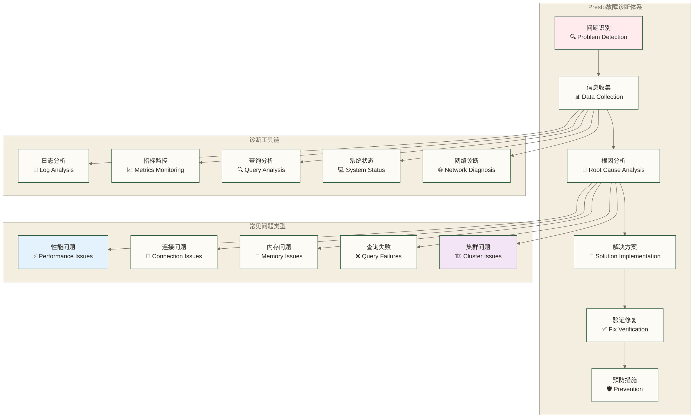

# Presto故障诊断与调试 - 企业级问题排查与性能调优指南

> [!abstract] 📋 本节概览
> - 🎯 学习目标：掌握Presto生产环境的故障诊断方法和调试技能
> - 📚 前置知识：[[【技术与工具】/Presto/14-监控与告警|监控与告警]] 和 系统运维基础
> - ⏱️ 预计用时：160分钟

## 🏗️ 故障诊断架构

### 📊 诊断体系概览



## 🔍 日志分析与诊断

### 📝 日志系统架构

```sql
-- 创建日志分析视图
CREATE VIEW catalog.schema.presto_log_analysis AS
WITH parsed_logs AS (
    SELECT 
        timestamp,
        level,
        thread,
        logger,
        message,
        -- 解析查询ID
        REGEXP_EXTRACT(message, 'Query ([a-f0-9_]+)', 1) AS query_id,
        -- 解析错误代码
        REGEXP_EXTRACT(message, 'Error code: ([0-9]+)', 1) AS error_code,
        -- 解析执行时间
        REGEXP_EXTRACT(message, 'elapsed ([0-9.]+)s', 1) AS elapsed_seconds,
        -- 解析内存使用
        REGEXP_EXTRACT(message, 'memory: ([0-9.]+[KMGT]?B)', 1) AS memory_usage
    FROM catalog.schema.presto_logs
),
log_categories AS (
    SELECT 
        *,
        CASE 
            WHEN logger LIKE '%QueryManager%' THEN 'query_management'
            WHEN logger LIKE '%TaskManager%' THEN 'task_management'
            WHEN logger LIKE '%MemoryManager%' THEN 'memory_management'
            WHEN logger LIKE '%ConnectorManager%' THEN 'connector_management'
            WHEN logger LIKE '%SecurityManager%' THEN 'security'
            ELSE 'general'
        END AS log_category,
        CASE 
            WHEN level = 'ERROR' THEN 4
            WHEN level = 'WARN' THEN 3
            WHEN level = 'INFO' THEN 2
            WHEN level = 'DEBUG' THEN 1
            ELSE 0
        END AS severity_level
    FROM parsed_logs
)
SELECT * FROM log_categories;
```

### 🚨 错误日志分析

```bash
#!/bin/bash
# 错误日志分析脚本

LOG_DIR="/var/presto/logs"
ANALYSIS_DIR="/var/presto/analysis"
DATE=$(date +%Y%m%d)

# 创建分析目录
mkdir -p $ANALYSIS_DIR

# 分析错误模式
analyze_error_patterns() {
    echo "=== Error Pattern Analysis - $(date) ===" > $ANALYSIS_DIR/error_analysis_$DATE.txt
    
    # TOP 10 错误类型
    echo "Top 10 Error Types:" >> $ANALYSIS_DIR/error_analysis_$DATE.txt
    grep -h "ERROR" $LOG_DIR/*.log | \
    sed 's/.*ERROR.*\] //' | \
    awk '{print $1}' | \
    sort | uniq -c | sort -rn | head -10 >> $ANALYSIS_DIR/error_analysis_$DATE.txt
    
    # 查询失败分析
    echo -e "\nQuery Failure Analysis:" >> $ANALYSIS_DIR/error_analysis_$DATE.txt
    grep -h "Query.*failed" $LOG_DIR/*.log | \
    grep -o "Query [a-f0-9_]*" | \
    sort | uniq -c | sort -rn | head -20 >> $ANALYSIS_DIR/error_analysis_$DATE.txt
    
    # 内存相关错误
    echo -e "\nMemory Related Errors:" >> $ANALYSIS_DIR/error_analysis_$DATE.txt
    grep -h -i "memory\|oom\|heap" $LOG_DIR/*.log | \
    grep -i "error\|exception" | \
    wc -l >> $ANALYSIS_DIR/error_analysis_$DATE.txt
    
    # 连接错误
    echo -e "\nConnection Errors:" >> $ANALYSIS_DIR/error_analysis_$DATE.txt
    grep -h -i "connection\|timeout\|refused" $LOG_DIR/*.log | \
    grep -i "error\|exception" | \
    wc -l >> $ANALYSIS_DIR/error_analysis_$DATE.txt
}

# 性能日志分析
analyze_performance_logs() {
    echo "=== Performance Log Analysis - $(date) ===" > $ANALYSIS_DIR/performance_analysis_$DATE.txt
    
    # 慢查询分析
    echo "Slow Queries (>10s):" >> $ANALYSIS_DIR/performance_analysis_$DATE.txt
    grep -h "elapsed.*s" $LOG_DIR/*.log | \
    awk '{
        match($0, /elapsed ([0-9.]+)s/, arr)
        if (arr[1] > 10) {
            match($0, /Query ([a-f0-9_]+)/, query)
            print arr[1] "s", query[1]
        }
    }' | sort -rn | head -20 >> $ANALYSIS_DIR/performance_analysis_$DATE.txt
    
    # 资源使用分析
    echo -e "\nResource Usage Analysis:" >> $ANALYSIS_DIR/performance_analysis_$DATE.txt
    grep -h "memory:" $LOG_DIR/*.log | \
    awk '{
        match($0, /memory: ([0-9.]+[KMGT]?B)/, arr)
        print arr[1]
    }' | sort | uniq -c | sort -rn | head -10 >> $ANALYSIS_DIR/performance_analysis_$DATE.txt
}

# 执行分析
analyze_error_patterns
analyze_performance_logs

echo "Analysis completed. Results saved to $ANALYSIS_DIR/"
```

### 📊 实时日志监控

```python
#!/usr/bin/env python3
# 实时日志监控脚本

import re
import time
import json
from collections import defaultdict
from datetime import datetime

class PrestoLogMonitor:
    def __init__(self, log_file, alert_threshold=10):
        self.log_file = log_file
        self.alert_threshold = alert_threshold
        self.error_counts = defaultdict(int)
        self.query_stats = defaultdict(dict)
        
    def parse_log_line(self, line):
        """解析日志行"""
        patterns = {
            'timestamp': r'(\d{4}-\d{2}-\d{2}T\d{2}:\d{2}:\d{2}\.\d{3}Z)',
            'level': r'\[(ERROR|WARN|INFO|DEBUG)\]',
            'query_id': r'Query ([a-f0-9_]+)',
            'elapsed_time': r'elapsed ([0-9.]+)s',
            'memory_usage': r'memory: ([0-9.]+[KMGT]?B)',
            'error_code': r'Error code: ([0-9]+)',
            'stage': r'Stage-([0-9]+)',
            'task': r'Task ([a-f0-9_.-]+)'
        }
        
        result = {'message': line}
        for key, pattern in patterns.items():
            match = re.search(pattern, line)
            if match:
                result[key] = match.group(1)
        
        return result
    
    def analyze_error(self, parsed_line):
        """分析错误"""
        if parsed_line.get('level') == 'ERROR':
            error_type = self._extract_error_type(parsed_line)
            self.error_counts[error_type] += 1
            
            # 错误阈值告警
            if self.error_counts[error_type] >= self.alert_threshold:
                self._send_alert(error_type, self.error_counts[error_type])
    
    def analyze_performance(self, parsed_line):
        """分析性能"""
        query_id = parsed_line.get('query_id')
        elapsed_time = parsed_line.get('elapsed_time')
        memory_usage = parsed_line.get('memory_usage')
        
        if query_id:
            if elapsed_time:
                self.query_stats[query_id]['elapsed_time'] = float(elapsed_time)
            if memory_usage:
                self.query_stats[query_id]['memory_usage'] = memory_usage
            
            # 性能告警
            if elapsed_time and float(elapsed_time) > 300:  # 5分钟
                self._send_performance_alert(query_id, elapsed_time)
    
    def _extract_error_type(self, parsed_line):
        """提取错误类型"""
        message = parsed_line.get('message', '')
        if 'OutOfMemoryError' in message:
            return 'memory_error'
        elif 'TimeoutException' in message:
            return 'timeout_error'
        elif 'ConnectException' in message:
            return 'connection_error'
        elif 'SQLException' in message:
            return 'sql_error'
        else:
            return 'general_error'
    
    def _send_alert(self, error_type, count):
        """发送告警"""
        alert_message = {
            'timestamp': datetime.now().isoformat(),
            'type': 'error_threshold',
            'error_type': error_type,
            'count': count,
            'threshold': self.alert_threshold
        }
        print(f"ALERT: {json.dumps(alert_message)}")
    
    def _send_performance_alert(self, query_id, elapsed_time):
        """发送性能告警"""
        alert_message = {
            'timestamp': datetime.now().isoformat(),
            'type': 'performance_alert',
            'query_id': query_id,
            'elapsed_time': elapsed_time,
            'threshold': '300s'
        }
        print(f"PERFORMANCE ALERT: {json.dumps(alert_message)}")
    
    def monitor(self):
        """监控日志"""
        try:
            with open(self.log_file, 'r') as f:
                # 移动到文件末尾
                f.seek(0, 2)
                
                while True:
                    line = f.readline()
                    if line:
                        parsed = self.parse_log_line(line.strip())
                        self.analyze_error(parsed)
                        self.analyze_performance(parsed)
                    else:
                        time.sleep(1)
        except KeyboardInterrupt:
            print("Monitoring stopped.")
        except Exception as e:
            print(f"Monitoring error: {e}")

# 使用示例
if __name__ == "__main__":
    monitor = PrestoLogMonitor('/var/presto/logs/server.log')
    monitor.monitor()
```

## 🔧 查询诊断与优化

### 📈 查询性能分析

```sql
-- 查询性能诊断视图
CREATE VIEW catalog.schema.query_performance_diagnosis AS
WITH query_metrics AS (
    SELECT 
        query_id,
        session_user,
        catalog,
        schema,
        query,
        state,
        created,
        started,
        "end",
        elapsed_time,
        execution_time,
        analysis_time,
        distributed_planning_time,
        total_planning_time,
        finishing_time,
        total_cpu_time,
        total_scheduled_time,
        total_blocked_time,
        peak_user_memory_bytes,
        peak_task_user_memory,
        peak_task_total_memory,
        physical_input_bytes,
        physical_input_rows,
        internal_network_bytes,
        internal_network_rows,
        total_bytes,
        total_rows,
        output_bytes,
        output_rows,
        written_bytes,
        written_rows
    FROM system.runtime.queries
    WHERE created >= current_timestamp - interval '1' hour
),
performance_metrics AS (
    SELECT 
        *,
        -- 计算各种比率
        CASE 
            WHEN total_rows > 0 THEN physical_input_bytes / total_rows 
            ELSE 0 
        END AS bytes_per_row,
        CASE 
            WHEN elapsed_time.seconds > 0 THEN physical_input_bytes / elapsed_time.seconds 
            ELSE 0 
        END AS bytes_per_second,
        CASE 
            WHEN elapsed_time.seconds > 0 THEN total_rows / elapsed_time.seconds 
            ELSE 0 
        END AS rows_per_second,
        -- 内存效率
        CASE 
            WHEN physical_input_bytes > 0 THEN peak_user_memory_bytes / physical_input_bytes 
            ELSE 0 
        END AS memory_efficiency,
        -- CPU效率
        CASE 
            WHEN elapsed_time.seconds > 0 THEN total_cpu_time.seconds / elapsed_time.seconds 
            ELSE 0 
        END AS cpu_efficiency,
        -- 网络效率
        CASE 
            WHEN total_bytes > 0 THEN internal_network_bytes / total_bytes 
            ELSE 0 
        END AS network_efficiency
    FROM query_metrics
),
performance_classification AS (
    SELECT 
        *,
        CASE 
            WHEN elapsed_time.seconds > 300 THEN 'very_slow'
            WHEN elapsed_time.seconds > 60 THEN 'slow'
            WHEN elapsed_time.seconds > 10 THEN 'moderate'
            ELSE 'fast'
        END AS performance_class,
        CASE 
            WHEN peak_user_memory_bytes > 10 * 1024 * 1024 * 1024 THEN 'high_memory'  -- 10GB
            WHEN peak_user_memory_bytes > 1 * 1024 * 1024 * 1024 THEN 'medium_memory'  -- 1GB
            ELSE 'low_memory'
        END AS memory_class,
        CASE 
            WHEN cpu_efficiency > 0.8 THEN 'cpu_intensive'
            WHEN cpu_efficiency > 0.3 THEN 'cpu_moderate'
            ELSE 'cpu_light'
        END AS cpu_class
    FROM performance_metrics
)
SELECT * FROM performance_classification;
```

### 🔍 查询执行计划分析

```sql
-- 执行计划诊断工具
WITH FUNCTION analyze_execution_plan(query_text VARCHAR) 
RETURNS TABLE(
    stage_id VARCHAR,
    operation VARCHAR,
    estimated_rows BIGINT,
    estimated_bytes BIGINT,
    join_type VARCHAR,
    join_strategy VARCHAR,
    partition_count INTEGER,
    bottleneck_probability DOUBLE
) AS (
    -- 这是一个概念性的函数，实际实现需要访问执行计划API
    SELECT 
        'stage_' || CAST(ROW_NUMBER() OVER() AS VARCHAR),
        'scan',
        1000000,
        100000000,
        NULL,
        NULL,
        100,
        0.2
);

-- 查询瓶颈识别
CREATE VIEW catalog.schema.query_bottleneck_analysis AS
SELECT 
    q.query_id,
    q.query,
    q.elapsed_time,
    q.total_cpu_time,
    q.peak_user_memory_bytes,
    q.physical_input_bytes,
    -- 瓶颈分析
    CASE 
        WHEN q.total_cpu_time.seconds / q.elapsed_time.seconds > 0.8 THEN 'CPU_BOUND'
        WHEN q.peak_user_memory_bytes > 8 * 1024 * 1024 * 1024 THEN 'MEMORY_BOUND'
        WHEN q.physical_input_bytes / q.elapsed_time.seconds < 10 * 1024 * 1024 THEN 'IO_BOUND'
        WHEN q.internal_network_bytes > q.physical_input_bytes * 2 THEN 'NETWORK_BOUND'
        ELSE 'BALANCED'
    END AS bottleneck_type,
    -- 优化建议
    CASE 
        WHEN q.total_cpu_time.seconds / q.elapsed_time.seconds > 0.8 THEN 
            'Consider adding more CPU resources or optimizing complex operations'
        WHEN q.peak_user_memory_bytes > 8 * 1024 * 1024 * 1024 THEN 
            'Increase memory limits or optimize memory usage'
        WHEN q.physical_input_bytes / q.elapsed_time.seconds < 10 * 1024 * 1024 THEN 
            'Check storage performance or add more parallel workers'
        WHEN q.internal_network_bytes > q.physical_input_bytes * 2 THEN 
            'Optimize JOIN operations or network configuration'
        ELSE 'Query is well balanced'
    END AS optimization_recommendation
FROM catalog.schema.query_performance_diagnosis q
WHERE q.state = 'FINISHED' 
  AND q.elapsed_time.seconds > 30;
```

### ⚡ 自动化查询优化

```python
#!/usr/bin/env python3
# 自动查询优化建议工具

import re
import sqlparse
from collections import defaultdict

class PrestoQueryOptimizer:
    def __init__(self):
        self.optimization_rules = {
            'join_optimization': self._analyze_joins,
            'predicate_pushdown': self._analyze_predicates,
            'column_pruning': self._analyze_columns,
            'partition_optimization': self._analyze_partitions,
            'aggregation_optimization': self._analyze_aggregations
        }
    
    def analyze_query(self, query):
        """分析查询并提供优化建议"""
        parsed = sqlparse.parse(query)[0]
        recommendations = []
        
        for rule_name, rule_func in self.optimization_rules.items():
            suggestions = rule_func(parsed, query)
            if suggestions:
                recommendations.extend(suggestions)
        
        return recommendations
    
    def _analyze_joins(self, parsed, query):
        """分析JOIN操作"""
        suggestions = []
        
        # 检查JOIN顺序
        join_pattern = re.findall(r'JOIN\s+(\w+)', query, re.IGNORECASE)
        if len(join_pattern) > 2:
            suggestions.append({
                'type': 'join_optimization',
                'severity': 'medium',
                'message': 'Consider reordering JOINs with smaller tables first',
                'recommendation': 'Place smaller tables on the right side of JOIN operations'
            })
        
        # 检查JOIN条件
        if 'ON ' not in query.upper() and 'WHERE ' in query.upper():
            suggestions.append({
                'type': 'join_optimization',
                'severity': 'high',
                'message': 'Possible Cartesian product detected',
                'recommendation': 'Ensure all JOINs have proper ON conditions'
            })
        
        return suggestions
    
    def _analyze_predicates(self, parsed, query):
        """分析谓词下推"""
        suggestions = []
        
        # 检查WHERE子句位置
        if re.search(r'SELECT.*FROM.*JOIN.*WHERE', query, re.IGNORECASE | re.DOTALL):
            where_conditions = re.findall(r'WHERE\s+(.+?)(?:GROUP|ORDER|LIMIT|$)', query, re.IGNORECASE | re.DOTALL)
            if where_conditions:
                suggestions.append({
                    'type': 'predicate_pushdown',
                    'severity': 'medium',
                    'message': 'WHERE conditions could be pushed down to individual tables',
                    'recommendation': 'Move table-specific filters to subqueries or use explicit filtering'
                })
        
        return suggestions
    
    def _analyze_columns(self, parsed, query):
        """分析列剪枝"""
        suggestions = []
        
        # 检查SELECT *
        if re.search(r'SELECT\s+\*', query, re.IGNORECASE):
            suggestions.append({
                'type': 'column_pruning',
                'severity': 'medium',
                'message': 'Using SELECT * may read unnecessary columns',
                'recommendation': 'Specify only the columns you need'
            })
        
        return suggestions
    
    def _analyze_partitions(self, parsed, query):
        """分析分区优化"""
        suggestions = []
        
        # 检查日期过滤
        date_columns = ['date', 'created_at', 'updated_at', 'timestamp']
        has_date_filter = any(col in query.lower() for col in date_columns)
        
        if not has_date_filter and ('FROM' in query.upper()):
            suggestions.append({
                'type': 'partition_optimization',
                'severity': 'high',
                'message': 'No date-based filtering detected',
                'recommendation': 'Add date range filters to leverage partitioning'
            })
        
        return suggestions
    
    def _analyze_aggregations(self, parsed, query):
        """分析聚合优化"""
        suggestions = []
        
        # 检查DISTINCT
        distinct_count = len(re.findall(r'DISTINCT', query, re.IGNORECASE))
        if distinct_count > 1:
            suggestions.append({
                'type': 'aggregation_optimization',
                'severity': 'medium',
                'message': 'Multiple DISTINCT operations detected',
                'recommendation': 'Consider using approximation functions like approx_distinct()'
            })
        
        # 检查GROUP BY
        if 'GROUP BY' in query.upper() and 'ORDER BY' in query.upper():
            suggestions.append({
                'type': 'aggregation_optimization',
                'severity': 'low',
                'message': 'Ordering after grouping may be expensive',
                'recommendation': 'Consider if ordering is necessary or can be done client-side'
            })
        
        return suggestions
    
    def generate_optimized_query(self, original_query, recommendations):
        """基于建议生成优化后的查询"""
        optimized_query = original_query
        
        for rec in recommendations:
            if rec['type'] == 'column_pruning' and 'SELECT *' in optimized_query:
                # 这里需要更复杂的逻辑来确定需要的列
                optimized_query = optimized_query.replace('SELECT *', 'SELECT /* specify needed columns */')
            
            elif rec['type'] == 'aggregation_optimization' and 'DISTINCT' in optimized_query:
                optimized_query = re.sub(r'COUNT\s*\(\s*DISTINCT', 'APPROX_DISTINCT(', optimized_query, flags=re.IGNORECASE)
        
        return optimized_query

# 使用示例
def optimize_query_example():
    optimizer = PrestoQueryOptimizer()
    
    query = """
    SELECT *
    FROM large_table t1
    JOIN medium_table t2 ON t1.id = t2.id
    JOIN small_table t3 ON t2.ref_id = t3.id
    WHERE t1.status = 'active'
    GROUP BY t1.category
    ORDER BY COUNT(DISTINCT t1.user_id) DESC
    """
    
    recommendations = optimizer.analyze_query(query)
    
    print("Query Optimization Analysis:")
    print("=" * 50)
    
    for i, rec in enumerate(recommendations, 1):
        print(f"{i}. {rec['type'].upper()} ({rec['severity']})")
        print(f"   Issue: {rec['message']}")
        print(f"   Recommendation: {rec['recommendation']}")
        print()
    
    optimized = optimizer.generate_optimized_query(query, recommendations)
    print("Optimized Query:")
    print("-" * 20)
    print(optimized)

if __name__ == "__main__":
    optimize_query_example()
```

## 💾 内存诊断与调优

### 🧠 内存使用分析

```sql
-- 内存使用诊断视图
CREATE VIEW catalog.schema.memory_usage_diagnosis AS
WITH memory_stats AS (
    SELECT 
        node_id,
        pool_id,
        max_bytes,
        reserved_bytes,
        reserved_revocable_bytes,
        query_count,
        -- 计算内存使用率
        CAST(reserved_bytes AS DOUBLE) / CAST(max_bytes AS DOUBLE) AS usage_ratio,
        -- 计算可撤销内存比例
        CAST(reserved_revocable_bytes AS DOUBLE) / NULLIF(CAST(reserved_bytes AS DOUBLE), 0.0) AS revocable_ratio
    FROM system.runtime.memory_pools
),
memory_pressure AS (
    SELECT 
        *,
        CASE 
            WHEN usage_ratio > 0.9 THEN 'critical'
            WHEN usage_ratio > 0.7 THEN 'high'
            WHEN usage_ratio > 0.5 THEN 'medium'
            ELSE 'low'
        END AS pressure_level,
        CASE 
            WHEN query_count > 100 THEN 'high_concurrency'
            WHEN query_count > 50 THEN 'medium_concurrency'
            ELSE 'low_concurrency'
        END AS concurrency_level
    FROM memory_stats
),
recommendations AS (
    SELECT 
        *,
        CASE 
            WHEN pressure_level = 'critical' THEN 
                'URGENT: Increase memory allocation or reduce concurrent queries'
            WHEN pressure_level = 'high' AND concurrency_level = 'high_concurrency' THEN 
                'Consider increasing memory or implementing query queuing'
            WHEN revocable_ratio < 0.1 THEN 
                'Enable spilling to disk for better memory management'
            ELSE 'Memory usage is acceptable'
        END AS recommendation
    FROM memory_pressure
)
SELECT * FROM recommendations;
```

### 🔄 内存泄漏检测

```bash
#!/bin/bash
# 内存泄漏检测脚本

PRESTO_HOME="/opt/presto"
MONITORING_INTERVAL=60  # 秒
ALERT_THRESHOLD=90      # 内存使用百分比

detect_memory_leaks() {
    local output_file="/tmp/memory_leak_detection_$(date +%Y%m%d_%H%M%S).log"
    
    echo "Starting memory leak detection at $(date)" | tee $output_file
    echo "Monitoring interval: ${MONITORING_INTERVAL}s" | tee -a $output_file
    echo "Alert threshold: ${ALERT_THRESHOLD}%" | tee -a $output_file
    echo "=========================================" | tee -a $output_file
    
    local previous_memory=0
    local consecutive_increases=0
    local max_consecutive=5
    
    while true; do
        # 获取Presto进程内存使用
        local presto_pid=$(pgrep -f "presto-server")
        if [ -z "$presto_pid" ]; then
            echo "$(date): Presto process not found" | tee -a $output_file
            sleep $MONITORING_INTERVAL
            continue
        fi
        
        # 获取内存使用情况
        local memory_info=$(ps -p $presto_pid -o pid,ppid,pmem,rss,vsz --no-headers)
        local memory_percent=$(echo $memory_info | awk '{print $3}')
        local memory_rss=$(echo $memory_info | awk '{print $4}')
        
        echo "$(date): PID=$presto_pid, Memory=$memory_percent%, RSS=${memory_rss}KB" | tee -a $output_file
        
        # 检查内存是否持续增长
        if (( $(echo "$memory_rss > $previous_memory" | bc -l) )); then
            consecutive_increases=$((consecutive_increases + 1))
        else
            consecutive_increases=0
        fi
        
        # 内存泄漏告警
        if [ $consecutive_increases -ge $max_consecutive ]; then
            echo "$(date): MEMORY GROWTH ALERT - Memory has increased for $consecutive_increases consecutive intervals; this alone does not establish a memory leak" | tee -a $output_file
            send_alert "Memory Growth" "Presto memory usage has increased consecutively for $consecutive_increases intervals; investigate workload, GC and retained objects before concluding a leak"
            consecutive_increases=0
        fi
        
        # 高内存使用告警
        if (( $(echo "$memory_percent > $ALERT_THRESHOLD" | bc -l) )); then
            echo "$(date): HIGH MEMORY ALERT - Memory usage: $memory_percent%" | tee -a $output_file
            send_alert "High Memory Usage" "Presto memory usage is at $memory_percent%"
        fi
        
        previous_memory=$memory_rss
        sleep $MONITORING_INTERVAL
    done
}

send_alert() {
    local alert_type="$1"
    local message="$2"
    
    # 发送到监控系统 (示例)
    curl -X POST http://monitoring-system/alerts \
         -H "Content-Type: application/json" \
         -d "{
             \"type\": \"$alert_type\",
             \"message\": \"$message\",
             \"timestamp\": \"$(date -u +%Y-%m-%dT%H:%M:%SZ)\",
             \"service\": \"presto\"
         }" 2>/dev/null || echo "Failed to send alert: $alert_type"
}

# Java堆内存分析
analyze_heap_dump() {
    local heap_dump_file="$1"
    local analysis_output="/tmp/heap_analysis_$(date +%Y%m%d_%H%M%S).txt"
    
    echo "Analyzing heap dump: $heap_dump_file" | tee $analysis_output
    
    # 使用jhat分析堆转储 (需要安装JDK)
    if command -v jhat >/dev/null 2>&1; then
        echo "Generating heap analysis..." | tee -a $analysis_output
        jhat -J-Xmx4g $heap_dump_file > /dev/null 2>&1 &
        local jhat_pid=$!
        
        sleep 10
        
        # 获取对象统计
        curl -s "http://localhost:7000/histo/" | \
        head -50 >> $analysis_output
        
        kill $jhat_pid 2>/dev/null
    else
        echo "jhat not available. Install JDK for heap analysis." | tee -a $analysis_output
    fi
    
    echo "Heap analysis saved to: $analysis_output"
}

# 自动清理内存
cleanup_memory() {
    echo "Attempting to cleanup memory..."
    
    # 触发JVM垃圾回收
    local presto_pid=$(pgrep -f "presto-server")
    if [ ! -z "$presto_pid" ]; then
        echo "Automatic GC action skipped: SIGUSR1 is not a portable JVM garbage collection interface"
    fi
    
    # 系统级内存清理
    sync
    echo 1 > /proc/sys/vm/drop_caches
    echo "Cleared system caches"
}

# 主函数
main() {
    case "$1" in
        "detect")
            detect_memory_leaks
            ;;
        "analyze")
            if [ -z "$2" ]; then
                echo "Usage: $0 analyze <heap_dump_file>"
                exit 1
            fi
            analyze_heap_dump "$2"
            ;;
        "cleanup")
            cleanup_memory
            ;;
        *)
            echo "Usage: $0 {detect|analyze <heap_file>|cleanup}"
            exit 1
            ;;
    esac
}

main "$@"
```

## 🌐 网络诊断与调优

### 📡 网络连接诊断

```python
#!/usr/bin/env python3
# 网络诊断工具

import socket
import time
import subprocess
import threading
from concurrent.futures import ThreadPoolExecutor, as_completed

class PrestoNetworkDiagnostic:
    def __init__(self, coordinator_host, coordinator_port=8080):
        self.coordinator_host = coordinator_host
        self.coordinator_port = coordinator_port
        self.worker_nodes = []
        
    def discover_workers(self):
        """发现工作节点"""
        try:
            # 通过REST API获取节点信息
            import requests
            response = requests.get(f"http://{self.coordinator_host}:{self.coordinator_port}/v1/node")
            nodes = response.json()
            
            self.worker_nodes = [
                {'host': node['host'], 'port': node['httpUri'].split(':')[-1]}
                for node in nodes if not node.get('coordinator', False)
            ]
            
            print(f"Discovered {len(self.worker_nodes)} worker nodes")
            return self.worker_nodes
            
        except Exception as e:
            print(f"Error discovering workers: {e}")
            return []
    
    def test_connectivity(self, host, port, timeout=5):
        """测试连接性"""
        try:
            start_time = time.time()
            sock = socket.socket(socket.AF_INET, socket.SOCK_STREAM)
            sock.settimeout(timeout)
            result = sock.connect_ex((host, int(port)))
            end_time = time.time()
            sock.close()
            
            return {
                'host': host,
                'port': port,
                'status': 'connected' if result == 0 else 'failed',
                'latency': round((end_time - start_time) * 1000, 2),  # ms
                'error': None if result == 0 else f"Connection failed: {result}"
            }
        except Exception as e:
            return {
                'host': host,
                'port': port,
                'status': 'error',
                'latency': None,
                'error': str(e)
            }
    
    def test_bandwidth(self, host, port, duration=10):
        """测试带宽"""
        try:
            # 简单的带宽测试 - 实际实现会更复杂
            start_time = time.time()
            sock = socket.socket(socket.AF_INET, socket.SOCK_STREAM)
            sock.connect((host, int(port)))
            
            # 发送测试数据
            test_data = b'x' * 1024  # 1KB
            bytes_sent = 0
            
            while time.time() - start_time < duration:
                sock.send(test_data)
                bytes_sent += len(test_data)
            
            sock.close()
            elapsed = time.time() - start_time
            bandwidth_mbps = (bytes_sent * 8) / (elapsed * 1024 * 1024)  # Mbps
            
            return {
                'host': host,
                'port': port,
                'bandwidth_mbps': round(bandwidth_mbps, 2),
                'bytes_sent': bytes_sent,
                'duration': round(elapsed, 2)
            }
            
        except Exception as e:
            return {
                'host': host,
                'port': port,
                'bandwidth_mbps': 0,
                'error': str(e)
            }
    
    def ping_test(self, host, count=4):
        """Ping测试"""
        try:
            result = subprocess.run(
                ['ping', '-c', str(count), host],
                capture_output=True,
                text=True,
                timeout=30
            )
            
            output = result.stdout
            
            # 解析ping结果
            packet_loss = 0
            avg_latency = 0
            
            for line in output.split('\n'):
                if 'packet loss' in line:
                    packet_loss = float(line.split('%')[0].split()[-1])
                elif 'min/avg/max' in line:
                    avg_latency = float(line.split('/')[4])
            
            return {
                'host': host,
                'packet_loss': packet_loss,
                'avg_latency': avg_latency,
                'status': 'success' if result.returncode == 0 else 'failed'
            }
            
        except Exception as e:
            return {
                'host': host,
                'packet_loss': 100,
                'avg_latency': 0,
                'status': 'error',
                'error': str(e)
            }
    
    def comprehensive_network_test(self):
        """综合网络测试"""
        print("Starting comprehensive network diagnostic...")
        
        # 发现节点
        if not self.worker_nodes:
            self.discover_workers()
        
        all_nodes = [{'host': self.coordinator_host, 'port': self.coordinator_port}] + self.worker_nodes
        
        results = {
            'connectivity': [],
            'ping': [],
            'bandwidth': []
        }
        
        # 并发测试连接性
        with ThreadPoolExecutor(max_workers=10) as executor:
            # 连接性测试
            connectivity_futures = {
                executor.submit(self.test_connectivity, node['host'], node['port']): node
                for node in all_nodes
            }
            
            for future in as_completed(connectivity_futures):
                result = future.result()
                results['connectivity'].append(result)
            
            # Ping测试
            ping_futures = {
                executor.submit(self.ping_test, node['host']): node
                for node in all_nodes
            }
            
            for future in as_completed(ping_futures):
                result = future.result()
                results['ping'].append(result)
        
        return results
    
    def generate_network_report(self, results):
        """生成网络诊断报告"""
        report = []
        report.append("=" * 60)
        report.append("PRESTO NETWORK DIAGNOSTIC REPORT")
        report.append("=" * 60)
        report.append(f"Generated at: {time.strftime('%Y-%m-%d %H:%M:%S')}")
        report.append("")
        
        # 连接性报告
        report.append("CONNECTIVITY TEST RESULTS:")
        report.append("-" * 30)
        failed_connections = []
        slow_connections = []
        
        for conn in results['connectivity']:
            status_emoji = "✅" if conn['status'] == 'connected' else "❌"
            latency_info = f"{conn['latency']}ms" if conn['latency'] else "N/A"
            report.append(f"{status_emoji} {conn['host']}:{conn['port']} - {latency_info}")
            
            if conn['status'] != 'connected':
                failed_connections.append(conn)
            elif conn['latency'] and conn['latency'] > 100:
                slow_connections.append(conn)
        
        # Ping测试报告
        report.append("")
        report.append("PING TEST RESULTS:")
        report.append("-" * 30)
        high_latency_nodes = []
        packet_loss_nodes = []
        
        for ping in results['ping']:
            status_emoji = "✅" if ping['status'] == 'success' else "❌"
            report.append(f"{status_emoji} {ping['host']} - {ping['avg_latency']}ms avg, {ping['packet_loss']}% loss")
            
            if ping['avg_latency'] > 50:
                high_latency_nodes.append(ping)
            if ping['packet_loss'] > 0:
                packet_loss_nodes.append(ping)
        
        # 问题汇总
        report.append("")
        report.append("ISSUES DETECTED:")
        report.append("-" * 30)
        
        if failed_connections:
            report.append(f"❌ {len(failed_connections)} connection failures detected")
        
        if slow_connections:
            report.append(f"⚠️  {len(slow_connections)} slow connections detected (>100ms)")
        
        if high_latency_nodes:
            report.append(f"⚠️  {len(high_latency_nodes)} high latency nodes detected (>50ms)")
        
        if packet_loss_nodes:
            report.append(f"❌ {len(packet_loss_nodes)} nodes with packet loss detected")
        
        if not (failed_connections or slow_connections or high_latency_nodes or packet_loss_nodes):
            report.append("✅ No issues detected by the performed TCP connectivity and Ping checks; bandwidth and overall network health remain unassessed")
        
        # 建议
        report.append("")
        report.append("RECOMMENDATIONS:")
        report.append("-" * 30)
        
        if failed_connections:
            report.append("• Check firewall rules and network configuration")
            report.append("• Verify Presto services are running on failed nodes")
        
        if slow_connections or high_latency_nodes:
            report.append("• Consider network topology optimization")
            report.append("• Check for network congestion")
            
        if packet_loss_nodes:
            report.append("• Investigate network infrastructure issues")
            report.append("• Check network hardware and cables")
        
        return "\n".join(report)

# 使用示例
def main():
    diagnostic = PrestoNetworkDiagnostic('presto-coordinator.example.com')
    results = diagnostic.comprehensive_network_test()
    report = diagnostic.generate_network_report(results)
    
    print(report)
    
    # 保存报告
    with open(f'/tmp/presto_network_report_{int(time.time())}.txt', 'w') as f:
        f.write(report)

if __name__ == "__main__":
    main()
```

## 🚨 故障响应自动化

### 🤖 自动故障修复

```bash
#!/bin/bash
# Presto自动故障修复脚本

PRESTO_HOME="/opt/presto"
PRESTO_CONFIG="$PRESTO_HOME/etc"
PRESTO_LOGS="$PRESTO_HOME/var/log"
RESTART_THRESHOLD=3
MEMORY_THRESHOLD=90

log_message() {
    echo "$(date '+%Y-%m-%d %H:%M:%S') - $1" | tee -a /var/log/presto-auto-repair.log
}

check_presto_health() {
    local coordinator_url="http://localhost:8080"
    
    # 检查HTTP响应
    if ! curl -f -s "$coordinator_url/v1/cluster" >/dev/null 2>&1; then
        log_message "ERROR: Presto coordinator is not responding"
        return 1
    fi
    
    # 检查集群状态
    local active_workers=$(curl -s "$coordinator_url/v1/node" | jq -r '.[] | select(.coordinator==false) | .nodeId' | wc -l)
    local total_workers=$(curl -s "$coordinator_url/v1/node" | jq -r '.[] | select(.coordinator==false) | .nodeId' | wc -l)
    
    if [ "$active_workers" -lt "$((total_workers / 2))" ]; then
        log_message "WARNING: Less than 50% of workers are active ($active_workers/$total_workers)"
        return 2
    fi
    
    log_message "INFO: Presto cluster health check passed"
    return 0
}

fix_memory_issues() {
    log_message "INFO: Attempting to fix memory issues"
    
    # 检查内存使用
    local memory_usage=$(free | grep Mem | awk '{printf "%.0f", $3/$2 * 100.0}')
    
    if [ "$memory_usage" -gt "$MEMORY_THRESHOLD" ]; then
        log_message "WARNING: High memory usage detected: ${memory_usage}%"
        
        # 清理系统缓存
        sync
        echo 1 > /proc/sys/vm/drop_caches
        log_message "INFO: System caches cleared"
        
        # 触发JVM垃圾回收
        local presto_pid=$(pgrep -f "presto-server")
        if [ ! -z "$presto_pid" ]; then
            log_message "WARNING: Automatic GC action skipped; SIGUSR1 is not a portable JVM garbage collection interface"
        fi
        
        # 等待一段时间检查改善情况
        sleep 30
        local new_memory_usage=$(free | grep Mem | awk '{printf "%.0f", $3/$2 * 100.0}')
        
        if [ "$new_memory_usage" -lt "$memory_usage" ]; then
            log_message "INFO: Memory usage improved from ${memory_usage}% to ${new_memory_usage}%"
            return 0
        else
            log_message "WARNING: Memory cleanup did not improve usage significantly"
            return 1
        fi
    fi
    
    return 0
}

fix_connection_issues() {
    log_message "INFO: Attempting to fix connection issues"
    
    # 检查端口监听
    if ! netstat -tulpn | grep -q ":8080.*LISTEN"; then
        log_message "ERROR: Presto coordinator port 8080 is not listening"
        restart_presto_service
        return $?
    fi
    
    # 检查网络连接
    if ! ping -c 1 -W 5 localhost >/dev/null 2>&1; then
        log_message "ERROR: Network connectivity issues detected"
        # 这里可以添加网络修复逻辑
        return 1
    fi
    
    return 0
}

fix_query_failures() {
    log_message "INFO: Checking for query failures"
    
    # 分析最近的查询失败
    local failed_queries=$(curl -s "http://localhost:8080/v1/query" | jq -r '.[] | select(.state=="FAILED") | .queryId' | head -10)
    
    if [ ! -z "$failed_queries" ]; then
        log_message "WARNING: Recent query failures detected"
        
        # 检查常见失败原因
        for query_id in $failed_queries; do
            local error_info=$(curl -s "http://localhost:8080/v1/query/$query_id" | jq -r '.errorCode.name // "UNKNOWN"')
            log_message "INFO: Query $query_id failed with error: $error_info"
            
            case "$error_info" in
                "EXCEEDED_MEMORY_LIMIT")
                    fix_memory_issues
                    ;;
                "TIMEOUT")
                    # 可以调整超时配置
                    log_message "INFO: Query timeout detected, consider adjusting timeout settings"
                    ;;
                "CONNECTOR_ERROR")
                    # 重启连接器相关服务
                    log_message "INFO: Connector error detected, may need service restart"
                    ;;
            esac
        done
    fi
    
    return 0
}

restart_presto_service() {
    log_message "INFO: Restarting Presto service"
    
    # 优雅关闭
    if pgrep -f "presto-server" >/dev/null; then
        log_message "INFO: Stopping Presto service gracefully"
        pkill -TERM -f "presto-server"
        
        # 等待进程结束
        local wait_count=0
        while [ $wait_count -lt 30 ] && pgrep -f "presto-server" >/dev/null; do
            sleep 1
            wait_count=$((wait_count + 1))
        done
        
        # 强制终止如果还在运行
        if pgrep -f "presto-server" >/dev/null; then
            log_message "WARNING: Force killing Presto process"
            pkill -KILL -f "presto-server"
        fi
    fi
    
    # 启动服务
    log_message "INFO: Starting Presto service"
    cd "$PRESTO_HOME"
    nohup bin/launcher run >/dev/null 2>&1 &
    
    # 等待服务启动
    local startup_wait=0
    while [ $startup_wait -lt 60 ]; do
        if curl -f -s "http://localhost:8080/v1/cluster" >/dev/null 2>&1; then
            log_message "INFO: Presto service started successfully"
            return 0
        fi
        sleep 5
        startup_wait=$((startup_wait + 5))
    done
    
    log_message "ERROR: Presto service failed to start within 60 seconds"
    return 1
}

emergency_procedures() {
    log_message "CRITICAL: Executing emergency procedures"
    
    # 备份当前配置
    local backup_dir="/tmp/presto_emergency_backup_$(date +%Y%m%d_%H%M%S)"
    mkdir -p "$backup_dir"
    cp -r "$PRESTO_CONFIG" "$backup_dir/"
    cp -r "$PRESTO_LOGS" "$backup_dir/"
    log_message "INFO: Configuration and logs backed up to $backup_dir"
    
    # 重置到安全配置
    if [ -f "$PRESTO_CONFIG/config.properties.safe" ]; then
        cp "$PRESTO_CONFIG/config.properties.safe" "$PRESTO_CONFIG/config.properties"
        log_message "INFO: Restored safe configuration"
    fi
    
    # 清理临时文件
    find "$PRESTO_HOME/var" -name "*.tmp" -delete
    log_message "INFO: Cleaned temporary files"
    
    # 强制重启
    restart_presto_service
}

auto_repair_main() {
    log_message "INFO: Starting Presto auto-repair check"
    
    local health_status
    check_presto_health
    health_status=$?
    
    case $health_status in
        0)
            log_message "INFO: Presto cluster is healthy"
            ;;
        1)
            log_message "WARNING: Presto coordinator issues detected"
            fix_connection_issues
            fix_memory_issues
            ;;
        2)
            log_message "WARNING: Worker node issues detected"
            # 这里可以添加工作节点修复逻辑
            ;;
    esac
    
    # 检查查询失败
    fix_query_failures
    
    # 再次检查健康状态
    check_presto_health
    health_status=$?
    
    if [ $health_status -ne 0 ]; then
        log_message "WARNING: Auto-repair did not resolve all issues"
        
        # 检查是否需要紧急处理
        local failure_count=$(cat /var/log/presto-auto-repair.log | grep "ERROR\|CRITICAL" | tail -10 | wc -l)
        
        if [ "$failure_count" -gt "$RESTART_THRESHOLD" ]; then
            emergency_procedures
        fi
    fi
    
    log_message "INFO: Auto-repair check completed"
}

# Cron job模式
if [ "$1" = "--cron" ]; then
    auto_repair_main
elif [ "$1" = "--emergency" ]; then
    emergency_procedures
else
    echo "Usage: $0 [--cron|--emergency]"
    echo "  --cron      Run in cron job mode"
    echo "  --emergency Run emergency procedures"
fi
```

## 📚 学习连接

### 🎯 本节核心技能

- **日志分析**：掌握Presto日志的解读和分析技巧
- **性能诊断**：识别和解决查询性能问题
- **内存管理**：诊断和解决内存相关问题
- **网络诊断**：网络连接和带宽问题排查
- **自动化运维**：实现故障自动检测和修复

### 🔗 下一步学习

**诊断技能检查**：
- ✅ 能够快速定位Presto集群问题？
- ✅ 掌握查询性能优化方法？
- ✅ 理解内存和网络诊断技巧？

**学习路径完成**：
- **企业实践**：[[【技术与工具】/Presto/16-企业级应用实践|企业级应用实践]] - 综合应用案例
- **高级优化**：深入性能调优和架构设计
- **运维自动化**：构建完整的运维体系

---

> [!tip] 💡 故障诊断掌握要点
> 
> 🔧 **诊断精髓**：
> - 📊 **系统观察** - 多维度监控，快速问题定位
> - 🔍 **根因分析** - 深入日志分析，找到问题本质
> - ⚡ **快速响应** - 自动化修复，减少服务中断
> - 🛡️ **预防为主** - 监控告警，防患于未然
> 
> 🚀 **实践应用**：故障诊断技能掌握后，进入 [[【技术与工具】/Presto/16-企业级应用实践|企业级应用实践]] 学习完整的企业应用方案！