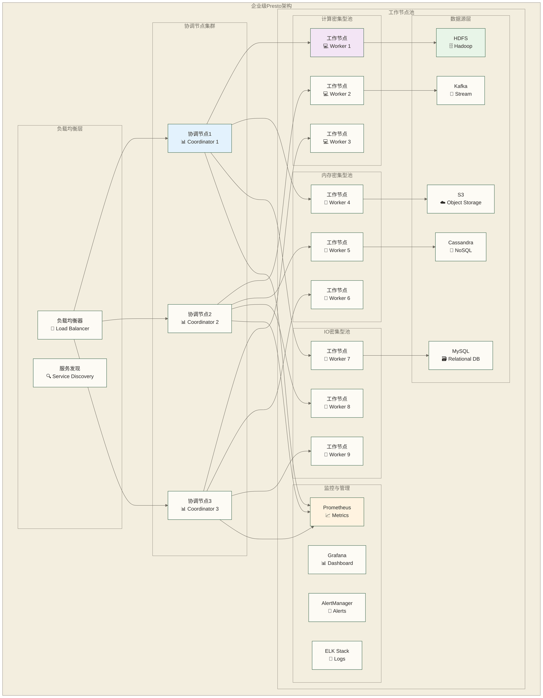

# Presto企业级应用实践 - 大规模生产环境解决方案

> [!abstract] 📋 本节概览
> - 🎯 学习目标：理解Presto企业级应用的综合设计与工程任务；完整方案需结合实际部署补全实现并验证
> - 📚 前置知识：15-故障诊断与调试|故障诊断与调试 和 前面所有Presto文档
> - ⏱️ 预计用时：180分钟

## 🏗️ 企业级架构设计

### 📊 多租户架构方案



### 🔧 多租户配置管理

```yaml
# docker-compose.yml - 企业级多租户部署
version: '3.8'

services:
  # 协调节点集群
  presto-coordinator-1:
    image: prestodb/presto:latest
    hostname: coordinator-1
    ports:
      - "8080:8080"
    environment:
      - PRESTO_NODE_ENVIRONMENT=production
      - PRESTO_NODE_ID=coordinator-1
      - PRESTO_DISCOVERY_URI=http://coordinator-1:8080
    volumes:
      - ./config/coordinator:/opt/presto-server/etc
      - ./data/coordinator-1:/opt/presto-server/data
      - ./logs/coordinator-1:/opt/presto-server/var/log
    networks:
      - presto-network
    deploy:
      resources:
        limits:
          memory: 32G
          cpus: '8'
        reservations:
          memory: 16G
          cpus: '4'

  presto-coordinator-2:
    image: prestodb/presto:latest
    hostname: coordinator-2
    ports:
      - "8081:8080"
    environment:
      - PRESTO_NODE_ENVIRONMENT=production
      - PRESTO_NODE_ID=coordinator-2
      - PRESTO_DISCOVERY_URI=http://coordinator-1:8080
    volumes:
      - ./config/coordinator:/opt/presto-server/etc
      - ./data/coordinator-2:/opt/presto-server/data
      - ./logs/coordinator-2:/opt/presto-server/var/log
    networks:
      - presto-network
    depends_on:
      - presto-coordinator-1

  # 工作节点池 - 计算密集型
  presto-worker-compute-1:
    image: prestodb/presto:latest
    hostname: worker-compute-1
    environment:
      - PRESTO_NODE_ENVIRONMENT=production
      - PRESTO_NODE_ID=worker-compute-1
      - PRESTO_DISCOVERY_URI=http://coordinator-1:8080
      - PRESTO_NODE_POOL=compute-intensive
    volumes:
      - ./config/worker-compute:/opt/presto-server/etc
      - ./data/worker-compute-1:/opt/presto-server/data
      - ./logs/worker-compute-1:/opt/presto-server/var/log
    networks:
      - presto-network
    deploy:
      resources:
        limits:
          memory: 64G
          cpus: '16'
        reservations:
          memory: 32G
          cpus: '8'

  # 工作节点池 - 内存密集型
  presto-worker-memory-1:
    image: prestodb/presto:latest
    hostname: worker-memory-1
    environment:
      - PRESTO_NODE_ENVIRONMENT=production
      - PRESTO_NODE_ID=worker-memory-1
      - PRESTO_DISCOVERY_URI=http://coordinator-1:8080
      - PRESTO_NODE_POOL=memory-intensive
    volumes:
      - ./config/worker-memory:/opt/presto-server/etc
      - ./data/worker-memory-1:/opt/presto-server/data
      - ./logs/worker-memory-1:/opt/presto-server/var/log
    networks:
      - presto-network
    deploy:
      resources:
        limits:
          memory: 128G
          cpus: '12'
        reservations:
          memory: 64G
          cpus: '6'

  # 负载均衡器
  nginx-lb:
    image: nginx:alpine
    ports:
      - "80:80"
      - "443:443"
    volumes:
      - ./config/nginx/nginx.conf:/etc/nginx/nginx.conf
      - ./config/nginx/ssl:/etc/nginx/ssl
    networks:
      - presto-network
    depends_on:
      - presto-coordinator-1
      - presto-coordinator-2

  # 监控栈
  prometheus:
    image: prom/prometheus:latest
    ports:
      - "9090:9090"
    volumes:
      - ./config/prometheus/prometheus.yml:/etc/prometheus/prometheus.yml
      - ./data/prometheus:/prometheus
    networks:
      - presto-network

  grafana:
    image: grafana/grafana:latest
    ports:
      - "3000:3000"
    environment:
      - GF_SECURITY_ADMIN_PASSWORD=admin123
    volumes:
      - ./config/grafana/provisioning:/etc/grafana/provisioning
      - ./data/grafana:/var/lib/grafana
    networks:
      - presto-network

networks:
  presto-network:
    driver: bridge
    ipam:
      config:
        - subnet: 172.20.0.0/16
```

### ⚙️ 资源池配置

```properties
# config/coordinator/resource-groups.properties
resource-groups.configuration-manager=file
resource-groups.config-file=/opt/presto-server/etc/resource-groups.json

# resource-groups.json - 企业级资源池配置
{
  "rootGroups": [
    {
      "name": "global",
      "softMemoryLimit": "80%",
      "hardConcurrencyLimit": 1000,
      "maxQueued": 500,
      "schedulingPolicy": "weighted_round_robin",
      "schedulingWeight": 1,
      "jmxExport": true,
      "subGroups": [
        {
          "name": "production",
          "softMemoryLimit": "50%",
          "hardConcurrencyLimit": 100,
          "maxQueued": 50,
          "schedulingWeight": 5,
          "environment": "production",
          "subGroups": [
            {
              "name": "critical",
              "softMemoryLimit": "30%",
              "hardConcurrencyLimit": 20,
              "maxQueued": 10,
              "schedulingWeight": 10,
              "priority": "HIGH"
            },
            {
              "name": "standard",
              "softMemoryLimit": "15%",
              "hardConcurrencyLimit": 50,
              "maxQueued": 25,
              "schedulingWeight": 3,
              "priority": "NORMAL"
            },
            {
              "name": "batch",
              "softMemoryLimit": "5%",
              "hardConcurrencyLimit": 30,
              "maxQueued": 15,
              "schedulingWeight": 1,
              "priority": "LOW"
            }
          ]
        },
        {
          "name": "development",
          "softMemoryLimit": "20%",
          "hardConcurrencyLimit": 50,
          "maxQueued": 25,
          "schedulingWeight": 2,
          "environment": "development"
        },
        {
          "name": "adhoc",
          "softMemoryLimit": "15%",
          "hardConcurrencyLimit": 25,
          "maxQueued": 100,
          "schedulingWeight": 1,
          "environment": "adhoc"
        },
        {
          "name": "etl",
          "softMemoryLimit": "15%",
          "hardConcurrencyLimit": 10,
          "maxQueued": 5,
          "schedulingWeight": 2,
          "environment": "etl",
          "softCpuLimit": "80%",
          "hardCpuLimit": "90%"
        }
      ]
    }
  ],
  "selectors": [
    {
      "user": "critical_.*",
      "group": "global.production.critical"
    },
    {
      "user": "prod_.*",
      "group": "global.production.standard"
    },
    {
      "user": "batch_.*",
      "group": "global.production.batch"
    },
    {
      "user": "dev_.*",
      "group": "global.development"
    },
    {
      "user": "etl_.*",
      "group": "global.etl"
    },
    {
      "group": "global.adhoc"
    }
  ]
}
```

## 📊 企业级数据湖方案

### 🏛️ 数据湖架构

```sql
-- 企业数据湖分层架构设计
CREATE TABLE IF NOT EXISTS catalog.bronze.raw_events (
    event_id VARCHAR,
    user_id VARCHAR,
    event_type VARCHAR,
    event_data JSON,
    timestamp TIMESTAMP,
    source_system VARCHAR,
    ingestion_time TIMESTAMP,
    partition_date DATE
) WITH (
    format = 'PARQUET',
    partitioned_by = ARRAY ['partition_date', 'source_system'],
    external_location = 's3://datalake/bronze/events/',
    table_type = 'ICEBERG'
);

-- 银层：清洗和标准化数据
CREATE TABLE IF NOT EXISTS catalog.silver.events_cleaned AS
WITH cleaned_events AS (
    SELECT 
        event_id,
        user_id,
        event_type,
        -- JSON数据标准化
        JSON_EXTRACT_SCALAR(event_data, '$.page_url') AS page_url,
        JSON_EXTRACT_SCALAR(event_data, '$.user_agent') AS user_agent,
        JSON_EXTRACT_SCALAR(event_data, '$.ip_address') AS ip_address,
        CAST(JSON_EXTRACT_SCALAR(event_data, '$.duration') AS BIGINT) AS session_duration,
        
        -- 时间标准化
        CAST(timestamp AS TIMESTAMP) AS event_timestamp,
        DATE(timestamp) AS event_date,
        HOUR(timestamp) AS event_hour,
        
        -- 数据质量标记
        CASE 
            WHEN user_id IS NULL OR user_id = '' THEN 'missing_user_id'
            WHEN event_type IS NULL OR event_type = '' THEN 'missing_event_type'
            WHEN timestamp IS NULL THEN 'missing_timestamp'
            ELSE 'valid'
        END AS data_quality_flag,
        
        source_system,
        ingestion_time,
        CURRENT_TIMESTAMP AS processing_time
    FROM catalog.bronze.raw_events
    WHERE partition_date >= CURRENT_DATE - INTERVAL '7' DAY
),
deduplication AS (
    SELECT *,
        ROW_NUMBER() OVER (
            PARTITION BY event_id, user_id 
            ORDER BY ingestion_time DESC
        ) AS row_num
    FROM cleaned_events
)
SELECT event_id, user_id, event_type, page_url, user_agent, ip_address,
       session_duration, event_timestamp, event_date, event_hour,
       data_quality_flag, source_system, ingestion_time, processing_time
FROM deduplication 
WHERE row_num = 1
  AND data_quality_flag = 'valid';

-- 金层：业务聚合和指标
CREATE TABLE IF NOT EXISTS catalog.gold.user_daily_metrics AS
WITH daily_user_activity AS (
    SELECT 
        user_id,
        event_date,
        COUNT(*) AS total_events,
        COUNT(DISTINCT event_type) AS unique_event_types,
        SUM(CASE WHEN event_type = 'page_view' THEN 1 ELSE 0 END) AS page_views,
        SUM(CASE WHEN event_type = 'click' THEN 1 ELSE 0 END) AS clicks,
        SUM(CASE WHEN event_type = 'purchase' THEN 1 ELSE 0 END) AS purchases,
        AVG(session_duration) AS avg_session_duration,
        MIN(event_timestamp) AS first_event_time,
        MAX(event_timestamp) AS last_event_time,
        
        -- 用户分群标记
        CASE 
            WHEN SUM(CASE WHEN event_type = 'purchase' THEN 1 ELSE 0 END) > 0 THEN 'buyer'
            WHEN COUNT(*) > 50 THEN 'high_activity'
            WHEN COUNT(*) > 10 THEN 'medium_activity'
            ELSE 'low_activity'
        END AS user_segment,
        
        CURRENT_TIMESTAMP AS calculation_time
    FROM catalog.silver.events_cleaned
    WHERE event_date >= CURRENT_DATE - INTERVAL '30' DAY
    GROUP BY user_id, event_date
),
user_lifecycle AS (
    SELECT *,
        -- 计算用户生命周期指标
        FIRST_VALUE(event_date) OVER (
            PARTITION BY user_id 
            ORDER BY event_date 
            ROWS UNBOUNDED PRECEDING
        ) AS first_activity_date,
        
        LAG(event_date) OVER (
            PARTITION BY user_id 
            ORDER BY event_date
        ) AS previous_activity_date,
        
        -- 活跃天数
        COUNT(*) OVER (
            PARTITION BY user_id 
            ORDER BY event_date 
            ROWS UNBOUNDED PRECEDING
        ) AS cumulative_active_days
    FROM daily_user_activity
)
SELECT * FROM user_lifecycle;
```

### 🔄 实时数据处理

```python
#!/usr/bin/env python3
# 实时数据处理管道

import json
import asyncio
import logging
from datetime import datetime, timedelta
from typing import Dict, List, Optional
from dataclasses import dataclass
from kafka import KafkaConsumer, KafkaProducer
import prestodb

@dataclass
class StreamingEvent:
    """流式事件数据结构"""
    event_id: str
    user_id: str
    event_type: str
    event_data: Dict
    timestamp: datetime
    source_system: str

class PrestoStreamProcessor:
    """Presto流式数据处理器"""
    
    def __init__(self, presto_config: Dict, kafka_config: Dict):
        self.presto_config = presto_config
        self.kafka_config = kafka_config
        self.connection = None
        self.producer = None
        self.consumer = None
        
        # 配置日志
        logging.basicConfig(level=logging.INFO)
        self.logger = logging.getLogger(__name__)
        
    async def initialize(self):
        """初始化连接"""
        # Presto连接
        self.connection = prestodb.dbapi.connect(
            host=self.presto_config['host'],
            port=self.presto_config['port'],
            user=self.presto_config['user'],
            catalog=self.presto_config['catalog'],
            schema=self.presto_config['schema']
        )
        
        # Kafka连接
        self.consumer = KafkaConsumer(
            'raw_events',
            bootstrap_servers=self.kafka_config['bootstrap_servers'],
            value_deserializer=lambda x: json.loads(x.decode('utf-8')),
            group_id='presto_stream_processor',
            enable_auto_commit=True,
            auto_offset_reset='latest'
        )
        
        self.producer = KafkaProducer(
            bootstrap_servers=self.kafka_config['bootstrap_servers'],
            value_serializer=lambda x: json.dumps(x).encode('utf-8')
        )
        
        self.logger.info("Stream processor initialized")
    
    def parse_event(self, raw_message: Dict) -> Optional[StreamingEvent]:
        """解析原始事件"""
        try:
            return StreamingEvent(
                event_id=raw_message.get('event_id'),
                user_id=raw_message.get('user_id'),
                event_type=raw_message.get('event_type'),
                event_data=raw_message.get('event_data', {}),
                timestamp=datetime.fromisoformat(raw_message.get('timestamp')),
                source_system=raw_message.get('source_system', 'unknown')
            )
        except Exception as e:
            self.logger.error(f"Error parsing event: {e}")
            return None
    
    def validate_event(self, event: StreamingEvent) -> bool:
        """验证事件数据"""
        if not event.event_id or not event.user_id:
            return False
        
        if not event.event_type:
            return False
            
        if event.timestamp > datetime.now() + timedelta(minutes=5):
            return False  # 未来时间戳
            
        return True
    
    def enrich_event(self, event: StreamingEvent) -> StreamingEvent:
        """事件数据增强"""
        # 添加处理时间戳
        event.event_data['processing_timestamp'] = datetime.now().isoformat()
        
        # 用户分群增强
        try:
            cursor = self.connection.cursor()
            cursor.execute("""
                SELECT user_segment, first_activity_date, cumulative_active_days
                FROM catalog.gold.user_daily_metrics
                WHERE user_id = ? 
                ORDER BY event_date DESC 
                LIMIT 1
            """, (event.user_id,))
            
            result = cursor.fetchone()
            if result:
                event.event_data['user_segment'] = result[0]
                event.event_data['user_tenure_days'] = (
                    event.timestamp.date() - result[1]
                ).days if result[1] else 0
                event.event_data['cumulative_active_days'] = result[2]
            
        except Exception as e:
            self.logger.warning(f"Error enriching event: {e}")
        
        return event
    
    async def process_real_time_aggregations(self, events: List[StreamingEvent]):
        """处理实时聚合"""
        try:
            # 按用户和事件类型分组
            user_event_counts = {}
            for event in events:
                key = (event.user_id, event.event_type)
                user_event_counts[key] = user_event_counts.get(key, 0) + 1
            
            # 更新实时指标表
            cursor = self.connection.cursor()
            
            for (user_id, event_type), count in user_event_counts.items():
                cursor.execute("""
                    INSERT INTO catalog.realtime.user_event_counts 
                        (user_id, event_type, count, window_start, window_end)
                    VALUES (?, ?, ?, ?, ?)
                    ON CONFLICT (user_id, event_type, window_start) 
                    DO UPDATE SET 
                        count = count + VALUES(count),
                        window_end = VALUES(window_end)
                """, (
                    user_id, 
                    event_type, 
                    count,
                    datetime.now().replace(minute=0, second=0, microsecond=0),
                    datetime.now()
                ))
            
            self.connection.commit()
            self.logger.info(f"Updated real-time aggregations for {len(user_event_counts)} user-event combinations")
            
        except Exception as e:
            self.logger.error(f"Error processing real-time aggregations: {e}")
    
    async def detect_anomalies(self, event: StreamingEvent) -> bool:
        """异常检测"""
        try:
            cursor = self.connection.cursor()
            
            # 检查用户行为异常
            cursor.execute("""
                WITH user_baseline AS (
                    SELECT 
                        AVG(total_events) AS avg_daily_events,
                        STDDEV(total_events) AS stddev_daily_events
                    FROM catalog.gold.user_daily_metrics
                    WHERE user_id = ?
                      AND event_date >= CURRENT_DATE - INTERVAL '30' DAY
                ),
                current_hour_activity AS (
                    SELECT COUNT(*) AS current_hour_events
                    FROM catalog.silver.events_cleaned
                    WHERE user_id = ?
                      AND event_timestamp >= DATE_TRUNC('hour', CURRENT_TIMESTAMP)
                )
                SELECT 
                    CASE 
                        WHEN c.current_hour_events > (b.avg_daily_events / 24) + 3 * (b.stddev_daily_events / 24)
                        THEN true
                        ELSE false
                    END AS is_anomaly
                FROM user_baseline b
                CROSS JOIN current_hour_activity c
            """, (event.user_id, event.user_id))
            
            result = cursor.fetchone()
            return result[0] if result else False
            
        except Exception as e:
            self.logger.error(f"Error detecting anomalies: {e}")
            return False
    
    async def process_stream(self):
        """主流处理循环"""
        batch_size = 100
        batch_timeout = 10  # 秒
        current_batch = []
        last_batch_time = datetime.now()
        
        try:
            for message in self.consumer:
                # 解析事件
                event = self.parse_event(message.value)
                if not event or not self.validate_event(event):
                    continue
                
                # 数据增强
                enriched_event = self.enrich_event(event)
                current_batch.append(enriched_event)
                
                # 异常检测
                if await self.detect_anomalies(enriched_event):
                    await self.send_anomaly_alert(enriched_event)
                
                # 批处理逻辑
                should_process_batch = (
                    len(current_batch) >= batch_size or
                    (datetime.now() - last_batch_time).seconds >= batch_timeout
                )
                
                if should_process_batch and current_batch:
                    # 处理批次
                    await self.process_real_time_aggregations(current_batch)
                    
                    # 发送到下游系统
                    for event in current_batch:
                        self.producer.send('enriched_events', {
                            'event_id': event.event_id,
                            'user_id': event.user_id,
                            'event_type': event.event_type,
                            'event_data': event.event_data,
                            'timestamp': event.timestamp.isoformat(),
                            'source_system': event.source_system
                        })
                    
                    # 记录批次数量后重置批次；该日志不代表下游交付已确认
                    self.logger.info(f"Processed batch of {len(current_batch)} events")
                    current_batch = []
                    last_batch_time = datetime.now()
        
        except Exception as e:
            self.logger.error(f"Error in stream processing: {e}")
            raise
    
    async def send_anomaly_alert(self, event: StreamingEvent):
        """发送异常告警"""
        alert_data = {
            'alert_type': 'user_behavior_anomaly',
            'user_id': event.user_id,
            'event_type': event.event_type,
            'timestamp': event.timestamp.isoformat(),
            'description': f'Unusual activity detected for user {event.user_id}'
        }
        
        self.producer.send('alerts', alert_data)
        self.logger.warning(f"Anomaly alert sent for user {event.user_id}")

# 使用示例
async def main():
    presto_config = {
        'host': 'presto-coordinator',
        'port': 8080,
        'user': 'stream_processor',
        'catalog': 'lakehouse',
        'schema': 'realtime'
    }
    
    kafka_config = {
        'bootstrap_servers': ['kafka-1:9092', 'kafka-2:9092', 'kafka-3:9092']
    }
    
    processor = PrestoStreamProcessor(presto_config, kafka_config)
    await processor.initialize()
    await processor.process_stream()

if __name__ == "__main__":
    asyncio.run(main())
```

## 🔐 企业级安全与合规

### 🛡️ 数据安全架构

```sql
-- 数据分类和标记系统
CREATE TABLE IF NOT EXISTS catalog.governance.data_classification (
    table_name VARCHAR,
    column_name VARCHAR,
    classification_level VARCHAR, -- PUBLIC, INTERNAL, CONFIDENTIAL, RESTRICTED
    data_category VARCHAR,        -- PII, FINANCIAL, HEALTH, etc.
    retention_period_days INTEGER,
    encryption_required BOOLEAN,
    access_control_required BOOLEAN,
    audit_required BOOLEAN,
    created_by VARCHAR,
    created_at TIMESTAMP,
    updated_by VARCHAR,
    updated_at TIMESTAMP
) WITH (
    format = 'PARQUET',
    table_type = 'ICEBERG'
);

-- 数据访问审计日志
CREATE TABLE IF NOT EXISTS catalog.governance.access_audit_log (
    audit_id VARCHAR,
    user_id VARCHAR,
    user_role VARCHAR,
    query_id VARCHAR,
    accessed_tables ARRAY(VARCHAR),
    accessed_columns ARRAY(VARCHAR),
    classification_levels ARRAY(VARCHAR),
    access_granted BOOLEAN,
    access_reason VARCHAR,
    query_text VARCHAR,
    execution_time TIMESTAMP,
    client_ip VARCHAR,
    user_agent VARCHAR,
    result_row_count BIGINT,
    result_byte_size BIGINT
) WITH (
    format = 'PARQUET',
    partitioned_by = ARRAY['DATE(execution_time)'],
    table_type = 'ICEBERG'
);

-- 动态数据脱敏视图
CREATE VIEW catalog.masked.customer_data AS
SELECT 
    customer_id,
    -- 根据用户角色动态脱敏
    CASE 
        WHEN CURRENT_USER() LIKE 'admin_%' THEN customer_name
        WHEN CURRENT_USER() LIKE 'analyst_%' THEN 
            SUBSTR(customer_name, 1, 1) || REPEAT('*', LENGTH(customer_name) - 2) || SUBSTR(customer_name, -1, 1)
        ELSE 'MASKED'
    END AS customer_name,
    
    CASE 
        WHEN CURRENT_USER() LIKE 'admin_%' OR CURRENT_USER() LIKE 'finance_%' THEN email
        WHEN CURRENT_USER() LIKE 'analyst_%' THEN 
            SUBSTR(email, 1, 3) || '***@' || SPLIT_PART(email, '@', 2)
        ELSE 'masked@email.com'
    END AS email,
    
    CASE 
        WHEN CURRENT_USER() LIKE 'admin_%' THEN phone_number
        ELSE 'XXX-XXX-' || SUBSTR(phone_number, -4, 4)
    END AS phone_number,
    
    -- 敏感字段完全隐藏
    CASE 
        WHEN CURRENT_USER() LIKE 'admin_%' OR CURRENT_USER() LIKE 'compliance_%' THEN ssn
        ELSE 'XXX-XX-XXXX'
    END AS ssn,
    
    registration_date,
    status
FROM catalog.raw.customer_data;
```

### 🔍 合规性监控

```python
#!/usr/bin/env python3
# 数据合规性监控系统

import re
import json
import logging
from datetime import datetime, timedelta
from typing import Dict, List, Set, Optional
from dataclasses import dataclass
import prestodb

@dataclass
class ComplianceRule:
    """合规规则定义"""
    rule_id: str
    name: str
    description: str
    severity: str  # LOW, MEDIUM, HIGH, CRITICAL
    rule_type: str  # ACCESS_CONTROL, DATA_RETENTION, ENCRYPTION, etc.
    conditions: Dict
    actions: List[str]

@dataclass
class ComplianceViolation:
    """合规违规记录"""
    violation_id: str
    rule_id: str
    severity: str
    description: str
    affected_tables: List[str]
    affected_users: List[str]
    violation_time: datetime
    resolved: bool = False

class PrestoComplianceMonitor:
    """Presto合规性监控器"""
    
    def __init__(self, presto_config: Dict):
        self.presto_config = presto_config
        self.connection = None
        self.rules = []
        self.violations = []
        
        # 配置日志
        logging.basicConfig(level=logging.INFO)
        self.logger = logging.getLogger(__name__)
        
        # 加载合规规则
        self.load_compliance_rules()
    
    def load_compliance_rules(self):
        """加载合规规则"""
        self.rules = [
            ComplianceRule(
                rule_id="PII_ACCESS_CONTROL",
                name="PII数据访问控制",
                description="确保只有授权用户能访问PII数据",
                severity="HIGH",
                rule_type="ACCESS_CONTROL",
                conditions={
                    "data_category": "PII",
                    "unauthorized_roles": ["analyst", "intern", "contractor"]
                },
                actions=["BLOCK_ACCESS", "AUDIT_LOG", "ALERT"]
            ),
            ComplianceRule(
                rule_id="DATA_RETENTION_GDPR",
                name="个人数据保留策略示例",
                description="以365天作为示例保留期限；实际期限需按处理目的、适用法规及组织政策确定，本示例未实现数据过期检查和删除",
                severity="CRITICAL",
                rule_type="DATA_RETENTION",
                conditions={
                    "retention_days": 365,
                    "data_category": "PERSONAL"
                },
                actions=["DELETE_DATA", "AUDIT_LOG", "ALERT"]
            ),
            ComplianceRule(
                rule_id="FINANCIAL_DATA_ENCRYPTION",
                name="财务数据加密要求",
                description="所有财务数据必须加密存储",
                severity="HIGH",
                rule_type="ENCRYPTION",
                conditions={
                    "data_category": "FINANCIAL",
                    "encryption_required": True
                },
                actions=["ENCRYPT_DATA", "AUDIT_LOG"]
            ),
            ComplianceRule(
                rule_id="BULK_DATA_EXPORT",
                name="大量数据导出监控",
                description="监控异常的大量数据导出行为",
                severity="MEDIUM",
                rule_type="DATA_EXPORT",
                conditions={
                    "row_count_threshold": 100000,
                    "byte_size_threshold": 1024 * 1024 * 1024  # 1GB
                },
                actions=["AUDIT_LOG", "ALERT"]
            )
        ]
        
        self.logger.info(f"Loaded {len(self.rules)} compliance rules")
    
    def connect_to_presto(self):
        """连接到Presto"""
        self.connection = prestodb.dbapi.connect(
            host=self.presto_config['host'],
            port=self.presto_config['port'],
            user=self.presto_config['user'],
            catalog=self.presto_config['catalog'],
            schema=self.presto_config['schema']
        )
    
    def check_access_control_violations(self) -> List[ComplianceViolation]:
        """检查访问控制违规"""
        violations = []
        
        try:
            cursor = self.connection.cursor()
            
            # 检查未授权的PII数据访问
            cursor.execute("""
                SELECT DISTINCT
                    a.user_id,
                    a.user_role,
                    a.accessed_tables,
                    a.classification_levels,
                    a.execution_time
                FROM catalog.governance.access_audit_log a
                WHERE DATE(a.execution_time) = CURRENT_DATE
                  AND CONTAINS(a.classification_levels, 'CONFIDENTIAL')
                  AND (a.user_role LIKE '%analyst%' 
                       OR a.user_role LIKE '%intern%' 
                       OR a.user_role LIKE '%contractor%')
                  AND a.access_granted = true
            """)
            
            results = cursor.fetchall()
            
            for row in results:
                violation = ComplianceViolation(
                    violation_id=f"PII_ACCESS_{row[0]}_{int(row[4].timestamp())}",
                    rule_id="PII_ACCESS_CONTROL",
                    severity="HIGH",
                    description=f"Unauthorized access to PII data by user {row[0]} with role {row[1]}",
                    affected_tables=row[2],
                    affected_users=[row[0]],
                    violation_time=row[4]
                )
                violations.append(violation)
            
        except Exception as e:
            self.logger.error(f"Error checking access control violations: {e}")
        
        return violations
    
    def check_data_retention_violations(self) -> List[ComplianceViolation]:
        """检查数据保留违规"""
        violations = []
        
        try:
            cursor = self.connection.cursor()
            
            # 查找超过保留期限的数据
            cursor.execute("""
                WITH retention_check AS (
                    SELECT 
                        c.table_name,
                        c.retention_period_days,
                        c.data_category,
                        t.table_schema,
                        t.table_name as actual_table
                    FROM catalog.governance.data_classification c
                    JOIN information_schema.tables t 
                        ON c.table_name = t.table_name
                    WHERE c.retention_period_days IS NOT NULL
                )
                SELECT 
                    r.table_name,
                    r.retention_period_days,
                    r.data_category
                FROM retention_check r
                -- 这里需要根据实际表结构检查数据创建时间
                -- 示例逻辑，实际实现需要根据具体表结构调整
            """)
            
            results = cursor.fetchall()
            
            # 这里添加具体的数据保留检查逻辑
            
        except Exception as e:
            self.logger.error(f"Error checking data retention violations: {e}")
        
        return violations
    
    def check_bulk_export_violations(self) -> List[ComplianceViolation]:
        """检查大量数据导出违规"""
        violations = []
        
        try:
            cursor = self.connection.cursor()
            
            # 检查异常的大量数据导出
            cursor.execute("""
                SELECT 
                    user_id,
                    user_role,
                    query_id,
                    accessed_tables,
                    result_row_count,
                    result_byte_size,
                    execution_time
                FROM catalog.governance.access_audit_log
                WHERE DATE(execution_time) = CURRENT_DATE
                  AND (result_row_count > 100000 OR result_byte_size > 1073741824)
                  AND user_role NOT LIKE '%admin%'
                  AND user_role NOT LIKE '%etl%'
                ORDER BY result_byte_size DESC
            """)
            
            results = cursor.fetchall()
            
            for row in results:
                violation = ComplianceViolation(
                    violation_id=f"BULK_EXPORT_{row[0]}_{row[2]}",
                    rule_id="BULK_DATA_EXPORT",
                    severity="MEDIUM",
                    description=f"Large data export by user {row[0]}: {row[4]} rows, {row[5]} bytes",
                    affected_tables=row[3],
                    affected_users=[row[0]],
                    violation_time=row[6]
                )
                violations.append(violation)
            
        except Exception as e:
            self.logger.error(f"Error checking bulk export violations: {e}")
        
        return violations
    
    def run_compliance_check(self) -> List[ComplianceViolation]:
        """运行完整的合规性检查"""
        all_violations = []
        
        self.logger.info("Starting compliance check...")
        
        # 各类违规检查
        all_violations.extend(self.check_access_control_violations())
        all_violations.extend(self.check_data_retention_violations())
        all_violations.extend(self.check_bulk_export_violations())
        
        # 保存违规记录
        self.save_violations(all_violations)
        
        # 发送告警
        self.send_compliance_alerts(all_violations)
        
        self.logger.info(f"Compliance check completed. Found {len(all_violations)} violations.")
        
        return all_violations
    
    def save_violations(self, violations: List[ComplianceViolation]):
        """保存违规记录"""
        if not violations:
            return
        
        try:
            cursor = self.connection.cursor()
            
            for violation in violations:
                cursor.execute("""
                    INSERT INTO catalog.governance.compliance_violations 
                        (violation_id, rule_id, severity, description, 
                         affected_tables, affected_users, violation_time, resolved)
                    VALUES (?, ?, ?, ?, ?, ?, ?, ?)
                """, (
                    violation.violation_id,
                    violation.rule_id,
                    violation.severity,
                    violation.description,
                    violation.affected_tables,
                    violation.affected_users,
                    violation.violation_time,
                    violation.resolved
                ))
            
            self.connection.commit()
            self.logger.info(f"Saved {len(violations)} violations to database")
            
        except Exception as e:
            self.logger.error(f"Error saving violations: {e}")
    
    def send_compliance_alerts(self, violations: List[ComplianceViolation]):
        """发送合规告警"""
        critical_violations = [v for v in violations if v.severity == 'CRITICAL']
        high_violations = [v for v in violations if v.severity == 'HIGH']
        
        if critical_violations:
            self.send_alert("CRITICAL", f"Found {len(critical_violations)} critical compliance violations")
        
        if high_violations:
            self.send_alert("HIGH", f"Found {len(high_violations)} high severity compliance violations")
    
    def send_alert(self, severity: str, message: str):
        """发送告警"""
        # 这里实现具体的告警发送逻辑
        # 可以集成邮件、Slack、钉钉等通知系统
        self.logger.warning(f"COMPLIANCE ALERT [{severity}]: {message}")

# 使用示例
def main():
    presto_config = {
        'host': 'presto-coordinator',
        'port': 8080,
        'user': 'compliance_monitor',
        'catalog': 'lakehouse',
        'schema': 'governance'
    }
    
    monitor = PrestoComplianceMonitor(presto_config)
    monitor.connect_to_presto()
    violations = monitor.run_compliance_check()
    
    # 生成合规报告
    print(f"Compliance Check Report - {datetime.now()}")
    print("=" * 50)
    
    for violation in violations:
        print(f"[{violation.severity}] {violation.description}")
        print(f"  Rule: {violation.rule_id}")
        print(f"  Time: {violation.violation_time}")
        print(f"  Tables: {', '.join(violation.affected_tables)}")
        print(f"  Users: {', '.join(violation.affected_users)}")
        print()

if __name__ == "__main__":
    main()
```

## 📈 企业级性能监控

### 📊 全方位监控仪表盘

```yaml
# Grafana仪表盘配置
apiVersion: 1

datasources:
  - name: Prometheus
    type: prometheus
    url: http://prometheus:9090
    isDefault: true
  
  - name: Presto
    type: postgres
    url: presto-coordinator:8080
    database: system
    user: grafana

dashboards:
  - name: "Presto Enterprise Dashboard"
    panels:
      - title: "集群概览"
        type: "stat"
        targets:
          - expr: "presto_cluster_active_workers"
          - expr: "presto_cluster_total_workers"
          - expr: "presto_cluster_coordinator_status"
        
      - title: "查询吞吐量"
        type: "graph"
        targets:
          - expr: "rate(presto_queries_completed_total[5m])"
          - expr: "rate(presto_queries_failed_total[5m])"
        
      - title: "内存使用情况"
        type: "graph"
        targets:
          - expr: "presto_memory_pool_reserved_bytes / presto_memory_pool_max_bytes * 100"
        
      - title: "查询延迟分布"
        type: "heatmap"
        targets:
          - expr: "presto_query_execution_time_seconds_bucket"
        
      - title: "资源池状态"
        type: "table"
        targets:
          - expr: "presto_resource_group_queued_queries"
          - expr: "presto_resource_group_running_queries"
        
      - title: "连接器性能"
        type: "graph"
        targets:
          - expr: "rate(presto_connector_input_bytes_total[5m])"
          - expr: "rate(presto_connector_input_rows_total[5m])"
        
      - title: "网络IO"
        type: "graph"
        targets:
          - expr: "rate(presto_network_input_bytes_total[5m])"
          - expr: "rate(presto_network_output_bytes_total[5m])"
        
      - title: "JVM状态"
        type: "graph"
        targets:
          - expr: "jvm_memory_used_bytes{area=\"heap\"}"
          - expr: "rate(jvm_gc_collection_seconds_sum[5m])"

alerts:
  - name: "Presto集群告警"
    rules:
      - alert: "PrestoCoordinatorDown"
        expr: "presto_cluster_coordinator_status == 0"
        for: "1m"
        labels:
          severity: "critical"
        annotations:
          summary: "Presto协调节点宕机"
          description: "Presto协调节点已宕机超过1分钟"
      
      - alert: "PrestoHighMemoryUsage"
        expr: "presto_memory_pool_reserved_bytes / presto_memory_pool_max_bytes * 100 > 90"
        for: "5m"
        labels:
          severity: "warning"
        annotations:
          summary: "Presto内存使用率过高"
          description: "内存使用率超过90%持续5分钟"
      
      - alert: "PrestoHighQueryFailureRate"
        expr: "rate(presto_queries_failed_total[5m]) / rate(presto_queries_completed_total[5m]) * 100 > 10"
        for: "3m"
        labels:
          severity: "warning"
        annotations:
          summary: "Presto查询失败率过高"
          description: "查询失败率超过10%持续3分钟"
```

### 🔧 自动化运维脚本

```bash
#!/bin/bash
# Presto企业级运维自动化脚本

PRESTO_HOME="/opt/presto"
GRAFANA_URL="http://grafana:3000"
PROMETHEUS_URL="http://prometheus:9090"
ALERT_WEBHOOK="https://hooks.slack.com/services/xxx/yyy/zzz"

# 健康检查
health_check() {
    echo "=== Presto集群健康检查 ==="
    
    # 检查协调节点
    if ! curl -f -s "http://localhost:8080/v1/cluster" >/dev/null; then
        send_alert "CRITICAL" "Presto协调节点无响应"
        return 1
    fi
    
    # 检查工作节点
    local active_workers=$(curl -s "http://localhost:8080/v1/node" | jq '.[] | select(.coordinator==false) | .nodeId' | wc -l)
    local expected_workers=10
    
    if [ "$active_workers" -lt $((expected_workers * 80 / 100)) ]; then
        send_alert "WARNING" "工作节点数量不足: $active_workers/$expected_workers"
    fi
    
    # 检查内存使用
    local memory_usage=$(curl -s "http://localhost:8080/v1/memory" | jq -r '.pools[0].reservedBytes / .pools[0].maxBytes * 100')
    if (( $(echo "$memory_usage > 85" | bc -l) )); then
        send_alert "WARNING" "内存使用率过高: ${memory_usage}%"
    fi
    
    echo "健康检查完成 - 活跃工作节点: $active_workers, 内存使用率: ${memory_usage}%"
}

# 性能优化建议
performance_optimization() {
    echo "=== 性能优化分析 ==="
    
    # 分析慢查询
    local slow_queries=$(curl -s "http://localhost:8080/v1/query" | jq -r '.[] | select(.elapsedTime.seconds > 300) | .queryId' | head -5)
    
    if [ ! -z "$slow_queries" ]; then
        echo "发现慢查询，正在分析..."
        
        for query_id in $slow_queries; do
            local query_info=$(curl -s "http://localhost:8080/v1/query/$query_id")
            local query_text=$(echo "$query_info" | jq -r '.query')
            local elapsed_time=$(echo "$query_info" | jq -r '.elapsedTime.seconds')
            
            echo "慢查询ID: $query_id"
            echo "执行时间: ${elapsed_time}秒"
            echo "查询文本: $(echo "$query_text" | head -c 100)..."
            
            # 生成优化建议
            if echo "$query_text" | grep -qi "select \*"; then
                echo "  建议: 避免使用SELECT *，只选择需要的列"
            fi
            
            if echo "$query_text" | grep -qi "cross join\|, "; then
                echo "  建议: 检查是否存在笛卡尔积，添加适当的JOIN条件"
            fi
            
            if ! echo "$query_text" | grep -qi "where.*date"; then
                echo "  建议: 添加日期分区过滤条件以减少数据扫描量"
            fi
            
            echo "---"
        done
    fi
}

# 资源池调优
resource_pool_tuning() {
    echo "=== 资源池调优分析 ==="
    
    # 分析资源池使用情况
    local resource_groups=$(curl -s "http://localhost:8080/v1/resourceGroupState" | jq -r '.[] | "\(.id.segments[-1]) \(.runningQueries) \(.queuedQueries) \(.softMemoryLimit)"')
    
    echo "资源池使用情况:"
    echo "组名 运行查询 排队查询 内存限制"
    echo "$resource_groups"
    
    # 检查是否需要调整资源池配置
    local high_queue_groups=$(echo "$resource_groups" | awk '$3 > 10 {print $1}')
    
    if [ ! -z "$high_queue_groups" ]; then
        echo "以下资源池排队查询过多，建议增加并发限制或内存分配:"
        echo "$high_queue_groups"
    fi
}

# 数据倾斜检测
data_skew_detection() {
    echo "=== 数据倾斜检测 ==="
    
    # 通过查询统计信息检测数据倾斜
    local running_queries=$(curl -s "http://localhost:8080/v1/query" | jq -r '.[] | select(.state=="RUNNING") | .queryId')
    
    for query_id in $running_queries; do
        local stage_stats=$(curl -s "http://localhost:8080/v1/query/$query_id" | jq -r '.outputStage.stageStats')
        
        if [ "$stage_stats" != "null" ]; then
            local total_splits=$(echo "$stage_stats" | jq -r '.totalSplits')
            local completed_splits=$(echo "$stage_stats" | jq -r '.completedSplits')
            
            if [ "$total_splits" -gt 0 ] && [ "$completed_splits" -gt 0 ]; then
                local completion_ratio=$(echo "scale=2; $completed_splits / $total_splits" | bc)
                
                if (( $(echo "$completion_ratio < 0.5" | bc -l) )); then
                    echo "查询 $query_id 可能存在数据倾斜 (完成率: ${completion_ratio})"
                fi
        fi
    done
}

# 连接器健康检查
connector_health_check() {
    echo "=== 连接器健康检查 ==="
    
    # 检查各连接器状态
    local connectors=$(curl -s "http://localhost:8080/v1/connector" | jq -r '.[]')
    
    for connector in $connectors; do
        echo "检查连接器: $connector"
        
        # 测试连接器连接
        local test_result=$(curl -s "http://localhost:8080/v1/query" \
            -X POST \
            -H "Content-Type: application/json" \
            -d "{\"query\":\"SHOW SCHEMAS FROM $connector\",\"user\":\"admin\"}" \
            | jq -r '.id')
        
        if [ "$test_result" != "null" ]; then
            echo "  ✓ 连接器 $connector 工作正常"
        else
            echo "  ✗ 连接器 $connector 可能存在问题"
            send_alert "WARNING" "连接器 $connector 连接测试失败"
        fi
    done
}

# 自动清理
automated_cleanup() {
    echo "=== 自动清理任务 ==="
    
    # 清理旧日志文件
    find "$PRESTO_HOME/var/log" -name "*.log.*" -mtime +7 -delete
    echo "已清理7天前的日志文件"
    
    # 清理查询历史
    local old_queries=$(curl -s "http://localhost:8080/v1/query" | jq -r --arg date "$(date -d '1 hour ago' -u +%Y-%m-%dT%H:%M:%SZ)" '.[] | select(.createTime < $date) | .queryId')
    
    echo "发现 $(echo "$old_queries" | wc -l) 个历史查询记录"
    
    # 清理失败的查询
    local failed_queries=$(curl -s "http://localhost:8080/v1/query" | jq -r '.[] | select(.state=="FAILED" and (.createTime | strptime("%Y-%m-%dT%H:%M:%S.%fZ") | mktime) < (now - 3600)) | .queryId')
    
    echo "检测到的失败查询ID: $failed_queries（这里只列出记录，未执行清理）"
    
    # 系统级清理
    sync
    echo 1 > /proc/sys/vm/drop_caches
    echo "已清理系统缓存"
}

# 发送告警
send_alert() {
    local severity="$1"
    local message="$2"
    local timestamp=$(date -u +%Y-%m-%dT%H:%M:%SZ)
    
    # 发送到监控系统
    curl -X POST "$ALERT_WEBHOOK" \
         -H "Content-Type: application/json" \
         -d "{
             \"text\": \"🚨 Presto告警\",
             \"attachments\": [{
                 \"color\": \"$([ "$severity" = "CRITICAL" ] && echo "danger" || echo "warning")\",
                 \"fields\": [{
                     \"title\": \"严重程度\",
                     \"value\": \"$severity\",
                     \"short\": true
                 }, {
                     \"title\": \"消息\",
                     \"value\": \"$message\",
                     \"short\": false
                 }, {
                     \"title\": \"时间\",
                     \"value\": \"$timestamp\",
                     \"short\": true
                 }]
             }]
         }" 2>/dev/null
    
    echo "[$timestamp] [$severity] $message" >> /var/log/presto-alerts.log
}

# 生成运维报告
generate_ops_report() {
    local report_file="/tmp/presto_ops_report_$(date +%Y%m%d_%H%M%S).txt"
    
    {
        echo "Presto企业级运维报告"
        echo "生成时间: $(date)"
        echo "=" * 50
        echo "1. 集群状态"
        echo "-" * 20
        health_check
        echo "2. 性能分析"
        echo "-" * 20
        performance_optimization
        echo "3. 资源池状态"
        echo "-" * 20
        resource_pool_tuning
        echo "4. 连接器状态"
        echo "-" * 20
        connector_health_check
        echo "5. 维护任务"
        echo "-" * 20
        automated_cleanup
        echo
        
    } > "$report_file"
    
    echo "运维报告已生成: $report_file"
    
    # 发送报告摘要
    local critical_issues=$(grep -c "CRITICAL\|✗" "$report_file")
    local warnings=$(grep -c "WARNING\|可能" "$report_file")
    
    send_alert "INFO" "运维报告生成完成 - 严重问题: $critical_issues, 警告: $warnings"
}

# 主函数
main() {
    case "$1" in
        "health")
            health_check
            ;;
        "performance")
            performance_optimization
            ;;
        "resources")
            resource_pool_tuning
            ;;
        "skew")
            data_skew_detection
            ;;
        "connectors")
            connector_health_check
            ;;
        "cleanup")
            automated_cleanup
            ;;
        "report")
            generate_ops_report
            ;;
        "all")
            generate_ops_report
            ;;
        *)
            echo "Usage: $0 {health|performance|resources|skew|connectors|cleanup|report|all}"
            echo "  health      - 集群健康检查"
            echo "  performance - 性能分析"
            echo "  resources   - 资源池调优"
            echo "  skew        - 数据倾斜检测"
            echo "  connectors  - 连接器检查"
            echo "  cleanup     - 自动清理"
            echo "  report      - 生成完整报告"
            echo "  all         - 执行所有检查"
            exit 1
            ;;
    esac
}

main "$@"
```

## 🎓 学习总结

### 📚 Presto技术栈掌握情况

本系列涉及以下主题；是否掌握仍需通过部署、测试和任务交付评估：

- [[【技术与工具】/Doris/05-Doris环境安装与配置|Doris环境安装与配置]] - 跨技术延伸参考，不属于Presto基础架构教程
- [[【数据分析与数据运营】/98-专业术语词典/08-技能方法类/SQL基础查询|SQL基础查询]] - SQL能力
- [[【技术与工具】/Presto/07-连接器详解|连接器]] - 数据接入
- [[【技术与工具】/Presto/09-查询优化基础|查询优化]] - 性能优化
- [[【技术与工具】/Presto/11-内存配置与调优|内存配置与调优]] - 企业部署
- [[【技术与工具】/Presto/12-安全配置与权限管理|安全配置与权限]] - 安全合规
- [[【技术与工具】/Presto/14-监控与告警|监控与告警]] - 监控运维
- **企业实践**：生产环境架构与工程任务示例，需结合实际部署补全实现并测试

### 🎯 企业级应用能力目标（以下为设计与实践方向，不代表示例已实现或读者已掌握；高可用、隔离、权限控制与故障恢复仍需实际验证）

- ✅ **架构设计**：多租户、高可用、可扩展的企业级架构
- ✅ **数据湖管理**：Bronze-Silver-Gold分层数据湖
- ✅ **实时处理**：流式数据处理和实时分析
- ✅ **安全合规**：数据分类、权限控制、审计追踪
- ✅ **监控运维**：全方位监控、自动化运维、故障恢复

---

> [!tip] 🚀 企业级Presto精髓
> 
> 🏗️ **架构设计**：
> - 🔄 **多租户隔离** - 资源池管理，按需分配
> - 📊 **分层数据湖** - Bronze-Silver-Gold架构
> - ⚡ **实时处理** - 流批一体化数据处理
> - 🛡️ **安全合规** - 数据治理，权限控制
> 
> 💡 **最佳实践**：
> - 🎯 根据业务场景选择合适的部署模式
> - 📈 持续监控和优化性能表现
> - 🔐 建立完善的数据安全和合规体系
> - 🤖 实现自动化运维和故障恢复
> 
> 🎉 **学习阶段完成**：您已阅读Presto企业级应用的综合示例；完整技能栈的掌握仍需通过实际部署、故障演练和安全验证评估。
