# Python学习路线图 - 数据从业者完整指南

> [!abstract] 路线图核心信息
> - **学习目标**：构建完整的Python数据科学技能体系
> - **适用人群**：零基础到高级数据科学家
> - **学习周期**：6-18个月（根据投入时间和学习强度）
> - **核心技能**：Python编程 + 数据处理 + 机器学习 + 生产部署
> - **就业方向**：数据分析师、数据科学家、算法工程师、数据工程师

## 学习目标定位

> [!tip] 学习策略建议
> **渐进式学习法**：Python学习遵循"理论-实践-项目"三阶段循环，每个概念都需要在实际数据项目中得到验证和巩固。
>
> **项目驱动法**：建议从第一周开始就尝试小型数据分析项目，将学到的知识立即应用，这样能显著提高学习效果和记忆持久度。

### 技能要求分析

> [!info] 市场需求现状
> - **基础要求**：Python语法、数据结构、函数编程
> - **核心要求**：NumPy/Pandas数据处理、机器学习算法
> - **高级要求**：模型部署、大数据处理、深度学习
> - **专业要求**：业务理解、统计分析、系统设计

> [!note] 学习路径特点
> - **场景导向**：面向数据科学应用场景
> - **实践优先**：注重实际项目经验积累
> - **生态集成**：强调与其他技术栈的集成
> - **工程能力**：关注生产环境部署能力

### 技术生态关系

```mermaid
%%{init: {"theme":"base","themeVariables":{"fontFamily":"PingFang SC, -apple-system, Source Han Serif SC, serif","fontSize":"16px","background":"#FDFBF5","primaryColor":"#FDFBF5","primaryTextColor":"#2D2A26","primaryBorderColor":"#6E6A60","secondaryColor":"#E8EFE8","secondaryBorderColor":"#8FA890","secondaryTextColor":"#2D2A26","tertiaryColor":"#FDFBF5","tertiaryBorderColor":"#9A9488","tertiaryTextColor":"#6E6A60","lineColor":"#6E6A60","textColor":"#2D2A26","mainBkg":"#FDFBF5","nodeBorder":"#2D5A3D","clusterBkg":"#F3EEDF","clusterBorder":"#9A9488","edgeLabelBackground":"#FDFBF5"},"flowchart":{"htmlLabels":true,"curve":"basis","padding":20,"nodeSpacing":60,"rankSpacing":70,"useMaxWidth":false},"themeCSS":".node rect, .node polygon, .node circle { stroke-width: 1.5px; } .edgePath .path { stroke-width: 1.5px; } .cluster-label .nodeLabel, .cluster-label foreignObject { color: #2D2A26 !important; } .edgeLabel, .edgeLabel foreignObject { color: #2D2A26 !important; background-color: #FDFBF5; } .edgeLabel rect { fill: #FDFBF5; }"}}%%
graph TD
    A[Python核心] --> B[数据处理]
    A --> C[统计分析]
    A --> D[机器学习]
    A --> E[数据可视化]

    B --> B1[NumPy数值计算]
    B --> B2[Pandas数据操作]
    C --> C1[SciPy统计函数]
    C --> C2[Statsmodels建模]
    D --> D1[Scikit_learn算法]
    D --> D2[深度学习框架]
    E --> E1[Matplotlib基础图表]
    E --> E2[Seaborn统计图表]
    E --> E3[Plotly交互可视化]

    classDef coreNode fill:#e1f5fe
    classDef processNode fill:#f3e5f5
    classDef analysisNode fill:#e8f5e8
    classDef mlNode fill:#fff3e0
    classDef vizNode fill:#fce4ec

    class A coreNode
    class B,B1,B2 processNode
    class C,C1,C2 analysisNode
    class D,D1,D2 mlNode
    class E,E1,E2,E3 vizNode
```

## 2026更新：从Pandas到轻量分析栈

AI 时代的 Python 数据工作流不再只有 Pandas。对于本地文件、Parquet、Notebook 分析、轻量数据产品，DuckDB、Polars、Arrow 这类工具正在成为数据人的新工具箱。

建议在掌握 Pandas 后阅读：

- [[【技术与工具】/Python/41-从Pandas到Polars与DuckDB|从Pandas到Polars与DuckDB]]：理解 Pandas、Polars、DuckDB 各自适合什么场景。
- [[【技术与工具】/SQL/33-AI时代分析SQL实战|AI时代分析SQL实战]]：把 SQL 分析模板放到本地数据文件上练习。
- [[【学习路线】/AI时代数据人/12-AI时代SQL能力地图|AI时代SQL能力地图]]：理解 SQL、Python 与 AI Agent 如何协作。
- [[【技术与工具】/DuckDB/00-DuckDB学习路线图|DuckDB学习路线图]]：用 SQL 直接分析 CSV、Parquet、本地文件和小型数据集。
- [[【技术与工具】/Polars/00-Polars学习路线图|Polars学习路线图]]：用 LazyFrame 和表达式系统处理更大、更快的 DataFrame。
- [[【技术与工具】/Ibis/00-Ibis学习路线图|Ibis学习路线图]]：用一套 Python 表达式迁移到 DuckDB、Polars、PostgreSQL、BigQuery 等后端。

> [!note] 学习顺序
> 不建议新人跳过 Pandas。先用 Pandas 建立数据处理基本功，再用 Polars 和 DuckDB 解决性能、文件分析与 SQL 化表达的问题。

## 三阶段学习体系

### 基础阶段：Python核心技能（6-8周）

> [!success] 阶段目标
> 掌握Python编程基础和数据处理核心技能，能够独立完成数据分析任务

> [!abstract] 技能目标
> - **编程基础**：Python语法和编程思维
> - **数值计算**：NumPy数值计算和数组操作
> - **数据操作**：Pandas数据结构和操作
> - **可视化**：基础数据可视化技能

> [!clock] 学习时间分配
> - **Python基础**（2-3周）：语法、数据结构、函数、面向对象
> - **数据处理**（3-4周）：NumPy数组、Pandas操作、数据清洗
> - **可视化基础**（1周）：Matplotlib、Seaborn基础图表

基础阶段的核心学习内容围绕Python编程基础和数据处理展开。[[【技术与工具】/Python/02-Python环境搭建|Python环境搭建]]是入门的第一步，通过Anaconda发行版及其环境管理工具可以简化部分包安装与依赖管理，但仍可能遇到版本冲突和平台兼容问题，同时为后续的数据科学工作奠定稳固基础。[[【技术与工具】/Python/03-Python基础语法|Python基础语法]]涵盖变量类型、控制流和函数定义，这些是所有Python应用的基石。[[【技术与工具】/Python/04-Python数据结构|Python数据结构]]深入探讨列表、字典、集合等内置数据类型，掌握它们的内部机制对于高效数据处理至关重要。

数值计算方面，[[【技术与工具】/Python/07-NumPy数值计算|NumPy数值计算]]提供了高性能数组操作和广播机制，这是科学计算的核心工具。[[【技术与工具】/Python/09-Pandas数据结构|Pandas数据结构]]则构建在NumPy之上，提供Series和DataFrame两种核心数据结构，专门针对结构化数据分析进行优化。[[【技术与工具】/Python/13-Matplotlib基础|Matplotlib]]作为Python最重要的可视化库，掌握其图表绘制和样式定制能力对于数据探索和结果展示不可或缺。

实战项目训练包括销售数据分析报告制作，通过真实业务场景培养数据处理思维；股价趋势可视化项目帮助理解时间序列数据的特点和可视化技巧；用户行为数据清洗项目则重点训练数据预处理技能，这是数据科学工作中占比最大的环节。

技能检验方面，学习者需要能够独立完成数据文件的读取和基础处理，包括处理缺失值、异常值和数据类型转换。熟练使用Pandas进行数据筛选、分组和聚合操作是数据分析的基本功。此外，能够制作清晰的统计图表并进行趋势分析，体现了从数据到洞察的转化能力。

### 进阶阶段：机器学习应用（8-10周）

> [!success] 阶段目标
> 掌握机器学习算法和高级数据分析技术，具备构建预测模型的能力

> [!abstract] 技能目标
> - **算法应用**：机器学习算法理解和应用
> - **工程技能**：特征工程和模型评估
> - **高级分析**：高级可视化和统计分析
> - **专业领域**：时间序列和文本分析基础

> [!clock] 学习时间分配
> - **监督学习**（3-4周）：回归、分类算法及应用
> - **无监督学习**（2周）：聚类、降维算法
> - **高级技术**（2-3周）：时间序列、NLP入门
> - **模型评估**（1周）：交叉验证、性能指标

进阶阶段的核心在于建立完整的机器学习工程思维。机器学习基础部分重点掌握Scikit-learn的核心API设计哲学，包括fit-predict模式、Pipeline机制和统一的接口设计，这种一致性使得算法切换变得简单高效。回归算法学习涵盖线性回归的数学原理、多项式回归的特征扩展思想，以及Ridge和Lasso正则化技术来解决过拟合问题，深入理解偏差-方差权衡的核心概念。

分类算法方面，决策树的信息增益原理帮助理解特征重要性概念，随机森林的ensemble思想展示了如何通过模型组合提升性能，支持向量机则体现了核函数在处理非线性问题上的优雅方案。聚类分析包括K-means的中心点迭代优化、DBSCAN的密度聚类思想、层次聚类的树状结构构建，每种方法适用于不同的数据分布特征和业务场景。

模型评估体系是机器学习项目成败的关键，交叉验证技术可辅助评估模型泛化能力，评估可靠性取决于合理的数据划分、数据泄漏控制以及对时间或分组结构的处理，ROC曲线和AUC指标提供了分类模型性能的全面视角，混淆矩阵则帮助识别具体的分类错误模式。特征工程作为"数据科学的艺术"，包括基于统计的特征选择方法、多项式和对数变换的特征变换技术，以及PCA等降维技术在处理高维数据时的重要作用。

实战项目设计覆盖了不同的应用场景和技术挑战。客户流失预测模型结合业务理解和技术实现，训练端到端的项目思维；商品推荐系统涉及协同过滤和内容推荐的融合；文本情感分析引入自然语言处理的基础概念；股价预测模型则结合时间序列特征和传统机器学习方法。

技能检验标准要求学习者能够独立完成包括数据探索、特征工程、模型训练、性能评估、结果解释在内的完整机器学习项目流程。深入理解不同算法的数学原理、适用场景和关键参数，具备针对具体问题选择合适算法的能力。掌握系统化的模型性能评估方法，能够基于评估结果进行有针对性的模型改进和优化。

### 专业阶段：生产部署与进阶应用（8-12周）

> [!success] 阶段目标
> 以生产环境部署能力和专业级项目开发技能为学习目标；是否达到高级数据科学家水平，还取决于实际项目经验、业务判断和工程能力

> [!abstract] 技能目标
> - **Web开发**：Web应用开发和API设计
> - **MLOps**：模型部署和MLOps实践
> - **深度学习**：深度学习框架应用
> - **系统集成**：大数据处理和系统集成

> [!clock] 学习时间分配
> - **Web开发**（2-3周）：Flask/Django、API开发
> - **模型部署**（2-3周）：Docker、云平台、监控
> - **深度学习**（3-4周）：TensorFlow/PyTorch基础
> - **系统集成**（1-2周）：数据库、消息队列、大数据工具

专业阶段标志着从实验室环境向生产环境的关键转变。[[【技术与工具】/Python/30-Flask Web开发|Flask Web开发]]不仅涉及RESTful API的设计原则，更重要的是理解微服务架构下的前后端分离模式，掌握JSON数据交换、HTTP状态码处理、跨域资源共享等Web开发核心概念。[[【技术与工具】/Python/32-模型部署|模型部署]]深入探讨Docker容器化的优势，包括环境一致性、可移植性和资源隔离，以及在AWS、Azure、Google Cloud等云平台上的部署策略。

深度学习基础涵盖神经网络的反向传播算法、卷积神经网络在图像识别中的应用原理、循环神经网络处理序列数据的记忆机制。理解这些架构的数学基础有助于在实际项目中做出合理的模型选择和超参数调整。MLOps实践代表了现代机器学习工程的最佳实践，包括使用模型与实验版本管理工具（如MLflow、DVC）辅助实验复现；可重现性还取决于数据与代码版本、运行环境、随机性控制及实验配置，A/B测试框架验证模型在真实环境中的效果，监控告警系统及时发现模型性能下降等生产问题。

实战项目体现了端到端系统的复杂性。机器学习Web应用系统整合了前端界面、后端API、模型服务和数据库，考验全栈开发能力。实时推荐API服务涉及低延迟响应、高并发处理、缓存策略等技术挑战。深度学习图像分类项目从数据预处理到模型训练再到推理优化，展现了深度学习项目的完整流程。端到端数据科学平台则是系统工程的综合体现，包括数据管道、实验管理、模型部署、监控运维等多个子系统的协调配合。

技能检验要求具备将实验室模型转化为生产服务的完整能力，包括性能优化、错误处理、监控日志等工程细节。架构设计能力体现在能够根据业务需求设计可扩展的系统架构，合理选择技术栈，平衡性能、成本和维护复杂度。MLOps流程掌握包括持续集成/持续部署（CI/CD）在机器学习项目中的应用，数据漂移检测，模型性能监控等现代化机器学习工程实践。

## 学习时间规划与里程碑

### 全日制学习路径（6个月）

**适合人群**：转行人员、应届毕业生、全职学习者
**学习强度**：每日6-8小时，周末项目实战

**时间安排**：
- **月1-2**：基础阶段完成，掌握Python和数据处理
- **月3-4**：进阶阶段完成，掌握机器学习基础
- **月5-6**：专业阶段入门，完成部署项目

**里程碑检验**：
- 2个月：完成3个数据分析项目
- 4个月：完成2个机器学习项目
- 6个月：完成1个端到端部署项目

### 兼职学习路径（12个月）

**适合人群**：在职人员、业余学习者
**学习强度**：每日2-3小时，周末4-6小时

**时间安排**：
- **月1-4**：基础阶段，夯实编程和数据处理基础
- **月5-8**：进阶阶段，掌握机器学习应用
- **月9-12**：专业阶段，提升工程和部署能力

**里程碑检验**：
- 4个月：独立完成数据分析报告
- 8个月：构建预测模型并评估性能
- 12个月：部署模型到生产环境

### 深度专业路径（18个月）

**适合人群**：追求技术专家路线、科研方向
**学习强度**：系统性深入学习，理论与实践并重

**时间安排**：
- **月1-6**：基础阶段深化，包含统计学和数学基础
- **月7-12**：进阶阶段拓展，深度学习和高级算法
- **月13-18**：专业阶段精进，研究级项目和论文复现

**里程碑检验**：
- 6个月：发表技术博客，参与开源项目
- 12个月：完成算法论文复现，构建创新模型
- 18个月：以技术专家能力和团队lead能力为长期发展目标，通过研究级项目、实际协作与项目规划检验进展，不保证在该期限内达到

## 技能评估与职业发展

### 初级数据分析师能力方向（基础阶段完成后继续对照岗位要求评估）

初级数据分析师阶段的核心技能建设围绕数据处理的基本功展开。Python编程基础和数据结构操作是所有后续技能的基础，需要熟练掌握列表推导式、字典操作、异常处理等核心概念。NumPy数值计算和Pandas数据处理构成了数据科学的底层工具链，深入理解向量化操作、数据对齐机制、内存优化策略对于处理大规模数据至关重要。

基础统计分析和数据可视化技能体现了从数据到洞察的转化能力，包括描述性统计、假设检验、相关性分析等统计方法，以及制作清晰、美观、信息量丰富的可视化图表。SQL查询和数据库操作是数据获取的重要技能，需要掌握复杂的JOIN操作、子查询、窗口函数等高级特性。Excel高级功能和BI工具使用则提供了与业务用户沟通的桥梁。

就业方向主要包括数据分析师助理、商业分析师、报表工程师等入门级岗位。仅作薪资区间假设示例：一线城市10K-18K、二线城市6K-12K；这些数字未提供来源、统计时间或薪资口径，不代表当前市场行情或就业承诺。

### 中级数据科学家能力方向（进阶阶段完成后继续积累项目经验）

中级数据科学家的技能要求更加综合和深入。机器学习算法的理解和应用不仅要求掌握算法的使用方法，更重要的是理解其数学原理、适用场景和局限性，能够根据具体问题选择合适的算法并进行有效调优。特征工程和模型调优技术是机器学习项目成功的关键，包括特征选择、特征变换、模型集成、超参数优化等高级技术。

A/B测试设计和统计推断体现了实验设计的科学性，需要理解假设检验、置信区间、统计功效等统计学概念，能够设计有效的对照实验验证模型效果。高级数据可视化和报告制作要求能够制作交互式图表、仪表板，并能够向非技术人员清晰地传达分析结果。时间序列分析和预测建模是许多业务场景的核心需求，涉及季节性分解、ARIMA模型、指数平滑等专业技术。

就业方向包括数据科学家、算法工程师、业务分析专家等核心技术岗位。仅作薪资区间假设示例：一线城市18K-30K、二线城市12K-22K；这些数字未提供来源、统计时间或薪资口径，不代表当前市场行情或就业承诺。

### 高级数据科学家能力方向（专业阶段完成不等于达到相应职级）

高级数据科学家代表了数据科学领域的专家级水平。深度学习框架和神经网络设计要求不仅能够使用现有模型，更能够根据具体问题设计新的网络结构，理解反向传播、梯度下降、正则化等深度学习的核心原理。MLOps流程和模型生产化部署体现了工程化思维，包括模型版本管理、持续集成、监控告警等现代软件工程实践在机器学习领域的应用。

大数据处理和分布式计算能力使得高级数据科学家能够处理企业级的海量数据，熟悉Spark、Hadoop等大数据技术栈，理解分布式计算的原理和优化策略。系统架构设计和技术选型能力要求能够从业务需求出发，设计可扩展、可维护的数据科学系统，合理平衡性能、成本和复杂度。团队管理和项目规划能力体现了向管理层发展的潜力，包括项目管理、人员培养、跨部门协作等软技能。

就业方向包括高级数据科学家、算法专家、技术Leader、首席数据官等高级岗位，各岗位还需要不同的专业、管理及业务经验。仅作薪资区间假设示例：一线城市30K-60K+、二线城市22K-45K；这些数字未提供来源、统计时间或薪资口径，不代表当前市场行情或就业承诺。

## 学习工具与资源

### 开发环境配置

> [!gear] 必备工具优先级
> 1. **Anaconda** - Python数据科学发行版，集成Jupyter、Spyder等工具
> 2. **Jupyter Notebook** - 交互式数据分析和原型开发
> 3. **VS Code** - 轻量级IDE，支持Python扩展和调试
> 4. **Git** - 版本控制，代码管理和团队协作

> [!settings] 推荐配置
> - **Python版本**：3.8+ （推荐3.9或3.10）
> - **包管理**：conda + pip 双重管理
> - **环境隔离**：为不同项目创建独立虚拟环境
> - **数据库工具**：DBeaver（通用数据库客户端）

> [!tip] 环境搭建建议
> 初学者可使用Anaconda全家桶简化环境配置，但仍需管理项目环境并处理可能出现的依赖冲突。有经验开发者可考虑轻量化配置：Miniconda + 精选包。

### 学习资源推荐

**在线课程**（按质量排序）：
1. **Coursera**：《Python for Everybody》、《Applied Data Science with Python》
2. **edX**：MIT《Introduction to Computer Science and Programming Using Python》
3. **Kaggle Learn**：免费实战课程，涵盖Pandas、ML、深度学习
4. **DataCamp**：交互式学习，适合初学者建立信心

**技术书籍**：
- **《Python数据科学手册》**（Jake VanderPlas）- 实用工具书
- **《利用Python进行数据分析》**（Wes McKinney）- Pandas创始人作品
- **《机器学习实战》**（Peter Harrington）- 算法实现详解
- **《深度学习》**（Ian Goodfellow）- 理论基础权威教材

> [!warning] 常见学习陷阱
> **避免过早深入框架细节**：先掌握Python核心概念再学习专门库，避免概念混淆。
>
> **重视数据思维培养**：不只是学会用工具，更要培养数据分析的逻辑思维。
>
> **平衡理论与实践**：既要理解算法原理，也要关注实际应用场景和工程实现。

**实践平台**：
- **Kaggle** - 数据科学竞赛，真实数据集练习
- **GitHub** - 开源项目学习，代码管理
- **Google Colab** - 免费GPU/TPU环境，适合深度学习
- **Jupyter Hub** - 在线Jupyter环境

## 职业发展规划

### 技术发展路径

数据分析师路线体现了从技术向业务的深度融合发展轨迹。基础Python阶段建立编程基础和数据思维，数据处理专精阶段深入掌握NumPy、Pandas等核心工具，达到处理复杂数据场景的专业水平。统计分析阶段需要系统学习概率论、假设检验、贝叶斯推断等统计学基础，能够进行严格的数据驱动决策。商业智能阶段要求理解企业的业务逻辑和KPI体系，掌握数据仓库、OLAP分析等BI技术。最终成长为业务专家，具备深厚的行业知识，能够将数据洞察转化为商业价值。

算法工程师路线侧重于机器学习技术的深度发展。基础Python阶段打好编程基础，机器学习阶段系统掌握监督学习、无监督学习、强化学习等核心算法。深度学习阶段深入研究神经网络架构、优化算法、正则化技术等前沿技术。模型优化阶段关注算法的工程实现，包括模型压缩、量化、加速等技术。最终发展到系统架构层面，能够设计大规模机器学习系统，处理海量数据和高并发场景。

数据工程师路线强调数据基础设施建设能力。基础Python阶段掌握编程和数据处理基础，大数据工具阶段学习Spark、Hadoop、Kafka等分布式计算和流处理技术。ETL开发阶段专注于数据管道的设计和实现，包括数据清洗、转换、质量监控等工程实践。数据平台阶段能够构建企业级数据基础设施，提供统一的数据服务。最终发展为架构设计专家，能够规划和实施大型数据系统的技术架构。

### 行业应用方向

**互联网行业**：用户画像、推荐算法、增长分析、A/B测试
**金融行业**：风控建模、量化交易、反欺诈、信用评估
**制造业**：预测性维护、质量控制、供应链优化
**医疗健康**：医学影像分析、药物发现、临床数据分析
**零售电商**：需求预测、价格优化、库存管理、客户分析

### 核心竞争力建设

技术能力的建设需要在广度的基础上追求深度。深入掌握1-2个专业领域是形成技术护城河的关键，无论是自然语言处理的语言模型和文本理解、计算机视觉的深度卷积网络和图像识别，还是时间序列分析的预测建模和异常检测，每个领域都需要深入理解其理论基础、核心算法和工程实践。端到端项目开发能力体现了系统化思维，从问题定义、数据收集、模型构建到部署上线的完整流程掌握，这种全栈能力在实际工作中极其重要。生产环境的部署和优化涉及性能监控、资源管理、故障处理等工程细节，是区分研究型和工程型人才的重要指标。

业务能力是数据科学家职业发展的关键差异化因素。理解行业特点和业务流程要求深入了解所在行业的商业模式、竞争格局、价值链结构，能够识别数据科学应用的关键场景和价值点。将技术方案转化为业务价值的能力体现在能够量化模型的商业影响，设计合理的评估指标，与业务团队有效沟通技术方案的价值和局限性。数据产品思维要求从用户需求出发设计数据解决方案，关注用户体验、产品迭代和价值创造。

软技能在数据科学家的职业发展中越来越重要。技术表达和汇报能力要求能够向不同背景的听众清晰传达复杂的技术概念和分析结果，包括数据故事的叙述技巧和可视化表达方法。跨部门协作和项目管理能力体现在与产品、业务、工程等不同职能团队的有效协作，以及复杂项目的计划制定和执行推进。持续学习和知识分享的能力确保在快速变化的技术领域保持竞争力，通过技术博客、开源贡献、内部分享等方式建立个人技术品牌。

## 相关技术栈集成

**数据存储与查询**：
- [[【技术与工具】/PostgreSQL/00-PostgreSQL学习路线图|PostgreSQL/PostgreSQL]] - 关系型数据库系统，支持使用SQL进行数据查询
- [[【技术与工具】/MySQL/00-MySQL学习路线图|MySQL/MySQL]] - 关系型数据库
- [[【技术与工具】/PostgreSQL/00-PostgreSQL学习路线图|PostgreSQL/PostgreSQL]] - 高级数据分析支持
- [[【技术与工具】/HBase/00-HBase学习路线图|HBase/HBase]] - NoSQL大数据存储

**大数据处理平台**：
- [[【技术与工具】/Spark/00-Spark学习路线图|Spark/Spark]] - 分布式计算，PySpark支持
- [[【技术与工具】/Hadoop/00-Hadoop学习路线图|Hadoop/Hadoop]] - 大数据生态基础
- [[【技术与工具】/Flink/00-Flink学习路线图|Flink/Flink]] - 实时流处理
- [[【技术与工具】/Kafka/00-Kafka学习路线图|Kafka/Kafka]] - 消息队列和流处理

**分析型数据库**：
- [[【技术与工具】/ClickHouse/00-ClickHouse学习路线图|ClickHouse/ClickHouse]] - OLAP分析引擎
- [[【技术与工具】/Doris/00-Doris学习路线图|Doris/Doris]] - 实时分析数据库

**统计学基础**：
- [[【技术与工具】/统计学/偏度与峰度|统计学/偏度与峰度]] - 数据科学数学基础

---

**创建时间**：2024-06-29
**最后更新**：2026-05-18
**字数统计**：约4800字
**阅读时长**：15-20分钟

#Python #学习路线 #数据科学 #职业发展 #技能规划
