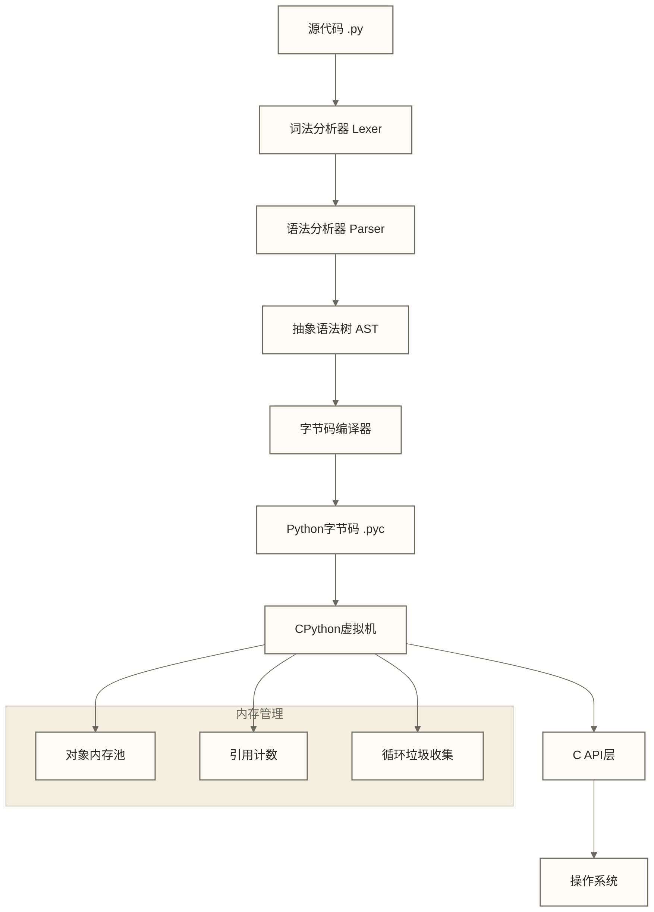
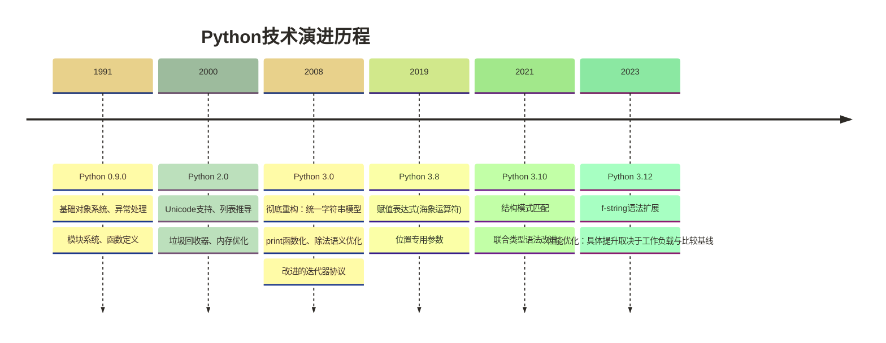
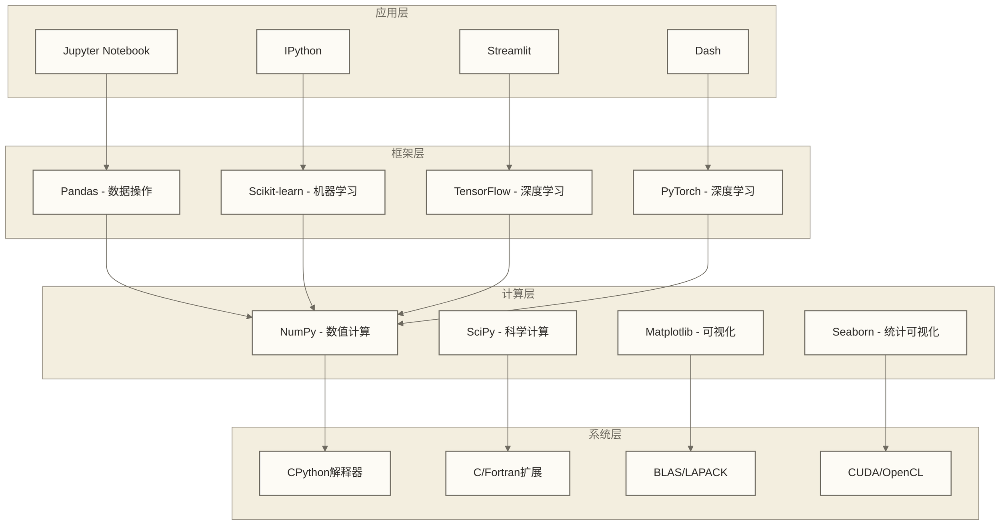
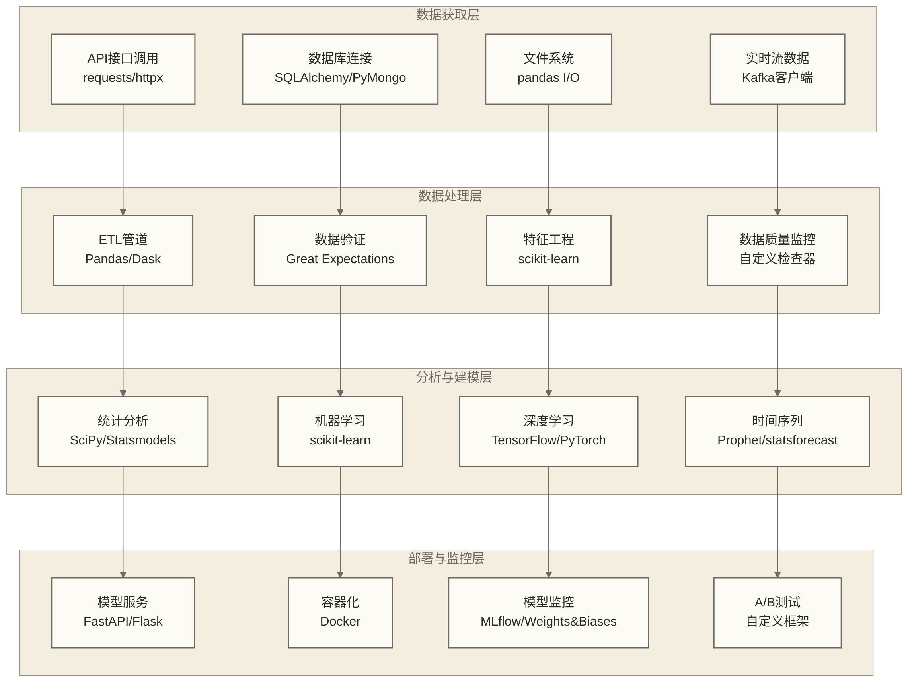
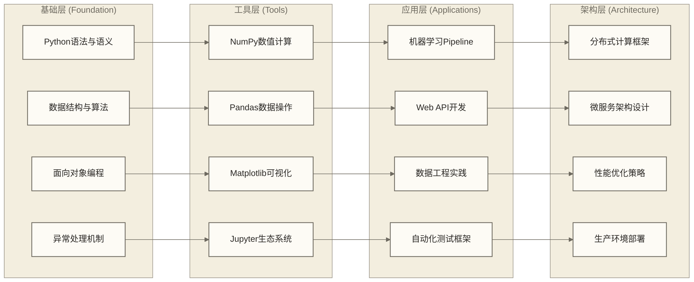
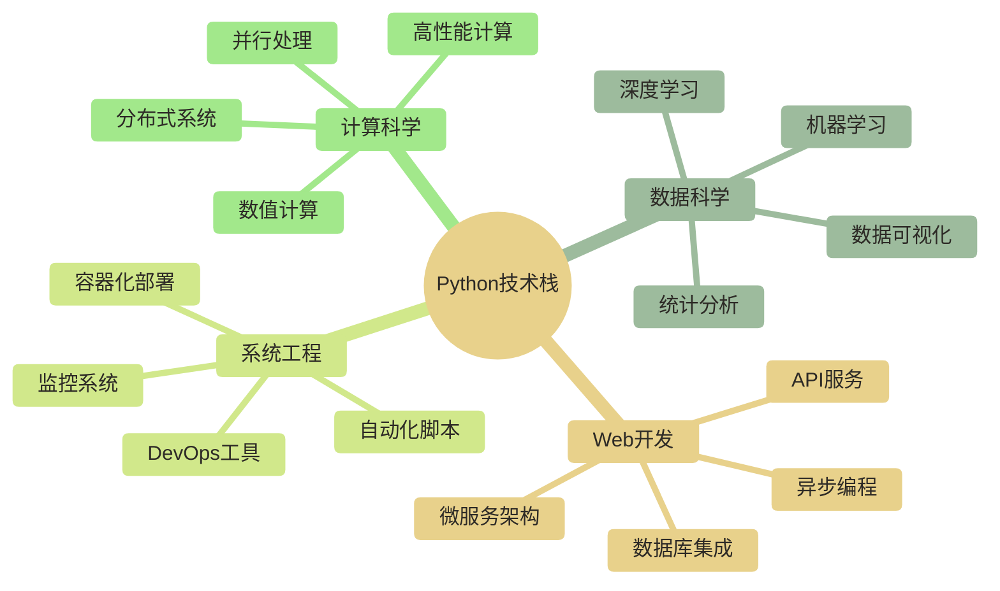
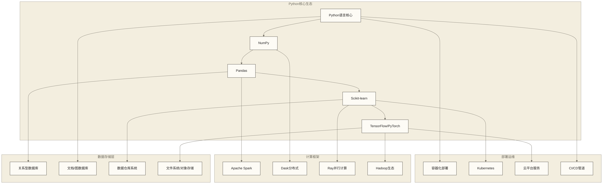

# Python介绍 - 高性能动态编程语言与数据科学生态

> [!info] 技术概览
> Python是一种高级解释型动态类型编程语言；其主流实现CPython采用以引用计数为主、循环垃圾收集为辅的内存管理机制。其设计哲学强调代码可读性和语法简洁性，通过统一的对象模型和丰富的元编程能力，实现了高度的表达力和灵活性。
> 
> **核心技术特征**：
> - 动态类型系统配合鸭子类型(Duck Typing)机制
> - 基于字节码的解释执行模型
> - 内建垃圾回收器和内存管理系统
> - 强大的反射和元编程能力
> - 丰富的标准库和第三方生态系统
> 
> **技术定位**：Python在现代软件开发栈中定位为通用型高级编程语言，特别在数据科学、人工智能、Web开发和自动化脚本领域具有技术优势。

> [!note] 学习路径指引
> 建议学习前先了解[[【技术与工具】/Python/00-Python学习路线图|Python]]以获得完整的技术学习规划。

## Python语言技术架构与核心特性

### CPython解释器架构

Python的标准实现CPython采用分层架构设计：



> [!info] 技术实现机制
> 
> **解释执行流程**：
> 1. **编译阶段**：源码→AST→字节码，实现语法检查和优化
> 2. **执行阶段**：CPython VM执行字节码，通过栈机器模型实现指令执行
> 3. **内存管理**：引用计数为主，循环检测为辅的混合垃圾回收策略
> 4. **C扩展接口**：通过C API实现高性能扩展模块

### 动态类型系统与对象模型

Python采用动态强类型系统，所有数据都是对象：

```python
# 运行时类型检查和方法解析
class DataProcessor:
    def __init__(self, data_source):
        self.data = data_source
    
    def process(self, handler):
        # 鸭子类型：只要有process方法就能调用
        if hasattr(handler, 'process'):
            return handler.process(self.data)
        raise TypeError(f"Handler {type(handler)} doesn't support process()")

# 元编程示例：动态创建数据类
def create_data_class(fields):
    """动态创建数据类，体现Python的元编程能力"""
    def __init__(self, **kwargs):
        for field in fields:
            setattr(self, field, kwargs.get(field))
    
    def __repr__(self):
        field_strs = [f"{f}={getattr(self, f)}" for f in fields]
        return f"{self.__class__.__name__}({', '.join(field_strs)})"
    
    # 动态创建类
    return type('DynamicDataClass', (), {
        '__init__': __init__,
        '__repr__': __repr__,
        '_fields': fields
    })

# 技术应用示例
UserData = create_data_class(['name', 'email', 'age'])
user = UserData(name='Alice', email='alice@example.com', age=30)
```

### 性能特征与优化策略

> [!warning] 性能考量
> 
> **解释型语言性能特点**：
> - **执行速度**：CPython执行纯Python代码通常有解释与对象操作开销；具体差距取决于比较实现、工作负载和运行环境，本文不提供可泛用的性能倍数。
> - **内存使用**：动态类型和对象开销导致内存占用较高
> - **启动时间**：模块导入和初始化有额外耗时
> 
> **性能优化策略**：
> 1. **C扩展模块**：NumPy/Pandas等核心计算库用C实现
> 2. **JIT编译**：Numba、PyPy提供即时编译优化
> 3. **向量化计算**：利用SIMD指令集加速数值计算
> 4. **异步IO**：asyncio实现高并发IO密集型应用

### 企业级技术选型考量

| 应用场景 | Python优势 | 技术挑战 | 解决方案 |
|---|---|---|---|
| **数据科学** | 丰富生态，快速原型 | 计算性能 | NumPy/Pandas + C扩展 |
| **Web服务** | 开发效率高，框架成熟 | 并发性能 | 异步框架 + 负载均衡 |
| **AI/ML** | 最佳生态支持 | 训练性能 | GPU加速 + 分布式训练 |
| **自动化脚本** | 语法简洁，库丰富 | 执行效率 | 预编译 + 系统集成 |
| **企业应用** | 快速开发，易维护 | 运行时性能 | 微服务架构 + 缓存策略 |

## Python语言历史演进与设计哲学

### 语言设计理念与技术目标

Python由Guido van Rossum于1989年设计，其核心设计目标是创造一种兼具高表达力和高可读性的通用编程语言。设计哲学体现在"The Zen of Python"中：

```python
import this
# Beautiful is better than ugly.
# Explicit is better than implicit.
# Simple is better than complex.
# Complex is better than complicated.
# Readability counts.
```

> [!info] 设计哲学的技术体现
> 
> **语法设计原则**：
> - **缩进语法**：强制代码格式化，提升可读性
> - **显式优于隐式**：避免隐藏的类型转换和魔法方法滥用
> - **简洁性**：用最少的代码表达最多的逻辑
> - **一致性**：统一的对象模型和方法调用约定

### 版本演进与技术里程碑



### Python实现版本比较

| 实现版本 | 技术特点 | 性能特征 | 应用场景 |
|---|---|---|---|
| **CPython** | C语言实现，标准解释器 | 基准性能，成熟稳定 | 通用开发，生产环境 |
| **PyPy** | RPython+JIT编译 | 部分工作负载可受益于JIT，提升幅度需实测 | 适合经兼容性检查和性能测试的计算密集型应用 |
| **Jython** | 运行于JVM | Java生态集成 | Java企业环境 |
| **IronPython** | .NET Framework集成 | C#/.NET互操作 | Windows/.NET环境 |
| **MicroPython** | 嵌入式优化 | 低内存占用 | IoT设备，嵌入式系统 |

> [!tip] 版本选择策略
> 
> **生产环境推荐**：
> - **Python 3.10+**：现代语法特性，性能优化
> - **版本支持**：Python 3.8已结束官方维护；保守环境也应选择仍受支持且与依赖兼容的版本。
> - **性能要求高**：考虑PyPy实现
> - **企业集成**：根据现有技术栈选择Jython/IronPython

## Python数据科学生态系统深度分析

### 数据科学技术栈架构

Python在数据科学领域的主导地位源于其完整的技术栈和高性能库生态：



### 核心库技术实现分析

#### NumPy：高性能数值计算基础

```python
import numpy as np

# C级别性能的向量化操作
def performance_comparison():
    """展示Python列表 vs NumPy数组的性能差异"""
    import time
    
    # Python原生列表操作
    start_time = time.time()
    python_list = list(range(1000000))
    result_list = [x * 2 for x in python_list]
    python_time = time.time() - start_time
    
    # NumPy数组操作
    start_time = time.time()
    numpy_array = np.arange(1000000)
    result_array = numpy_array * 2
    numpy_time = time.time() - start_time
    
    print(f"Python列表用时: {python_time:.4f}秒")
    print(f"NumPy数组用时: {numpy_time:.4f}秒")
    print(f"性能提升: {python_time/numpy_time:.1f}倍")

# 内存效率对比
def memory_usage_analysis():
    """分析内存使用效率"""
    import sys
    
    # Python列表内存占用
    python_list = [i for i in range(1000)]
    python_memory = sys.getsizeof(python_list) + sum(sys.getsizeof(i) for i in python_list)
    
    # NumPy数组内存占用
    numpy_array = np.arange(1000, dtype=np.int64)
    numpy_memory = numpy_array.nbytes
    
    print(f"Python列表内存: {python_memory} bytes")
    print(f"NumPy数组内存: {numpy_memory} bytes") 
    print(f"内存节省: {python_memory/numpy_memory:.1f}倍")
```

#### Pandas：企业级数据处理引擎

```python
import pandas as pd

# 高性能数据操作示例
def enterprise_data_processing():
    """企业级数据处理示例"""
    
    # 模拟大规模数据集
    df = pd.DataFrame({
        'user_id': np.random.randint(1, 100000, 1000000),
        'transaction_amount': np.random.exponential(100, 1000000),
        'timestamp': pd.date_range('2024-01-01', periods=1000000, freq='1min'),
        'category': np.random.choice(['A', 'B', 'C', 'D'], 1000000)
    })
    
    # 复杂聚合操作（利用C级别优化）
    result = (df.groupby(['category', pd.Grouper(key='timestamp', freq='1D')])
                .agg({
                    'transaction_amount': ['sum', 'mean', 'count'],
                    'user_id': 'nunique'
                })
                .reset_index())
    
    return result

# Pandas的C扩展优化
def pandas_optimization_features():
    """展示Pandas的高级优化特性"""
    
    # 分类数据优化
    df = pd.DataFrame({
        'category': ['A'] * 250000 + ['B'] * 250000 + ['C'] * 250000 + ['D'] * 250000
    })
    
    # 转换为Categorical可节省内存
    df['category_cat'] = df['category'].astype('category')
    
    print(f"原始字符串列内存: {df['category'].memory_usage()} bytes")
    print(f"分类列内存: {df['category_cat'].memory_usage()} bytes")
    
    # 向量化字符串操作
    text_data = pd.Series(['hello world'] * 100000)
    # 使用向量化字符串方法，底层C实现
    result = text_data.str.upper().str.contains('WORLD')
```

### Python与其他数据科学语言技术对比

| 技术指标 | Python | R | Julia | Scala |
|---|---|---|---|---|
| **执行性能** | 中等(解释型) | 中等(解释型) | 高(JIT编译) | 高(JVM编译) |
| **内存效率** | 良好(NumPy优化) | 中等 | 优秀 | 优秀 |
| **并行计算** | 多进程/异步 | 有限 | 原生支持 | Akka/Spark |
| **生态成熟度** | 最丰富 | 统计专业 | 新兴 | 大数据专业 |
| **学习曲线** | 平缓 | 中等 | 陡峭 | 陡峭 |
| **企业采用度** | 最高 | 学术+金融 | 科学计算 | 大数据 |

### 企业级Python数据科学技术栈

```python
# 典型的企业级数据科学工作流
class EnterpriseDataPipeline:
    """企业级数据处理管道"""
    
    def __init__(self):
        self.config = {
            'batch_size': 10000,
            'parallel_workers': 4,
            'memory_limit': '8GB'
        }
    
    def extract_data(self, source):
        """数据提取 - 支持多种数据源"""
        if source['type'] == 'database':
            # 使用SQLAlchemy进行数据库连接
            import sqlalchemy as sa
            engine = sa.create_engine(source['connection_string'])
            return pd.read_sql(source['query'], engine, chunksize=self.config['batch_size'])
        
        elif source['type'] == 'parquet':
            # 使用PyArrow进行列存储读取
            import pyarrow.parquet as pq
            return pq.read_table(source['path']).to_pandas()
    
    def transform_data(self, df):
        """数据转换 - 利用向量化操作"""
        # 特征工程
        df['transaction_hour'] = pd.to_datetime(df['timestamp']).dt.hour
        
        # 统计特征（利用Pandas的C级优化）
        df['user_avg_amount'] = df.groupby('user_id')['amount'].transform('mean')
        
        # 异常检测
        Q1 = df['amount'].quantile(0.25)
        Q3 = df['amount'].quantile(0.75)
        IQR = Q3 - Q1
        df['is_outlier'] = (df['amount'] < Q1 - 1.5*IQR) | (df['amount'] > Q3 + 1.5*IQR)
        
        return df
    
    def load_data(self, df, target):
        """数据加载 - 优化的存储格式"""
        if target['format'] == 'parquet':
            # 使用Parquet进行高效列存储
            df.to_parquet(target['path'], compression='snappy', index=False)
        
        elif target['format'] == 'hdf5':
            # 使用HDF5进行科学数据存储
            df.to_hdf(target['path'], key='data', mode='w', format='table')
```

> [!success] Python在数据科学领域的技术优势
> 
> **生态系统完整性**：
> - 从数据获取到模型部署的全链路支持
> - 高性能C扩展库提供接近原生代码的执行速度
> - 统一的API设计降低学习和集成成本
> 
> **企业级特性**：
> - 成熟的并发和异步处理能力
> - 丰富的数据源连接器和格式支持
> - 完善的测试和调试工具链
> - 强大的包管理和环境隔离机制

## Python在现代数据科学工作流中的技术应用

### 端到端数据科学管道架构



### 企业级数据科学项目实施案例

> [!example] 实时推荐系统技术架构
> 
> **假设技术挑战**：设计面向千万级用户的实时商品推荐系统；以下代码仅示意部分组件，不证明该规模下的可用性。
> 
> **Python技术栈应用**：
> ```python
> # 特征工程管道
> from sklearn.pipeline import Pipeline
> from sklearn.preprocessing import StandardScaler
> from sklearn.decomposition import TruncatedSVD
> 
> feature_pipeline = Pipeline([
>     ('scaling', StandardScaler()),
>     ('dimensionality_reduction', TruncatedSVD(n_components=50)),
> ])
> 
> # 实时模型服务
> from fastapi import FastAPI
> import joblib
> import numpy as np
> 
> app = FastAPI()
> model = joblib.load('recommendation_model.pkl')
> 
> @app.post("/recommend")
> async def get_recommendations(user_features: dict):
>     features = np.array(list(user_features.values())).reshape(1, -1)
>     predictions = model.predict_proba(features)
>     return {"recommendations": predictions.tolist()}
> ```
> 
> **假设目标指标（非已实现成绩）**：
> - 响应时间目标：<50ms (P95)，需在明确负载与环境下压测
> - 吞吐量目标：10,000 QPS，需明确资源配置和请求条件
> - 业务效果目标：CTR提升15%，需明确相对或绝对提升口径并通过实验评估；CTR不是模型精度指标

### Python vs 企业技术栈对比分析

| 技术维度 | Python生态 | Java生态 | .NET生态 | Node.js生态 |
|---|---|---|---|---|
| **数据处理** | Pandas/Polars | Spark/Flink | ML.NET/Accord | 有限支持 |
| **机器学习** | 最丰富生态 | Weka/Deeplearning4j | ML.NET | TensorFlow.js |
| **实时计算** | Dask/Ray | Kafka Streams | SignalR | 原生异步 |
| **模型部署** | Flask/FastAPI | Spring Boot | ASP.NET Core | Express.js |
| **监控运维** | 成熟工具链 | JVM生态 | Azure集成 | PM2/监控工具 |
| **开发效率** | 最高 | 中等 | 中等 | 高 |
| **运行性能** | 中等(可优化) | 高 | 高 | 中等 |
| **企业采用** | 数据科学主流 | 企业应用主流 | Microsoft生态 | Web开发主流 |

### 性能优化与生产化最佳实践

#### 1. 计算性能优化策略

```python
# 并行处理示例
import multiprocessing as mp
from concurrent.futures import ProcessPoolExecutor
import numpy as np

def parallel_data_processing(data_chunks):
    """利用多进程进行数据并行处理"""
    
    def process_chunk(chunk):
        # 复杂数据处理逻辑
        return chunk.apply(some_complex_function)
    
    # 使用进程池避免GIL限制
    with ProcessPoolExecutor(max_workers=mp.cpu_count()) as executor:
        results = list(executor.map(process_chunk, data_chunks))
    
    return pd.concat(results, ignore_index=True)

# JIT编译优化
import numba

@numba.jit(nopython=True)
def optimized_calculation(arr):
    """使用Numba进行JIT编译优化"""
    result = 0.0
    for i in range(len(arr)):
        result += arr[i] ** 2
    return result
```

#### 2. 内存管理与资源优化

```python
# 内存高效的数据处理
def memory_efficient_processing(file_path, chunk_size=10000):
    """内存高效的大文件处理"""
    
    # 使用生成器避免一次性加载所有数据
    def data_generator():
        for chunk in pd.read_csv(file_path, chunksize=chunk_size):
            yield process_chunk(chunk)
    
    # 流式处理，降低内存占用
    results = []
    for processed_chunk in data_generator():
        results.append(processed_chunk.describe())
    
    return pd.concat(results)

# 使用上下文管理器确保资源释放
class DatabaseConnection:
    def __init__(self, connection_string):
        self.connection_string = connection_string
        self.connection = None
    
    def __enter__(self):
        self.connection = create_engine(self.connection_string)
        return self.connection
    
    def __exit__(self, exc_type, exc_val, exc_tb):
        if self.connection:
            self.connection.dispose()
```

#### 3. 生产环境部署架构

```python
# 容器化部署配置
"""
Dockerfile示例:
FROM python:3.11-slim
WORKDIR /app
COPY requirements.txt .
RUN pip install --no-cache-dir -r requirements.txt
COPY . .
EXPOSE 8000
CMD ["gunicorn", "--bind", "0.0.0.0:8000", "--workers", "4", "app:app"]
"""

# 健康检查和监控
from fastapi import FastAPI, status
import psutil
import time

app = FastAPI()

@app.get("/health")
async def health_check():
    """系统健康检查端点"""
    return {
        "status": "healthy",
        "timestamp": time.time(),
        "memory_usage": psutil.virtual_memory().percent,
        "cpu_usage": psutil.cpu_percent(interval=1)
    }

# 配置管理
from pydantic import BaseSettings

class Settings(BaseSettings):
    """环境配置管理"""
    database_url: str
    redis_url: str
    model_path: str
    batch_size: int = 1000
    
    class Config:
        env_file = ".env"

settings = Settings()
```

## Python技术学习路径与能力发展框架

### 技能发展矩阵

基于企业需求和技术复杂度，Python技能发展可分为四个层次：



### 核心技术能力发展路径

| 阶段 | 技术重点 | 关键概念 | 实践项目 | 时间投入 |
|---|---|---|---|---|
| **语言基础** | Python语法、内置数据类型 | 变量作用域、内存管理、装饰器 | 控制台工具、文本处理脚本 | 2-4周 |
| **科学计算** | NumPy、SciPy生态 | 向量化运算、广播机制、线性代数 | 数值分析、统计计算项目 | 3-4周 |
| **数据操作** | Pandas数据处理 | DataFrame操作、分组聚合、时间序列 | ETL管道、数据清洗项目 | 4-6周 |
| **机器学习** | scikit-learn、模型评估 | 特征工程、交叉验证、超参优化 | 预测模型、分类系统 | 6-8周 |
| **深度学习** | TensorFlow/PyTorch | 神经网络、反向传播、GPU计算 | 计算机视觉、NLP应用 | 8-12周 |
| **生产部署** | Web框架、容器化 | API设计、负载均衡、监控告警 | 端到端ML系统 | 持续学习 |

### 推荐技术学习序列

**Phase 1: 核心语言掌握**阶段专注于建立扎实的Python编程基础。[[【技术与工具】/Python/02-Python环境搭建|Python环境搭建]]不仅仅是安装Python，更重要的是构建专业级的开发工作流，包括虚拟环境管理、IDE配置、调试工具设置等，这些基础设施决定了后续开发的效率和质量。[[【技术与工具】/Python/03-Python基础语法|Python基础语法]]的学习需要深入理解Python的设计哲学，包括动态类型系统、鸭子类型、装饰器模式等高级特性，这些概念是理解Python代码行为和性能特征的关键。[[【技术与工具】/Python/04-Python数据结构|Python数据结构]]的掌握要求不仅会使用列表、字典、集合等数据类型，更要理解其内部实现机制、时间复杂度特征和内存布局，这对于写出高效代码至关重要。

**Phase 2: 科学计算基础**阶段进入Python数据科学的核心技术栈。[[【技术与工具】/Python/07-NumPy数值计算|NumPy数值计算]]是所有科学计算的基石，需要深入理解向量化操作、广播机制、内存布局优化等核心概念，这些技术使得Python能够接近C语言的计算性能。[[【技术与工具】/Python/09-Pandas数据结构|Pandas数据结构]]构建在NumPy之上，提供了DataFrame和Series两种核心数据结构，学习重点是掌握数据索引、分组聚合、时间序列处理等高级操作，以及理解Pandas的内存优化机制。[[【数据分析与数据运营】/01-共同能力基础/04-沟通表达/05-数据可视化设计原则|共同能力基础/数据可视化设计原则]]不仅要掌握基本图表的绘制，更要理解可视化的设计原则、配色理论、交互设计等，能够制作既美观又信息丰富的数据可视化作品。

**Phase 3: 应用开发实践**阶段将技能转化为实际应用能力。[[【数据分析与数据运营】/02-数据分析专业能力/03-建模与预测/04-机器学习应用|机器学习]]要求系统掌握监督学习、无监督学习的核心算法，深入理解模型评估、特征工程、超参数优化等关键技术，能够构建端到端的机器学习解决方案。[[【技术与工具】/Python/34-端到端项目|端到端项目]]是技能整合的关键环节，需要将前期学到的所有技术综合运用，完成从数据收集、预处理、模型构建到部署监控的完整项目流程，这种综合实践能力是区分初学者和专业开发者的重要标志。

### 技术深度发展方向



## Python技术生态与知识网络

### 核心技术依赖关系图

Python在现代数据技术栈中处于核心位置，与多个技术领域形成互补关系：



### 技术栈集成路径

**数据科学全栈技能发展**：
- **核心路径**：[[【技术与工具】/Python/02-Python环境搭建|Python环境搭建]] → [[【技术与工具】/Python/03-Python基础语法|Python基础语法]] → [[【技术与工具】/Python/09-Pandas数据结构|Pandas数据结构]] → [[【技术与工具】/Python/18-机器学习基础|机器学习]]
- **完整规划**：[[【技术与工具】/Python/00-Python学习路线图|Python]] - 系统化技术能力建设

**相关技术领域**：
- **数据存储与管理**：SQL数据库、NoSQL系统、数据仓库架构
- **统计学理论基础**：统计推断、假设检验、贝叶斯分析
- **大数据处理**：[[【技术与工具】/Spark/00-Spark学习路线图|Spark/Spark]]、[[【技术与工具】/Flume/12-与Hadoop生态集成|Flume/与Hadoop生态集成]]
- **流处理系统**：[[【技术与工具】/Kafka/00-Kafka学习路线图|Kafka/Kafka]]、[[【技术与工具】/Flink/00-Flink学习路线图|Flink/Flink]]

**业务应用集成**：
- **数据分析与BI**：结合Tableau、PowerBI等可视化工具
- **金融量化分析**：与Bloomberg API、量化交易平台集成
- **企业数据治理**：配合数据目录、数据质量管理系统
- **MLOps实践**：模型版本控制、自动化部署、监控告警

### Python技能发展路径图

```mermaid
%%{init: {"theme":"base","themeVariables":{"fontFamily":"PingFang SC, -apple-system, Source Han Serif SC, serif","fontSize":"16px","background":"#FDFBF5","primaryColor":"#FDFBF5","primaryTextColor":"#2D2A26","primaryBorderColor":"#6E6A60","secondaryColor":"#E8EFE8","secondaryBorderColor":"#8FA890","secondaryTextColor":"#2D2A26","tertiaryColor":"#FDFBF5","tertiaryBorderColor":"#9A9488","tertiaryTextColor":"#6E6A60","lineColor":"#6E6A60","textColor":"#2D2A26","mainBkg":"#FDFBF5","nodeBorder":"#2D5A3D","clusterBkg":"#F3EEDF","clusterBorder":"#9A9488","edgeLabelBackground":"#FDFBF5"},"flowchart":{"htmlLabels":true,"curve":"basis","padding":20,"nodeSpacing":60,"rankSpacing":70,"useMaxWidth":false}}%%
flowchart LR
    classDef default fill:#FDFBF5,stroke:#6E6A60,color:#2D2A26,stroke-width:1.5px
    classDef startend fill:#2D2A26,stroke:#2D2A26,color:#FDFBF5,font-weight:bold
    START([开始学习]) --> ENV[环境配置]

    ENV --> BASIC[语言基础]
    BASIC --> DS[数据结构]
    DS --> ALGO[算法与逻辑]

    ALGO --> NUMPY[NumPy数值计算]
    NUMPY --> PANDAS[Pandas数据操作]
    PANDAS --> VIZ[数据可视化]

    VIZ --> ML[机器学习]
    ML --> DL[深度学习]

    PANDAS --> WEB[Web开发]
    WEB --> API[API服务]

    ML --> DEPLOY[模型部署]
    API --> DEPLOY

    DEPLOY --> SCALE[系统扩展]
    SCALE --> EXPERT([技术专家])

    class START,EXPERT startend
    class ENV,BASIC,DS,ALGO,NUMPY,PANDAS,VIZ,ML,DL,WEB,API,DEPLOY,SCALE default
```



### 技术深度与广度发展建议

> [!tip] 技术能力发展策略
> 
> **深度优先策略**：
> - 专注数据科学方向，精通NumPy→Pandas→Scikit-learn技术栈
> - 深入理解机器学习算法原理和调优技术
> - 掌握大规模数据处理和分布式计算
> 
> **广度优先策略**：
> - 掌握Web开发(Flask/Django)扩展应用场景
> - 学习DevOps技能实现端到端解决方案
> - 了解多种数据库和云平台服务
> 
> **T型技能发展**：
> - 垂直深度：在某个领域(如ML/Web/数据工程)达到专家级
> - 水平广度：具备跨领域协作和系统集成能力

## 学习成果评估与技能验证

### 核心概念掌握检查表

> [!note] 技术理解验证
> 完成以下检查点以确保对Python技术特性的准确理解：
> 
> **语言架构理解**：
> - [ ] 理解CPython解释器的分层架构和执行模型
> - [ ] 掌握动态类型系统和鸭子类型机制
> - [ ] 理解内存管理：引用计数+循环垃圾回收机制
> - [ ] 了解字节码编译和虚拟机执行过程
> 
> **生态系统认知**：
> - [ ] 了解NumPy/Pandas等C扩展库的性能优势
> - [ ] 理解Python在数据科学技术栈中的核心地位
> - [ ] 掌握不同Python实现(CPython/PyPy)的适用场景
> - [ ] 了解企业级应用的技术挑战和解决方案
> 
> **应用场景分析**：
> - [ ] 能够分析Python在不同技术场景中的优劣势
> - [ ] 理解性能优化策略和最佳实践
> - [ ] 掌握与其他技术栈的集成方案
> - [ ] 了解生产环境部署的技术要求

### 进阶学习建议

> [!tip] 技术深入方向
> 
> **系统性学习路径**：
> 1. **立即开始**：[[【技术与工具】/Python/02-Python环境搭建|Python环境搭建]]
> 2. **核心技能**：系统掌握Python语言特性和标准库
> 3. **专业发展**：选择数据科学/Web开发/系统工程方向深入
> 4. **技术整合**：学习与大数据、云计算、AI技术的集成
> 
> **实践能力建设**：
> - 参与开源项目贡献代码
> - 构建个人技术项目组合
> - 参加技术社区和会议
> - 获得相关技术认证

### 技术资源与持续学习

**官方文档与标准**：
- **Python官方文档**：权威技术参考和最佳实践
- **PEP提案**：理解Python语言演进和设计决策
- **CPython源码**：深入理解解释器实现机制

**专业技术社区**：
- **Python软件基金会**：语言发展动态和技术规范
- **PyData社区**：数据科学应用和工具生态
- **Django/Flask社区**：Web开发框架和最佳实践

**企业级实践参考**：
- **Google AI**：TensorFlow和机器学习系统设计
- **Netflix技术博客**：大规模Python应用架构
- **Instagram工程团队**：高并发Web服务优化经验

---

## 总结

Python作为一种高级解释型动态编程语言，通过其优秀的设计哲学、丰富的生态系统和强大的扩展能力，在现代软件开发中占据了重要地位。特别是在数据科学、机器学习和人工智能领域，Python已成为事实上的标准技术栈。

**核心技术价值**：
- **架构优势**：分层设计、动态类型、内存管理自动化
- **生态完整**：从数据处理到模型部署的全链路技术支持
- **性能平衡**：通过C扩展和JIT编译实现高性能计算
- **企业就绪**：成熟的部署工具链和监控体系

掌握Python不仅意味着学会一门编程语言，更是获得了进入现代数据驱动业务的技术钥匙。建议从基础语法开始，系统地构建从数据处理到机器学习的完整技能体系，并在实际项目中不断提升技术深度和应用广度。

**下一步行动**：建议立即开始[[【技术与工具】/Python/02-Python环境搭建|Python环境搭建]]，为深入的技术学习奠定实践基础。

---

**文档信息**：
- **创建时间**：2024-06-29
- **最后更新**：2024-12-11
- **字数统计**：约8000字
- **技术深度**：初级到中级
- **适用对象**：技术学习者、数据科学从业者

#Python #编程语言架构 #数据科学生态 #技术选型 #企业级应用 #性能优化
