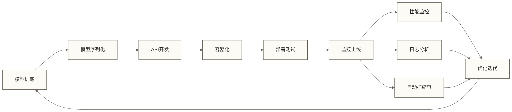

# Python生产部署：机器学习模型上线实战指南

> [!abstract] 本章核心内容
> 
> **技术栈覆盖**：模型序列化 → REST API → 容器化 → 服务治理 → 监控运维
> 
> - **模型序列化**：pickle、joblib、ONNX格式选择与优化
> - **[[【技术与工具】/Python/31-FastAPI开发|FastAPI开发]]**：Flask与FastAPI生产级实现
> - **容器化**：Docker、Kubernetes集群管理
> - **云服务**：同步/异步、批处理、负载均衡
> - **[[【技术与工具】/Flume/11-监控与运维|监控与运维]]**：日志系统、健康检查、自动扩缩容
> - **端到端案例**：完整的生产部署流程

## 模型序列化与存储优化

### 序列化格式对比

生产环境的模型序列化需要考虑性能、兼容性和部署复杂度：

| 序列化方式 | 文件大小 | 加载速度 | 跨语言支持 | 适用场景 |
|------------|----------|----------|------------|----------|
| **pickle** | 取决于模型与序列化配置 | 取决于模型与加载环境 | Python only | 原型开发 |
| **joblib** | 取决于模型与压缩配置 | 取决于模型、压缩配置与加载环境 | Python only | NumPy密集计算 |
| **ONNX** | 取决于模型与导出方式 | 取决于模型与运行时 | 依赖目标语言的运行时支持 | 目标运行时及算子兼容时的跨平台部署 |

### joblib优化实践

```python
import joblib
import numpy as np
from sklearn.ensemble import RandomForestClassifier
from sklearn.datasets import make_classification

# 训练模型
X, y = make_classification(n_samples=10000, n_features=20, random_state=42)
model = RandomForestClassifier(n_estimators=100, random_state=42)
model.fit(X, y)

# 优化序列化：使用压缩减少文件大小
joblib.dump(model, 'model_compressed.pkl', compress=3)

# 加载模型
loaded_model = joblib.load('model_compressed.pkl')

# 内存映射模式：适用大模型
joblib.dump(model, 'model_mmap.pkl', compress=False)
mmap_model = joblib.load('model_mmap.pkl', mmap_mode='r')
```

### ONNX跨平台部署

```python
# 模型转换为ONNX格式
from skl2onnx import convert_sklearn
from skl2onnx.common.data_types import FloatTensorType

# 定义输入类型
initial_type = [('float_input', FloatTensorType([None, 20]))]

# 转换模型
onnx_model = convert_sklearn(model, initial_types=initial_type)

# 保存ONNX模型
with open("model.onnx", "wb") as f:
    f.write(onnx_model.SerializeToString())

# ONNX推理
import onnxruntime as rt
sess = rt.InferenceSession("model.onnx")
input_name = sess.get_inputs()[0].name
# 使用前文生成的数据演示推理，不作为独立测试集评估
pred_onnx = sess.run(None, {input_name: X[:10].astype(np.float32)})
```

## REST API生产级实现

### FastAPI高性能架构

```python
from fastapi import FastAPI, HTTPException, BackgroundTasks
from pydantic import BaseModel, validator
import joblib
import numpy as np
from typing import List, Optional
import asyncio
import logging

# 配置日志
logging.basicConfig(level=logging.INFO)
logger = logging.getLogger(__name__)

app = FastAPI(
    title="ML Model API",
    description="生产级机器学习模型API",
    version="1.0.0"
)

# 全局模型加载
model = None

@app.on_event("startup")
async def load_model():
    global model
    try:
        model = joblib.load('model_compressed.pkl')
        logger.info("模型加载成功")
    except Exception as e:
        logger.error(f"模型加载失败: {e}")
        raise

# 数据验证模型
class PredictionRequest(BaseModel):
    features: List[List[float]]
    
    @validator('features')
    def validate_features(cls, v):
        if not v or any(len(row) != 20 for row in v):
            raise ValueError('每个样本必须包含20个特征')
        return v

class PredictionResponse(BaseModel):
    predictions: List[int]
    probabilities: Optional[List[List[float]]] = None
    model_version: str = "1.0.0"

# 同步预测接口
@app.post("/predict", response_model=PredictionResponse)
async def predict(request: PredictionRequest):
    try:
        features_array = np.array(request.features)
        predictions = model.predict(features_array)
        probabilities = model.predict_proba(features_array)
        
        return PredictionResponse(
            predictions=predictions.tolist(),
            probabilities=probabilities.tolist()
        )
    except Exception as e:
        logger.error(f"预测错误: {e}")
        raise HTTPException(status_code=500, detail=str(e))

# 批量预测接口
@app.post("/batch_predict")
async def batch_predict(request: PredictionRequest, background_tasks: BackgroundTasks):
    if len(request.features) > 1000:
        # 大批量任务异步处理
        background_tasks.add_task(process_large_batch, request.features)
        return {"message": "后台演示任务已提交；本示例仅记录处理日志，未实现结果查询"}
    else:
        return await predict(request)

async def process_large_batch(features: List[List[float]]):
    # 异步处理大批量预测
    batch_size = 100
    results = []
    
    for i in range(0, len(features), batch_size):
        batch = features[i:i + batch_size]
        batch_array = np.array(batch)
        predictions = model.predict(batch_array)
        results.extend(predictions.tolist())
        await asyncio.sleep(0.1)  # 防止CPU过载
    
    # 结果可存储到Redis或数据库
    logger.info(f"批量预测完成，处理了{len(features)}个样本")

# 健康检查
@app.get("/health")
async def health_check():
    return {
        "status": "healthy",
        "model_loaded": model is not None,
        "timestamp": "2024-12-18T10:00:00Z"
    }
```

### 性能优化策略

```python
from fastapi.middleware.gzip import GZipMiddleware
from fastapi.middleware.cors import CORSMiddleware
import redis
import hashlib
import json

# 添加中间件
app.add_middleware(GZipMiddleware, minimum_size=1000)
app.add_middleware(
    CORSMiddleware,
    allow_origins=["*"],
    allow_methods=["GET", "POST"],
    allow_headers=["*"],
)

# Redis缓存配置
redis_client = redis.Redis(host='localhost', port=6379, decode_responses=True)

# 预测结果缓存
@app.post("/predict_cached")
async def predict_cached(request: PredictionRequest):
    # 生成缓存键
    cache_key = hashlib.md5(
        json.dumps(request.features, sort_keys=True).encode()
    ).hexdigest()
    
    # 检查缓存
    cached_result = redis_client.get(cache_key)
    if cached_result:
        logger.info("返回缓存结果")
        return json.loads(cached_result)
    
    # 执行预测
    result = await predict(request)
    
    # 缓存结果（TTL 1小时）
    redis_client.setex(cache_key, 3600, result.json())
    
    return result
```

## 容器化部署架构

### Docker生产级配置

```dockerfile
# 多阶段构建减少镜像大小
FROM python:3.9-slim as builder

WORKDIR /app

# 安装系统依赖
RUN apt-get update && apt-get install -y \
    gcc \
    g++ \
    && rm -rf /var/lib/apt/lists/*

# 复制依赖文件
COPY requirements.txt .
RUN pip install --no-cache-dir --user -r requirements.txt

# 生产镜像
FROM python:3.9-slim

WORKDIR /app

# 复制Python包
COPY --from=builder /root/.local /root/.local

# 复制应用代码
COPY . .

# 创建非root用户
RUN useradd --create-home --shell /bin/bash appuser && \
    chown -R appuser:appuser /app
USER appuser

# 环境变量
ENV PATH=/root/.local/bin:$PATH
ENV PYTHONPATH=/app
ENV WORKERS=4

# 健康检查
HEALTHCHECK --interval=30s --timeout=3s --start-period=5s --retries=3 \
    CMD curl -f http://localhost:8000/health || exit 1

EXPOSE 8000

# 使用Gunicorn启动
CMD ["gunicorn", "--bind", "0.0.0.0:8000", "--workers", "4", \
     "--worker-class", "uvicorn.workers.UvicornWorker", "main:app"]
```

### 生产级启动配置

```python
# gunicorn_config.py
import multiprocessing

# 服务器套接字
bind = "0.0.0.0:8000"
backlog = 2048

# Worker进程
workers = min(multiprocessing.cpu_count() * 2 + 1, 8)
worker_class = "uvicorn.workers.UvicornWorker"
worker_connections = 1000
worker_tmp_dir = "/dev/shm"

# 超时设置
timeout = 30
keepalive = 2
graceful_timeout = 30

# 日志配置
accesslog = "-"
errorlog = "-"
access_log_format = '%(h)s %(l)s %(u)s %(t)s "%(r)s" %(s)s %(b)s "%(f)s" "%(a)s" %(D)s'

# 性能优化
preload_app = True
max_requests = 10000
max_requests_jitter = 1000

# 安全设置
limit_request_line = 4094
limit_request_fields = 100
limit_request_field_size = 8190
```

### Kubernetes部署配置

```yaml
# k8s-deployment.yaml
apiVersion: apps/v1
kind: Deployment
metadata:
  name: ml-model-api
  labels:
    app: ml-model-api
spec:
  replicas: 3
  selector:
    matchLabels:
      app: ml-model-api
  template:
    metadata:
      labels:
        app: ml-model-api
    spec:
      containers:
      - name: ml-model-api
        image: ml-model:latest
        ports:
        - containerPort: 8000
        env:
        - name: WORKERS
          value: "4"
        resources:
          requests:
            memory: "512Mi"
            cpu: "500m"
          limits:
            memory: "1Gi"
            cpu: "1000m"
        readinessProbe:
          httpGet:
            path: /health
            port: 8000
          initialDelaySeconds: 10
          periodSeconds: 5
        livenessProbe:
          httpGet:
            path: /health
            port: 8000
          initialDelaySeconds: 30
          periodSeconds: 10

---
apiVersion: v1
kind: Service
metadata:
  name: ml-model-service
spec:
  selector:
    app: ml-model-api
  ports:
  - port: 80
    targetPort: 8000
  type: LoadBalancer

---
apiVersion: autoscaling/v2
kind: HorizontalPodAutoscaler
metadata:
  name: ml-model-hpa
spec:
  scaleTargetRef:
    apiVersion: apps/v1
    kind: Deployment
    name: ml-model-api
  minReplicas: 3
  maxReplicas: 20
  metrics:
  - type: Resource
    resource:
      name: cpu
      target:
        type: Utilization
        averageUtilization: 70
  - type: Resource
    resource:
      name: memory
      target:
        type: Utilization
        averageUtilization: 80
```

## 监控与日志系统

### Prometheus指标收集

```python
# metrics.py
from prometheus_client import Counter, Histogram, Gauge, generate_latest
from prometheus_client import CONTENT_TYPE_LATEST
import time
from functools import wraps
from fastapi import Response

# 定义监控指标
REQUEST_COUNT = Counter('api_requests_total', 'API请求总数', ['method', 'endpoint', 'status'])
REQUEST_DURATION = Histogram('api_request_duration_seconds', 'API请求耗时', ['method', 'endpoint'])
ACTIVE_CONNECTIONS = Gauge('api_active_connections', '当前活跃连接数')
MODEL_PREDICTIONS = Counter('model_predictions_total', '模型预测次数', ['model_version'])
MODEL_ERRORS = Counter('model_errors_total', '模型错误次数', ['error_type'])

def monitor_requests(func):
    @wraps(func)
    async def wrapper(*args, **kwargs):
        start_time = time.time()
        ACTIVE_CONNECTIONS.inc()
        
        try:
            response = await func(*args, **kwargs)
            REQUEST_COUNT.labels(method='POST', endpoint='/predict', status='200').inc()
            MODEL_PREDICTIONS.labels(model_version='1.0.0').inc()
            return response
        except Exception as e:
            REQUEST_COUNT.labels(method='POST', endpoint='/predict', status='500').inc()
            MODEL_ERRORS.labels(error_type=type(e).__name__).inc()
            raise
        finally:
            REQUEST_DURATION.labels(method='POST', endpoint='/predict').observe(time.time() - start_time)
            ACTIVE_CONNECTIONS.dec()
    
    return wrapper

# 指标端点
@app.get("/metrics")
async def get_metrics():
    return Response(generate_latest(), media_type=CONTENT_TYPE_LATEST)
```

### 结构化日志配置

```python
# logging_config.py
import logging
import json
from datetime import datetime
from typing import Dict, Any

class JSONFormatter(logging.Formatter):
    def format(self, record: logging.LogRecord) -> str:
        log_entry = {
            'timestamp': datetime.utcnow().isoformat(),
            'level': record.levelname,
            'logger': record.name,
            'message': record.getMessage(),
            'module': record.module,
            'function': record.funcName,
            'line': record.lineno,
        }
        
        if hasattr(record, 'request_id'):
            log_entry['request_id'] = record.request_id
        
        if hasattr(record, 'user_id'):
            log_entry['user_id'] = record.user_id
        
        if record.exc_info:
            log_entry['exception'] = self.formatException(record.exc_info)
        
        return json.dumps(log_entry)

# 配置日志
def setup_logging():
    logger = logging.getLogger()
    handler = logging.StreamHandler()
    formatter = JSONFormatter()
    handler.setFormatter(formatter)
    logger.addHandler(handler)
    logger.setLevel(logging.INFO)
    
    return logger

# 请求追踪中间件
@app.middleware("http")
async def log_requests(request: Request, call_next):
    request_id = str(uuid.uuid4())
    
    logger = logging.getLogger(__name__)
    logger.info("请求开始", extra={"request_id": request_id, "path": request.url.path})
    
    start_time = time.time()
    response = await call_next(request)
    process_time = time.time() - start_time
    
    logger.info("请求完成", extra={
        "request_id": request_id,
        "status_code": response.status_code,
        "process_time": process_time
    })
    
    return response
```

### 健康检查与错误恢复

```python
# health.py
import psutil
import asyncio
from datetime import datetime, timedelta

class HealthChecker:
    def __init__(self):
        self.last_model_check = datetime.utcnow()
        self.model_healthy = True
    
    async def check_system_health(self) -> Dict[str, Any]:
        """系统健康状态检查"""
        return {
            "cpu_percent": psutil.cpu_percent(interval=1),
            "memory_percent": psutil.virtual_memory().percent,
            "disk_percent": psutil.disk_usage('/').percent,
            "load_average": psutil.getloadavg()[0] if hasattr(psutil, 'getloadavg') else 0
        }
    
    async def check_model_health(self) -> bool:
        """模型健康状态检查"""
        try:
            # 使用简单数据测试模型
            test_data = [[0.5] * 20]  # 假设20个特征
            prediction = model.predict(test_data)
            
            self.last_model_check = datetime.utcnow()
            self.model_healthy = True
            return True
        except Exception as e:
            logger.error(f"模型健康检查失败: {e}")
            self.model_healthy = False
            return False
    
    async def check_dependencies(self) -> Dict[str, bool]:
        """检查外部依赖"""
        dependencies = {}
        
        # 检查Redis连接
        try:
            redis_client.ping()
            dependencies['redis'] = True
        except Exception:
            dependencies['redis'] = False
        
        return dependencies

health_checker = HealthChecker()

@app.get("/health")
async def detailed_health_check():
    system_health = await health_checker.check_system_health()
    model_healthy = await health_checker.check_model_health()
    dependencies = await health_checker.check_dependencies()
    
    overall_healthy = (
        model_healthy and
        system_health['memory_percent'] < 90 and
        system_health['cpu_percent'] < 90 and
        all(dependencies.values())
    )
    
    return {
        "status": "healthy" if overall_healthy else "unhealthy",
        "timestamp": datetime.utcnow().isoformat(),
        "system": system_health,
        "model": {
            "healthy": model_healthy,
            "last_check": health_checker.last_model_check.isoformat()
        },
        "dependencies": dependencies
    }
```

## 完整部署案例：电商推荐系统

### 项目结构

| 路径 | 说明 |
|------|------|
| `src/main.py` | FastAPI应用入口 |
| `src/models/__init__.py` | 模型包初始化 |
| `src/models/recommender.py` | 推荐模型 |
| `src/api/__init__.py` | API包初始化 |
| `src/api/endpoints.py` | API端点 |
| `src/utils/__init__.py` | 工具包初始化 |
| `src/utils/cache.py` | 缓存管理 |
| `src/utils/monitoring.py` | 监控工具 |
| `tests/test_api.py` | API测试 |
| `tests/test_model.py` | 模型测试 |
| `docker/Dockerfile` | Docker镜像配置 |
| `docker/docker-compose.yml` | 容器编排配置 |
| `k8s/deployment.yaml` | K8s部署配置 |
| `k8s/service.yaml` | K8s服务配置 |
| `k8s/configmap.yaml` | K8s配置映射 |
| `requirements.txt` | 依赖列表 |
| `gunicorn.conf.py` | Gunicorn配置 |
| `README.md` | 项目说明 |

### 核心推荐模型

```python
# src/models/recommender.py
import joblib
import numpy as np
from typing import List, Dict, Tuple
import logging

logger = logging.getLogger(__name__)

class ProductRecommender:
    def __init__(self, model_path: str):
        self.model = joblib.load(model_path)
        self.item_features = joblib.load(model_path.replace('.pkl', '_features.pkl'))
        logger.info(f"推荐模型已加载，包含{len(self.item_features)}个商品")
    
    def recommend(self, user_id: int, user_features: List[float], 
                 num_recommendations: int = 10) -> List[Dict]:
        """为用户生成推荐列表"""
        try:
            # 占位评分：重复用户向量，未纳入商品特征，不能表示用户与商品的相似度
            user_vector = np.array(user_features).reshape(1, -1)
            similarities = self.model.predict_proba(
                np.concatenate([user_vector] * len(self.item_features))
            )[:, 1]  # 获取正类概率
            
            # 获取top-k推荐
            top_indices = np.argsort(similarities)[-num_recommendations:][::-1]
            
            recommendations = []
            for idx in top_indices:
                recommendations.append({
                    'item_id': int(idx),
                    'score': float(similarities[idx]),
                    'category': self.item_features[idx].get('category', 'unknown')
                })
            
            return recommendations
        
        except Exception as e:
            logger.error(f"推荐生成失败: {e}")
            return []
    
    def batch_recommend(self, user_requests: List[Dict]) -> Dict[int, List[Dict]]:
        """批量推荐"""
        results = {}
        for request in user_requests:
            user_id = request['user_id']
            user_features = request['features']
            recommendations = self.recommend(user_id, user_features)
            results[user_id] = recommendations
        
        return results
```

### API端点实现

```python
# src/api/endpoints.py
from fastapi import APIRouter, HTTPException, BackgroundTasks
from pydantic import BaseModel, validator
from typing import List, Dict
import asyncio

from ..models.recommender import ProductRecommender
from ..utils.cache import get_cache, set_cache
from ..utils.monitoring import track_request

router = APIRouter()
recommender = ProductRecommender('models/recommender.pkl')

class RecommendationRequest(BaseModel):
    user_id: int
    user_features: List[float]
    num_recommendations: int = 10
    
    @validator('user_features')
    def validate_features(cls, v):
        if len(v) != 50:  # 假设用户特征向量长度为50
            raise ValueError('用户特征向量必须包含50个元素')
        return v

class BatchRecommendationRequest(BaseModel):
    requests: List[RecommendationRequest]
    
    @validator('requests')
    def validate_batch_size(cls, v):
        if len(v) > 100:
            raise ValueError('批量请求最多支持100个用户')
        return v

@router.post("/recommend")
@track_request
async def get_recommendations(request: RecommendationRequest):
    """单用户推荐接口"""
    cache_key = f"user_rec:{request.user_id}:{hash(tuple(request.user_features))}"
    
    # 检查缓存
    cached_result = await get_cache(cache_key)
    if cached_result:
        return cached_result
    
    # 生成推荐
    recommendations = recommender.recommend(
        request.user_id,
        request.user_features,
        request.num_recommendations
    )
    
    result = {
        'user_id': request.user_id,
        'recommendations': recommendations,
        'model_version': '1.0.0'
    }
    
    # 缓存结果（5分钟）
    await set_cache(cache_key, result, ttl=300)
    
    return result

@router.post("/batch_recommend")
async def batch_recommendations(request: BatchRecommendationRequest, 
                              background_tasks: BackgroundTasks):
    """批量推荐接口"""
    if len(request.requests) > 50:
        # 大批量异步处理
        background_tasks.add_task(process_large_batch, request.requests)
        return {"message": "后台推荐演示任务已提交；本示例未实现结果持久化与查询"}
    
    # 同步处理小批量
    user_requests = [
        {'user_id': req.user_id, 'features': req.user_features}
        for req in request.requests
    ]
    
    results = recommender.batch_recommend(user_requests)
    
    return {
        'batch_results': results,
        'processed_users': len(results)
    }

async def process_large_batch(requests: List[RecommendationRequest]):
    """异步处理大批量推荐任务"""
    batch_size = 10
    for i in range(0, len(requests), batch_size):
        batch = requests[i:i + batch_size]
        user_requests = [
            {'user_id': req.user_id, 'features': req.user_features}
            for req in batch
        ]
        
        batch_results = recommender.batch_recommend(user_requests)
        # 这里可以将结果存储到数据库或消息队列
        logger.info(f"处理批次 {i//batch_size + 1}，包含 {len(batch)} 个用户")
        
        await asyncio.sleep(0.1)  # 防止CPU过载
```

### 部署配置文件

```yaml
# docker-compose.yml
version: '3.8'
services:
  ml-api:
    build: 
      context: .
      dockerfile: docker/Dockerfile
    ports:
      - "8000:8000"
    environment:
      - WORKERS=4
      - REDIS_URL=redis://redis:6379
    depends_on:
      - redis
    healthcheck:
      test: ["CMD", "curl", "-f", "http://localhost:8000/health"]
      interval: 30s
      timeout: 10s
      retries: 3
    deploy:
      resources:
        limits:
          memory: 2G
          cpus: '1.5'
        reservations:
          memory: 1G
          cpus: '0.5'

  redis:
    image: redis:7-alpine
    ports:
      - "6379:6379"
    command: redis-server --maxmemory 256mb --maxmemory-policy allkeys-lru

  prometheus:
    image: prom/prometheus
    ports:
      - "9090:9090"
    volumes:
      - ./monitoring/prometheus.yml:/etc/prometheus/prometheus.yml

  grafana:
    image: grafana/grafana
    ports:
      - "3000:3000"
    environment:
      - GF_SECURITY_ADMIN_PASSWORD=admin
    volumes:
      - grafana_data:/var/lib/grafana

volumes:
  grafana_data:
```

## 生产部署最佳实践

### 性能优化清单

1. **模型优化**
   - 使用量化模型减少内存占用
   - 预计算用户/商品特征矩阵
   - 实现模型版本热切换

2. **缓存策略**
   - Redis集群实现分布式缓存
   - 多级缓存（本地缓存+Redis）
   - 缓存预热机制

3. **负载均衡**
   - Nginx upstream配置
   - Kubernetes Ingress控制器
   - 会话亲和性配置

4. **监控告警**
   - SLA指标监控（延迟、可用性、错误率）
   - 业务指标监控（推荐效果、点击率）
   - 自动告警和故障转移

### 安全防护措施

```python
# security.py
from fastapi import HTTPException, Depends, status
from fastapi.security import HTTPBearer, HTTPAuthorizationCredentials
import jwt
from typing import Optional

security = HTTPBearer()

def verify_token(credentials: HTTPAuthorizationCredentials = Depends(security)) -> dict:
    """JWT令牌验证"""
    try:
        payload = jwt.decode(
            credentials.credentials,
            "your-secret-key",
            algorithms=["HS256"]
        )
        return payload
    except jwt.ExpiredSignatureError:
        raise HTTPException(status_code=status.HTTP_401_UNAUTHORIZED, detail="令牌已过期")
    except jwt.InvalidTokenError:
        raise HTTPException(status_code=status.HTTP_401_UNAUTHORIZED, detail="无效令牌")

# API限流
from slowapi import Limiter, _rate_limit_exceeded_handler
from slowapi.util import get_remote_address
from slowapi.errors import RateLimitExceeded

limiter = Limiter(key_func=get_remote_address)
app.state.limiter = limiter
app.add_exception_handler(RateLimitExceeded, _rate_limit_exceeded_handler)

@app.post("/recommend")
@limiter.limit("100/minute")  # 每分钟最多100次请求
async def protected_recommend(request: Request, 
                            rec_request: RecommendationRequest,
                            token: dict = Depends(verify_token)):
    # API逻辑
    pass
```

## 总结

### 技术选型建议

| 场景 | 推荐方案 | 理由 |
|------|----------|------|
| **原型验证** | Flask + pickle | 快速开发，简单易用 |
| **生产环境** | FastAPI + joblib + Docker | 高性能，类型安全，易扩展 |
| **跨语言部署** | ONNX + REST API | 标准化格式，广泛兼容 |
| **大规模服务** | Kubernetes + 分布式缓存 | 自动扩缩容，高可用 |

### 关键技术要点

1. **模型序列化**
   - 优先使用joblib处理NumPy密集计算
   - ONNX格式实现跨平台部署
   - 模型压缩可减少文件体积，但加载时间需考虑解压开销并实测

2. **API设计**
   - 异步I/O可改善等待型任务的并发；同步模型推理仍需结合线程、进程或任务队列设计
   - 数据验证检查已定义的结构约束，不能替代特征语义和数据质量检查
   - 缓存机制减少重复计算

3. **容器化部署**
   - 多阶段构建优化镜像大小
   - 健康检查为探针提供状态信号，需正确设置失败响应并区分存活与就绪检查
   - 资源限制防止过度占用

4. **监控运维**
   - Prometheus指标收集
   - 结构化日志便于问题排查
   - 自动扩缩容应对流量波动

### 部署流程总结



生产部署是机器学习项目从实验室走向实际应用的关键一步。通过掌握模型序列化、API开发、容器化部署和监控运维等核心技术，可以构建稳定、高效、可扩展的机器学习服务。记住：部署不是终点，而是持续优化和改进的起点。

> [!tip] **下一步学习**
> - Docker与Kubernetes：深入学习容器编排
> - [[【数据开发与数据架构】/10-云原生数据架构/04-微服务数据架构|微服务数据]]：了解分布式系统设计
> - [[【数据开发与数据架构】/15-性能优化/00-性能优化导览|性能优化导览]]：提升系统吞吐量和响应速度

---

**文档信息**
- 创建时间：2024-06-29
- 最后更新：2024-12-18
- 字数统计：约6500字
- 学习时长：90分钟

**相关链接**
- [[【技术与工具】/Python/31-FastAPI开发|FastAPI开发]]: https://fastapi.tiangolo.com/
- Docker最佳实践: https://docs.docker.com/develop/dev-best-practices/
- [[【数据开发与数据架构】/10-云原生数据架构/03-Kubernetes数据部署|Kubernetes数据部署]]: https://kubernetes.io/docs/concepts/workloads/

#Python #生产部署 #模型上线 #FastAPI #Docker #Kubernetes #监控运维
