# Flask Web开发 - 构建数据驱动的Web应用

> [!abstract] 📋 学习目标与内容概览
> **学习目标**：理解Flask Web开发的核心概念，练习分段API实现，并认识生产部署架构；完整应用启动与生产交付还需补齐依赖、入口、配置及业务实现
> - **前置知识**：[[【技术与工具】/Python/03-Python基础语法|Python基础语法]] + [[【技术与工具】/Python/05-Python函数编程|Python函数编程]] + HTTP协议基础
> - **核心技能**：Flask应用架构、RESTful API设计、数据库集成、安全认证
> - **应用场景**：数据API服务、数据可视化后端、微服务架构、业务系统接口
> - **技术栈**：Flask + SQLAlchemy + JWT + Redis + Docker

## 1. Flask框架深度解析

### 1.1 什么是Flask？

Flask是由Armin Ronacher开发的Python Web微框架，诞生于2010年。它秉承"微框架"理念，核心功能极简，但通过扩展机制提供了强大的可扩展性。

**Flask的核心特征**：
- **微框架哲学**：只提供Web开发的核心功能，其他功能通过扩展实现
- **简洁优雅**：API设计简单直观，学习曲线平缓
- **高度灵活**：没有固定的项目结构，开发者可以自由组织代码
- **WSGI兼容**：完全符合WSGI标准，可在任何WSGI服务器上运行
- **丰富生态**：拥有大量高质量扩展库

**为什么选择Flask？**

1. **快速原型开发**：最小化配置，几行代码即可启动Web应用
2. **学习成本低**：相比Django等重量级框架，Flask更容易上手
3. **设计灵活性**：不强制特定的项目结构和设计模式
4. **社区活跃**：开源社区贡献了大量优秀扩展
5. **数据科学友好**：与NumPy、Pandas等数据科学库完美集成

**Flask的设计理念**：

Flask遵循"显式优于隐式"的Python哲学，所有配置和行为都是明确的。它采用装饰器模式进行路由绑定，使代码结构清晰易懂。与传统MVC模式不同，Flask采用更轻量的设计模式。

### 1.2 Web开发基础概念

在深入Flask之前，需要理解现代Web开发的基础概念：

**HTTP协议核心原理**：

HTTP（超文本传输协议）是Web的基础协议，采用请求-响应模型：

1. **请求方法语义**：
   - GET：获取资源，幂等且安全
   - POST：创建资源，非幂等
   - PUT：更新资源，幂等
   - DELETE：删除资源，幂等
   - PATCH：部分更新资源

2. **状态码分类**：
   - 2xx：成功状态（200 OK, 201 Created, 204 No Content）
   - 3xx：重定向（301 Moved Permanently, 302 Found）
   - 4xx：客户端错误（400 Bad Request, 401 Unauthorized, 404 Not Found）
   - 5xx：服务器错误（500 Internal Server Error, 503 Service Unavailable）

3. **请求响应结构**：
   - 请求头：包含元数据（Content-Type、Authorization等）
   - 请求体：包含实际数据（JSON、表单数据等）
   - 响应头：包含响应元数据
   - 响应体：包含返回数据

**RESTful架构约束**：

REST（Representational State Transfer）是一种架构风格，定义了Web服务的设计原则：

1. **统一接口**：使用标准HTTP方法，URL表示资源
2. **无状态性**：每个请求都包含完整信息，服务器不保存客户端状态
3. **可缓存性**：响应可以被缓存以提高性能
4. **分层系统**：支持代理、网关等中间层
5. **按需代码**：可以向客户端传输可执行代码（可选）

### 1.3 Flask的工作原理深度解析

**WSGI（Web Server Gateway Interface）机制**：

WSGI是Python Web应用和Web服务器之间的标准接口，Flask完全基于WSGI构建：

```mermaid
%%{init: {"theme":"base","themeVariables":{"fontFamily":"PingFang SC, -apple-system, Source Han Serif SC, serif","fontSize":"16px","background":"#FDFBF5","primaryColor":"#FDFBF5","primaryTextColor":"#2D2A26","primaryBorderColor":"#6E6A60","secondaryColor":"#E8EFE8","secondaryBorderColor":"#8FA890","secondaryTextColor":"#2D2A26","tertiaryColor":"#FDFBF5","tertiaryBorderColor":"#9A9488","tertiaryTextColor":"#6E6A60","lineColor":"#6E6A60","textColor":"#2D2A26","mainBkg":"#FDFBF5","nodeBorder":"#2D5A3D","clusterBkg":"#F3EEDF","clusterBorder":"#9A9488","edgeLabelBackground":"#FDFBF5"},"flowchart":{"htmlLabels":true,"curve":"basis","padding":20,"nodeSpacing":60,"rankSpacing":70,"useMaxWidth":false},"themeCSS":".node rect, .node polygon, .node circle { stroke-width: 1.5px; } .edgePath .path { stroke-width: 1.5px; } .cluster-label .nodeLabel, .cluster-label foreignObject { color: #2D2A26 !important; } .edgeLabel, .edgeLabel foreignObject { color: #2D2A26 !important; background-color: #FDFBF5; } .edgeLabel rect { fill: #FDFBF5; }"}}%%
graph LR
    classDef default fill:#FDFBF5,stroke:#6E6A60,color:#2D2A26,stroke-width:1.5px
    classDef startend fill:#2D2A26,stroke:#2D2A26,color:#FDFBF5,font-weight:bold
    classDef decision fill:#F6EAD8,stroke:#C08A1A,color:#2D2A26,font-weight:bold
    classDef hub fill:#3B5A80,stroke:#3B5A80,color:#FDFBF5,font-weight:bold
    classDef io fill:#E5EAF0,stroke:#3B5A80,color:#2D2A26
    classDef accent fill:#A6432C,stroke:#A6432C,color:#FDFBF5,font-weight:bold
    classDef storage fill:#F3EEDF,stroke:#9A9488,color:#2D2A26
    A["Web服务器<br>(Nginx)"] <--> B["WSGI适配器<br>(Gunicorn)"] <--> C["Flask应用<br>(我们的代码)"]
    class A,B,C default
```



WSGI应用本质是一个可调用对象，接收两个参数：
- `environ`：包含请求信息的字典
- `start_response`：用于发送响应状态和头部的回调函数

**路由系统实现原理**：

Flask的路由系统基于Werkzeug的URL路由器，工作流程如下：

1. **路由注册**：装饰器将URL模式和视图函数绑定
2. **请求匹配**：根据请求URL查找对应的视图函数
3. **参数提取**：从URL中提取动态参数
4. **上下文建立**：创建请求上下文和应用上下文
5. **视图执行**：调用匹配的视图函数
6. **响应生成**：将返回值转换为HTTP响应

**请求上下文（Request Context）**：

Flask使用上下文管理来处理请求相关的数据，主要包括：

- **应用上下文（Application Context）**：包含应用级别的数据
- **请求上下文（Request Context）**：包含请求级别的数据

在相应上下文已激活时，可以通过`flask.request`访问请求数据、通过`flask.g`保存应用上下文内的临时数据，无需显式传递参数；上下文之外访问这些代理对象会报错。

### 2.1 Flask应用基础架构

**应用实例化与配置管理**：

Flask应用的生命周期从创建应用实例开始。应用实例是整个Web应用的核心，承担着路由管理、配置存储、扩展注册等重要职责。

**配置管理最佳实践**：
- 使用环境变量管理敏感配置
- 采用配置类进行结构化配置
- 区分开发、测试、生产环境配置

```python
from flask import Flask, request, jsonify
import os

# 基础应用实例化
app = Flask(__name__)

# 配置管理 - 生产级配置示例
app.config.update({
    'SECRET_KEY': os.environ['SECRET_KEY'],  # 启动前必须设置独立的随机密钥
    'DEBUG': os.environ.get('FLASK_DEBUG', 'False').lower() == 'true'
})

# Flask 2.2及之后使用JSON provider配置响应格式
app.json.ensure_ascii = False  # 中文字符不转换为ASCII转义序列
app.json.compact = False  # 使用非紧凑JSON格式

# 请求生命周期钩子
@app.before_request
def before_request():
    """每个请求前执行 - 用于身份验证、日志记录等"""
    pass

@app.after_request
def after_request(response):
    """每个请求后执行 - 用于响应处理、CORS等"""
    response.headers['X-Content-Type-Options'] = 'nosniff'
    return response
```

**路由系统深入理解**：

Flask的路由系统采用装饰器模式，背后的实现原理包括：

1. **路由注册过程**：`@app.route()`装饰器实际上调用了`app.add_url_rule()`方法
2. **URL模式匹配**：使用Werkzeug的路由系统进行模式匹配
3. **动态参数提取**：路由中的路径参数自动传入视图函数；查询参数需通过`request.args`读取
4. **HTTP方法处理**：根据请求方法分发到对应的处理函数

**装饰器与中间件模式**：

Flask通过装饰器模式实现了优雅的中间件机制，可以在不修改视图函数的情况下添加通用功能：

```python
from functools import wraps

def validate_json(f):
    """JSON验证装饰器 - 演示中间件模式"""
    @wraps(f)
    def decorated(*args, **kwargs):
        if not request.is_json:
            return {'error': '请求必须是JSON格式'}, 400
        return f(*args, **kwargs)
    return decorated

# 简洁的API端点实现
@app.route('/api/health')
def health_check():
    """健康检查端点"""
    return {'status': 'healthy', 'service': 'Flask API'}
```

### 3.1 REST架构原理深度解析

**REST约束条件的实际意义**：

REST架构风格定义了六个核心约束，理解这些约束对于设计优秀的API至关重要：

1. **统一接口（Uniform Interface）**：
   - 资源识别：URL唯一标识资源
   - 资源操作：通过HTTP方法操作资源
   - 自描述消息：每个消息包含处理所需信息
   - 超媒体驱动：通过链接发现相关资源

2. **无状态性（Stateless）**：
   - 服务器不存储客户端状态
   - 每个请求包含完整上下文信息
   - 提高系统可扩展性和容错性

3. **可缓存性（Cacheable）**：
   - 响应数据可以被缓存
   - 减少客户端-服务器交互
   - 提高性能和用户体验

**API设计最佳实践**：

1. **资源命名约定**：
   - 使用名词而非动词：`/users` 而非 `/getUsers`
   - 复数形式表示集合：`/api/resources`
   - 层次结构表示关系：`/users/123/orders`

2. **HTTP方法语义**：
   - GET：安全且幂等的数据检索
   - POST：非幂等的资源创建
   - PUT：幂等的完整资源更新
   - PATCH：部分资源更新
   - DELETE：幂等的资源删除

3. **状态码使用规范**：
   - 200：成功返回数据
   - 201：成功创建资源
   - 204：成功但无内容返回
   - 400：客户端请求错误
   - 401：未授权访问
   - 404：资源不存在
   - 500：服务器内部错误

### 3.2 响应格式标准化

**统一响应结构设计**：

一致的响应格式是优秀API的基础，建议采用以下结构：

```python
from datetime import datetime

# 标准响应工具函数
def api_response(success=True, data=None, message="",
                error_code=None, status_code=200):
    """标准化API响应格式"""
    response = {
        'success': success,
        'timestamp': datetime.utcnow().isoformat(),
        'message': message
    }

    if success and data is not None:
        response['data'] = data
    elif not success and error_code:
        response['error_code'] = error_code

    return response, status_code

# RESTful资源操作示例
@app.route('/api/resources', methods=['GET'])
def list_resources():
    """资源列表API - 支持分页和过滤"""
    try:
        page = request.args.get('page', 1, type=int)
        limit = min(request.args.get('limit', 10, type=int), 100)  # 限制最大返回数量

        # 实际应用中从数据库查询
        resources = get_paginated_resources(page, limit)

        return api_response(
            data={
                'resources': resources['items'],
                'pagination': {
                    'page': page,
                    'limit': limit,
                    'total': resources['total'],
                    'has_next': resources['has_next']
                }
            },
            message="获取成功"
        )
    except Exception as e:
        return api_response(False, message="获取失败",
                          error_code="FETCH_ERROR", status_code=500)
```

### 4.1 Flask蓝图（Blueprint）架构模式

**蓝图的设计理念与优势**：

Flask蓝图是一种应用模块化的设计模式，它允许开发者将大型应用拆分为可维护的小模块。蓝图的主要优势包括：

1. **模块化组织**：按功能域划分代码结构
2. **命名空间隔离**：避免路由和视图函数名称冲突
3. **版本管理**：支持API版本控制
4. **团队协作**：不同团队可以独立开发不同蓝图
5. **插件化开发**：支持插件式的功能扩展

**蓝图实现原理**：

蓝图本质上是一个记录操作的容器，它不直接处理请求，而是在注册到应用时将所有记录的操作应用到主应用上。

```python
from flask import Blueprint

# API版本控制示例
api_v1 = Blueprint('api_v1', __name__, url_prefix='/api/v1')
api_v2 = Blueprint('api_v2', __name__, url_prefix='/api/v2')

# 版本化的API端点
@api_v1.route('/users')
def get_users_v1():
    """API v1.0 - 返回基础用户信息"""
    return {'users': [{'id': 1, 'name': '张三'}], 'version': '1.0'}

@api_v2.route('/users')
def get_users_v2():
    """API v2.0 - 返回详细用户信息"""
    return {
        'users': [{'id': 1, 'name': '张三', 'email': 'zhang@example.com'}],
        'version': '2.0',
        'deprecated_in': None
    }

# 处理该蓝图视图内部触发的404；未匹配URL的404需在应用级处理
@api_v1.errorhandler(404)
def api_not_found(error):
    return {'error': 'API端点不存在', 'version': '1.0'}, 404
```

### 4.2 数据库集成策略

**SQLAlchemy与Flask的集成模式**：

Flask-SQLAlchemy是Flask应用中最常用的ORM解决方案，它在原生SQLAlchemy基础上提供了Flask特定的便利功能。

**数据库设计最佳实践**：

1. **模型设计原则**：
   - 单一职责：每个模型只负责一个业务实体
   - 关系明确：正确使用外键和关系定义
   - 约束完整：适当使用数据库约束保证数据完整性

2. **性能优化策略**：
   - 索引设计：为查询字段创建合适的索引
   - 查询优化：使用eager loading减少N+1查询问题
   - 连接池管理：配置合适的连接池参数

3. **数据迁移管理**：
   - 使用Flask-Migrate进行版本化的数据库迁移
   - 编写可回滚的迁移脚本
   - 在生产环境谨慎执行迁移操作

```python
# 高效的数据模型设计示例
from flask_sqlalchemy import SQLAlchemy
from sqlalchemy import func, Index
from werkzeug.security import generate_password_hash

db = SQLAlchemy()

class User(db.Model):
    """用户模型 - 演示最佳实践"""
    __tablename__ = 'users'

    id = db.Column(db.Integer, primary_key=True)
    username = db.Column(db.String(80), unique=True, nullable=False, index=True)
    email = db.Column(db.String(120), unique=True, nullable=False, index=True)
    password_hash = db.Column(db.String(255), nullable=False)
    created_at = db.Column(db.DateTime, default=func.now(), index=True)

    # 关系定义
    data_records = db.relationship('DataRecord', backref='user', lazy='dynamic')

    def set_password(self, password):
        """安全的密码设置"""
        self.password_hash = generate_password_hash(password)

    def to_dict(self, include_email=False):
        """灵活的序列化方法"""
        result = {
            'id': self.id,
            'username': self.username,
            'created_at': self.created_at.isoformat()
        }
        if include_email:
            result['email'] = self.email
        return result

# 复合索引优化查询性能
class DataRecord(db.Model):
    __tablename__ = 'data_records'

    id = db.Column(db.Integer, primary_key=True)
    name = db.Column(db.String(100), nullable=False)
    value = db.Column(db.Float, nullable=False)
    category = db.Column(db.String(50), nullable=False, index=True)
    user_id = db.Column(db.Integer, db.ForeignKey('users.id'), nullable=False)
    created_at = db.Column(db.DateTime, default=func.now())

    # 复合索引 - 优化常见查询
    __table_args__ = (
        Index('idx_user_category_created', 'user_id', 'category', 'created_at'),
    )
```

### 5.1 现代Web安全威胁与防护

**常见安全威胁分析**：

现代Web应用面临多种安全威胁，理解这些威胁是构建安全API的基础：

1. **身份认证攻击**：
   - 暴力破解：尝试大量密码组合
   - 凭据填充：使用泄露的用户名密码组合
   - 会话劫持：窃取和重用会话令牌

2. **授权绕过**：
   - 垂直权限提升：获取更高级别的权限
   - 水平权限提升：访问同级别其他用户的数据
   - 功能级权限绕过：访问未授权的功能

3. **数据安全威胁**：
   - SQL注入：通过恶意SQL代码窃取数据
   - XSS攻击：在客户端执行恶意脚本
   - CSRF攻击：强制用户执行未授权操作

### 5.2 JWT认证机制深度解析

**JWT（JSON Web Token）工作原理**：

JWT是一种基于JSON的开放标准（RFC 7519），用于在各方之间安全地传输信息。JWT的结构包括三个部分：

1. **Header（头部）**：包含令牌类型和签名算法
2. **Payload（负载）**：包含声明（claims）信息
3. **Signature（签名）**：用于验证令牌的完整性

**JWT vs 传统会话管理**：

| 特性 | JWT | 传统Session |
|------|-----|------------|
| **存储位置** | 客户端 | 服务端 |
| **扩展性** | 优秀（无状态） | 受限（有状态） |
| **安全性** | 需要正确实现 | 相对简单 |
| **性能** | 较少数据库查询 | 需要会话存储 |
| **撤销能力** | 复杂 | 简单 |

**安全认证实现示例**：

```python
from flask_jwt_extended import JWTManager, create_access_token, jwt_required
from functools import wraps
from datetime import timedelta

# JWT配置
app.config.update({
    'JWT_SECRET_KEY': os.environ['JWT_SECRET_KEY'],  # 启动前必须设置独立的随机密钥
    'JWT_ACCESS_TOKEN_EXPIRES': timedelta(hours=1),
    'JWT_REFRESH_TOKEN_EXPIRES': timedelta(days=30)
})

jwt = JWTManager(app)

# 身份认证装饰器
def auth_required(f):
    """统一的身份认证装饰器"""
    @wraps(f)
    @jwt_required()
    def decorated(*args, **kwargs):
        from flask_jwt_extended import get_jwt_identity
        user_id = get_jwt_identity()

        # 可以在这里添加额外的用户验证逻辑
        # 如检查用户状态、权限等

        return f(user_id, *args, **kwargs)
    return decorated

# 简化的登录端点
@app.route('/api/auth/login', methods=['POST'])
def login():
    """用户登录 - 返回访问令牌"""
    try:
        data = request.get_json()
        username = data.get('username')
        password = data.get('password')

        # 验证用户凭据（实际应用中从数据库验证）
        user = authenticate_user(username, password)
        if not user:
            return {'error': '用户名或密码错误'}, 401

        # 生成访问令牌
        access_token = create_access_token(identity=user['id'])

        return {
            'access_token': access_token,
            'user': user,
            'expires_in': 3600
        }
    except Exception as e:
        return {'error': '登录失败'}, 500

# 受保护的API端点
@app.route('/api/user/profile')
@auth_required
def get_user_profile(user_id):
    """获取用户资料 - 需要身份认证"""
    # user_id 由装饰器自动注入
    profile = get_user_by_id(user_id)
    return {'profile': profile}
```

### 5.3 数据验证与安全过滤

**输入验证策略**：

输入验证是防止安全攻击的第一道防线，应该遵循以下原则：

1. **白名单验证**：只允许预期的输入格式
2. **长度限制**：防止缓冲区溢出和DoS攻击
3. **类型检查**：确保数据类型符合预期
4. **业务逻辑验证**：验证数据的业务合理性

```python
from marshmallow import Schema, fields, ValidationError, validate

# 使用Marshmallow进行数据验证
class UserRegistrationSchema(Schema):
    """用户注册数据验证模式"""
    username = fields.Str(required=True, validate=validate.Length(min=3, max=20))
    email = fields.Email(required=True)
    password = fields.Str(required=True, validate=validate.Length(min=8))

def validate_request(schema_class):
    """请求数据验证装饰器"""
    def decorator(f):
        @wraps(f)
        def decorated(*args, **kwargs):
            schema = schema_class()
            try:
                validated_data = schema.load(request.get_json())
                return f(validated_data, *args, **kwargs)
            except ValidationError as err:
                return {'errors': err.messages}, 400
        return decorated
    return decorator

@app.route('/api/auth/register', methods=['POST'])
@validate_request(UserRegistrationSchema)
def register(validated_data):
    """用户注册 - 使用验证装饰器"""
    # validated_data 已经通过验证
    user = create_user(validated_data)
    return {'user': user, 'message': '注册成功'}, 201
```

### 6.1 性能优化策略

**Flask应用性能瓶颈分析**：

Flask应用的性能瓶颈通常出现在以下几个方面：

1. **数据库查询优化**：
   - N+1查询问题：使用eager loading避免多次查询
   - 索引优化：为常用查询字段建立合适的索引
   - 查询缓存：缓存频繁查询的结果

2. **应用层缓存**：
   - 内存缓存：使用Redis或Memcached缓存热点数据
   - 响应缓存：缓存计算密集型操作的结果
   - 会话缓存：优化用户会话数据存储

3. **静态资源优化**：
   - CDN部署：将静态资源部署到CDN
   - 资源压缩：使用Gzip压缩响应内容
   - 缓存策略：合理设置HTTP缓存头

**应用工厂模式与配置管理**：

应用工厂模式是Flask生产级部署的最佳实践，它提供了更好的模块化和可测试性：

```python
# 简化的应用工厂示例
from flask import Flask
from flask_sqlalchemy import SQLAlchemy
import os

db = SQLAlchemy()

def create_app(config_name='production'):
    """Flask应用工厂函数"""
    app = Flask(__name__)

    # 环境配置
    configs = {
        'development': DevelopmentConfig,
        'production': ProductionConfig,
        'testing': TestingConfig
    }

    app.config.from_object(configs.get(config_name, ProductionConfig))

    # 初始化扩展
    db.init_app(app)

    # 注册蓝图
    register_blueprints(app)

    return app

class ProductionConfig:
    """生产环境配置"""
    SECRET_KEY = os.environ.get('SECRET_KEY')
    SQLALCHEMY_DATABASE_URI = os.environ.get('DATABASE_URL')
    SQLALCHEMY_ENGINE_OPTIONS = {
        'pool_size': 10,
        'pool_recycle': 120,
        'pool_pre_ping': True
    }
```

### 6.2 容器化部署策略

**Docker容器化的优势**：

容器化部署为Flask应用提供了一致的运行环境和简化的部署流程：

1. **环境一致性**：复用镜像可提高运行环境一致性，但开发、测试、生产的配置、数据和基础设施仍可能不同
2. **资源隔离**：应用之间相互隔离，提高安全性
3. **弹性扩展**：可以根据负载动态调整容器数量
4. **版本管理**：每个版本都有对应的镜像，便于回滚

```python
# 生产级Dockerfile示例
FROM python:3.9-slim

# 设置工作目录
WORKDIR /app

# 安装系统依赖
RUN apt-get update && apt-get install -y \
    gcc \
    && rm -rf /var/lib/apt/lists/*

# 复制依赖文件
COPY requirements.txt .

# 安装Python依赖
RUN pip install --no-cache-dir -r requirements.txt

# 复制应用代码
COPY . .

# 创建非root用户
RUN groupadd -r flaskuser && useradd -r -g flaskuser flaskuser
USER flaskuser

# 暴露端口
EXPOSE 5000

# 使用Gunicorn作为WSGI服务器
CMD ["gunicorn", "--bind", "0.0.0.0:5000", "--workers", "4", "wsgi:app"]
```

### 7.1 Python Web框架生态对比

**主流Python Web框架特性分析**：

Python Web开发生态系统非常丰富，每个框架都有其独特的优势和适用场景：

| 框架特性 | Flask | FastAPI | Django | Tornado |
|---------|-------|---------|--------|---------|
| **框架类型** | 微框架 | 现代API框架 | 全栈框架 | 异步框架 |
| **学习曲线** | 平缓 ⭐⭐ | 中等 ⭐⭐⭐ | 陡峭 ⭐⭐⭐⭐ | 中等 ⭐⭐⭐ |
| **性能表现** | 中等 | 高 ⭐⭐⭐⭐ | 中等 | 高 ⭐⭐⭐⭐ |
| **异步支持** | Flask 2.0+可通过安装异步依赖支持异步视图；WSGI部署下仍受请求工作单元限制 | 原生支持 ⭐⭐⭐⭐ | 有限支持 ⭐⭐ | 原生支持 ⭐⭐⭐⭐ |
| **生态丰富度** | 非常丰富 ⭐⭐⭐⭐ | 快速发展 ⭐⭐⭐ | 最丰富 ⭐⭐⭐⭐⭐ | 专业化 ⭐⭐ |
| **自动文档** | 需要扩展 | 自动生成 ⭐⭐⭐⭐ | 需要配置 ⭐⭐ | 无 |
| **类型提示** | 可选 | 广泛用于参数解析、验证和文档生成，但并非所有代码都强制使用 | 可选 | 可选 |

**适用场景分析**：

1. **Flask适用场景**：
   - **API服务开发**：快速构建RESTful API
   - **微服务架构**：轻量级服务组件
   - **数据科学应用**：与NumPy、Pandas等无缝集成
   - **快速原型开发**：验证业务逻辑和技术方案

2. **与其他框架的选择策略**：
   - **选择Flask**：需要灵活性和快速开发的中小型项目
   - **选择Django**：需要完整功能的大型Web应用（CMS、电商等）
   - **选择FastAPI**：高性能API开发，需要自动文档和类型安全
   - **选择Tornado**：高并发、长连接应用（WebSocket、实时通信）

### 7.2 Flask开发最佳实践总结

**项目结构最佳实践**：

| 路径 | 说明 |
|------|------|
| `app/__init__.py` | 应用工厂 |
| `app/models/` | 数据模型 |
| `app/api/` | API蓝图 |
| `app/auth/` | 认证模块 |
| `app/utils/` | 工具函数 |
| `migrations/` | 数据库迁移 |
| `tests/` | 测试代码 |
| `config.py` | 配置文件 |
| `requirements.txt` | 依赖列表 |
| `wsgi.py` | WSGI入口点 |

**代码质量保证**：

1. **错误处理策略**：
   - 使用统一的错误处理装饰器
   - 记录详细的错误日志用于调试
   - 向客户端返回友好的错误信息
   - 避免在响应中泄露敏感信息

2. **测试驱动开发**：
   - 编写单元测试覆盖核心业务逻辑
   - 使用集成测试验证API端点
   - 自动化测试确保代码质量
   - 使用测试数据库隔离测试环境

3. **监控与日志**：
   - 实现结构化日志记录
   - 监控应用性能和错误率
   - 设置关键指标的告警机制
   - 使用APM工具追踪性能瓶颈

**生产环境部署检查清单**：

- ✅ **安全配置**：HTTPS强制、CORS配置、安全头设置
- ✅ **性能优化**：数据库连接池、Redis缓存、静态资源CDN
- ✅ **监控告警**：应用监控、日志聚合、错误追踪
- ✅ **容灾备份**：数据库备份、应用多实例部署
- ✅ **CI/CD流程**：自动化测试、容器化部署、滚动更新

### 8.1 数据驱动应用案例

**案例一：数据分析API服务**

构建一个为数据科学团队提供数据接口的API服务，典型的应用场景包括：

1. **数据查询接口**：为BI工具和数据可视化应用提供标准化的数据接口
2. **指标计算服务**：实时计算业务KPI和统计指标
3. **数据导出功能**：支持CSV、Excel、JSON等多种格式的数据导出
4. **用户权限管理**：基于角色的数据访问控制

**技术架构选择理由**：
- Flask的轻量性适合快速迭代和原型验证
- SQLAlchemy提供强大的ORM能力处理复杂查询
- JWT认证支持无状态的微服务架构
- Redis缓存提升查询性能

**案例二：微服务架构中的业务服务**

在微服务架构中，Flask常用于构建专门的业务服务：

1. **用户管理服务**：处理用户注册、登录、资料管理
2. **订单处理服务**：处理订单创建、状态更新、支付集成
3. **通知服务**：处理邮件、短信、推送通知
4. **文件服务**：处理文件上传、存储、访问权限

### 8.2 常见问题与解决方案

**性能优化问题**：

1. **数据库查询优化**：
   - 问题：N+1查询导致性能下降
   - 解决方案：使用SQLAlchemy的`joinedload`预加载关联数据
   - 最佳实践：为频繁查询的字段创建数据库索引

2. **内存使用优化**：
   - 问题：大量数据查询导致内存占用过高
   - 解决方案：使用分页查询和流式处理
   - 最佳实践：实现查询结果缓存机制

**安全问题解决**：

1. **API安全加固**：
   - 实现请求频率限制缓解接口滥用，并结合网关、上游流量清洗等措施应对DDoS攻击
   - 使用CORS配置控制跨域访问
   - 输入验证用于限制非法输入；防范SQL注入还需参数化查询，防范XSS还需按输出上下文进行转义等措施

2. **数据安全保护**：
   - 敏感数据加密存储
   - API响应中过滤敏感信息
   - 实现审计日志记录数据访问

**扩展性问题**：

1. **水平扩展策略**：
   - 使用负载均衡器分发请求
   - 数据库读写分离提升性能
   - 使用消息队列处理异步任务

**Flask的发展趋势与未来**：

1. **技术发展方向**：
   - **异步支持增强**：Flask 2.0+开始支持异步视图函数
   - **类型提示集成**：更好的IDE支持和代码质量
   - **性能持续优化**：内存使用和响应速度改进

2. **生态系统演进**：
   - **云原生支持**：容器化、微服务、服务网格集成
   - **AI/ML集成**：机器学习模型部署和推理服务
   - **边缘计算应用**：轻量级部署适合边缘设备

3. **学习建议**：
   - 掌握Flask基础后可以学习[[【技术与工具】/Python/31-FastAPI开发|FastAPI开发]]
   - 深入理解数据库优化和[[【技术与工具】/MySQL/10-MySQL索引深度剖析|MySQL/MySQL索引深度剖析]]
   - 学习容器化部署和云服务架构

---

## 知识连接

> [!info] Flask在数据服务生态中的定位
> Flask是连接数据科学与Web服务的重要桥梁，为数据应用提供轻量级但功能强大的HTTP接口层

**前置知识体系**：
- [[【技术与工具】/Python/03-Python基础语法|Python基础语法]] - 掌握Python编程基础
- [[【技术与工具】/Python/05-Python函数编程|Python函数编程]] - 理解装饰器和高阶函数
- [[【技术与工具】/Python/06-Python面向对象|Python面向对象]] - 面向对象设计模式
- [[【技术与工具】/SQL/05-SQL语言概述|SQL/SQL语言]] - 数据库查询基础

**核心应用领域**：
1. **数据API服务**：为数据科学团队和BI工具提供标准化数据接口
2. **微服务架构**：构建分布式数据处理和业务服务系统
3. **机器学习部署**：[[【技术与工具】/Python/32-模型部署|模型部署]]中的轻量级推理服务
4. **数据可视化后端**：支持[[【技术与工具】/Python/13-Matplotlib基础|Matplotlib]]和仪表板应用

**技术栈扩展**：
- **高性能替代**：[[【技术与工具】/Python/31-FastAPI开发|FastAPI开发]] - 现代异步API框架
- **数据处理集成**：[[【技术与工具】/Python/11-Pandas数据清洗|Pandas数据清洗]] - 数据ETL和分析
- **数据库深化**：[[【技术与工具】/MySQL/06-InnoDB存储引擎|MySQL/InnoDB存储引擎]] - 生产级数据库优化
- **缓存系统**：Redis集群和分布式缓存策略
- **消息队列**：[[【技术与工具】/Kafka/01-消息队列基础概念|Kafka/消息队列基础概念]] - 异步任务处理

**职业发展路径**：
- **后端工程师**：深入学习系统架构和性能优化
- **数据工程师**：专注数据管道和ETL服务开发
- **全栈工程师**：结合前端技术构建完整应用
- **DevOps工程师**：专注容器化部署和运维自动化

**实战项目建议**：
1. **个人数据仪表板**：集成多个数据源的可视化系统
2. **API网关服务**：微服务架构中的统一入口
3. **实时监控系统**：应用性能和业务指标监控
4. **数据分析平台**：支持SQL查询和图表生成的分析工具

---

> [!tip] 学习建议
> Flask学习应该循序渐进：先掌握核心概念→实践API开发→深入安全和性能→最终掌握生产级部署。建议结合实际项目进行学习，在实践中加深理解。

**创建时间**：2024-06-29
**最后更新**：2025-01-20
**预计学习时长**：120分钟
**难度等级**：⭐⭐⭐（中级）

#Flask #Web开发 #RESTful #API开发 #数据服务 #微框架 #Python #WSGI

