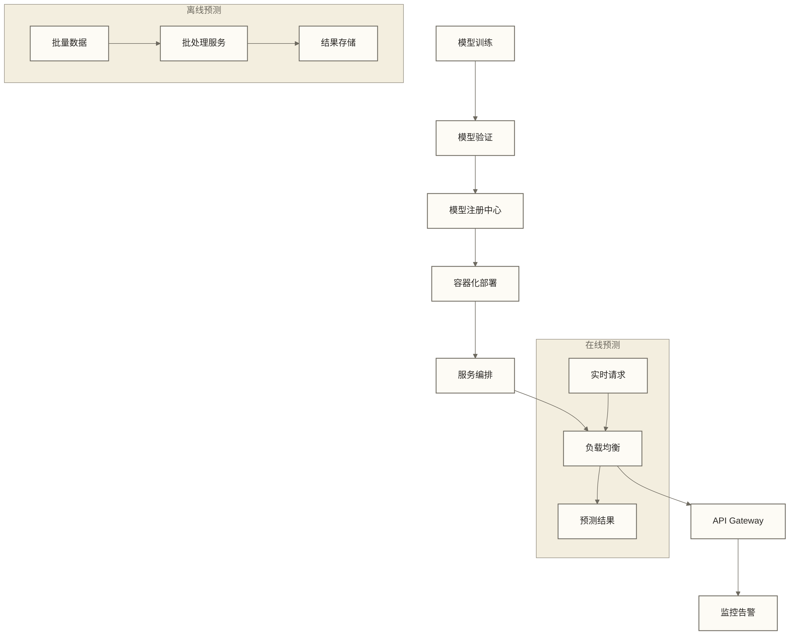

# 模型部署 - MLOps工程化实践

> [!abstract] 学习目标
> - **核心技能**：理解面向生产场景的ML模型部署工程化流程与示例实现边界
> - **技术栈**：FastAPI、Docker、Kubernetes、模型监控与版本管理
> - **实践重点**：从训练完成到模型服务及部署配置生成的端到端MLOps示例
> - **学习时长**：2小时，涵盖完整部署生命周期

## MLOps架构概览

模型部署是机器学习生命周期的关键环节，将训练好的模型转化为可扩展的生产服务。

### 部署架构模式



### 核心组件架构

```python
from typing import Dict, List, Optional
from dataclasses import dataclass
from enum import Enum
import asyncio

class DeploymentType(Enum):
    """部署类型枚举"""
    ONLINE_SERVING = "online_serving"    # 在线服务
    BATCH_INFERENCE = "batch_inference"  # 批量推理
    STREAMING = "streaming"              # 流式处理
    EDGE = "edge"                       # 边缘计算

@dataclass
class ModelMetadata:
    """模型元数据"""
    model_name: str
    version: str
    algorithm: str
    framework: str
    metrics: Dict[str, float]
    features: List[str]
    target: str
    training_date: str
    deployment_date: Optional[str] = None

class ModelRegistry:
    """模型注册中心"""
    
    def __init__(self):
        self.models = {}
        self.active_models = {}
    
    def register_model(self, metadata: ModelMetadata, model_path: str):
        """注册模型版本"""
        key = f"{metadata.model_name}:{metadata.version}"
        self.models[key] = {
            "metadata": metadata,
            "path": model_path,
            "status": "registered"
        }
        print(f"✅ 模型注册成功: {key}")
    
    def promote_to_production(self, model_name: str, version: str):
        """提升模型到生产环境"""
        key = f"{model_name}:{version}"
        if key in self.models:
            self.active_models[model_name] = key
            self.models[key]["status"] = "production"
            print(f"🚀 示例注册中心已将模型标记为生产版本（未执行服务部署）: {key}")
    
    def get_active_model(self, model_name: str) -> Optional[Dict]:
        """获取生产环境活跃模型"""
        if model_name in self.active_models:
            key = self.active_models[model_name]
            return self.models.get(key)
        return None

# 示例使用
registry = ModelRegistry()

# 注册模型
metadata = ModelMetadata(
    model_name="customer_churn",
    version="v1.2.3",
    algorithm="RandomForest",
    framework="scikit-learn",
    metrics={"accuracy": 0.95, "f1_score": 0.92},
    features=["age", "tenure", "monthly_charges", "total_charges"],
    target="churn",
    training_date="2024-12-30"
)

registry.register_model(metadata, "/models/customer_churn_v1.2.3.pkl")
registry.promote_to_production("customer_churn", "v1.2.3")
```

## 模型服务化实现

### FastAPI高性能服务架构

```python
from fastapi import FastAPI, HTTPException, BackgroundTasks, Depends
from fastapi.middleware.cors import CORSMiddleware
from fastapi.middleware.gzip import GZipMiddleware
from pydantic import BaseModel, Field, validator
import joblib
import numpy as np
import logging
import time
from typing import List, Dict, Any
import asyncio
from contextlib import asynccontextmanager

# 配置日志
logging.basicConfig(
    level=logging.INFO,
    format='%(asctime)s - %(name)s - %(levelname)s - %(message)s'
)
logger = logging.getLogger(__name__)

# 模型管理器
class ModelManager:
    """生产级模型管理器"""
    
    def __init__(self):
        self.models = {}
        self.model_stats = {}
        self.circuit_breaker = {}
    
    async def load_model(self, model_name: str, model_path: str):
        """异步加载模型"""
        try:
            # 模拟模型加载时间
            await asyncio.sleep(0.1)
            
            model = joblib.load(model_path)
            self.models[model_name] = {
                "model": model,
                "loaded_at": time.time(),
                "prediction_count": 0,
                "error_count": 0
            }
            
            # 初始化熔断器
            self.circuit_breaker[model_name] = {
                "failure_count": 0,
                "last_failure_time": 0,
                "state": "CLOSED"  # CLOSED, OPEN, HALF_OPEN
            }
            
            logger.info(f"✅ 模型加载成功: {model_name}")
            return True
            
        except Exception as e:
            logger.error(f"❌ 模型加载失败: {model_name}, 错误: {str(e)}")
            return False
    
    def is_model_available(self, model_name: str) -> bool:
        """检查模型可用性（熔断器模式）"""
        if model_name not in self.models:
            return False
        
        breaker = self.circuit_breaker[model_name]
        
        # 熔断器开启状态
        if breaker["state"] == "OPEN":
            # 60秒后尝试半开状态
            if time.time() - breaker["last_failure_time"] > 60:
                breaker["state"] = "HALF_OPEN"
                return True
            return False
        
        return True
    
    async def predict(self, model_name: str, features: np.ndarray) -> Dict[str, Any]:
        """执行预测（包含熔断器逻辑）"""
        if not self.is_model_available(model_name):
            raise HTTPException(
                status_code=503, 
                detail=f"模型 {model_name} 当前不可用"
            )
        
        try:
            start_time = time.time()
            
            model_info = self.models[model_name]
            model = model_info["model"]
            
            # 执行预测
            prediction = model.predict(features)
            probabilities = model.predict_proba(features) if hasattr(model, 'predict_proba') else None
            
            duration = time.time() - start_time
            
            # 更新统计信息
            model_info["prediction_count"] += 1
            
            # 重置熔断器（成功时）
            breaker = self.circuit_breaker[model_name]
            if breaker["state"] == "HALF_OPEN":
                breaker["state"] = "CLOSED"
                breaker["failure_count"] = 0
            
            return {
                "prediction": prediction.tolist(),
                "probabilities": probabilities.tolist() if probabilities is not None else None,
                "model_version": "v1.2.3",
                "inference_time_ms": duration * 1000,
                "model_stats": {
                    "total_predictions": model_info["prediction_count"],
                    "error_rate": model_info["error_count"] / max(1, model_info["prediction_count"])
                }
            }
            
        except Exception as e:
            # 更新错误统计和熔断器
            model_info = self.models[model_name]
            model_info["error_count"] += 1
            
            breaker = self.circuit_breaker[model_name]
            breaker["failure_count"] += 1
            breaker["last_failure_time"] = time.time()
            
            # 连续失败5次则开启熔断器
            if breaker["failure_count"] >= 5:
                breaker["state"] = "OPEN"
                logger.warning(f"🚨 模型 {model_name} 熔断器开启")
            
            logger.error(f"❌ 预测失败: {str(e)}")
            raise HTTPException(status_code=500, detail=f"预测失败: {str(e)}")

# 全局模型管理器
model_manager = ModelManager()

# 应用生命周期管理
@asynccontextmanager
async def lifespan(app: FastAPI):
    """应用启动和关闭生命周期管理"""
    
    # 启动时加载模型
    logger.info("🚀 启动模型服务...")
    
    # 加载多个模型
    models_to_load = [
        ("customer_churn", "models/customer_churn_v1.2.3.pkl"),
        ("price_prediction", "models/price_model_v2.1.0.pkl")
    ]
    
    for model_name, model_path in models_to_load:
        try:
            await model_manager.load_model(model_name, model_path)
        except Exception as e:
            logger.warning(f"⚠️ 模型 {model_name} 加载失败: {str(e)}")
    
    logger.info("✅ 模型服务启动完成")
    
    yield
    
    # 关闭时清理资源
    logger.info("🛑 关闭模型服务...")
    model_manager.models.clear()

# 创建FastAPI应用
app = FastAPI(
    title="生产级ML模型服务",
    description="高性能机器学习模型推理API",
    version="2.0.0",
    lifespan=lifespan
)

# 中间件配置
app.add_middleware(GZipMiddleware, minimum_size=1000)
app.add_middleware(
    CORSMiddleware,
    allow_origins=["*"],
    allow_methods=["GET", "POST"],
    allow_headers=["*"],
)

# 请求模型定义
class PredictionRequest(BaseModel):
    """预测请求模型"""
    model_name: str = Field(..., description="模型名称")
    features: List[float] = Field(..., description="特征值列表")
    
    @validator('features')
    def validate_features(cls, v):
        if len(v) == 0:
            raise ValueError("特征列表不能为空")
        return v

class BatchPredictionRequest(BaseModel):
    """批量预测请求"""
    model_name: str
    batch_features: List[List[float]] = Field(..., max_items=1000)

# API端点实现
@app.post("/v1/predict")
async def predict(request: PredictionRequest, background_tasks: BackgroundTasks):
    """单样本预测接口"""
    
    features = np.array([request.features])
    result = await model_manager.predict(request.model_name, features)
    
    # 后台任务：记录预测日志
    background_tasks.add_task(log_prediction, request.model_name, request.features, result)
    
    return {
        "status": "success",
        "data": result,
        "request_id": f"req_{int(time.time())}"
    }

@app.post("/v1/predict/batch")
async def predict_batch(request: BatchPredictionRequest):
    """批量预测接口"""
    
    features = np.array(request.batch_features)
    result = await model_manager.predict(request.model_name, features)
    
    return {
        "status": "success",
        "data": result,
        "batch_size": len(request.batch_features)
    }

@app.get("/v1/models")
async def list_models():
    """获取可用模型列表"""
    
    models_info = []
    for name, info in model_manager.models.items():
        models_info.append({
            "name": name,
            "loaded_at": info["loaded_at"],
            "prediction_count": info["prediction_count"],
            "error_count": info["error_count"],
            "status": "available" if model_manager.is_model_available(name) else "unavailable"
        })
    
    return {"models": models_info}

@app.get("/health")
async def health_check():
    """健康检查"""
    
    # 检查所有模型状态
    model_status = {}
    for name in model_manager.models.keys():
        model_status[name] = model_manager.is_model_available(name)
    
    all_healthy = all(model_status.values()) if model_status else False
    
    return {
        "status": "healthy" if all_healthy else "degraded",
        "models": model_status,
        "timestamp": time.time()
    }

async def log_prediction(model_name: str, features: List[float], result: Dict):
    """记录预测日志的后台任务"""
    logger.info(f"📊 预测记录: {model_name}, 特征数: {len(features)}, 推理时间: {result.get('inference_time_ms', 0):.2f}ms")
```

### A/B测试与模型版本管理

```python
import random
from typing import Dict, Optional
from datetime import datetime, timedelta

class ABTestManager:
    """A/B测试管理器"""
    
    def __init__(self):
        self.experiments = {}
        self.user_assignments = {}  # 用户分组缓存
    
    def create_experiment(self, 
                         experiment_name: str,
                         model_a: str, 
                         model_b: str,
                         traffic_split: float = 0.5,
                         start_date: Optional[datetime] = None,
                         end_date: Optional[datetime] = None):
        """创建A/B测试实验"""
        
        self.experiments[experiment_name] = {
            "model_a": model_a,
            "model_b": model_b, 
            "traffic_split": traffic_split,
            "start_date": start_date or datetime.now(),
            "end_date": end_date or (datetime.now() + timedelta(days=14)),
            "metrics": {
                "model_a": {"requests": 0, "errors": 0, "avg_latency": 0},
                "model_b": {"requests": 0, "errors": 0, "avg_latency": 0}
            },
            "status": "active"
        }
        
        logger.info(f"🧪 A/B测试创建: {experiment_name}")
        logger.info(f"   模型A: {model_a} ({(1-traffic_split)*100:.1f}%)")
        logger.info(f"   模型B: {model_b} ({traffic_split*100:.1f}%)")
    
    def get_model_for_user(self, experiment_name: str, user_id: str) -> Optional[str]:
        """为用户分配模型（仅当前进程缓存内保持一致）"""
        
        if experiment_name not in self.experiments:
            return None
        
        experiment = self.experiments[experiment_name]
        
        # 检查实验是否在有效期内
        now = datetime.now()
        if now < experiment["start_date"] or now > experiment["end_date"]:
            return None
        
        # 检查用户是否已有分组
        user_key = f"{experiment_name}:{user_id}"
        if user_key in self.user_assignments:
            return self.user_assignments[user_key]
        
        # 示例分组：仅在当前进程内复用缓存；内置hash不保证跨进程或重启后一致
        user_hash = hash(user_id) % 100
        traffic_split_threshold = int(experiment["traffic_split"] * 100)
        
        if user_hash < traffic_split_threshold:
            assigned_model = experiment["model_b"]
            group = "model_b"
        else:
            assigned_model = experiment["model_a"] 
            group = "model_a"
        
        # 缓存用户分组
        self.user_assignments[user_key] = assigned_model
        
        logger.debug(f"👤 用户 {user_id} 分配到 {group}: {assigned_model}")
        return assigned_model
    
    def record_experiment_metrics(self, experiment_name: str, model_name: str, 
                                 latency: float, success: bool):
        """记录实验指标"""
        
        if experiment_name not in self.experiments:
            return
        
        experiment = self.experiments[experiment_name]
        
        # 确定是哪个模型组
        if model_name == experiment["model_a"]:
            group = "model_a"
        elif model_name == experiment["model_b"]:
            group = "model_b"
        else:
            return
        
        metrics = experiment["metrics"][group]
        metrics["requests"] += 1
        if not success:
            metrics["errors"] += 1
        
        # 更新平均延迟（累计平均）
        current_avg = metrics["avg_latency"]
        request_count = metrics["requests"]
        metrics["avg_latency"] = (current_avg * (request_count - 1) + latency) / request_count
    
    def get_experiment_report(self, experiment_name: str) -> Dict:
        """获取实验报告"""
        
        if experiment_name not in self.experiments:
            return {"error": "实验不存在"}
        
        experiment = self.experiments[experiment_name]
        metrics_a = experiment["metrics"]["model_a"]
        metrics_b = experiment["metrics"]["model_b"]
        
        # 计算关键指标
        total_requests = metrics_a["requests"] + metrics_b["requests"]
        
        report = {
            "experiment_name": experiment_name,
            "status": experiment["status"],
            "duration": {
                "start": experiment["start_date"].isoformat(),
                "end": experiment["end_date"].isoformat(),
                "remaining_days": (experiment["end_date"] - datetime.now()).days
            },
            "traffic_distribution": {
                "model_a": f"{(1-experiment['traffic_split'])*100:.1f}%",
                "model_b": f"{experiment['traffic_split']*100:.1f}%"
            },
            "performance_comparison": {
                "model_a": {
                    "model_name": experiment["model_a"],
                    "requests": metrics_a["requests"],
                    "error_rate": metrics_a["errors"] / max(1, metrics_a["requests"]),
                    "avg_latency_ms": metrics_a["avg_latency"]
                },
                "model_b": {
                    "model_name": experiment["model_b"], 
                    "requests": metrics_b["requests"],
                    "error_rate": metrics_b["errors"] / max(1, metrics_b["requests"]),
                    "avg_latency_ms": metrics_b["avg_latency"]
                }
            },
            "statistical_significance": self._calculate_significance(metrics_a, metrics_b),
            "recommendation": self._generate_recommendation(metrics_a, metrics_b)
        }
        
        return report
    
    def _calculate_significance(self, metrics_a: Dict, metrics_b: Dict) -> str:
        """按示例阈值比较指标差异，不构成统计显著性检验"""
        
        if metrics_a["requests"] < 100 or metrics_b["requests"] < 100:
            return "样本量不足，需要更多数据"
        
        # 示例阈值比较，不是统计显著性检验
        error_rate_a = metrics_a["errors"] / metrics_a["requests"]
        error_rate_b = metrics_b["errors"] / metrics_b["requests"]
        
        latency_diff = abs(metrics_a["avg_latency"] - metrics_b["avg_latency"])
        error_diff = abs(error_rate_a - error_rate_b)
        
        if latency_diff > 10 or error_diff > 0.05:
            return "指标差异超过示例阈值，统计显著性尚未评估"
        else:
            return "指标差异未超过示例阈值，不能据此判断统计显著性"
    
    def _generate_recommendation(self, metrics_a: Dict, metrics_b: Dict) -> str:
        """生成推荐决策"""
        
        error_rate_a = metrics_a["errors"] / max(1, metrics_a["requests"])
        error_rate_b = metrics_b["errors"] / max(1, metrics_b["requests"])
        
        # 综合考虑错误率和延迟
        score_a = (1 - error_rate_a) * 0.7 + (1 / max(1, metrics_a["avg_latency"])) * 0.3
        score_b = (1 - error_rate_b) * 0.7 + (1 / max(1, metrics_b["avg_latency"])) * 0.3
        
        if abs(score_a - score_b) < 0.05:
            return "两个模型表现相当，建议继续观察"
        elif score_a > score_b:
            return "推荐选择模型A，表现更优"
        else:
            return "推荐选择模型B，表现更优"

# 集成A/B测试到API
ab_test_manager = ABTestManager()

@app.post("/v1/predict/ab-test")
async def predict_with_ab_test(request: PredictionRequest, 
                              user_id: str = "anonymous",
                              experiment: str = "default"):
    """支持A/B测试的预测接口"""
    
    start_time = time.time()
    
    # 获取用户对应的模型
    assigned_model = ab_test_manager.get_model_for_user(experiment, user_id)
    
    # 如果没有实验或实验结束，使用默认模型
    if not assigned_model:
        assigned_model = request.model_name
    
    try:
        features = np.array([request.features])
        result = await model_manager.predict(assigned_model, features)
        
        # 记录实验指标
        latency = (time.time() - start_time) * 1000
        ab_test_manager.record_experiment_metrics(experiment, assigned_model, latency, True)
        
        return {
            "status": "success",
            "data": result,
            "experiment_info": {
                "experiment": experiment,
                "assigned_model": assigned_model,
                "user_id": user_id
            }
        }
        
    except Exception as e:
        # 记录失败指标
        latency = (time.time() - start_time) * 1000
        ab_test_manager.record_experiment_metrics(experiment, assigned_model, latency, False)
        raise e

@app.get("/v1/experiments/{experiment_name}/report")
async def get_experiment_report(experiment_name: str):
    """获取A/B测试报告"""
    return ab_test_manager.get_experiment_report(experiment_name)

# 创建示例实验
ab_test_manager.create_experiment(
    "customer_churn_test",
    model_a="customer_churn_v1.2.3",
    model_b="customer_churn_v1.3.0", 
    traffic_split=0.3,  # 30%流量给新模型
    end_date=datetime.now() + timedelta(days=7)
)
```

## 容器化与编排

### Docker生产级配置

```dockerfile
# 多阶段构建优化镜像大小
FROM python:3.9-slim as builder

# 设置构建环境
ENV PYTHONDONTWRITEBYTECODE=1
ENV PYTHONUNBUFFERED=1

# 安装构建依赖
RUN apt-get update && apt-get install -y \
    gcc \
    g++ \
    && rm -rf /var/lib/apt/lists/*

# 创建Python虚拟环境
RUN python -m venv /opt/venv
ENV PATH="/opt/venv/bin:$PATH"

# 安装Python依赖
COPY requirements.txt .
RUN pip install --no-cache-dir --upgrade pip \
    && pip install --no-cache-dir -r requirements.txt

# 生产镜像
FROM python:3.9-slim as production

# 复制虚拟环境
COPY --from=builder /opt/venv /opt/venv
ENV PATH="/opt/venv/bin:$PATH"

# 设置工作目录
WORKDIR /app

# 创建非root用户
RUN groupadd -r ml && useradd -r -g ml ml \
    && mkdir -p /app/logs /app/models \
    && chown -R ml:ml /app

# 复制应用代码
COPY --chown=ml:ml . .

# 切换到非root用户
USER ml

# 健康检查
HEALTHCHECK --interval=30s --timeout=10s --start-period=60s --retries=3 \
    CMD curl -f http://localhost:8000/health || exit 1

# 暴露端口
EXPOSE 8000

# 启动命令
CMD ["uvicorn", "app:app", "--host", "0.0.0.0", "--port", "8000", "--workers", "4"]
```

### Kubernetes部署清单

```yaml
# kubernetes/namespace.yaml
apiVersion: v1
kind: Namespace
metadata:
  name: ml-serving

---
# kubernetes/configmap.yaml
apiVersion: v1
kind: ConfigMap
metadata:
  name: ml-config
  namespace: ml-serving
data:
  MODEL_PATH: "/models"
  LOG_LEVEL: "INFO"
  MAX_WORKERS: "4"
  
---
# kubernetes/secret.yaml
apiVersion: v1
kind: Secret
metadata:
  name: ml-secrets
  namespace: ml-serving
type: Opaque
data:
  API_KEY: <base64-encoded-api-key>
  
---
# kubernetes/deployment.yaml
apiVersion: apps/v1
kind: Deployment
metadata:
  name: ml-serving
  namespace: ml-serving
  labels:
    app: ml-serving
spec:
  replicas: 3
  strategy:
    type: RollingUpdate
    rollingUpdate:
      maxSurge: 1
      maxUnavailable: 1
  selector:
    matchLabels:
      app: ml-serving
  template:
    metadata:
      labels:
        app: ml-serving
    spec:
      containers:
      - name: ml-api
        image: ml-serving:v1.2.3
        ports:
        - containerPort: 8000
        env:
        - name: MODEL_PATH
          valueFrom:
            configMapKeyRef:
              name: ml-config
              key: MODEL_PATH
        - name: LOG_LEVEL
          valueFrom:
            configMapKeyRef:
              name: ml-config
              key: LOG_LEVEL
        resources:
          requests:
            cpu: 200m
            memory: 512Mi
          limits:
            cpu: 1000m
            memory: 2Gi
        livenessProbe:
          httpGet:
            path: /health
            port: 8000
          initialDelaySeconds: 30
          periodSeconds: 10
        readinessProbe:
          httpGet:
            path: /health
            port: 8000
          initialDelaySeconds: 5
          periodSeconds: 5
        volumeMounts:
        - name: model-storage
          mountPath: /models
          readOnly: true
      volumes:
      - name: model-storage
        persistentVolumeClaim:
          claimName: model-pvc
          
---
# kubernetes/service.yaml
apiVersion: v1
kind: Service
metadata:
  name: ml-serving-service
  namespace: ml-serving
spec:
  selector:
    app: ml-serving
  ports:
  - port: 80
    targetPort: 8000
    protocol: TCP
  type: ClusterIP
  
---
# kubernetes/hpa.yaml
apiVersion: autoscaling/v2
kind: HorizontalPodAutoscaler
metadata:
  name: ml-serving-hpa
  namespace: ml-serving
spec:
  scaleTargetRef:
    apiVersion: apps/v1
    kind: Deployment
    name: ml-serving
  minReplicas: 3
  maxReplicas: 10
  metrics:
  - type: Resource
    resource:
      name: cpu
      target:
        type: Utilization
        averageUtilization: 70
  - type: Resource
    resource:
      name: memory
      target:
        type: Utilization
        averageUtilization: 80
  behavior:
    scaleUp:
      stabilizationWindowSeconds: 60
      policies:
      - type: Percent
        value: 50
        periodSeconds: 60
    scaleDown:
      stabilizationWindowSeconds: 300
      policies:
      - type: Percent
        value: 10
        periodSeconds: 60
```

## 模型监控与漂移检测

### 综合监控系统

```python
import numpy as np
from scipy import stats
from typing import Dict, List, Tuple
import json
from collections import deque
from datetime import datetime, timedelta
import warnings

class ModelDriftDetector:
    """模型漂移检测器"""
    
    def __init__(self, reference_data: np.ndarray, 
                 drift_threshold: float = 0.05,
                 window_size: int = 1000):
        """
        初始化漂移检测器
        
        Args:
            reference_data: 参考数据（训练数据分布）
            drift_threshold: 漂移检测阈值
            window_size: 滑动窗口大小
        """
        self.reference_data = reference_data
        self.drift_threshold = drift_threshold
        self.window_size = window_size
        
        # 计算参考数据统计量
        self.reference_stats = {
            'mean': np.mean(reference_data, axis=0),
            'std': np.std(reference_data, axis=0),
            'quantiles': np.quantile(reference_data, [0.25, 0.5, 0.75], axis=0)
        }
        
        # 滑动窗口
        self.current_window = deque(maxlen=window_size)
        
        # 漂移历史
        self.drift_history = []
    
    def detect_drift(self, new_data: np.ndarray) -> Dict[str, any]:
        """检测数据漂移"""
        
        # 添加新数据到窗口
        for sample in new_data:
            self.current_window.append(sample)
        
        if len(self.current_window) < 100:  # 需要最少100个样本
            return {"status": "insufficient_data", "samples": len(self.current_window)}
        
        current_data = np.array(list(self.current_window))
        
        # 统计检验方法
        drift_results = {}
        
        # 1. Kolmogorov-Smirnov检验
        ks_results = []
        for feature_idx in range(current_data.shape[1]):
            ref_feature = self.reference_data[:, feature_idx]
            curr_feature = current_data[:, feature_idx]
            
            ks_stat, p_value = stats.ks_2samp(ref_feature, curr_feature)
            ks_results.append({
                'feature_idx': feature_idx,
                'ks_statistic': ks_stat,
                'p_value': p_value,
                'drift_detected': p_value < self.drift_threshold
            })
        
        drift_results['kolmogorov_smirnov'] = ks_results
        
        # 2. Population Stability Index (PSI)
        psi_results = []
        for feature_idx in range(current_data.shape[1]):
            psi_value = self._calculate_psi(
                self.reference_data[:, feature_idx],
                current_data[:, feature_idx]
            )
            
            psi_results.append({
                'feature_idx': feature_idx,
                'psi_value': psi_value,
                'drift_level': self._interpret_psi(psi_value)
            })
        
        drift_results['population_stability_index'] = psi_results
        
        # 3. 统计距离（Wasserstein距离）
        wasserstein_results = []
        for feature_idx in range(current_data.shape[1]):
            ref_feature = self.reference_data[:, feature_idx]
            curr_feature = current_data[:, feature_idx]
            
            distance = stats.wasserstein_distance(ref_feature, curr_feature)
            
            wasserstein_results.append({
                'feature_idx': feature_idx,
                'wasserstein_distance': distance
            })
        
        drift_results['wasserstein_distance'] = wasserstein_results
        
        # 综合漂移评估
        overall_drift = self._assess_overall_drift(drift_results)
        
        # 记录漂移历史
        drift_record = {
            'timestamp': datetime.now().isoformat(),
            'overall_drift': overall_drift,
            'detailed_results': drift_results
        }
        self.drift_history.append(drift_record)
        
        # 只保留最近100条记录
        if len(self.drift_history) > 100:
            self.drift_history.pop(0)
        
        return {
            'status': 'completed',
            'overall_drift': overall_drift,
            'drift_results': drift_results,
            'recommendations': self._generate_recommendations(overall_drift, drift_results)
        }
    
    def _calculate_psi(self, reference: np.ndarray, current: np.ndarray, bins: int = 10) -> float:
        """计算Population Stability Index"""
        
        # 创建分桶
        _, bin_edges = np.histogram(reference, bins=bins)
        
        # 计算参考和当前数据的分布
        ref_counts, _ = np.histogram(reference, bins=bin_edges)
        curr_counts, _ = np.histogram(current, bins=bin_edges)
        
        # 转换为概率分布
        ref_probs = ref_counts / len(reference)
        curr_probs = curr_counts / len(current)
        
        # 避免除零错误
        ref_probs = np.where(ref_probs == 0, 1e-6, ref_probs)
        curr_probs = np.where(curr_probs == 0, 1e-6, curr_probs)
        
        # 计算PSI
        psi = np.sum((curr_probs - ref_probs) * np.log(curr_probs / ref_probs))
        
        return psi
    
    def _interpret_psi(self, psi_value: float) -> str:
        """解释PSI值"""
        if psi_value < 0.1:
            return "无显著变化"
        elif psi_value < 0.2:
            return "轻微变化"
        else:
            return "显著变化"
    
    def _assess_overall_drift(self, drift_results: Dict) -> str:
        """综合评估整体漂移状态"""
        
        # 计算有漂移的特征比例
        ks_drifts = [r['drift_detected'] for r in drift_results['kolmogorov_smirnov']]
        psi_drifts = [r['drift_level'] != '无显著变化' for r in drift_results['population_stability_index']]
        
        ks_drift_ratio = sum(ks_drifts) / len(ks_drifts)
        psi_drift_ratio = sum(psi_drifts) / len(psi_drifts)
        
        # 综合判断
        if ks_drift_ratio > 0.5 or psi_drift_ratio > 0.5:
            return "严重漂移"
        elif ks_drift_ratio > 0.3 or psi_drift_ratio > 0.3:
            return "中等漂移"
        elif ks_drift_ratio > 0.1 or psi_drift_ratio > 0.1:
            return "轻微漂移"
        else:
            return "无漂移"
    
    def _generate_recommendations(self, overall_drift: str, drift_results: Dict) -> List[str]:
        """生成建议"""
        recommendations = []
        
        if overall_drift == "严重漂移":
            recommendations.extend([
                "🚨 示例严重漂移告警：先核查数据质量和模型性能，再评估是否重训",
                "🔍 检查数据获取流程是否发生变化",
                "📊 分析漂移特征的业务含义",
                "⏰ 考虑启用模型回退机制"
            ])
        elif overall_drift == "中等漂移":
            recommendations.extend([
                "⚠️ 示例处置窗口为1-2周：是否重训及具体时限需结合业务风险和性能验证确定",
                "📈 增加监控频率",
                "🧪 可考虑A/B测试新旧模型"
            ])
        elif overall_drift == "轻微漂移":
            recommendations.extend([
                "📝 记录漂移趋势，持续观察",
                "📊 分析潜在业务影响"
            ])
        else:
            recommendations.append("✅ 模型数据分布稳定，继续监控")
        
        return recommendations
    
    def get_drift_trend(self, days: int = 30) -> Dict:
        """获取漂移趋势分析"""
        
        cutoff_date = datetime.now() - timedelta(days=days)
        
        recent_history = [
            record for record in self.drift_history
            if datetime.fromisoformat(record['timestamp']) > cutoff_date
        ]
        
        if not recent_history:
            return {"message": f"最近{days}天内无漂移检测记录"}
        
        # 统计漂移级别分布
        drift_levels = [record['overall_drift'] for record in recent_history]
        drift_distribution = {
            level: drift_levels.count(level) 
            for level in set(drift_levels)
        }
        
        # 计算漂移趋势
        serious_drift_count = drift_levels.count("严重漂移") + drift_levels.count("中等漂移")
        trend = "恶化" if serious_drift_count > len(recent_history) * 0.3 else "稳定"
        
        return {
            "period_days": days,
            "total_checks": len(recent_history),
            "drift_distribution": drift_distribution,
            "trend": trend,
            "serious_drift_ratio": serious_drift_count / len(recent_history),
            "latest_status": recent_history[-1]['overall_drift']
        }

class ModelPerformanceMonitor:
    """模型性能监控器"""
    
    def __init__(self):
        self.predictions = deque(maxlen=10000)
        self.ground_truths = deque(maxlen=10000)
        self.performance_history = []
    
    def record_prediction(self, prediction: float, ground_truth: float = None, 
                         confidence: float = None, latency: float = None):
        """记录预测结果"""
        
        record = {
            'timestamp': datetime.now(),
            'prediction': prediction,
            'ground_truth': ground_truth,
            'confidence': confidence,
            'latency_ms': latency
        }
        
        self.predictions.append(record)
        
        if ground_truth is not None:
            self.ground_truths.append({
                'timestamp': datetime.now(),
                'prediction': prediction,
                'ground_truth': ground_truth
            })
    
    def calculate_performance_metrics(self, window_hours: int = 24) -> Dict:
        """计算性能指标"""
        
        if not self.ground_truths:
            return {"error": "无真实标签数据，无法计算性能指标"}
        
        # 获取指定时间窗口内的数据
        cutoff_time = datetime.now() - timedelta(hours=window_hours)
        
        recent_data = [
            record for record in self.ground_truths
            if record['timestamp'] > cutoff_time
        ]
        
        if not recent_data:
            return {"error": f"最近{window_hours}小时内无标签数据"}
        
        predictions = [record['prediction'] for record in recent_data]
        actuals = [record['ground_truth'] for record in recent_data]
        
        # 计算回归指标
        mse = np.mean((np.array(predictions) - np.array(actuals)) ** 2)
        mae = np.mean(np.abs(np.array(predictions) - np.array(actuals)))
        
        # 计算相关系数
        correlation = np.corrcoef(predictions, actuals)[0, 1]
        
        # 性能退化检测
        performance_degradation = self._detect_performance_degradation(mse, mae, correlation)
        
        metrics = {
            'window_hours': window_hours,
            'sample_count': len(recent_data),
            'mse': float(mse),
            'mae': float(mae),
            'rmse': float(np.sqrt(mse)),
            'correlation': float(correlation),
            'performance_status': performance_degradation,
            'timestamp': datetime.now().isoformat()
        }
        
        # 记录性能历史
        self.performance_history.append(metrics)
        if len(self.performance_history) > 168:  # 保留一周的小时级记录
            self.performance_history.pop(0)
        
        return metrics
    
    def _detect_performance_degradation(self, current_mse: float, 
                                      current_mae: float, 
                                      current_corr: float) -> str:
        """检测性能退化"""
        
        if len(self.performance_history) < 7:  # 需要至少7条历史记录，不一定覆盖一周
            return "数据不足"
        
        # 计算历史平均性能
        historical_mse = np.mean([h['mse'] for h in self.performance_history[-7:]])
        historical_mae = np.mean([h['mae'] for h in self.performance_history[-7:]])
        historical_corr = np.mean([h['correlation'] for h in self.performance_history[-7:]])
        
        # 性能退化判断
        mse_degradation = (current_mse - historical_mse) / historical_mse
        mae_degradation = (current_mae - historical_mae) / historical_mae
        corr_degradation = (historical_corr - current_corr) / historical_corr
        
        if mse_degradation > 0.2 or mae_degradation > 0.2 or corr_degradation > 0.1:
            return "严重退化"
        elif mse_degradation > 0.1 or mae_degradation > 0.1 or corr_degradation > 0.05:
            return "轻微退化"
        else:
            return "性能稳定"

# 集成监控到API
drift_detector = None  # 需要在加载模型时初始化
performance_monitor = ModelPerformanceMonitor()

@app.post("/v1/predict/monitored")
async def predict_with_monitoring(request: PredictionRequest):
    """带完整监控的预测接口"""
    
    start_time = time.time()
    
    try:
        features = np.array([request.features])
        result = await model_manager.predict(request.model_name, features)
        
        latency = (time.time() - start_time) * 1000
        
        # 记录预测（用于漂移检测）
        if drift_detector:
            drift_result = drift_detector.detect_drift(features)
        
        # 记录性能（需要后续获得真实标签）
        performance_monitor.record_prediction(
            prediction=result['prediction'][0],
            latency=latency
        )
        
        return {
            "status": "success",
            "data": result,
            "monitoring": {
                "latency_ms": latency,
                "drift_status": drift_result.get('overall_drift', 'unknown') if drift_detector else 'not_configured'
            }
        }
        
    except Exception as e:
        logger.error(f"预测失败: {str(e)}")
        raise HTTPException(status_code=500, detail=str(e))

@app.get("/v1/monitoring/drift")
async def get_drift_status():
    """获取漂移检测状态"""
    if not drift_detector:
        return {"error": "漂移检测未配置"}
    
    return drift_detector.get_drift_trend(days=7)

@app.get("/v1/monitoring/performance")
async def get_performance_status():
    """获取性能监控状态"""
    return performance_monitor.calculate_performance_metrics(window_hours=24)
```

## 端到端MLOps案例

### 完整的CI/CD流水线

```yaml
# .github/workflows/ml-deployment.yml
name: ML Model CI/CD Pipeline

on:
  push:
    branches: [main, develop]
    paths: ['models/**', 'src/**', 'requirements.txt']
  pull_request:
    branches: [main]

env:
  MODEL_REGISTRY: your-registry.com/ml-models
  KUBE_NAMESPACE: ml-serving

jobs:
  
  model-validation:
    runs-on: ubuntu-latest
    steps:
    - uses: actions/checkout@v3
    
    - name: Set up Python
      uses: actions/setup-python@v4
      with:
        python-version: '3.9'
    
    - name: Install dependencies
      run: |
        pip install -r requirements.txt
        pip install pytest pytest-cov
    
    - name: Run model tests
      run: |
        pytest tests/model_tests.py -v --cov=src/
    
    - name: Validate model performance
      run: |
        python scripts/validate_model.py --model-path models/latest/ --threshold 0.85
    
    - name: Check model size
      run: |
        python scripts/check_model_size.py --max-size 100MB
  
  security-scan:
    runs-on: ubuntu-latest
    steps:
    - uses: actions/checkout@v3
    
    - name: Run security scan
      uses: securecodewarrior/github-action-add-sarif@v1
      with:
        files: |
          src/**/*.py
          requirements.txt
    
    - name: Check for secrets
      uses: trufflesecurity/trufflehog@main
      with:
        path: ./
        base: main
        head: HEAD
  
  build-and-test:
    needs: [model-validation, security-scan]
    runs-on: ubuntu-latest
    steps:
    - uses: actions/checkout@v3
    
    - name: Build Docker image
      run: |
        docker build -t ml-serving:${{ github.sha }} .
    
    - name: Run container tests
      run: |
        docker run -d --name test-container -p 8000:8000 ml-serving:${{ github.sha }}
        sleep 30
        
        # 健康检查
        curl -f http://localhost:8000/health || exit 1
        
        # API测试
        python scripts/integration_tests.py --base-url http://localhost:8000
        
        docker stop test-container
    
    - name: Push to registry
      if: github.ref == 'refs/heads/main'
      run: |
        echo ${{ secrets.REGISTRY_PASSWORD }} | docker login $MODEL_REGISTRY -u ${{ secrets.REGISTRY_USERNAME }} --password-stdin
        docker push ml-serving:${{ github.sha }}
        docker tag ml-serving:${{ github.sha }} ml-serving:latest
        docker push ml-serving:latest
  
  deploy-staging:
    needs: build-and-test
    runs-on: ubuntu-latest
    if: github.ref == 'refs/heads/develop'
    environment: staging
    steps:
    - uses: actions/checkout@v3
    
    - name: Deploy to staging
      uses: azure/k8s-deploy@v1
      with:
        manifests: |
          kubernetes/staging/
        images: |
          ml-serving:${{ github.sha }}
        kubectl-version: 'v1.24.0'
    
    - name: Run staging tests
      run: |
        sleep 60  # 等待部署完成
        python scripts/e2e_tests.py --env staging
  
  deploy-production:
    needs: build-and-test
    runs-on: ubuntu-latest
    if: github.ref == 'refs/heads/main'
    environment: production
    steps:
    - uses: actions/checkout@v3
    
    - name: Blue-Green Deployment
      run: |
        # 部署到绿色环境
        kubectl apply -f kubernetes/production/green-deployment.yaml
        kubectl set image deployment/ml-serving-green ml-api=ml-serving:${{ github.sha }} -n $KUBE_NAMESPACE
        
        # 等待绿色环境就绪
        kubectl rollout status deployment/ml-serving-green -n $KUBE_NAMESPACE
        
        # 健康检查
        kubectl exec deployment/ml-serving-green -n $KUBE_NAMESPACE -- curl -f http://localhost:8000/health
        
        # 切换流量到绿色环境
        kubectl patch service ml-serving-service -n $KUBE_NAMESPACE -p '{"spec":{"selector":{"version":"green"}}}'
        
        # 清理蓝色环境
        sleep 300  # 等待5分钟确保稳定
        kubectl delete deployment ml-serving-blue -n $KUBE_NAMESPACE
    
    - name: Production smoke tests
      run: |
        python scripts/production_tests.py --critical-only
    
    - name: Update monitoring
      run: |
        # 更新监控配置
        curl -X POST "${{ secrets.MONITORING_WEBHOOK }}" \
          -H "Content-Type: application/json" \
          -d '{"deployment": "ml-serving", "version": "${{ github.sha }}", "environment": "production"}'
```

### 模型训练与部署自动化脚本

```python
#!/usr/bin/env python3
"""
端到端MLOps自动化脚本
完整的模型训练、验证、部署流程
"""

import os
import sys
import json
import joblib
import logging
from datetime import datetime
from pathlib import Path
from typing import Dict, List, Tuple
import argparse

import pandas as pd
import numpy as np
from sklearn.model_selection import train_test_split
from sklearn.ensemble import RandomForestClassifier
from sklearn.metrics import accuracy_score, classification_report
import mlflow
import mlflow.sklearn

# 配置日志
logging.basicConfig(
    level=logging.INFO,
    format='%(asctime)s - %(levelname)s - %(message)s'
)
logger = logging.getLogger(__name__)

class MLOpsAutomation:
    """MLOps自动化流水线"""
    
    def __init__(self, config_path: str):
        """初始化配置"""
        with open(config_path, 'r') as f:
            self.config = json.load(f)
        
        self.model_name = self.config['model']['name']
        self.version = self.config['model']['version']
        self.data_path = self.config['data']['path']
        self.output_dir = Path(self.config['output']['directory'])
        
        # 创建输出目录
        self.output_dir.mkdir(parents=True, exist_ok=True)
        
        logger.info(f"🚀 初始化MLOps流水线: {self.model_name} v{self.version}")
    
    def load_and_prepare_data(self) -> Tuple[np.ndarray, np.ndarray, List[str]]:
        """数据加载和预处理"""
        
        logger.info("📊 加载和预处理数据...")
        
        # 加载数据
        data = pd.read_csv(self.data_path)
        logger.info(f"   数据形状: {data.shape}")
        
        # 特征工程
        feature_columns = self.config['data']['features']
        target_column = self.config['data']['target']
        
        X = data[feature_columns].values
        y = data[target_column].values
        
        # 数据质量检查
        if np.any(pd.isna(X)) or np.any(pd.isna(y)):
            logger.error("❌ 数据包含缺失值")
            sys.exit(1)
        
        logger.info("✅ 数据加载完成")
        return X, y, feature_columns
    
    def train_model(self, X: np.ndarray, y: np.ndarray) -> Tuple[object, Dict]:
        """模型训练"""
        
        logger.info("🔥 开始模型训练...")
        
        # 数据分割
        X_train, X_test, y_train, y_test = train_test_split(
            X, y, 
            test_size=self.config['training']['test_size'],
            random_state=42,
            stratify=y
        )
        
        # 启动MLflow实验
        mlflow.set_experiment(f"{self.model_name}_experiment")
        
        with mlflow.start_run(run_name=f"{self.model_name}_v{self.version}"):
            
            # 记录参数
            model_params = self.config['model']['parameters']
            mlflow.log_params(model_params)
            
            # 创建和训练模型
            model = RandomForestClassifier(**model_params)
            model.fit(X_train, y_train)
            
            # 模型评估
            y_pred = model.predict(X_test)
            accuracy = accuracy_score(y_test, y_pred)
            
            # 记录指标
            mlflow.log_metric("accuracy", accuracy)
            mlflow.log_metric("training_samples", len(X_train))
            mlflow.log_metric("test_samples", len(X_test))
            
            # 记录模型
            mlflow.sklearn.log_model(
                model, 
                "model",
                registered_model_name=self.model_name
            )
            
            # 生成详细报告
            report = classification_report(y_test, y_pred, output_dict=True)
            
            metrics = {
                'accuracy': accuracy,
                'classification_report': report,
                'training_date': datetime.now().isoformat(),
                'training_samples': len(X_train),
                'test_samples': len(X_test)
            }
            
            logger.info(f"✅ 模型训练完成，准确率: {accuracy:.3f}")
            
            return model, metrics
    
    def validate_model(self, model: object, metrics: Dict) -> bool:
        """模型验证"""
        
        logger.info("✅ 模型验证...")
        
        # 性能阈值检查
        accuracy_threshold = self.config['validation']['accuracy_threshold']
        
        if metrics['accuracy'] < accuracy_threshold:
            logger.error(f"❌ 模型准确率 {metrics['accuracy']:.3f} 低于阈值 {accuracy_threshold}")
            return False
        
        # 模型大小检查
        model_path = self.output_dir / f"{self.model_name}_v{self.version}.pkl"
        joblib.dump(model, model_path)
        
        model_size_mb = model_path.stat().st_size / (1024 * 1024)
        max_size_mb = self.config['validation']['max_model_size_mb']
        
        if model_size_mb > max_size_mb:
            logger.error(f"❌ 模型大小 {model_size_mb:.1f}MB 超过限制 {max_size_mb}MB")
            return False
        
        logger.info(f"✅ 模型验证通过 (准确率: {metrics['accuracy']:.3f}, 大小: {model_size_mb:.1f}MB)")
        return True
    
    def deploy_model(self, model: object, features: List[str], metrics: Dict):
        """模型部署"""
        
        logger.info("🚀 部署模型...")
        
        # 保存模型文件
        model_path = self.output_dir / f"{self.model_name}_v{self.version}.pkl"
        joblib.dump(model, model_path)
        
        # 生成模型元信息
        model_info = {
            'model_name': self.model_name,
            'version': self.version,
            'algorithm': 'RandomForest',
            'framework': 'scikit-learn',
            'features': features,
            'metrics': metrics,
            'deployment_date': datetime.now().isoformat(),
            'model_file': str(model_path),
            'api_schema': {
                'endpoint': f'/v1/predict/{self.model_name}',
                'method': 'POST',
                'input_features': features,
                'output_format': {
                    'prediction': 'int',
                    'probability': 'List[float]',
                    'confidence': 'float'
                }
            }
        }
        
        # 保存元信息
        info_path = self.output_dir / f"{self.model_name}_info.json"
        with open(info_path, 'w') as f:
            json.dump(model_info, f, indent=2, ensure_ascii=False)
        
        # 生成API代码
        self._generate_api_code(model_info)
        
        # 生成Docker配置
        self._generate_docker_config()
        
        # 生成Kubernetes配置
        self._generate_k8s_config()
        
        logger.info("✅ 模型部署配置生成完成")
        logger.info(f"   模型文件: {model_path}")
        logger.info(f"   元信息: {info_path}")
        logger.info(f"   API代码: {self.output_dir}/api.py")
    
    def _generate_api_code(self, model_info: Dict):
        """生成API服务代码"""
        
        api_code = f'''
from fastapi import FastAPI, HTTPException
from pydantic import BaseModel
import joblib
import numpy as np
from typing import List

# 模型信息
MODEL_NAME = "{model_info['model_name']}"
MODEL_VERSION = "{model_info['version']}"
FEATURES = {model_info['features']}

# 加载模型
model = joblib.load("{model_info['model_file']}")

# 创建API应用
app = FastAPI(
    title=f"{{MODEL_NAME}} API",
    version=MODEL_VERSION
)

class PredictionRequest(BaseModel):
    """预测请求"""
{chr(10).join([f'    {feature}: float' for feature in model_info['features']])}

class PredictionResponse(BaseModel):
    """预测响应"""
    prediction: int
    probability: List[float]
    confidence: float
    model_version: str

@app.post("/v1/predict/{model_info['model_name']}", response_model=PredictionResponse)
async def predict(request: PredictionRequest):
    """模型预测接口"""
    
    try:
        # 准备特征
        features = np.array([[{', '.join('request.' + feature for feature in model_info['features'])}]])
        
        # 执行预测
        prediction = model.predict(features)[0]
        probabilities = model.predict_proba(features)[0].tolist()
        confidence = max(probabilities)
        
        return PredictionResponse(
            prediction=int(prediction),
            probability=probabilities,
            confidence=confidence,
            model_version=MODEL_VERSION
        )
        
    except Exception as e:
        raise HTTPException(status_code=500, detail=str(e))

@app.get("/health")
async def health_check():
    """健康检查"""
    return {{"status": "healthy", "model": MODEL_NAME, "version": MODEL_VERSION}}
'''
        
        api_path = self.output_dir / "api.py"
        with open(api_path, 'w') as f:
            f.write(api_code.strip())
    
    def _generate_docker_config(self):
        """生成Docker配置文件"""
        
        dockerfile_content = '''
FROM python:3.9-slim

WORKDIR /app

# 安装依赖
COPY requirements.txt .
RUN pip install --no-cache-dir -r requirements.txt

# 复制模型和API代码
COPY *.pkl ./
COPY *.json ./
COPY api.py ./

# 暴露端口
EXPOSE 8000

# 启动命令
CMD ["uvicorn", "api:app", "--host", "0.0.0.0", "--port", "8000"]
'''
        
        dockerfile_path = self.output_dir / "Dockerfile"
        with open(dockerfile_path, 'w') as f:
            f.write(dockerfile_content.strip())
    
    def _generate_k8s_config(self):
        """生成Kubernetes配置文件"""
        
        k8s_config = f'''
apiVersion: apps/v1
kind: Deployment
metadata:
  name: {self.model_name}-deployment
  labels:
    app: {self.model_name}
    version: {self.version}
spec:
  replicas: 3
  selector:
    matchLabels:
      app: {self.model_name}
  template:
    metadata:
      labels:
        app: {self.model_name}
        version: {self.version}
    spec:
      containers:
      - name: {self.model_name}
        image: {self.model_name}:{self.version}
        ports:
        - containerPort: 8000
        resources:
          requests:
            cpu: 200m
            memory: 512Mi
          limits:
            cpu: 500m
            memory: 1Gi
        livenessProbe:
          httpGet:
            path: /health
            port: 8000
          initialDelaySeconds: 30
          periodSeconds: 10
        readinessProbe:
          httpGet:
            path: /health
            port: 8000
          initialDelaySeconds: 5
          periodSeconds: 5

---
apiVersion: v1
kind: Service
metadata:
  name: {self.model_name}-service
spec:
  selector:
    app: {self.model_name}
  ports:
  - port: 80
    targetPort: 8000
  type: ClusterIP
'''
        
        k8s_path = self.output_dir / f"{self.model_name}-k8s.yaml"
        with open(k8s_path, 'w') as f:
            f.write(k8s_config.strip())
    
    def run_pipeline(self):
        """执行完整的MLOps流水线"""
        
        try:
            # 1. 数据准备
            X, y, features = self.load_and_prepare_data()
            
            # 2. 模型训练
            model, metrics = self.train_model(X, y)
            
            # 3. 模型验证
            if not self.validate_model(model, metrics):
                logger.error("❌ 模型验证失败，流水线终止")
                sys.exit(1)
            
            # 4. 模型部署
            self.deploy_model(model, features, metrics)
            
            logger.info("🎉 MLOps流水线执行完成！")
            logger.info("=" * 50)
            logger.info("📋 部署清单:")
            logger.info(f"   ├── 模型文件: {self.model_name}_v{self.version}.pkl")
            logger.info(f"   ├── API服务: api.py")
            logger.info(f"   ├── Docker配置: Dockerfile")
            logger.info(f"   └── K8s配置: {self.model_name}-k8s.yaml")
            
        except Exception as e:
            logger.error(f"❌ 流水线执行失败: {str(e)}")
            sys.exit(1)

def main():
    """主函数"""
    
    parser = argparse.ArgumentParser(description="MLOps自动化流水线")
    parser.add_argument("--config", required=True, help="配置文件路径")
    
    args = parser.parse_args()
    
    # 执行MLOps流水线
    pipeline = MLOpsAutomation(args.config)
    pipeline.run_pipeline()

if __name__ == "__main__":
    main()
```

## 最佳实践总结

### 生产部署检查清单

```python
# 生产部署检查清单类
class ProductionDeploymentChecklist:
    """生产部署检查清单"""
    
    def __init__(self):
        self.checks = {
            "model_quality": [
                "模型性能满足业务要求",
                "模型在测试数据上表现稳定",
                "模型解释性和可理解性验证",
                "偏差和公平性测试通过"
            ],
            "technical_readiness": [
                "API接口文档完整",
                "容器化配置测试通过",
                "负载测试和性能基准确认",
                "安全扫描和漏洞检测通过"
            ],
            "operational_readiness": [
                "监控和告警系统配置",
                "日志收集和分析就绪",
                "备份和恢复流程测试",
                "故障恢复和回滚计划就绪"
            ],
            "compliance": [
                "数据隐私保护合规",
                "模型审计追踪机制",
                "版本管理和变更记录",
                "业务影响评估完成"
            ]
        }
    
    def run_checklist(self) -> Dict[str, bool]:
        """运行检查清单"""
        results = {}
        
        print("🔍 生产部署检查清单")
        print("=" * 40)
        
        for category, items in self.checks.items():
            print(f"\n📋 {category.upper()}:")
            category_results = []
            
            for item in items:
                # 这里应该是实际的自动化检查
                # 现在用模拟结果
                status = "✅"  # 或 "❌"
                category_results.append(True)
                print(f"   {status} {item}")
            
            results[category] = all(category_results)
        
        print(f"\n📊 检查结果汇总:")
        for category, passed in results.items():
            status = "✅ 通过" if passed else "❌ 失败"
            print(f"   {category}: {status}")
        
        overall_ready = all(results.values())
        print(f"\n🚀 模拟检查状态: {'✅ 示例全部通过（不代表生产就绪）' if overall_ready else '❌ 示例存在未通过项'}")
        
        return results

# 运行检查清单
checklist = ProductionDeploymentChecklist()
deployment_ready = checklist.run_checklist()
```

### 关键技术要点

> [!tip] MLOps最佳实践要点
> 
> **模型服务架构设计**：
> - 在线推理：低延迟实时服务（可将<100ms作为示例响应时间目标，是否达到需按模型、硬件、并发和请求规模实测）
> - 批量推理：高吞吐离线处理（处理大规模数据）
> - 流式处理：准实时数据流处理
> 
> **版本管理与发布策略**：
> - 模型注册中心：统一管理模型版本和元数据
> - A/B测试：渐进式流量切换验证新模型
> - 蓝绿部署：以降低更新中断为目标；零停机取决于就绪检查、流量切换、连接处理和回滚设计
> - 熔断机制：自动故障检测和服务保护
> 
> **监控与运维体系**：
> - 数据漂移检测：KS检验、PSI指标、Wasserstein距离
> - 性能监控：延迟、吞吐量、错误率、资源使用
> - 业务指标：准确率、召回率、业务KPI影响
> - 告警机制：多级告警和自动化响应

## 知识连接

### 前置技能基础
- [[【技术与工具】/Python/18-机器学习基础|机器学习]] - ML模型训练基础
- [[【技术与工具】/Python/30-Flask Web开发|Flask Web开发]] - Web服务开发
- [[【技术与工具】/Python/31-FastAPI开发|FastAPI开发]] - 现代API框架

### 核心技术栈
- **容器化技术**：Docker、Kubernetes容器编排
- **服务网格**：Istio流量管理和安全
- **监控体系**：Prometheus+Grafana监控栈
- **CI/CD工具**：Jenkins、GitLab CI、GitHub Actions

### 进阶学习方向
- **MLOps平台**：MLflow、Kubeflow、Vertex AI完整解决方案
- **模型优化**：推理加速、模型压缩、边缘部署
- **实时ML**：特征工程管道、在线学习系统
- **联邦学习**：分布式隐私保护机器学习

### 业务应用场景
- **推荐系统**：个性化推荐模型大规模部署
- **风控模型**：金融反欺诈实时决策系统
- **计算机视觉**：图像识别API服务化
- **自然语言处理**：文本分析微服务架构

---

**创建时间**：2024-06-29  
**最后更新**：2024-12-31  
**学习时长**：120分钟  
**难度等级**：⭐⭐⭐⭐（中高级）

#模型部署 #MLOps #生产环境 #Docker #Kubernetes #监控 #版本管理 #A/B测试 #CI/CD #机器学习工程