# 🏗️ Python数据工程与大数据

## 目录
- [[【数据分析与数据运营】/98-专业术语词典/08-技能方法类/Python|专业术语词典/Python]]
- [[【数据分析与数据运营】/98-专业术语词典/08-技能方法类/Python|专业术语词典/Python]]
- [[【数据分析与数据运营】/00-数据分析与数据运营导览|【数据分析与运营】知识体系整合总结/【数据分析与运营】知识体系整合总结]]
- #数据管道设计与工作流调度
- #流处理技术栈
- #数据湖与数据仓库架构
- #架构示例：构建企业级大数据处理系统（非完整可运行工程）

## Python在大数据生态系统中的核心作用

### 技术栈定位

Python在大数据生态中扮演**胶水语言**和**统一接口**的角色：

```mermaid
%%{init: {"theme":"base","themeVariables":{"fontFamily":"PingFang SC, -apple-system, Source Han Serif SC, serif","fontSize":"16px","background":"#FDFBF5","primaryColor":"#FDFBF5","primaryTextColor":"#2D2A26","primaryBorderColor":"#6E6A60","secondaryColor":"#E8EFE8","secondaryBorderColor":"#8FA890","secondaryTextColor":"#2D2A26","tertiaryColor":"#FDFBF5","tertiaryBorderColor":"#9A9488","tertiaryTextColor":"#6E6A60","lineColor":"#6E6A60","textColor":"#2D2A26","mainBkg":"#FDFBF5","nodeBorder":"#2D5A3D","clusterBkg":"#F3EEDF","clusterBorder":"#9A9488","edgeLabelBackground":"#FDFBF5"},"flowchart":{"htmlLabels":true,"curve":"basis","padding":20,"nodeSpacing":60,"rankSpacing":70,"useMaxWidth":false},"themeCSS":".node rect, .node polygon, .node circle { stroke-width: 1.5px; } .edgePath .path { stroke-width: 1.5px; } .cluster-label .nodeLabel, .cluster-label foreignObject { color: #2D2A26 !important; } .edgeLabel, .edgeLabel foreignObject { color: #2D2A26 !important; background-color: #FDFBF5; } .edgeLabel rect { fill: #FDFBF5; }"}}%%
graph TD
    classDef default fill:#FDFBF5,stroke:#6E6A60,color:#2D2A26,stroke-width:1.5px
    classDef startend fill:#2D2A26,stroke:#2D2A26,color:#FDFBF5,font-weight:bold
    classDef decision fill:#F6EAD8,stroke:#C08A1A,color:#2D2A26,font-weight:bold
    classDef hub fill:#3B5A80,stroke:#3B5A80,color:#FDFBF5,font-weight:bold
    classDef io fill:#E5EAF0,stroke:#3B5A80,color:#2D2A26
    classDef accent fill:#A6432C,stroke:#A6432C,color:#FDFBF5,font-weight:bold
    classDef storage fill:#F3EEDF,stroke:#9A9488,color:#2D2A26
    A[Python生态] --> B[数据采集层]
    A --> C[数据处理层]
    A --> D[数据存储层]
    A --> E[数据服务层]
    
    B --> B1[Scrapy/Requests]
    B --> B2[Kafka-Python]
    B --> B3[SQLAlchemy]
    
    C --> C1[PySpark]
    C --> C2[Dask]
    C --> C3[Ray]
    C --> C4[Pandas]
    
    D --> D1[PyHive]
    D --> D2[Delta-Lake]
    D --> D3[PyArrow]
    
    E --> E1[FastAPI]
    E --> E2[Flask]
    E --> E3[Streamlit]
    class A,B,C,D,E,B1,B2,B3,C1,C2,C3,C4,D1,D2,D3,E1,E2,E3 default
```



### 核心优势

1. **API统一性**：为异构系统提供一致的Python接口
2. **生态完整性**：覆盖数据全生命周期的库和框架
3. **开发效率**：可将“相比Java/Scala，开发周期缩短60-80%”作为待验证的示例假设；实际差异取决于任务、团队经验和系统约束，本文未提供支持该幅度的测量依据
4. **原型验证**：快速POC验证，支持敏捷开发

## PySpark：分布式数据处理的Python接口

### 架构原理

PySpark通过Py4J网关实现Python与Scala/Java的通信：

```python
# Spark上下文初始化
from pyspark.sql import SparkSession
from pyspark.sql.functions import *
from pyspark.sql.types import *

spark = SparkSession.builder \
    .appName("BigDataProcessing") \
    .config("spark.sql.adaptive.enabled", "true") \
    .config("spark.sql.adaptive.coalescePartitions.enabled", "true") \
    .config("spark.serializer", "org.apache.spark.serializer.KryoSerializer") \
    .getOrCreate()

# 设置日志级别
spark.sparkContext.setLogLevel("WARN")
```

### 数据处理模式

**DataFrame API**：
```python
# 读取大数据集
df = spark.read.parquet("hdfs://data/sales/*")

# 复杂聚合分析
result = df.filter(col("date") >= "2024-01-01") \
    .withColumn("quarter", quarter(col("date"))) \
    .groupBy("region", "quarter") \
    .agg(
        sum("amount").alias("total_sales"),
        avg("amount").alias("avg_sales"),
        count("*").alias("transaction_count")
    ) \
    .orderBy("region", "quarter")

result.write.mode("overwrite").parquet("hdfs://output/quarterly_sales")
```

**RDD低级API**：
```python
# 处理非结构化数据
rdd = spark.sparkContext.textFile("hdfs://logs/access.log")

# 日志解析与统计
parsed_logs = rdd.map(parse_log_line) \
    .filter(lambda x: x['status'] == '200') \
    .map(lambda x: (x['ip'], 1)) \
    .reduceByKey(lambda a, b: a + b) \
    .sortBy(lambda x: x[1], ascending=False)

top_ips = parsed_logs.take(10)
```

### 性能优化策略

```python
# 分区优化
df.repartition(200, col("date")).write \
    .partitionBy("year", "month") \
    .mode("overwrite") \
    .parquet("hdfs://data/partitioned")

# 缓存策略
df.cache()  # 内存缓存
df.persist(StorageLevel.MEMORY_AND_DISK_SER)  # 序列化持久化

# 广播变量
broadcast_dict = spark.sparkContext.broadcast(reference_data)
```

## 分布式计算框架：Dask与Ray

### Dask：扩展Pandas的分布式计算

Dask提供**惰性求值**和**任务图**优化：

```python
import dask.dataframe as dd
from dask.distributed import Client

# 启动分布式集群
client = Client('scheduler-address:8786')

# 读取大规模数据
df = dd.read_parquet('s3://bucket/data/*.parquet')

# 分布式计算
result = df.groupby('category') \
    .sales.sum() \
    .compute()

# 机器学习工作负载
from dask_ml.model_selection import train_test_split
from dask_ml.linear_model import LinearRegression

X_train, X_test, y_train, y_test = train_test_split(X, y, test_size=0.2)
model = LinearRegression().fit(X_train, y_train)
```

### Ray：高性能分布式AI计算

```python
import ray
from ray import tune
from ray.data import Dataset

# 初始化Ray集群
ray.init(address='ray://head-node:10001')

# 分布式数据处理
@ray.remote
def process_batch(batch):
    # 数据处理逻辑
    return processed_data

# 并行处理
futures = [process_batch.remote(batch) for batch in data_batches]
results = ray.get(futures)

# 超参数调优
config = {
    "lr": tune.grid_search([0.001, 0.01, 0.1]),
    "batch_size": tune.choice([32, 64, 128])
}

analysis = tune.run(
    train_model,
    config=config,
    num_samples=10,
    resources_per_trial={"cpu": 2, "gpu": 1}
)
```

## 数据管道设计与工作流调度

### Apache Airflow：工作流编排

```python
from airflow import DAG
from airflow.operators.python import PythonOperator
from airflow.providers.spark.operators.spark_submit import SparkSubmitOperator
from airflow.providers.postgres.operators.postgres import PostgresOperator
from datetime import datetime, timedelta

default_args = {
    'owner': 'data-team',
    'depends_on_past': False,
    'start_date': datetime(2024, 1, 1),
    'email_on_failure': True,
    'email_on_retry': False,
    'retries': 2,
    'retry_delay': timedelta(minutes=5)
}

dag = DAG(
    'big_data_pipeline',
    default_args=default_args,
    description='Enterprise Big Data Pipeline',
    schedule_interval=timedelta(hours=1),
    catchup=False,
    max_active_runs=1
)

# 数据质量检查
def data_quality_check(**context):
    from great_expectations import DataContext
    
    data_context = DataContext()
    batch = data_context.get_batch(
        datasource_name="spark_datasource",
        data_connector_name="default_inferred_data_connector",
        data_asset_name="sales_data"
    )
    
    results = data_context.run_validation_operator(
        "action_list_operator",
        assets_to_validate=[batch]
    )
    
    if not results["success"]:
        raise ValueError("Data quality check failed")

# 任务定义
quality_check = PythonOperator(
    task_id='data_quality_check',
    python_callable=data_quality_check,
    dag=dag
)

spark_job = SparkSubmitOperator(
    task_id='spark_processing',
    application='/opt/spark/jobs/data_processing.py',
    conn_id='spark_default',
    conf={
        'spark.sql.adaptive.enabled': 'true',
        'spark.sql.adaptive.coalescePartitions.enabled': 'true'
    },
    dag=dag
)

update_metadata = PostgresOperator(
    task_id='update_metadata',
    postgres_conn_id='metadata_db',
    sql="UPDATE pipeline_status SET last_run = NOW() WHERE pipeline_name = 'big_data_pipeline'",
    dag=dag
)

# 任务依赖
quality_check >> spark_job >> update_metadata
```

### Prefect：现代化工作流管理

```python
from prefect import Flow, task, Parameter
from prefect.executors import DaskExecutor
from prefect.storage import S3
from prefect.run_configs import KubernetesRun

@task(max_retries=3, retry_delay=timedelta(minutes=1))
def extract_data(source_path: str):
    df = pd.read_parquet(source_path)
    return df

@task
def transform_data(df):
    # 数据转换逻辑
    transformed_df = df.dropna() \
        .pipe(standardize_columns) \
        .pipe(apply_business_rules)
    return transformed_df

@task
def load_data(df, target_path: str):
    df.to_parquet(target_path, compression='snappy')
    return f"Loaded {len(df)} records"

with Flow(
    "modern_etl_pipeline",
    executor=DaskExecutor(cluster_kwargs={"n_workers": 4}),
    storage=S3(bucket="my-flows"),
    run_config=KubernetesRun(image="my-repo/prefect:latest")
) as flow:
    
    source = Parameter("source_path")
    target = Parameter("target_path")
    
    raw_data = extract_data(source)
    clean_data = transform_data(raw_data)
    result = load_data(clean_data, target)

flow.register(project_name="BigDataPipelines")
```

## 流处理技术栈

### Kafka + Python生态

**Producer实现**：
```python
from kafka import KafkaProducer
import json
import time

producer = KafkaProducer(
    bootstrap_servers=['kafka1:9092', 'kafka2:9092'],
    value_serializer=lambda v: json.dumps(v).encode('utf-8'),
    batch_size=16384,
    linger_ms=10,
    compression_type='gzip'
)

def publish_metrics(metrics_data):
    for metric in metrics_data:
        producer.send('metrics-topic', {
            'timestamp': int(time.time()),
            'source': metric['source'],
            'value': metric['value'],
            'tags': metric['tags']
        })
    
    producer.flush()
```

**Consumer与流处理**：
```python
from kafka import KafkaConsumer
from kafka.structs import TopicPartition
import pandas as pd
from collections import deque

consumer = KafkaConsumer(
    'metrics-topic',
    bootstrap_servers=['kafka1:9092'],
    group_id='stream-processor',
    value_deserializer=lambda m: json.loads(m.decode('utf-8')),
    auto_offset_reset='latest',
    enable_auto_commit=True
)

# 滑动窗口处理
window_buffer = deque(maxlen=1000)

for message in consumer:
    data = message.value
    window_buffer.append(data)
    
    # 缓冲区达到100条后，每收到一条新消息都对当前缓冲区执行聚合
    if len(window_buffer) >= 100:
        df = pd.DataFrame(list(window_buffer))
        
        # 实时聚合
        aggregated = df.groupby('source').agg({
            'value': ['mean', 'max', 'min'],
            'timestamp': 'count'
        }).reset_index()
        
        # 写入时序数据库
        write_to_timeseries_db(aggregated)
```

### Structured Streaming集成

```python
from pyspark.sql import SparkSession
from pyspark.sql.functions import *
from pyspark.sql.types import *

spark = SparkSession.builder \
    .appName("KafkaStructuredStreaming") \
    .getOrCreate()

# Kafka数据流读取
df = spark \
    .readStream \
    .format("kafka") \
    .option("kafka.bootstrap.servers", "kafka1:9092,kafka2:9092") \
    .option("subscribe", "user-events") \
    .load()

# 数据解析与处理
parsed_df = df.select(
    col("timestamp"),
    from_json(col("value").cast("string"), schema).alias("data")
).select(
    col("timestamp"),
    col("data.user_id"),
    col("data.event_type"),
    col("data.properties")
)

# 窗口聚合
windowed_counts = parsed_df \
    .withWatermark("timestamp", "10 minutes") \
    .groupBy(
        window(col("timestamp"), "5 minutes"),
        col("event_type")
    ) \
    .count()

# 输出到控制台，用于观察聚合结果；此处尚未实现数据仓库写入
query = windowed_counts.writeStream \
    .format("console") \
    .outputMode("update") \
    .trigger(processingTime='30 seconds') \
    .start()

query.awaitTermination()
```

## 数据湖与数据仓库架构

### Delta Lake：ACID事务支持

```python
from delta import *
from pyspark.sql import SparkSession

# Delta Lake配置
spark = configure_spark_with_delta_pip(SparkSession.builder \
    .appName("DeltaLakeExample") \
    .config("spark.sql.extensions", "io.delta.sql.DeltaSparkSessionExtension") \
    .config("spark.sql.catalog.spark_catalog", "org.apache.spark.sql.delta.catalog.DeltaCatalog")) \
    .getOrCreate()

# 创建Delta表
df.write.format("delta").mode("overwrite").save("/delta/sales")

# ACID更新操作
from delta.tables import *

deltaTable = DeltaTable.forPath(spark, "/delta/sales")

# 条件更新
deltaTable.update(
    condition = col("date") < "2024-01-01",
    set = {"status": lit("archived")}
)

# 时间旅行查询
df_historical = spark.read.format("delta") \
    .option("timestampAsOf", "2024-01-01") \
    .load("/delta/sales")

# 变更数据捕获
changes_df = spark.read.format("delta") \
    .option("readChangeFeed", "true") \
    .option("startingTimestamp", "2024-01-01") \
    .load("/delta/sales")
```

### 数据湖架构模式

```python
# 分层数据湖架构
class DataLakeManager:
    def __init__(self, spark_session):
        self.spark = spark_session
        
    def bronze_layer_ingestion(self, source_path, table_name):
        """原始数据摄取层"""
        df = self.spark.read.option("multiline", "true") \
            .json(source_path)
        
        # 添加元数据
        df_with_metadata = df \
            .withColumn("ingestion_timestamp", current_timestamp()) \
            .withColumn("source_file", input_file_name()) \
            .withColumn("data_source", lit(table_name))
        
        # 写入Bronze层
        df_with_metadata.write.format("delta") \
            .mode("append") \
            .option("mergeSchema", "true") \
            .save(f"/datalake/bronze/{table_name}")
    
    def silver_layer_processing(self, table_name):
        """清洗转换层"""
        bronze_df = self.spark.read.format("delta") \
            .load(f"/datalake/bronze/{table_name}")
        
        # 数据清洗与标准化
        clean_df = bronze_df \
            .dropDuplicates() \
            .filter(col("data").isNotNull()) \
            .withColumn("processed_timestamp", current_timestamp())
        
        # 写入Silver层
        clean_df.write.format("delta") \
            .mode("overwrite") \
            .save(f"/datalake/silver/{table_name}")
    
    def gold_layer_aggregation(self, table_name):
        """业务聚合层"""
        silver_df = self.spark.read.format("delta") \
            .load(f"/datalake/silver/{table_name}")
        
        # 业务指标计算
        metrics_df = silver_df \
            .groupBy("category", "date") \
            .agg(
                sum("amount").alias("total_revenue"),
                count("*").alias("transaction_count"),
                avg("amount").alias("avg_transaction_value")
            )
        
        # 写入Gold层
        metrics_df.write.format("delta") \
            .mode("overwrite") \
            .save(f"/datalake/gold/{table_name}_metrics")
```

## 架构示例：构建企业级大数据处理系统（非完整可运行工程）

### 需求场景

构建一个**实时电商数据分析系统**，包含：
- 用户行为数据实时采集
- 订单数据批量处理
- 实时推荐系统
- 业务监控大屏

### 系统架构

```python
# 系统配置类
class BigDataSystemConfig:
    KAFKA_BROKERS = "kafka1:9092,kafka2:9092"
    SPARK_MASTER = "spark://spark-master:7077"
    DELTA_LAKE_PATH = "s3a://data-lake/"
    REDIS_URL = "redis://redis-cluster:6379"
    POSTGRES_URL = "postgresql://postgres:5432/analytics"

# 数据采集服务
class DataCollectionService:
    def __init__(self):
        self.kafka_producer = KafkaProducer(
            bootstrap_servers=BigDataSystemConfig.KAFKA_BROKERS,
            value_serializer=lambda v: json.dumps(v).encode('utf-8')
        )
    
    def collect_user_events(self, user_id, event_type, properties):
        event_data = {
            'user_id': user_id,
            'event_type': event_type,
            'properties': properties,
            'timestamp': int(time.time() * 1000),
            'session_id': self.get_session_id(user_id)
        }
        
        self.kafka_producer.send('user-events', event_data)
    
    def collect_order_data(self, order_data):
        enhanced_order = {
            **order_data,
            'ingestion_time': datetime.now().isoformat(),
            'data_version': 'v1.0'
        }
        
        self.kafka_producer.send('orders', enhanced_order)

# 实时流处理引擎
class RealTimeProcessor:
    def __init__(self):
        self.spark = SparkSession.builder \
            .appName("EcommerceRealTimeAnalytics") \
            .config("spark.sql.streaming.checkpointLocation", "/tmp/checkpoints") \
            .getOrCreate()
    
    def process_user_behavior_stream(self):
        # 用户行为流处理
        user_events_df = self.spark \
            .readStream \
            .format("kafka") \
            .option("kafka.bootstrap.servers", BigDataSystemConfig.KAFKA_BROKERS) \
            .option("subscribe", "user-events") \
            .load()
        
        # 实时用户画像更新
        parsed_events = user_events_df.select(
            from_json(col("value").cast("string"), user_event_schema).alias("event")
        ).select("event.*")
        
        # 实时聚合：5分钟窗口的用户活跃度
        user_activity = parsed_events \
            .withWatermark("timestamp", "10 minutes") \
            .groupBy(
                window(col("timestamp"), "5 minutes"),
                col("user_id")
            ) \
            .agg(
                count("*").alias("event_count"),
                countDistinct("event_type").alias("unique_events")
            )
        
        # 写入Redis进行实时查询
        query = user_activity.writeStream \
            .foreachBatch(self.update_user_profile_cache) \
            .outputMode("update") \
            .trigger(processingTime='30 seconds') \
            .start()
        
        return query
    
    def update_user_profile_cache(self, batch_df, batch_id):
        # 更新Redis中的用户画像缓存
        import redis
        r = redis.from_url(BigDataSystemConfig.REDIS_URL)
        
        for row in batch_df.collect():
            user_id = row['user_id']
            profile_key = f"user_profile:{user_id}"
            
            profile_data = {
                'last_activity': row['window']['end'],
                'activity_score': row['event_count'],
                'engagement_level': self.calculate_engagement(row)
            }
            
            r.hmset(profile_key, profile_data)
            r.expire(profile_key, 7200)  # 2小时过期

# 批处理作业管理器
class BatchProcessingManager:
    def __init__(self):
        self.spark = SparkSession.builder \
            .appName("EcommerceBatchProcessing") \
            .config("spark.sql.adaptive.enabled", "true") \
            .getOrCreate()
    
    def daily_sales_analysis(self, date):
        # 读取订单数据
        orders_df = self.spark.read.format("delta") \
            .load(f"{BigDataSystemConfig.DELTA_LAKE_PATH}/bronze/orders") \
            .filter(col("order_date") == date)
        
        # 销售分析
        sales_metrics = orders_df.groupBy("category", "region") \
            .agg(
                sum("amount").alias("total_sales"),
                count("*").alias("order_count"),
                countDistinct("customer_id").alias("unique_customers"),
                avg("amount").alias("avg_order_value")
            )
        
        # 同比分析
        previous_year_date = (datetime.strptime(date, "%Y-%m-%d") - 
                            timedelta(days=365)).strftime("%Y-%m-%d")
        
        previous_sales = self.spark.read.format("delta") \
            .load(f"{BigDataSystemConfig.DELTA_LAKE_PATH}/gold/daily_sales") \
            .filter(col("date") == previous_year_date)
        
        # 计算同比增长
        growth_analysis = sales_metrics.join(
            previous_sales.select("category", "region", 
                                col("total_sales").alias("previous_sales")),
            ["category", "region"], "left"
        ).withColumn(
            "yoy_growth", 
            (col("total_sales") - col("previous_sales")) / col("previous_sales") * 100
        )
        
        # 保存结果
        growth_analysis.write.format("delta") \
            .mode("overwrite") \
            .option("replaceWhere", f"date = '{date}'") \
            .save(f"{BigDataSystemConfig.DELTA_LAKE_PATH}/gold/daily_sales")
    
    def customer_segmentation_analysis(self):
        # RFM分析实现
        orders_df = self.spark.read.format("delta") \
            .load(f"{BigDataSystemConfig.DELTA_LAKE_PATH}/silver/orders")
        
        # 计算RFM指标
        current_date = datetime.now().strftime("%Y-%m-%d")
        
        rfm_df = orders_df.groupBy("customer_id") \
            .agg(
                datediff(lit(current_date), max("order_date")).alias("recency"),
                count("*").alias("frequency"),
                sum("amount").alias("monetary")
            )
        
        # RFM评分计算
        from pyspark.ml.feature import Bucketizer
        
        # 分桶器配置
        recency_bucketizer = Bucketizer(
            splits=[0, 30, 90, 180, float('inf')],
            inputCol="recency", outputCol="r_score"
        )
        
        frequency_bucketizer = Bucketizer(
            splits=[0, 2, 5, 10, float('inf')],
            inputCol="frequency", outputCol="f_score"
        )
        
        monetary_bucketizer = Bucketizer(
            splits=[0, 100, 500, 1000, float('inf')],
            inputCol="monetary", outputCol="m_score"
        )
        
        # 应用分桶
        rfm_scored = recency_bucketizer.transform(rfm_df)
        rfm_scored = frequency_bucketizer.transform(rfm_scored)
        rfm_scored = monetary_bucketizer.transform(rfm_scored)
        
        # 客户分群
        customer_segments = rfm_scored.withColumn(
            "segment",
            when((col("r_score") <= 2) & (col("f_score") >= 3) & (col("m_score") >= 3), "Champions")
            .when((col("r_score") <= 2) & (col("f_score") >= 2), "Loyal Customers")
            .when((col("r_score") <= 2) & (col("f_score") <= 2), "Potential Loyalists")
            .otherwise("At Risk")
        )
        
        # 保存分群结果
        customer_segments.write.format("delta") \
            .mode("overwrite") \
            .save(f"{BigDataSystemConfig.DELTA_LAKE_PATH}/gold/customer_segments")

# 系统编排
class EcommerceBigDataPipeline:
    def __init__(self):
        self.collector = DataCollectionService()
        self.stream_processor = RealTimeProcessor()
        self.batch_processor = BatchProcessingManager()
    
    def start_realtime_pipeline(self):
        """启动实时数据管道"""
        user_behavior_query = self.stream_processor.process_user_behavior_stream()
        return user_behavior_query
    
    def run_daily_batch_jobs(self, date):
        """运行每日批处理作业"""
        try:
            # 销售分析
            self.batch_processor.daily_sales_analysis(date)
            
            # 客户分群
            self.batch_processor.customer_segmentation_analysis()
            
            # 数据质量检查
            self.run_data_quality_checks(date)
            
            return {"status": "success", "date": date}
            
        except Exception as e:
            logging.error(f"Batch job failed for {date}: {str(e)}")
            return {"status": "failed", "error": str(e)}
    
    def run_data_quality_checks(self, date):
        """数据质量监控"""
        from great_expectations import DataContext
        
        data_context = DataContext()
        
        # 检查订单数据完整性
        orders_batch = data_context.get_batch(
            datasource_name="delta_datasource",
            data_connector_name="default_inferred_data_connector",
            data_asset_name="orders",
            batch_kwargs={"date": date}
        )
        
        validation_result = data_context.run_validation_operator(
            "action_list_operator",
            assets_to_validate=[orders_batch]
        )
        
        if not validation_result["success"]:
            raise DataQualityError(f"Data quality check failed for {date}")

# 主程序入口
if __name__ == "__main__":
    pipeline = EcommerceBigDataPipeline()
    
    # 启动实时处理
    realtime_query = pipeline.start_realtime_pipeline()
    
    # 运行每日批处理
    today = datetime.now().strftime("%Y-%m-%d")
    batch_result = pipeline.run_daily_batch_jobs(today)
    
    print(f"Pipeline status: {batch_result}")
    
    # 等待流处理完成
    realtime_query.awaitTermination()
```

### 监控与运维

```python
# 系统监控类
class SystemMonitor:
    def __init__(self):
        self.metrics_collector = MetricsCollector()
    
    def monitor_data_pipeline_health(self):
        """数据管道健康监控"""
        metrics = {
            'kafka_lag': self.get_kafka_consumer_lag(),
            'spark_job_status': self.get_spark_job_metrics(),
            'data_quality_score': self.calculate_data_quality_score(),
            'system_resources': self.get_resource_utilization()
        }
        
        # 发送到监控系统
        self.send_metrics_to_prometheus(metrics)
        
        return metrics
    
    def alert_on_anomalies(self, metrics):
        """异常告警"""
        if metrics['kafka_lag'] > 10000:
            self.send_alert("High Kafka consumer lag detected")
        
        if metrics['data_quality_score'] < 0.95:
            self.send_alert("Data quality issues detected")
```

## 最佳实践与性能优化

### 代码组织结构

| 路径 | 说明 |
|------|------|
| `src/pipelines/streaming/` | 流处理管道 |
| `src/pipelines/batch/` | 批处理管道 |
| `src/processors/` | 数据处理器 |
| `src/utils/` | 工具函数 |
| `src/config/` | 配置管理 |
| `tests/` | 测试代码 |
| `deployment/docker/` | Docker配置 |
| `deployment/kubernetes/` | Kubernetes配置 |
| `deployment/airflow_dags/` | Airflow DAG |
| `monitoring/dashboards/` | 监控看板 |
| `monitoring/alerts/` | 告警配置 |

### 性能调优指南

1. **Spark调优**：
   - 合理设置executor内存和核心数
   - 启用自适应查询执行
   - 使用列式存储格式（Parquet、Delta）

2. **Kafka优化**：
   - 调整批处理大小和压缩
   - 合理分区设计
   - 监控消费者滞后

3. **数据湖设计**：
   - 分层架构（Bronze-Silver-Gold）
   - 合理分区策略
   - 定期维护和压缩

通过这个尚需补齐实现与部署配置的企业级架构示例，展示了Python在大数据生态系统中的核心作用，从实时数据采集到批处理分析，从流处理到数据湖架构，Python提供了统一而强大的开发体验。

---

> **推荐学习路径**：
> 1. 掌握PySpark基础API和性能优化
> 2. 实践Kafka + Python流处理开发
> 3. 学习Airflow/Prefect工作流编排
> 4. 深入Delta Lake等数据湖技术
> 5. 构建端到端的大数据项目