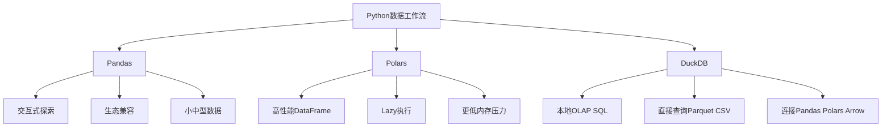
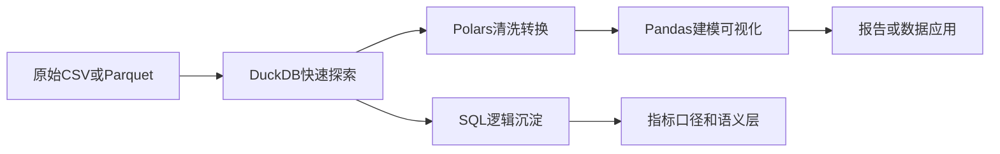

# 从Pandas到Polars与DuckDB：AI时代Python数据工作流升级

> [!abstract] 一句话结论
> Pandas 仍然是 Python 数据分析的基本盘；Polars 适合更快、更省内存的 DataFrame 计算；DuckDB 适合用 SQL 直接分析本地文件、Parquet、Pandas、Polars 与 Arrow 数据。2026 年的数据人不必站队，而要学会按场景组合。

很多人把问题问成：“Pandas 会不会被 Polars 或 DuckDB 替代？”

这不是一个好问题。更好的问题是：

> 我的数据规模、团队习惯、性能瓶颈、交付形态，适合用哪一层工具？

如果你正在学习 Python 数据分析，建议先完成 [[【技术与工具】/Python/09-Pandas数据结构|Pandas数据结构]]、[[【技术与工具】/Python/10-Pandas数据操作|Pandas数据操作]]、[[【技术与工具】/Python/11-Pandas数据清洗|Pandas数据清洗]]，再读本文。

---

## 1. 三个工具分别解决什么问题



### Pandas：基本盘

Pandas 的优势不是最快，而是生态最成熟：

- 教程、面试、公司存量代码最多
- 和 Matplotlib、Seaborn、Scikit-learn、Statsmodels 兼容好
- 对中小数据、探索分析、一次性任务足够好

相关：[[【技术与工具】/Python/12-数据读取与存储|数据读取与存储]]、[[【技术与工具】/Python/17-数据统计与描述|数据统计与描述]]。

### Polars：高性能 DataFrame

Polars 的核心价值是把 DataFrame 计算做得更快、更接近查询引擎：

- 支持 Lazy API，可以先构建查询计划再执行
- 对列式数据和并行计算更友好
- 在较大 CSV/Parquet、复杂转换、链式计算中更有优势

它适合替代 Pandas 中“慢、占内存、链式转换复杂”的部分。

### DuckDB：嵌入式分析数据库

DuckDB 的心智模型不是 DataFrame，而是“本地 OLAP 数据库”。它特别适合：

- 用 SQL 分析本地 CSV / Parquet
- 在 Notebook 中快速 join 多个文件
- 不想搭数据库，但又想用 SQL 做分析
- 与 Pandas、Polars、Arrow 互相转换

DuckDB 官方 Python 文档说明，它可以直接查询 Pandas DataFrame、Polars DataFrame 和 Arrow 表，这让它很适合成为 Python 分析工作流里的 SQL 引擎。

---

## 2. 场景选择表

| 场景 | 推荐工具 | 原因 |
|---|---|---|
| 新人学习、面试准备 | Pandas | 公司和面试存量最大 |
| 10万到几百万行探索分析 | Pandas 或 Polars | Pandas 易用，Polars 更快 |
| 大 CSV/Parquet 本地分析 | DuckDB 或 Polars | 避免一次性全量读入内存 |
| 多表 join、窗口函数、分组聚合 | DuckDB | SQL 表达更自然 |
| 复杂 DataFrame 转换链 | Polars | Lazy 执行和表达式更清晰 |
| 机器学习前处理 | Pandas + Polars | 根据下游生态兼容选择 |
| 给业务同事解释逻辑 | SQL / DuckDB | SQL 更接近业务表达 |

> [!tip] 不要为了新而新
> 如果 Pandas 已经能在 3 秒内解决问题，就没有必要为了炫技换工具。工具升级应该由性能瓶颈、工程复用、数据规模或协作方式驱动。

---

## 3. 从 Pandas 到 Polars：迁移思维

Pandas 常见写法：

```python
import pandas as pd

orders = pd.read_parquet("orders.parquet")
result = (
    orders[orders["status"] == "paid"]
    .assign(pay_date=lambda df: pd.to_datetime(df["pay_time"]).dt.date)
    .groupby("pay_date", as_index=False)
    .agg(gmv=("amount", "sum"), orders=("order_id", "nunique"))
)
print(result.head())
```

Polars Lazy 写法：

```python
import polars as pl

result = (
    pl.scan_parquet("orders.parquet")
    .filter(pl.col("status") == "paid")
    .with_columns(pl.col("pay_time").str.to_datetime().dt.date().alias("pay_date"))
    .group_by("pay_date")
    .agg([
        pl.col("amount").sum().alias("gmv"),
        pl.col("order_id").drop_nulls().n_unique().alias("orders"),
    ])
    .collect()
)
print(result.head())
```

### 迁移时最重要的变化

1. **从立即执行到延迟执行**：Polars 的 Lazy 模式会先优化计划再执行。
2. **从行思维到列思维**：尽量用表达式，而不是逐行 `apply`。
3. **从索引依赖到显式列**：Polars 不鼓励 Pandas 那种复杂索引心智模型。
4. **从内存 DataFrame 到文件扫描**：优先 `scan_parquet`，不要一上来全量读入。

---

## 4. 从 Pandas 到 DuckDB：把 SQL 放进 Notebook

DuckDB 可以让你在 Python 中直接写 SQL：

```python
import duckdb

query = """
SELECT
    DATE_TRUNC('day', CAST(pay_time AS TIMESTAMP)) AS pay_date,
    SUM(amount) AS gmv,
    COUNT(DISTINCT order_id) AS orders
FROM 'orders.parquet'
WHERE status = 'paid'
GROUP BY 1
ORDER BY 1
"""

result = duckdb.sql(query).df()
print(result.head())
```

它的好处是：

- SQL 逻辑更容易被分析师、工程师、AI 一起审查。
- Parquet 文件不必先读成 Pandas。
- 多文件、多表 join 比 Pandas 更自然。
- 可以把 [[【技术与工具】/SQL/33-AI时代分析SQL实战|AI时代分析SQL实战]] 里的 SQL 直接搬到本地数据文件上练习。

---

## 5. AI 时代为什么这套组合更重要

### 5.1 AI 生成代码，需要更容易审查的执行层

AI 生成 Pandas 代码经常出现链式操作很长、变量名混乱、隐式类型转换等问题。SQL 相对更容易审查，DuckDB 因此适合做“AI 生成查询的本地执行器”。

### 5.2 数据不一定大到 Spark，但也不小到 Pandas 舒服

很多真实工作不是 500TB，也不是 5MB，而是 2GB、20GB、200GB 的本地或对象存储文件。这个区间非常适合 DuckDB、Polars、Arrow、Parquet 组合。

### 5.3 个人作品集更容易落地

如果你做一个作品集项目，不一定需要搭 Hadoop、Spark、Flink。可以用：

- DuckDB 处理本地 Parquet
- Polars 做高性能特征处理
- Pandas 做最后的可视化与模型输入
- Streamlit 或 FastAPI 做展示

这比一上来搭复杂集群更适合求职和个人学习。

---

## 6. 一个推荐工作流



推荐实践：

1. 用 DuckDB 看数据规模、字段、分布、缺失情况。
2. 用 Polars 处理大批量清洗、转换、聚合。
3. 用 Pandas 接入现有统计、机器学习、可视化生态。
4. 把稳定 SQL 沉淀到指标定义或数据集市。
5. 让 AI 参与代码生成，但人负责性能、口径、边界审查。

---

## 7. 学习顺序建议

### 第一步：不要跳过 Pandas

Pandas 仍然是数据分析语言的普通话。先学：

- [[【技术与工具】/Python/09-Pandas数据结构|Pandas数据结构]]
- [[【技术与工具】/Python/10-Pandas数据操作|Pandas数据操作]]
- [[【技术与工具】/Python/11-Pandas数据清洗|Pandas数据清洗]]

### 第二步：用 DuckDB 练 SQL 分析

把你在 [[【技术与工具】/SQL/33-AI时代分析SQL实战|AI时代分析SQL实战]] 中的留存、漏斗、Cohort SQL，换成 DuckDB 在本地 Parquet 上跑。

### 第三步：用 Polars 处理性能瓶颈

当你发现 Pandas 慢、内存爆、链式代码难维护，再迁移关键转换链。

### 第四步：形成自己的工具判断

你最终应该能说清楚：

- 为什么这个任务不用 Spark
- 为什么这个任务不用纯 Pandas
- 为什么这里用 SQL 更适合
- 为什么这里用 Polars 的 Lazy 模式更适合

这才是真正的工具能力。

---

## 8. 常见误区

### 误区一：Polars 更快，所以 Pandas 没用了

错。Pandas 的生态、岗位需求、教学资源、下游兼容仍然很强。新人跳过 Pandas，容易在工作和面试里吃亏。

### 误区二：DuckDB 是玩具数据库

错。DuckDB 的定位不是替代企业数仓，而是解决本地分析、嵌入式分析、文件数据分析。它不适合所有场景，但在自己的场景里很锋利。

### 误区三：工具越新越代表能力强

数据人的能力不是“我会最新工具”，而是“我能解释为什么此处用这个工具”。

---

## 9. 外部参考

- [DuckDB Python API 文档](https://duckdb.org/docs/stable/clients/python/overview)
- [DuckDB Documentation](https://duckdb.org/docs/current/)
- [Polars Coming from Pandas 用户指南](https://docs.pola.rs/user-guide/migration/pandas/)
- [DuckDB Local UI 官方博客](https://duckdb.org/2025/03/12/duckdb-ui.html)

---

## 10. 相关学习入口

- [[【技术与工具】/Python/00-Python学习路线图|Python学习路线图]]
- [[【技术与工具】/Python/36-Python数据工程与大数据|Python数据工程与大数据]]
- [[【技术与工具】/Python/34-端到端项目|Python端到端项目]]
- [[【技术与工具】/SQL/00-SQL学习路线图|SQL学习路线图]]
- [[【学习路线】/AI时代数据人/12-AI时代SQL能力地图|AI时代SQL能力地图]]
- [[【学习路线】/AI时代数据人/13-AI时代统计学能力地图|AI时代统计学能力地图]]
- [[【数据开发与数据架构】/10-云原生数据架构/02-容器化数据应用|容器化数据应用]]
