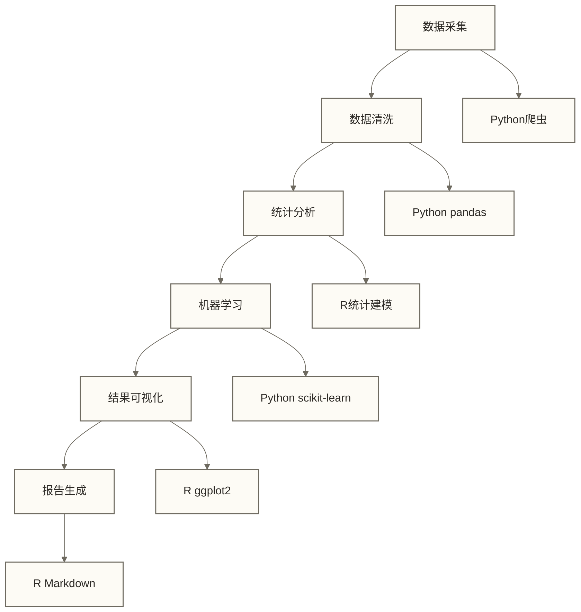
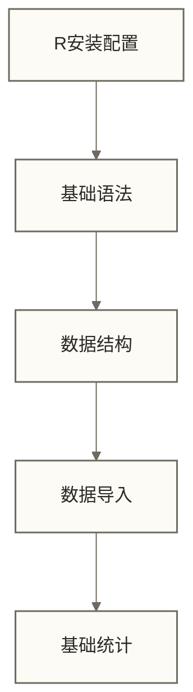
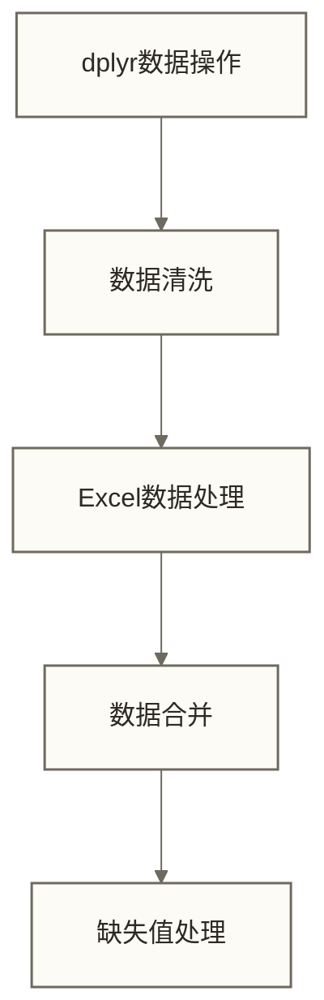
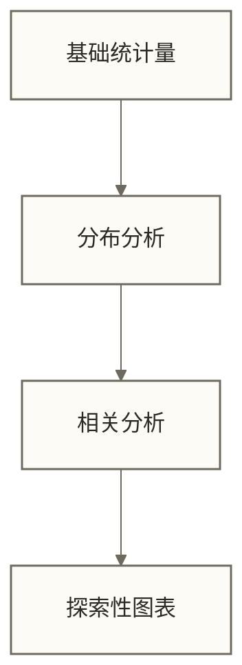
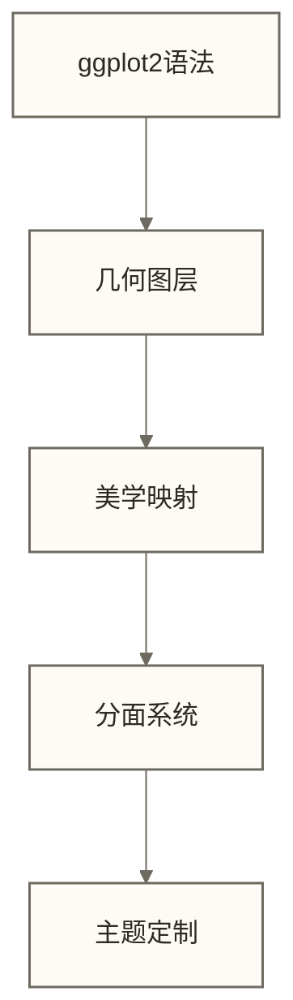
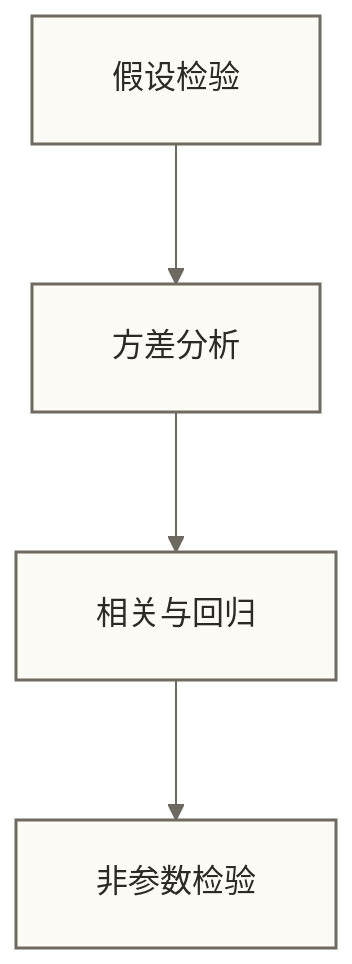
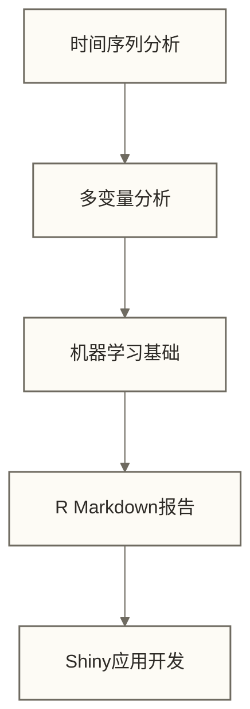

# 📊 R学习路线图 - 统计分析师的专业工具箱

> [!tip] 💝 给统计新手的温暖提醒
> 
> 🤗 **欢迎来到R语言的世界！**
> 
> 如果你现在对"统计编程"这个词感到紧张，甚至觉得自己"数学不好不适合学R" ——请暂停这种想法！
> 
> 🔬 **想象一下**：R就像是科学家的"智能实验室"，而你即将学会使用这套专业设备：
> - 让复杂的统计分析变成简单的几行代码
> - 把枯燥的数字变成直观的美丽图表
> - 发现数据背后隐藏的有趣规律和秘密
> - 用科学的方法验证你的想法和假设
> 
> [!quote] ✨ 全球专家共识
> **全世界数百万研究者、分析师、科学家都在用R，不是因为他们天生聪明，而是因为R真的很友好！**
> 
> 🎯 **学会R = 获得数据世界的"科学家执照"！**

> [!abstract] 📋 学习路线概览
> - 🎯 **学习目标**：掌握R语言进行专业统计分析和数据可视化
> - 💰 **学会后价值**：R技能可支持统计分析相关工作；12-25k仅作为原文的假设薪资情境，不代表可获得的职位或收入。
> - 📚 **适用人群**：统计专业学生、数据分析师、科研工作者、质量管理人员
> - ⏱️ **总体用时**：建议3-8个月系统学习
> - 🎓 **学习成果**：具备专业统计建模、高级数据可视化、科学报告撰写能力
> - 🌟 **独特优势**：提供丰富的统计分析、可视化和可重复研究工具；是否选用R取决于任务、团队及领域要求。

## 💰 学会R语言，你的职业前景如何？

### 🚀 薪资情境示例（假设值，不作为2024年真实数据）

下表保留原有数值作为职业规划讨论的假设，不代表市场统计。原文未说明地区、币种、薪资周期及样本口径；技能水平、学习时长与收入之间不构成保证关系。

| 技能水平 | 薪资范围 | 典型岗位 | 学习时长 |
|---|---|---|---|
| **R语言入门** | 8K-12K | 数据助理、统计实习生 | 1-3个月 |
| **统计分析熟练** | 12K-20K | 数据分析师、市场研究员 | 3-6个月 |
| **高级建模** | 18K-30K | 统计师、生物统计学家 | 6-12个月 |
| **R语言专家** | 25K-45K | 数据科学家、统计咨询师 | 1-2年 |

### 🏢 哪些领域急需R语言人才？

**以下领域存在R的应用场景，但是否急需R人才须依据具体岗位和招聘信息判断。**

- 🏥 **医疗健康**：临床试验、药物研发、流行病学研究
- 🏦 **金融保险**：风险建模、精算分析、量化投资
- 🎓 **教育科研**：学术研究、论文发表、实验设计
- 📊 **市场调研**：消费者行为、民意调查、A/B测试
- 🏭 **质量控制**：六西格玛、过程改进、质量分析
- 🌾 **农业生物**：基因分析、育种研究、环境监测

> [!tip] 💡 假设情境：小红的统计师进阶路
> 以下人物背景、学习时长、发表及就业经历均按示例理解，不作为真人经历或学习效果证据。
> 
> 👩‍🎓 **小红，心理学硕士研究生**
> 
> **学习前**：只会用SPSS点菜单做简单分析，论文数据处理求助师兄
> **学习过程**：花6个月系统学习R语言和高级统计方法
> **学习后**：独立完成复杂统计建模，发表SCI论文，毕业后进入知名咨询公司
> 
> 假设小红通过学习R拓展了编程与统计建模能力，并在示例情境中实现了比部分同学高50%的薪资；该比例不是实际收益证据。R与SPSS能否完成具体分析取决于方法、扩展工具和使用能力，不能笼统断言SPSS根本做不到高级分析。

## 🚀 R语言：统计分析的王者之路

假设统计专业的小红应聘一个要求R编程和统计建模能力的岗位，面试时仅展示了SPSS菜单操作经验。她随后用半年时间学习R，并在再次面试时展示建模和可视化作品。这个情境用于说明技能与岗位要求的匹配，不代表真实录用经历，也不能据此断言SPSS无法处理大数据或学习半年即可达到岗位要求。

这一假设情境提示读者关注具体岗位的工具与方法要求，不作为实际招聘频率的证据。理解相关知识不仅能解决当前问题，更能提升整体的专业能力。
### 🎯 R语言的独特优势

> [!success] ✅ R的"科学实验室"特质
> 
> **1. 🔬 统计分析的"原生血统"**
> - R由统计学家为统计学家而创造
> - R提供丰富的统计功能，更多方法可通过扩展包使用；Python也可借助相应库开展统计分析。
> - 统计理论与编程实现完美结合
> 
> **2. 📊 数据可视化的"艺术大师"**
> - ggplot2被誉为最美的数据可视化工具
> - 可用简洁代码创建图表；达到期刊要求还需检查数据表达、标注、尺寸、分辨率及投稿规范。
> - 自定义程度极高，满足学术发表要求
> 
> **3. 📝 科学报告的"完美搭档"**
> - R Markdown实现代码、分析、报告一体化
> - 直接生成PDF、Word、HTML等格式报告
> - 可重复研究的黄金标准
> 
> **4. 🎓 学术研究的"通用语言"**
> - 可选择使用R示例的统计学教材进行学习，具体以教材内容为准。
> - 可通过R扩展包学习和应用统计方法；具体方法的实现工具与发布时间因项目而异。
> - 学术界和工业界的桥梁

### 🤝 R + Python：完美组合



## 📚 六阶段学习体系

### 🌱 第一阶段：R语言基础（2-3周）

**学习目标**：掌握R语言基础语法，建立统计编程思维

> [!info] 🌰 生活比喻：学会使用"统计计算器"
> 就像学开车要先熟悉方向盘、油门、刹车一样，学R也要先掌握基本的"操控界面"。这个阶段你将学会如何让R"听懂"你的指令，就像教会一个非常聪明但需要精确指令的助手帮你处理数据。

> [!example] 🎆 初学者成功案例
> 👨‍🎓 **小张，经济学本科生**："第一次在R里算出平均数和标准差时超级兴奋！比Excel公式灵活太多了，现在我用R处理所有的课程作业，效率提升了好几倍！"



**学习文件顺序**：
1. [[【技术与工具】/R/01-R语言介绍|R语言介绍]] - 了解R的历史、特点和应用领域
2. [[【技术与工具】/Presto/03-Presto环境搭建|Presto/Presto环境搭建]] - 安装R、RStudio，配置开发环境  
3. [[【技术与工具】/R/03-R基础语法|R基础语法]] - 变量、函数、运算符等基础概念
4. [[【技术与工具】/R/04-R数据结构|R数据结构]] - 向量、矩阵、数据框、列表
5. [[【技术与工具】/ClickHouse/06-ClickHouse数据导入导出|ClickHouse/ClickHouse数据导入导出]] - CSV、Excel、数据库数据处理

> [!tip] 💡 第一阶段重点
> - 理解R的面向对象特性和函数式编程思想
> - 熟练掌握数据框(data.frame)的操作
> - 学会使用RStudio提高开发效率
> - 能够导入和处理常见格式的数据文件

---

### 🟡 第二阶段：数据操作与清洗（2-3周）

**学习目标**：掌握数据预处理技能，为统计分析做准备

> [!info] 🧹 生活比喻：数据的"大扫除"专家
> 就像大厨在烹饪前要洗菜、切菜、调味一样，数据分析前也需要"清洗"数据。脏乱的原始数据就像刚从菜地摘下来的蔬菜，需要去掉泥土、坏叶子，整理成适合"烹饪"（分析）的形态。这个阶段让你成为数据处理的专业"大厨"！

> [!example] 🎆 初学者成功案例
> 👩‍💼 **小林，市场调研专员**："假设在一个重复性整理任务中，使用dplyr后速度提升了10倍，并将原本一天的工作缩短到几分钟；这些数值仅用于示例。实际效率取决于任务和数据，仍须检查清洗结果，不能保证不会出错。"



**学习文件顺序**：
6. [[【技术与工具】/R/06-dplyr数据操作|dplyr数据操作]] - 筛选、排序、分组、汇总等操作
7. [[【技术与工具】/R/07-数据清洗技巧|数据清洗技巧]] - 处理异常值、重复值、数据类型转换
8. tidyr数据整理 - 长宽数据转换、数据重塑
9. 字符串处理 - stringr包进行文本数据处理
10. 日期时间处理 - lubridate包处理时间序列数据

> [!tip] 💡 第二阶段重点
> - 掌握tidyverse生态系统的核心理念
> - 熟练使用管道操作符(%>%)提高代码可读性
> - 学会处理各种数据质量问题
> - 建立数据清洗的标准化流程

---

### 🟠 第三阶段：描述性统计与探索性分析（2-3周）

**学习目标**：掌握基础统计方法，学会从数据中发现规律

> [!info] 🔍 生活比喻：数据的"体检医生"
> 想象你是一名医生，拿到患者的体检报告。你需要查看身高、体重、血压等各项指标，判断哪些正常、哪些异常。统计分析就是给数据做"体检"，通过平均值、标准差等指标了解数据的"健康状况"，发现数据中隐藏的规律和异常。

> [!example] 🎆 初学者成功案例
> 👨‍🔬 **小王，质量工程师**："用R做出的箱线图和散点图矩阵让我一眼就看出了生产过程中的质量问题，老板对我的分析报告印象深刻！"



**学习文件顺序**：
11. [[【技术与工具】/统计学/描述性统计|描述性统计]] - 中心趋势、离散程度、分布形态
12. 数据分布分析 - 正态性检验、分布拟合
13. 相关与协方差分析 - 皮尔逊、斯皮尔曼相关
14. 探索性数据分析 - EDA方法论和最佳实践
15. 基础绘图系统 - base R绘图系统详解

> [!tip] 💡 第三阶段重点
> - 掌握各种描述统计量的含义和应用场景
> - 学会选择合适的图表类型展示数据特征
> - 理解数据分布的重要性和检验方法
> - 培养从图表中发现数据模式的能力

---

### 🔴 第四阶段：ggplot2数据可视化（3-4周）

**学习目标**：掌握专业级数据可视化技能，制作期刊级图表

> [!info] 🎭 生活比喻：数据的"翻译家"和"艺术家"
> 数据本身就像一本用外语写的书，大多数人看不懂。数据可视化就是把这本"天书"翻译成人人都能理解的图画。一张好的图表胜过千言万语，就像一幅画能传达出深刻的情感一样。你将学会把冷冰冰的数字变成生动有趣的视觉故事！

> [!example] 🎆 初学者成功案例
> 👩‍🎓 **小陈，生物学硕士**："用ggplot2做的图表发表在了SCI期刊上！审稿人特别赞赏图表的专业性和美观度，说一看就知道是用专业统计软件制作的。"



**学习文件顺序**：
16. [[【数据分析与数据运营】/01-新手入门指南|新手入门指南/新手]] - 图形语法理论和基础概念
17. 几何图层详解 - 散点图、线图、柱状图等
18. 美学映射与标度 - 颜色、形状、大小映射
19. 分面与组合图表 - 多子图布局和组合
20. 主题与样式定制 - 专业图表美化技巧

> [!tip] 💡 第四阶段重点
> - 理解"图形语法"的核心思想
> - 掌握图层叠加的绘图逻辑
> - 学会制作符合期刊要求的专业图表
> - 培养数据可视化的设计思维

---

### 🟣 第五阶段：统计建模与假设检验（4-5周）

**学习目标**：掌握核心统计方法，具备独立进行统计推断的能力

> [!info] ⚖️ 生活比喻：数据世界的"侦探"和"法官"
> 这个阶段你将成为数据世界的福尔摩斯！面对有限的样本数据，你需要像侦探一样收集证据，像法官一样做出判断："这个新药真的有效吗？""男女在某项能力上真的有差异吗？"统计推断让你能够从小样本中发现大世界的真相，但要谨慎，避免冤假错案！

> [!example] 🎆 初学者成功案例
> 👨‍💼 **小李，产品经理**："学会统计检验后，我能科学地评估A/B测试结果了！不再凭感觉做决策，用数据说话让我在团队中更有说服力。"



**学习文件顺序**：
21. [[【技术与工具】/统计学/假设检验|假设检验]] - t检验、卡方检验、假设检验流程
22. [[【技术与工具】/统计学/方差分析（ANOVA）|统计学/方差分析（ANOVA）]] - 单因素、多因素方差分析
23. [[【技术与工具】/统计学/回归分析|回归]] - 简单、多元线性回归建模
24. [[【数据分析与数据运营】/98-专业术语词典/03-技术算法类/逻辑回归|逻辑回归]] - 分类问题的回归方法
25. 非参数统计方法 - 威尔科克森检验、克鲁斯卡尔检验

> [!tip] 💡 第五阶段重点
> - 理解假设检验的逻辑和统计推断原理
> - 掌握选择合适统计方法的判断标准
> - 学会解读统计结果和编写分析报告
> - 避免常见的统计分析错误和陷阱

---

### 🔵 第六阶段：高级分析与报告（4-6周）

**学习目标**：掌握高级统计方法和专业报告撰写技能

> [!info] 🏗️ 生活比喻：数据分析的"建筑师"和"作家"
> 到了这个阶段，你已经从学徒成长为大师级"建筑师"！你能设计复杂的统计模型，就像设计摩天大楼一样需要考虑各种因素。同时你也是优秀的"作家"，能将复杂的分析结果写成清晰易懂的报告，让每个读者都能理解你的发现和结论。

> [!example] 🎆 初学者成功案例
> 👩‍🔬 **小刘，临床研究员**："用R Markdown写的统计分析报告获得了伦理委员会的高度认可，可重复的分析流程让我们的研究更加严谨可信！"



**学习文件顺序**：
26. [[【数据分析与数据运营】/02-数据分析专业能力/03-建模与预测/03-时间序列分析|时间序列]] - ARIMA模型、时序预测
27. [[【技术与工具】/统计学/主成分分析（PCA）|统计学/主成分分析（PCA）]] - 降维分析和因子分析
28. [[【技术与工具】/统计学/聚类分析|聚类]] - K-means、层次聚类方法
29. [[【技术与工具】/R/11-R-Markdown数据报告自动化|R Markdown 数据报告自动化]] - 动态报告和可重复研究
30. Shiny交互应用 - 制作交互式统计应用

> [!tip] 💡 第六阶段重点
> - 掌握高级统计建模方法
> - 学会制作专业的统计分析报告
> - 理解可重复研究的重要性和实现方法
> - 具备开发简单统计应用的能力

## 🎯 按应用领域的学习路径

### 🏥 生物医学统计路径
**重点技能**：临床试验设计 + 生存分析 + Meta分析
- 📊 **基础期**：R基础 + 描述统计 + 假设检验
- 🧬 **专业期**：生存分析 + 流行病学方法 + 临床试验分析
- 📝 **应用期**：医学论文写作 + SCI期刊图表制作

### 📈 商业数据分析路径  
**重点技能**：A/B测试 + 客户细分 + 预测建模
- 📊 **基础期**：R基础 + ggplot2 + dplyr数据处理
- 💼 **商业期**：假设检验 + 回归分析 + 客户行为分析
- 🚀 **高级期**：机器学习 + 时间序列 + Shiny仪表板

### 🎓 学术研究路径
**重点技能**：实验设计 + 多变量分析 + 论文发表
- 📚 **理论期**：统计学理论 + 实验设计 + 数据收集
- 🔬 **分析期**：高级统计方法 + 多变量分析 + 模型诊断
- 📝 **发表期**：学术写作 + 图表制作 + 可重复研究

### 🏭 质量控制路径
**重点技能**：SPC统计过程控制 + 实验设计 + 质量改进
- 📊 **监控期**：控制图 + 过程能力分析 + 质量指标
- 🔬 **改进期**：实验设计 + 方差分析 + 回归建模
- 🎯 **优化期**：响应面设计 + 优化方法 + 六西格玛

## 🛠️ 学习工具与环境

### 💻 推荐开发环境
- **RStudio Desktop**：最友好的R集成开发环境
- **RStudio Cloud**：在线版本，无需本地安装
- **Visual Studio Code**：轻量级编辑器（进阶用户）

### 📦 核心R包生态

```r
# 数据操作生态
install.packages("tidyverse")  # 数据科学全家桶

# 统计分析包
install.packages("broom")      # 整理统计结果
install.packages("car")        # 回归分析诊断
install.packages("psych")      # 心理测量统计

# 可视化增强
install.packages("plotly")     # 交互式图表
install.packages("gganimate")  # 动画图表
install.packages("corrplot")   # 相关性可视化

# 报告制作
install.packages("rmarkdown")  # 动态报告
install.packages("knitr")      # 文档生成
install.packages("DT")         # 交互式表格
```

## 🎓 学习资源与支持

### 📚 精选学习资源（按优先级排序）

**第一阶段：建立信心（推荐指数：⭐⭐⭐⭐⭐）**
- 📺 **B站：R语言入门教程**（中文讲解，新手友好，有实际操作演示）
- 📖 **《R语言实战》**（入门经典教材，案例丰富实用）
- 🌐 **RStudio Education**（官方教程，免费资源丰富）

**第二阶段：技能提升（推荐指数：⭐⭐⭐⭐）**
- 📊 **《ggplot2：数据分析与图形艺术》**（可视化必读）
- 🔬 **《R语言统计分析与挖掘实战》**（统计方法详解）
- 💻 **Coursera R Programming**（系统化在线课程）

**第三阶段：专业进阶（推荐指数：⭐⭐⭐）**
- 📝 **《R Markdown权威指南》**（报告制作圣经）
- 🎯 **《Applied Statistics with R》**（应用统计深度教程）
- 🌐 **R-bloggers**（最新技术动态和案例）

### 🤝 社区支持网络

**中文社区（新手友好）：**
- 💬 **R语言中文社区**：问答活跃，解答耐心
- 📱 **统计之都**：高质量统计方法讨论
- 🎓 **知乎R语言话题**：实用技巧分享

**国际社区（进阶必备）：**
- 🌍 **Stack Overflow R Tag**：技术问题权威解答
- 📚 **R Documentation**：官方文档和帮助
- 💼 **RStudio Community**：专业用户交流平台

## 💬 学习反馈与心理建设

> [!note] 🤔 学习成果自我检测
> - [ ] 我了解了R语言在统计分析中的独特优势
> - [ ] 我明确了R语言的学习路径和阶段目标
> - [ ] 我知道如何根据应用领域选择学习重点
> - [ ] 我对R语言的职业前景有了清晰认识
> - [ ] 我已经准备好开始我的R语言学习之旅了！

> [!success] 💪 给自己加油打气
> 
> [!question] 💭 内心的小声音？让我们来解答！
> 
> - 😰 **"我数学不好能学会吗？"** → 可以从简单函数调用开始学习，但统计推断和建模仍需理解相应数学、方法假设及结果解释。
> - 😵 **"统计学好难啊"** → 我们从最简单的描述统计开始，一步步建立信心
> - 😱 **"我能写出那么美的图吗？"** → ggplot2的图形语法让美丽图表变得简单
> - 😤 **"学完会不会用不上？"** → 可以结合学术研究或业务任务练习R，实际是否适用取决于工作需求、数据条件和团队工具。
> 
> **记住：每个R语言专家都曾是初学者，每个统计大师都曾对着报错发呆！**

## 🎉 开始你的R语言之旅

### 🎯 根据你的背景选择起点

**🟢 完全零基础？**
👉 从这里开始：[[【技术与工具】/R/01-R语言介绍|R语言介绍]]

**🟡 有统计基础，并已掌握R基础语法、数据框操作和数据导入？**  
👉 可进入：[[【技术与工具】/R/06-dplyr数据操作|dplyr数据操作]]；若尚无R编程基础，仍应先完成第一阶段的基础学习。

**🟠 想做可视化？**
👉 推荐路径：[[【数据分析与数据运营】/01-新手入门指南|新手入门指南/新手]] - 图形语法的艺术

**🔴 需要写论文？**
👉 查看重点：[[【技术与工具】/R/11-R-Markdown数据报告自动化|R Markdown 数据报告自动化]] - 可重复研究的标准

---

## 🌟 你的R语言学习成功故事即将开始！

> [!success] ✅ 记住我们的学习理念
> 
> 1. **循序渐进**：从简单的数据操作开始，逐步掌握高级统计方法
> 2. **理论与实践结合**：每学一个概念都要用实际数据练习
> 3. **项目驱动学习**：选择与自己专业相关的数据集进行分析
> 4. **社区互助成长**：主动参与R语言社区，与同学习者交流

**下一步行动**：
1. 📥 **安装R和RStudio**：准备学习环境
2. 📖 **阅读第一篇文档**：建立对R的基本认识  
3. 📅 **制定学习计划**：每周投入5-8小时，坚持3个月
4. 🎯 **选择应用方向**：根据职业目标确定学习重点

**愿你在R语言的世界里发现数据的美妙，用统计的力量洞察世界的规律！** 🌟

---

**创建时间**：2024-12-11  
**温度指数**：⭐⭐⭐⭐⭐ (特别适合统计新手)  
**预计学习时长**：3-8个月系统掌握  
**职业价值**：统计分析师、数据科学家的必备技能

#R语言 #统计分析 #数据可视化 #学习路线 #新手友好 #职业发展
