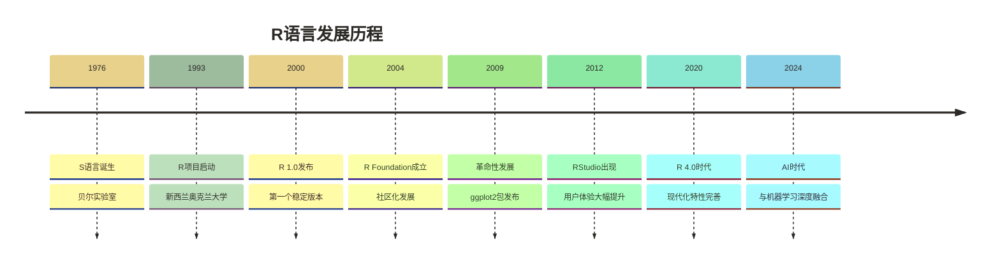
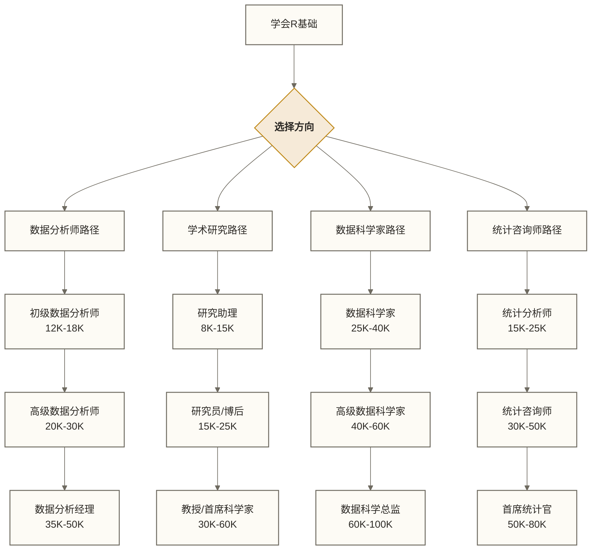

# 📊 R语言介绍 - 统计分析的专业利器

> [!tip] 💝 给统计新手的温暖提醒
> 
> 🤗 **欢迎来到R语言的世界！**
> 
> 如果你现在内心有个小声音在说：
> - "我数学不好，能学会统计编程吗？"
> - "R语言看起来好复杂，会不会很难？"
> - "我只是想做简单的数据分析，有必要学编程吗？"
> 
> [!quote] ✨ 专家心声
> **请先深呼吸，然后告诉自己：每一个统计专家都曾经历过同样的担心！**
> 
> 🔬 **想象一下：R就像一套智能实验室设备**
> 
> 就像科学家有显微镜看微观世界，有望远镜看宇宙，**R就是数据科学家的"多功能分析仪器"**！
> 
> - 📈 把枯燥的数字变成直观的美丽图表
> - 🔍 发现数据背后隐藏的有趣规律
> - 📊 用科学的方法验证你的想法
> - 📝 生成专业的统计报告
> 
> [!quote] 🌟 全球共识
> **全世界数百万研究者都在用R，不是因为他们天生聪明，而是因为R真的很友好！**

## 🌟 什么是R语言？

### 📚 R的身份证

**R语言**是一种专门为**统计计算和数据可视化**而设计的编程语言和软件环境。

> [!info] 🏠 生活比喻：R就像你的"智能助手"
> 想象一下现代的智能助手（如Siri、小爱）能做什么？
> - 听懂你的说话，按你的意思执行任务（R听懂你的数据需求）
> - 帮你管理日程、提醒事项（R帮你管理数据、提醒统计结果）
> - 回答各种问题，提供专业建议（R回答数据问题，提供统计分析）
> - 学习你的习惯，越用越聪明（R包生态越用越强大）
> 
> R可以辅助完成多种数据分析任务；具体能否实现，取决于数据、可用方法、扩展包和运行资源。

> [!info] 🎯 简单理解R语言
> 
> **用一句话描述R**：R是专门为数据分析师和研究者设计的"数据魔法工具箱"
> 
> - 🧮 **计算器的进化版**：不只算数，还能算统计、画图、建模
> - 🎨 **艺术家的画笔**：把枯燥数据变成美丽图表
> - 🔬 **科学家的实验台**：用科学方法验证假设和发现规律
> - 📝 **秘书的报告神器**：自动生成专业的分析报告

### 🏗️ R的发展历史



> [!note] 💡 历史小故事
> R语言的名字有两个含义：
> 1. 👥 **创始人名字**：Ross Ihaka和Robert Gentleman的首字母
> 2. 🅰️ **S语言的继承**：R是S语言的"继承者"，在字母表中S的前一个字母
> 
> 这就像是在说："我们要做比S更好的统计语言！"

## 🎯 R语言的核心特性

### ⭐ 5大核心优势

#### 1. 🧬 **统计分析的原生血统**

R由统计学家为统计学家而创造，内置了数百种统计方法。

```r
# 一行代码完成复杂统计检验
t.test(group1, group2)  # t检验
cor.test(x, y)          # 相关性检验
aov(score ~ treatment)  # 方差分析
```

> [!success] ✅ **为什么这很重要？**
> - **Python需要导入很多包**才能做统计分析
> - **SPSS既支持菜单操作，也支持语法编程**，可按任务需要进行定制
> - **Excel统计功能**有限且容易出错
> - **R内置多种常用统计功能**，其他分析、绘图和报告功能可能需要安装扩展包

#### 2. 🎨 **数据可视化的艺术大师**

> [!info] 🎨 生活比喻：R的可视化就像"专业相机"
> 你知道为什么专业摄影师的照片这么美吗？📷
> - **智能识别场景**：人像、风景、夜景自动调参（使用者根据数据特点与分析目的选择图表类型）
> - **专业滚镜系统**：可更换不同镜头拍不同风格（R有数百种图表类型可选择）
> - **一键美化滞镜**：自动调整色彩、对比度、光线（R绘图工具提供默认样式，也可由使用者调整颜色、布局和样式）
> - **RAW格式输出**：无损质保存，后期任意编辑（R生成矢量图，可无限放大）
> 
> 用R做可视化，就像拥有了一台专业单反相机，轻松拍出“数据大片”！

ggplot2被誉为最美的数据可视化工具，一行代码生成期刊级别图表。

```r
# 创建专业散点图的代码
ggplot(data, aes(x = height, y = weight, color = gender)) +
  geom_point(size = 3, alpha = 0.7) +
  geom_smooth(method = "lm") +
  theme_minimal() +
  labs(title = "身高体重关系分析",
       subtitle = "按性别分组显示",
       x = "身高 (cm)", y = "体重 (kg)")
```

**效果图对比**：

| 工具 | 制图复杂度 | 美观程度 | 定制化程度 | 学术认可度 |
|---|---|---|---|---|
| **R (ggplot2)** | 🟢 简单 | 🌟🌟🌟🌟🌟 | 🔥🔥🔥🔥🔥 | 🎓🎓🎓🎓🎓 |
| Python (matplotlib) | 🟡 中等 | 🌟🌟🌟 | 🔥🔥🔥🔥 | 🎓🎓🎓🎓 |
| Excel | 🟢 简单 | 🌟🌟 | 🔥🔥 | 🎓🎓 |
| SPSS | 🟡 中等 | 🌟🌟🌟 | 🔥🔥 | 🎓🎓🎓 |

#### 3. 📝 **科学报告的完美搭档**

R Markdown实现代码、分析、报告一体化，可重复研究的黄金标准。

> [!example] 🔬 科学研究的黄金流程
> 
> **传统方式的问题**：
> ```text
> 数据分析 → 复制结果 → 粘贴到Word → 手动调整格式 → 发现错误 → 重新开始
> ```
> ❌ 容易出错、难以重现、效率低下
> 
> **R Markdown的革命**：
> ```text
> 写代码 + 写文字 → 一键生成 → 完美报告 → 修改数据 → 自动更新
> ```
> ✅ 有助于提高报告生成效率与可重现性；分析准确性仍取决于数据、代码和方法，复现还依赖运行环境与依赖配置

#### 4. 🎓 **学术研究的通用语言**

- 📖 **教材首选**：几乎所有统计学教材都使用R示例
- 🔬 **方法实现**：最新统计方法首先在R中实现
- 📊 **期刊认可**：顶级期刊大多接受R语言制作的图表
- 🌍 **国际通用**：全球学术界的标准工具

#### 5. 🆓 **完全免费的专业工具**

> [!note]
> 💰 **成本对比**
>
> | 软件 | 价格 | 功能完整度 | 更新频率 |
> |---|---|---|---|
> | **R** | 🆓 免费 | 100% | 每月更新 |
> | SPSS | ¥20,000+/年 | 80% | 半年更新 |
> | SAS | ¥50,000+/年 | 90% | 年度更新 |
> | Stata | ¥10,000+/年 | 75% | 年度更新 |

## 🎯 统计学家的编程语言梦想

1993年，新西兰统计学家Ross Ihaka和Robert Gentleman遇到了一个问题：

当时做统计分析要么用昂贵的商业软件（如SAS、SPSS），要么用复杂的编程语言（如C++）。统计学家们抱怨："为什么没有一个既专业又好用的统计语言？"

于是他们开发了**R语言**——一个专门为统计分析而生的编程语言。

今天，R语言已经成为：
- **学术界**：全球大学统计系的标准工具
- **制药行业**：可用于药物试验数据分析；具体使用须满足相应研究、验证与监管要求，本文不提供FDA认可或推荐的依据
- **金融界**：华尔街量化分析师的首选
- **科技公司**：Google、Microsoft数据科学团队的核心工具

**从两个统计学家的梦想，到全球数据科学的基石——这就是R语言的传奇。**
## 🌍 R语言的核心应用领域

### 🏥 **生物医学与健康科学**

**为什么R是医学研究的金标准？**

医学研究对统计方法的要求极其严格，R在这个领域的统治地位来源于其：
- **临床试验分析用途**：R可用于药物试验数据分析，但工具使用需满足适用的验证与监管要求，不能据本文推断其获得FDA官方推荐
- **生存分析支持**：可通过survival等包使用Cox回归、Kaplan-Meier估计等方法，运行前需确保相应包可用并已加载
- **Bioconductor生态**：专为生物信息学设计的包集合，包含3000+专业包

**应用场景**：
- 🧬 **基因数据分析**：Bioconductor生态系统
- 🩺 **临床试验分析**：生存分析、药效评估
- 📊 **流行病学研究**：疾病传播模型、风险因素分析
- 🔬 **医学影像处理**：影像统计分析

> [!example] 🎯 **真实案例**
> **新冠疫情期间**，全球科学家使用R语言：
> - 📈 分析病毒传播趋势
> - 💊 评估疫苗有效性
> - 🌍 制作疫情地图
> - 📊 预测医疗资源需求

### 🏦 **金融与商业分析**

**应用场景**：
- 📈 **量化投资**：股票分析、风险建模
- 🏪 **零售分析**：客户细分、购物篮分析
- 💳 **风险管理**：信用评分、欺诈检测
- 📊 **市场研究**：消费者行为分析

**成功案例**：
- 🏦 **花旗银行**使用R进行风险建模
- 📊 **谷歌**用R分析广告效果
- 🛒 **沃尔玛**用R优化供应链

### 🎓 **学术研究与教育**

**应用场景**：
- 📚 **心理学研究**：实验设计、数据分析
- 🌱 **环境科学**：气候数据分析、生态建模
- 📊 **社会科学**：调查数据分析、政策评估
- 🔬 **自然科学**：实验数据处理、模型验证

**学术影响力**：
- 📖 全球80%+的统计学教材使用R
- 📊 50%+的顶级期刊接受R制作的图表
- 🎓 全球500强大学都在教授R语言

### 🏭 **工业与质量控制**

**应用场景**：
- 🔧 **六西格玛**：过程改进、质量分析
- 🏭 **制造业**：设备预测维护、产品质量控制
- ⚡ **能源行业**：智能电网分析、能耗优化
- 🚗 **汽车工业**：故障诊断、性能测试

## 🎯 学会R语言的职业价值

### 💰 薪资区间示例（以下金额仅作假设，不代表已核验的2024年行情；地区、币种及计薪周期未明确）

| 职位等级 | 薪资范围 | 典型岗位 | R技能要求 |
|---|---|---|---|
| **入门级** | 8K-15K | 数据助理、统计实习生 | 基础R语法、简单统计 |
| **初级** | 12K-22K | 数据分析师、市场研究员 | ggplot2、统计检验 |
| **中级** | 20K-35K | 高级数据分析师、统计师 | 建模分析、R包开发 |
| **高级** | 30K-50K | 数据科学家、首席分析师 | 高级统计、机器学习 |
| **专家级** | 45K-80K | 数据科学总监、统计咨询师 | 全栈数据技能、团队管理 |

### 🏢 哪些公司急需R语言人才？

**科技公司**：
- 🌐 **Google、Facebook、Microsoft**：用户行为分析
- 📊 **Uber、滴滴**：运营数据分析、算法优化
- 🛒 **阿里巴巴、京东**：电商数据分析、推荐系统

**传统行业数字化转型**：
- 🏦 **银行保险**：风险建模、精算分析
- 🏥 **医疗健康**：临床数据分析、药物研发
- 🏭 **制造业**：质量控制、智能制造
- 📈 **咨询公司**：数据驱动决策、商业分析

### 🚀 职业发展路径示例（图中薪资为假设性区间，不代表实际招聘行情或晋升收益保证）



## 🎮 开始学习R的第一步

### 🛠️ 学习环境准备

**必备软件（都是免费的！）**：

1. **R软件本体**
   - 🌐 官网下载：https://cran.r-project.org/
   - 💡 就像手机的操作系统，是基础

2. **RStudio桌面版**
   - 🌐 官网下载：https://www.rstudio.com/
   - 💡 就像手机的用户界面，让R更好用

> [!tip] 💻 **安装小贴士**
> 
> **安装顺序很重要**：
> 1. 🥇 **先安装R** → 这是"发动机"
> 2. 🥈 **再安装RStudio** → 这是"驾驶舱"
> 
> **系统要求**：
> - Windows 10+ / macOS 10.14+ / Ubuntu 18.04+
> - 内存：4GB+（推荐8GB+）
> - 硬盘：2GB可用空间

### 🎯 第一个R程序体验

在RStudio中输入以下代码，感受R的魅力：

```r
# 我的第一个R程序 - 分析鸢尾花数据
# 这是R内置的经典数据集

# 1. 查看数据
head(iris)  # 显示前6行数据

# 2. 数据概述
summary(iris)  # 数据统计摘要

# 3. 美丽的可视化
# 首次使用时需安装ggplot2；安装需要可用的包仓库和网络
# install.packages("ggplot2")
library(ggplot2)
ggplot(iris, aes(x = Sepal.Length, y = Sepal.Width, color = Species)) +
  geom_point(size = 3) +
  labs(title = "鸢尾花花萼长度与宽度关系",
       x = "花萼长度", y = "花萼宽度") +
  theme_minimal()

# 4. 简单统计检验
t.test(Sepal.Length ~ Species, data = iris[iris$Species %in% c("setosa", "versicolor"),])
```

> [!success] 🎉 **运行成功的标志**
> 
> 如果你看到：
> - 📊 数据表格正确显示
> - 📈 美丽的散点图出现
> - 📋 统计检验结果输出
> 
> [!success] 🌟 成功安装！
> **恭喜！你已经是R语言使用者了！**
> 
> 这短短几行代码完成了：数据查看 → 统计描述 → 可视化 → 假设检验
> 
> 在Excel或SPSS中，这需要很多步骤才能完成！

### 🎓 学习路径建议

根据你的背景选择起点：

**🟢 完全零基础新手？**
```text
建议路径：R基础语法 → 数据操作 → 简单统计 → 基础绘图
预计时间：2-3个月，每天30分钟
```

**🟡 有统计学基础？**
```text
建议路径：R语法快速入门 → ggplot2可视化 → 高级统计方法
预计时间：1-2个月，每天45分钟
```

**🟠 有编程经验？**
```text
建议路径：R语法对比学习 → 统计包使用 → 数据科学应用
预计时间：3-4周，每天1小时
```

**🔴 想做学术研究？**
```text
建议路径：R基础 → 统计分析 → R Markdown → 专业制图
预计时间：2-4个月，根据研究需要
```

## 💬 初学者常见疑虑解答

> [!question] 🤔 **学习R语言的常见顾虑**

#### **Q1: "我数学基础差，能学会R吗？"**
💡 **现实答案：完全可以！**

**虚构情境示例**：假设文科生小张大学数学只考过60分，后来学习R并成为月薪18K的市场研究员。这个设定仅用于说明学习起点可以不同，不代表真实人物经历，也不意味着学习R即可获得该岗位或收入。

**为什么数学不好也能学R？**
- R将复杂数学公式封装成简单函数，如`cor.test(x, y)`就能做相关分析
- 重要的是理解业务逻辑，不是手算公式
- 现代数据分析更注重“理解数据说了什么”，而非“怎么算出来的”

**Q2: "R的语法看起来很奇怪？"**
💡 **答案：习惯就好！**
- 每种编程语言都有自己的"方言"
- R的语法实际上很接近英语表达
- 用几周时间就能适应

**Q3: "学了会不会没地方用？"**
💡 **答案：应用场景超级广泛！**
- 从学术研究到商业分析
- 从医学研究到金融建模
- 只要有数据的地方就有R的用武之地

**Q4: "R会不会被Python替代？"**
💡 **答案：各有优势，互相补充！**
- R在统计分析领域有不可替代的地位
- 很多专业统计方法只有R实现
- 学会R+Python是最强组合

## 🎉 开始你的R语言之旅

> [!success] ✅ **学习心态建议**
> 
> 1. **耐心对待自己**：每个专家都曾是初学者
> 2. **享受探索过程**：发现数据规律是很有趣的事情
> 3. **不要害怕出错**：错误是学习的最好老师
> 4. **多动手实践**：理论结合实际，效果更好
> 5. **加入社区**：与其他学习者交流分享

### 🎯 下一步行动计划

**本周任务**：
- [ ] 安装R和RStudio
- [ ] 运行第一个程序
- [ ] 阅读 [[【技术与工具】/R/02-R环境搭建|R环境搭建]]

**本月目标**：
- [ ] 掌握R基础语法
- [ ] 学会基本数据操作
- [ ] 完成第一个数据分析项目

**3个月后**：
- [ ] 能独立进行统计分析
- [ ] 制作专业水平的图表
- [ ] 用R解决实际工作问题

---

> [!quote] 🌟 **最后的鼓励**
> 
> 记住：**你不是在学习一门编程语言，而是在掌握一种思考数据的方式！**
> 
> R语言将成为你在数据世界中的得力助手，帮你：
> - 🔍 **发现别人看不到的规律**
> - 📊 **用数据讲述精彩故事**
> - 🎯 **做出更科学的决策**
> - 🚀 **在职业道路上快速成长**
> 
> [!success] ⚡ 出发时刻！
> **现在就开始，你的数据科学之旅正式启航！**

---

**创建时间**：2024-12-11  
**温度指数**：⭐⭐⭐⭐⭐ (特别适合统计新手)  
**预计阅读时长**：25分钟  
**后续学习**：[[【技术与工具】/R/02-R环境搭建|R环境搭建]] → [[【技术与工具】/R/03-R基础语法|R基础语法]]

#R语言 #统计分析 #数据可视化 #入门介绍 #职业发展 #学习指南
