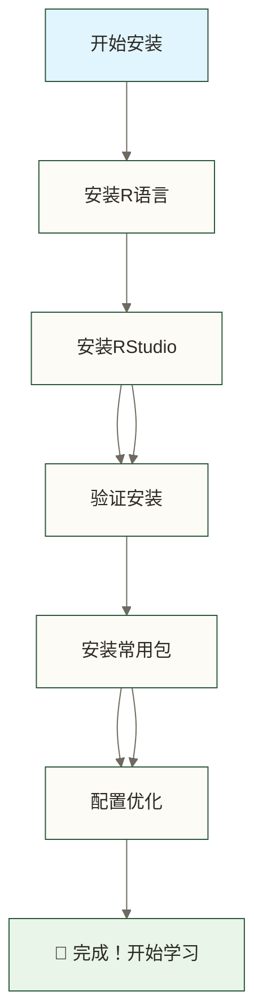
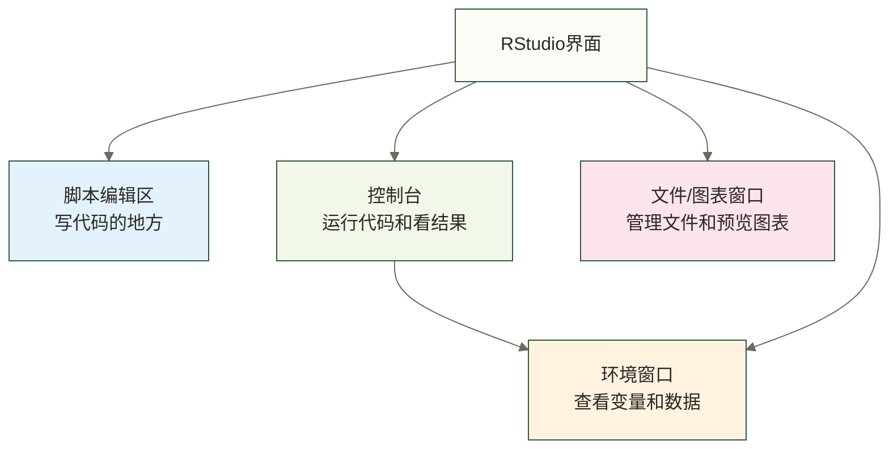

# 🛠️ R环境搭建 - 打造你的数据分析工作台

> [!tip] 💝 给新手的贴心提醒
> 
> 🤗 **别担心，搭建R环境比组装宜家家具简单多了！**
> 
> 如果你现在心里想着：
> - "我是电脑小白，会不会搞坏电脑？"
> - "这些安装步骤看起来好复杂..."
> - "万一安装出错怎么办？"
> 
> **请放心！** 我们会一步步引导你，就像有个贴心助手在身边 ✨
> 
> 🏠 **想象搭建你的数据分析"工作室"**
> 
> 就像装修新房子一样：
> - 🏗️ **R软件** = 房子的地基和框架（基础设施）
> - 🪑 **RStudio** = 精美的家具和装饰（舒适的工作环境）
> - 📦 **R包** = 各种专业工具（按需添加的功能）
> 
> **装修完成后，你就有了一个专业的数据分析工作室！** 🌟

## 🎯 环境搭建概览

### 📋 我们要安装什么？



**安装清单**：
- ✅ **R语言本体** (免费，约100MB)
- ✅ **RStudio桌面版** (免费，约200MB)
- ✅ **常用R包** (按需安装)
- ✅ **中文字体配置** (可选)

> [!info] ⏱️ **时间预估**
> - **快速安装**：15-20分钟
> - **完整配置**：30-45分钟
> - **系统要求**：Windows 10+/macOS 10.14+/Ubuntu 18.04+

## 💻 第一步：安装R语言

### 🪟 Windows系统安装

#### 📥 下载R语言

1. **访问官方下载页面**
   ```text
   网址：https://cran.r-project.org/bin/windows/base/
   ```

2. **选择版本**
   - 点击 **"Download R-4.x.x for Windows"** (选择最新版本)
   - 文件大小约100MB，下载时间5-10分钟

3. **安装步骤**
   ```text
   📁 双击下载的 .exe 文件
   🌐 选择安装语言：English (推荐) 或 简体中文
   📂 安装位置：默认 C:\Program Files\R\ (推荐)
   ⚙️ 组件选择：全部勾选 (默认即可)
   🎯 用户配置：选择 "为所有用户安装"
   ```

> [!tip] 💡 **Windows安装小贴士**
> 
> **常见问题解决**：
> - ❌ **安装被阻止**：右键 → 以管理员身份运行
> - ❌ **路径有中文**：避免安装在有中文的文件夹
> - ❌ **杀毒软件警告**：暂停安装，确认安装包来自官方页面并检查报警原因；不要直接关闭杀毒软件或将未知安装包添加为信任

### 🍎 macOS系统安装

#### 📥 下载R语言

1. **访问官方下载页面**
   ```text
   网址：https://cran.r-project.org/bin/macosx/
   ```

2. **选择对应版本**
   - **Intel芯片Mac**：下载 "R-4.x.x-x86_64.pkg"
   - **M1/M2芯片Mac**：下载 "R-4.x.x-arm64.pkg"
   
   > 💡 **不确定芯片类型？**
   > 点击苹果菜单 → 关于本机 → 查看"处理器"信息

3. **安装步骤**
   ```text
   📁 双击下载的 .pkg 文件
   🔐 输入管理员密码
   ⚙️ 跟随安装向导（一路点击"继续"）
   ✅ 安装完成
   ```

### 🐧 Linux系统安装

#### Ubuntu/Debian系统

```bash
# 更新软件包列表
sudo apt update

# 安装R语言
sudo apt install r-base r-base-dev

# 验证安装
R --version
```

#### CentOS/RHEL系统

```bash
# 安装EPEL源
sudo yum install epel-release

# 安装R语言
sudo yum install R

# 验证安装
R --version
```

## 🎨 第二步：安装RStudio

### 🎯 为什么RStudio这么重要？

刚学R的小王抱怨："R语言的原生命令行界面太难用了，没有语法高亮，没有自动补全，连个文件管理都没有。"这时老师推荐了RStudio："这是R语言的最佳搭档，就像给汽车装上GPS和音响系统。"安装后小王惊呼："原来写R代码可以这么舒服！"

在实际工作环境中，这样的挑战每天都在发生。理解相关知识不仅能解决当前问题，更能提升整体的专业能力。
### 📥 下载和安装RStudio

#### 🌐 官方下载

1. **访问RStudio官网**
   ```text
   网址：https://www.rstudio.com/products/rstudio/download/
   ```

2. **选择版本**
   - 选择 **"RStudio Desktop"** (桌面版，免费)
   - 系统会自动检测你的操作系统

3. **各系统安装方法**

**Windows**：
```text
📁 双击 .exe 文件
🎯 安装位置：默认位置即可
⚙️ 安装选项：默认配置
✅ 完成安装
```

**macOS**：
```text
📁 双击 .dmg 文件
🖱️ 拖拽RStudio图标到Applications文件夹
✅ 安装完成
```

**Linux (Ubuntu)**：
```bash
# 下载deb包（以Ubuntu为例）
wget https://download1.rstudio.org/desktop/bionic/amd64/rstudio-2023.12.1-402-amd64.deb

# 安装
sudo dpkg -i rstudio-2023.12.1-402-amd64.deb

# 如果有依赖问题，执行：
sudo apt-get install -f
```

## ✅ 第三步：验证安装

### 🎯 第一次启动RStudio

1. **启动RStudio**
   - Windows：开始菜单 → RStudio
   - macOS：应用程序 → RStudio
   - Linux：命令行输入 `rstudio` 或从应用菜单启动

2. **RStudio界面介绍**



3. **测试安装是否成功**

在控制台输入以下代码：

```r
# 测试R是否正常工作
print("Hello, R World!")

# 检查R版本
version

# 简单数学运算
2 + 2

# 创建第一个图表
plot(1:10, type = "l", col = "blue", main = "我的第一个R图表")
```

> [!success] ✅ **安装成功的标志**
> 
> 如果你看到：
> - 📝 控制台显示："Hello, R World!"
> - 🔢 数学运算结果：4
> - 📈 右下角出现蓝色折线图
> 
> **恭喜！R和RStudio安装成功！** 🎉

### 🔧 常见安装问题及解决

#### ❌ 问题1：RStudio启动时找不到R

**症状**：RStudio提示"R not found"或无法启动

**解决方法**：
```r
# 方法1：重新安装（确保先装R，再装RStudio）
# 方法2：手动指定R路径
# 在RStudio中：Tools → Global Options → General → R version
```

#### ❌ 问题2：中文显示乱码

**解决方法**：
```r
# 查看当前区域设置；区域设置不等同于UTF-8编码设置
Sys.getlocale()
# 如需调整区域设置，应使用操作系统支持的locale名称；不要将"Chinese"视为跨平台UTF-8设置

# 或者在RStudio中设置：
# Tools → Global Options → Code → Saving → Default text encoding → UTF-8
```

#### ❌ 问题3：图表不显示或显示异常

**解决方法**：
```r
# 仅在已有非null图形设备时关闭当前设备，再重画
if (dev.cur() > 1) dev.off()
plot(1:10)

# png、jpeg包用于相应图像读写，不是基础绘图异常的通用依赖。
# 若仍异常，检查设备、RStudio绘图面板及实际报错。
```

## 📦 第四步：安装常用R包

### 🎒 什么是R包？

> [!info] 💡 **R包的概念**
> 
> 想象R包就像手机APP：
> - 📱 **基础R** = 手机操作系统（基本功能）
> - 📦 **R包** = 各种APP（专门功能）
> - 🏪 **CRAN** = 应用商店（官方包仓库）
> 
> **常用包就像手机必装APP**：
> - 📊 `ggplot2` = 美图秀秀（数据可视化）
> - 🔧 `dplyr` = 文件管理器（数据处理）
> - 📈 `readr` = 文档阅读器（数据读取）

### 🏷️ 必装包清单

```r
# 数据科学全家桶（一次安装多个包）
install.packages("tidyverse")

# 如果网络慢，可以单独安装核心包：
install.packages(c(
  "ggplot2",    # 数据可视化
  "dplyr",      # 数据处理
  "readr",      # 数据读取
  "tidyr",      # 数据整理
  "stringr",    # 字符串处理
  "forcats"     # 因子处理
))

# 其他实用包
install.packages(c(
  "rmarkdown",  # 制作报告
  "knitr",      # 文档编织
  "DT",         # 交互式表格
  "plotly"      # 交互式图表
))
```

### 🚀 包安装优化设置

#### 🇨🇳 设置中国镜像源（加速下载）

```r
# 方法1：临时设置
install.packages("ggplot2", repos = "https://mirrors.tuna.tsinghua.edu.cn/CRAN/")

# 方法2：设置当前R会话的默认镜像（重启R后需重新设置）
options(repos = c(CRAN = "https://mirrors.tuna.tsinghua.edu.cn/CRAN/"))

# 方法3：通过RStudio设置
# Tools → Global Options → Packages → Primary CRAN repository
# 选择：China (Beijing) [https://mirrors.tuna.tsinghua.edu.cn/CRAN/
```

#### 📱 常用镜像源推荐

```r
# 清华大学镜像（推荐）
options(repos = "https://mirrors.tuna.tsinghua.edu.cn/CRAN/")

# 中国科学技术大学镜像
options(repos = "https://mirrors.ustc.edu.cn/CRAN/")

# 阿里云镜像
options(repos = "https://mirrors.aliyun.com/CRAN/")
```

## ⚙️ 第五步：环境优化配置

### 🎨 RStudio个性化设置

#### 📝 编辑器优化

```r
# 在RStudio中设置：
# Tools → Global Options → Code

# 推荐设置：
✅ 显示行号
✅ 语法高亮
✅ 代码自动补全
✅ 括号匹配高亮
✅ 保存时自动格式化
```

#### 🎯 外观设置

```r
# Tools → Global Options → Appearance

# 推荐主题：
🌙 深色主题：Cobalt / Monokai / Tomorrow Night 80s
☀️ 浅色主题：Textmate / Solarized Light / Chrome
📝 字体：Consolas / Monaco / Source Code Pro
📏 字体大小：12-14pt
```

#### 💾 项目管理设置

```r
# Tools → Global Options → General

# 推荐设置：
❌ 取消勾选 "Restore .RData into workspace at startup"
❌ 取消勾选 "Save workspace to .RData on exit"
✅ 选择 "Never" save workspace
```

### 📁 创建学习工作空间

#### 🏠 建立项目文件夹结构

| 目录 | 说明 |
|------|------|
| `R-Learning/` | 主学习文件夹 |
| `R-Learning/01-Basics/` | 基础学习 |
| `R-Learning/01-Basics/scripts/` | R 脚本文件 |
| `R-Learning/01-Basics/data/` | 数据文件 |
| `R-Learning/01-Basics/output/` | 输出结果 |
| `R-Learning/02-Projects/` | 实践项目 |
| `R-Learning/02-Projects/project1/` | 项目一 |
| `R-Learning/02-Projects/project2/` | 项目二 |
| `R-Learning/03-Resources/` | 学习资源 |
| `R-Learning/03-Resources/datasets/` | 练习数据集 |
| `R-Learning/03-Resources/references/` | 参考文档 |
| `R-Learning/04-Notes/` | 学习笔记 |

#### 🎯 创建第一个R项目

1. **在RStudio中创建项目**
   ```text
   File → New Project → New Directory → New Project
   Directory name: "my-first-r-project"
   Create project as subdirectory of: [选择位置]
   ```

2. **创建第一个R脚本**
   ```r
 # File → New File → R Script
 # 保存为：hello-world.R
   
 # 我的第一个R脚本
   print("欢迎来到R语言的世界！")
   
 # 创建一些示例数据
   my_numbers <- c(1, 2, 3, 4, 5)
   my_average <- mean(my_numbers)
   
   print(paste("平均值是:", my_average))
   ```

## 🧪 第六步：环境测试

### 🔬 全面功能测试

运行以下测试脚本，确保所有功能正常：

```r
# =====================================
# R环境完整性测试脚本
# =====================================

cat("🎯 开始R环境测试...\n\n")

# 1. 基础功能测试
cat("1️⃣ 测试基础计算功能...\n")
result1 <- 2 + 2
cat("   2 + 2 =", result1, "✅\n\n")

# 2. 数据结构测试
cat("2️⃣ 测试数据结构...\n")
test_vector <- c(1, 2, 3, 4, 5)
test_dataframe <- data.frame(
  name = c("Alice", "Bob", "Charlie"),
  age = c(25, 30, 35),
  score = c(85, 92, 78)
)
cat("   向量长度:", length(test_vector), "✅\n")
cat("   数据框行数:", nrow(test_dataframe), "✅\n\n")

# 3. 包安装测试
cat("3️⃣ 测试必要包是否安装...\n")
required_packages <- c("ggplot2", "dplyr", "readr")
for(pkg in required_packages) {
  if(require(pkg, character.only = TRUE, quietly = TRUE)) {
    cat("   包", pkg, "✅\n")
  } else {
    cat("   包", pkg, "❌ (需要安装)\n")
  }
}
cat("\n")

# 4. 图形功能测试
cat("4️⃣ 测试图形功能...\n")
try({
 # 基础图形
  png("test_plot.png", width = 400, height = 300)
  plot(1:10, main = "测试图表", col = "blue", type = "l")
  dev.off()
  cat("   基础图形 ✅\n")
  
 # ggplot2图形
  if(require(ggplot2, quietly = TRUE)) {
    p <- ggplot(test_dataframe, aes(x = name, y = score)) +
      geom_bar(stat = "identity", fill = "steelblue") +
      labs(title = "测试ggplot2")
    ggsave("test_ggplot.png", p, width = 6, height = 4)
    cat("   ggplot2图形 ✅\n")
  }
}, silent = FALSE)
cat("\n")

# 5. 中文支持测试
cat("5️⃣ 测试中文支持...\n")
chinese_text <- "这是中文测试"
cat("   中文显示:", chinese_text, "✅\n\n")

cat("🎉 环境测试完成！\n")
cat("📁 测试文件保存在当前工作目录中\n")
cat("🚀 测试流程已结束；请检查包加载结果、图形错误、生成的图片和中文显示，再判断这些基础功能是否可用。\n")
```

### 📊 测试结果解读

> [!success] ✅ **测试全部通过的标志**
> 
> 如果你看到：
> - 🔢 所有计算结果正确
> - 📦 必要包都显示 ✅
> - 📈 生成了测试图片文件
> - 🇨🇳 中文正常显示
> 
> **恭喜！上述基础功能检查已通过；这不代表所有R包、字体和分析任务都已验证。** 🌟

## 💡 常用技巧和最佳实践

### 🚀 提升工作效率的设置

#### ⌨️ 快捷键配置

```r
# 常用快捷键（可在 Tools → Keyboard Shortcuts 自定义）
Ctrl + Enter     # 运行当前行代码
Ctrl + Shift + Enter  # 运行整个脚本
Ctrl + L         # 清空控制台
Ctrl + Shift + C  # 注释/取消注释
Tab              # 代码自动补全
```

#### 🔧 工作流优化

```r
# 1. 设置工作目录
setwd("~/R-Learning")

# 2. 创建常用函数
clear_all <- function() {
  rm(list = ls(envir = .GlobalEnv), envir = .GlobalEnv)  # 删除全局工作区中非隐藏对象；执行前确认不再需要这些对象
  cat("\033[2J")   # 清空控制台
  cat("🧹 环境已清理完毕！\n")
}

# 3. 自动加载常用包
auto_load_packages <- function() {
  packages <- c("ggplot2", "dplyr", "readr")
  sapply(packages, require, character.only = TRUE)
  cat("📦 常用包加载完成！\n")
}
```

### 📚 学习资源推荐

#### 🎥 在线教程

- 📺 **B站：R语言入门教程**（搜索"R语言零基础"）
- 🌐 **RStudio官方教程**：https://education.rstudio.com/
- 📖 **菜鸟教程R语言**：https://www.runoob.com/r/

#### 📱 实用工具

- 🔍 **R帮助系统**：在控制台输入 `?函数名`
- 📋 **RStudio小抄**：Help → Cheatsheets
- 🌐 **Stack Overflow R标签**：遇到问题的求助平台

## 🎉 恭喜完成环境搭建！

> [!success] 🌟 **你已经拥有了**
> 
> - ✅ **专业的数据分析环境**
> - ✅ **美观的代码编辑器**
> - ✅ **丰富的功能包库**
> - ✅ **完善的项目管理系统**
> 
> **现在你已经准备好开始真正的R语言学习之旅了！** 🚀

### 🎯 下一步建议

**立即行动**：
- [ ] 运行环境测试脚本
- [ ] 创建第一个学习项目
- [ ] 开始学习 [[【技术与工具】/R/03-R基础语法|R基础语法]]

**本周目标**：
- [ ] 熟悉RStudio界面
- [ ] 掌握基础代码运行
- [ ] 完成第一个简单分析

**记住**：
> 🎯 **环境搭建只是开始，真正的乐趣在于用R解决实际问题！**
> 
> 当你第一次用R制作出美丽的图表，第一次发现数据中的有趣规律时，你会感受到数据科学的真正魅力！ ✨

---

**创建时间**：2024-12-11  
**温度指数**：⭐⭐⭐⭐⭐ (新手友好，步骤详细)  
**预计完成时长**：30-45分钟  
**下一步学习**：[[【技术与工具】/R/03-R基础语法|R基础语法]] → [[【技术与工具】/R/04-R数据结构|R数据结构]]

#R语言 #环境搭建 #RStudio #安装指南 #新手教程 #数据分析环境
