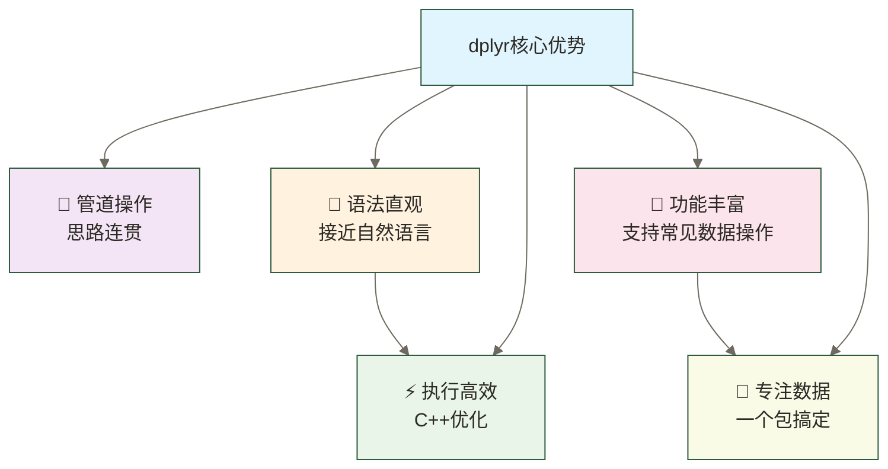

# 🔧 dplyr数据操作 - 数据处理的瑞士军刀

> [!tip] 💝 给数据新手的贴心话
> 
> 🤗 **学会dplyr，就像获得了数据处理的"超能力"！**
> 
> 如果你现在想着：
> - "数据这么乱，怎么整理啊？"
> - "Excel里要点很多下，R里会不会更复杂？"
> - "这么多函数记得住吗？"
> 
> **别担心！** dplyr的设计哲学就是让复杂的数据操作变简单 ✨
> 
> 🔧 **想象dplyr是一套完美的工具箱**
> 
> 就像装修房子需要不同工具：
> - 🔨 **select()** = 锤子（选择需要的列）
> - ✂️ **filter()** = 剪刀（筛选需要的行）
> - 📏 **arrange()** = 尺子（数据排序整齐）
> - 🔧 **mutate()** = 扳手（创建新的列）
> - 📊 **summarise()** = 计算器（统计汇总）
> - 🗂️ **group_by()** = 分类盒（数据分组）
> 
> **每个工具都简单易用，组合起来就能解决复杂问题！** 🌟

假设数据分析师小赵拿到一个包含50万行销售数据的表格，需要按地区分组、筛选高价值客户、计算月度增长率、排序输出报告。若手工处理预计需要2小时，可尝试用dplyr流水线组织这些步骤；这里的人物、耗时和任务规模仅为情境假设，并非真实经历或性能测试。实际代码量、耗时和错误风险取决于数据结构、业务口径、硬件与操作方式。
### 🌟 dplyr的核心优势



## 🛠️ dplyr六大核心函数

### 📋 函数概览

```r
# 安装和加载dplyr
# install.packages("tidyverse")  # 包含dplyr
# 如未安装，请先执行：
# install.packages(c("dplyr", "stringr", "tidyr", "moments", "scales"))
library(dplyr)
library(stringr)
library(tidyr)
# moments和scales在下文通过包名::函数名调用

# 六大核心函数一览
# select()   - 选择列（选择变量）
# filter()   - 筛选行（筛选观测）
# arrange()  - 排序（重新排列）
# mutate()   - 创建新列（变换数据）
# summarise() - 汇总统计（summarize的英式拼写）
# group_by() - 分组操作（分组分析）
```

### 🎯 管道操作符 %>%

> [!info] 🔗 **管道操作的魔力**
> 
> **管道操作符 `%>%` 就像流水线：**
> 
> **传统方式（嵌套地狱）**：

```r
result <- summarise(
  arrange(
    filter(
      select(data, 姓名, 年龄, 成绩),
      成绩 > 80
    ),
    成绩
  ),
  平均分 = mean(成绩)
)
```

> 
> **管道方式（清晰流畅）**：

```r
result <- data %>%
  select(姓名, 年龄, 成绩) %>%
  filter(成绩 > 80) %>%
  arrange(成绩) %>%
  summarise(平均分 = mean(成绩))
```

> 
> **读起来就像：**"拿数据 → 选择列 → 筛选行 → 排序 → 汇总"

## 🔍 select() - 选择你需要的列

### 🎯 基础列选择

```r
# 创建示例数据
students <- data.frame(
  学号 = sprintf("2024%03d", 1:10),
  姓名 = paste0("学生", 1:10),
  性别 = sample(c("男", "女"), 10, replace = TRUE),
  年龄 = sample(18:22, 10, replace = TRUE),
  专业 = sample(c("计算机", "数学", "物理"), 10, replace = TRUE),
  数学成绩 = round(rnorm(10, 85, 10), 1),
  英语成绩 = round(rnorm(10, 80, 12), 1),
  编程成绩 = round(rnorm(10, 88, 8), 1),
  stringsAsFactors = FALSE
)

print(students)

# 1. 按名称选择列
basic_info <- students %>%
  select(姓名, 年龄, 专业)

print(basic_info)

# 2. 按位置选择列
first_three <- students %>%
  select(1:3)  # 选择前3列

# 3. 排除不需要的列
without_id <- students %>%
  select(-学号)  # 排除学号列

without_multiple <- students %>%
  select(-c(学号, 年龄))  # 排除多列

# 4. 按模式选择列
# 选择包含"成绩"的列
scores_only <- students %>%
  select(contains("成绩"))

# 选择以某字符开头的列
student_info <- students %>%
  select(starts_with("姓"))

# 选择以某字符结尾的列
personal_info <- students %>%
  select(ends_with("龄"))

print(scores_only)
```

### 🔧 高级选择技巧

```r
# 1. 重命名同时选择
renamed_data <- students %>%
  select(
    ID = 学号,
    Name = 姓名,
    Age = 年龄,
    Math = 数学成绩
  )

# 2. 重新排列列顺序
reordered <- students %>%
  select(姓名, 专业, everything())  # everything()表示其他所有列

# 3. 根据数据类型选择
numeric_cols <- students %>%
  select(where(is.numeric))  # 选择所有数值列

character_cols <- students %>%
  select(where(is.character))  # 选择所有字符列

print(numeric_cols)

# 4. 条件选择
high_variance_cols <- students %>%
  select(where(~ is.numeric(.x) && var(.x, na.rm = TRUE) > 50))

# 5. 使用变量选择列
score_columns <- c("数学成绩", "英语成绩", "编程成绩")
selected_scores <- students %>%
  select(all_of(score_columns))
```

## 🔍 filter() - 精确筛选数据行

### 🎯 基础行筛选

```r
# 1. 单条件筛选
# 筛选年龄大于20的学生
older_students <- students %>%
  filter(年龄 > 20)

# 筛选计算机专业的学生
cs_students <- students %>%
  filter(专业 == "计算机")

# 筛选数学成绩优秀的学生
excellent_math <- students %>%
  filter(数学成绩 >= 90)

print(excellent_math)

# 2. 多条件筛选（AND逻辑）
# 筛选年龄>20且专业是计算机的学生
cs_older <- students %>%
  filter(年龄 > 20, 专业 == "计算机")

# 等价写法
cs_older2 <- students %>%
  filter(年龄 > 20 & 专业 == "计算机")

# 3. 或逻辑筛选（OR逻辑）
# 筛选专业是计算机或数学的学生
stem_students <- students %>%
  filter(专业 == "计算机" | 专业 == "数学")

# 使用%in%操作符（更简洁）
stem_students2 <- students %>%
  filter(专业 %in% c("计算机", "数学"))

print(stem_students2)

# 4. 数值范围筛选
# 筛选年龄在19-21之间的学生
age_range <- students %>%
  filter(年龄 >= 19, 年龄 <= 21)

# 等价写法
age_range2 <- students %>%
  filter(between(年龄, 19, 21))

print(age_range2)
```

### 🔧 高级筛选技巧

```r
# 1. 字符串模糊匹配
# 筛选姓名包含"1"的学生
name_contains <- students %>%
  filter(str_detect(姓名, "1"))

# 2. 多列条件筛选
# 筛选任意一科成绩>90的学生
high_achievers <- students %>%
  filter(数学成绩 > 90 | 英语成绩 > 90 | 编程成绩 > 90)

# 3. 筛选前N名
# 按数学成绩筛选前3名：以下第三名阈值写法要求至少有3行数据
# 阈值写法及slice_max默认均保留并列，因此结果可能超过3人
# 如需最多3人，可使用slice_max(数学成绩, n = 3, with_ties = FALSE)，并明确并列取舍规则
top_math <- students %>%
  filter(数学成绩 >= sort(数学成绩, decreasing = TRUE)[3])

# 使用slice_max更简单
top_math2 <- students %>%
  slice_max(数学成绩, n = 3)

print(top_math2)

# 4. 筛选缺失值
# 假设有缺失值的数据
students_with_na <- students
students_with_na$数学成绩[c(1,3)] <- NA

# 筛选非缺失值
complete_math <- students_with_na %>%
  filter(!is.na(数学成绩))

# 筛选缺失值
missing_math <- students_with_na %>%
  filter(is.na(数学成绩))

# 5. 复杂条件筛选
# 筛选综合表现优秀的学生（平均分>85且没有科目<70）
excellent_overall <- students %>%
  rowwise() %>%
  mutate(平均分 = mean(c(数学成绩, 英语成绩, 编程成绩))) %>%
  filter(
    平均分 > 85,
    数学成绩 >= 70,
    英语成绩 >= 70,
    编程成绩 >= 70
  ) %>%
  ungroup()

print(excellent_overall)
```

## 📊 arrange() - 让数据井然有序

### 🎯 基础排序

```r
# 1. 单列排序
# 按年龄升序排列
age_asc <- students %>%
  arrange(年龄)

# 按数学成绩降序排列
math_desc <- students %>%
  arrange(desc(数学成绩))

print(math_desc)

# 2. 多列排序
# 先按专业，再按数学成绩降序
multi_sort <- students %>%
  arrange(专业, desc(数学成绩))

print(multi_sort)

# 3. 字符串排序
# 按姓名字母顺序排列
name_sort <- students %>%
  arrange(姓名)

print(name_sort)
```

### 🔧 高级排序技巧

```r
# 1. 自定义排序顺序
# 按专业自定义顺序排列
custom_order <- students %>%
  mutate(专业_顺序 = factor(专业, levels = c("计算机", "数学", "物理"))) %>%
  arrange(专业_顺序) %>%
  select(-专业_顺序)

print(custom_order)

# 2. 按计算列排序
# 按总分排序
total_score_sort <- students %>%
  mutate(总分 = 数学成绩 + 英语成绩 + 编程成绩) %>%
  arrange(desc(总分))

print(total_score_sort)

# 3. 随机排序
# 随机打乱顺序
random_order <- students %>%
  slice_sample(n = nrow(students))

# 4. 条件排序
# 女生按数学成绩排序，男生按英语成绩排序
conditional_sort <- students %>%
  arrange(性别, ifelse(性别 == "女", desc(数学成绩), desc(英语成绩)))
```

## 🔧 mutate() - 创造新的数据列

### 🎯 基础列创建

```r
# 1. 创建简单计算列
enhanced_students <- students %>%
  mutate(
    总分 = 数学成绩 + 英语成绩 + 编程成绩,
    平均分 = 总分 / 3,
    平均分_四舍五入 = round(平均分, 1)
  )

print(enhanced_students)

# 2. 创建条件列
graded_students <- students %>%
  mutate(
    数学等级 = case_when(
      数学成绩 >= 90 ~ "优秀",
      数学成绩 >= 80 ~ "良好",
      数学成绩 >= 70 ~ "中等",
      数学成绩 >= 60 ~ "及格",
      TRUE ~ "不及格"
    ),
    是否成年 = ifelse(年龄 >= 18, "是", "否"),
    性别编码 = if_else(性别 == "男", 1, 0)
  )

print(graded_students)

# 3. 基于多列创建新列
analysis_students <- students %>%
  mutate(
    总分 = 数学成绩 + 英语成绩 + 编程成绩,
    最高分科目 = case_when(
      数学成绩 >= 英语成绩 & 数学成绩 >= 编程成绩 ~ "数学",
      英语成绩 >= 数学成绩 & 英语成绩 >= 编程成绩 ~ "英语",
      TRUE ~ "编程"
    ),
    是否偏科 = abs(数学成绩 - 英语成绩) > 15 | 
              abs(数学成绩 - 编程成绩) > 15 | 
              abs(英语成绩 - 编程成绩) > 15
  )

print(analysis_students)
```

### 🔧 高级列操作

```r
# 1. 窗口函数
ranked_students <- students %>%
  mutate(
    数学排名 = rank(desc(数学成绩)),
    数学百分位 = percent_rank(数学成绩),
    累计平均 = cummean(数学成绩),
    与平均分差 = 数学成绩 - mean(数学成绩)
  )

print(ranked_students)

# 2. 字符串处理
string_processed <- students %>%
  mutate(
    姓名_大写 = toupper(姓名),
    学号_后三位 = str_sub(学号, -3, -1),
    专业_简称 = case_when(
      专业 == "计算机" ~ "CS",
      专业 == "数学" ~ "MATH",
      专业 == "物理" ~ "PHYS",
      TRUE ~ 专业
    )
  )

# 3. 跨行计算
cross_row_calc <- students %>%
  arrange(数学成绩) %>%
  mutate(
    前一名成绩 = lag(数学成绩),
    后一名成绩 = lead(数学成绩),
    与前一名差距 = 数学成绩 - lag(数学成绩),
    与前行成绩比较 = case_when(
      is.na(lag(数学成绩)) ~ "起始行（最低分）",
      数学成绩 > lag(数学成绩) ~ "高于前行",
      数学成绩 == lag(数学成绩) ~ "与前行相同",
      TRUE ~ "低于前行"
    )
  )

print(cross_row_calc)

# 4. 批量创建列
# 为所有成绩列创建等级
score_grades <- students %>%
  mutate(
    across(
      contains("成绩"),
      ~ case_when(
        .x >= 90 ~ "A",
        .x >= 80 ~ "B", 
        .x >= 70 ~ "C",
        .x >= 60 ~ "D",
        TRUE ~ "F"
      ),
      .names = "{.col}_等级"
    )
  )

print(score_grades)
```

## 📊 summarise() - 数据汇总统计

### 🎯 基础汇总统计

```r
# 1. 简单汇总
basic_summary <- students %>%
  summarise(
    学生总数 = n(),
    平均年龄 = mean(年龄),
    数学平均分 = mean(数学成绩),
    数学最高分 = max(数学成绩),
    数学最低分 = min(数学成绩),
    数学标准差 = sd(数学成绩)
  )

print(basic_summary)

# 2. 多列汇总
multi_summary <- students %>%
  summarise(
    across(
      contains("成绩"),
      list(
        平均 = ~ mean(.x, na.rm = TRUE),
        最大 = ~ max(.x, na.rm = TRUE),
        最小 = ~ min(.x, na.rm = TRUE),
        标准差 = ~ sd(.x, na.rm = TRUE)
      ),
      .names = "{.col}_{.fn}"
    )
  )

print(multi_summary)

# 3. 自定义统计函数
custom_summary <- students %>%
  summarise(
    总人数 = n(),
    男生人数 = sum(性别 == "男"),
    女生人数 = sum(性别 == "女"),
    成年人比例 = mean(年龄 >= 18),
    数学优秀率 = mean(数学成绩 >= 90),
    数学及格率 = mean(数学成绩 >= 60),
    全科及格人数 = sum(数学成绩 >= 60 & 英语成绩 >= 60 & 编程成绩 >= 60)
  )

print(custom_summary)
```

### 🔧 高级汇总技巧

```r
# 1. 条件汇总
conditional_summary <- students %>%
  summarise(
 # 不同性别的统计
    男生平均年龄 = mean(年龄[性别 == "男"]),
    女生平均年龄 = mean(年龄[性别 == "女"]),
    
 # 不同专业的统计
    计算机专业人数 = sum(专业 == "计算机"),
    数学专业平均分 = mean(数学成绩[专业 == "数学"]),
    
 # 成绩分段统计
    优秀学生数 = sum(数学成绩 >= 90),
    中等学生数 = sum(数学成绩 >= 70 & 数学成绩 < 90),
    需要帮助学生数 = sum(数学成绩 < 70)
  )

print(conditional_summary)

# 2. 百分位数和分位数
quantile_summary <- students %>%
  summarise(
    数学成绩_25分位 = quantile(数学成绩, 0.25),
    数学成绩_中位数 = median(数学成绩),
    数学成绩_75分位 = quantile(数学成绩, 0.75),
    数学成绩_四分位距 = IQR(数学成绩)
  )

print(quantile_summary)

# 3. 自定义复杂统计
complex_summary <- students %>%
  summarise(
 # 基础统计
    样本大小 = n(),
    
 # 集中趋势
    数学平均分 = mean(数学成绩),
    数学中位数 = median(数学成绩),
    
 # 离散程度
    数学方差 = var(数学成绩),
    数学变异系数 = sd(数学成绩) / mean(数学成绩),
    
 # 分布形状
    数学偏度 = moments::skewness(数学成绩),
    数学峰度 = moments::kurtosis(数学成绩),
    
 # 实用统计
    优秀率 = scales::percent(mean(数学成绩 >= 90)),
    及格率 = scales::percent(mean(数学成绩 >= 60)),
    
 # 置信区间
    平均分下限 = t.test(数学成绩)$conf.int[1],
    平均分上限 = t.test(数学成绩)$conf.int[2]
  )

print(complex_summary)
```

## 🗂️ group_by() - 分组分析的威力

### 🎯 基础分组操作

```r
# 1. 按单个变量分组
by_gender <- students %>%
  group_by(性别) %>%
  summarise(
    人数 = n(),
    平均年龄 = mean(年龄),
    数学平均分 = mean(数学成绩),
    英语平均分 = mean(英语成绩),
    .groups = "drop"  # 取消分组
  )

print(by_gender)

# 2. 按多个变量分组
by_gender_major <- students %>%
  group_by(性别, 专业) %>%
  summarise(
    人数 = n(),
    数学平均分 = round(mean(数学成绩), 2),
    英语平均分 = round(mean(英语成绩), 2),
    .groups = "drop"
  )

print(by_gender_major)

# 3. 分组后的其他操作
# 分组排序
grouped_arrange <- students %>%
  group_by(专业) %>%
  arrange(专业, desc(数学成绩))

print(grouped_arrange)

# 分组筛选
top_by_major <- students %>%
  group_by(专业) %>%
  slice_max(数学成绩, n = 1) %>%
  ungroup()

print(top_by_major)
```

### 🔧 高级分组分析

```r
# 1. 分组窗口函数
windowed_analysis <- students %>%
  group_by(专业) %>%
  mutate(
    专业内排名 = rank(desc(数学成绩)),
    专业平均分 = mean(数学成绩),
    与专业平均差 = 数学成绩 - mean(数学成绩),
    专业内百分位 = percent_rank(数学成绩),
    # 按百分位阈值筛选，不保证人数恰为专业人数的50%；并列会影响入选比例
    # 单人组的percent_rank结果为NaN，此处显式标为NA
    是否达到专业百分位阈值 = if_else(
      is.na(专业内百分位), NA, 专业内百分位 >= 0.5
    )
  ) %>%
  ungroup()

print(windowed_analysis)

# 2. 复杂分组统计
comprehensive_analysis <- students %>%
  group_by(专业, 性别) %>%
  summarise(
 # 基础统计
    人数 = n(),
    
 # 数学成绩分析
    数学平均分 = round(mean(数学成绩), 2),
    数学中位数 = median(数学成绩),
    数学标准差 = round(sd(数学成绩), 2),
    数学最高分 = max(数学成绩),
    数学最低分 = min(数学成绩),
    
 # 英语成绩分析
    英语平均分 = round(mean(英语成绩), 2),
    英语优秀率 = round(mean(英语成绩 >= 90) * 100, 1),
    
 # 综合分析
    全科及格率 = round(mean(数学成绩 >= 60 & 英语成绩 >= 60 & 编程成绩 >= 60) * 100, 1),
    
    .groups = "drop"
  ) %>%
  arrange(专业, desc(人数))

print(comprehensive_analysis)

# 3. 分组条件操作
conditional_group_ops <- students %>%
  group_by(专业) %>%
  mutate(
    专业人数 = n(),
    专业标签 = case_when(
      专业人数 >= 4 ~ "大专业",
      专业人数 >= 2 ~ "中专业", 
      TRUE ~ "小专业"
    ),
    在专业中表现 = case_when(
      数学成绩 >= quantile(数学成绩, 0.75) ~ "优秀",
      数学成绩 >= quantile(数学成绩, 0.5) ~ "良好",
      数学成绩 >= quantile(数学成绩, 0.25) ~ "一般",
      TRUE ~ "需要帮助"
    )
  ) %>%
  ungroup()

print(conditional_group_ops)
```

## 🎯 dplyr实战案例：学生成绩全面分析

```r
# =====================================
# 案例：学生成绩管理系统完整分析
# =====================================

cat("🎓 学生成绩管理系统 - dplyr实战\n")
cat("=====================================\n")

# 创建更大的示例数据集
set.seed(123)
large_students <- data.frame(
  学号 = sprintf("2024%04d", 1:100),
  姓名 = paste0("学生", 1:100),
  班级 = rep(c("计算机1班", "计算机2班", "数学1班", "数学2班", "物理1班"), each = 20),
  性别 = sample(c("男", "女"), 100, replace = TRUE, prob = c(0.6, 0.4)),
  年龄 = sample(18:23, 100, replace = TRUE),
  入学成绩 = round(rnorm(100, 580, 50), 0),
  数学成绩 = round(rnorm(100, 85, 12), 1),
  英语成绩 = round(rnorm(100, 78, 15), 1),
  编程成绩 = round(rnorm(100, 82, 10), 1),
  体育成绩 = round(rnorm(100, 80, 8), 1),
  stringsAsFactors = FALSE
)

cat("📊 数据概览：", nrow(large_students), "名学生，", ncol(large_students), "个变量\n\n")

# 1. 数据清洗和预处理
cat("🧹 数据清洗和预处理...\n")
cleaned_students <- large_students %>%
 # 确保成绩在合理范围内
  mutate(
    across(c(数学成绩, 英语成绩, 编程成绩, 体育成绩), ~ pmax(0, pmin(100, .x))),
    专业 = str_extract(班级, "^[^0-9]+"),
    班级号 = str_extract(班级, "[0-9]+班$")
  ) %>%
 # 计算综合指标
  mutate(
    总分 = 数学成绩 + 英语成绩 + 编程成绩 + 体育成绩,
    平均分 = 总分 / 4,
    主科平均 = (数学成绩 + 英语成绩 + 编程成绩) / 3,
    是否优秀 = 平均分 >= 85,
    是否全科及格 = 数学成绩 >= 60 & 英语成绩 >= 60 & 编程成绩 >= 60 & 体育成绩 >= 60
  )

cat("✅ 数据清洗完成\n\n")

# 2. 整体情况分析
cat("📈 整体情况分析\n")
cat("=====================================\n")

overall_stats <- cleaned_students %>%
  summarise(
    学生总数 = n(),
    男生数量 = sum(性别 == "男"),
    女生数量 = sum(性别 == "女"),
    平均年龄 = round(mean(年龄), 2),
    
    总分平均 = round(mean(总分), 2),
    总分标准差 = round(sd(总分), 2),
    
    优秀学生数 = sum(是否优秀),
    优秀率 = paste0(round(mean(是否优秀) * 100, 1), "%"),
    
    全科及格数 = sum(是否全科及格),
    全科及格率 = paste0(round(mean(是否全科及格) * 100, 1), "%")
  )

print(overall_stats)

# 3. 专业对比分析
cat("\n📊 专业对比分析\n")
cat("=====================================\n")

major_comparison <- cleaned_students %>%
  group_by(专业) %>%
  summarise(
    学生数 = n(),
    男女比例 = paste0(sum(性别=="男"), ":", sum(性别=="女")),
    
    平均分_均值 = round(mean(平均分), 2),
    平均分_中位数 = round(median(平均分), 2),
    
    数学均分 = round(mean(数学成绩), 2),
    英语均分 = round(mean(英语成绩), 2),
    编程均分 = round(mean(编程成绩), 2),
    
    优秀率 = paste0(round(mean(是否优秀) * 100, 1), "%"),
    全科及格率 = paste0(round(mean(是否全科及格) * 100, 1), "%"),
    
    .groups = "drop"
  ) %>%
  arrange(desc(平均分_均值))

print(major_comparison)

# 4. 班级详细分析
cat("\n🏫 班级详细分析\n")
cat("=====================================\n")

class_analysis <- cleaned_students %>%
  group_by(班级) %>%
  summarise(
    人数 = n(),
    
 # 各科平均分
    数学均分 = round(mean(数学成绩), 1),
    英语均分 = round(mean(英语成绩), 1), 
    编程均分 = round(mean(编程成绩), 1),
    体育均分 = round(mean(体育成绩), 1),
    
 # 综合指标
    总平均分 = round(mean(平均分), 1),
    优秀人数 = sum(是否优秀),
    
 # 各科及格率
    数学及格率 = paste0(round(mean(数学成绩 >= 60) * 100, 1), "%"),
    英语及格率 = paste0(round(mean(英语成绩 >= 60) * 100, 1), "%"),
    
    .groups = "drop"
  ) %>%
  arrange(desc(总平均分))

print(class_analysis)

# 5. 性别差异分析
cat("\n👥 性别差异分析\n")
cat("=====================================\n")

gender_analysis <- cleaned_students %>%
  group_by(性别) %>%
  summarise(
    人数 = n(),
    平均年龄 = round(mean(年龄), 2),
    
 # 各科成绩对比
    数学平均 = round(mean(数学成绩), 2),
    英语平均 = round(mean(英语成绩), 2),
    编程平均 = round(mean(编程成绩), 2),
    体育平均 = round(mean(体育成绩), 2),
    
 # 优秀率对比
    总分优秀率 = paste0(round(mean(是否优秀) * 100, 1), "%"),
    
 # 各科优秀率
    数学优秀率 = paste0(round(mean(数学成绩 >= 85) * 100, 1), "%"),
    英语优秀率 = paste0(round(mean(英语成绩 >= 85) * 100, 1), "%"),
    
    .groups = "drop"
  )

print(gender_analysis)

# 6. 优秀学生画像
cat("\n🌟 优秀学生画像分析\n")
cat("=====================================\n")

excellent_students <- cleaned_students %>%
  filter(是否优秀) %>%
  select(学号, 姓名, 班级, 性别, 年龄, 数学成绩, 英语成绩, 编程成绩, 平均分) %>%
  arrange(desc(平均分))

cat("🏆 优秀学生top10：\n")
print(head(excellent_students, 10))

# 优秀学生特征分析
excellent_profile <- cleaned_students %>%
  filter(是否优秀) %>%
  summarise(
    优秀学生数 = n(),
    平均年龄 = round(mean(年龄), 2),
    男生比例 = paste0(round(mean(性别 == "男") * 100, 1), "%"),
    
    数学均分 = round(mean(数学成绩), 2),
    英语均分 = round(mean(英语成绩), 2),
    编程均分 = round(mean(编程成绩), 2),
    
    入学成绩均值 = round(mean(入学成绩), 2)
  )

cat("\n📋 优秀学生群体特征：\n")
print(excellent_profile)

# 7. 需要关注的学生
cat("\n⚠️ 需要关注的学生\n")
cat("=====================================\n")

attention_students <- cleaned_students %>%
  filter(!是否全科及格 | 平均分 < 70) %>%
  select(学号, 姓名, 班级, 数学成绩, 英语成绩, 编程成绩, 体育成绩, 平均分) %>%
  mutate(
    主要问题 = case_when(
      数学成绩 < 60 & 英语成绩 < 60 ~ "数学英语双弱",
      数学成绩 < 60 ~ "数学偏弱", 
      英语成绩 < 60 ~ "英语偏弱",
      编程成绩 < 60 ~ "编程偏弱",
      TRUE ~ "整体偏弱"
    )
  ) %>%
  arrange(平均分)

cat("需要重点关注的学生数量：", nrow(attention_students), "\n")
if(nrow(attention_students) > 0) {
  cat("前5名需要帮助的学生：\n")
  print(head(attention_students, 5))
}

# 8. 生成改进建议
cat("\n💡 改进建议\n")
cat("=====================================\n")

# 班级层面建议
class_suggestions <- cleaned_students %>%
  group_by(班级) %>%
  summarise(
    平均分 = mean(平均分),
    及格率 = mean(是否全科及格),
    数学弱势人数 = sum(数学成绩 < 70),
    英语弱势人数 = sum(英语成绩 < 70),
    .groups = "drop"
  ) %>%
  mutate(
    建议 = case_when(
      平均分 < 75 ~ "整体加强基础教学",
      数学弱势人数 >= 3 ~ "重点加强数学辅导",
      英语弱势人数 >= 3 ~ "重点加强英语辅导",
      及格率 < 0.9 ~ "关注后进生帮扶",
      TRUE ~ "保持当前教学水平"
    )
  )

print(class_suggestions)

cat("\n✅ 分析完成！关键发现：\n")
cat(sprintf("- 全校优秀率：%.1f%%\n", mean(cleaned_students$是否优秀) * 100))
cat(sprintf("- 全科及格率：%.1f%%\n", mean(cleaned_students$是否全科及格) * 100))
cat(sprintf("- 需要重点关注学生：%d人\n", nrow(attention_students)))

best_class <- class_analysis$班级[1]
cat(sprintf("- 表现最好班级：%s (平均分%.1f)\n", best_class, class_analysis$总平均分[1]))
```

## 🎉 dplyr数据操作技能达成！

> [!success] 🌟 **恭喜你！现在你已经掌握了**
> 
> - ✅ **select()技能**：自如选择需要的数据列
> - ✅ **filter()技能**：精确筛选符合条件的数据行
> - ✅ **arrange()技能**：让数据按需排序井然有序
> - ✅ **mutate()技能**：创建计算列扩展数据维度
> - ✅ **summarise()技能**：汇总统计洞察数据规律
> - ✅ **group_by()技能**：分组分析发现深层见解
> - ✅ **管道操作**：流畅串联复杂数据处理流程
> 
> **你已经拥有了数据处理的"超级工具箱"！** 🚀

### 🎯 dplyr最佳实践总结

```r
# =====================================
# dplyr最佳实践速查手册
# =====================================

# 1. 基础操作模板
data_processing_template <- function(data) {
  result <- data %>%
 # 数据清洗
    filter(!is.na(关键列)) %>%
 # 选择需要的列
    select(contains("重要"), starts_with("前缀")) %>%
 # 创建新的计算列
    mutate(
      新列 = 列1 + 列2,
      分类 = case_when(
        条件1 ~ "类别1",
        条件2 ~ "类别2", 
        TRUE ~ "其他"
      )
    ) %>%
 # 排序
    arrange(desc(重要列)) %>%
 # 分组分析
    group_by(分组列) %>%
    summarise(
      计数 = n(),
      平均值 = mean(数值列),
      .groups = "drop"
    )
  
  return(result)
}

# 2. 常用函数组合
useful_combinations <- list(
 # 组合1：数据概览
  data_overview = function(df) {
    df %>%
      summarise(
        行数 = n(),
        列数 = ncol(.),
        缺失值数 = sum(is.na(.)),
        across(where(is.numeric), list(mean = mean, sd = sd), na.rm = TRUE)
      )
  },
  
 # 组合2：分组排名
  group_ranking = function(df, group_col, value_col, n = 3) {
    df %>%
      group_by({{group_col}}) %>%
      slice_max({{value_col}}, n = n) %>%
      ungroup()
  },
  
 # 组合3：数据质量检查
  data_quality_check = function(df) {
    df %>%
      summarise(
        across(everything(), ~ sum(is.na(.x)), .names = "{.col}_缺失数")
      ) %>%
      pivot_longer(everything(), names_to = "列名", values_to = "缺失数") %>%
      filter(缺失数 > 0) %>%
      arrange(desc(缺失数))
  }
)

# 3. 性能优化提示
performance_tips <- list(
  "使用 filter() 尽早减少数据量",
  "避免在 mutate() 中重复计算",
  "大数据量时考虑使用 data.table 或 dtplyr",
  "合理使用 .groups 参数控制分组行为",
  "善用 across() 函数批量处理列"
)

cat("💡 dplyr性能优化提示：\n")
for(i in seq_along(performance_tips)) {
  cat(sprintf("%d. %s\n", i, performance_tips[[i]]))
}
```

### 🎯 下一步学习建议

**立即练习**：
- [ ] 用dplyr分析一个真实数据集
- [ ] 尝试复现今天案例中的所有操作
- [ ] 编写自己的数据处理流水线

**继续学习**：
- [ ] 学习 07-数据清洗技巧|数据清洗技巧 - 处理脏数据
- [ ] 学习 ggplot2数据可视化 - 让数据会说话

> [!quote] 💭 **学习感悟**
> 
> **dplyr的核心哲学**：
> - 🎯 **一个函数做一件事** - 职责单一，易于理解
> - 🔗 **管道串联操作** - 思路清晰，逻辑连贯
> - 📝 **代码即文档** - 代码可读，自我解释
> - ⚡ **高效执行** - C++底层，性能优异
> 
> **掌握了dplyr，你就掌握了数据处理的精髓！** ✨

---

**创建时间**：2024-12-11  
**温度指数**：⭐⭐⭐⭐⭐ (实战性强，案例完整)  
**预计学习时长**：75-90分钟  
**下一步学习**：[[【技术与工具】/R/07-数据清洗技巧|数据清洗技巧]] → ggplot2数据可视化

#R语言 #dplyr #数据操作 #数据处理 #管道操作 #数据分析 #tidyverse
