# R语言统计建模与机器学习

> [!abstract] 学习目标
> - 掌握R中统计建模的完整生态（stats/caret/tidymodels）
> - 能够独立完成线性回归/逻辑回归的建模与诊断
> - 理解tidymodels框架的统一建模范式
> - 了解时间序列与生存分析在业务场景中的应用

> [!quote] 核心洞察
> R是统计学家发明的语言，所以它在统计建模上有天然优势——不仅有丰富的模型实现，更有严谨的统计诊断工具。Python在预测精度上可能不相上下，但在解释模型、理解假设、做推断统计时，R的工具链更完整、更成熟。

---

## 一、R的统计建模生态全景

```mermaid
%%{init: {"theme":"base","themeVariables":{"fontFamily":"PingFang SC, -apple-system, Source Han Serif SC, serif","fontSize":"16px","background":"#FDFBF5","primaryColor":"#FDFBF5","primaryTextColor":"#2D2A26","primaryBorderColor":"#6E6A60","secondaryColor":"#E8EFE8","secondaryBorderColor":"#8FA890","secondaryTextColor":"#2D2A26","tertiaryColor":"#FDFBF5","tertiaryBorderColor":"#9A9488","tertiaryTextColor":"#6E6A60","lineColor":"#6E6A60","textColor":"#2D2A26","mainBkg":"#FDFBF5","nodeBorder":"#2D5A3D","clusterBkg":"#F3EEDF","clusterBorder":"#9A9488","edgeLabelBackground":"#FDFBF5"},"flowchart":{"htmlLabels":true,"curve":"basis","padding":20,"nodeSpacing":60,"rankSpacing":70,"useMaxWidth":false},"themeCSS":".node rect, .node polygon, .node circle { stroke-width: 1.5px; } .edgePath .path { stroke-width: 1.5px; } .cluster-label .nodeLabel, .cluster-label foreignObject { color: #2D2A26 !important; } .edgeLabel, .edgeLabel foreignObject { color: #2D2A26 !important; background-color: #FDFBF5; } .edgeLabel rect { fill: #FDFBF5; }"}}%%
flowchart TD
    classDef default fill:#FDFBF5,stroke:#6E6A60,color:#2D2A26,stroke-width:1.5px
    classDef startend fill:#2D2A26,stroke:#2D2A26,color:#FDFBF5,font-weight:bold
    classDef decision fill:#F6EAD8,stroke:#C08A1A,color:#2D2A26,font-weight:bold
    classDef hub fill:#3B5A80,stroke:#3B5A80,color:#FDFBF5,font-weight:bold
    classDef io fill:#E5EAF0,stroke:#3B5A80,color:#2D2A26
    classDef accent fill:#A6432C,stroke:#A6432C,color:#FDFBF5,font-weight:bold
    classDef storage fill:#F3EEDF,stroke:#9A9488,color:#2D2A26
    A[R 建模生态]
    A --> B[基础层 stats包 内置]
    A --> C[扩展算法层]
    A --> D[统一接口层 推荐]
    B --> B1[lm 线性回归]
    B --> B2[glm 广义线性模型<br/>逻辑回归等]
    B --> B3[aov 方差分析]
    B --> B4[t.test 假设检验]
    C --> C1[randomForest 随机森林]
    C --> C2[xgboost XGBoost梯度提升]
    C --> C3[e1071 SVM支持向量机]
    C --> C4[glmnet Lasso/Ridge正则化]
    C --> C5[forecast 时间序列]
    D --> D1[caret 老牌统一框架<br/>200+算法]
    D --> D2[tidymodels 新生代<br/>tidyverse风格框架]
    class A,B,C,D,B1,B2,B3,B4,C1,C2,C3,C4,C5,D1,D2 default
```



---

## 二、线性回归：从建模到诊断

### 2.1 建立模型

```r
library(tidyverse)
library(broom)

# 模拟房价数据
set.seed(42)
houses <- tibble(
  area        = rnorm(500, 90, 20),          # 面积（平方米）
  rooms       = sample(1:5, 500, replace = TRUE),
  age         = sample(1:30, 500, replace = TRUE),
  district    = sample(c("朝阳","海淀","西城","东城"), 500, replace = TRUE),
  price_wan   = 5 * area + 20 * rooms - 3 * age +
                ifelse(district == "西城", 200,
                ifelse(district == "海淀", 150, 100)) +
                rnorm(500, 0, 50)
)

# 建立线性回归模型
model_lm <- lm(price_wan ~ area + rooms + age + district, data = houses)

# 查看结果（broom包让输出更整洁）
tidy(model_lm)     # 系数表：estimate/std.error/statistic/p.value
glance(model_lm)   # 模型指标：R²/adjusted R²/F统计量/AIC
augment(model_lm)  # 原数据+预测值+残差（用于诊断）
```

### 2.2 模型诊断

```r
library(ggplot2)

# 诊断图（四合一）
par(mfrow = c(2, 2))
plot(model_lm)

# 用ggplot2做更漂亮的残差诊断
augmented <- augment(model_lm)

# 残差 vs 拟合值（检查同方差性）
ggplot(augmented, aes(x = .fitted, y = .resid)) +
  geom_point(alpha = 0.4) +
  geom_hline(yintercept = 0, color = "red", linetype = "dashed") +
  geom_smooth(method = "loess", se = FALSE) +
  labs(title = "残差 vs 拟合值", x = "拟合值", y = "残差") +
  theme_minimal()

# QQ图（检查残差正态性）
ggplot(augmented, aes(sample = .resid)) +
  stat_qq() +
  stat_qq_line(color = "red") +
  labs(title = "残差QQ图") +
  theme_minimal()

# 关键诊断指标
cat("VIF（方差膨胀因子，检查多重共线性）：\n")
car::vif(model_lm)  # VIF > 10说明存在严重多重共线性
```

---

## 三、逻辑回归：二分类问题

```r
# 模拟用户转化数据
set.seed(123)
user_data <- tibble(
  age           = sample(18:60, 2000, replace = TRUE),
  session_min   = rexp(2000, rate = 0.1),
  pages_viewed  = rpois(2000, lambda = 5),
  source        = sample(c("搜索","社交","直接","邮件"), 2000, replace = TRUE),
  converted     = rbinom(2000, 1, prob = plogis(
    -3 + 0.02 * age + 0.05 * session_min + 0.1 * pages_viewed +
    ifelse(source == "搜索", 0.5, 0)
  ))
)

# 建立逻辑回归
model_logit <- glm(converted ~ age + session_min + pages_viewed + source,
                   data = user_data, family = binomial())

# 查看结果
tidy(model_logit, exponentiate = TRUE, conf.int = TRUE)
# exponentiate = TRUE 将系数转为OR（Odds Ratio），更直观

# 预测概率
user_data <- user_data %>%
  mutate(
    pred_prob = predict(model_logit, type = "response"),
    pred_class = ifelse(pred_prob > 0.5, 1, 0)
  )

# 模型评估
library(yardstick)
user_data %>%
  mutate(across(c(converted, pred_class), factor)) %>%
  conf_mat(truth = converted, estimate = pred_class)

# ROC曲线与AUC
library(pROC)
roc_obj <- roc(user_data$converted, user_data$pred_prob)
cat("AUC:", auc(roc_obj), "\n")

ggroc(roc_obj, color = "#2196F3", size = 1.2) +
  geom_abline(slope = 1, intercept = 1, linetype = "dashed", color = "gray") +
  labs(title = paste0("ROC曲线（AUC = ", round(auc(roc_obj), 3), ")")) +
  theme_minimal()
```

---

## 四、tidymodels：现代建模的统一范式

tidymodels解决了一个历史痛点：R里每个算法包的接口都不一样（参数名不同、预测方法不同），tidymodels提供了统一的API。

```r
library(tidymodels)

# 第一步：将二分类响应转为因子，再进行数据分割
user_data <- user_data %>%
  mutate(converted = factor(converted, levels = c(0, 1)))
set.seed(42)
data_split <- initial_split(user_data, prop = 0.8, strata = converted)
train_data <- training(data_split)
test_data  <- testing(data_split)

# 第二步：定义特征工程（recipe）
rec <- recipe(converted ~ age + session_min + pages_viewed + source, data = train_data) %>%
  step_dummy(source) %>%               # 因子变量转哑变量
  step_normalize(all_numeric_predictors()) %>%  # 数值变量标准化
  step_impute_median(all_numeric_predictors())  # 中位数填充缺失值

# 第三步：定义模型规格
# 只需换一行就能切换算法！
spec_logit <- logistic_reg() %>% set_engine("glm")

spec_rf <- rand_forest(trees = 500, mtry = tune(), min_n = tune()) %>%
  set_engine("ranger") %>%
  set_mode("classification")

spec_xgb <- boost_tree(trees = tune(), tree_depth = tune(), learn_rate = tune()) %>%
  set_engine("xgboost") %>%
  set_mode("classification")

# 第四步：组合成workflow
wf <- workflow() %>%
  add_recipe(rec) %>%
  add_model(spec_logit)  # 替换成spec_rf/spec_xgb可切换算法

# 第五步：交叉验证
cv_folds <- vfold_cv(train_data, v = 5, strata = converted)

cv_results <- fit_resamples(
  wf,
  resamples = cv_folds,
  metrics = metric_set(roc_auc, accuracy, f_meas)
)

collect_metrics(cv_results)

# 第六步：在测试集评估最终模型
final_fit <- last_fit(wf, data_split)
collect_metrics(final_fit)
```

### 4.1 超参数调优（以随机森林为例）

```r
wf_rf <- workflow() %>%
  add_recipe(rec) %>%
  add_model(spec_rf)

# 定义搜索网格
rf_grid <- grid_regular(
  mtry(range = c(2, 4)),
  min_n(range = c(5, 20)),
  levels = 3
)

# 网格搜索（并行化）
library(doParallel)
registerDoParallel(cores = 4)

tune_results <- tune_grid(
  wf_rf,
  resamples = cv_folds,
  grid = rf_grid,
  metrics = metric_set(roc_auc)
)

# 选出最优超参数
best_params <- select_best(tune_results, metric = "roc_auc")
final_wf <- finalize_workflow(wf_rf, best_params)

# 在全量训练集重新拟合，在测试集评估
final_fit <- last_fit(final_wf, data_split)
collect_metrics(final_fit)
```

---

## 五、时间序列分析

### 5.1 forecast包：ARIMA与ETS

```r
library(forecast)

# 生成月度销售时序数据
set.seed(42)
ts_data <- ts(
  rnorm(60, mean = 100, sd = 10) +
    sin(seq(0, 4*pi, length.out = 60)) * 15 +  # 季节性
    seq(0, 30, length.out = 60),                 # 趋势
  start = c(2020, 1), frequency = 12
)

# 自动ARIMA（让函数自动选择最优p/d/q参数）
model_arima <- auto.arima(ts_data, seasonal = TRUE)
summary(model_arima)

# 预测未来12个月
forecast_result <- forecast(model_arima, h = 12, level = c(80, 95))
autoplot(forecast_result) +
  labs(title = "ARIMA模型：销售额预测", y = "销售额") +
  theme_minimal()

# ETS（指数平滑）
model_ets <- ets(ts_data)
forecast_ets <- forecast(model_ets, h = 12)
autoplot(forecast_ets) + theme_minimal()

# 查看ARIMA训练期拟合误差（不是交叉验证，也不是模型对比）
forecast::accuracy(forecast::forecast(forecast::auto.arima(ts_data), h = 6))
```

### 5.2 Prophet：业务友好的时序预测

```r
library(prophet)
library(lubridate)

# Prophet要求ds（日期）和y（值）两列
df_prophet <- tibble(
  ds = seq(as.Date("2020-01-01"), by = "month", length.out = 60),
  y = as.numeric(ts_data)
)

# 定义假日（重要！国内电商需要加入节假日效应）
cn_holidays <- data_frame(
  holiday = rep(c("春节", "国庆"), 3),
  ds = as.Date(c("2020-01-25", "2020-10-01", "2021-02-12", "2021-10-01",
                  "2022-02-01", "2022-10-01")),
  lower_window = -3,  # 节前3天开始影响
  upper_window = 7    # 节后7天结束影响
)

m <- prophet(
  df_prophet,
  holidays = cn_holidays,
  seasonality.mode = "multiplicative",  # 乘法季节性（随趋势增长）
  yearly.seasonality = TRUE,
  weekly.seasonality = FALSE,           # 月度数据不需要周季节性
  changepoint.prior.scale = 0.05       # 趋势变化点的灵活度
)

future <- make_future_dataframe(m, periods = 12, freq = "month")
forecast_prophet <- predict(m, future)

plot(m, forecast_prophet) + theme_minimal()
prophet_plot_components(m, forecast_prophet)  # 分解趋势/季节性/假日效应
```

---

## 六、生存分析：用户流失预测的统计框架

生存分析来自医学（研究患者的存活时间），但在互联网场景下完美适用于用户流失分析——把"患者死亡"换成"用户流失"即可。

```r
library(survival)
library(survminer)

# 模拟用户订阅数据
set.seed(42)
subscription <- tibble(
  user_id   = 1:1000,
  duration  = rexp(1000, rate = 0.05),  # 订阅持续天数
  event     = rbinom(1000, 1, 0.7),     # 1=流失，0=仍在订阅（截尾）
  plan      = sample(c("基础版","专业版","企业版"), 1000, replace = TRUE),
  channel   = sample(c("有机","付费","推荐"), 1000, replace = TRUE)
)

# KM生存曲线（分计划类型）
km_fit <- survfit(Surv(duration, event) ~ plan, data = subscription)

ggsurvplot(
  km_fit,
  data = subscription,
  risk.table = TRUE,              # 展示风险表
  conf.int = TRUE,                # 95%置信区间
  pval = TRUE,                    # Log-rank检验p值
  palette = c("#E91E63","#2196F3","#4CAF50"),
  xlab = "订阅天数",
  ylab = "留存率",
  title = "不同计划类型的用户留存曲线",
  legend.title = "计划类型",
  ggtheme = theme_minimal()
)

# Cox比例风险模型（控制多变量影响）
cox_model <- coxph(Surv(duration, event) ~ plan + channel, data = subscription)
tidy(cox_model, exponentiate = TRUE, conf.int = TRUE)
# exp(coef) > 1 表示该因素增加流失风险
```

---

## 七、R vs Python：机器学习场景的选择指南

| 场景 | 推荐 | 原因 |
|------|------|------|
| 统计推断（假设检验、置信区间） | R | 更完整的统计诊断工具 |
| 线性/逻辑回归建模与解读 | R | broom包输出更整洁，诊断更系统 |
| 生存分析 | R | survival包生态最成熟 |
| 深度学习 | 通常优先考虑Python | Python生态与框架支持更广；R也可通过相关接口使用TensorFlow或torch，具体选择取决于任务与部署条件 |
| 大规模特征工程（GB+数据） | Python | pandas/sklearn更成熟 |
| 时间序列 | 均可 | R的forecast/prophet与Python的statsmodels各有优势 |
| 快速原型与模型部署 | Python | FastAPI/Streamlit生态更完整 |
| 学术论文建模 | R | 统计社区的标准工具 |

**选型建议**：若目标岗位主要使用Python，可优先准备Python，并按岗位要求补充R；金融（量化）、医药（临床试验）和学术建模可作为重点考察R工具链的场景。本文未提供国内招聘市场数据，不据此断言语言的市场优势或不可替代性。

---

## 相关文档

- [[【技术与工具】/R/08-tidyverse数据处理全流程]] — 建模前的数据准备
- [[【技术与工具】/R/09-ggplot2数据可视化深度实战]] — 模型结果的可视化呈现
- [[【技术与工具】/R/12-AB测试与实验分析]] — 实验设计与假设检验
- [[【技术与工具】/R/14-面试题与职业发展指南]] — 建模相关面试题精选
- 待创建：特征工程方法论 — 建模前的特征构建策略

> [!tip] 立即可用的技巧
> 建立任何线性回归后，立刻运行`broom::tidy(model)`和`broom::glance(model)`代替`summary(model)`——输出结果是整洁的数据框，可以直接用dplyr筛选，或用ggplot2绘制系数图；在需要反复整理模型结果的任务中可能减少手工处理，但本文未测量效率提升幅度。
