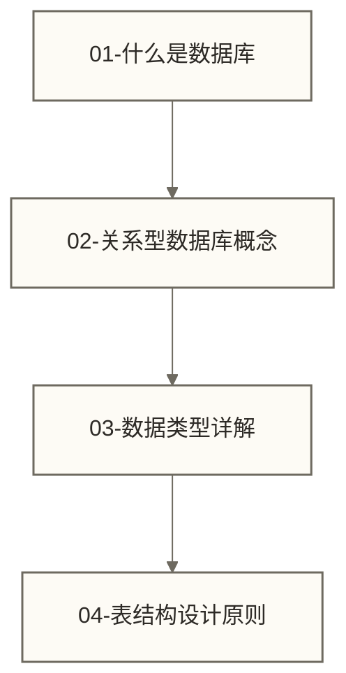
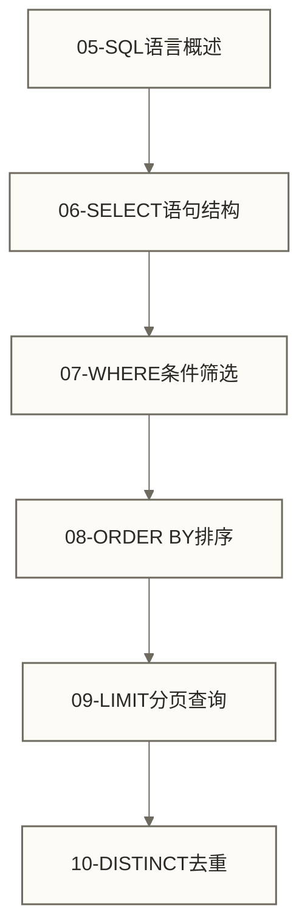
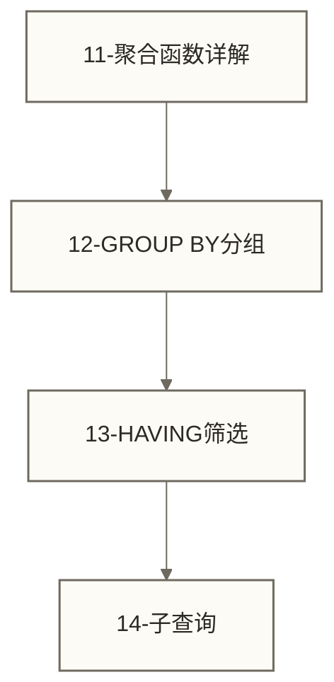
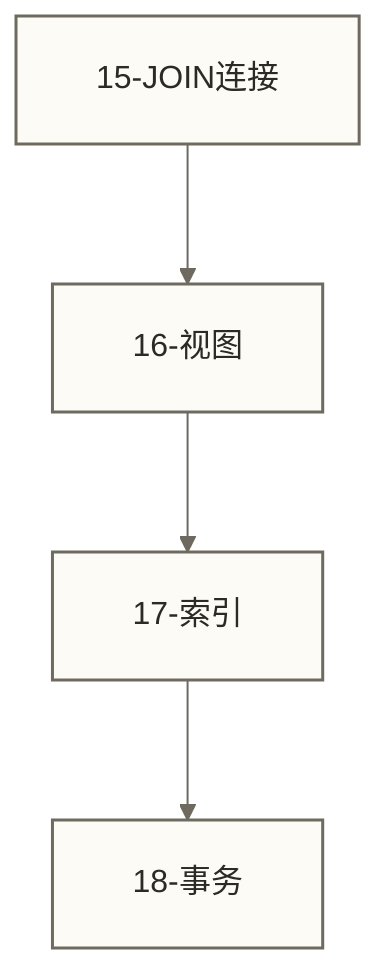
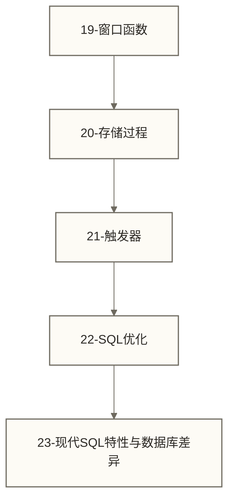
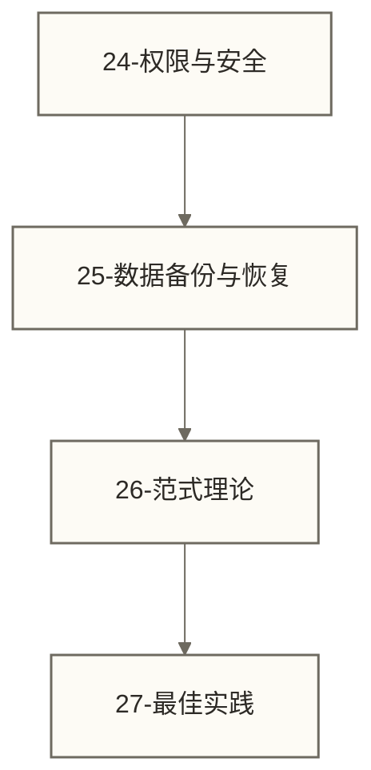
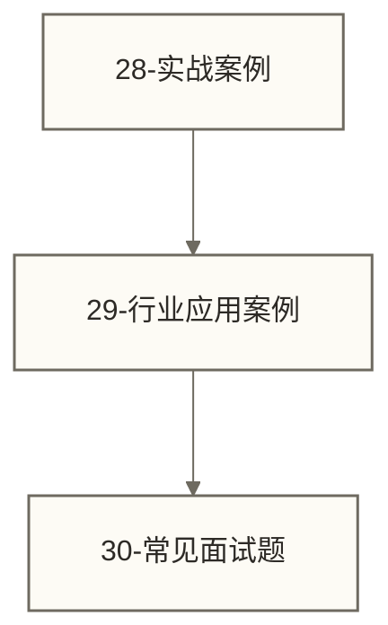

# SQL学习路线图 - 从零基础到精通的完整指南

> [!abstract] 学习路线概览
> 本路线图为SQL学习者提供系统性的技能发展路径，从数据库基础概念到企业级应用实践，涵盖理论基础、核心技术、性能优化和实际应用等关键领域。
>
> **适用群体**：数据分析师、后端开发工程师、数据工程师、在校学生
> **学习周期**：建议3-6个月系统性学习
> **技能收获**：数据查询分析、数据库设计、性能调优、企业级应用开发

## 2026更新：AI时代SQL学习入口

Text-to-SQL 和分析 Agent 正在改变 SQL 的使用方式，但没有降低 SQL 的重要性。SQL 现在更像“数据结论的审计语言”：你要能判断 AI 写出的查询是否口径正确、粒度正确、权限正确。

新增学习入口：

- [[【学习路线】/AI时代数据人/12-AI时代SQL能力地图|AI时代SQL能力地图]]：先建立 AI 时代 SQL 的能力分层。
- [[【技术与工具】/SQL/33-AI时代分析SQL实战|AI时代分析SQL实战]]：用留存、漏斗、Cohort、分层、异常定位练习业务模板。
- [[【AI 与大数据】/06-行业应用/03-Text-to-SQL自然语言查询实战|Text-to-SQL自然语言查询实战]]：理解自然语言查询的工程链路。
- [[【数据开发与数据架构】/07-数据服务架构/09-语义层工程实践|语义层工程实践]]：理解为什么指标口径要被系统化管理。

> [!important] 新标准
> SQL 学到“会写”还不够；要学到能审查 AI、能解释业务口径、能沉淀指标资产。

## 🎯 学习阶段划分

### 第一阶段：数据库理论基础（1-2周）
**学习目标**：建立数据库系统的理论基础，掌握关系模型和数据组织原理



**学习内容与技能要求**：
1. [[【技术与工具】/SQL/01-什么是数据库|什么是数据库]] ✅ **已优化** - 掌握DBMS架构、事务特性、企业级应用场景
2. [[【技术与工具】/SQL/02-关系型数据库概念|关系型数据库概念]] ✅ **已优化** - 理解关系代数、完整性约束、范式理论
3. [[【数据分析与数据运营】/98-专业术语词典/07-基础概念类/数据类型详解|数据类型]] ✅ **已优化** - 精通数据类型选择、存储优化、性能影响
4. [[【技术与工具】/SQL/04-表结构设计原则|表结构设计原则]] - 掌握规范化设计、索引策略、分区方案

> [!important] 第一阶段核心技能
> - **理论掌握**：数据库系统架构、关系模型理论、ACID特性
> - **实践能力**：数据类型选择、约束设计、简单表结构设计
> - **质量标准**：能够根据业务需求设计符合3NF的表结构
> - **时间投入**：每日1-2小时，重点理解概念和原理

---

### 第二阶段：SQL核心语法（2-3周）
**学习目标**：掌握SQL查询语言的核心语法，建立数据检索和处理的技术基础



**学习内容与技能要求**：
5. [[【技术与工具】/SQL/05-SQL语言概述|SQL语言]] ✅ **已优化** - 掌握SQL标准演进、DML/DDL/DCL分类
6. [[【技术与工具】/SQL/06-SELECT语句结构|SELECT语句结构]] ✅ **已优化** - 精通SELECT语法、执行顺序、查询优化器原理
7. [[【技术与工具】/SQL/07-WHERE条件筛选|WHERE条件筛选]] ✅ **已优化** - 掌握条件表达式、逻辑运算、模式匹配
8. [[【技术与工具】/SQL/08-ORDER BY排序|ORDER BY排序]] ✅ **已优化** - 理解排序算法、索引利用、性能优化
9. [[【技术与工具】/SQL/09-LIMIT分页查询|LIMIT分页查询]] ✅ **已优化** - 掌握分页策略、游标分页、大数据处理
10. [[【技术与工具】/SQL/10-DISTINCT去重|DISTINCT去重]] ✅ **已优化** - 理解去重机制、性能影响、替代方案

> [!important] 第二阶段核心技能
> - **语法掌握**：SELECT完整语法结构、子句执行顺序、参数化查询
> - **实践能力**：复杂条件构建、结果集排序、高效分页实现
> - **质量标准**：能够编写高质量的单表查询和简单的业务报表
> - **性能意识**：开始关注查询效率和索引使用

---

### 第三阶段：数据聚合与分析（2-3周）
**学习目标**：掌握数据统计分析技术，理解聚合计算和复杂查询逻辑



**学习内容与技能要求**：
11. [[【技术与工具】/SQL/11-聚合函数详解|聚合函数]] ✅ **已优化** - 精通COUNT/SUM/AVG/MAX/MIN、NULL处理、性能优化
12. [[【技术与工具】/SQL/12-GROUP BY分组|GROUP BY分组]] ✅ **已优化** - 掌握分组机制、执行顺序、多字段分组
13. [[【技术与工具】/SQL/13-HAVING筛选|HAVING筛选]] ✅ **已优化** - 理解组级过滤、与WHERE区别、复合条件
14. [[【技术与工具】/Presto/10-JOIN优化与子查询|Presto/JOIN优化与子查询]] ✅ **已优化** - 掌握嵌套查询、相关子查询、性能优化策略

> [!important] 第三阶段核心技能
> - **聚合分析**：熟练使用聚合函数进行统计计算和数据汇总
> - **分组处理**：理解GROUP BY工作机制和HAVING筛选条件
> - **嵌套逻辑**：掌握子查询构建方法和执行优化技巧
> - **业务应用**：能够完成销售分析、用户统计等业务场景查询

---

### 第四阶段：多表关联与系统优化（3-4周）
**学习目标**：掌握复杂多表查询技术，理解数据库性能优化和事务管理



**学习内容与技能要求**：
15. [[【技术与工具】/SQL/15-JOIN连接|JOIN连接]] ✅ **已优化** - 掌握内连接、外连接、自连接、连接算法原理
16. [[【技术与工具】/Doris/11-物化视图应用|Doris/物化视图]] ✅ **已优化** - 理解视图机制、物化视图、权限管理、设计模式
17. [[【数据分析与数据运营】/98-专业术语词典/99-术语索引表|术语索引表]] - 辅助查阅术语，不作为数据库索引课程；B-Tree索引、复合索引与执行计划分析可结合第22项及所选数据库环境学习和验证
18. [[【技术与工具】/PostgreSQL/07-PostgreSQL事务与并发控制|PostgreSQL/PostgreSQL事务与并发控制]] ✅ **已优化** - 掌握ACID特性、隔离级别、并发控制、锁机制

> [!important] 第四阶段核心技能
> - **关联查询**：熟练使用各种JOIN类型完成复杂业务查询
> - **视图设计**：理解视图的数据抽象和安全隔离作用
> - **性能优化**：掌握索引设计原理和查询优化策略
> - **事务管理**：理解并发控制和数据一致性保障机制

---

### 第五阶段：高级分析与数据库编程（4-5周）
**学习目标**：掌握高级SQL特性和数据库编程技术，具备复杂数据分析和系统优化能力



**学习内容与技能要求**：
19. [[【技术与工具】/Hive/11-窗口函数与分析|Hive/窗口函数与]] ✅ **已优化** - 精通排名函数、分析函数、移动窗口计算
20. [[【技术与工具】/Oracle/09-Oracle存储过程高级应用|Oracle/Oracle存储过程高级]] ✅ **已优化** - 掌握PL/SQL编程、参数处理、流程控制
21. [[【技术与工具】/Oracle/11-Oracle触发器应用|Oracle/Oracle触发器]] ✅ **已优化** - 理解触发器类型、事件处理、业务规则自动化
22. [[【技术与工具】/PostgreSQL/06-PostgreSQL索引与性能优化|PostgreSQL/PostgreSQL索引与性能优化]] - 掌握执行计划分析、索引策略、查询重写技术
23. [[【技术与工具】/SQL/23-现代SQL特性与数据库差异|现代SQL特性与数据库差异]] - 了解CTE、JSON处理、跨数据库兼容性

> [!important] 第五阶段核心技能
> - **高级分析**：熟练使用窗口函数进行复杂业务分析和数据计算
> - **数据库编程**：掌握存储过程和触发器的设计与实现
> - **性能调优**：能够分析执行计划并实施有效的优化策略
> - **技术选型**：理解不同数据库系统的特性差异和适用场景

---

### 第六阶段：企业级数据库管理（5-6周）
**学习目标**：掌握生产环境数据库管理技术，具备企业级数据库运维和治理能力



**学习内容与技能要求**：
24. [[【技术与工具】/SQL/24-权限与安全|权限与安全]] - 掌握用户权限管理、访问控制、数据加密技术
25. [[【技术与工具】/Hadoop/21-数据备份与恢复|Hadoop/数据备份与恢复]] - 了解Hadoop平台的备份策略、恢复机制和灾难恢复方案；该材料不替代所选关系数据库的备份恢复学习与演练
26. [[【技术与工具】/SQL/26-范式理论|范式理论]] - 深入掌握数据库规范化理论和反范式化策略
27. [[【技术与工具】/Python/16-数据可视化最佳实践|Python/数据可视化]] - 作为分析结果可视化的补充学习材料，不代表已覆盖数据库企业级开发规范和代码质量标准

> [!important] 第六阶段核心技能
> - **安全管理**：建立完整的数据库安全体系和权限控制机制
> - **运维管理**：掌握备份恢复、监控告警、性能调优等运维技能
> - **设计规范**：能够基于范式理论进行高质量的数据库架构设计
> - **工程实践**：遵循企业级开发标准，具备团队协作和代码管理能力

---

### 第七阶段：实战项目与技能验证（持续学习）
**学习目标**：通过实际项目巩固技能，达到企业级应用水平和面试要求



**学习内容与技能要求**：
28. [[【数据分析与数据运营】/05-场景实战案例/00-目录导览|场景实战案例/目录导览]] - 完成完整的业务场景分析和数据处理项目
29. [[【技术与工具】/SQL/29-行业应用案例|行业应用案例]] - 掌握电商、金融、互联网等行业的SQL应用特点
30. [[【技术与工具】/SQL/30-常见面试题|常见面试题]] - 具备通过数据分析师、后端工程师等岗位面试的能力

> [!important] 第七阶段核心技能
> - **项目实战**：能够独立完成复杂的数据分析项目和业务系统设计
> - **行业应用**：理解不同行业的数据特点和SQL应用场景
> - **面试能力**：具备扎实的SQL理论基础和丰富的实践经验
> - **持续学习**：建立自主学习能力，跟上技术发展趋势

---

## 📅 建议学习计划

### 🗓️ 全职学习计划（3个月）
```text
第1-2周：数据库基础 + SQL基础语法
第3-4周：数据聚合与分组 + 多表操作
第5-8周：高级特性与优化
第9-12周：企业级应用 + 实战项目
```

### 🗓️ 业余学习计划（6个月）
```text
第1-4周：数据库基础（每天1小时）
第5-12周：SQL基础语法（每天1-1.5小时）
第13-20周：数据聚合与多表操作（每天1.5小时）
第21-24周：高级特性与优化（重点难点，每天2小时）
```

## 🎯 学习检查点

### ✅ 基础阶段检查点
- [ ] 能够解释什么是数据库、表、字段、记录
- [ ] 能够设计一个包含3-5个表的简单数据库
- [ ] 熟练使用SELECT进行基本查询
- [ ] 掌握WHERE条件的各种写法

### ✅ 进阶阶段检查点
- [ ] 能够使用聚合函数进行数据统计
- [ ] 理解GROUP BY的分组逻辑
- [ ] 熟练使用各种JOIN进行多表查询
- [ ] 能够编写子查询解决复杂问题

### ✅ 高级阶段检查点
- [ ] 掌握窗口函数进行高级数据分析
- [ ] 理解索引的作用并能进行性能优化
- [ ] 能够分析执行计划并优化慢查询
- [ ] 了解不同数据库的特性差异

### ✅ 实战阶段检查点
- [ ] 完成至少3个完整的业务分析案例
- [ ] 能够独立设计数据库表结构
- [ ] 通过SQL面试题的90%以上
- [ ] 具备解决实际业务问题的能力

## 🚀 学习建议

### 💡 高效学习方法

> [!tip] 💡 学习技巧
> 1. **理论结合实践**：每学一个概念都要在数据库中实际操作验证
> 2. **循序渐进**：按阶段建立通用SQL基础，再根据目标数据库选择平台专属分支；不必依次完成所有平台条目，PL/SQL及各平台管理实践需在对应环境中学习
> 3. **多做练习**：每个阶段完成至少10道相关练习题巩固理解
> 4. **项目驱动**：选择一个真实业务场景（如电商、教育管理）贯穿整个学习过程
> 5. **思维导图**：每学完一个模块制作思维导图，建立知识体系
> 6. **错误记录**：建立错误笔记本，记录常见语法错误和解决方案
> 7. **社区交流**：加入SQL学习群或技术论坛，遇到问题及时求助
> 8. **定期复习**：按照艾宾浩斯遗忘曲线制定复习计划

### 🛠️ 推荐学习工具

**数据库选择**：
- **MySQL 8.0+**（推荐入门）：易于安装，社区支持好，企业应用广泛
- **PostgreSQL 13+**（推荐进阶）：功能强大，标准兼容性好，支持高级特性
- **SQLite**（轻量级练习）：无需安装服务器，适合快速实验和学习

**客户端工具**：
- **DBeaver**（推荐）：免费开源，支持多种数据库，功能丰富
- **MySQL Workbench**：MySQL官方工具，设计和管理功能完善
- **pgAdmin**：PostgreSQL专用管理工具
- **DataGrip**：JetBrains出品，付费但体验极佳

**在线学习平台**：
- **LeetCode数据库题库**：面试必备，题目质量高
- **HackerRank SQL**：从基础到高级的完整练习体系
- **SQLBolt**：交互式SQL教程，适合初学者
- **W3Schools SQL**：基础语法学习和在线练习

**示例数据库**：
- **Northwind**：经典商务数据库，包含订单、客户、产品等表
- **Sakila**：视频租赁店数据库，MySQL官方示例
- **Chinook**：音乐商店数据库，支持多种数据库系统
- **HR Schema**：Oracle经典人力资源数据库

### 📚 补充学习资源

**官方文档与教程**：
- **MySQL官方文档**：https://dev.mysql.com/doc/ - 权威的语法参考和最佳实践
- **PostgreSQL官方教程**：https://www.postgresql.org/docs/ - 详细的功能说明和示例
- **SQL标准文档**：理解ANSI SQL标准，掌握跨数据库通用语法

**视频课程与在线教育**：
- **慕课网SQL实战课程**：系统化的项目驱动学习
- **极客时间MySQL实战课程**：深入数据库内核和性能优化
- **Coursera数据库专项课程**：斯坦福大学等名校课程

**实战项目与开源资源**：
- **GitHub SQL练习项目**：搜索"sql-practice"、"sql-exercises"等关键词
- **Kaggle数据集**：使用真实业务数据进行SQL分析实践
- **企业级开源项目**：研究电商、CRM等系统的数据库设计

**技术社区与问答**：
- **Stack Overflow**：SQL标签下的高质量问答
- **掘金、CSDN**：中文技术社区的SQL专栏
- **Reddit r/SQL**：国际SQL学习者交流平台

---

## 🔗 相关技术知识库

掌握SQL基础后，建议学习以下相关技术：

### 📊 数据库系统
- **[[【技术与工具】/MySQL/00-MySQL学习路线图|MySQL/MySQL]]** - 最流行的开源关系数据库
- **[[【技术与工具】/PostgreSQL/00-PostgreSQL学习路线图|PostgreSQL/PostgreSQL]]** - 功能强大的开源数据库
- **[[【技术与工具】/Oracle/00-Oracle学习路线图|Oracle/Oracle]]** - 企业级数据库解决方案
- **[[【技术与工具】/HBase/00-HBase学习路线图|HBase/HBase]]** - NoSQL分布式数据库

### 🚀 大数据与分析平台
- **[[【技术与工具】/Spark/00-Spark学习路线图|Spark/Spark]]** - 大数据分析SQL引擎
- **[[【技术与工具】/Hive/00-Hive学习路线图|Hive/Hive]]** - Hadoop生态数据仓库
- **[[【技术与工具】/ClickHouse/00-ClickHouse学习路线图|ClickHouse/ClickHouse]]** - 高性能OLAP分析数据库
- **[[【技术与工具】/Presto/00-Presto学习路线图|Presto/Presto]]** - 交互式查询引擎
- **[[【技术与工具】/Impala/00-Impala学习路线图|Impala/Impala]]** - 高速SQL查询引擎

### 💻 编程语言与数据科学
- **[[【技术与工具】/Python/00-Python学习路线图|Python/Python]]** - 数据分析和机器学习语言
- **[[【技术与工具】/PostgreSQL/00-PostgreSQL学习路线图|PostgreSQL/PostgreSQL]]** - 可用于数据存储、SQL查询与分析的开源关系数据库系统
- **[[【技术与工具】/统计学/偏度与峰度|统计学/偏度与峰度]]** - 数据分析的数学基础

### 🏗️ 数据平台与架构
- **[[【技术与工具】/Hadoop/00-Hadoop学习路线图|Hadoop/Hadoop]]** - 分布式计算基础平台
- **[[【技术与工具】/Kafka/00-Kafka学习路线图|Kafka/Kafka]]** - 流式数据处理平台
- **[[【技术与工具】/Flink/00-Flink学习路线图|Flink/Flink]]** - 实时计算引擎

---

## 技能成果与职业发展

以下是整个学习路线的核心技能目标，是否达成需结合练习、项目及所选数据库环境中的实际表现判断：

**技术能力矩阵**：
- **数据查询分析**：熟练使用SQL进行复杂业务数据查询和统计分析
- **数据库设计**：基于范式理论设计高质量的数据库架构和表结构
- **性能优化**：识别性能瓶颈并实施有效的索引和查询优化策略
- **数据库管理**：掌握企业级数据库运维、安全管理和灾难恢复
- **业务应用**：能够独立完成复杂的数据分析项目和业务系统设计

**适用职业方向**：
- 数据分析师 / 数据科学家
- 数据库管理员 / 数据工程师
- 后端开发工程师
- 产品经理 / 业务分析师
- BI 开发工程师

---

## 🔗 快速导航

**开始学习**：[[【技术与工具】/SQL/01-什么是数据库|什么是数据库]]
**核心语法**：[[【技术与工具】/SQL/06-SELECT语句结构|SELECT语句结构]]
**高级特性**：[[【技术与工具】/Hive/11-窗口函数与分析|Hive/窗口函数与]]
**性能优化**：[[【技术与工具】/PostgreSQL/06-PostgreSQL索引与性能优化|PostgreSQL/PostgreSQL索引与性能优化]]
**实战练习**：[[【数据分析与数据运营】/05-场景实战案例/00-目录导览|场景实战案例/目录导览]]
**面试准备**：[[【技术与工具】/SQL/30-常见面试题|常见面试题]]

---

**创建时间**：2024-06-29
**最后更新**：2026-05-18
**学习周期**：3-6个月系统性学习

#SQL #学习路线 #技能发展 #数据库技术 #数据分析 #职业发展
