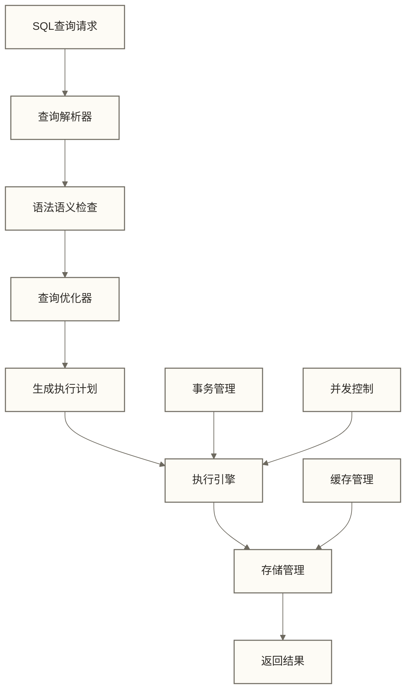

# 数据库基础概念 - 现代信息系统的数据管理核心

> [!tip] 学习目标
> 
> 本文将帮您建立对数据库技术的系统性认知，掌握数据库的核心概念和技术原理。
> 
> **核心内容**：
> - 数据库的技术定义和基本概念
> - 数据库管理系统（DBMS）的工作原理
> - 关系型与非关系型数据库对比分析
> - 企业级数据库选型的关键考虑因素
> 
> **学习价值**：数据库技术是现代企业信息系统的基础设施，掌握这些概念对数据从业者至关重要。

> [!abstract] 本节概览
> - **学习目标**：掌握数据库的技术定义和核心概念
> - **技能价值**：理解现代信息系统的数据管理架构
> - **预计用时**：20分钟
> - **学习成果**：具备数据库技术选型的基础认知能力
> - **应用前景**：为深入学习数据库技术奠定理论基础

## 数据库的技术定义

### 核心概念定义

**数据库（Database, DB）**：按照特定数据模型组织、存储和管理的相关数据集合，是长期储存在计算机内、有组织的、可共享的大量数据的集合。

> [!note] 生活化理解
> 把数据库想象成一个超级智能的图书馆。这个图书馆不仅能存放大量的书籍（数据），还有完善的分类系统（数据模型）、检索目录（索引）和借阅规则（约束条件），让人们能快速找到需要的信息。

**数据库管理系统（Database Management System, DBMS）**：专门用于建立和管理数据库的系统软件，介于用户与操作系统之间的一层数据管理软件。

> [!note] 生活化理解
> DBMS就像图书馆的管理系统，包括图书管理员、借阅系统、安全系统等。它负责处理所有与数据库相关的操作，确保数据的安全性、一致性和高效访问。

**数据库系统（Database System, DBS）**：由数据库、数据库管理系统、应用程序和数据库管理员组成的存储、管理、处理和维护数据的系统。

> [!note] 生活化理解
> 数据库系统就是完整的图书馆生态系统：包括图书馆建筑（硬件）、管理系统（DBMS）、图书（数据）、读者应用（应用程序）和管理员（DBA）。

### 数据库的基本特征

**数据结构化**：数据按照特定的数据模型进行组织，具有明确的结构和关系。

**数据共享性**：多个用户和应用程序可以同时访问和使用同一数据资源。

**数据独立性**：物理数据独立性指物理存储方式的变化通常无需修改应用程序；逻辑数据独立性指在保持应用所依赖的外部视图或接口兼容时，部分逻辑结构变化可以不影响应用程序，并非所有数据结构变化都对应用透明。

**数据完整性**：通过约束条件确保数据的准确性、一致性和有效性。

**并发控制**：支持多用户同时操作，通过锁机制和事务管理保证数据一致性。

**故障恢复**：具备数据备份和恢复机制，确保系统故障时数据的安全性。

## 数据库管理系统（DBMS）工作原理

### DBMS核心组件

**数据定义语言（DDL）**：用于定义数据库结构、表结构、索引等对象
```sql
CREATE TABLE users (
    id INT PRIMARY KEY,
    name VARCHAR(50) NOT NULL,
    email VARCHAR(100) UNIQUE
);
```

**数据操纵语言（DML）**：用于数据的增删改查操作
```sql
-- 插入数据
INSERT INTO users (id, name, email) VALUES (1, '张三', 'zhang@example.com');
-- 查询数据
SELECT * FROM users WHERE name = '张三';
```

**数据控制语言（DCL）**：用于控制数据访问权限
```sql
-- 授予权限
GRANT SELECT, INSERT ON users TO user_role;
-- 撤销权限
REVOKE DELETE ON users FROM user_role;
```

### DBMS处理流程



**处理步骤详解**：
1. **查询解析**：解析SQL语句，检查语法和语义合法性
2. **查询优化**：分析多种执行方案，选择成本最低的执行计划
3. **执行引擎**：按照最优执行计划访问存储数据
4. **存储管理**：管理数据的物理存储、缓存和I/O操作
5. **事务管理**：保证ACID特性（原子性、一致性、隔离性、持久性）
6. **并发控制**：通过锁机制处理多用户并发访问冲突

### 企业级应用场景

**交易处理系统**：银行转账、电商订单处理等高并发业务场景
- 要求：高可用性、强一致性、低延迟
- 典型选择：Oracle、MySQL、PostgreSQL

**数据分析系统**：商业智能、数据仓库等分析型业务场景  
- 要求：高吞吐量、复杂查询优化、历史数据管理
- 典型选择：ClickHouse、Apache Doris、Amazon Redshift

## 关系型与非关系型数据库对比

### 关系型数据库（RDBMS）

**技术特点**：
- 基于关系模型，数据以表格形式存储
- 支持ACID事务特性
- 使用SQL作为标准查询语言
- 具有严格的数据结构约束

**适用场景**：
- 金融交易系统：银行转账、证券交易
- 企业资源规划（ERP）：财务管理、人力资源
- 客户关系管理（CRM）：客户信息、销售记录

**主流产品**：
| 产品 | 特点 | 典型应用 |
|------|------|----------|
| **MySQL** | 开源、轻量级、成本低 | Web应用、中小企业 |
| **PostgreSQL** | 功能丰富、扩展性强 | 地理信息系统、科学计算 |
| **Oracle** | 企业级、高性能、高可用 | 大型企业、关键业务系统 |
| **SQL Server** | 微软生态、易于管理 | Windows环境、企业应用 |

### 非关系型数据库（NoSQL）

**技术分类**：

**文档数据库**（Document Database）
- 代表产品：MongoDB、CouchDB
- 数据存储：JSON/BSON文档格式
- 适用场景：内容管理、产品目录、用户配置

```json
// MongoDB文档示例
{
  "_id": "user123",
  "name": "张三",
  "profile": {
    "age": 30,
    "interests": ["阅读", "旅行", "编程"]
  },
  "orders": [
    {"id": "order001", "amount": 299.99, "date": "2024-01-15"}
  ]
}
```

**键值数据库**（Key-Value Database）
- 代表产品：Redis、DynamoDB、Memcached
- 数据存储：简单的键值对
- 适用场景：缓存系统、会话存储、实时推荐

**列族数据库**（Column Family）
- 代表产品：Cassandra、HBase
- 数据存储：按列存储，适合稀疏数据
- 适用场景：时间序列数据、日志分析、IoT数据

**图数据库**（Graph Database）
- 代表产品：Neo4j、Amazon Neptune
- 数据存储：节点和边的图结构
- 适用场景：社交网络、推荐系统、知识图谱

## 企业级数据库选型考虑因素

### 性能要求分析

**并发处理能力**
- 读写QPS要求：评估系统的查询和写入频率
- 响应时间要求：确定可接受的延迟范围
- 峰值处理能力：考虑业务高峰期的负载

**数据规模评估**
- 当前数据量：现有数据的存储需求
- 增长预期：未来3-5年的数据增长预测
- 查询复杂度：简单查询vs复杂分析查询

### 业务特性匹配

**事务处理要求**
```sql
-- 银行转账事务示例
BEGIN TRANSACTION;
UPDATE accounts SET balance = balance - 1000 WHERE account_id = 'A001';
UPDATE accounts SET balance = balance + 1000 WHERE account_id = 'B002';
INSERT INTO transactions (from_account, to_account, amount, timestamp) 
VALUES ('A001', 'B002', 1000, NOW());
COMMIT;
```

**数据一致性需求**
- 强一致性：金融交易、订单处理
- 最终一致性：社交媒体、内容分发
- 弱一致性：日志记录、统计分析

### 技术生态考量

**开发团队技能**
- SQL熟练程度：团队对关系型数据库的掌握
- 新技术学习成本：NoSQL技术的学习投入
- 运维管理经验：数据库维护和优化能力

**系统集成要求**
- 现有技术栈：与当前系统的兼容性
- 第三方工具：监控、备份、分析工具支持
- 云服务集成：公有云、私有云部署需求

### 成本效益分析

**软件许可成本**
- 开源vs商业软件
- 按CPU核心数计费
- 按存储容量计费

**硬件资源需求**
- 计算资源：CPU、内存规格要求
- 存储资源：磁盘类型、容量需求
- 网络资源：带宽、延迟要求

**运维管理成本**
- 人员培训费用
- 系统监控和维护
- 数据备份和恢复

## 实践操作：数据库环境搭建

### MySQL环境配置
```sql
-- 创建业务数据库（电商示例）
-- 使用utf8mb4字符集支持emoji和多语言
-- 电商业务数据库
CREATE DATABASE ecommerce_db 
CHARACTER SET utf8mb4 
COLLATE utf8mb4_unicode_ci;

-- 切换到业务数据库
USE ecommerce_db;

-- 创建用户表
CREATE TABLE users (
    user_id INT AUTO_INCREMENT PRIMARY KEY COMMENT '用户唯一标识',
    username VARCHAR(50) NOT NULL UNIQUE COMMENT '用户名，全局唯一',
    email VARCHAR(100) NOT NULL UNIQUE COMMENT '邮箱地址，用于登录',
    phone VARCHAR(20) COMMENT '手机号码',
    status TINYINT DEFAULT 1 COMMENT '用户状态：1-正常，0-禁用',
    created_at TIMESTAMP DEFAULT CURRENT_TIMESTAMP COMMENT '创建时间',
    updated_at TIMESTAMP DEFAULT CURRENT_TIMESTAMP ON UPDATE CURRENT_TIMESTAMP COMMENT '更新时间'
) ENGINE=InnoDB COMMENT '用户基础信息表';

-- email和username的UNIQUE已建立相应唯一索引，无需再建同列普通索引
-- 状态+创建时间复合索引示例；是否需要应结合实际查询与执行计划
CREATE INDEX idx_users_status_created ON users(status, created_at);
```

### 权限管理配置
```sql
-- 创建应用程序用户
CREATE USER 'app_user'@'%' IDENTIFIED BY 'secure_password';

-- 授予必要权限
GRANT SELECT, INSERT, UPDATE, DELETE ON ecommerce_db.* TO 'app_user'@'%';

-- 创建只读用户（用于报表和分析）
CREATE USER 'readonly_user'@'%' IDENTIFIED BY 'readonly_password';
GRANT SELECT ON ecommerce_db.* TO 'readonly_user'@'%';

-- 刷新权限
FLUSH PRIVILEGES;
```

## 知识连接

- [[【技术与工具】/SQL/02-关系型数据库概念|关系型数据库概念]]：深入理解关系模型理论
- [[【技术与工具】/SQL/05-SQL语言概述|SQL语言]]：学习结构化查询语言
- 分布式数据库设计：了解大规模数据存储架构

## 学习检验

**理论掌握检验**：
- [ ] 能够准确定义数据库、DBMS、DBS的概念和区别
- [ ] 理解ACID事务特性的含义和重要性
- [ ] 掌握关系型和非关系型数据库的技术特点
- [ ] 了解企业级数据库选型的关键考虑因素

**实践能力检验**：
- [ ] 能够创建数据库和基本表结构
- [ ] 掌握用户权限管理的基本操作
- [ ] 能够根据业务需求选择合适的数据库类型

## 总结要点

**核心概念**：
- 数据库是按特定模型组织的数据集合，DBMS是管理数据库的系统软件
- 数据库系统具有结构化、共享性、独立性、完整性等基本特征
- DBMS通过DDL、DML、DCL提供完整的数据管理功能

**技术选型**：
- 关系型数据库适用于事务处理和结构化数据管理
- 非关系型数据库适用于大规模、高并发、灵活schema的场景
- 数据库选型需要综合考虑性能、业务、技术、成本等多个维度

#SQL #数据库 #DBMS #技术选型

**下一步学习路径**：
- [[【技术与工具】/SQL/02-关系型数据库概念|关系型数据库概念]] - 深入理解关系模型理论基础
- [[【数据分析与数据运营】/98-专业术语词典/07-基础概念类/数据类型详解|数据类型]] - 掌握数据类型选择和存储优化
- [[【技术与工具】/SQL/04-表结构设计原则|表结构设计原则]] - 学习数据库结构设计最佳实践

**扩展学习**：
- [[【技术与工具】/MySQL/01-MySQL介绍与特性|MySQL/MySQL介绍与特性]] - 学习最流行的开源数据库
- 数据库选型与架构设计 - 企业级数据库架构设计