# SQL数据类型系统 - 数据存储与性能优化的技术基础

> [!tip] 学习目标
> 
> 本文将深入介绍SQL数据类型系统，包括各种数据类型的技术特性、存储机制、性能影响以及在不同数据库系统中的差异。
> 
> **核心内容**：
> - SQL标准数据类型体系与分类原理
> - 各主流数据库的数据类型实现差异
> - 数据类型选择对性能和存储的影响
> - 企业级数据建模中的类型选择策略
> 
> **学习价值**：正确的数据类型选择是数据库性能优化和存储效率的基础，对数据库设计至关重要。

> [!abstract] 本节概览
> - **学习目标**：掌握SQL数据类型系统和选择策略
> - **技能价值**：具备数据库性能优化的基础能力
> - **预计用时**：30分钟
> - **学习成果**：能够根据业务需求选择最优数据类型
> - **应用前景**：为数据库设计和优化提供技术支撑

## SQL标准数据类型体系

### 数据类型分类原理

**数据类型（Data Type）**：定义数据的存储格式、取值范围、支持的操作以及占用的存储空间的规范。

**常见SQL数据类型分类（包含不同数据库的扩展类型，并非全部属于SQL-92）**：

```mermaid
%%{init: {"theme":"base","themeVariables":{"fontFamily":"PingFang SC, -apple-system, Source Han Serif SC, serif","fontSize":"16px","background":"#FDFBF5","primaryColor":"#FDFBF5","primaryTextColor":"#2D2A26","primaryBorderColor":"#6E6A60","secondaryColor":"#E8EFE8","secondaryBorderColor":"#8FA890","secondaryTextColor":"#2D2A26","tertiaryColor":"#FDFBF5","tertiaryBorderColor":"#9A9488","tertiaryTextColor":"#6E6A60","lineColor":"#6E6A60","textColor":"#2D2A26","mainBkg":"#FDFBF5","nodeBorder":"#2D5A3D","clusterBkg":"#F3EEDF","clusterBorder":"#9A9488","edgeLabelBackground":"#FDFBF5"},"flowchart":{"htmlLabels":true,"curve":"basis","padding":20,"nodeSpacing":60,"rankSpacing":70,"useMaxWidth":false},"themeCSS":".node rect, .node polygon, .node circle { stroke-width: 1.5px; } .edgePath .path { stroke-width: 1.5px; } .cluster-label .nodeLabel, .cluster-label foreignObject { color: #2D2A26 !important; } .edgeLabel, .edgeLabel foreignObject { color: #2D2A26 !important; background-color: #FDFBF5; } .edgeLabel rect { fill: #FDFBF5; }"}}%%
graph TD
    classDef default fill:#FDFBF5,stroke:#6E6A60,color:#2D2A26,stroke-width:1.5px
    classDef startend fill:#2D2A26,stroke:#2D2A26,color:#FDFBF5,font-weight:bold
    classDef decision fill:#F6EAD8,stroke:#C08A1A,color:#2D2A26,font-weight:bold
    classDef hub fill:#3B5A80,stroke:#3B5A80,color:#FDFBF5,font-weight:bold
    classDef io fill:#E5EAF0,stroke:#3B5A80,color:#2D2A26
    classDef accent fill:#A6432C,stroke:#A6432C,color:#FDFBF5,font-weight:bold
    classDef storage fill:#F3EEDF,stroke:#9A9488,color:#2D2A26
    A[SQL数据类型] --> B[精确数值类型]
    A --> C[近似数值类型]
    A --> D[字符串类型]
    A --> E[日期时间类型]
    A --> F[二进制类型]
    A --> G[布尔类型]
    A --> H[复合类型]
    
    B --> B1[INTEGER/INT]
    B --> B2[SMALLINT]
    B --> B3[BIGINT]
    B --> B4[DECIMAL/NUMERIC]
    
    C --> C1[REAL]
    C --> C2[DOUBLE PRECISION]
    C --> C3[FLOAT]
    
    D --> D1[CHAR]
    D --> D2[VARCHAR]
    D --> D3[TEXT/CLOB]
    
    E --> E1[DATE]
    E --> E2[TIME]
    E --> E3[TIMESTAMP]
    E --> E4[INTERVAL]
    class A,B,C,D,E,F,G,H,B1,B2,B3,B4,C1,C2,C3,D1,D2,D3,E1,E2,E3,E4 default
```



## 数值类型详解

### 整数类型（Integer Types）

**技术特性对比**：

| 类型 | MySQL存储空间 | PostgreSQL存储 | 取值范围 | 适用场景 |
|------|---------------|----------------|----------|----------|
| TINYINT | 1字节 | - | -128 ~ 127 | 状态码、枚举值 |
| SMALLINT | 2字节 | 2字节 | -32,768 ~ 32,767 | 年龄、数量 |
| MEDIUMINT | 3字节 | - | -8,388,608 ~ 8,388,607 | 中等规模ID |
| INT/INTEGER | 4字节 | 4字节 | -2,147,483,648 ~ 2,147,483,647 | 主键、用户ID |
| BIGINT | 8字节 | 8字节 | -9,223,372,036,854,775,808 ~ 9,223,372,036,854,775,807 | 大规模ID、金额 |

**实际应用示例（MySQL方言）**：

本文MySQL示例中的CHECK约束需要MySQL 8.0.16或更高版本才会实际执行；在更早版本中，不能依赖这些声明阻止违反条件的数据写入。FLOAT(M,D)和DOUBLE(M,D)是MySQL旧式非标准声明，不应视为跨数据库通用写法。

```sql
-- 电商系统数据类型选择
CREATE TABLE ecommerce_entities (
    -- 用户ID：预计千万级别用户
    user_id BIGINT UNSIGNED AUTO_INCREMENT PRIMARY KEY,
    
    -- 商品ID：预计百万级别商品
    product_id INT UNSIGNED NOT NULL,
    
    -- 订单数量：通常不超过1000
    quantity SMALLINT UNSIGNED DEFAULT 1 CHECK (quantity > 0),
    
    -- 商品状态：有限枚举值
    status TINYINT UNSIGNED DEFAULT 1 COMMENT '1:正常 2:下架 3:删除',
    
    -- 创建年份：用于分区
    created_year SMALLINT UNSIGNED NOT NULL
);
```

**性能优化考量**：

```sql
-- 优化前：使用过大的数据类型
CREATE TABLE users_inefficient (
    user_id BIGINT,           -- 浪费4字节
    age BIGINT,              -- 浪费7字节
    status VARCHAR(50)       -- 浪费大量空间
);

-- 优化后：精确选择数据类型
CREATE TABLE users_optimized (
    user_id INT UNSIGNED,         -- 节省4字节，支持42亿用户
    age TINYINT UNSIGNED,         -- 节省7字节，0-255范围足够
    status ENUM('active', 'inactive', 'suspended')  -- 有限枚举可减少值的存储空间；查询性能取决于索引和负载
);

-- 存储空间对比
-- 简化假设：忽略长度信息、NULL位图及行存储开销，并假设原status值占50字节
-- users_inefficient字段值负载估算：8 + 8 + 50 = 66字节
-- users_optimized字段值负载估算：4 + 1 + 1 = 6字节
-- 在上述假设下字段值负载减少约90.9%，不代表实际每行或整表节省比例
```

### 精确数值类型（Exact Numeric Types）

**DECIMAL/NUMERIC类型特性**：

```sql
-- 金融系统精确数值处理
CREATE TABLE financial_transactions (
    transaction_id BIGINT PRIMARY KEY AUTO_INCREMENT,
    
    -- 交易金额：最大999,999,999.99，精确到分
    amount DECIMAL(11,2) NOT NULL CHECK (amount > 0),
    
    -- 汇率：精确到小数点后6位
    exchange_rate DECIMAL(10,6) NOT NULL,
    
    -- 手续费率：百分比，精确到小数点后4位
    fee_rate DECIMAL(6,4) DEFAULT 0.0000,
    
    -- 计算结果示例
    converted_amount DECIMAL(15,2) GENERATED ALWAYS AS (amount * exchange_rate) STORED
);

-- 插入示例数据
INSERT INTO financial_transactions (amount, exchange_rate, fee_rate) VALUES
(1000.50, 6.8945, 0.0025),  -- 人民币转美元
(50000.00, 0.1451, 0.0030); -- 日元转人民币
```

**浮点数类型的使用场景**：

```sql
-- 科学计算和统计分析场景
CREATE TABLE scientific_data (
    experiment_id INT PRIMARY KEY,
    
    -- 温度测量：FLOAT精度足够
    temperature FLOAT(7,2),  -- MySQL旧式声明：共7位，其中2位小数；声明范围为-99999.99 ~ 99999.99，存储仍为近似值
    
    -- 坐标近似值：使用DOUBLE；实际定位精度取决于数据来源
    latitude DOUBLE(10,8),   -- 小数位声明不保证实际定位达到米级精度
    longitude DOUBLE(11,8),
    
    -- 计算密集型数据：性能优先
    calculation_result DOUBLE NOT NULL
);
```

## 字符串类型详解

### 字符串类型选择策略

**固定长度 vs 可变长度**：

```sql
-- 字符串类型性能对比测试
CREATE TABLE string_performance_test (
    id INT PRIMARY KEY,
    
    -- 固定长度：适合长度固定的数据
    country_code CHAR(2),        -- ISO国家代码，始终2位
    phone_prefix CHAR(4),        -- 电话区号，固定4位
    
    -- 可变长度：适合长度变化的数据
    username VARCHAR(50),        -- 用户名，5-50字符
    email VARCHAR(320),          -- 邮箱地址，最大320字符
    description TEXT,            -- 商品描述，长度不固定
    
    -- 性能分析
    INDEX idx_country (country_code),      -- 是否有效加速取决于选择性、查询条件和执行计划
    INDEX idx_username (username(20))      -- VARCHAR部分索引优化
);
```

**字符集和排序规则选择**：

```sql
-- 多语言支持的电商平台
CREATE TABLE multilingual_products (
    product_id INT PRIMARY KEY,
    
    -- 产品名称：支持多语言，使用UTF8MB4
    name VARCHAR(200) CHARACTER SET utf8mb4 COLLATE utf8mb4_unicode_ci,
    
    -- SKU编码：仅英数字，使用Latin1节省空间
    sku VARCHAR(50) CHARACTER SET latin1 COLLATE latin1_general_ci,
    
    -- 描述：支持emoji，使用UTF8MB4
    description TEXT CHARACTER SET utf8mb4 COLLATE utf8mb4_unicode_ci,
    
    -- 全文搜索索引
    FULLTEXT KEY ft_name_desc (name, description)
);

-- 字符集存储空间对比
-- latin1: 1字节/字符
-- utf8: 1-3字节/字符  
-- utf8mb4: 1-4字节/字符
```

### 文本搜索优化

```sql
-- 全文搜索功能实现
CREATE TABLE articles (
    article_id INT PRIMARY KEY AUTO_INCREMENT,
    title VARCHAR(500) NOT NULL,
    content LONGTEXT NOT NULL,
    tags VARCHAR(1000),
    
    -- 创建全文索引
    FULLTEXT(title, content, tags)
) ENGINE=InnoDB;

-- 高效的全文搜索查询
SELECT article_id, title,
       MATCH(title, content, tags) AGAINST('数据库优化' IN BOOLEAN MODE) as relevance_score
FROM articles 
WHERE MATCH(title, content, tags) AGAINST('数据库 +优化 -删除' IN BOOLEAN MODE)
ORDER BY relevance_score DESC
LIMIT 20;
```

## 日期时间类型详解

### 日期时间类型特性

**类型对比与选择（以下为MySQL；时间范围按通常的有效值范围描述）**：

表中TIME、DATETIME和TIMESTAMP的字节数按MySQL 5.6.4起的存储格式、无小数秒精度计算；指定小数秒精度1—2、3—4、5—6时分别额外占用1、2、3字节。旧格式DATETIME为8字节。

| 类型 | 存储空间 | 时区支持 | 精度 | 范围 | 适用场景 |
|------|----------|----------|------|------|----------|
| DATE | 3字节 | 无 | 日 | 1000-01-01 ~ 9999-12-31 | 生日、日期 |
| TIME | 3字节 | 无 | 秒 | -838:59:59 ~ 838:59:59 | 营业时间 |
| DATETIME | 5字节（无小数秒，现代格式） | 无 | 秒，可指定小数秒精度 | 1000-01-01 00:00:00 ~ 9999-12-31 23:59:59 | 创建时间 |
| TIMESTAMP | 4字节 | 有 | 秒 | 1970-01-01 00:00:01 ~ 2038-01-19 03:14:07 | 日志记录 |

**企业级时间处理方案**：

```sql
-- 全球化应用的时间管理
CREATE TABLE global_events (
    event_id BIGINT PRIMARY KEY AUTO_INCREMENT,
    
    -- 事件发生的本地时间（不含时区信息）
    local_datetime DATETIME NOT NULL,
    
    -- UTC标准时间（含时区转换）
    utc_timestamp TIMESTAMP DEFAULT CURRENT_TIMESTAMP,
    
    -- 事件日期（用于按日统计）
    event_date DATE GENERATED ALWAYS AS (DATE(local_datetime)) STORED,
    
    -- 事件小时（用于按小时统计）
    event_hour TINYINT GENERATED ALWAYS AS (HOUR(local_datetime)) STORED,
    
    -- 时区信息（单独存储）
    timezone_offset SMALLINT COMMENT '时区偏移分钟数',
    
    -- 索引优化
    KEY idx_date_hour (event_date, event_hour),
    KEY idx_utc_timestamp (utc_timestamp)
);

-- 时区转换查询示例
SELECT 
    event_id,
    local_datetime,
    utc_timestamp,
    -- 转换为指定时区
    CONVERT_TZ(utc_timestamp, '+00:00', '+08:00') AS beijing_time,
    CONVERT_TZ(utc_timestamp, '+00:00', '-05:00') AS fixed_minus_05_time
FROM global_events
WHERE event_date = '2024-12-11';
```

### 时间序列数据优化

```sql
-- 高频时间序列数据表设计
CREATE TABLE metrics_data (
    metric_id BIGINT AUTO_INCREMENT,
    
    -- 时间戳：秒级精度足够，使用TIMESTAMP节省空间
    recorded_at TIMESTAMP(0) DEFAULT CURRENT_TIMESTAMP,
    
    -- 设备ID：假设设备数量在百万级别
    device_id INT UNSIGNED NOT NULL,
    
    -- 指标值：使用适当精度的数值类型
    cpu_usage DECIMAL(5,2) CHECK (cpu_usage >= 0 AND cpu_usage <= 100),
    memory_usage BIGINT UNSIGNED, -- 字节数
    temperature FLOAT(4,1),       -- 温度，1位小数
    
    -- 复合主键优化查询
    PRIMARY KEY (device_id, recorded_at),
    
    -- 自增列必须作为某个索引的首列；该非唯一索引不额外保证metric_id全表唯一
    KEY idx_metric_id (metric_id),
    KEY idx_time (recorded_at)
) PARTITION BY RANGE (UNIX_TIMESTAMP(recorded_at)) (
    -- 使用固定UTC秒数，避免分区边界受建表会话时区影响
    PARTITION p202412 VALUES LESS THAN (1735689600),
    PARTITION p202501 VALUES LESS THAN (1738368000),
    PARTITION p202502 VALUES LESS THAN (1740787200),
    PARTITION p_future VALUES LESS THAN MAXVALUE
);
```

## 高级数据类型

### JSON数据类型

**MySQL 5.7+ JSON类型特性**：

```sql
-- 现代应用的灵活数据存储
CREATE TABLE user_profiles (
    user_id INT PRIMARY KEY,
    username VARCHAR(50) NOT NULL,
    
    -- JSON存储用户配置
    preferences JSON,
    
    -- JSON存储用户元数据
    metadata JSON,
    
    created_at TIMESTAMP DEFAULT CURRENT_TIMESTAMP,
    
    -- MySQL 5.7+：通过有界字符串生成列索引JSON标量；示例假设语言值不超过16字符
    preferred_language VARCHAR(16) GENERATED ALWAYS AS (JSON_UNQUOTE(JSON_EXTRACT(preferences, '$.language'))) STORED,
    INDEX idx_pref_lang (preferred_language)
);

-- 插入JSON数据
INSERT INTO user_profiles (user_id, username, preferences, metadata) VALUES
(1, 'alice', 
 '{"language": "zh-CN", "theme": "dark", "notifications": {"email": true, "sms": false}}',
 '{"registration_source": "mobile_app", "referrer": "google", "tags": ["vip", "early_adopter"]}'
),
(2, 'bob',
 '{"language": "en-US", "theme": "light", "notifications": {"email": false, "sms": true}}',
 '{"registration_source": "web", "last_login_device": "desktop"}'
);

-- JSON数据查询
SELECT 
    username,
    JSON_EXTRACT(preferences, '$.language') AS preferred_language,
    JSON_EXTRACT(preferences, '$.theme') AS theme,
    JSON_CONTAINS(JSON_EXTRACT(metadata, '$.tags'), '"vip"') AS is_vip
FROM user_profiles
WHERE JSON_EXTRACT(preferences, '$.notifications.email') = true;
```

### 数组和复合类型（PostgreSQL）

```sql
-- PostgreSQL特有的高级数据类型
CREATE TABLE product_catalog (
    product_id SERIAL PRIMARY KEY,
    name VARCHAR(200) NOT NULL,
    
    -- 数组类型：存储标签
    tags TEXT[],
    
    -- 数组类型：存储价格历史
    price_history DECIMAL(10,2)[],
    
    -- JSONB类型：更高效的JSON存储
    specifications JSONB,
    
    -- 几何类型：存储二维点坐标，不自带地理坐标系语义
    location POINT
);

-- PostgreSQL索引在建表后单独创建
CREATE INDEX idx_catalog_tags ON product_catalog USING gin (tags);
CREATE INDEX idx_catalog_specifications ON product_catalog USING gin (specifications);

-- 插入复杂数据
INSERT INTO product_catalog (name, tags, price_history, specifications, location) VALUES
('Smart Phone X', 
 ARRAY['electronics', 'mobile', '5G'],
 ARRAY[999.99, 899.99, 799.99],
 '{"screen": {"size": 6.1, "resolution": "2532x1170"}, "camera": {"main": "12MP", "ultra_wide": "12MP"}}',
 POINT(39.9042, 116.4074)
);

-- 数组和JSONB查询
SELECT name, tags, specifications->'screen'->>'size' AS screen_size
FROM product_catalog 
WHERE 'electronics' = ANY(tags)
AND specifications @> '{"camera": {"main": "12MP"}}';
```

## 数据类型选择最佳实践

### 性能优化策略

**存储空间优化**：

```sql
-- 大表存储优化示例：用户行为日志
CREATE TABLE user_behavior_logs (
    -- 自增ID：预计十亿级数据，使用BIGINT
    log_id BIGINT UNSIGNED AUTO_INCREMENT PRIMARY KEY,
    
    -- 用户ID：千万级用户，INT足够
    user_id INT UNSIGNED NOT NULL,
    
    -- 行为类型：有限枚举，使用TINYINT
    action_type TINYINT UNSIGNED NOT NULL COMMENT '1:登录 2:浏览 3:购买 4:退出',
    
    -- 页面ID：百万级页面，INT足够  
    page_id INT UNSIGNED,
    
    -- 会话时长：秒数，MEDIUMINT可存储4600+小时
    session_duration MEDIUMINT UNSIGNED,
    
    -- IP地址：使用INT存储IPv4，节省空间
    ip_address INT UNSIGNED,
    
    -- 时间戳：使用TIMESTAMP，自动时区处理
    created_at TIMESTAMP DEFAULT CURRENT_TIMESTAMP,
    
    -- 优化索引设计
    KEY idx_user_time (user_id, created_at),
    KEY idx_action_time (action_type, created_at),
    KEY idx_time (created_at)
    
) ENGINE=InnoDB 
  DEFAULT CHARSET=latin1  -- 日志表使用latin1节省空间
  ROW_FORMAT=COMPRESSED;  -- 启用行压缩
```

**查询性能优化**：

```sql
-- 类型比较示例：是否使用索引需结合转换方向和执行计划判断
SELECT user_id FROM user_behavior_logs 
WHERE user_id = '12345';  -- MySQL中整数列与该字符串常量比较通常仍可使用索引，不能据此认定索引失效

-- 优化后：类型匹配，利用索引
SELECT user_id FROM user_behavior_logs 
WHERE user_id = 12345;    -- 类型匹配，高效利用索引

-- 优化前：范围查询使用不当类型
CREATE TABLE orders (
    order_date DATETIME,
    amount VARCHAR(20)    -- 金额存储为字符串
);

-- 优化后：使用正确的数据类型
CREATE TABLE orders_optimized (
    order_date DATE,           -- 日期查询优化
    amount DECIMAL(12,2),      -- 数值计算优化
    
    KEY idx_date (order_date),
    KEY idx_amount (amount)
);
```

### 跨数据库兼容性策略

**主流数据库差异处理**：

```sql
-- 多数据库类型选型示例：下列DDL仍需按目标数据库调整，不能直接跨库执行
CREATE TABLE universal_users (
    user_id BIGINT NOT NULL,
    
    -- 字符串类型：各数据库通用
    username VARCHAR(50) NOT NULL,
    email VARCHAR(320),
    
    -- 数值类型：标准SQL兼容
    balance DECIMAL(15,2) DEFAULT 0.00,
    
    -- 日期时间：使用标准类型
    created_date DATE NOT NULL,
    last_login TIMESTAMP,
    
    -- 布尔类型兼容处理
    is_active TINYINT(1) DEFAULT 1,  -- MySQL/MariaDB
    -- is_active BOOLEAN DEFAULT TRUE,  -- PostgreSQL/SQLite
    
    -- 文本类型
    profile_data TEXT,
    
    PRIMARY KEY (user_id)
);
```

## 企业级数据建模案例

### 金融系统数据类型设计

```sql
-- 银行核心系统账户表
CREATE TABLE bank_accounts (
    -- 账户ID：使用字符串保持兼容性
    account_id VARCHAR(20) PRIMARY KEY,
    
    -- 客户ID：数值型，支持大量客户
    customer_id BIGINT UNSIGNED NOT NULL,
    
    -- 账户余额：精确数值，防止舍入误差
    balance DECIMAL(20,2) NOT NULL DEFAULT 0.00,
    
    -- 可用余额：考虑冻结金额
    available_balance DECIMAL(20,2) NOT NULL DEFAULT 0.00,
    
    -- 账户类型：枚举优化存储
    account_type ENUM('savings', 'checking', 'credit', 'loan') NOT NULL,
    
    -- 币种：ISO标准3字符代码
    currency_code CHAR(3) NOT NULL DEFAULT 'CNY',
    
    -- 利率：支持负利率，精确到0.0001%
    interest_rate DECIMAL(8,4) DEFAULT 0.0000,
    
    -- 状态标志：位运算优化
    status_flags INT UNSIGNED DEFAULT 0 COMMENT 'bit0:激活 bit1:冻结 bit2:关闭 bit3:限制',
    
    -- 创建时间：业务时间用DATETIME
    created_at DATETIME NOT NULL,
    
    -- 最后更新：系统时间用TIMESTAMP
    updated_at TIMESTAMP DEFAULT CURRENT_TIMESTAMP ON UPDATE CURRENT_TIMESTAMP,
    
    -- 约束和索引
    CONSTRAINT chk_balance_positive CHECK (balance >= 0),
    CONSTRAINT chk_available_lte_balance CHECK (available_balance <= balance),
    
    KEY idx_customer (customer_id),
    KEY idx_type_status (account_type, status_flags),
    KEY idx_created (created_at)
);
```

### 电商系统商品表设计

```sql
-- 电商平台商品主表
CREATE TABLE ecommerce_products (
    -- 商品ID：支持大量SKU
    product_id BIGINT UNSIGNED AUTO_INCREMENT PRIMARY KEY,
    
    -- SKU编码：业务标识
    sku_code VARCHAR(50) UNIQUE NOT NULL,
    
    -- 商品名称：支持多语言
    product_name VARCHAR(500) CHARACTER SET utf8mb4 NOT NULL,
    
    -- 类目ID：层级类目支持
    category_id INT UNSIGNED NOT NULL,
    
    -- 品牌ID：可选字段
    brand_id INT UNSIGNED,
    
    -- 价格信息：精确到分
    original_price DECIMAL(12,2) NOT NULL CHECK (original_price > 0),
    selling_price DECIMAL(12,2) NOT NULL CHECK (selling_price > 0),
    cost_price DECIMAL(12,2) CHECK (cost_price >= 0),
    
    -- 库存数量：支持负库存预警
    stock_quantity INT NOT NULL DEFAULT 0,
    reserved_quantity INT UNSIGNED DEFAULT 0,
    
    -- 商品属性：JSON存储灵活属性
    attributes JSON COMMENT '{"color": "red", "size": "XL", "weight": 0.5}',
    
    -- 状态和标志
    status ENUM('draft', 'active', 'inactive', 'deleted') DEFAULT 'draft',
    is_featured BOOLEAN DEFAULT FALSE,
    
    -- 时间戳
    created_at TIMESTAMP DEFAULT CURRENT_TIMESTAMP,
    updated_at TIMESTAMP DEFAULT CURRENT_TIMESTAMP ON UPDATE CURRENT_TIMESTAMP,
    published_at TIMESTAMP NULL,
    
    -- 性能优化索引
    KEY idx_sku (sku_code),
    KEY idx_category_status (category_id, status),
    KEY idx_price_range (selling_price, status),
    KEY idx_stock (stock_quantity, status),
    KEY idx_created (created_at),
    
    -- MySQL 5.7+：通过有界字符串生成列索引；示例假设颜色和尺寸值均不超过64字符
    attr_color VARCHAR(64) GENERATED ALWAYS AS (JSON_UNQUOTE(JSON_EXTRACT(attributes, '$.color'))) STORED,
    attr_size VARCHAR(64) GENERATED ALWAYS AS (JSON_UNQUOTE(JSON_EXTRACT(attributes, '$.size'))) STORED,
    INDEX idx_attr_color (attr_color),
    INDEX idx_attr_size (attr_size),
    
    -- 外键约束
    FOREIGN KEY (category_id) REFERENCES product_categories(category_id),
    FOREIGN KEY (brand_id) REFERENCES brands(brand_id)
);
```

## 知识连接

- [[【技术与工具】/SQL/02-关系型数据库概念|关系型数据库概念]]：理解数据类型的理论基础
- [[【技术与工具】/SQL/04-表结构设计原则|表结构设计原则]]：学习基于数据类型的表设计
- [[【数据分析与数据运营】/98-专业术语词典/99-术语索引表|术语索引表]]：了解数据类型对索引性能的影响
- [[【技术与工具】/PostgreSQL/06-PostgreSQL索引与性能优化|PostgreSQL/PostgreSQL索引与性能优化]]：掌握类型选择对查询性能的影响

## 学习检验

**理论掌握检验**：
- [ ] 能够准确说明各种数据类型的存储空间和取值范围
- [ ] 理解字符集和排序规则对字符串类型的影响
- [ ] 掌握精确数值与近似数值的区别和应用场景
- [ ] 了解不同数据库系统的数据类型差异

**实践能力检验**：
- [ ] 能够根据业务需求选择最优的数据类型
- [ ] 掌握JSON等复杂数据类型的使用方法
- [ ] 能够设计存储空间优化的表结构
- [ ] 具备跨数据库兼容的数据类型选择能力

## 总结要点

**数据类型选择原则**：
- 根据数据范围选择最小的合适类型，优化存储空间
- 考虑业务增长，预留适当的数据范围余量
- 优先选择标准SQL类型，保证跨数据库兼容性
- 合理使用高级数据类型，平衡灵活性与性能

**性能优化策略**：
- 精确的数据类型选择可以显著减少存储空间
- 正确的类型匹配避免隐式转换，提升查询性能
- 字符集选择影响存储效率和查询速度
- 复合数据类型（JSON、数组）提供灵活性但需谨慎使用

**企业应用考量**：
- 金融系统优先考虑数据精度，使用DECIMAL类型
- 大数据场景注重存储效率，精确选择类型大小
- 全球化应用重视字符集支持和时区处理
- 高并发系统关注类型选择对性能的影响

#SQL #数据类型 #性能优化 #数据库设计

**学习路径**：
- [[【技术与工具】/SQL/04-表结构设计原则|表结构设计原则]]
- [[【数据分析与数据运营】/98-专业术语词典/99-术语索引表|术语索引表]]