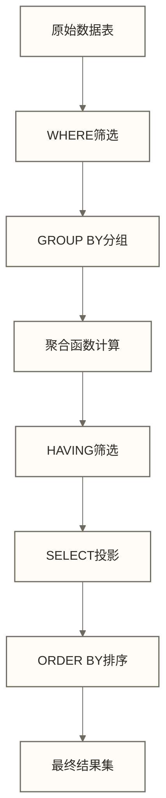

# HAVING子句：分组结果筛选

> [!abstract] 📋 本节概览
> - 🎯 **学习目标**：掌握HAVING子句的语法和应用场景，理解与WHERE子句的本质区别
> - 📚 **前置知识**：[[【技术与工具】/SQL/12-GROUP BY分组|GROUP BY分组]]、[[【技术与工具】/SQL/07-WHERE条件筛选|WHERE条件筛选]]
> - ⏱️ **预计用时**：45分钟（建议，含练习）
> - 🔧 **适用版本**：SQL标准，MySQL 5.0+、PostgreSQL 8.0+、SQL Server 2005+
> - 📊 **核心概念**：聚合函数筛选、分组后过滤、查询执行顺序

## 技术定义与工作机制

### 什么是HAVING子句

**HAVING子句**是SQL中用于对分组后的结果集进行条件筛选的关键字，专门设计用来筛选聚合函数的计算结果。它是GROUP BY操作的配套筛选机制，在SQL查询的执行顺序中位于GROUP BY之后、ORDER BY之前。

### 工作机制原理



在逻辑查询处理顺序中，HAVING用于筛选分组后的结果，条件可以引用聚合表达式和分组列；WHERE用于分组前的行级筛选，不能直接使用同一查询层级的聚合函数作为筛选条件。

## 核心语法结构

### 基本语法模式

```sql
SELECT column_list, aggregate_function(column)
FROM table_name
[WHERE condition]
GROUP BY column_list
HAVING aggregate_condition
[ORDER BY column_list];
```

### 语法要点解析

- **位置要求**：有GROUP BY时，HAVING写在其后、ORDER BY之前；没有显式GROUP BY时，也可以用HAVING筛选整体聚合结果
- **条件表达式**：可以使用聚合函数作为筛选条件
- **逻辑运算符**：支持AND、OR、NOT等逻辑组合
- **比较运算符**：支持=、!=、>、<、>=、<=、BETWEEN、IN等

## HAVING与WHERE的本质区别

| 对比维度 | WHERE子句 | HAVING子句 |
|---------|----------|-----------|
| **执行时机** | GROUP BY之前 | GROUP BY之后 |
| **筛选对象** | 原始数据行 | 分组聚合结果 |
| **函数支持** | 不能使用聚合函数 | 可以使用聚合函数 |
| **性能影响** | 减少分组数据量 | 筛选分组结果 |
| **使用场景** | 行级条件筛选 | 分组级条件筛选 |

### 错误示例对比

```sql
-- ❌ 错误：WHERE中使用聚合函数
SELECT department, AVG(salary)
FROM employees
WHERE AVG(salary) > 50000  -- 语法错误
GROUP BY department;

-- ✅ 正确：HAVING中使用聚合函数
SELECT department, AVG(salary)
FROM employees
GROUP BY department
HAVING AVG(salary) > 50000;
```

## 实际业务应用场景

### 1. 销售数据分析

```sql
-- 查找自2024-01-01起累计销售额超过100万的销售区域
SELECT 
    region,
    SUM(sales_amount) as total_sales,
    COUNT(order_id) as order_count
FROM sales_orders 
WHERE order_date >= '2024-01-01'
GROUP BY region
HAVING SUM(sales_amount) > 1000000
ORDER BY total_sales DESC;
```

### 2. 用户行为分析

```sql
-- 筛选活跃用户较多的城市（月登录次数>1000）
SELECT 
    city,
    COUNT(DISTINCT user_id) as active_users,
    SUM(login_count) as total_logins
FROM user_activity 
WHERE activity_month = '2024-12'
GROUP BY city
HAVING SUM(login_count) > 1000
   AND COUNT(DISTINCT user_id) > 50;
```

### 3. 产品质量监控

```sql
-- 识别平均评分低于4.0且评价数量充足的产品
SELECT 
    product_id,
    product_name,
    AVG(rating) as avg_rating,
    COUNT(review_id) as review_count
FROM product_reviews
GROUP BY product_id, product_name
HAVING AVG(rating) < 4.0 
   AND COUNT(review_id) >= 20;
```

## 高级应用技巧

### 1. 复合条件筛选

```sql
-- 多个聚合函数组合条件
SELECT 
    department,
    COUNT(*) as employee_count,
    AVG(salary) as avg_salary,
    MAX(salary) as max_salary
FROM employees
GROUP BY department
HAVING COUNT(*) > 10 
   AND AVG(salary) BETWEEN 40000 AND 80000
   AND MAX(salary) < 120000;
```

### 2. 子查询结合使用

```sql
-- 筛选销售额超过全公司平均水平的部门
SELECT 
    department,
    SUM(sales) as dept_sales
FROM sales_data
GROUP BY department
HAVING SUM(sales) > (
    SELECT AVG(dept_total) 
    FROM (
        SELECT SUM(sales) as dept_total
        FROM sales_data 
        GROUP BY department
    ) as dept_averages
);
```

### 3. 百分比计算筛选

```sql
-- 查找占总销售额20%以上的客户群体
SELECT 
    customer_segment,
    SUM(order_amount) as segment_sales,
    ROUND(
        SUM(order_amount) * 100.0 / 
        (SELECT SUM(order_amount) FROM orders), 2
    ) as sales_percentage
FROM orders
GROUP BY customer_segment
HAVING SUM(order_amount) > 
    (SELECT SUM(order_amount) * 0.2 FROM orders);
```

## 性能优化要点

### 1. 索引优化策略

```sql
-- 为GROUP BY和HAVING涉及的列创建复合索引
CREATE INDEX idx_sales_region_date 
ON sales_orders (region, order_date, sales_amount);

-- 候选索引是否提高效率，需结合数据分布与执行计划判断
SELECT region, SUM(sales_amount)
FROM sales_orders 
WHERE order_date >= '2024-01-01'
GROUP BY region
HAVING SUM(sales_amount) > 500000;
```

### 2. WHERE与HAVING的性能权衡

```sql
-- 示例A：先筛选指定日期后的active商品，再计算各类别均价
SELECT 
    category,
    AVG(price) as avg_price
FROM products 
WHERE status = 'active'          -- 先筛选状态
  AND created_date >= '2024-01-01'  -- 再筛选日期
GROUP BY category
HAVING AVG(price) > 100;         -- 最后筛选聚合结果

-- 示例B：计算全部商品的类别均价，并要求组内至少有一个active商品；与示例A业务语义不同，不能作为等价查询的性能对照
SELECT 
    category,
    AVG(price) as avg_price
FROM products 
GROUP BY category
HAVING AVG(price) > 100
   AND MAX(CASE WHEN status = 'active' THEN 1 ELSE 0 END) = 1;
```

## 常见错误与解决方案

### 1. 聚合函数使用错误

```sql
-- ❌ 错误：在SELECT中使用非聚合列
SELECT department, employee_name, COUNT(*)  -- employee_name不在GROUP BY中
FROM employees
GROUP BY department
HAVING COUNT(*) > 5;

-- ✅ 正确：只选择分组列和聚合函数
SELECT department, COUNT(*) as employee_count
FROM employees
GROUP BY department
HAVING COUNT(*) > 5;
```

### 2. 条件逻辑错误

```sql
-- ❌ 错误：HAVING条件过于复杂
SELECT product_category, AVG(price)
FROM products
GROUP BY product_category
HAVING AVG(price) > 100 AND price > 50;  -- price不是聚合结果

-- ✅ 正确：结合WHERE和HAVING
SELECT product_category, AVG(price)
FROM products
WHERE price > 50                    -- 行级筛选
GROUP BY product_category
HAVING AVG(price) > 100;           -- 聚合级筛选
```

## 最佳实践指南

### 1. 查询优化原则

- **提前筛选**：能用WHERE的条件优先使用WHERE
- **索引配合**：为GROUP BY和聚合列建立适当索引
- **条件简化**：避免在HAVING中使用复杂的子查询
- **结果限制**：按数据库方言限制返回数据量；MySQL和PostgreSQL可使用LIMIT，SQL Server可使用TOP，或在支持的版本中使用OFFSET/FETCH

### 2. 可读性提升技巧

```sql
-- 使用列别名提高可读性
SELECT 
    region,
    COUNT(*) as order_count,
    SUM(amount) as total_sales,
    AVG(amount) as avg_order_value
FROM orders
WHERE order_date >= '2024-01-01'
GROUP BY region
HAVING COUNT(*) > 100          -- 重复聚合表达式，避免HAVING别名的方言差异
   AND SUM(amount) > 500000
   AND AVG(amount) > 800;
```

### 3. 业务逻辑清晰化

```sql
-- 将业务规则明确表达在查询中
SELECT 
    product_category,
    COUNT(*) as product_count,
    AVG(rating) as avg_rating
FROM products
WHERE status = 'active'
GROUP BY product_category
HAVING COUNT(*) >= 10           -- 至少10个产品的类别
   AND AVG(rating) >= 4.0       -- 平均评分4星以上
ORDER BY avg_rating DESC, product_count DESC;
```

## 实战练习与验证

### 练习1：电商销售分析

```sql
-- 示例需求：找出2024年第四季度销售额超过10万且订单量超过50的商品类别；订单量需按不同订单ID计数
SELECT 
    category,
    COUNT(DISTINCT od.order_id) as order_count,
    SUM(sales_amount) as total_sales,
    ROUND(AVG(sales_amount), 2) as avg_detail_amount
FROM order_details od
JOIN products p ON od.product_id = p.product_id
WHERE od.order_date >= '2024-10-01'
  AND od.order_date < '2025-01-01'
GROUP BY category
HAVING SUM(sales_amount) > 100000
   AND COUNT(DISTINCT od.order_id) > 50
ORDER BY total_sales DESC;
```

### 练习2：用户活跃度分析

```sql
-- 需求：识别群体平均月活跃天数超过15天、平均会话时长超过30分钟，且不同用户数超过100的用户群；不代表每名用户均达到阈值
SELECT 
    user_segment,
    COUNT(DISTINCT user_id) as user_count,
    AVG(active_days) as avg_active_days,
    AVG(session_duration) as avg_session_minutes
FROM user_monthly_stats
WHERE stat_month = '2024-12'
GROUP BY user_segment
HAVING AVG(active_days) > 15
   AND AVG(session_duration) > 30
   AND COUNT(DISTINCT user_id) > 100;
```

## 扩展学习路径

- **下一步学习**：[[【技术与工具】/SQL/08-ORDER BY排序|ORDER BY排序]]
- **相关概念**：[[【技术与工具】/SQL/11-聚合函数详解|聚合函数]]
- **高级应用**：窗口函数基础

---

> **关键要点总结**
> 1. HAVING专门用于筛选分组后的聚合结果
> 2. 执行顺序：WHERE → GROUP BY → HAVING → ORDER BY
> 3. 性能优化：优先使用WHERE减少分组数据量
> 4. 实际应用：业务数据分析中的指标筛选利器

