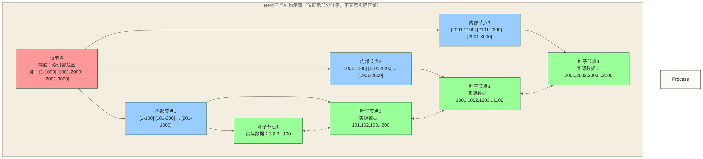

# 🌲 MySQL索引深度剖析 - B+树原理与优化实战

> [!tip] 💡 为什么索引是数据库性能的核心？
> 
> **想象一下在图书馆找一本书的场景：**
> - **没有索引**：你需要逐一翻看每个书架上的每本书（全表扫描）
> - **有了索引**：你直接查看目录，快速定位到具体书架和位置（索引查找）
> 
> 🚀 **索引查找与全表扫描的复杂度示例：**
> - 假设全表扫描需要逐条检查100万条记录，其扫描工作量随记录数线性增长。
> - 假设节点扇出为300，log₃₀₀(1000000)约为2.42；实际树高还取决于叶子容量、填充率和层数计数方式，不能据此断言只需20次比较。
> - 若仅假设比较次数从100万次降到20次，两者之比为50,000；这不是实测耗时提升，实际性能取决于缓存、I/O、查询返回量与执行计划。
> 
> 💼 **掌握索引优化的职业价值：**
> - **初级工程师**：知道创建索引；原8-12K仅作为假设薪资区间，不代表市场统计。
> - **中级工程师**：会分析慢查询并优化索引；原15-25K仅作为假设薪资区间，不代表市场统计。
> - **高级工程师**：能设计复杂索引策略，解决生产性能问题；原25K+仅作为假设薪资区间，不代表市场统计，掌握索引技能不保证获得该收入。

> [!abstract] 📋 本节概览
> - 🎯 **学习目标**：深入理解MySQL索引的实现原理和优化策略
> - 📚 **前置知识**：[[【技术与工具】/PostgreSQL/00-PostgreSQL学习路线图|PostgreSQL/PostgreSQL]] | [[【技术与工具】/MySQL/06-InnoDB存储引擎|MySQL/InnoDB存储引擎]] | [[【技术与工具】/MySQL/05-MySQL架构原理|MySQL/MySQL]]
> - ⏱️ **预计用时**：100分钟
> - 🔧 **技术重点**：B+树结构、索引类型、查询优化、覆盖索引
> - 💰 **职业价值**：索引优化是数据库工程师的核心技能，直接影响系统性能和用户体验

## 🏗️ B+树索引的工程奇迹

### B+树结构的设计智慧

B+树是计算机科学中最精妙的数据结构之一，它专门为磁盘存储和大数据量查找而设计。与内存中的数据结构不同，B+树考虑了磁盘I/O的特性：每次磁盘读取都是以页面为单位（通常16KB），而不是单个记录。

B+树的天才之处在于它将数据组织成多层结构：根节点和内部节点只存储索引键和指针，不存储实际数据；所有数据都集中在叶子节点，并且叶子节点之间用双向链表连接。这种设计使得范围查询异常高效：一旦定位到起始位置，就可以沿着链表顺序访问后续数据。



### 聚簇索引与二级索引的本质区别

InnoDB的索引体系建立在聚簇索引的基础上，这是理解MySQL性能的关键。聚簇索引就像一本按主键顺序排列的电话黄页，聚簇索引叶子记录按聚簇键逻辑有序组织，但相邻键值不保证对应相邻磁盘位置；这种有序结构有利于范围扫描。

二级索引则像是电话黄页的主题索引，它们指向主键值而不是直接指向数据行。这种设计的优势是当聚簇索引发生页面分裂或记录移动时，二级索引不需要更新。但非覆盖的二级索引查询可能需要回表：先通过二级索引找到主键，再访问聚簇索引获取完整数据；这是两类访问步骤，不代表固定两次磁盘I/O。

```sql title="深度理解聚簇索引与二级索引的性能差异"
-- 创建测试表来演示索引工作原理
CREATE TABLE index_performance_test (
    id BIGINT AUTO_INCREMENT PRIMARY KEY,  -- 聚簇索引：叶子记录按此键逻辑有序，不保证磁盘位置相邻
    user_id INT NOT NULL,                  -- 准备创建二级索引
    email VARCHAR(100) NOT NULL,           -- 准备创建唯一二级索引
    name VARCHAR(50),                      
    age INT,
    score DECIMAL(5,2),
    created_at TIMESTAMP DEFAULT CURRENT_TIMESTAMP,
    
    -- 创建各种类型的二级索引
    INDEX idx_user_id (user_id),           -- 单列二级索引
    INDEX idx_name_age (name, age),        -- 复合索引
    UNIQUE INDEX uk_email (email),         -- 唯一索引
    INDEX idx_score_created (score, created_at)  -- 复合索引用于覆盖查询
) ENGINE=InnoDB;

-- 插入测试数据观察存储结构
INSERT INTO index_performance_test (user_id, email, name, age, score) VALUES
(1001, 'alice@test.com', 'Alice', 25, 85.5),
(1002, 'bob@test.com', 'Bob', 30, 92.3),
(1003, 'charlie@test.com', 'Charlie', 28, 78.9),
(1001, 'alice2@test.com', 'Alice Smith', 25, 88.7),
(1002, 'bob2@test.com', 'Bob Johnson', 31, 91.2);

-- 分析不同索引的查询行为
-- 1. 聚簇索引查询：直接定位，性能最佳
EXPLAIN FORMAT=JSON 
SELECT * FROM index_performance_test WHERE id = 3;

-- 2. 二级索引查询：需要回表操作
EXPLAIN FORMAT=JSON
SELECT * FROM index_performance_test WHERE user_id = 1001;

-- 3. 覆盖索引查询：无需回表，性能优异
EXPLAIN FORMAT=JSON
SELECT user_id FROM index_performance_test WHERE user_id = 1001;

-- 4. 复合索引的高效利用
EXPLAIN FORMAT=JSON
SELECT score, created_at FROM index_performance_test 
WHERE score > 80 AND created_at > '2024-01-01';

-- 监控索引使用的系统指标
SELECT 
    VARIABLE_NAME,
    VARIABLE_VALUE,
    CASE 
        WHEN VARIABLE_NAME = 'Handler_read_key' THEN '通过索引键读取行的次数'
        WHEN VARIABLE_NAME = 'Handler_read_next' THEN '按索引顺序读取下一行的次数'
        WHEN VARIABLE_NAME = 'Handler_read_rnd' THEN '按固定位置读取行的次数，不能直接等同于回表次数'
        WHEN VARIABLE_NAME = 'Handler_read_rnd_next' THEN '按位置读取下一行的次数'
    END as description
FROM performance_schema.session_status
WHERE VARIABLE_NAME IN ('Handler_read_key', 'Handler_read_next', 'Handler_read_rnd', 'Handler_read_rnd_next');
```

---

## 🔍 索引类型的深度解析

### 复合索引与最左前缀原理

复合索引的设计体现了数据库设计者的深谋远虑。它不仅仅是多个单列索引的简单组合，而是一个精心设计的多维查找结构。最左前缀原理的本质是：复合索引相当于多个索引的"嵌套"，外层索引决定了内层索引的有效性。

复合索引的字段顺序设计需要综合考虑查询频率、字段选择性、排序需求等多个因素。一般来说，将选择性高（唯一值多）的字段放在前面能提高索引效率，但如果某个选择性低的字段在WHERE条件中出现频率极高，也可以考虑将其前置。

```sql title="复合索引设计的最佳实践"
-- 创建优化的复合索引示例
CREATE TABLE order_analysis (
    order_id BIGINT AUTO_INCREMENT PRIMARY KEY,
    user_id INT NOT NULL,                    -- 选择性中等，查询频率高
    order_status TINYINT NOT NULL,           -- 选择性低，但查询频率极高
    order_date DATE NOT NULL,                -- 选择性高，常用于范围查询
    order_amount DECIMAL(10,2),              -- 选择性高，但查询频率较低
    created_at TIMESTAMP DEFAULT CURRENT_TIMESTAMP,
    
    -- 策略1：按查询频率设计（推荐）
    INDEX idx_status_user_date (order_status, user_id, order_date),
    
    -- 策略2：按选择性设计
    INDEX idx_user_date_status (user_id, order_date, order_status),
    
    -- 策略3：为特定查询模式优化
    INDEX idx_date_status_amount (order_date, order_status, order_amount)
) ENGINE=InnoDB;

-- 分析不同索引策略的效果
-- 测试查询1：按状态和用户筛选（最常见）
EXPLAIN SELECT order_id, order_amount 
FROM order_analysis 
WHERE order_status = 1 AND user_id = 1001;

-- 测试查询2：用户的时间范围查询
EXPLAIN SELECT COUNT(*) 
FROM order_analysis 
WHERE user_id = 1001 AND order_date >= '2024-01-01';

-- 测试查询3：复杂的多条件查询
EXPLAIN SELECT order_id, order_amount
FROM order_analysis 
WHERE order_status IN (1,2) 
    AND user_id = 1001 
    AND order_date BETWEEN '2024-01-01' AND '2024-12-31';

-- 分析索引选择性来优化字段顺序
SELECT 
    'order_status' as field_name,
    COUNT(DISTINCT order_status) as distinct_values,
    COUNT(*) as total_records,
    ROUND(COUNT(DISTINCT order_status) / COUNT(*), 4) as selectivity,
    CASE 
        WHEN COUNT(DISTINCT order_status) / COUNT(*) > 0.1 THEN '高选择性，适合索引前置'
        WHEN COUNT(DISTINCT order_status) / COUNT(*) > 0.01 THEN '中等选择性'
        ELSE '低选择性，考虑后置或与高选择性字段组合'
    END as recommendation
FROM order_analysis

UNION ALL

SELECT 
    'user_id',
    COUNT(DISTINCT user_id),
    COUNT(*),
    ROUND(COUNT(DISTINCT user_id) / COUNT(*), 4),
    CASE 
        WHEN COUNT(DISTINCT user_id) / COUNT(*) > 0.1 THEN '高选择性，适合索引前置'
        WHEN COUNT(DISTINCT user_id) / COUNT(*) > 0.01 THEN '中等选择性'
        ELSE '低选择性，考虑后置或与高选择性字段组合'
    END
FROM order_analysis;
```

### 覆盖索引的性能魔法

覆盖索引是减少回表的重要手段。当索引包含查询所需的所有列时，通常可直接从索引取得所需信息；实际访问还受事务可见性等条件影响，不能保证磁盘I/O固定从两次减少为一次。

覆盖索引的设计需要在存储空间和查询性能之间找到平衡。索引越宽（包含的列越多），占用的存储空间越大，维护成本也越高。但对于高频查询，这种投入可能值得；是否提升性能及提升幅度取决于查询、数据分布与负载，需要通过实际测量评估。

```sql title="覆盖索引的设计艺术"
-- 创建专门用于演示覆盖索引的表
CREATE TABLE user_profile (
    id BIGINT AUTO_INCREMENT PRIMARY KEY,
    user_id INT NOT NULL,
    username VARCHAR(50) NOT NULL,
    email VARCHAR(100) NOT NULL,
    phone VARCHAR(20),
    age INT,
    city VARCHAR(50),
    registration_date DATE,
    last_login_time TIMESTAMP,
    status TINYINT DEFAULT 1,
    
    -- 为最常见的查询设计覆盖索引
    INDEX idx_user_basic_info (user_id, username, email, status),
    
    -- 为用户列表查询设计覆盖索引
    INDEX idx_user_list_covering (status, registration_date, user_id, username, city),
    
    -- 为搜索功能设计覆盖索引
    INDEX idx_search_covering (username, email, city, phone, status)
) ENGINE=InnoDB;

-- 插入测试数据
INSERT INTO user_profile (user_id, username, email, phone, age, city, registration_date, status)
VALUES 
(1001, 'alice_2024', 'alice@example.com', '13800001001', 25, '北京', '2024-01-15', 1),
(1002, 'bob_user', 'bob@example.com', '13800001002', 30, '上海', '2024-02-20', 1),
(1003, 'charlie_dev', 'charlie@example.com', '13800001003', 28, '深圳', '2024-03-10', 1),
(1004, 'david_admin', 'david@example.com', '13800001004', 35, '杭州', '2024-01-25', 0);

-- 演示覆盖索引的威力
-- 查询1：用户基本信息（使用覆盖索引）
EXPLAIN FORMAT=JSON
SELECT user_id, username, email, status 
FROM user_profile 
WHERE user_id = 1001;
-- JSON格式检查using_index属性；传统EXPLAIN格式检查Extra中的"Using index"

-- 查询2：需要回表的查询（无法使用覆盖索引）
EXPLAIN FORMAT=JSON
SELECT user_id, username, email, age, phone 
FROM user_profile 
WHERE user_id = 1001;
-- 没有"Using index"，需要回表获取age和phone

-- 查询3：用户列表查询（完美的覆盖索引场景）
EXPLAIN FORMAT=JSON
SELECT user_id, username, city, registration_date
FROM user_profile 
WHERE status = 1 
    AND registration_date >= '2024-01-01'
ORDER BY registration_date DESC
LIMIT 10;

-- 测量覆盖索引的性能优势
-- 重置状态计数器
FLUSH STATUS;

-- 执行使用覆盖索引的查询
SELECT user_id, username, email FROM user_profile WHERE user_id BETWEEN 1001 AND 1003;

-- 查看I/O统计
SELECT 
    VARIABLE_NAME,
    VARIABLE_VALUE,
    CASE 
        WHEN VARIABLE_NAME = 'Handler_read_key' THEN '索引键查找次数'
        WHEN VARIABLE_NAME = 'Handler_read_next' THEN '索引顺序扫描次数'
        WHEN VARIABLE_NAME = 'Handler_read_rnd' THEN '按固定位置读取行的次数；为0不能证明覆盖索引生效'
    END as description
FROM performance_schema.session_status 
WHERE VARIABLE_NAME IN ('Handler_read_key', 'Handler_read_next', 'Handler_read_rnd');

-- 动态分析覆盖索引的使用效果
SELECT 
    OBJECT_NAME as table_name,
    INDEX_NAME,
    COUNT_FETCH as index_usage_count,
    COUNT_INSERT + COUNT_UPDATE + COUNT_DELETE as maintenance_cost,
    ROUND(COUNT_FETCH / (COUNT_INSERT + COUNT_UPDATE + COUNT_DELETE + 1), 2) as benefit_ratio
FROM performance_schema.table_io_waits_summary_by_index_usage
WHERE OBJECT_SCHEMA = DATABASE() 
    AND OBJECT_NAME = 'user_profile'
    AND INDEX_NAME != 'PRIMARY'
ORDER BY benefit_ratio DESC;
```

### 前缀索引的空间优化

前缀索引是在存储效率和查询性能之间的巧妙平衡。对于长字符串字段，使用全字段索引可能占用大量存储空间，而前缀索引通过只索引字段的前几个字符来减少空间占用。关键是找到最优的前缀长度：既要保证足够的选择性，又要控制索引大小。

前缀索引的选择需要基于数据分布特性进行分析。不同的数据类型和业务场景下，最优前缀长度差异很大。邮箱地址可能需要10-15个字符的前缀，而中文姓名可能只需要2-3个字符。

```sql title="前缀索引的科学设计方法"
-- 创建包含长字符串字段的表
CREATE TABLE content_analysis (
    id BIGINT AUTO_INCREMENT PRIMARY KEY,
    title VARCHAR(255) NOT NULL,
    description TEXT,
    url VARCHAR(500),
    content_hash VARCHAR(64),
    created_at TIMESTAMP DEFAULT CURRENT_TIMESTAMP
) ENGINE=InnoDB;

-- 插入一些测试数据
INSERT INTO content_analysis (title, url, content_hash) VALUES
('MySQL索引优化实战指南', 'https://example.com/mysql-index-optimization', 'a1b2c3d4e5f6g7h8i9j0k1l2m3n4o5p6'),
('深入理解InnoDB存储引擎', 'https://example.com/innodb-storage-engine', 'b2c3d4e5f6g7h8i9j0k1l2m3n4o5p6q7'),
('MySQL性能调优最佳实践', 'https://example.com/mysql-performance-tuning', 'c3d4e5f6g7h8i9j0k1l2m3n4o5p6q7r8'),
('数据库架构设计原理解析', 'https://example.com/database-architecture-design', 'd4e5f6g7h8i9j0k1l2m3n4o5p6q7r8s9');

-- 分析前缀选择性的科学方法
-- 步骤1：分析不同前缀长度的选择性
SELECT 
    '全字段' as prefix_type,
    COUNT(DISTINCT title) as distinct_count,
    COUNT(*) as total_count,
    ROUND(COUNT(DISTINCT title) / COUNT(*), 4) as selectivity,
    AVG(CHAR_LENGTH(title)) as avg_length
FROM content_analysis

UNION ALL

SELECT 
    CONCAT('前缀', 5, '字符'),
    COUNT(DISTINCT LEFT(title, 5)),
    COUNT(*),
    ROUND(COUNT(DISTINCT LEFT(title, 5)) / COUNT(*), 4),
    5
FROM content_analysis

UNION ALL

SELECT 
    CONCAT('前缀', 10, '字符'),
    COUNT(DISTINCT LEFT(title, 10)),
    COUNT(*),
    ROUND(COUNT(DISTINCT LEFT(title, 10)) / COUNT(*), 4),
    10
FROM content_analysis

UNION ALL

SELECT 
    CONCAT('前缀', 15, '字符'),
    COUNT(DISTINCT LEFT(title, 15)),
    COUNT(*),
    ROUND(COUNT(DISTINCT LEFT(title, 15)) / COUNT(*), 4),
    15
FROM content_analysis;

-- 步骤2：创建最优前缀索引
-- 基于分析结果，假设15字符前缀达到了95%以上的选择性
ALTER TABLE content_analysis ADD INDEX idx_title_prefix (title(15));

-- 步骤3：验证前缀索引的查询效果
-- 精确匹配：前缀索引有效
EXPLAIN SELECT * FROM content_analysis WHERE title = 'MySQL索引优化实战指南';

-- 前缀匹配：前缀索引高效
EXPLAIN SELECT * FROM content_analysis WHERE title LIKE 'MySQL索引%';

-- 后缀匹配：前缀索引无效，需要全表扫描
EXPLAIN SELECT * FROM content_analysis WHERE title LIKE '%实战指南';

-- 步骤4：分析前缀索引的存储效率
SELECT 
    INDEX_NAME,
    COLUMN_NAME,
    SUB_PART as prefix_length,
    CARDINALITY,
    ROUND(
        (SELECT SUM(INDEX_LENGTH) FROM information_schema.TABLES 
         WHERE TABLE_NAME = 'content_analysis') / 1024, 2
    ) as total_index_size_kb
FROM information_schema.STATISTICS
WHERE TABLE_SCHEMA = DATABASE()
    AND TABLE_NAME = 'content_analysis'
    AND INDEX_NAME = 'idx_title_prefix';

-- 前缀索引的限制与权衡分析
/*
优势：
1. 减少索引存储空间，特别对长字符串字段效果显著
2. 提高索引缓存命中率（更多索引页能放入内存）
3. 加快索引维护操作的速度

限制：
1. 无法用于ORDER BY（因为前缀可能相同）
2. 无法用于覆盖索引（因为只有前缀信息）
3. 可能增加扫描的记录数（前缀相同的记录都需要检查）

适用场景：
1. 长字符串字段且前几个字符有良好选择性
2. 主要用于等值查询和前缀匹配
3. 存储空间紧张或内存有限的环境
*/
```

---

## 🚀 索引优化的实战策略

### 慢查询驱动的索引优化

真正的索引优化不是纸上谈兵，而是基于实际的查询负载进行有针对性的设计。慢查询日志是索引优化的最佳指南，它记录了系统中真实发生的性能问题。通过分析慢查询模式，可以发现最有价值的索引优化机会。

现代的索引优化需要结合查询统计信息、执行计划分析、系统负载特征等多维度信息。单纯基于经验创建索引往往效果有限，而基于数据驱动的优化能够带来显著的性能提升。

```sql title="基于慢查询分析的索引优化流程"
-- 第一步：启用慢查询日志和查询统计
SET GLOBAL slow_query_log = ON;
SET GLOBAL long_query_time = 1.0;  -- 记录执行超过1秒的查询
SET GLOBAL log_queries_not_using_indexes = ON;  -- 记录未使用索引的查询

-- 第二步：通过Performance Schema分析查询模式
-- 查找最耗时的查询
SELECT 
    DIGEST_TEXT as query_pattern,
    COUNT_STAR as execution_count,
    ROUND(AVG_TIMER_WAIT / 1000000000000, 4) as avg_seconds,
    ROUND(SUM_TIMER_WAIT / 1000000000000, 2) as total_seconds,
    ROUND(MAX_TIMER_WAIT / 1000000000000, 4) as max_seconds,
    FIRST_SEEN,
    LAST_SEEN
FROM performance_schema.events_statements_summary_by_digest
WHERE DIGEST_TEXT IS NOT NULL
    AND AVG_TIMER_WAIT > 1000000000  -- 平均执行时间超过1毫秒
ORDER BY SUM_TIMER_WAIT DESC
LIMIT 10;

-- 第三步：分析表的访问模式
SELECT 
    OBJECT_NAME as table_name,
    COUNT_READ,
    COUNT_WRITE,
    COUNT_FETCH,
    COUNT_INSERT,
    COUNT_UPDATE,
    COUNT_DELETE,
    ROUND(COUNT_READ / (COUNT_READ + COUNT_WRITE), 4) as read_write_ratio
FROM performance_schema.table_io_waits_summary_by_table
WHERE OBJECT_SCHEMA = DATABASE()
ORDER BY COUNT_READ + COUNT_WRITE DESC;

-- 第四步：识别缺失的索引
-- 通过sys schema查看全表扫描的查询
SELECT 
    db,
    query,
    exec_count,
    ROUND(avg_latency / 1000000, 2) as avg_latency_ms,
    rows_examined_avg,
    last_seen
FROM sys.statements_with_full_table_scans
WHERE db = DATABASE()
ORDER BY avg_latency DESC;

-- 第五步：创建模拟环境验证索引效果
-- 创建大数据量的测试表
CREATE TABLE query_performance_test (
    id BIGINT AUTO_INCREMENT PRIMARY KEY,
    user_id INT NOT NULL,
    category_id INT NOT NULL,
    product_id INT NOT NULL,
    order_date DATE NOT NULL,
    amount DECIMAL(10,2),
    status TINYINT DEFAULT 1,
    created_at TIMESTAMP DEFAULT CURRENT_TIMESTAMP
) ENGINE=InnoDB;

-- 插入大量测试数据（生产环境数据特征模拟）
INSERT INTO query_performance_test (user_id, category_id, product_id, order_date, amount, status)
SELECT 
    FLOOR(1 + RAND() * 10000) as user_id,
    FLOOR(1 + RAND() * 100) as category_id,
    FLOOR(1 + RAND() * 1000) as product_id,
    DATE_SUB(CURDATE(), INTERVAL FLOOR(RAND() * 365) DAY) as order_date,
    ROUND(10 + RAND() * 1000, 2) as amount,
    FLOOR(1 + RAND() * 3) as status
FROM 
    (SELECT a.N + b.N * 10 + 1 as N FROM 
     (SELECT 0 as N UNION SELECT 1 UNION SELECT 2 UNION SELECT 3 UNION SELECT 4 UNION SELECT 5 UNION SELECT 6 UNION SELECT 7 UNION SELECT 8 UNION SELECT 9) a,
     (SELECT 0 as N UNION SELECT 1 UNION SELECT 2 UNION SELECT 3 UNION SELECT 4 UNION SELECT 5 UNION SELECT 6 UNION SELECT 7 UNION SELECT 8 UNION SELECT 9) b
    ) numbers
LIMIT 10000;  -- 当前上游数字集合仅生成100行，因此本次实际最多插入100条记录

-- 第六步：对比索引创建前后的查询性能
-- 测试查询1：用户的订单统计（慢查询场景）
-- 优化前：全表扫描
EXPLAIN FORMAT=JSON
SELECT user_id, COUNT(*) as order_count, SUM(amount) as total_amount
FROM query_performance_test 
WHERE user_id = 1001 AND order_date >= '2024-01-01' AND status = 1
GROUP BY user_id;

-- 记录优化前的执行时间
SET @start_time = NOW(6);
SELECT user_id, COUNT(*) as order_count, SUM(amount) as total_amount
FROM query_performance_test 
WHERE user_id = 1001 AND order_date >= '2024-01-01' AND status = 1
GROUP BY user_id;
SELECT TIMESTAMPDIFF(MICROSECOND, @start_time, NOW(6)) as execution_time_microseconds;

-- 创建针对性的复合索引
CREATE INDEX idx_user_date_status_covering 
ON query_performance_test (user_id, order_date, status, amount);

-- 优化后：使用索引
EXPLAIN FORMAT=JSON
SELECT user_id, COUNT(*) as order_count, SUM(amount) as total_amount
FROM query_performance_test 
WHERE user_id = 1001 AND order_date >= '2024-01-01' AND status = 1
GROUP BY user_id;

-- 记录优化后的执行时间
SET @start_time = NOW(6);
SELECT user_id, COUNT(*) as order_count, SUM(amount) as total_amount
FROM query_performance_test 
WHERE user_id = 1001 AND order_date >= '2024-01-01' AND status = 1
GROUP BY user_id;
SELECT TIMESTAMPDIFF(MICROSECOND, @start_time, NOW(6)) as execution_time_microseconds;
```

### 查询重写与索引协同优化

有时候，创建新索引并不是解决性能问题的最佳方案。通过重写查询语句，可以更好地利用现有索引，避免索引维护的额外开销。查询重写需要深入理解MySQL优化器的工作原理，以及不同SQL写法对执行计划的影响。

查询重写的艺术在于在保持功能不变的前提下，引导优化器选择更高效的执行路径。这包括条件下推、子查询转换、连接顺序优化等技术手段。

```sql title="查询重写与索引配合优化"
-- 创建复杂查询场景的测试表
CREATE TABLE sales_analysis (
    id BIGINT AUTO_INCREMENT PRIMARY KEY,
    customer_id INT NOT NULL,
    product_id INT NOT NULL,
    category_id INT NOT NULL,
    sale_date DATE NOT NULL,
    quantity INT NOT NULL,
    unit_price DECIMAL(8,2) NOT NULL,
    discount_rate DECIMAL(3,2) DEFAULT 0.00,
    sales_rep_id INT,
    region_id INT,
    created_at TIMESTAMP DEFAULT CURRENT_TIMESTAMP,
    
    -- 基础索引
    INDEX idx_customer (customer_id),
    INDEX idx_product (product_id),
    INDEX idx_date (sale_date),
    INDEX idx_category_date (category_id, sale_date),
    INDEX idx_rep_date (sales_rep_id, sale_date)
) ENGINE=InnoDB;

-- 插入测试数据
INSERT INTO sales_analysis (customer_id, product_id, category_id, sale_date, quantity, unit_price, sales_rep_id, region_id)
SELECT 
    FLOOR(1 + RAND() * 5000) as customer_id,
    FLOOR(1 + RAND() * 500) as product_id,
    FLOOR(1 + RAND() * 50) as category_id,
    DATE_SUB(CURDATE(), INTERVAL FLOOR(RAND() * 730) DAY) as sale_date,
    FLOOR(1 + RAND() * 10) as quantity,
    ROUND(10 + RAND() * 500, 2) as unit_price,
    FLOOR(1 + RAND() * 100) as sales_rep_id,
    FLOOR(1 + RAND() * 10) as region_id
FROM information_schema.COLUMNS
LIMIT 20000;

-- 优化案例1：子查询优化
-- 原始查询：效率较低的子查询
EXPLAIN
SELECT customer_id, 
       (SELECT COUNT(*) FROM sales_analysis s2 
        WHERE s2.customer_id = s1.customer_id AND s2.sale_date >= '2024-01-01') as recent_orders
FROM (SELECT DISTINCT customer_id FROM sales_analysis) s1
LIMIT 10;

-- 优化后：使用JOIN替代子查询
EXPLAIN
SELECT s1.customer_id, COUNT(s2.id) as recent_orders
FROM (SELECT DISTINCT customer_id FROM sales_analysis) s1
LEFT JOIN sales_analysis s2 ON s1.customer_id = s2.customer_id 
    AND s2.sale_date >= '2024-01-01'
GROUP BY s1.customer_id
LIMIT 10;

-- 优化案例2：IN子查询优化
-- 原始查询：IN子查询可能导致全表扫描
EXPLAIN
SELECT * FROM sales_analysis 
WHERE customer_id IN (
    SELECT customer_id FROM sales_analysis 
    WHERE sale_date >= '2024-06-01' 
    GROUP BY customer_id 
    HAVING SUM(quantity * unit_price) > 1000
);

-- 优化后：使用EXISTS或JOIN
EXPLAIN
SELECT DISTINCT s1.* 
FROM sales_analysis s1
INNER JOIN (
    SELECT customer_id 
    FROM sales_analysis 
    WHERE sale_date >= '2024-06-01'
    GROUP BY customer_id 
    HAVING SUM(quantity * unit_price) > 1000
) s2 ON s1.customer_id = s2.customer_id;

-- 优化案例3：OR条件优化
-- 原始查询：OR条件难以使用索引
EXPLAIN
SELECT * FROM sales_analysis 
WHERE category_id = 10 OR sales_rep_id = 20;

-- 优化后：使用UNION替代OR
EXPLAIN
(SELECT * FROM sales_analysis WHERE category_id = 10)
UNION
(SELECT * FROM sales_analysis WHERE sales_rep_id = 20);

-- 优化案例4：范围查询与ORDER BY优化
-- 原始查询：范围查询后的排序可能需要filesort
EXPLAIN
SELECT * FROM sales_analysis 
WHERE sale_date BETWEEN '2024-01-01' AND '2024-12-31' 
    AND category_id = 10
ORDER BY created_at DESC
LIMIT 20;

-- 创建优化索引：将ORDER BY字段包含在内
CREATE INDEX idx_category_date_created 
ON sales_analysis (category_id, sale_date, created_at);

-- 验证候选索引：sale_date为范围条件，不能保证消除ORDER BY created_at的filesort
EXPLAIN
SELECT * FROM sales_analysis 
WHERE category_id = 10 
    AND sale_date BETWEEN '2024-01-01' AND '2024-12-31'
ORDER BY created_at DESC
LIMIT 20;

-- 查询重写效果验证
-- 创建查询性能对比存储过程
DELIMITER $$
CREATE PROCEDURE CompareQueryPerformance()
BEGIN
    DECLARE original_time, optimized_time BIGINT DEFAULT 0;
    DECLARE start_time TIMESTAMP(6);
    
    -- 测试原始查询性能
    SET start_time = NOW(6);
    SELECT COUNT(*) FROM sales_analysis 
    WHERE customer_id IN (
        SELECT customer_id FROM sales_analysis 
        WHERE sale_date >= '2024-06-01' 
        GROUP BY customer_id 
        HAVING SUM(quantity * unit_price) > 1000
    ) INTO @dummy;
    SET original_time = TIMESTAMPDIFF(MICROSECOND, start_time, NOW(6));
    
    -- 测试优化后查询性能
    SET start_time = NOW(6);
    SELECT COUNT(DISTINCT s1.id) 
    FROM sales_analysis s1
    INNER JOIN (
        SELECT customer_id 
        FROM sales_analysis 
        WHERE sale_date >= '2024-06-01'
        GROUP BY customer_id 
        HAVING SUM(quantity * unit_price) > 1000
    ) s2 ON s1.customer_id = s2.customer_id INTO @dummy;
    SET optimized_time = TIMESTAMPDIFF(MICROSECOND, start_time, NOW(6));
    
    -- 输出性能对比结果
    SELECT 
        original_time as original_microseconds,
        optimized_time as optimized_microseconds,
        ROUND(original_time / optimized_time, 2) as performance_improvement_ratio,
        CASE 
            WHEN optimized_time < original_time THEN 'Query optimization successful'
            ELSE 'Consider alternative approaches'
        END as optimization_result;
        
END$$
DELIMITER ;

-- 执行性能对比
CALL CompareQueryPerformance();
```

---

## 📈 索引监控与维护体系

### 建立索引健康监控

索引不是一次性创建后就可以忽视的静态结构，而是需要持续监控和维护的动态系统。索引的使用模式会随着业务发展而变化，曾经高效的索引可能变成累赘，而新的查询模式可能需要新的索引支持。

建立完善的索引监控体系需要从多个维度进行观察：使用频率、维护成本、存储空间、查询性能等。通过定期的索引健康检查，可以及时发现问题并进行优化调整。

```sql title="索引健康监控与自动化维护"
-- 创建索引监控仪表板
CREATE VIEW index_health_dashboard AS
SELECT 
    t.TABLE_SCHEMA as database_name,
    t.TABLE_NAME as table_name,
    s.INDEX_NAME,
    s.COLUMN_NAME,
    s.SEQ_IN_INDEX,
    s.CARDINALITY,
    CASE 
        WHEN s.INDEX_NAME = 'PRIMARY' THEN 'PRIMARY KEY'
        WHEN s.NON_UNIQUE = 0 THEN 'UNIQUE INDEX'
        ELSE 'REGULAR INDEX'
    END as index_type,
    
    -- 索引大小估算
    ROUND(
        (s.CARDINALITY * 
         CASE 
             WHEN s.COLUMN_NAME IN (SELECT COLUMN_NAME FROM information_schema.COLUMNS 
                                   WHERE TABLE_SCHEMA = s.TABLE_SCHEMA 
                                     AND TABLE_NAME = s.TABLE_NAME 
                                     AND DATA_TYPE IN ('int', 'bigint')) THEN 8
             WHEN s.COLUMN_NAME IN (SELECT COLUMN_NAME FROM information_schema.COLUMNS 
                                   WHERE TABLE_SCHEMA = s.TABLE_SCHEMA 
                                     AND TABLE_NAME = s.TABLE_NAME 
                                     AND DATA_TYPE = 'varchar') THEN 20
             ELSE 10
         END) / 1024 / 1024, 2
    ) as estimated_size_mb,
    
    -- 索引选择性评估
    ROUND(s.CARDINALITY / t.TABLE_ROWS, 4) as selectivity,
    
    CASE 
        WHEN s.CARDINALITY / t.TABLE_ROWS > 0.1 THEN 'EXCELLENT'
        WHEN s.CARDINALITY / t.TABLE_ROWS > 0.01 THEN 'GOOD'
        WHEN s.CARDINALITY / t.TABLE_ROWS > 0.001 THEN 'FAIR'
        ELSE 'POOR'
    END as selectivity_rating

FROM information_schema.STATISTICS s
JOIN information_schema.TABLES t ON s.TABLE_SCHEMA = t.TABLE_SCHEMA 
    AND s.TABLE_NAME = t.TABLE_NAME
WHERE s.TABLE_SCHEMA = DATABASE()
    AND t.ENGINE = 'InnoDB'
ORDER BY t.TABLE_NAME, s.INDEX_NAME, s.SEQ_IN_INDEX;

-- 查看索引健康状况
SELECT * FROM index_health_dashboard;

-- 识别未使用的索引
SELECT 
    'UNUSED INDEXES' as analysis_type,
    OBJECT_NAME as table_name,
    INDEX_NAME,
    'No recorded operations in the current statistics window' as issue
FROM performance_schema.table_io_waits_summary_by_index_usage
WHERE OBJECT_SCHEMA = DATABASE()
    AND INDEX_NAME != 'PRIMARY'
    AND COUNT_FETCH = 0 
    AND COUNT_INSERT = 0 
    AND COUNT_UPDATE = 0 
    AND COUNT_DELETE = 0

UNION ALL

-- 识别重复索引
SELECT 
    'DUPLICATE INDEXES' as analysis_type,
    TABLE_NAME as table_name,
    GROUP_CONCAT(INDEX_NAME) as index_names,
    CONCAT('Columns: ', GROUP_CONCAT(COLUMN_NAME ORDER BY SEQ_IN_INDEX)) as issue
FROM information_schema.STATISTICS
WHERE TABLE_SCHEMA = DATABASE()
GROUP BY TABLE_NAME, GROUP_CONCAT(COLUMN_NAME ORDER BY SEQ_IN_INDEX)
HAVING COUNT(DISTINCT INDEX_NAME) > 1

UNION ALL

-- 识别低选择性索引
SELECT 
    'LOW SELECTIVITY' as analysis_type,
    TABLE_NAME,
    INDEX_NAME,
    CONCAT('Selectivity: ', ROUND(CARDINALITY / (SELECT TABLE_ROWS FROM information_schema.TABLES t WHERE t.TABLE_NAME = s.TABLE_NAME AND t.TABLE_SCHEMA = s.TABLE_SCHEMA), 4)) as issue
FROM information_schema.STATISTICS s
WHERE TABLE_SCHEMA = DATABASE()
    AND INDEX_NAME != 'PRIMARY'
    AND CARDINALITY / (SELECT TABLE_ROWS FROM information_schema.TABLES t WHERE t.TABLE_NAME = s.TABLE_NAME AND t.TABLE_SCHEMA = s.TABLE_SCHEMA) < 0.01
    AND SEQ_IN_INDEX = 1;  -- 只检查索引的第一列

-- 索引使用频率分析
SELECT 
    OBJECT_NAME as table_name,
    INDEX_NAME,
    COUNT_FETCH as read_operations,
    COUNT_INSERT + COUNT_UPDATE + COUNT_DELETE as write_operations,
    ROUND(COUNT_FETCH / (COUNT_INSERT + COUNT_UPDATE + COUNT_DELETE + 1), 2) as read_write_ratio,
    CASE 
        WHEN COUNT_FETCH = 0 THEN 'NO READS OBSERVED - Review observation window and constraints'
        WHEN COUNT_FETCH / (COUNT_INSERT + COUNT_UPDATE + COUNT_DELETE + 1) > 10 THEN 'HIGH VALUE - Keep'
        WHEN COUNT_FETCH / (COUNT_INSERT + COUNT_UPDATE + COUNT_DELETE + 1) > 1 THEN 'MODERATE VALUE'
        ELSE 'LOW VALUE - Review necessity'
    END as recommendation
FROM performance_schema.table_io_waits_summary_by_index_usage
WHERE OBJECT_SCHEMA = DATABASE()
    AND INDEX_NAME != 'PRIMARY'
ORDER BY read_write_ratio DESC;

-- 创建索引维护建议存储过程
DELIMITER $$
CREATE PROCEDURE GenerateIndexMaintenanceReport()
BEGIN
    -- 声明变量
    DECLARE total_tables INT DEFAULT 0;
    DECLARE total_indexes INT DEFAULT 0;
    DECLARE unused_indexes INT DEFAULT 0;
    DECLARE duplicate_indexes INT DEFAULT NULL; -- 当前过程未计算重复索引数量，NULL表示未知
    
    -- 获取统计信息
    SELECT COUNT(DISTINCT TABLE_NAME) INTO total_tables
    FROM information_schema.TABLES 
    WHERE TABLE_SCHEMA = DATABASE() AND ENGINE = 'InnoDB';
    
    SELECT COUNT(DISTINCT TABLE_NAME, INDEX_NAME) INTO total_indexes
    FROM information_schema.STATISTICS 
    WHERE TABLE_SCHEMA = DATABASE() AND INDEX_NAME != 'PRIMARY';
    
    SELECT COUNT(*) INTO unused_indexes
    FROM performance_schema.table_io_waits_summary_by_index_usage
    WHERE OBJECT_SCHEMA = DATABASE()
        AND INDEX_NAME != 'PRIMARY'
        AND COUNT_FETCH = 0;
    
    -- 输出总体报告
    SELECT 
        'INDEX MAINTENANCE REPORT' as report_section,
        NOW() as report_time;
    
    SELECT 
        total_tables as total_tables,
        total_indexes as total_indexes,
        unused_indexes as unused_indexes,
        duplicate_indexes as duplicate_indexes,
        ROUND(unused_indexes * 100.0 / total_indexes, 2) as unused_percentage;
    
    -- 具体维护建议
    SELECT 'MAINTENANCE RECOMMENDATIONS' as section;
    
    -- 建议删除的索引
    SELECT 
        'REVIEW INDEX USAGE AND CONSTRAINTS' as action,
        OBJECT_NAME as table_name,
        INDEX_NAME,
        'No reads recorded in the current statistics window; not sufficient evidence for dropping' as reason
    FROM performance_schema.table_io_waits_summary_by_index_usage
    WHERE OBJECT_SCHEMA = DATABASE()
        AND INDEX_NAME != 'PRIMARY'
        AND COUNT_FETCH = 0
    
    UNION ALL
    
    -- 需要重新分析的索引
    SELECT 
        'ANALYZE TABLE',
        TABLE_NAME,
        'ALL_INDEXES',
        'Update statistics for better query planning'
    FROM information_schema.TABLES
    WHERE TABLE_SCHEMA = DATABASE()
        AND ENGINE = 'InnoDB'
        AND UPDATE_TIME < DATE_SUB(NOW(), INTERVAL 7 DAY)
    
    UNION ALL
    
    -- 考虑优化的索引
    SELECT 
        'REVIEW INDEX',
        OBJECT_NAME,
        INDEX_NAME,
        CONCAT('Low read/write ratio: ', ROUND(COUNT_FETCH / (COUNT_INSERT + COUNT_UPDATE + COUNT_DELETE + 1), 2))
    FROM performance_schema.table_io_waits_summary_by_index_usage
    WHERE OBJECT_SCHEMA = DATABASE()
        AND INDEX_NAME != 'PRIMARY'
        AND COUNT_FETCH / (COUNT_INSERT + COUNT_UPDATE + COUNT_DELETE + 1) < 0.5
        AND COUNT_FETCH > 0;

END$$
DELIMITER ;

-- 生成索引维护报告
CALL GenerateIndexMaintenanceReport();

-- 自动化索引统计信息更新
-- 创建定期分析表的事件调度器（需要开启事件调度）
-- SET GLOBAL event_scheduler = ON;

-- CREATE EVENT auto_analyze_tables
-- ON SCHEDULE EVERY 1 DAY
-- STARTS TIMESTAMP(CURRENT_DATE + INTERVAL 1 DAY, '02:00:00')
-- DO
-- BEGIN
--     DECLARE done INT DEFAULT FALSE;
--     DECLARE table_name VARCHAR(64);
--     DECLARE cur CURSOR FOR 
--         SELECT TABLE_NAME FROM information_schema.TABLES 
--         WHERE TABLE_SCHEMA = DATABASE() AND ENGINE = 'InnoDB';
--     DECLARE CONTINUE HANDLER FOR NOT FOUND SET done = TRUE;
--     
--     OPEN cur;
--     read_loop: LOOP
--         FETCH cur INTO table_name;
--         IF done THEN
--             LEAVE read_loop;
--         END IF;
--         SET @sql = CONCAT('ANALYZE TABLE ', table_name);
--         PREPARE stmt FROM @sql;
--         EXECUTE stmt;
--         DEALLOCATE PREPARE stmt;
--     END LOOP;
--     CLOSE cur;
-- END;
```

---

## 🎓 索引优化的最佳实践总结

### 索引设计的系统性方法

成功的索引策略需要从业务需求、数据特征、查询模式三个维度进行综合考虑。业务需求决定了哪些查询是关键路径，需要优先保证性能；数据特征影响了索引的选择性和存储效率；查询模式指导了索引的具体设计。

索引设计是一个迭代优化的过程，需要在系统运行过程中持续监控和调整。初期的索引设计可能基于假设和估计，而真实的运行数据会提供更准确的优化方向。因此，建立监控体系和持续优化机制至关重要。

> [!success] ✅ 索引优化成功要素
> 
> **设计阶段**
> - 分析查询模式，识别高频查询和关键路径
> - 评估字段选择性，选择合适的索引类型
> - 考虑读写平衡，避免过度索引影响写入性能
> - 预留扩展空间，为业务发展做好准备
> 
> **实施阶段**
> - 在非高峰期创建索引，使用在线DDL减少影响
> - 分批验证索引效果，确保符合预期
> - 监控系统性能指标，及时发现问题
> - 建立回滚方案，应对意外情况
> 
> **维护阶段**
> - 定期分析索引使用情况，清理无效索引
> - 更新表统计信息，保证查询优化器决策准确
> - 监控存储空间使用，控制索引膨胀
> - 跟踪业务变化，及时调整索引策略

> [!warning] ⚠️ 索引优化的常见陷阱
> 
> **设计陷阱**
> - 盲目创建索引，不分析实际查询需求
> - 忽视复合索引的字段顺序，违反最左前缀原则
> - 在低选择性字段上创建单独索引，效果甚微
> - 过度使用覆盖索引，导致索引过宽影响维护
> 
> **维护陷阱**
> - 长期不清理无用索引，造成存储浪费和性能下降
> - 忽视统计信息更新，导致查询计划不准确
> - 在高峰期进行索引维护，影响业务正常运行
> - 缺乏监控体系，问题发生后才被动处理

### 面向未来的索引策略

随着数据量的持续增长和业务复杂度的提升，索引策略也需要不断演进。新版本MySQL提供的功能索引、不可见索引、降序索引等特性为索引优化提供了更多工具。云原生环境下的自动化索引建议和智能优化也成为发展趋势。

现代的索引优化需要结合机器学习和人工智能技术，通过分析历史查询模式和性能数据，自动发现优化机会并提供建议。这要求数据库工程师不仅要掌握传统的索引技术，还要了解新技术的应用场景和限制。

> [!tip] 💡 索引专家的进阶路径
> 
> **技术深度**
> - 深入理解B+树算法和存储结构
> - 掌握不同存储引擎的索引实现差异
> - 学习查询优化器的工作原理和调优方法
> - 了解分布式环境下的索引设计考虑
> 
> **实战经验**
> - 处理TB级数据的索引设计和优化
> - 解决复杂业务场景下的性能问题
> - 参与大型系统的数据库架构设计
> - 建立企业级的数据库性能监控体系
> 
> **持续学习**
> - 关注MySQL新版本的索引特性
> - 学习其他数据库系统的索引技术
> - 掌握云原生数据库的优化方法
> - 了解AI在数据库优化中的应用

---

## 🔗 深入学习指引

掌握MySQL索引原理后，建议继续深入学习：

**立即深入**：
- [[【技术与工具】/MySQL/11-查询执行计划|MySQL/查询执行计划]]
- [[【技术与工具】/MySQL/13-慢查询优化实战|MySQL/慢查询优化]]

**进阶学习**：
- [[【技术与工具】/Oracle/16-Oracle性能监控与诊断|Oracle/Oracle性能监控与诊断]]
- [[【技术与工具】/PostgreSQL/00-PostgreSQL学习路线图|PostgreSQL/PostgreSQL]]

**实践项目建议**：
1. **索引性能测试**：使用sysbench等工具测试不同索引策略的性能表现
2. **慢查询分析项目**：分析真实生产环境的慢查询日志，设计索引优化方案
3. **监控系统构建**：基于Prometheus+Grafana构建索引监控仪表板
4. **自动化优化工具**：开发基于查询模式的自动索引建议工具

> [!quote] 💭 索引大师的心得
> "索引优化不是技术的炫技，而是对业务的深刻理解。最好的索引策略来源于对用户行为的洞察，最有效的优化方案源于对系统瓶颈的精准定位。掌握索引技术的精髓在于平衡：查询性能与存储开销的平衡，复杂度与可维护性的平衡，当前需求与未来扩展的平衡。"
> 
> **真正的索引专家不是创建最多索引的人，而是用最少的索引解决最多问题的人。**

---

*最后更新：2024-06-29* 