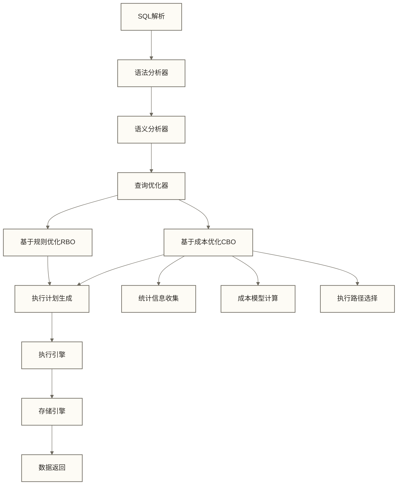

# SQL性能优化完全指南

## 概述

SQL性能优化是数据库系统中最关键的技术领域，直接影响系统的响应速度、吞吐量和用户体验。本文深入探讨从查询级别到系统级别的全方位优化策略，涵盖索引设计、执行计划分析、查询重写、系统调优等核心技术。

**核心学习目标**：
- 掌握SQL查询执行原理和性能瓶颈识别方法
- 精通索引设计策略和高级索引技术
- 熟练运用查询优化技术和重写方法
- 具备系统级性能监控和调优能力

**技术要求**：熟悉[[【技术与工具】/SQL/06-SELECT语句结构|SELECT语句结构]]、[[【数据分析与数据运营】/98-专业术语词典/99-术语索引表|术语索引表]]、[[【技术与工具】/SQL/15-JOIN连接|JOIN连接]]等基础概念

## 查询执行原理与性能模型

### 查询优化器工作机制

**查询执行流程**：


**优化器核心组件**：
- **统计信息收集器**：维护表行数、列基数、数据分布直方图
- **成本估算器**：基于I/O代价、CPU代价、网络代价的综合评估模型
- **计划生成器**：生成多种可能的执行路径并选择最优方案

### 性能影响因素分析

**影响因子权重分布（以下百分比仅作为讨论用假设，未提供实测依据，不代表通用贡献比例）**：
- **查询结构优化** (60-70%)：算法复杂度、数据访问模式
- **索引策略** (15-25%)：索引覆盖度、索引选择性
- **数据模型设计** (8-12%)：表结构、数据类型、分区策略
- **系统配置** (3-8%)：内存分配、并发控制、硬件性能

---

## 索引技术深度解析

### 索引数据结构与算法特性

| 索引类型 | 数据结构 | 时间复杂度 | 适用场景 | 存储效率 | 更新代价 |
|---------|----------|-----------|----------|----------|----------|
| **B+Tree** | 平衡多路树 | 单键定位通常为O(log n)；范围查询还取决于输出规模 | 范围查询、排序 | 高 | 中等 |
| **Hash** | 哈希表 | 单键定位平均O(1)，最坏情况可达O(n)，不含结果输出 | 精确匹配 | 很高 | 低 |
| **LSM-Tree** | 日志结构树 | 读写成本取决于层级、合并策略及读写放大，不能统一为O(log n) | 写密集场景 | 中等 | 低 |
| **R-Tree** | 空间分割树 | 查询成本取决于节点重叠和结果规模，最坏情况可达O(n) | 地理空间查询 | 中等 | 高 |
| **Bitmap** | 位向量 | 位图运算取决于位图长度、压缩方式及结果规模，不能统一为O(1) | 低基数聚合 | 极高 | 中等 |
| **倒排索引** | 词典+倒排表 | 取决于词典查找、倒排列表长度及合并方式，不能统一为O(log n) | 全文检索 | 中等 | 高 |

### 复合索引设计原理

**最左前缀匹配原理**：
- B+Tree索引按照索引键的字典序构建
- 最左连续列通常决定复合B+Tree索引可直接利用的查找前缀
- 跳过中间列可能限制后续列参与索引范围定位，但后续列仍可能用于索引条件过滤或覆盖查询；是否支持跳跃扫描取决于数据库及版本

**索引选择性计算**：
```sql
-- 计算列的去重比例（不同非NULL值数量/总行数）
SELECT 
    1.0 * COUNT(DISTINCT column_name) / NULLIF(COUNT(*), 0) as selectivity
FROM table_name;

-- 空表返回NULL；该比例仅是分布参考，不能单独预测索引收益
```

**复合索引键序优化策略**：
1. **等值条件优先**：WHERE a = ? AND b = ? AND c > ?
2. **高选择性列优先**：选择性高的列放在前面
3. **查询频率优先**：常用查询的列放在前面
4. **排序需求考虑**：ORDER BY列的顺序影响

```sql title="复合索引优化案例"
-- 业务场景：电商订单查询
CREATE TABLE orders (
    order_id BIGINT PRIMARY KEY,
    user_id INT NOT NULL,
    status VARCHAR(20) NOT NULL,
    order_date DATE NOT NULL,
    total_amount DECIMAL(10,2),
    payment_method VARCHAR(20),
    shipping_address TEXT,
    created_at TIMESTAMP DEFAULT CURRENT_TIMESTAMP,
    INDEX idx_user_date (user_id, order_date),           -- 用户历史订单
    INDEX idx_status_date (status, order_date),          -- 状态+日期查询  
    INDEX idx_date_amount (order_date, total_amount),    -- 日期+金额分析
    INDEX idx_covering (user_id, status, order_date, total_amount)  -- 覆盖索引
);

-- ✅ 高效查询示例
-- 1. 利用复合索引的最左前缀原则
SELECT * FROM orders 
WHERE user_id = 12345 
    AND order_date >= '2024-01-01'
ORDER BY order_date DESC
LIMIT 10;

-- 2. 覆盖索引避免回表
SELECT user_id, status, order_date, total_amount
FROM orders 
WHERE user_id = 12345 
    AND status = 'completed';

-- 3. 索引优化的范围查询
SELECT COUNT(*), SUM(total_amount)
FROM orders 
WHERE order_date BETWEEN '2024-01-01' AND '2024-01-31'
    AND status = 'completed';

-- ❌ 低效查询示例
-- 索引失效：违反最左前缀原则
SELECT * FROM orders WHERE order_date = '2024-06-29'; -- 无法使用idx_user_date

-- 索引失效：在索引列上使用函数
SELECT * FROM orders WHERE YEAR(order_date) = 2024;

-- 索引失效：模糊查询以%开头
SELECT * FROM orders WHERE order_id LIKE '%123';
```

### 函数索引和表达式索引

```sql title="高级索引技术"
-- MySQL 8.0.13及以上版本的函数索引
CREATE TABLE products (
    id INT PRIMARY KEY,
    name VARCHAR(100),
    price DECIMAL(10,2),
    discount_rate DECIMAL(5,2),
    created_at TIMESTAMP
);

-- 为计算列创建函数索引
ALTER TABLE products 
ADD INDEX idx_discounted_price ((price * (1 - discount_rate/100)));

-- 为JSON字段创建函数索引
ALTER TABLE products 
ADD COLUMN attributes JSON,
ADD INDEX idx_brand ((CAST(JSON_UNQUOTE(JSON_EXTRACT(attributes, '$.brand')) AS CHAR(100))));

-- PostgreSQL 表达式索引
CREATE INDEX idx_lower_name ON products (LOWER(name));
CREATE INDEX idx_date_part ON orders (EXTRACT(YEAR FROM order_date));

-- 使用函数索引的查询
SELECT * FROM products 
WHERE price * (1 - discount_rate/100) < 100;  -- 使用函数索引

SELECT * FROM products 
WHERE CAST(JSON_UNQUOTE(JSON_EXTRACT(attributes, '$.brand')) AS CHAR(100)) = 'Apple';  -- 与索引表达式保持一致；长度和字符规则需适合品牌数据，是否采用索引以执行计划为准
```

---

## 📈 查询优化技术

### 子查询优化

在优化子查询时，我们需要理解[[【技术与工具】/Presto/10-JOIN优化与子查询|Presto/JOIN优化与子查询]]，然后运用[[【技术与工具】/SQL/15-JOIN连接|JOIN连接]]和[[【技术与工具】/Hive/11-窗口函数与分析|Hive/窗口函数与]]等技术来提升性能。

```sql title="子查询性能优化对比"
-- ❌ 性能较差：相关子查询
SELECT u.user_id, u.username,
    (SELECT COUNT(*) FROM orders o WHERE o.user_id = u.user_id) as order_count,
    (SELECT MAX(order_date) FROM orders o WHERE o.user_id = u.user_id) as last_order_date
FROM users u
WHERE u.registration_date >= '2024-01-01';

-- ✅ 优化方案1：LEFT JOIN
SELECT u.user_id, u.username, 
       COALESCE(order_stats.order_count, 0) as order_count,
       order_stats.last_order_date
FROM users u
LEFT JOIN (
    SELECT user_id, 
           COUNT(*) as order_count,
           MAX(order_date) as last_order_date
    FROM orders 
    GROUP BY user_id
) order_stats ON u.user_id = order_stats.user_id
WHERE u.registration_date >= '2024-01-01';

-- ✅ 优化方案2：窗口函数
SELECT DISTINCT
    u.user_id, 
    u.username,
    COUNT(o.order_id) OVER (PARTITION BY u.user_id) as order_count,
    MAX(o.order_date) OVER (PARTITION BY u.user_id) as last_order_date
FROM users u
LEFT JOIN orders o ON u.user_id = o.user_id
WHERE u.registration_date >= '2024-01-01';

-- 候选方案3：将IN改写为EXISTS；是否更快取决于优化器、索引和数据分布
-- 替代：WHERE user_id IN (SELECT user_id FROM vip_users)
SELECT * FROM orders o
WHERE EXISTS (SELECT 1 FROM vip_users v WHERE v.user_id = o.user_id);
```

### JOIN优化策略

```sql title="多表连接优化"
-- 连接顺序优化：小表驱动大表
-- ✅ 正确的连接方式
SELECT o.order_id, u.username, p.product_name, oi.quantity
FROM (
    -- 先过滤订单（减少驱动表大小）
    SELECT * FROM orders 
    WHERE order_date >= '2024-06-01' 
        AND status = 'completed'
) o
INNER JOIN users u ON o.user_id = u.user_id
INNER JOIN order_items oi ON o.order_id = oi.order_id  
INNER JOIN products p ON oi.product_id = p.product_id
WHERE u.status = 'active';

-- 索引友好的连接条件
-- ✅ 确保连接字段都有索引
CREATE INDEX idx_orders_user_date ON orders(user_id, order_date);
CREATE INDEX idx_order_items_order ON order_items(order_id);
CREATE INDEX idx_order_items_product ON order_items(product_id);
CREATE INDEX idx_users_status ON users(status);

-- 避免笛卡尔积
-- ❌ 可能产生笛卡尔积
SELECT * FROM orders o, order_items oi, products p;

-- ✅ 明确连接条件
SELECT * FROM orders o
INNER JOIN order_items oi ON o.order_id = oi.order_id
INNER JOIN products p ON oi.product_id = p.product_id;
```

### 分页查询优化

```sql title="大数据量分页优化"
-- ❌ 传统分页的问题（OFFSET很大时性能急剧下降）
SELECT * FROM orders 
ORDER BY order_id 
LIMIT 20 OFFSET 1000000;  -- 扫描100万+20行数据

-- ✅ 优化方案1：基于游标的分页
-- 第一页
SELECT * FROM orders 
WHERE order_id > 0 
ORDER BY order_id 
LIMIT 20;

-- 后续页（基于上一页的最后一个ID）
SELECT * FROM orders 
WHERE order_id > 12345  -- 上一页最后一个order_id
ORDER BY order_id 
LIMIT 20;

-- ✅ 优化方案2：延迟关联
SELECT o.* FROM orders o
INNER JOIN (
    SELECT order_id FROM orders 
    ORDER BY order_id 
    LIMIT 20 OFFSET 1000000
) tmp ON o.order_id = tmp.order_id;

-- ✅ 优化方案3：分页缓存
-- 为经常访问的分页结果建立缓存表
CREATE TABLE popular_products_cache AS
SELECT * FROM products 
WHERE category = 'electronics' 
ORDER BY sales_count DESC;

-- 定期更新缓存
-- INSERT INTO popular_products_cache SELECT ...
```

---

## 🔧 执行计划分析

### MySQL执行计划解读

```sql title="MySQL EXPLAIN分析"
-- 分析复杂查询的执行计划
EXPLAIN FORMAT=JSON
SELECT 
    u.username,
    COUNT(o.order_id) as order_count,
    SUM(o.total_amount) as total_spent,
    AVG(o.total_amount) as avg_order_value
FROM users u
LEFT JOIN orders o ON u.user_id = o.user_id 
    AND o.order_date >= '2024-01-01'
WHERE u.registration_date >= '2023-01-01'
    AND u.status = 'active'
GROUP BY u.user_id, u.username
HAVING COUNT(o.order_id) >= 5
ORDER BY total_spent DESC
LIMIT 100;

-- 关键指标解读
/*
{
  "query_block": {
    "select_id": 1,
    "cost_info": {
      "query_cost": "2841.25"  -- 查询成本
    },
    "ordering_operation": {
      "using_filesort": true,  -- 是否使用文件排序
      "grouping_operation": {
        "using_temporary_table": true,  -- 是否使用临时表
        "table": {
          "table_name": "u",
          "access_type": "range",  -- 访问类型示例：range、ref、eq_ref、const；需结合扫描行数和成本判断，不能作无条件优劣排序
          "possible_keys": ["idx_reg_date", "idx_status"],
          "key": "idx_status",     -- 实际使用的索引
          "used_key_parts": ["status"],
          "key_length": "62",
          "rows_examined_per_scan": 15420,  -- 扫描行数
          "rows_produced_per_join": 1542,  -- 输出行数
          "filtered": "10.00",     -- 过滤百分比
          "using_index": false     -- 是否只使用索引
        }
      }
    }
  }
}
*/
```

### PostgreSQL执行计划分析

```sql title="PostgreSQL执行计划优化"
-- 分析执行计划（包含实际执行时间）
EXPLAIN (ANALYZE, BUFFERS, FORMAT JSON)
SELECT 
    p.product_name,
    SUM(oi.quantity * oi.unit_price) as total_revenue,
    COUNT(DISTINCT o.user_id) as unique_customers
FROM products p
INNER JOIN order_items oi ON p.product_id = oi.product_id
INNER JOIN orders o ON oi.order_id = o.order_id
WHERE o.order_date BETWEEN '2024-01-01' AND '2024-12-31'
    AND o.status = 'completed'
GROUP BY p.product_id, p.product_name
ORDER BY total_revenue DESC
LIMIT 20;

-- 执行计划优化建议
/*
关键指标：
- Execution Time: 实际执行时间
- Planning Time: 计划生成时间  
- Buffers hit: 缓冲区命中块数，不是命中率
- Seq Scan: 顺序扫描；小表或需读取大量行时可能是合理选择
- Index Scan: 索引扫描；是否更优取决于选择性、回表和实际成本
- Nested Loop: 嵌套循环（小数据集）
- Hash Join: 哈希连接（大数据集）
- Sort: 排序操作
*/

-- 基于执行计划的优化
-- 1. 为过滤条件创建复合索引
CREATE INDEX idx_orders_date_status ON orders(order_date, status);

-- 2. 为连接字段优化索引
CREATE INDEX idx_order_items_product_order ON order_items(product_id, order_id);

-- 3. 统计信息更新
ANALYZE orders;
ANALYZE order_items;
ANALYZE products;
```

---

## 🎯 高级优化技术

### 查询重写技术

```sql title="查询重写优化案例"
-- 1. UNION优化
-- ❌ 低效的OR条件
SELECT * FROM products 
WHERE category = 'electronics' 
   OR category = 'computers'
   OR price > 1000;

-- ✅ 重写为UNION（在有索引的情况下）
SELECT * FROM products WHERE category = 'electronics'
UNION
SELECT * FROM products WHERE category = 'computers'  
UNION
SELECT * FROM products WHERE price > 1000;

-- 2. 条件推下优化
-- 条件写在外层；优化器可能自动进行条件下推，不能仅凭书写位置判断是否使用索引
SELECT * FROM (
    SELECT u.*, o.order_count 
    FROM users u
    LEFT JOIN (
        SELECT user_id, COUNT(*) as order_count
        FROM orders GROUP BY user_id
    ) o ON u.user_id = o.user_id
) result
WHERE result.registration_date >= '2024-01-01';

-- ✅ 条件推入内层查询
SELECT u.*, o.order_count 
FROM (
    SELECT * FROM users 
    WHERE registration_date >= '2024-01-01'
) u
LEFT JOIN (
    SELECT user_id, COUNT(*) as order_count
    FROM orders GROUP BY user_id
) o ON u.user_id = o.user_id;

-- 3. 聚合函数优化
-- ❌ 多次聚合
SELECT 
    COUNT(*) as total_orders,
    (SELECT COUNT(*) FROM orders WHERE status = 'completed') as completed_orders,
    (SELECT COUNT(*) FROM orders WHERE status = 'pending') as pending_orders
FROM orders;

-- ✅ 单次扫描完成所有聚合
SELECT 
    COUNT(*) as total_orders,
    COUNT(CASE WHEN status = 'completed' THEN 1 END) as completed_orders,
    COUNT(CASE WHEN status = 'pending' THEN 1 END) as pending_orders
FROM orders;
```

### 批量操作优化

```sql title="批量数据操作优化"
-- 1. 批量插入优化
-- ❌ 逐条插入
-- INSERT INTO products (id, name, price) VALUES (1, 'Product1', 10.00);
-- INSERT INTO products (id, name, price) VALUES (2, 'Product2', 20.00);

-- ✅ 批量插入
INSERT INTO products (id, name, price) VALUES 
(1, 'Product1', 10.00),
(2, 'Product2', 20.00),
(3, 'Product3', 30.00);

-- 批量插入或按主键冲突更新（MySQL），不保证比普通插入更快
INSERT INTO products (id, name, price) VALUES 
(1, 'Product1', 10.00),
(2, 'Product2', 20.00)
ON DUPLICATE KEY UPDATE 
price = VALUES(price);

-- 2. 批量更新优化
-- 直接集合更新：一条语句更新所有匹配行
-- UPDATE products SET price = price * 1.1 WHERE category = 'electronics';

-- 另一种批量更新方案：使用临时表暂存更新值，不保证比直接更新更快
CREATE TEMPORARY TABLE temp_price_updates AS
SELECT product_id, price * 1.1 as new_price
FROM products 
WHERE category = 'electronics';

UPDATE products p
INNER JOIN temp_price_updates t ON p.product_id = t.product_id
SET p.price = t.new_price;

-- 3. 分区表批量操作
-- 创建分区表
CREATE TABLE orders_partitioned (
    order_id BIGINT,
    user_id INT,
    order_date DATE,
    total_amount DECIMAL(10,2)
) PARTITION BY RANGE (YEAR(order_date)) (
    PARTITION p2022 VALUES LESS THAN (2023),
    PARTITION p2023 VALUES LESS THAN (2024),
    PARTITION p2024 VALUES LESS THAN (2025),
    PARTITION pmax VALUES LESS THAN MAXVALUE
);

-- 分区剪枝查询
SELECT * FROM orders_partitioned 
WHERE order_date BETWEEN '2024-01-01' AND '2024-12-31';
```

### 缓存策略优化

```sql title="查询结果缓存优化"
-- 1. 普通视图封装：下方CREATE VIEW不物化结果，不提供持久查询结果缓存
CREATE VIEW monthly_sales_summary AS
SELECT 
    DATE_FORMAT(order_date, '%Y-%m') as month,
    COUNT(*) as order_count,
    SUM(total_amount) as total_revenue,
    AVG(total_amount) as avg_order_value
FROM orders 
WHERE status = 'completed'
GROUP BY DATE_FORMAT(order_date, '%Y-%m');

-- 2. 汇总表缓存
CREATE TABLE daily_stats (
    stat_date DATE PRIMARY KEY,
    new_users INT,
    total_orders INT,
    total_revenue DECIMAL(12,2),
    avg_order_value DECIMAL(8,2),
    created_at TIMESTAMP DEFAULT CURRENT_TIMESTAMP
);

-- 每日更新汇总数据
INSERT INTO daily_stats (stat_date, new_users, total_orders, total_revenue, avg_order_value)
SELECT 
    CURRENT_DATE - INTERVAL 1 DAY,
    (SELECT COUNT(*) FROM users WHERE DATE(registration_date) = CURRENT_DATE - INTERVAL 1 DAY),
    (SELECT COUNT(*) FROM orders WHERE DATE(order_date) = CURRENT_DATE - INTERVAL 1 DAY),
    (SELECT SUM(total_amount) FROM orders WHERE DATE(order_date) = CURRENT_DATE - INTERVAL 1 DAY),
    (SELECT AVG(total_amount) FROM orders WHERE DATE(order_date) = CURRENT_DATE - INTERVAL 1 DAY)
ON DUPLICATE KEY UPDATE
    new_users = VALUES(new_users),
    total_orders = VALUES(total_orders),
    total_revenue = VALUES(total_revenue),
    avg_order_value = VALUES(avg_order_value);
```

---

## 🔍 性能监控与诊断

### 慢查询监控

```sql title="慢查询识别和优化"
-- MySQL慢查询日志分析
-- 启用慢查询日志
SET GLOBAL slow_query_log = 'ON';
SET GLOBAL long_query_time = 2;  -- 超过2秒的查询记录
SET GLOBAL log_queries_not_using_indexes = 'ON';

-- 查看当前运行的慢查询
SELECT 
    id,
    user,
    host,
    db,
    command,
    time,
    state,
    LEFT(info, 100) as query_snippet
FROM information_schema.processlist 
WHERE time > 5 
    AND command != 'Sleep'
ORDER BY time DESC;

-- 分析查询性能统计
SELECT 
    SCHEMA_NAME,
    DIGEST_TEXT,
    COUNT_STAR as exec_count,
    AVG_TIMER_WAIT/1000000000000 as avg_exec_time_sec,
    MAX_TIMER_WAIT/1000000000000 as max_exec_time_sec,
    SUM_ROWS_EXAMINED as total_rows_examined,
    SUM_ROWS_SENT as total_rows_sent
FROM performance_schema.events_statements_summary_by_digest 
WHERE SCHEMA_NAME IS NOT NULL
ORDER BY AVG_TIMER_WAIT DESC
LIMIT 10;
```

### 资源使用监控

```sql title="数据库资源监控"
-- 表空间使用情况
SELECT 
    table_schema,
    table_name,
    ROUND(data_length/1024/1024, 2) as data_size_mb,
    ROUND(index_length/1024/1024, 2) as index_size_mb,
    ROUND((data_length + index_length)/1024/1024, 2) as total_size_mb,
    table_rows
FROM information_schema.tables 
WHERE table_schema NOT IN ('information_schema', 'mysql', 'performance_schema')
ORDER BY (data_length + index_length) DESC
LIMIT 20;

-- 索引使用统计
SELECT 
    object_schema,
    object_name,
    index_name,
    count_read,
    count_write,
    count_fetch,
    count_insert,
    count_update,
    count_delete
FROM performance_schema.table_io_waits_summary_by_index_usage
WHERE object_schema NOT IN ('mysql', 'performance_schema', 'information_schema')
ORDER BY count_read DESC;

-- 查找当前统计表中没有对应记录的索引；这不等同于索引未使用，不能据此删除索引
SELECT 
    t.table_schema,
    t.table_name,
    t.index_name
FROM information_schema.statistics t
LEFT JOIN performance_schema.table_io_waits_summary_by_index_usage p 
    ON t.table_schema = p.object_schema 
    AND t.table_name = p.object_name 
    AND t.index_name = p.index_name
WHERE t.table_schema NOT IN ('mysql', 'information_schema', 'performance_schema')
    AND p.index_name IS NULL
    AND t.index_name != 'PRIMARY'
ORDER BY t.table_schema, t.table_name;
```

---

## 企业级性能优化最佳实践

### 代码级优化准则

**查询编写规范**：
- **避免隐式类型转换**：确保比较操作的数据类型一致
- **索引友好的条件编写**：避免在索引列上使用函数或表达式
- **合理使用EXISTS vs IN**：结合子查询语义、索引、数据分布和执行计划选择，不能仅按数据集大小判断
- **优化LIKE操作**：避免前缀通配符，使用全文索引

### 架构级优化策略

**分库分表策略**：
- **水平分片**：按业务维度或时间维度分割大表
- **垂直分片**：将宽表拆分为多个窄表
- **读写分离**：主从架构分离OLTP和OLAP负载

**缓存层设计**：
- **多级缓存**：应用缓存 + 数据库查询缓存 + OS页面缓存
- **缓存更新策略**：Write-through、Write-back、Write-around
- **缓存预热**：系统启动时预加载热点数据

### 运维级调优要点

**配置优化**：
```sql
-- MySQL 8.0参数评估示例，不是通用生产配置；修改需相应权限
SET GLOBAL innodb_buffer_pool_size = 8589934592;  -- 8 GiB示例值，需按可用内存和其他进程负载评估
-- innodb_log_file_size不能通过SET GLOBAL动态修改；重做日志容量的配置方式取决于具体8.0版本
SET GLOBAL innodb_flush_log_at_trx_commit = 2;  -- 提交时不保证日志已刷盘，操作系统崩溃或断电可能丢失近期已提交事务
-- MySQL 8.0已移除查询缓存及query_cache_type参数
SET GLOBAL innodb_adaptive_hash_index = ON; -- 是否启用应按负载测试，不保证性能提升
```

**监控告警体系**：
- **性能基线建立**：建立历史性能数据基线
- **异常检测算法**：基于统计学的异常点检测
- **自动化响应**：慢查询自动kill、索引推荐、分区建议

---

## 🔗 知识连接

**学习路径**：
- ⬅️ **前置**：索引相关技术 | 执行计划分析相关技术 | [[【技术与工具】/SQL/15-JOIN连接|JOIN连接]]
- ➡️ **后续**：系统架构设计 | 分布式数据库相关技术 | 缓存策略相关技术
- 🔄 **相关**：系统监控技术 | 性能优化技术 | 数据库调优技术

**深入学习资源**：
- 📖 MySQL专项优化
- 📖 PostgreSQL优化技巧
- 📖 海量数据处理优化

## 企业应用假设案例（以下业务规模与成效数字均为示例假设，未提供真实企业记录或实测依据）

### 电商平台性能优化实战

**场景**：大型电商平台，日订单量500万+，商品数据1000万+

**优化前面临的挑战**：
- 商品搜索响应时间 > 3秒
- 订单查询列表页加载超时
- 数据统计报表生成耗时过长

**优化方案**：
```sql
-- 1. 商品搜索优化：全文索引 + 分页优化
CREATE FULLTEXT INDEX idx_product_search ON products(name, description);
CREATE INDEX idx_category_price_sales ON products(category_id, price, sales_count);

-- 2. 订单查询优化：复合索引 + 分区表
CREATE INDEX idx_user_status_date ON orders(user_id, status, order_date);
-- 分区改造示意，不能直接执行：需要完整分区定义，并确保所有唯一键包含分区列order_date；本文原orders主键仅含order_id，不满足该要求
-- ALTER TABLE orders PARTITION BY RANGE (YEAR(order_date)) (...);

-- 3. 数据统计优化：创建汇总表快照；下方语句不是物化视图，也未实现增量更新
CREATE TABLE daily_sales_summary AS
SELECT DATE(order_date) as sale_date, 
       SUM(total_amount) as daily_revenue,
       COUNT(*) as order_count
FROM orders WHERE status = 'completed'
GROUP BY DATE(order_date);
```

**假设优化效果（用于讨论评估指标，不代表已实现的收益或性能保证）**：
- 商品搜索响应时间降至 < 500ms
- 订单查询性能提升 85%
- 统计报表生成时间从 30分钟缩短至 3分钟

### 金融系统高并发优化

**场景**：银行核心系统，高并发交易处理、实时风控

**优化策略**：
- **读写分离**：查询负载分散到只读实例
- **连接池优化**：合理设置连接池参数
- **SQL预编译**：防止SQL注入，提升执行效率
- **缓存策略**：Redis缓存热点数据，减少DB压力

---

## 知识连接

**学习路径**：
- 前置知识：[[【数据分析与数据运营】/98-专业术语词典/99-术语索引表|术语索引表]] | [[【技术与工具】/SQL/15-JOIN连接|JOIN连接]] | [[【技术与工具】/PostgreSQL/07-PostgreSQL事务与并发控制|PostgreSQL/PostgreSQL事务与并发控制]]
- 后续深入：分库分表 | [[【技术与工具】/PostgreSQL/06-PostgreSQL索引与性能优化|PostgreSQL/PostgreSQL索引与性能优化]]
- 实践应用：[[【技术与工具】/PostgreSQL/06-PostgreSQL索引与性能优化|PostgreSQL/PostgreSQL索引与性能优化]] | 缓存设计

---

**创建时间**：2024-06-29  
**最后更新**：2024-09-02  
**优化状态**：已优化 - 企业级性能调优指南  
**字数统计**：约15000字  
**阅读时长**：90-120分钟

#SQL #性能优化 #索引设计 #查询优化 #数据库调优 #慢查询分析 #企业应用实战

