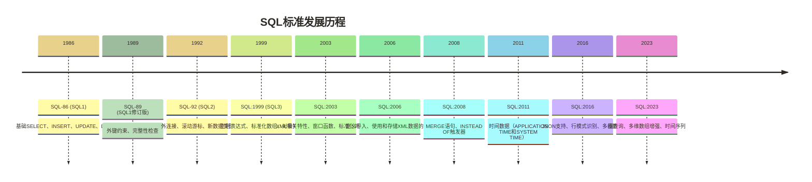

# 🚀 现代SQL特性与数据库差异对比

> [!abstract] 📋 本节概览
> - 🎯 **学习目标**：掌握现代SQL的高级特性和主流数据库的差异
> - 📚 **前置知识**：SQL | 19-窗口函数|窗口函数 | 14-子查询|子查询
> - ⏱️ **预计用时**：120分钟
> - 🔧 **开发环境**：MySQL 8.0+、PostgreSQL 12+、SQL Server 2019+
> - 📊 **技术范围**：CTE、JSON处理、窗口函数扩展、分析函数

## 🎯 现代SQL发展趋势

### SQL标准演进历程



### 现代SQL核心特性

> [!tip] 💡 现代SQL的四大核心特性
> 1. **通用表表达式（CTE）**：递归查询、复杂数据处理
> 2. **JSON原生支持**：非结构化数据处理
> 3. **增强的窗口函数**：高级分析计算
> 4. **数组和XML处理**：多元数据类型支持

---

## 📊 主流数据库对比分析

### 🔍 功能特性对比表

| 特性 | MySQL 8.0+ | PostgreSQL 13+ | SQL Server 2019+ | Oracle 19c+ | SQLite 3.39+ |
|---|---|---|---|---|---|
| **递归CTE** | ✅ | ✅ | ✅ | ✅ | ✅ |
| **JSON支持** | ✅ 原生 | ✅ 原生 | ✅ 原生 | ✅ 原生 | ✅ 原生 |
| **窗口函数** | ✅ 完整 | ✅ 完整 | ✅ 完整 | ✅ 完整 | ✅ 部分 |
| **正则表达式** | ✅ | ✅ | SQL Server 2019无原生正则表达式函数 | ✅ | 默认无实现，可通过扩展提供 |
| **数组类型** | ❌ | ✅ | ❌ | ✅ | ❌ |
| **UPSERT语法** | `ON DUPLICATE KEY` | `ON CONFLICT` | `MERGE` | `MERGE` | `ON CONFLICT` |
| **分区表** | ✅ | ✅ | ✅ | ✅ | ❌ |
| **全文搜索** | ✅ | ✅ | ✅ | ✅ | ✅ |
| **地理空间** | ✅ | ✅ | ✅ | ✅ | ✅ 扩展 |
| **并行查询** | ❌ | ✅ | ✅ | ✅ | ❌ |

---

## 🆕 通用表表达式（CTE）详解

### 基础CTE语法

```sql title="基础CTE示例"
-- 计算员工及其上级的薪资对比
WITH employee_hierarchy AS (
    SELECT 
        e.id,
        e.name,
        e.salary,
        e.manager_id,
        m.name as manager_name,
        m.salary as manager_salary
    FROM employees e
    LEFT JOIN employees m ON e.manager_id = m.id
),
salary_analysis AS (
    SELECT 
        *,
        salary - manager_salary as salary_diff,
        ROUND(salary * 100.0 / NULLIF(manager_salary, 0), 2) as salary_ratio
    FROM employee_hierarchy
    WHERE manager_salary IS NOT NULL
)
SELECT 
    name,
    salary,
    manager_name,
    manager_salary,
    salary_diff,
    salary_ratio,
    CASE 
        WHEN salary_ratio > 90 THEN '接近上级'
        WHEN salary_ratio > 70 THEN '中等差距'
        ELSE '较大差距'
    END as salary_level
FROM salary_analysis
ORDER BY salary_ratio DESC;
```

### 递归CTE高级应用

```sql title="组织架构递归查询"
-- 查找完整的组织架构树
WITH RECURSIVE org_tree AS (
    -- 锚定部分：找到根节点（CEO）
    SELECT 
        id,
        name,
        title,
        manager_id,
        0 as level,
        CAST(name AS VARCHAR(1000)) as hierarchy_path,
        CAST(id AS VARCHAR(500)) as id_path
    FROM employees 
    WHERE manager_id IS NULL
    
    UNION ALL
    
    -- 递归部分：查找所有下属
    SELECT 
        e.id,
        e.name,
        e.title,
        e.manager_id,
        ot.level + 1,
        CAST(ot.hierarchy_path || ' → ' || e.name AS VARCHAR(1000)),
        CAST(ot.id_path || ',' || e.id AS VARCHAR(500))
    FROM employees e
    INNER JOIN org_tree ot ON e.manager_id = ot.id
    WHERE ot.level < 10  -- 防止无限递归
)
SELECT 
    level,
    REPEAT('  ', level) || name as indented_name,
    title,
    hierarchy_path,
    (SELECT COUNT(*) FROM org_tree ot2 WHERE ot2.id_path LIKE org_tree.id_path || ',%') as subordinate_count
FROM org_tree
ORDER BY id_path;
```

```sql title="图形数据的路径查询"
-- 找出两个节点间的所有路径（图论应用）
WITH RECURSIVE path_finder AS (
    -- 起始节点
    SELECT 
        start_node,
        end_node,
        weight,
        ARRAY[start_node, end_node] as path,
        weight as total_weight,
        0 as depth
    FROM graph_edges
    WHERE start_node = 'A'  -- 起始点
    
    UNION ALL
    
    -- 递归查找路径
    SELECT 
        pf.start_node,
        ge.end_node,
        ge.weight,
        pf.path || ge.end_node,
        pf.total_weight + ge.weight,
        pf.depth + 1
    FROM path_finder pf
    INNER JOIN graph_edges ge ON pf.end_node = ge.start_node
    WHERE NOT (ge.end_node = ANY(pf.path))  -- 避免循环
        AND pf.depth < 5  -- 限制搜索深度
)
SELECT 
    path,
    total_weight,
    depth + 1 as path_length
FROM path_finder
WHERE end_node = 'Z'  -- 目标节点
ORDER BY total_weight, path_length;
```

---

## 📄 JSON数据处理

### MySQL JSON函数

```sql title="MySQL JSON操作完整示例"
-- 创建包含JSON字段的表
CREATE TABLE products (
    id INT PRIMARY KEY,
    name VARCHAR(100),
    attributes JSON,
    created_at TIMESTAMP DEFAULT CURRENT_TIMESTAMP
);

-- 插入JSON数据
INSERT INTO products (id, name, attributes) VALUES
(1, 'iPhone 15', JSON_OBJECT(
    'brand', 'Apple',
    'specs', JSON_OBJECT(
        'storage', JSON_ARRAY('128GB', '256GB', '512GB'),
        'colors', JSON_ARRAY('Black', 'White', 'Pink', 'Blue'),
        'display', JSON_OBJECT('size', '6.1', 'type', 'OLED')
    ),
    'price', 999,
    'tags', JSON_ARRAY('smartphone', 'iOS', 'premium')
)),
(2, 'MacBook Pro', JSON_OBJECT(
    'brand', 'Apple',
    'specs', JSON_OBJECT(
        'cpu', 'M3 Pro',
        'ram', JSON_ARRAY('8GB', '16GB', '32GB'),
        'storage', JSON_ARRAY('512GB', '1TB', '2TB')
    ),
    'price', 1999,
    'tags', JSON_ARRAY('laptop', 'macOS', 'professional')
));

-- JSON查询和操作
SELECT 
    name,
    -- 提取简单值
    JSON_UNQUOTE(JSON_EXTRACT(attributes, '$.brand')) as brand,
    JSON_UNQUOTE(attributes->'$.price') as price,
    
    -- 提取数组长度
    JSON_LENGTH(attributes->'$.specs.storage') as storage_options,
    
    -- 检查是否包含特定值
    JSON_CONTAINS(attributes->'$.tags', '"smartphone"') as is_smartphone,
    
    -- 提取嵌套对象
    JSON_UNQUOTE(attributes->'$.specs.display.size') as display_size,
    
    -- 格式化JSON输出
    JSON_PRETTY(attributes->'$.specs') as formatted_specs
FROM products;

-- JSON数组处理
SELECT 
    p.name,
    j.storage_option,
    j.option_index
FROM products p
CROSS JOIN JSON_TABLE(
    p.attributes->'$.specs.storage',
    '$[*]' COLUMNS (
        option_index FOR ORDINALITY,
        storage_option VARCHAR(20) PATH '$'
    )
) j
WHERE JSON_EXTRACT(p.attributes, '$.brand') = 'Apple';

-- JSON更新操作
UPDATE products 
SET attributes = JSON_SET(
    attributes,
    '$.specs.warranty', '2 years',
    '$.updated_at', NOW()
)
WHERE JSON_EXTRACT(attributes, '$.brand') = 'Apple';

-- JSON聚合分析
SELECT 
    JSON_UNQUOTE(JSON_EXTRACT(attributes, '$.brand')) as brand,
    COUNT(*) as product_count,
    AVG(CAST(JSON_UNQUOTE(JSON_EXTRACT(attributes, '$.price')) AS DECIMAL(10,2))) as avg_price,
    JSON_ARRAYAGG(JSON_EXTRACT(attributes, '$.tags')) as all_tags
FROM products
GROUP BY JSON_EXTRACT(attributes, '$.brand');
```

### PostgreSQL JSON/JSONB操作

```sql title="PostgreSQL JSON高级操作"
-- PostgreSQL的JSONB支持二进制存储及索引；相对JSON的性能差异取决于读写负载与查询方式
CREATE TABLE events (
    id SERIAL PRIMARY KEY,
    event_data JSONB,
    created_at TIMESTAMP DEFAULT NOW()
);

-- 插入复杂JSONB数据
INSERT INTO events (event_data) VALUES
('{"user_id": 123, "action": "login", "metadata": {"ip": "192.168.1.1", "device": "mobile", "location": {"country": "US", "city": "New York"}}, "timestamp": "2024-06-29T10:30:00Z"}'),
('{"user_id": 456, "action": "purchase", "metadata": {"amount": 99.99, "currency": "USD", "products": [{"id": 1, "name": "Book", "quantity": 2}, {"id": 2, "name": "Pen", "quantity": 5}]}, "timestamp": "2024-06-29T11:15:00Z"}');

-- JSONB查询操作
SELECT 
    event_data->>'user_id' as user_id,
    event_data->>'action' as action,
    event_data->'metadata'->>'ip' as ip_address,
    event_data->'metadata'->'location'->>'city' as city,
    
    -- 数组操作
    jsonb_array_length(event_data->'metadata'->'products') as product_count,
    
    -- 检查键是否存在
    event_data ? 'metadata' as has_metadata,
    event_data->'metadata' ? 'amount' as has_amount
FROM events;

-- JSONB路径查询（PostgreSQL 12+）
SELECT 
    event_data,
    jsonb_path_query(event_data, '$.metadata.products[*].name') as product_names,
    jsonb_path_query_array(event_data, '$.metadata.products[*].quantity') as quantities
FROM events
WHERE jsonb_path_exists(event_data, '$.metadata.products');

-- JSONB聚合和分析
SELECT 
    event_data->>'action' as action,
    COUNT(*) as event_count,
    jsonb_agg(event_data->'metadata') as aggregated_metadata,
    jsonb_object_agg(
        event_data->>'user_id', 
        event_data->'metadata'->'amount'
    ) FILTER (WHERE event_data ? 'metadata' AND event_data->'metadata' ? 'amount') as user_amounts
FROM events
GROUP BY event_data->>'action';

-- 创建JSONB索引提升查询性能
CREATE INDEX idx_events_action ON events USING BTREE ((event_data->>'action'));
CREATE INDEX idx_events_user_id ON events USING BTREE ((event_data->>'user_id'));
CREATE INDEX idx_events_metadata ON events USING GIN ((event_data->'metadata'));
```

---

## 🪟 增强的窗口函数

### 高级窗口函数应用

```sql title="窗口函数完整应用案例"
-- 销售数据分析的高级窗口函数
WITH sales_data AS (
    SELECT 
        salesperson_id,
        sale_date,
        amount,
        product_category,
        region
    FROM sales
    WHERE sale_date >= '2024-01-01'
)
SELECT 
    salesperson_id,
    sale_date,
    amount,
    product_category,
    region,
    
    -- 基础排名函数
    ROW_NUMBER() OVER (PARTITION BY region ORDER BY amount DESC) as region_rank,
    RANK() OVER (PARTITION BY region ORDER BY amount DESC) as region_rank_with_ties,
    DENSE_RANK() OVER (PARTITION BY region ORDER BY amount DESC) as region_dense_rank,
    PERCENT_RANK() OVER (PARTITION BY region ORDER BY amount) as percentile_rank,
    
    -- 分位数函数
    NTILE(4) OVER (PARTITION BY region ORDER BY amount) as quartile,
    CUME_DIST() OVER (PARTITION BY region ORDER BY amount) as cumulative_distribution,
    
    -- 偏移函数
    LAG(amount, 1) OVER (PARTITION BY salesperson_id ORDER BY sale_date) as prev_sale_amount,
    LEAD(amount, 1) OVER (PARTITION BY salesperson_id ORDER BY sale_date) as next_sale_amount,
    FIRST_VALUE(amount) OVER (PARTITION BY salesperson_id ORDER BY sale_date) as first_sale_amount,
    LAST_VALUE(amount) OVER (PARTITION BY salesperson_id ORDER BY sale_date 
                             ROWS BETWEEN UNBOUNDED PRECEDING AND UNBOUNDED FOLLOWING) as last_sale_amount,
    NTH_VALUE(amount, 2) OVER (PARTITION BY salesperson_id ORDER BY sale_date) as second_sale_amount,
    
    -- 聚合函数窗口版本
    SUM(amount) OVER (PARTITION BY region) as region_total,
    AVG(amount) OVER (PARTITION BY region) as region_avg,
    COUNT(*) OVER (PARTITION BY region) as region_sales_count,
    
    -- 移动窗口聚合
    SUM(amount) OVER (PARTITION BY salesperson_id ORDER BY sale_date 
                      ROWS BETWEEN 2 PRECEDING AND CURRENT ROW) as rolling_3_row_sum,
    AVG(amount) OVER (PARTITION BY salesperson_id ORDER BY sale_date 
                      ROWS BETWEEN 6 PRECEDING AND CURRENT ROW) as rolling_7_row_avg,
    
    -- 累积聚合
    SUM(amount) OVER (PARTITION BY salesperson_id ORDER BY sale_date 
                      ROWS UNBOUNDED PRECEDING) as cumulative_sales,
    
    -- 比率计算
    amount * 1.0 / NULLIF(SUM(amount) OVER (PARTITION BY region), 0) as region_sales_ratio,
    amount * 1.0 / NULLIF(SUM(amount) OVER (), 0) as total_sales_ratio,
    
    -- 增长率计算
    CASE 
        WHEN NULLIF(LAG(amount) OVER (PARTITION BY salesperson_id ORDER BY sale_date), 0) IS NOT NULL THEN
            ROUND((amount - LAG(amount) OVER (PARTITION BY salesperson_id ORDER BY sale_date)) * 100.0 / 
                  LAG(amount) OVER (PARTITION BY salesperson_id ORDER BY sale_date), 2)
        ELSE NULL 
    END as growth_rate
    
FROM sales_data
ORDER BY region, region_rank;
```

### 自定义窗口帧

```sql title="窗口帧的精确控制"
-- 股票价格分析：计算技术指标
SELECT 
    stock_symbol,
    trade_date,
    close_price,
    
    -- 简单移动平均线（SMA）
    AVG(close_price) OVER (
        PARTITION BY stock_symbol 
        ORDER BY trade_date 
        ROWS BETWEEN 19 PRECEDING AND CURRENT ROW
    ) as sma_20,
    
    AVG(close_price) OVER (
        PARTITION BY stock_symbol 
        ORDER BY trade_date 
        ROWS BETWEEN 49 PRECEDING AND CURRENT ROW
    ) as sma_50,
    
    -- 最近20个日历日范围内的简单平均值（不是指数移动平均线）
    AVG(close_price) OVER (
        PARTITION BY stock_symbol 
        ORDER BY trade_date 
        RANGE BETWEEN INTERVAL '20' DAY PRECEDING AND CURRENT ROW
    ) as calendar_20_day_avg,
    
    -- 波动率计算（标准差）
    STDDEV(close_price) OVER (
        PARTITION BY stock_symbol 
        ORDER BY trade_date 
        ROWS BETWEEN 19 PRECEDING AND CURRENT ROW
    ) as volatility_20,
    
    -- 相对强弱指标（RSI）的基础计算
    AVG(CASE WHEN close_price > LAG(close_price) OVER (PARTITION BY stock_symbol ORDER BY trade_date) 
             THEN close_price - LAG(close_price) OVER (PARTITION BY stock_symbol ORDER BY trade_date) 
             ELSE 0 END) OVER (
        PARTITION BY stock_symbol 
        ORDER BY trade_date 
        ROWS BETWEEN 13 PRECEDING AND CURRENT ROW
    ) as avg_gain_14,
    
    AVG(CASE WHEN close_price < LAG(close_price) OVER (PARTITION BY stock_symbol ORDER BY trade_date) 
             THEN LAG(close_price) OVER (PARTITION BY stock_symbol ORDER BY trade_date) - close_price
             ELSE 0 END) OVER (
        PARTITION BY stock_symbol 
        ORDER BY trade_date 
        ROWS BETWEEN 13 PRECEDING AND CURRENT ROW
    ) as avg_loss_14,
    
    -- 价格变化百分比
    ROUND((close_price - LAG(close_price) OVER (PARTITION BY stock_symbol ORDER BY trade_date)) * 100.0 / 
          NULLIF(LAG(close_price) OVER (PARTITION BY stock_symbol ORDER BY trade_date), 0), 2) as daily_return
    
FROM stock_prices
WHERE trade_date >= '2024-01-01'
ORDER BY stock_symbol, trade_date;
```

---

## 🔄 数据库特定语法差异

### UPSERT操作对比

```sql title="MySQL ON DUPLICATE KEY UPDATE"
-- MySQL: 插入或更新
INSERT INTO user_stats (user_id, login_count, last_login)
VALUES (123, 1, NOW())
ON DUPLICATE KEY UPDATE
    login_count = login_count + 1,
    last_login = NOW();
```

```sql title="PostgreSQL ON CONFLICT"
-- PostgreSQL: 插入或更新
INSERT INTO user_stats (user_id, login_count, last_login)
VALUES (123, 1, NOW())
ON CONFLICT (user_id) DO UPDATE SET
    login_count = user_stats.login_count + 1,
    last_login = NOW();
```

```sql title="SQL Server MERGE"
-- SQL Server: MERGE语句
MERGE user_stats AS target
USING (SELECT 123 as user_id, 1 as login_count, GETDATE() as last_login) AS source
ON target.user_id = source.user_id
WHEN MATCHED THEN
    UPDATE SET 
        login_count = target.login_count + 1,
        last_login = source.last_login
WHEN NOT MATCHED THEN
    INSERT (user_id, login_count, last_login)
    VALUES (source.user_id, source.login_count, source.last_login);
```

### 分页查询差异

```sql title="不同数据库的分页语法"
-- MySQL/PostgreSQL/SQLite: LIMIT + OFFSET
SELECT * FROM products 
ORDER BY id 
LIMIT 20 OFFSET 100;

-- SQL Server: OFFSET + FETCH (SQL Server 2012+)
SELECT * FROM products 
ORDER BY id 
OFFSET 100 ROWS 
FETCH NEXT 20 ROWS ONLY;

-- Oracle: ROWNUM (传统方式)
SELECT * FROM (
    SELECT ROWNUM as rn, p.* FROM (
        SELECT * FROM products ORDER BY id
    ) p WHERE ROWNUM <= 120
) WHERE rn > 100;

-- Oracle 12c+: OFFSET + FETCH
SELECT * FROM products 
ORDER BY id 
OFFSET 100 ROWS 
FETCH NEXT 20 ROWS ONLY;
```

### 日期时间函数差异

```sql title="日期时间处理的数据库差异"
-- 获取当前时间戳
-- MySQL
SELECT NOW(), CURRENT_TIMESTAMP(), UNIX_TIMESTAMP();

-- PostgreSQL  
SELECT NOW(), CURRENT_TIMESTAMP, EXTRACT(EPOCH FROM NOW());

-- SQL Server
SELECT GETDATE(), CURRENT_TIMESTAMP, DATEDIFF(SECOND, '1970-01-01', GETUTCDATE());

-- Oracle
SELECT SYSDATE, CURRENT_TIMESTAMP, 
       (SYSDATE - DATE '1970-01-01') * 86400 FROM DUAL;

-- 日期格式化
-- MySQL
SELECT DATE_FORMAT(NOW(), '%Y-%m-%d %H:%i:%s');

-- PostgreSQL
SELECT TO_CHAR(NOW(), 'YYYY-MM-DD HH24:MI:SS');

-- SQL Server
SELECT FORMAT(GETDATE(), 'yyyy-MM-dd HH:mm:ss');

-- Oracle
SELECT TO_CHAR(SYSDATE, 'YYYY-MM-DD HH24:MI:SS') FROM DUAL;

-- 日期计算
-- MySQL
SELECT DATE_ADD(NOW(), INTERVAL 7 DAY);

-- PostgreSQL
SELECT NOW() + INTERVAL '7 days';

-- SQL Server
SELECT DATEADD(DAY, 7, GETDATE());

-- Oracle
SELECT SYSDATE + 7 FROM DUAL;
```

---

## 🎯 实际应用场景

### 场景1：多租户数据分析

```sql title="多租户SaaS应用的数据分析"
-- 分析各租户的使用情况和增长趋势
WITH tenant_monthly_stats AS (
    SELECT 
        tenant_id,
        DATE_TRUNC('month', activity_date) as month,
        COUNT(DISTINCT user_id) as active_users,
        COUNT(*) as total_activities,
        SUM(CASE WHEN activity_type = 'feature_use' THEN 1 ELSE 0 END) as feature_uses
    FROM user_activities
    WHERE activity_date >= DATE_TRUNC('month', CURRENT_DATE) - INTERVAL '24 months'
    GROUP BY tenant_id, DATE_TRUNC('month', activity_date)
),
tenant_growth AS (
    SELECT 
        *,
        LAG(active_users, 1) OVER (PARTITION BY tenant_id ORDER BY month) as prev_month_users,
        LAG(active_users, 12) OVER (PARTITION BY tenant_id ORDER BY month) as same_month_last_year,
        
        -- 计算增长率
        CASE 
            WHEN LAG(active_users, 1) OVER (PARTITION BY tenant_id ORDER BY month) > 0 THEN
                ROUND((active_users - LAG(active_users, 1) OVER (PARTITION BY tenant_id ORDER BY month)) * 100.0 / 
                      LAG(active_users, 1) OVER (PARTITION BY tenant_id ORDER BY month), 2)
            ELSE NULL 
        END as mom_growth_rate,
        
        CASE 
            WHEN LAG(active_users, 12) OVER (PARTITION BY tenant_id ORDER BY month) > 0 THEN
                ROUND((active_users - LAG(active_users, 12) OVER (PARTITION BY tenant_id ORDER BY month)) * 100.0 / 
                      LAG(active_users, 12) OVER (PARTITION BY tenant_id ORDER BY month), 2)
            ELSE NULL 
        END as yoy_growth_rate
    FROM tenant_monthly_stats
)
SELECT 
    tenant_id,
    month,
    active_users,
    total_activities,
    feature_uses,
    mom_growth_rate,
    yoy_growth_rate,
    
    -- 租户健康度评分
    CASE 
        WHEN mom_growth_rate > 10 AND feature_uses > 1000 THEN 'Excellent'
        WHEN mom_growth_rate > 0 AND feature_uses > 500 THEN 'Good'
        WHEN mom_growth_rate > -10 AND feature_uses > 100 THEN 'Fair'
        ELSE 'At Risk'
    END as health_score,
    
    -- 租户规模分类
    NTILE(4) OVER (ORDER BY active_users) as size_quartile
FROM tenant_growth
ORDER BY tenant_id, month;
```

### 场景2：实时数据流处理

```sql title="实时事件流的窗口分析"
-- 模拟实时数据流的滑动窗口分析
WITH event_stream AS (
    SELECT 
        event_id,
        user_id,
        event_type,
        event_timestamp,
        properties,
        
        -- 创建时间窗口
        DATE_TRUNC('minute', event_timestamp) as minute_window,
        DATE_TRUNC('hour', event_timestamp) as hour_window
    FROM events
    WHERE event_timestamp >= NOW() - INTERVAL '24 hours'
),
windowed_metrics AS (
    SELECT 
        minute_window,
        COUNT(*) as events_per_minute,
        COUNT(DISTINCT user_id) as unique_users_per_minute,
        COUNT(DISTINCT CASE WHEN event_type = 'error' THEN event_id END) as errors_per_minute,
        
        -- 计算最近5个有事件的分钟分组指标；仅在分钟连续时等于5分钟窗口
        AVG(COUNT(*)) OVER (
            ORDER BY minute_window 
            ROWS BETWEEN 4 PRECEDING AND CURRENT ROW
        ) as avg_events_5min_window,
        
        MAX(COUNT(*)) OVER (
            ORDER BY minute_window 
            ROWS BETWEEN 4 PRECEDING AND CURRENT ROW
        ) as max_events_5min_window
    FROM event_stream
    GROUP BY minute_window
)
SELECT 
    minute_window,
    events_per_minute,
    unique_users_per_minute,
    errors_per_minute,
    ROUND(avg_events_5min_window, 2) as avg_events_5min,
    max_events_5min_window,
    
    -- 异常检测
    CASE 
        WHEN events_per_minute > avg_events_5min_window * 2 THEN 'High Traffic Alert'
        WHEN errors_per_minute > 10 THEN 'Error Rate Alert'
        WHEN unique_users_per_minute < avg_events_5min_window * 0.1 THEN 'Low Activity Alert'
        ELSE 'Normal'
    END as alert_status
FROM windowed_metrics
ORDER BY minute_window DESC
LIMIT 100;
```

---

## 🚀 性能优化最佳实践

### 现代SQL性能技巧

> [!tip] 💡 现代SQL性能优化要点
> 1. **合理使用CTE**：CTE可以提高可读性，但注意材化成本
> 2. **JSON索引优化**：为频繁查询的JSON路径创建函数索引
> 3. **窗口函数优化**：避免不必要的大窗口帧
> 4. **分区表利用**：充分利用分区剪枝
> 5. **并行查询**：在支持的数据库中启用并行处理

```sql title="性能优化示例"
-- 优化前：多次子查询
SELECT 
    user_id,
    (SELECT COUNT(*) FROM orders WHERE user_id = u.user_id) as order_count,
    (SELECT MAX(order_date) FROM orders WHERE user_id = u.user_id) as last_order_date,
    (SELECT SUM(total_amount) FROM orders WHERE user_id = u.user_id) as total_spent
FROM users u;

-- 候选改写：连接后使用窗口函数汇总；扫描次数及性能取决于执行计划、索引和数据分布
SELECT DISTINCT
    u.user_id,
    COUNT(o.order_id) OVER (PARTITION BY u.user_id) as order_count,
    MAX(o.order_date) OVER (PARTITION BY u.user_id) as last_order_date,
    SUM(o.total_amount) OVER (PARTITION BY u.user_id) as total_spent
FROM users u
LEFT JOIN orders o ON u.user_id = o.user_id;
```

---

## 🔗 知识连接

**学习路径**：
- ⬅️ **前置**：[[【数据分析与数据运营】/01-共同能力基础/03-工具掌握/01-SQL基本概念|共同能力基础/SQL基本概念]] | [[【技术与工具】/Hive/11-窗口函数与分析|Hive/窗口函数与]] | [[【技术与工具】/Presto/10-JOIN优化与子查询|Presto/JOIN优化与子查询]]
- ➡️ **后续**：[[【技术与工具】/Java/06-Java大数据技术栈|Java/Java大数据技术栈]] | 系统架构设计 | [[【数据开发与数据架构】/09-实时数据架构/03-实时数据处理|实时数据架构/实时数据处理]]
- 🔄 **相关**：[[【技术与工具】/Hadoop/14-HBase NoSQL数据库|Hadoop/HBase NoSQL数据库]] | 数据仓库 | 分布式数据库

**深入学习资源**：
- 📖 PostgreSQL特有功能
- 📖 MySQL现代化特性
- 📖 SQL Server企业级功能

---

**创建时间**：2024-06-29  
**最后更新**：2024-06-29  
**字数统计**：约8000字  
**阅读时长**：90-120分钟

#SQL #现代特性 #数据库差异 #JSON #CTE #窗口函数 #性能优化 #高级查询
