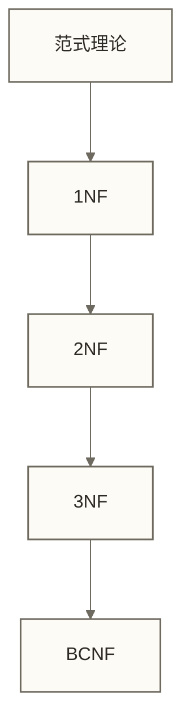

# 🧩 范式理论

> [!abstract] 📋 本节概览
> - 🎯 **学习目标**：理解数据库范式的基本概念及其应用
> - 📚 **前置知识**：[[【技术与工具】/SQL/04-表结构设计原则|表结构设计原则]]
> - ⏱️ **预计用时**：20分钟
> - 🔧 **开发环境**：无
> - 📊 **数据集**：无

## 🎯 学习目标

### 定义
**范式（Normal Form）**：==用于规范数据库表结构，消除冗余、避免异常，提高数据一致性==

**关键特点**：
- ✅ 1NF：每个字段不可再分
- ✅ 2NF：满足1NF，且每个非主属性都完全函数依赖于每个候选键，不存在对候选键真子集的部分依赖
- ✅ 3NF：满足2NF，且非主属性不传递依赖于候选键；形式上，每个非平凡函数依赖X → A都要求X是超键或A是主属性
- ⚠️ 注意事项：过度范式化可能影响性能



## 💻 代码实践

### 基础用法

```sql title="1NF示例"
-- 满足1NF的表
CREATE TABLE students (
  id INT PRIMARY KEY,
  name VARCHAR(50),
  phone VARCHAR(20)
);
```

### 进阶应用

```sql title="3NF拆分示例"
-- 示例假设：order_id是唯一候选键，user_id决定user_name，且每位用户可有多笔订单
-- 改造前的表：在上述假设下，user_name传递依赖于order_id，不满足3NF
-- 使用不同表名展示改造前后结构；本示例不包含已有数据迁移
CREATE TABLE orders_before_normalization (
  order_id INT PRIMARY KEY,
  user_id INT,
  user_name VARCHAR(50), -- 冗余
  amount DECIMAL(10,2)
);
-- 拆分为：
CREATE TABLE users (
  id INT PRIMARY KEY,
  name VARCHAR(50)
);
CREATE TABLE orders (
  order_id INT PRIMARY KEY,
  user_id INT,
  amount DECIMAL(10,2),
  FOREIGN KEY (user_id) REFERENCES users(id)
);
```

> [!tip] 💡 代码解读
> - 1NF：字段不可再分
> - 3NF：消除传递依赖，避免冗余

## 🔗 知识连接

- [[【技术与工具】/SQL/04-表结构设计原则|表结构设计原则]]
- [[【技术与工具】/SQL/06-SELECT语句结构|SELECT语句结构]]
- [[【技术与工具】/SQL/02-关系型数据库概念|关系型数据库概念]]

## 📊 实战练习

### 练习1：判断范式 ⭐⭐
> 假设order_id是唯一候选键，order_id决定其余属性，user_id决定user_name，且每位用户可有多笔订单。依据这些业务函数依赖，判断下列表结构是否满足3NF，并说明理由；表中两行数据仅用于展示，不能单独证明函数依赖。
> | order_id | user_id | user_name | amount |
> |----------|---------|-----------|--------|
> | 1        | 101     | Alice     | 100.0  |
> | 2        | 102     | Bob       | 200.0  |

## 🔖 总结要点

- 范式理论有助于规范表结构，消除冗余
- 实际设计需兼顾性能与规范

## 💬 学习反馈

- [ ] 我能说出1NF、2NF、3NF的定义
- [ ] 我能判断表结构是否满足3NF

#SQL #基础 #设计 #范式

**相关推荐**：
- [[【技术与工具】/SQL/04-表结构设计原则|表结构设计原则]]
- [[【技术与工具】/SQL/02-关系型数据库概念|关系型数据库概念]]