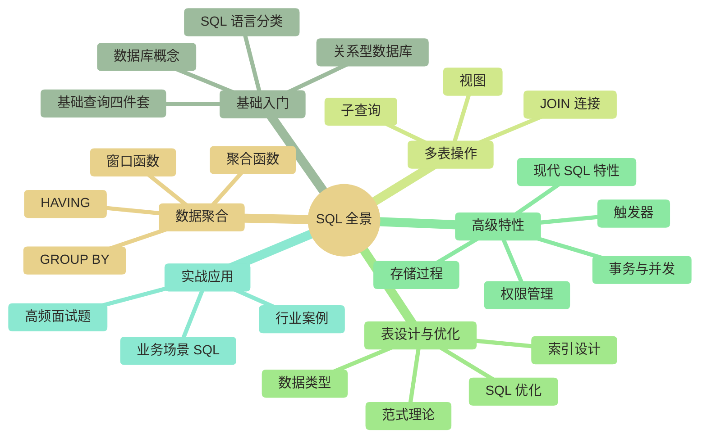
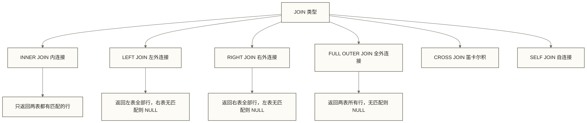
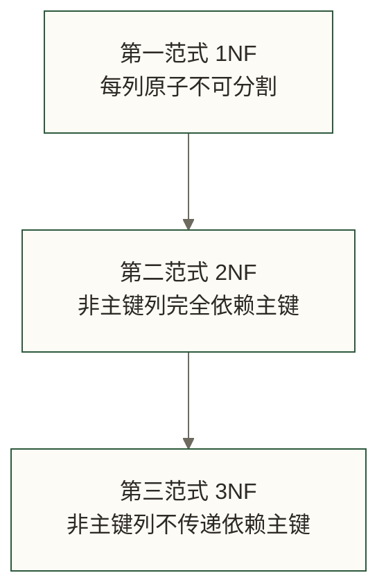

# SQL完整教程 - 数据从业者的SQL知识全景

> [!abstract] 这份文档是什么，怎么用
>
> 这是整个 SQL 知识体系的**汇总索引 + 精华提炼**文档。
>
> **它能帮你做三件事**：
> 1. **建立全局认知**：通过知识树和章节摘要，快速理解 SQL 的完整版图
> 2. **精准定位细节**：每个知识点都链接到对应的深度文档，随时跳转深入学习
> 3. **查阅核心语法**：关键语法、典型示例、常见陷阱全部收录在此，无需翻多篇文档
>
> **推荐使用方式**：
> - 初学者：按章节顺序学习，跟随链接深入每个主题
> - 有经验者：直接跳到对应章节，快速查阅语法或解题思路
> - 面试备考：重点阅读第六章，结合双链文档刷题

---

## 知识体系总览



### 学习路径导航


> [!tip] 学习周期参考
> - **入门阶段**（第一到三章）：建议 2-3 周，打牢查询基础
> - **进阶阶段**（第四到五章）：建议 3-4 周，掌握设计与优化
> - **实战阶段**（第六章）：持续练习，结合实际业务场景巩固

---

## 第一章：基础入门

### 1.1 数据库基础

**数据库是什么？** 简单说，数据库是一个按照特定规则组织、存储和管理数据的系统。就像图书馆之于书籍，数据库之于数据，提供有序存储和高效检索能力。

#### 数据库的核心概念

| 概念 | 说明 | 类比 |
|------|------|------|
| 数据库（Database） | 数据的集合容器 | 图书馆 |
| 表（Table） | 存储同类数据的二维结构 | 书架上的分类区域 |
| 行（Row/Record） | 一条完整的数据记录 | 一本书 |
| 列（Column/Field） | 数据的某个属性 | 书的某个属性（书名、作者） |
| 主键（Primary Key） | 唯一标识每条记录的字段 | 书的 ISBN 编号 |
| 外键（Foreign Key） | 建立表之间关联的字段 | 借阅记录中的图书 ID |

#### 主流数据库对比

| 数据库 | 类型 | 典型应用场景 |
|--------|------|-------------|
| MySQL | 关系型 | Web 应用、中小型系统 |
| PostgreSQL | 关系型 | 复杂查询、地理数据、JSON |
| Oracle | 关系型 | 企业级、金融、电信 |
| SQL Server | 关系型 | Windows 生态、微软技术栈 |
| Hive | 分布式 SQL | 大数据离线分析 |
| Spark SQL | 分布式 SQL | 大数据批流一体分析 |
| ClickHouse | 列式存储 | 实时 OLAP 分析 |

> [!note] 深入阅读
> - [[【技术与工具】/SQL/01-什么是数据库|什么是数据库]] - 数据库系统全面介绍
> - [[【技术与工具】/SQL/02-关系型数据库概念|关系型数据库概念]] - 关系模型与 ACID 特性详解

---

### 1.2 SQL 语言概述

SQL（Structured Query Language，结构化查询语言）是操作关系数据库的标准语言，诞生于 1970 年代，至今仍是数据领域最重要的语言之一。

#### SQL 的四大子语言

```mermaid
%%{init: {"theme":"base","themeVariables":{"fontFamily":"PingFang SC, -apple-system, Source Han Serif SC, serif","fontSize":"16px","background":"#FDFBF5","primaryColor":"#FDFBF5","primaryTextColor":"#2D2A26","primaryBorderColor":"#6E6A60","secondaryColor":"#E8EFE8","secondaryBorderColor":"#8FA890","secondaryTextColor":"#2D2A26","tertiaryColor":"#FDFBF5","tertiaryBorderColor":"#9A9488","tertiaryTextColor":"#6E6A60","lineColor":"#6E6A60","textColor":"#2D2A26","mainBkg":"#FDFBF5","nodeBorder":"#2D5A3D","clusterBkg":"#F3EEDF","clusterBorder":"#9A9488","edgeLabelBackground":"#FDFBF5"},"flowchart":{"htmlLabels":true,"curve":"basis","padding":20,"nodeSpacing":60,"rankSpacing":70,"useMaxWidth":false},"themeCSS":".node rect, .node polygon, .node circle { stroke-width: 1.5px; } .edgePath .path { stroke-width: 1.5px; } .cluster-label .nodeLabel, .cluster-label foreignObject { color: #2D2A26 !important; } .edgeLabel, .edgeLabel foreignObject { color: #2D2A26 !important; background-color: #FDFBF5; } .edgeLabel rect { fill: #FDFBF5; }"}}%%
flowchart TD
    classDef default fill:#FDFBF5,stroke:#6E6A60,color:#2D2A26,stroke-width:1.5px
    classDef startend fill:#2D2A26,stroke:#2D2A26,color:#FDFBF5,font-weight:bold
    classDef decision fill:#F6EAD8,stroke:#C08A1A,color:#2D2A26,font-weight:bold
    classDef hub fill:#3B5A80,stroke:#3B5A80,color:#FDFBF5,font-weight:bold
    classDef io fill:#E5EAF0,stroke:#3B5A80,color:#2D2A26
    classDef accent fill:#A6432C,stroke:#A6432C,color:#FDFBF5,font-weight:bold
    classDef storage fill:#F3EEDF,stroke:#9A9488,color:#2D2A26
    SQL[SQL 语言] --> DDL[DDL 数据定义语言]
    SQL --> DML[DML 数据操作语言]
    SQL --> DQL[DQL 数据查询语言]
    SQL --> DCL[DCL 数据控制语言]

    DDL --> DDL1[CREATE 创建]
    DDL --> DDL2[ALTER 修改]
    DDL --> DDL3[DROP 删除]

    DML --> DML1[INSERT 插入]
    DML --> DML2[UPDATE 更新]
    DML --> DML3[DELETE 删除]

    DQL --> DQL1[SELECT 查询]

    DCL --> DCL1[GRANT 授权]
    DCL --> DCL2[REVOKE 撤权]
    class SQL,DDL,DML,DQL,DCL,DDL1,DDL2,DDL3,DML1,DML2,DML3,DQL1,DCL1,DCL2 default
```



#### DDL - 数据定义

```sql
-- 创建表
CREATE TABLE employees (
    id          INT PRIMARY KEY AUTO_INCREMENT,
    name        VARCHAR(100) NOT NULL,
    department  VARCHAR(50),
    salary      DECIMAL(10, 2),
    hire_date   DATE,
    created_at  TIMESTAMP DEFAULT CURRENT_TIMESTAMP
);

-- 修改表结构
ALTER TABLE employees ADD COLUMN email VARCHAR(200);
ALTER TABLE employees MODIFY COLUMN salary DECIMAL(12, 2);

-- 删除表
DROP TABLE IF EXISTS temp_table;
```

#### DML - 数据操作

```sql
-- 插入数据
INSERT INTO employees (name, department, salary, hire_date)
VALUES ('张三', '数据部', 15000.00, '2023-03-01');

-- 批量插入
INSERT INTO employees (name, department, salary, hire_date)
VALUES
    ('李四', '工程部', 18000.00, '2023-04-15'),
    ('王五', '数据部', 16000.00, '2023-05-20');

-- 更新数据
UPDATE employees
SET salary = salary * 1.1
WHERE department = '数据部';

-- 删除数据（务必带 WHERE 条件）
DELETE FROM employees
WHERE hire_date < '2020-01-01';
```

> [!warning] 生产环境注意事项
> - `DELETE` 和 `UPDATE` 操作**必须加 WHERE 条件**，否则影响全表
> - 重要操作前先用 `SELECT` 验证条件筛选结果
> - 生产环境建议在事务中执行，出错可回滚

> [!note] 深入阅读
> - [[【技术与工具】/SQL/05-SQL语言概述|SQL语言概述]] - SQL 历史、标准演进、完整分类体系

---

### 1.3 基础查询四件套

SELECT 查询是数据分析日常工作中的常见任务。以下四个子句构成了基础查询的骨架。

#### SELECT - 选择列

```sql
-- 查询全部列（生产环境慎用 *）
SELECT * FROM employees;

-- 查询指定列
SELECT name, department, salary
FROM employees;

-- 列别名
SELECT
    name        AS 姓名,
    department  AS 部门,
    salary      AS 月薪
FROM employees;

-- 计算列
SELECT
    name,
    salary,
    salary * 12 AS 年薪,
    salary * 12 * 0.85 AS 税后年薪
FROM employees;
```

#### WHERE - 条件筛选

```sql
-- 等值条件
SELECT * FROM employees WHERE department = '数据部';

-- 范围条件
SELECT * FROM employees WHERE salary BETWEEN 10000 AND 20000;

-- 列表条件
SELECT * FROM employees WHERE department IN ('数据部', '工程部');

-- 模糊匹配
SELECT * FROM employees WHERE name LIKE '张%';  -- 以"张"开头
SELECT * FROM employees WHERE name LIKE '%工%'; -- 包含"工"

-- 空值判断
SELECT * FROM employees WHERE email IS NULL;
SELECT * FROM employees WHERE email IS NOT NULL;

-- 多条件组合
SELECT * FROM employees
WHERE department = '数据部'
  AND salary > 15000
  AND hire_date >= '2022-01-01';
```

> [!tip] WHERE 条件的执行逻辑
> SQL 中 `AND` 优先级高于 `OR`。当混合使用时，务必用括号明确优先级：
> ```sql
> -- 明确分组，避免歧义
> WHERE (department = '数据部' OR department = '工程部')
>   AND salary > 15000
> ```

#### ORDER BY - 排序

```sql
-- 单列排序（默认升序）
SELECT name, salary FROM employees ORDER BY salary;

-- 降序
SELECT name, salary FROM employees ORDER BY salary DESC;

-- 多列排序（先按部门升序，相同部门再按薪资降序）
SELECT name, department, salary
FROM employees
ORDER BY department ASC, salary DESC;

-- 按列序号排序（不推荐，可读性差）
SELECT name, department, salary
FROM employees
ORDER BY 2, 3 DESC;
```

#### LIMIT - 分页查询

```sql
-- 取前 10 条
SELECT * FROM employees ORDER BY salary DESC LIMIT 10;

-- 分页（每页 10 条，取第 3 页）
-- 公式：OFFSET = (页码 - 1) * 每页条数
SELECT * FROM employees
ORDER BY id
LIMIT 10 OFFSET 20;  -- 跳过前 20 条，取 10 条

-- MySQL 简写
SELECT * FROM employees
ORDER BY id
LIMIT 20, 10;  -- LIMIT offset, count
```

#### 查询执行顺序（非常重要）

```mermaid
%%{init: {"theme":"base","themeVariables":{"fontFamily":"PingFang SC, -apple-system, Source Han Serif SC, serif","fontSize":"16px","background":"#FDFBF5","primaryColor":"#FDFBF5","primaryTextColor":"#2D2A26","primaryBorderColor":"#6E6A60","secondaryColor":"#E8EFE8","secondaryBorderColor":"#8FA890","secondaryTextColor":"#2D2A26","tertiaryColor":"#FDFBF5","tertiaryBorderColor":"#9A9488","tertiaryTextColor":"#6E6A60","lineColor":"#6E6A60","textColor":"#2D2A26","mainBkg":"#FDFBF5","nodeBorder":"#2D5A3D","clusterBkg":"#F3EEDF","clusterBorder":"#9A9488","edgeLabelBackground":"#FDFBF5"},"flowchart":{"htmlLabels":true,"curve":"basis","padding":20,"nodeSpacing":60,"rankSpacing":70,"useMaxWidth":false},"themeCSS":".node rect, .node polygon, .node circle { stroke-width: 1.5px; } .edgePath .path { stroke-width: 1.5px; } .cluster-label .nodeLabel, .cluster-label foreignObject { color: #2D2A26 !important; } .edgeLabel, .edgeLabel foreignObject { color: #2D2A26 !important; background-color: #FDFBF5; } .edgeLabel rect { fill: #FDFBF5; }"}}%%
flowchart LR
    classDef default fill:#FDFBF5,stroke:#6E6A60,color:#2D2A26,stroke-width:1.5px
    classDef startend fill:#2D2A26,stroke:#2D2A26,color:#FDFBF5,font-weight:bold
    classDef decision fill:#F6EAD8,stroke:#C08A1A,color:#2D2A26,font-weight:bold
    classDef hub fill:#3B5A80,stroke:#3B5A80,color:#FDFBF5,font-weight:bold
    classDef io fill:#E5EAF0,stroke:#3B5A80,color:#2D2A26
    classDef accent fill:#A6432C,stroke:#A6432C,color:#FDFBF5,font-weight:bold
    classDef storage fill:#F3EEDF,stroke:#9A9488,color:#2D2A26
    A[FROM] --> B[WHERE]
    B --> C[GROUP BY]
    C --> D[HAVING]
    D --> E[SELECT]
    E --> F[DISTINCT]
    F --> G[ORDER BY]
    G --> H[LIMIT]
    class A,B,C,D,E,F,G,H default
```



> [!warning] 常见误区
> SELECT 虽然写在最前面，但执行顺序排第 5。因此：
> - `WHERE` 子句中**不能**使用 SELECT 中定义的别名
> - `HAVING` 子句可以使用聚合函数，但 `WHERE` 不能
> - `ORDER BY` 可以使用 SELECT 中的别名（因为它在 SELECT 之后执行）

> [!note] 深入阅读
> - [[【技术与工具】/SQL/06-SELECT语句结构|SELECT语句结构]] - 完整语法与执行原理
> - [[【技术与工具】/SQL/07-WHERE条件筛选|WHERE条件筛选]] - 条件运算符与优化技巧
> - [[【技术与工具】/SQL/08-ORDER BY排序|ORDER BY排序]] - 排序原理与多场景应用
> - [[【技术与工具】/SQL/09-LIMIT分页查询|LIMIT分页查询]] - 深分页问题与优化方案
> - [[【技术与工具】/SQL/10-DISTINCT去重|DISTINCT去重]] - 去重原理与替代方案

---

## 第二章：数据聚合与分组

### 2.1 聚合函数

聚合函数将多行数据压缩为单个统计值，是数据分析最核心的工具之一。

#### 五大核心聚合函数

| 函数 | 功能 | NULL 处理 |
|------|------|----------|
| `COUNT(*)` | 统计行数（含 NULL） | 包含 NULL 行 |
| `COUNT(col)` | 统计非 NULL 值数量 | 忽略 NULL |
| `SUM(col)` | 求和 | 忽略 NULL |
| `AVG(col)` | 求平均值 | 忽略 NULL |
| `MAX(col)` | 最大值 | 忽略 NULL |
| `MIN(col)` | 最小值 | 忽略 NULL |

```sql
-- 基础统计
SELECT
    COUNT(*)                    AS 总人数,
    COUNT(email)                AS 有邮箱人数,
    SUM(salary)                 AS 薪资总额,
    AVG(salary)                 AS 平均薪资,
    MAX(salary)                 AS 最高薪资,
    MIN(salary)                 AS 最低薪资,
    MAX(salary) - MIN(salary)   AS 薪资区间
FROM employees;

-- 条件聚合（CASE WHEN 配合聚合）
SELECT
    COUNT(*) AS 总人数,
    COUNT(CASE WHEN salary > 20000 THEN 1 END) AS 高薪人数,
    SUM(CASE WHEN department = '数据部' THEN salary ELSE 0 END) AS 数据部薪资总额,
    AVG(CASE WHEN hire_date >= '2023-01-01' THEN salary END) AS 新员工平均薪资
FROM employees;
```

> [!note] 深入阅读
> - [[【技术与工具】/SQL/11-聚合函数详解|聚合函数详解]] - 聚合函数原理、高级用法与性能优化

---

### 2.2 GROUP BY 与 HAVING

`GROUP BY` 将数据按指定列分组后再聚合，`HAVING` 对聚合结果进行过滤。

```sql
-- 按部门统计
SELECT
    department,
    COUNT(*)        AS 人数,
    AVG(salary)     AS 平均薪资,
    MAX(salary)     AS 最高薪资
FROM employees
GROUP BY department
ORDER BY 平均薪资 DESC;

-- HAVING 过滤聚合结果（平均薪资大于 15000 的部门）
SELECT
    department,
    COUNT(*)    AS 人数,
    AVG(salary) AS 平均薪资
FROM employees
GROUP BY department
HAVING AVG(salary) > 15000
ORDER BY 平均薪资 DESC;

-- WHERE 与 HAVING 联用
-- WHERE 先过滤行，GROUP BY 再分组，HAVING 最后过滤组
SELECT
    department,
    COUNT(*) AS 人数
FROM employees
WHERE hire_date >= '2022-01-01'   -- 先筛选 2022 年后入职的员工
GROUP BY department
HAVING COUNT(*) >= 5               -- 再筛选人数不少于 5 的部门
ORDER BY 人数 DESC;
```

> [!tip] WHERE vs HAVING 的本质区别
> - `WHERE`：在分组**之前**过滤行，不能使用聚合函数
> - `HAVING`：在分组**之后**过滤组，可以使用聚合函数
> - 性能上：能用 WHERE 过滤的数据尽量用 WHERE，减少参与聚合的数据量

> [!note] 深入阅读
> - [[【技术与工具】/SQL/12-GROUP BY分组|GROUP BY分组]] - 分组原理、ROLLUP/CUBE 扩展语法
> - [[【技术与工具】/SQL/13-HAVING筛选|HAVING筛选]] - HAVING 与 WHERE 深度对比

---

### 2.3 窗口函数（进阶必备）

窗口函数是 SQL 分析的分水岭。普通聚合函数返回一个值，窗口函数在保留原始行的同时，为每行计算一个聚合或排名值。

#### 窗口函数基础语法

```sql
函数名() OVER (
    PARTITION BY 分组列   -- 可选：按列分窗口
    ORDER BY 排序列       -- 可选：窗口内排序
    ROWS/RANGE BETWEEN    -- 可选：窗口帧范围
)
```

#### 排名函数

```sql
-- 三种排名函数对比
SELECT
    name,
    department,
    salary,
    ROW_NUMBER() OVER (PARTITION BY department ORDER BY salary DESC) AS 行号,
    RANK()       OVER (PARTITION BY department ORDER BY salary DESC) AS 排名_有并列空缺,
    DENSE_RANK() OVER (PARTITION BY department ORDER BY salary DESC) AS 排名_有并列无空缺
FROM employees;
```

| 函数 | 并列时行为 | 示例（三人中前两人同分） |
|------|-----------|----------------|
| `ROW_NUMBER()` | 强制唯一，顺序递增 | 1, 2, 3 |
| `RANK()` | 并列相同名次，后续跳空 | 1, 1, 3 |
| `DENSE_RANK()` | 并列相同名次，后续不跳 | 1, 1, 2 |

#### 值访问函数

```sql
-- LAG/LEAD：访问前后行数据（环比分析必备）
SELECT
    order_date,
    revenue,
    LAG(revenue, 1) OVER (ORDER BY order_date)  AS 上期收入,
    LEAD(revenue, 1) OVER (ORDER BY order_date) AS 下期收入,
    revenue - LAG(revenue, 1) OVER (ORDER BY order_date) AS 环比变化
FROM daily_revenue;

-- FIRST_VALUE / LAST_VALUE：窗口内首尾值
SELECT
    name,
    department,
    salary,
    FIRST_VALUE(salary) OVER (
        PARTITION BY department
        ORDER BY salary DESC
    ) AS 部门最高薪资
FROM employees;
```

#### 聚合窗口函数

```sql
-- 累计求和（Running Total）
SELECT
    order_date,
    daily_revenue,
    SUM(daily_revenue) OVER (ORDER BY order_date) AS 累计收入,
    AVG(daily_revenue) OVER (
        ORDER BY order_date
        ROWS BETWEEN 6 PRECEDING AND CURRENT ROW
    ) AS 近7行均值  -- 每天一行且日期连续时，才等于近7日均值
FROM daily_revenue;

-- 组内占比
SELECT
    name,
    department,
    salary,
    SUM(salary) OVER (PARTITION BY department) AS 部门薪资总额,
    ROUND(salary / SUM(salary) OVER (PARTITION BY department) * 100, 2) AS 薪资占比
FROM employees;
```

> [!note] 深入阅读
> - [[【技术与工具】/SQL/19-窗口函数|窗口函数]] - 窗口函数完整原理、高级用法与企业级场景实践

---

## 第三章：多表操作

### 3.1 JOIN 类型详解

现实业务中的数据分散在多张表，JOIN 是把它们关联起来的关键操作。

#### JOIN 类型图解



#### 各类 JOIN 示例

```sql
-- 示例数据结构
-- employees(id, name, department_id, salary)
-- departments(id, name, manager_name)

-- INNER JOIN：只返回两表都有匹配的记录
SELECT e.name, d.name AS department, e.salary
FROM employees e
INNER JOIN departments d ON e.department_id = d.id;

-- LEFT JOIN：保留所有员工，即使部门不存在
SELECT e.name, d.name AS department
FROM employees e
LEFT JOIN departments d ON e.department_id = d.id;

-- 找出没有分配部门的员工
SELECT e.name
FROM employees e
LEFT JOIN departments d ON e.department_id = d.id
WHERE d.id IS NULL;

-- 多表 JOIN
SELECT
    o.order_id,
    c.customer_name,
    p.product_name,
    o.quantity,
    o.unit_price
FROM orders o
INNER JOIN customers c ON o.customer_id = c.id
INNER JOIN products p ON o.product_id = p.id
WHERE o.order_date >= '2024-01-01';

-- SELF JOIN：查找同部门薪资高于自己的同事数量
SELECT
    e1.name,
    e1.salary,
    COUNT(e2.id) AS 薪资高于我的同事数
FROM employees e1
LEFT JOIN employees e2
    ON e1.department_id = e2.department_id
    AND e2.salary > e1.salary
GROUP BY e1.id, e1.name, e1.salary
ORDER BY e1.salary DESC;
```

> [!warning] JOIN 性能陷阱
> - 多表 JOIN 时，确保 ON 条件涉及的列都有索引
> - 大表 JOIN 小表通常比小表 JOIN 大表性能更好（取决于查询优化器）
> - 对 JOIN 条件列使用函数可能妨碍普通索引查找；是否有函数索引及实际如何执行，应查看执行计划

> [!note] 深入阅读
> - [[【技术与工具】/SQL/15-JOIN连接|JOIN连接]] - JOIN 完整类型详解、执行原理与性能优化

---

### 3.2 子查询

子查询是嵌套在另一个 SQL 语句内部的 SELECT 语句，分为相关子查询和非相关子查询。

#### 子查询的四种使用位置

```sql
-- 1. WHERE 子句中（最常用）
-- 找薪资高于平均薪资的员工
SELECT name, salary
FROM employees
WHERE salary > (SELECT AVG(salary) FROM employees);

-- 2. FROM 子句中（派生表/内联视图）
SELECT dept_name, avg_salary
FROM (
    SELECT
        department AS dept_name,
        AVG(salary) AS avg_salary
    FROM employees
    GROUP BY department
) dept_stats
WHERE avg_salary > 15000;

-- 3. SELECT 子句中（标量子查询）
SELECT
    name,
    salary,
    (SELECT AVG(salary) FROM employees) AS 全公司平均薪资,
    salary - (SELECT AVG(salary) FROM employees) AS 与平均值差距
FROM employees;

-- 4. EXISTS 相关子查询
-- 找出有下属的员工
SELECT DISTINCT e1.name
FROM employees e1
WHERE EXISTS (
    SELECT 1
    FROM employees e2
    WHERE e2.manager_id = e1.id
);
```

#### IN vs EXISTS 的选择

```sql
-- IN：适合子查询结果集较小的场景
SELECT name FROM employees
WHERE department_id IN (
    SELECT id FROM departments WHERE region = '华东'
);

-- EXISTS：适合子查询结果集较大，或需要关联外部查询的场景
SELECT name FROM employees e
WHERE EXISTS (
    SELECT 1 FROM departments d
    WHERE d.id = e.department_id
      AND d.region = '华东'
);
```

> [!tip] 子查询 vs JOIN 的选择原则
> - 现代查询优化器通常会将子查询转换为 JOIN，性能差距不大
> - 子查询语义更清晰，适合逻辑复杂的场景
> - 未被优化器改写的相关子查询可能重复执行；是否改写为JOIN，应同时检查语义等价性和执行计划

> [!note] 深入阅读
> - [[【技术与工具】/SQL/14-子查询|子查询]] - 子查询类型、相关性分析与优化改写技巧

---

### 3.3 视图

视图是一个命名的 SQL 查询，表现得像一张虚拟表，可以简化复杂查询、控制数据访问权限。

```sql
-- 创建视图
CREATE VIEW v_employee_detail AS
SELECT
    e.id,
    e.name,
    e.salary,
    d.name AS department_name,
    d.manager_name AS 部门经理
FROM employees e
LEFT JOIN departments d ON e.department_id = d.id;

-- 像查普通表一样使用视图
SELECT * FROM v_employee_detail WHERE department_name = '数据部';

-- 创建可更新视图（简单视图才能更新）
CREATE VIEW v_data_team AS
SELECT id, name, salary, hire_date
FROM employees
WHERE department = '数据部';

-- 修改视图
CREATE OR REPLACE VIEW v_employee_detail AS
SELECT e.id, e.name, e.salary, d.name AS dept FROM employees e
LEFT JOIN departments d ON e.department_id = d.id;

-- 删除视图
DROP VIEW IF EXISTS v_employee_detail;
```

> [!note] 深入阅读
> - [[【技术与工具】/SQL/16-视图|视图]] - 视图类型、物化视图与权限控制应用

---

## 第四章：表设计与优化

### 4.1 数据类型选择

选择合适的数据类型不仅影响存储空间，还直接影响查询性能。

#### 常用数据类型速查

| 类别 | 类型 | 存储 | 适用场景 |
|------|------|------|---------|
| 整数 | `TINYINT` | MySQL中为1字节 | 枚举值、状态码；0-255需使用UNSIGNED |
| 整数 | `INT` | 4字节 | 通用整数、自增 ID |
| 整数 | `BIGINT` | 8字节 | 大量记录的 ID、时间戳 |
| 小数 | `DECIMAL(p,s)` | MySQL中存储占用由精度p和小数位数s决定 | 金额（精确计算） |
| 小数 | `FLOAT/DOUBLE` | 4/8字节 | 科学计算（允许误差） |
| 字符串 | `CHAR(n)` | n表示字符数，字节占用取决于字符集等条件 | 固定长度（身份证、电话） |
| 字符串 | `VARCHAR(n)` | 实际长度+1-2字节 | 变长字符串（姓名、邮箱） |
| 字符串 | `TEXT` | 变长 | 长文本（备注、内容） |
| 日期时间 | `DATE` | 3字节 | 只有日期 |
| 日期时间 | `DATETIME` | MySQL存储占用取决于版本及小数秒精度，不能统一写为8字节 | 日期+时间，不含时区 |
| 日期时间 | `TIMESTAMP` | MySQL中无小数秒时为4字节，小数秒精度会增加占用 | 时间戳，按会话时区转换 |
| 布尔 | `TINYINT(1)` | 1字节 | 布尔值（MySQL 惯用法） |
| JSON | `JSON` | 变长 | 半结构化数据 |

> [!tip] 选型原则
> 1. **够用就好**：不用 `BIGINT` 存只有几千条记录的 ID
> 2. **金额用 DECIMAL**：`FLOAT`/`DOUBLE` 有精度问题，不能用于金融计算
> 3. **时间用 DATETIME**：`TIMESTAMP` 有 2038 年问题，且范围有限
> 4. **状态码用 TINYINT**：比 `VARCHAR` 节省空间且查询更快

> [!note] 深入阅读
> - [[【技术与工具】/SQL/03-数据类型详解|数据类型详解]] - 各类型深度解析与选型决策树

---

### 4.2 范式理论

数据库范式是消除数据冗余、保证数据一致性的设计规范。

#### 三大范式简明对照



| 范式 | 核心要求 | 解决的问题 |
|------|---------|-----------|
| 1NF | 每个字段值原子，不可再分 | 消除重复列、多值字段 |
| 2NF | 非主键列完全依赖于整个主键（复合主键场景） | 消除部分函数依赖 |
| 3NF | 非主键列直接依赖主键，不通过其他非主键中转 | 消除传递依赖 |

```sql
-- 违反 3NF 的设计（部门名称通过 department_id 传递依赖 employee_id）
-- 错误设计：employees(employee_id, name, department_id, department_name)

-- 正确设计（分两张表）
-- employees(employee_id, name, department_id)
-- departments(department_id, department_name)
```

> [!note] 深入阅读
> - [[【技术与工具】/SQL/26-范式理论|范式理论]] - 1NF 到 BCNF 的完整讲解与反范式设计的权衡

---

### 4.3 索引优化

索引是提升查询性能最有效的手段，也是面试高频考察点。

#### 索引的工作原理


#### 索引创建与管理

```sql
-- 单列索引
CREATE INDEX idx_department ON employees(department);

-- 复合索引（最左前缀原则）
CREATE INDEX idx_dept_salary ON employees(department, salary);

-- 唯一索引
CREATE UNIQUE INDEX idx_email ON employees(email);

-- 查看索引使用情况
EXPLAIN SELECT * FROM employees WHERE department = '数据部';
```

#### 索引设计原则

| 原则 | 说明 | 示例 |
|------|------|------|
| 最左前缀 | 常规复合B+树索引查找通常依赖最左列前缀；跳跃扫描、覆盖扫描等需另看执行计划 | `(a,b,c)` 通常可支持 `a`, `a,b`, `a,b,c` 的查找 |
| 高选择性 | 选择基数高的列建索引 | 性别列不适合建索引（只有两个值） |
| 覆盖索引 | 索引包含查询所需全部列，无需回表 | `SELECT name FROM emp WHERE dept=?` + `idx(dept,name)` |
| 避免冗余 | `(a,b)` 已存在，`(a)` 是冗余索引 | 删除冗余索引，节省维护开销 |

#### 索引失效场景

```sql
-- 1. 对索引列使用函数可能妨碍普通索引范围查找
WHERE YEAR(hire_date) = 2023  -- 是否使用索引取决于索引定义、数据库能力和执行计划
-- 改写为范围查询
WHERE hire_date BETWEEN '2023-01-01' AND '2023-12-31'

-- 2. 隐式类型转换（是否影响索引需结合类型和执行计划判断）
WHERE employee_id = '100'  -- INT列与可转换的字符串数字比较，不必然导致索引失效；建议使用同类型参数

-- 3. LIKE 以 % 开头（失效）
WHERE name LIKE '%张'  -- 失效，改用全文索引或搜索引擎

-- 4. OR 连接的条件（部分失效）
WHERE department = '数据部' OR salary > 20000
-- 优化器可能选择索引合并、其他索引访问方式或全表扫描；两列各有索引既不是充分条件，也不是唯一条件
```

> [!note] 深入阅读
> - [[【技术与工具】/SQL/17-索引|索引]] - B+树原理、索引类型与失效场景完整分析

---

### 4.4 SQL 优化技巧

#### EXPLAIN 分析执行计划

```sql
-- 查看执行计划
EXPLAIN SELECT e.name, d.name
FROM employees e
JOIN departments d ON e.department_id = d.id
WHERE e.salary > 15000;
```

关键字段解读：

| 字段 | 关注点 |
|------|--------|
| `type` | `const` > `ref` > `range` > `index` > `ALL`（ALL 是全表扫描，需要优化） |
| `key` | 实际使用的索引，NULL 表示未使用索引 |
| `rows` | 预估扫描行数，越小越好 |
| `Extra` | `Using filesort` 或 `Using temporary` 是性能警告信号 |

#### 常见优化技巧

```sql
-- 1. 比较IN与EXISTS写法：性能取决于优化器、索引和数据分布
-- IN写法：
SELECT * FROM orders WHERE customer_id IN (SELECT id FROM customers WHERE region = '华东');
-- EXISTS写法：可能与IN生成相近的执行计划，不保证更快
SELECT * FROM orders o WHERE EXISTS (
    SELECT 1 FROM customers c WHERE c.id = o.customer_id AND c.region = '华东'
);

-- 2. 避免 SELECT *，只查询需要的列
-- 慢：SELECT * FROM employees;
-- 快：SELECT id, name, salary FROM employees;

-- 3. 分页大偏移量优化
-- 慢（深分页）：
SELECT * FROM orders ORDER BY id LIMIT 100000, 10;
-- 游标分页：假设上一页末行id为100000；这不等价于跳过100000行
SELECT * FROM orders WHERE id > 100000 ORDER BY id LIMIT 10;

-- 4. 批量操作替代逐条操作
-- 慢（逐条 INSERT）：
INSERT INTO logs VALUES (1, 'a'); INSERT INTO logs VALUES (2, 'b');
-- 快（批量 INSERT）：
INSERT INTO logs VALUES (1, 'a'), (2, 'b'), (3, 'c');

-- 5. 用 UNION ALL 替代 UNION（不需要去重时）
-- UNION 会进行额外的去重操作
SELECT name FROM table_a
UNION ALL  -- 无需去重时，比 UNION 性能更好
SELECT name FROM table_b;
```

> [!note] 深入阅读
> - [[【技术与工具】/SQL/22-SQL优化|SQL优化]] - 执行计划分析、索引调优、查询重写完整指南
> - [[【技术与工具】/SQL/17-索引|索引]] - 索引设计策略与高级优化技术

---

## 第五章：高级特性

### 5.1 事务与并发

事务保证数据库操作的原子性和一致性，是生产系统的基础保障。

#### ACID 特性

| 特性 | 含义 | 实现机制 |
|------|------|---------|
| **A**tomicity（原子性） | 事务所有操作要么全成功，要么全失败 | Undo Log 回滚 |
| **C**onsistency（一致性） | 事务前后数据满足业务约束 | 约束、触发器 |
| **I**solation（隔离性） | 并发事务互不干扰 | MVCC、锁机制 |
| **D**urability（持久性） | 提交后数据永久保存 | Redo Log 重做 |

#### 事务基本操作

```sql
-- 开始事务
START TRANSACTION;  -- 或 BEGIN;

-- 执行操作
UPDATE accounts SET balance = balance - 1000 WHERE account_id = 'A001';
UPDATE accounts SET balance = balance + 1000 WHERE account_id = 'B002';

-- 验证无误后提交
COMMIT;

-- 若提交前出错，应执行ROLLBACK而不是COMMIT；提交后不能用ROLLBACK撤销
-- ROLLBACK;

-- 保存点（部分回滚）
START TRANSACTION;
INSERT INTO orders VALUES (...);
SAVEPOINT sp1;
INSERT INTO order_items VALUES (...);
-- 如果 order_items 出错，只回滚到保存点
ROLLBACK TO SAVEPOINT sp1;
COMMIT;
```

#### 隔离级别

```mermaid
%%{init: {"theme":"base","themeVariables":{"fontFamily":"PingFang SC, -apple-system, Source Han Serif SC, serif","fontSize":"16px","background":"#FDFBF5","primaryColor":"#FDFBF5","primaryTextColor":"#2D2A26","primaryBorderColor":"#6E6A60","secondaryColor":"#E8EFE8","secondaryBorderColor":"#8FA890","secondaryTextColor":"#2D2A26","tertiaryColor":"#FDFBF5","tertiaryBorderColor":"#9A9488","tertiaryTextColor":"#6E6A60","lineColor":"#6E6A60","textColor":"#2D2A26","mainBkg":"#FDFBF5","nodeBorder":"#2D5A3D","clusterBkg":"#F3EEDF","clusterBorder":"#9A9488","edgeLabelBackground":"#FDFBF5"},"flowchart":{"htmlLabels":true,"curve":"basis","padding":20,"nodeSpacing":60,"rankSpacing":70,"useMaxWidth":false},"themeCSS":".node rect, .node polygon, .node circle { stroke-width: 1.5px; } .edgePath .path { stroke-width: 1.5px; } .cluster-label .nodeLabel, .cluster-label foreignObject { color: #2D2A26 !important; } .edgeLabel, .edgeLabel foreignObject { color: #2D2A26 !important; background-color: #FDFBF5; } .edgeLabel rect { fill: #FDFBF5; }"}}%%
flowchart LR
    classDef default fill:#FDFBF5,stroke:#6E6A60,color:#2D2A26,stroke-width:1.5px
    classDef startend fill:#2D2A26,stroke:#2D2A26,color:#FDFBF5,font-weight:bold
    classDef decision fill:#F6EAD8,stroke:#C08A1A,color:#2D2A26,font-weight:bold
    classDef hub fill:#3B5A80,stroke:#3B5A80,color:#FDFBF5,font-weight:bold
    classDef io fill:#E5EAF0,stroke:#3B5A80,color:#2D2A26
    classDef accent fill:#A6432C,stroke:#A6432C,color:#FDFBF5,font-weight:bold
    classDef storage fill:#F3EEDF,stroke:#9A9488,color:#2D2A26
    A[读未提交\nRead Uncommitted] --> |解决脏读| B[读已提交\nRead Committed]
    B --> |解决不可重复读| C[可重复读\nRepeatable Read]
    C --> |解决幻读| D[串行化\nSerializable]

    A --> A1[允许更多并发现象\n不保证性能最好]
    D --> D1[隔离保证更强\n性能取决于实现与负载]
    class A,B,C,D,A1,D1 default
```



| 隔离级别 | 脏读 | 不可重复读 | 幻读（标准允许情况） | 性能 |
|---------|------|-----------|------|------|
| READ UNCOMMITTED | 可能 | 可能 | 可能 | 取决于实现与负载 |
| READ COMMITTED | 不会 | 可能 | 可能 | 取决于实现与负载 |
| REPEATABLE READ | 不会 | 不会 | 可能，具体实现可提供更强保证 | 取决于实现与负载 |
| SERIALIZABLE | 不会 | 不会 | 不会 | 取决于实现与负载 |

> [!tip] MySQL 默认隔离级别
> MySQL InnoDB 默认使用 `REPEATABLE READ`；同一事务中的一致性快照读通常使用同一快照，锁定读则涉及不同机制。隔离级别应根据业务一致性要求和并发负载选择，不能将默认值视为普遍最佳方案。

> [!note] 深入阅读
> - [[【技术与工具】/SQL/18-事务|事务]] - ACID 原理、隔离级别、锁机制与死锁处理

---

### 5.2 存储过程与触发器

#### 存储过程

存储过程是预编译并存储在数据库服务器上的 SQL 代码块，可以接受参数、包含逻辑控制。

```sql
-- 创建存储过程：按部门涨薪
DELIMITER $$
CREATE PROCEDURE raise_salary(
    IN p_department VARCHAR(50),
    IN p_raise_pct  DECIMAL(5, 2),
    OUT p_affected_rows INT
)
BEGIN
    UPDATE employees
    SET salary = salary * (1 + p_raise_pct / 100)
    WHERE department = p_department;

    SET p_affected_rows = ROW_COUNT();
END$$
DELIMITER ;

-- 调用存储过程
CALL raise_salary('数据部', 10, @rows);
SELECT @rows AS 影响行数;

-- 删除存储过程
DROP PROCEDURE IF EXISTS raise_salary;
```

#### 触发器

触发器在表上发生特定事件（INSERT/UPDATE/DELETE）时自动执行。

```sql
-- 创建触发器：记录员工薪资变更历史
-- 以下DELIMITER为MySQL命令行客户端指令；其他客户端需按其方式提交完整定义
DELIMITER $$
CREATE TRIGGER trg_salary_change
AFTER UPDATE ON employees
FOR EACH ROW
BEGIN
    IF NOT (OLD.salary <=> NEW.salary) THEN
        INSERT INTO salary_history (
            employee_id, old_salary, new_salary,
            changed_at, changed_by
        )
        VALUES (
            OLD.id, OLD.salary, NEW.salary,
            NOW(), USER()
        );
    END IF;
END$$
DELIMITER ;
```

> [!warning] 存储过程与触发器的使用建议
> - 适合：复杂业务逻辑封装、数据审计、批量处理
> - 谨慎：调试困难、版本管理不便、过度使用会导致逻辑分散
> - 现代数据工程倾向于将业务逻辑放在应用层，数据库只做存储

> [!note] 深入阅读
> - [[【技术与工具】/SQL/20-存储过程|存储过程]] - 完整语法、参数类型、错误处理
> - [[【技术与工具】/SQL/21-触发器|触发器]] - 触发器类型、使用场景与最佳实践

---

### 5.3 权限管理

```sql
-- 创建用户
CREATE USER 'analyst'@'%' IDENTIFIED BY 'StrongPassword@123';

-- 授权（只读权限）
GRANT SELECT ON database_name.* TO 'analyst'@'%';

-- 授权特定表的特定操作
GRANT SELECT, INSERT ON sales_db.orders TO 'analyst'@'%';

-- 撤销权限
REVOKE INSERT ON sales_db.orders FROM 'analyst'@'%';

-- 查看用户权限
SHOW GRANTS FOR 'analyst'@'%';

-- 删除用户
DROP USER 'analyst'@'%';
```

> [!note] 深入阅读
> - [[【技术与工具】/SQL/24-权限与安全|权限与安全]] - 权限体系设计、行级安全、数据脱敏

---

### 5.4 现代 SQL 特性

#### CTE（公用表表达式）

CTE 让复杂查询更易读，可以替代嵌套子查询和临时表。

```sql
-- 基础 CTE
WITH dept_stats AS (
    SELECT
        department,
        AVG(salary) AS avg_salary,
        COUNT(*) AS headcount
    FROM employees
    GROUP BY department
),
high_performing_depts AS (
    SELECT department, avg_salary
    FROM dept_stats
    WHERE avg_salary > 15000 AND headcount >= 5
)
SELECT e.name, e.salary, h.avg_salary AS 部门平均薪资
FROM employees e
JOIN high_performing_depts h ON e.department = h.department
WHERE e.salary > h.avg_salary;

-- 递归 CTE（组织架构树）
WITH RECURSIVE org_tree AS (
    -- 基础查询：顶级员工（没有上级）
    SELECT id, name, manager_id, 1 AS level, CAST(name AS CHAR(500)) AS path
    FROM employees WHERE manager_id IS NULL

    UNION ALL

    -- 递归查询：逐层往下
    SELECT e.id, e.name, e.manager_id, t.level + 1, CONCAT(t.path, ' > ', e.name)
    FROM employees e
    JOIN org_tree t ON e.manager_id = t.id
)
SELECT * FROM org_tree ORDER BY path;
```

#### JSON 处理（现代数据库特性）

```sql
-- MySQL JSON 操作
SELECT
    data->>'$.name' AS 姓名,
    data->>'$.age' AS 年龄,
    JSON_EXTRACT(data, '$.address.city') AS 城市
FROM user_profiles;

-- 更新 JSON 字段
UPDATE user_profiles
SET data = JSON_SET(data, '$.status', 'active')
WHERE id = 1;
```

> [!note] 深入阅读
> - [[【技术与工具】/SQL/23-现代SQL特性与数据库差异|现代SQL特性与数据库差异]] - CTE、JSON、窗口函数的跨库兼容性

---

## 第六章：实战应用

### 6.1 常见业务场景 SQL

#### 场景一：用户留存率分析

```sql
-- 计算次日留存率
-- 思路：找出第 N+1 天仍然活跃的用户 / 第 N 天新用户总数
WITH new_users AS (
    SELECT user_id, DATE(register_time) AS register_date
    FROM users
    WHERE register_time >= '2024-01-01'
),
day1_active AS (
    SELECT DISTINCT user_id, DATE(active_time) AS active_date
    FROM user_activities
)
SELECT
    n.register_date,
    COUNT(DISTINCT n.user_id) AS 新用户数,
    COUNT(DISTINCT a.user_id) AS 次日活跃数,
    ROUND(COUNT(DISTINCT a.user_id) / COUNT(DISTINCT n.user_id) * 100, 2) AS 次日留存率
FROM new_users n
LEFT JOIN day1_active a
    ON n.user_id = a.user_id
    AND a.active_date = DATE_ADD(n.register_date, INTERVAL 1 DAY)
GROUP BY n.register_date
ORDER BY n.register_date;
```

#### 场景二：连续登录天数（经典算法题）

```sql
-- 方法：日期 - 排名 = 常量，则为连续日期
WITH ranked AS (
    SELECT
        user_id,
        login_date,
        ROW_NUMBER() OVER (PARTITION BY user_id ORDER BY login_date) AS rn
    FROM (SELECT DISTINCT user_id, DATE(login_time) AS login_date FROM login_logs) t
),
login_groups AS (
    SELECT
        user_id,
        login_date,
        DATE_SUB(login_date, INTERVAL rn DAY) AS group_id  -- 连续日期的这个值相同
    FROM ranked
)
SELECT
    user_id,
    MIN(login_date) AS 开始日期,
    MAX(login_date) AS 结束日期,
    COUNT(*) AS 连续天数
FROM login_groups
GROUP BY user_id, group_id
ORDER BY 连续天数 DESC;
```

#### 场景三：TopN 分组取最大值

```sql
-- 每个部门薪资最高的前3个薪资档位，包含并列员工，结果可能超过3人
WITH ranked AS (
    SELECT
        name,
        department,
        salary,
        DENSE_RANK() OVER (PARTITION BY department ORDER BY salary DESC) AS rk
    FROM employees
)
SELECT name, department, salary, rk AS 排名
FROM ranked
WHERE rk <= 3
ORDER BY department, rk;
```

#### 场景四：购物车/漏斗分析

```sql
-- 电商购买转化漏斗
SELECT
    '浏览商品' AS 步骤, COUNT(DISTINCT user_id) AS 用户数 FROM product_views
UNION ALL
SELECT '加入购物车', COUNT(DISTINCT user_id) FROM cart_adds
UNION ALL
SELECT '提交订单',   COUNT(DISTINCT user_id) FROM orders WHERE status != 'cancelled'
UNION ALL
SELECT '完成支付',   COUNT(DISTINCT user_id) FROM payments WHERE status = 'success'
ORDER BY 用户数 DESC;
```

> [!note] 深入阅读
> - [[【技术与工具】/SQL/28-实战案例|实战案例]] - 更多业务场景完整解题过程

---

### 6.2 行业案例

#### 电商行业

```sql
-- GMV月度环比增长示意
-- 仅在月份连续且上一月GMV非零时，下述LAG结果可按通常月度环比解释；月份缺失时比较的是上一条有数据月份
WITH monthly_gmv AS (
    SELECT
        DATE_FORMAT(pay_time, '%Y-%m') AS 月份,
        SUM(amount) AS GMV
    FROM orders
    WHERE status = 'paid'
    GROUP BY 月份
)
SELECT
    月份,
    GMV,
    LAG(GMV) OVER (ORDER BY 月份) AS 上一条有数据月份GMV,
    ROUND((GMV - LAG(GMV) OVER (ORDER BY 月份)) /
          NULLIF(LAG(GMV) OVER (ORDER BY 月份), 0) * 100, 2) AS 环比增长率
FROM monthly_gmv;
```

#### 金融行业

```sql
-- 用户 RFM 分层（最近购买时间、购买频次、消费金额）
SELECT
    user_id,
    DATEDIFF(CURDATE(), MAX(order_date)) AS Recency,
    COUNT(DISTINCT order_id) AS Frequency,
    SUM(amount) AS Monetary,
    NTILE(5) OVER (ORDER BY DATEDIFF(CURDATE(), MAX(order_date)))   AS R_score,
    NTILE(5) OVER (ORDER BY COUNT(DISTINCT order_id) DESC)           AS F_score,
    NTILE(5) OVER (ORDER BY SUM(amount) DESC)                        AS M_score
FROM orders
WHERE order_date >= DATE_SUB(CURDATE(), INTERVAL 1 YEAR)
GROUP BY user_id;
```

> [!note] 深入阅读
> - [[【技术与工具】/SQL/29-行业应用案例|行业应用案例]] - 电商、金融、医疗等行业的完整 SQL 解决方案

---

### 6.3 高频面试题精选

#### 基础类

**Q1：SQL 中 DELETE、TRUNCATE、DROP 的区别？**

| 操作 | 是否可回滚 | 触发触发器 | 释放空间 | 适用场景 |
|------|-----------|-----------|---------|---------|
| `DELETE` | 是（在事务中） | 是 | 否 | 按条件删除部分数据 |
| `TRUNCATE` | 否（DDL） | 否 | 是 | 清空表但保留结构 |
| `DROP` | 否（DDL） | 否 | 是（删除结构） | 删除整张表 |

**Q2：CHAR 和 VARCHAR 的区别？**
- `CHAR(n)`：固定长度，不足则补空格，查询时效率略高，适合固定长度数据（手机号、身份证）
- `VARCHAR(n)`：可变长度，存实际长度+1-2字节，节省空间，适合变长数据（姓名、描述）

#### 进阶类

**Q3：如何优化慢 SQL？**

```sql
-- 步骤 1：用 EXPLAIN 分析执行计划
EXPLAIN SELECT ...;

-- 步骤 2：关注 type 列，目标至少达到 range 级别
-- type 优先级：const > ref > range > index > ALL

-- 步骤 3：检查 key 列，确保用了预期的索引

-- 步骤 4：针对问题优化
-- - 无索引 → 添加合适索引
-- - 索引失效 → 修改查询条件
-- - 深分页 → 改用游标分页
-- - 大表 JOIN → 拆分查询或添加索引
```

**Q4：写一个 SQL 求每门课程的第二名成绩**

```sql
WITH ranked AS (
    SELECT
        course_id,
        student_id,
        score,
        DENSE_RANK() OVER (PARTITION BY course_id ORDER BY score DESC) AS rk
    FROM scores
)
SELECT course_id, student_id, score
FROM ranked
WHERE rk = 2;
```

**Q5：如何找到重复记录并保留最新的一条？**

```sql
-- 方法一：使用 ROW_NUMBER 分组排序
DELETE FROM orders
WHERE id NOT IN (
    SELECT id FROM (
        SELECT id,
               ROW_NUMBER() OVER (
                   PARTITION BY order_no
                   ORDER BY created_at DESC
               ) AS rn
        FROM orders
    ) t WHERE rn = 1
);
```

**Q6：解释 MVCC 的工作原理**

MVCC（多版本并发控制）通过数据版本支持一致性读，减少读写之间的阻塞；它不保证所有读写都不阻塞：
- MySQL InnoDB记录包含事务ID和回滚指针等隐藏信息，并非统一保存创建版本号、删除版本号
- 一致性读结合Read View判断版本可见性，通常不加行锁；锁定读仍涉及锁
- 写操作需要相应锁，旧版本可供符合可见性条件的一致性读访问
- MySQL InnoDB 通过 Undo Log 实现版本回溯

> [!note] 深入阅读
> - [[【技术与工具】/SQL/30-常见面试题|常见面试题]] - 完整题库，覆盖初级到高级全部题型与解题思路

---

## 知识体系导航（双链索引）

### 基础入门系列

| 文档 | 难度 | 核心内容 |
|------|------|---------|
| [[00-SQL学习路线图\|SQL学习路线图]] | 入门 | 完整学习路径规划，3-6个月系统学习指南 |
| [[01-什么是数据库\|什么是数据库]] | 入门 | 数据库类型、DBMS 选型、基础概念 |
| [[02-关系型数据库概念\|关系型数据库概念]] | 入门 | 关系模型、ACID 特性、ER 图设计 |
| [[03-数据类型详解\|数据类型详解]] | 初级 | 数值/字符串/日期类型深度解析与选型 |
| [[04-表结构设计原则\|表结构设计原则]] | 初级 | 字段命名、约束设计、表结构最佳实践 |
| [[05-SQL语言概述\|SQL语言概述]] | 初级 | SQL 发展史、DDL/DML/DQL/DCL 分类 |

### 核心查询系列

| 文档 | 难度 | 核心内容 |
|------|------|---------|
| [[06-SELECT语句结构\|SELECT语句结构]] | 初中级 | 完整语法、执行顺序、查询计划解读 |
| [[07-WHERE条件筛选\|WHERE条件筛选]] | 初级 | 比较/逻辑/特殊运算符，条件优化 |
| [[08-ORDER BY排序\|ORDER BY排序]] | 初级 | 单列/多列排序、NULL 值处理、filesort 优化 |
| [[09-LIMIT分页查询\|LIMIT分页查询]] | 初中级 | 深分页问题、游标分页、keyset 分页 |
| [[10-DISTINCT去重\|DISTINCT去重]] | 初级 | 去重原理、与 GROUP BY 对比、替代方案 |

### 聚合分析系列

| 文档 | 难度 | 核心内容 |
|------|------|---------|
| [[11-聚合函数详解\|聚合函数详解]] | 初中级 | 五大聚合函数、条件聚合、FILTER 子句 |
| [[12-GROUP BY分组\|GROUP BY分组]] | 初中级 | 分组原理、ROLLUP/CUBE、多维分析 |
| [[13-HAVING筛选\|HAVING筛选]] | 初中级 | 与 WHERE 深度对比、聚合条件过滤 |
| [[19-窗口函数\|窗口函数]] | 中高级 | 排名/值访问/聚合窗口函数、帧范围控制 |

### 多表操作系列

| 文档 | 难度 | 核心内容 |
|------|------|---------|
| [[14-子查询\|子查询]] | 中级 | 相关/非相关子查询、EXISTS 用法、改写技巧 |
| [[15-JOIN连接\|JOIN连接]] | 中级 | INNER/LEFT/RIGHT/FULL/SELF JOIN、性能优化 |
| [[16-视图\|视图]] | 中级 | 视图创建、物化视图、可更新视图限制 |

### 设计与优化系列

| 文档 | 难度 | 核心内容 |
|------|------|---------|
| [[17-索引\|索引]] | 中高级 | B+树原理、索引类型、失效场景、覆盖索引 |
| [[22-SQL优化\|SQL优化]] | 中高级 | EXPLAIN 解读、慢查询分析、查询重写 |
| [[26-范式理论\|范式理论]] | 中级 | 1NF-BCNF 完整推导、反范式设计权衡 |
| [[04-表结构设计原则\|表结构设计原则]] | 初中级 | 字段设计、主键策略、索引规划 |

### 高级特性系列

| 文档 | 难度 | 核心内容 |
|------|------|---------|
| [[18-事务\|事务]] | 中高级 | ACID 原理、隔离级别、MVCC、死锁处理 |
| [[20-存储过程\|存储过程]] | 中级 | 语法结构、参数类型、错误处理 |
| [[21-触发器\|触发器]] | 中级 | 触发时机、BEFORE/AFTER、使用场景 |
| [[23-现代SQL特性与数据库差异\|现代SQL特性与数据库差异]] | 中高级 | CTE、JSON、窗口函数、跨库差异 |
| [[24-权限与安全\|权限与安全]] | 中级 | GRANT/REVOKE、行级安全、审计日志 |
| [[25-数据备份与恢复\|数据备份与恢复]] | 中级 | 全量/增量备份、PITR、灾难恢复 |

### 实战应用系列

| 文档 | 难度 | 核心内容 |
|------|------|---------|
| [[27-最佳实践\|最佳实践]] | 中高级 | 命名规范、代码风格、团队协作规范 |
| [[28-实战案例\|实战案例]] | 中高级 | 留存率、漏斗分析、TopN、连续天数等 |
| [[29-行业应用案例\|行业应用案例]] | 中高级 | 电商、金融、医疗、游戏行业完整案例 |
| [[30-常见面试题\|常见面试题]] | 初到高级 | 完整面试题库，含解题思路与参考答案 |

---

## 快速参考卡片

### SQL 书写规范

```sql
-- 推荐风格（关键字大写，每个子句独行，适当缩进）
SELECT
    e.employee_id,
    e.name                      AS 姓名,
    d.department_name           AS 部门,
    SUM(s.amount)               AS 月销售额
FROM employees AS e
    INNER JOIN departments AS d ON e.department_id = d.id
    LEFT JOIN sales AS s
        ON e.employee_id = s.employee_id
        AND s.sale_month = DATE_FORMAT(NOW(), '%Y-%m')
WHERE e.status = 'active'
GROUP BY
    e.employee_id,
    e.name,
    d.department_name
HAVING SUM(s.amount) > 100000
ORDER BY 月销售额 DESC
LIMIT 20;
```

### 常用日期函数速查

```sql
-- MySQL 常用日期函数
SELECT
    NOW(),                                    -- 当前日期时间
    CURDATE(),                                -- 当前日期
    DATE_FORMAT(NOW(), '%Y-%m-%d'),           -- 格式化日期
    DATE_ADD(NOW(), INTERVAL 7 DAY),          -- 日期加减
    DATEDIFF('2024-12-31', '2024-01-01'),     -- 日期差（天）
    /* PostgreSQL请单独执行：SELECT DATE_TRUNC('month', NOW()); */
    DATE_FORMAT(NOW(), '%Y-%m'),             -- 年月（MySQL）
    YEAR(NOW()), MONTH(NOW()), DAY(NOW());   -- 提取年月日
```

### 字符串函数速查

```sql
SELECT
    CONCAT('Hello', ' ', 'World'),           -- 拼接字符串
    SUBSTRING('Hello World', 1, 5),          -- 截取字符串
    TRIM('  Hello World  '),                 -- 去除前后空格
    UPPER('hello'), LOWER('HELLO'),          -- 大小写转换
    LENGTH('Hello'),                         -- 字节长度
    CHAR_LENGTH('你好'),                     -- 字符长度
    REPLACE('Hello World', 'World', 'SQL'),  -- 替换字符串
    INSTR('Hello World', 'World');           -- 查找位置
```

---

> [!abstract] 持续学习的建议
>
> SQL 的学习是一个"学了用、用了学"的循环过程。建议你：
>
> 1. **先建立骨架**：通过本文了解 SQL 的全貌，建立整体认知
> 2. **深入每个主题**：跟随文档中的双链，深入学习每个知识点
> 3. **动手练习**：在真实数据库上运行每个代码示例
> 4. **刷题巩固**：定期回顾 [[【技术与工具】/SQL/30-常见面试题|常见面试题]]，检验学习效果
> 5. **结合实战**：将 [[【技术与工具】/SQL/28-实战案例|实战案例]] 和 [[【技术与工具】/SQL/29-行业应用案例|行业应用案例]] 中的题目在实际工作中复现

#SQL #数据库 #数据查询 #数据分析 #完整教程
