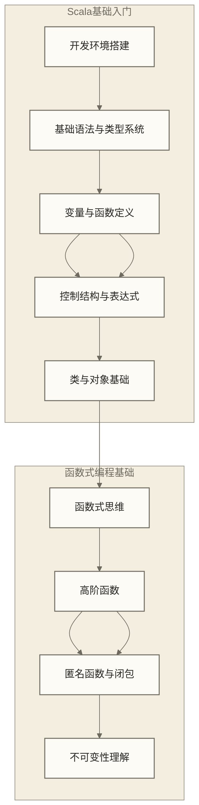
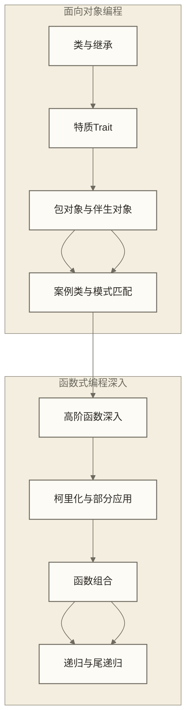
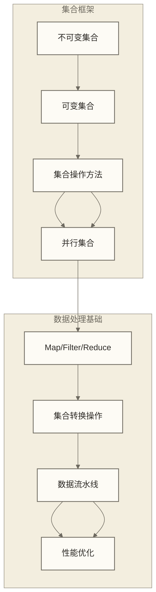
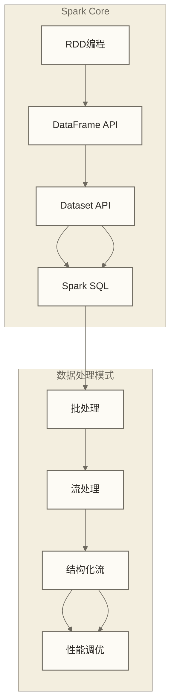
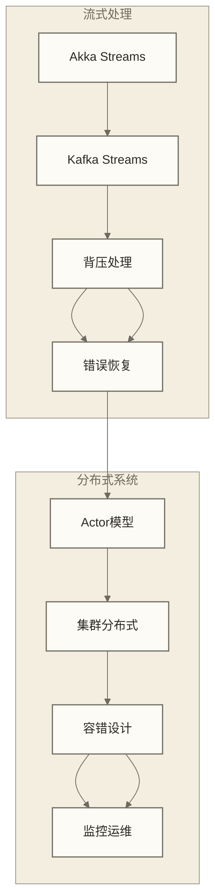
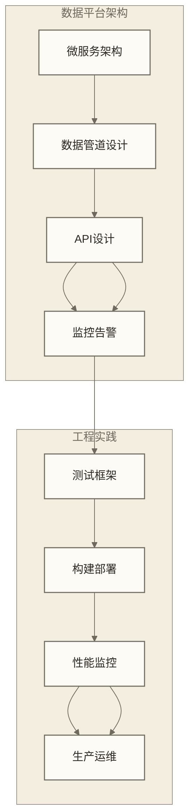

# Scala学习路线图 - 数据开发从业者的Scala技能体系

> [!abstract] 📋 Scala在数据开发中的重要地位
> 
> 🔍 **为什么数据从业者需要学习Scala？**
> Scala作为运行在JVM上的现代编程语言，完美融合了面向对象和函数式编程特性。在大数据领域，Scala是Apache Spark的原生语言、可用于Kafka Streams开发的语言、Akka分布式系统的核心语言，掌握Scala对数据开发者意义重大。
> 
> 🎯 **Scala在数据领域的核心应用**：
> - ⚡ **Apache Spark开发**：使用Scala API进行大数据处理，实际性能取决于API选择、执行计划、数据规模与运行配置
> - 🌊 **流式数据处理**：Akka Streams、Kafka Streams的高效开发
> - 🏗️ **分布式系统**：Akka Actor模型构建高并发数据服务
> - 📊 **数据科学平台**：结合Spark MLlib进行机器学习开发
> - 🔄 **实时计算引擎**：构建低延迟、高吞吐的数据处理系统
> 
> ⏱️ **学习时长**：下方详细计划覆盖28周，约6-7个月；实际进度应结合已有基础与每周投入时间调整

## 🗺️ Scala数据开发学习路径

### 📚 第一阶段：Scala基础语法（3-4周）

**核心学习内容**：
- **开发环境配置**：SBT构建工具、IntelliJ IDEA、Scala REPL
- **语法基础掌握**：val/var、类型推断、字符串插值、基本数据类型
- **函数式编程入门**：纯函数、不可变数据结构、高阶函数基础
- **Java互操作性**：理解Scala与Java的无缝集成

### 🏗️ 第二阶段：面向对象与函数式编程（4-5周）

**核心学习内容**：
- **面向对象高级特性**：抽象类、特质混入、继承链
- **模式匹配系统**：case类、模式匹配、守卫条件
- **函数式编程进阶**：函数组合、柯里化、偏函数应用
- **类型系统深入**：泛型、边界、型变

### 📊 第三阶段：集合框架与数据处理（3-4周）

**核心学习内容**：
- **集合框架精通**：List、Vector、Map、Set的选择和使用
- **函数式数据处理**：map、filter、reduce、fold等操作的熟练应用
- **并行处理基础**：并行集合、性能考量
- **数据管道构建**：链式操作、流式处理思维

### ⚡ 第四阶段：Spark开发基础（4-5周）

**核心学习内容**：
- **Spark Core精通**：RDD操作、转换与行动、缓存策略
- **结构化API**：DataFrame和Dataset的Scala API使用
- **Spark SQL集成**：SQL与Scala代码的结合使用
- **流处理基础**：Structured Streaming的Scala开发

### 🌊 第五阶段：高级数据处理（4-6周）

**核心学习内容**：
- **Akka生态系统**：Actor模型、Akka Streams、Akka HTTP
- **流式处理架构**：背压、错误处理、状态管理
- **分布式系统概念**：集群、分片、容错
- **性能优化实践**：内存管理、并发调优

### 🏢 第六阶段：企业级数据平台（3-4周）

**核心学习内容**：
- **企业级框架**：Play Framework、Akka HTTP微服务
- **数据平台设计**：Lambda架构、Kappa架构
- **工程化实践**：ScalaTest、sbt构建、Docker部署
- **生产级运维**：监控、日志、性能调优

## 📋 分阶段学习计划

### 🎯 阶段一：Scala语言基础（第1-4周）

**学习目标**：
- 熟练掌握Scala基本语法和类型系统
- 理解函数式编程的核心思想
- 能够编写简单的Scala程序
- 掌握与Java的互操作

**核心任务**：
1. **环境搭建**（第1周）
   - 安装Scala 2.13或3.x版本
   - 配置SBT构建工具
   - 设置IntelliJ IDEA Scala插件
   - 熟悉Scala REPL的使用

2. **语法基础**（第2周）
   - val和var的区别与使用
   - 基本数据类型和字符串操作
   - 函数定义与调用
   - 控制结构（if、for、while、match）

3. **面向对象基础**（第3周）
   - 类和对象的定义
   - 构造器和参数
   - 继承和重写
   - 访问修饰符

4. **函数式编程入门**（第4周）
   - 函数作为一等公民
   - 高阶函数的基本使用
   - 匿名函数和闭包
   - 递归思维

**实践项目**：
- 开发一个简单的数据清洗工具
- 实现基本的文件处理功能
- 练习函数式风格的数据转换

### 🛠️ 阶段二：进阶语言特性（第5-9周）

**学习目标**：
- 深入理解Scala的面向对象特性
- 掌握模式匹配的强大功能
- 熟练运用函数式编程技巧
- 理解Scala的类型系统

**核心任务**：
1. **特质和混入**（第5周）
   - 特质的定义和使用
   - 多重继承和线性化
   - 特质的实际应用场景
   - 与Java接口的对比

2. **模式匹配**（第6周）
   - case类的定义和使用
   - 模式匹配的各种形式
   - 守卫条件和变量绑定
   - 偏函数的应用

3. **高级函数式编程**（第7-8周）
   - 柯里化和部分应用函数
   - 函数组合和管道操作
   - 尾递归优化
   - 惰性求值

4. **类型系统深入**（第9周）
   - 泛型和类型参数
   - 上界和下界
   - 型变（协变、逆变、不变）
   - 隐式转换和隐式参数

**实践项目**：
- 设计一个数据验证框架
- 实现函数式的配置管理系统
- 构建类型安全的DSL

### 📊 阶段三：集合与数据处理（第10-13周）

**学习目标**：
- 精通Scala集合框架
- 掌握函数式数据处理技巧
- 理解并行计算的基础
- 能够构建高效的数据处理管道

**核心任务**：
1. **集合框架深入**（第10周）
   - List、Vector、Array的性能特点
   - Map、Set的不同实现
   - 可变与不可变集合的选择
   - 集合的性能分析

2. **数据处理操作**（第11周）
   - map、flatMap、filter的深入应用
   - fold、reduce、scan的使用场景
   - 分组和聚合操作
   - 集合转换最佳实践

3. **并行处理**（第12周）
   - 并行集合的使用
   - 性能对比和选择策略
   - 线程安全考虑
   - 并行度调优

4. **数据流水线**（第13周）
   - 链式操作的设计
   - 惰性求值的应用
   - 内存效率优化
   - 错误处理策略

**实践项目**：
- 构建一个日志分析工具
- 实现并行的数据聚合系统
- 开发内存友好的数据流处理器

### ⚡ 阶段四：Spark开发实战（第14-18周）

**学习目标**：
- 熟练使用Spark的Scala API
- 掌握DataFrame和Dataset编程
- 理解Spark的执行模型
- 能够开发企业级Spark应用

**核心任务**：
1. **Spark Core掌握**（第14周）
   - RDD的创建和操作
   - 转换和行动操作的区别
   - 缓存和持久化策略
   - Spark应用程序结构

2. **结构化API**（第15周）
   - DataFrame API的Scala使用
   - Dataset的类型安全特性
   - 自定义聚合函数
   - 用户定义函数（UDF）

3. **Spark SQL集成**（第16周）
   - SQL与Scala代码的混合使用
   - 表和视图的操作
   - 复杂查询的实现
   - 性能优化技巧

4. **流处理基础**（第17-18周）
   - Structured Streaming概念
   - 实时数据处理管道
   - 窗口操作和水印
   - 状态管理

**实践项目**：
- 开发批处理ETL系统
- 构建实时数据分析平台
- 实现机器学习管道

### 🌊 阶段五：高级流处理（第19-24周）

**学习目标**：
- 掌握Akka生态系统
- 理解流式处理的高级概念
- 能够构建分布式数据系统
- 掌握容错和性能优化

**核心任务**：
1. **Akka Actor模型**（第19-20周）
   - Actor系统基础
   - 消息传递模式
   - Actor层次结构
   - 容错监督策略

2. **Akka Streams**（第21-22周）
   - 流处理图的构建
   - 背压处理机制
   - 自定义流处理组件
   - 与外部系统集成

3. **分布式系统设计**（第23周）
   - 集群和分片
   - 分布式数据结构
   - 一致性和可用性
   - 错误恢复策略

4. **性能优化**（第24周）
   - 内存管理和垃圾回收
   - 并发性能调优
   - 网络和I/O优化
   - 监控和诊断

**实践项目**：
- 构建高并发API服务
- 实现分布式数据处理系统
- 开发实时推荐引擎

### 🏢 阶段六：企业级应用（第25-28周）

**学习目标**：
- 掌握企业级框架的使用
- 理解微服务架构设计
- 具备生产环境部署能力
- 掌握系统监控和运维

**核心任务**：
1. **Web框架应用**（第25周）
   - Play Framework基础
   - RESTful API设计
   - JSON处理和序列化
   - 数据库集成

2. **微服务架构**（第26周）
   - 服务发现和注册
   - 负载均衡和容错
   - 分布式配置管理
   - API网关设计

3. **测试和部署**（第27周）
   - ScalaTest框架使用
   - 单元测试和集成测试
   - 持续集成/持续部署
   - Docker容器化

4. **运维监控**（第28周）
   - 应用监控和指标
   - 日志管理和分析
   - 性能调优实践
   - 故障排查技巧

**实践项目**：
- 开发企业数据平台
- 构建微服务数据管道
- 实现实时监控系统

## 🎯 数据开发关键技能点

### 💡 核心技能矩阵

| 技能领域 | 基础要求 | 进阶要求 | 专家级要求 |
|---------|---------|---------|-----------|
| **Scala基础** | 语法、函数式编程 | 类型系统、高级特性 | 编译器扩展、宏编程 |
| **集合处理** | 基本操作、转换 | 并行处理、优化 | 自定义集合、性能调优 |
| **Spark开发** | RDD、DataFrame基础 | 复杂ETL、性能调优 | 源码贡献、框架扩展 |
| **流式处理** | Akka Streams基础 | 复杂拓扑、背压处理 | 分布式流处理架构 |
| **系统设计** | 基本架构理解 | 微服务设计 | 大规模分布式系统 |
| **工程实践** | 测试、构建 | CI/CD、容器化 | 平台工程、DevOps |

### 🛠️ 必备开发工具

**开发环境**：
- **Scala版本**：Scala 2.13.x（主流）或 Scala 3.x（最新）
- **构建工具**：SBT（主要）、Mill（新兴）
- **IDE选择**：IntelliJ IDEA + Scala插件（推荐）、VSCode + Metals
- **版本控制**：Git + GitHub/GitLab

**大数据工具**：
- **Spark生态**：Apache Spark、Spark SQL、MLlib
- **流处理**：Akka Streams、Kafka Streams
- **存储系统**：Hadoop HDFS、Apache Cassandra
- **消息队列**：Apache Kafka、RabbitMQ

**监控运维**：
- **应用监控**：Akka Management、Lightbend Telemetry
- **指标收集**：Micrometer、Prometheus
- **日志分析**：Logback、ELK Stack
- **容器化**：Docker、Kubernetes

## 📚 推荐学习资源

### 📖 经典书籍

**Scala基础**：
- 《Scala编程》（第三版）- Martin Odersky等
- 《Scala函数式编程》- Paul Chiusano、Rúnar Bjarnason
- 《Scala实战》- Nilanjan Raychaudhuri
- 《深入理解Scala》- Josh Suereth、Matthew Farwell

**数据处理**：
- 《Spark快速大数据分析》- Holden Karau等
- 《学习Spark》（第二版）- Jules Damji等
- 《Akka实战》- Raymond Roestenburg等
- 《反应式设计模式》- Roland Kuhn、Jamie Allen

### 🌐 在线资源

**官方文档**：
- [Scala官方文档](https://docs.scala-lang.org/)
- [Apache Spark文档](https://spark.apache.org/docs/latest/)
- [Akka文档](https://doc.akka.io/docs/akka/current/)
- [SBT官方指南](https://www.scala-sbt.org/documentation.html)

**学习平台**：
- [Scala Center课程](https://www.scala-lang.org/learn/)
- [Coursera Scala课程](https://www.coursera.org/specializations/scala)
- [Rock the JVM](https://rockthejvm.com/) - Scala专业培训
- [Scala School](https://twitter.github.io/scala_school/) - Twitter的Scala教程

**开源项目**：
- [Akka](https://github.com/akka/akka) - Actor模型框架
- [Apache Spark](https://github.com/apache/spark) - 大数据处理引擎
- [Cats](https://github.com/typelevel/cats) - 函数式编程库
- [Play Framework](https://github.com/playframework/playframework) - Web框架

## 🎓 学习建议与最佳实践

### 💪 学习方法建议

**从Java过渡**：
- 利用已有的Java知识，重点学习Scala的特殊特性
- 理解JVM互操作性，逐步转向Scala风格
- 多练习函数式编程思维，减少可变状态使用
- 关注Scala社区的最佳实践和设计模式

**实践驱动学习**：
- 每个概念都要通过REPL验证
- 构建小项目巩固学习成果
- 阅读开源项目的Scala代码
- 参与Scala社区的讨论和贡献

**函数式思维培养**：
- 优先使用不可变数据结构
- 重视函数的纯性和可组合性
- 学会用表达式而非语句思考
- 掌握递归和尾递归优化

### ⚠️ 常见学习误区

**避免的问题**：
- 把Scala当作"更好的Java"来写
- 过度使用高级特性而忽视可读性
- 忽视性能影响，盲目追求函数式风格
- 不理解JVM特性和垃圾回收影响

**正确的学习态度**：
- 深入理解函数式编程的哲学
- 平衡代码优雅性和性能考量
- 重视类型系统的设计和使用
- 关注Scala生态系统的发展趋势

### 🚀 职业发展路径

**初级Scala开发工程师**（0-2年）：
- 熟练掌握Scala基础语法和集合操作
- 能够使用Spark进行基本的数据处理
- 理解函数式编程的基本概念
- 具备基本的Akka应用开发能力

**中级Scala开发工程师**（2-5年）：
- 深入理解Scala类型系统和高级特性
- 熟练开发复杂的Spark应用和性能调优
- 掌握Akka生态系统的各种组件
- 能够设计和实现分布式数据处理系统

**高级Scala开发工程师**（5-8年）：
- 具备大规模Scala系统的架构设计能力
- 精通Spark内核和定制开发
- 深入理解函数式程序设计模式
- 能够进行框架级的开发和优化

**Scala架构师/技术专家**（8年以上）：
- 能够设计企业级的响应式系统架构
- 具备跨语言和跨平台的技术整合能力
- 能够推动Scala技术栈的创新应用
- 具备技术领导力和团队管理能力

## 🔄 与Java的对比优势

### 💫 Scala在数据开发中的优势

**语言层面**：
- **简洁表达力**：更少的样板代码，更高的开发效率
- **函数式特性**：天然支持不可变性和并行处理
- **类型安全**：强大的类型系统减少运行时错误
- **表达式导向**：一切皆表达式，逻辑更清晰

**数据处理优势**：
- **原生Spark支持**：Spark用Scala开发，提供Scala API，具体API选择应结合任务需求与版本支持
- **函数式数据管道**：map/filter/reduce的自然表达
- **并行处理**：Scala 2.13及Scala 3的并行集合操作需要另行引入与所选Scala版本兼容的并行集合模块
- **模式匹配**：处理复杂数据结构更加直观

**生态系统**：
- **Akka生态**：可用于构建高并发、分布式系统，是否适用取决于系统需求与技术约束
- **函数式库**：Cats、Scalaz等丰富的函数式编程库
- **类型级编程**：Shapeless等库支持编译时计算
- **响应式编程**：天然支持响应式和流式处理

---

> [!quote] 💭 Scala学习成功的关键
> 
> 🎯 **函数式思维**：从命令式编程转向声明式和函数式编程
> 💻 **实践为王**：通过大量的代码练习掌握Scala特性
> 🔍 **深入理解**：不仅要会用，更要理解背后的设计哲学
> 🌱 **持续学习**：关注Scala社区发展和最佳实践演进
> 🤝 **社区参与**：积极参与Scala社区讨论和开源贡献

## 🔗 相关学习资源链接

### 后续深入学习
- **Scala高级特性**：【技术与工具】/Scala/Scala高级编程技巧
- **Spark性能调优**：【技术与工具】/Scala/Spark性能优化实战
- **Akka分布式系统**：【技术与工具】/Scala/Akka企业级应用

### 配套实践项目
- **数据处理项目**：【技术与工具】/Scala/Scala数据处理实战
- **流式计算项目**：【技术与工具】/Scala/响应式数据流系统
- **微服务项目**：【技术与工具】/Scala/Scala微服务架构

> [!tip] 🌟 学习建议
> 
> Scala学习需要转变编程思维，从面向对象转向函数式编程。建议先掌握基础语法，然后重点学习集合操作和函数式编程技巧。在数据开发中，Scala的优势主要体现在Spark开发和流式处理上，这是重点学习方向。记住，Scala不是更复杂的Java，而是一种全新的编程范式。