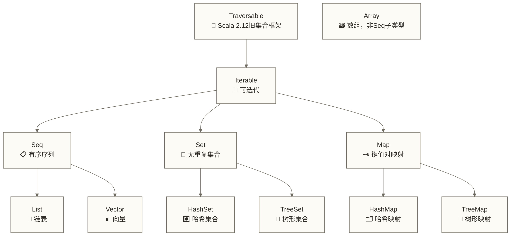

# Scala集合框架与模式匹配 - 函数式数据处理的核心

> [!abstract] 📋 本节概览
> - 🎯 学习目标：掌握Scala集合框架和模式匹配的核心概念与应用
> - 📚 前置知识：[[【技术与工具】/Scala/01-Scala基础语法入门|Scala基础语法]]
> - ⏱️ 预计用时：90分钟

## 🏭 集合框架：数据处理的流水线

想象一下现代工厂的流水线系统。原材料从一端进入，经过不同的处理站点，最终变成精美的产品。Scala的集合框架就是这样一个高效的"数据流水线"，让我们能够以函数式的方式优雅地处理数据。

> [!tip] 💡 核心理念
> Scala集合框架支持将数据处理组织为一系列变换操作的组合。本文主要使用不可变集合，其变换操作通常返回新结果而不修改原集合；但集合框架也包含可变集合，传入map、filter等操作的函数也可能产生副作用，因此不能将所有集合操作一概视为纯函数。

### 📊 集合层次结构



## 📋 List：函数式编程的明星

List就像一个精心设计的珠宝链，每个元素都通过指针连接到下一个。这种结构让函数式操作变得极其自然和高效。

### 🔧 List基本操作

```scala
// 创建List - 就像串珠子一样
val numbers = List(1, 2, 3, 4, 5)
val fruits = List("apple", "banana", "cherry")

// 头尾操作 - 就像拆解珠宝链
val head = numbers.head        // 1 - 第一颗珠子
val tail = numbers.tail        // List(2,3,4,5) - 剩余的链条
val init = numbers.init        // List(1,2,3,4) - 除了最后一颗
val last = numbers.last        // 5 - 最后一颗珠子

// 添加元素 - 就像在链条前后加珠子
val newNumbers = 0 :: numbers           // List(0,1,2,3,4,5) - 前面加一颗
val extended = numbers ::: List(6, 7)   // List(1,2,3,4,5,6,7) - 连接另一条链
```

> [!note] 🔍 性能特性
> List的头部操作（head、tail、::）是O(1)的时间复杂度，但随机访问是O(n)。这就像珠宝链一样 - 看第一颗珠子很容易，但要找到第100颗就需要一颗颗数过去。

### 🎨 函数式变换操作

```scala
val numbers = List(1, 2, 3, 4, 5)

// map - 变换每个元素，就像给每颗珠子重新镀金
val doubled = numbers.map(_ * 2)        // List(2, 4, 6, 8, 10)
val strings = numbers.map(_.toString)   // List("1", "2", "3", "4", "5")

// filter - 筛选元素，就像挑选符合标准的珠子
val evens = numbers.filter(_ % 2 == 0)  // List(2, 4)
val odds = numbers.filter(_ % 2 == 1)   // List(1, 3, 5)

// fold/reduce - 聚合操作，就像把珠宝链熔炼成一块金子
val sum = numbers.reduce(_ + _)         // 15
val product = numbers.foldLeft(1)(_ * _) // 120
```

> [!tip] 🎯 实际应用场景
> 在数据处理中，这些操作经常用于ETL流程：
> - `map`用于数据转换（如格式化日期、单位换算）
> - `filter`用于数据清洗（如过滤无效记录）
> - `fold/reduce`用于数据聚合（如计算总金额、平均值）

## 📊 Vector：高性能的数据容器

Vector就像一个设计精良的图书馆书架系统，支持快速的随机访问和高效的更新操作。

```scala
// Vector创建和操作
val vec = Vector(1, 2, 3, 4, 5)
val updated = vec.updated(2, 10)       // Vector(1, 2, 10, 4, 5)
val appended = vec :+ 6                // Vector(1, 2, 3, 4, 5, 6)
val prepended = 0 +: vec               // Vector(0, 1, 2, 3, 4, 5)

// 高效的随机访问
val element = vec(2)                   // 3 - 随机访问通常视为有效常数时间，树结构访问深度随规模增长
```

## 🗂️ Map：智能的索引系统

Map就像一个智能的图书管理系统，通过标签（键）快速找到对应的内容（值）。

### 📖 Map基本操作

```scala
// 创建Map
val ages = Map("Alice" -> 25, "Bob" -> 30, "Charlie" -> 35)
val scores = Map("Math" -> 95, "English" -> 88, "Science" -> 92)

// 访问和更新
val aliceAge = ages.get("Alice")        // Some(25)
val unknownAge = ages.get("David")      // None
val safeAge = ages.getOrElse("David", 0) // 0

// 更新操作
val updated = ages + ("David" -> 28)    // 添加新键值对
val removed = ages - "Bob"              // 删除键值对
```

### 🔄 Map的函数式操作

```scala
val inventory = Map("apples" -> 50, "bananas" -> 30, "oranges" -> 25)

// 对值进行变换
val doubled = inventory.map { case (name, count) => name -> (count * 2) }
// Map("apples" -> 100, "bananas" -> 60, "oranges" -> 50)

// 过滤操作
val abundant = inventory.filter(_._2 > 40)
// Map("apples" -> 50)

// 计算总库存
val total = inventory.values.sum        // 105
```

> [!example] 💼 业务应用示例：商品库存管理
> ```scala
> case class Product(name: String, price: Double, stock: Int)
> 
> val warehouse = Map(
>   "laptop" -> Product("Gaming Laptop", 1299.99, 15),
>   "mouse" -> Product("Wireless Mouse", 29.99, 50),
>   "keyboard" -> Product("Mechanical Keyboard", 89.99, 25)
> )
> 
> // 查找缺货商品
> val lowStock = warehouse.filter(_._2.stock < 20)
> 
> // 计算总库存价值
> val totalValue = warehouse.values.map(p => p.price * p.stock).sum
> 
> // 更新库存
> val updatedWarehouse = warehouse.updated("laptop", 
>   warehouse("laptop").copy(stock = 12))
> ```

## 🎯 Set：独特性的守护者

Set就像一个严格的门卫，确保没有重复的访客进入。它维护着元素的唯一性，是去重操作的最佳选择。

```scala
// 创建和操作Set
val uniqueNumbers = Set(1, 2, 3, 2, 1) // Set(1, 2, 3) - 自动去重
val colors = Set("red", "green", "blue")

// 集合运算
val set1 = Set(1, 2, 3, 4)
val set2 = Set(3, 4, 5, 6)

val union = set1 ++ set2              // Set(1, 2, 3, 4, 5, 6) - 并集
val intersection = set1 & set2         // Set(3, 4) - 交集
val difference = set1 -- set2          // Set(1, 2) - 差集
```

## 🔍 模式匹配：智能的分拣系统

模式匹配就像一个超智能的邮件分拣系统，能够根据不同的特征将数据准确地分发到对应的处理流程中。

> [!important] ⚡ 核心概念
> 模式匹配是Scala最强大的特性之一，它不仅仅是简单的条件判断，更是一种表达力极强的数据解构和处理方式。

### 🎪 基础模式匹配

```scala
// 基本的值匹配 - 就像邮件按地址分拣
def processNumber(x: Int): String = x match {
  case 1 => "One"
  case 2 => "Two" 
  case 3 => "Three"
  case n if n > 10 => "Large number"
  case _ => "Other number"
}

// 类型匹配 - 就像按包裹类型分类处理
def processAny(obj: Any): String = obj match {
  case s: String => s"String: $s"
  case i: Int if i > 0 => s"Positive integer: $i"
  case i: Int => s"Non-positive integer: $i"
  case d: Double => s"Double: $d"
  case _ => "Unknown type"
}
```

### 📦 集合模式匹配

```scala
// List模式匹配 - 就像按信件数量分类处理
def analyzeList(list: List[Int]): String = list match {
  case Nil => "Empty list"
  case head :: Nil => s"Single element: $head"
  case head :: tail => s"Head: $head, Tail has ${tail.length} elements"
}

// 复杂的List解构
def processData(data: List[String]): String = data match {
  case "START" :: content :: "END" :: Nil => 
    s"Valid message: $content"
  case "ERROR" :: errorCode :: message :: _ => 
    s"Error $errorCode: $message"
  case header :: body if header.startsWith("DATA") => 
    s"Data packet with ${body.length} elements"
  case _ => "Invalid format"
}
```

### 🏗️ Case Class与模式匹配

Case Class配合模式匹配，就像为不同类型的包裹设计专门的处理流程：

```scala
// 定义数据模型
sealed trait Shape
case class Rectangle(width: Double, height: Double) extends Shape
case class Circle(radius: Double) extends Shape
case class Triangle(base: Double, height: Double) extends Shape

// 智能的形状处理器
def calculateArea(shape: Shape): Double = shape match {
  case Rectangle(w, h) => w * h
  case Circle(r) => Math.PI * r * r
  case Triangle(b, h) => 0.5 * b * h
}

def describeShape(shape: Shape): String = shape match {
  case Rectangle(w, h) if w == h => s"Square with side $w"
  case Rectangle(w, h) => s"Rectangle ${w}x${h}"
  case Circle(r) if r > 10 => s"Large circle with radius $r"
  case Circle(r) => s"Circle with radius $r"
  case Triangle(b, h) => s"Triangle with base $b and height $h"
}
```

> [!example] 💼 实际应用：订单处理系统
> ```scala
> sealed trait OrderStatus
> case object Pending extends OrderStatus
> case object Processing extends OrderStatus
> case class Shipped(trackingNumber: String) extends OrderStatus
> case class Delivered(deliveryDate: String) extends OrderStatus
> case class Cancelled(reason: String) extends OrderStatus
> 
> case class Order(id: String, amount: Double, status: OrderStatus)
> 
> def handleOrder(order: Order): String = order match {
>   case Order(id, amount, Pending) if amount > 1000 => 
>     s"High-value order $id requires manual approval"
>   
>   case Order(id, _, Processing) => 
>     s"Order $id is being processed"
>   
>   case Order(id, _, Shipped(tracking)) => 
>     s"Order $id shipped, tracking: $tracking"
>   
>   case Order(id, _, Delivered(date)) => 
>     s"Order $id delivered on $date"
>   
>   case Order(id, _, Cancelled(reason)) => 
>     s"Order $id cancelled: $reason"
>   
>   case Order(id, _, Pending) => 
>     s"Order $id is pending processing"
> }
> ```

### 🎨 Option类型的模式匹配

Option类型就像一个透明的包装盒，里面可能有值(Some)，也可能是空的(None)：

```scala
// 安全的数据访问
def findUser(id: Int): Option[String] = {
  val users = Map(1 -> "Alice", 2 -> "Bob", 3 -> "Charlie")
  users.get(id)
}

def greetUser(id: Int): String = findUser(id) match {
  case Some(name) => s"Hello, $name!"
  case None => "User not found"
}

// 复杂的Option处理
def processUserData(nameOpt: Option[String], ageOpt: Option[Int]): String = {
  (nameOpt, ageOpt) match {
    case (Some(name), Some(age)) if age >= 18 => 
      s"Adult user: $name, age $age"
    case (Some(name), Some(age)) => 
      s"Minor user: $name, age $age"
    case (Some(name), None) => 
      s"User $name, age unknown"
    case (None, Some(age)) => 
      s"Anonymous user, age $age"
    case (None, None) => 
      "No user data available"
  }
}
```

## 🔄 集合操作的链式调用

Scala集合的真正威力在于可以将多个操作串联起来，就像搭建一条高效的数据处理流水线：

```scala
// 复杂的数据处理管道
case class Sale(product: String, quantity: Int, price: Double, region: String)

val sales = List(
  Sale("Laptop", 2, 1200.0, "North"),
  Sale("Mouse", 10, 25.0, "South"),
  Sale("Keyboard", 5, 80.0, "North"),
  Sale("Monitor", 3, 300.0, "East"),
  Sale("Laptop", 1, 1200.0, "South")
)

// 数据分析流水线
val northRevenue = sales
  .filter(_.region == "North")           // 筛选北部地区
  .groupBy(_.product)                    // 按产品分组
  .mapValues(_.map(s => s.quantity * s.price).sum)  // 计算每种产品收入
  .toList                                // 转换为List
  .sortBy(_._2)                          // 按收入排序
  .reverse                               // 降序排列

// 结果: List(("Laptop", 2400.0), ("Keyboard", 400.0))
```

> [!tip] 🎯 性能优化提示
> - 优先使用immutable集合，其不可变结构便于并发共享；若元素包含可变对象，仍需单独保证这些对象的线程安全
> - 对于适合并行化的CPU密集型集合处理，可在评估调度开销后考虑并行集合（.par）；Scala 2.13及Scala 3需要额外引入并行集合模块并导入相应转换
> - 链式操作时，注意中间集合的创建开销
> - 使用view来延迟计算，避免不必要的中间结果

## 🔧 实际项目应用

让我们看一个完整的数据处理示例，展示如何在实际项目中使用Scala集合和模式匹配：

```scala
// 电商数据分析系统
case class Customer(id: Int, name: String, email: String, tier: String)
case class Product(id: Int, name: String, category: String, price: Double)
case class Transaction(customerId: Int, productId: Int, quantity: Int, timestamp: Long)

object ECommerceAnalyzer {
  
  def analyzeCustomerBehavior(
    customers: List[Customer],
    products: List[Product], 
    transactions: List[Transaction]
  ): Map[String, Any] = {
    
    // 创建查找映射
    val customerMap = customers.map(c => c.id -> c).toMap
    val productMap = products.map(p => p.id -> p).toMap
    
    // 分析高价值客户
    val highValueCustomers = transactions
      .groupBy(_.customerId)
      .map { case (customerId, customerTxns) =>
        val totalSpent = customerTxns.map { txn =>
          val product = productMap(txn.productId)
          product.price * txn.quantity
        }.sum
        (customerId, totalSpent)
      }
      .filter(_._2 > 1000)
      .keys
      .toSet
    
    // 热门产品分析
    val popularProducts = transactions
      .groupBy(_.productId)
      .mapValues(_.map(_.quantity).sum)
      .toList
      .sortBy(_._2)
      .reverse
      .take(10)
      .map { case (productId, totalSold) =>
        (productMap(productId).name, totalSold)
      }
    
    // 客户分层分析
    val tierAnalysis = customers
      .groupBy(_.tier)
      .mapValues { tierCustomers =>
        val customerIds = tierCustomers.map(_.id).toSet
        val tierTransactions = transactions.filter(t => customerIds.contains(t.customerId))
        val revenue = tierTransactions.map { txn =>
          productMap(txn.productId).price * txn.quantity
        }.sum
        Map("customers" -> tierCustomers.length, "revenue" -> revenue)
      }
    
    Map(
      "highValueCustomers" -> highValueCustomers.size,
      "popularProducts" -> popularProducts,
      "tierAnalysis" -> tierAnalysis
    )
  }
}
```

## 📚 学习检验

> [!question] 🎯 理解检查
> 1. 能否解释List和Vector的性能差异？
> 2. 什么时候使用Map，什么时候使用Set？
> 3. 模式匹配比if-else有什么优势？
> 4. 如何处理Option类型避免空指针异常？

> [!practice] 🏋️ 实践练习
> 尝试实现一个简单的学生成绩管理系统：
> - 使用Case Class定义学生和课程
> - 使用Map存储学生成绩
> - 使用模式匹配处理不同的查询类型
> - 使用集合操作计算统计信息

## 🔗 学习连接

### 📖 本节要点
- **集合框架**：List、Vector、Map、Set的特性和使用场景
- **函数式操作**：map、filter、fold等变换操作
- **模式匹配**：数据解构和条件处理的强大工具
- **Option处理**：安全的空值处理机制

### 🎯 下一步学习
- **深入应用**：[[【技术与工具】/Scala/03-Scala在数据开发中的应用|Scala在数据开发中的]] - 实际项目中的应用
- **大数据处理**：[[【技术与工具】/Scala/04-Scala大数据技术栈教程|Scala大数据技术栈教程]] - Spark和大数据生态
- **流式计算**：[[【技术与工具】/Scala/05-Scala数据处理和流式计算教程|Scala数据处理和流式计算教程]] - 实时数据处理

---

> [!success] 🎉 恭喜完成！
> 
> 你已经掌握了Scala函数式编程的核心工具：
> - 🏭 **集合框架** - 数据处理的流水线
> - 🎯 **模式匹配** - 智能的分拣系统  
> - 🔧 **函数式操作** - 优雅的数据变换
> 
> 这些技能将为你的大数据开发之路奠定坚实的基础！