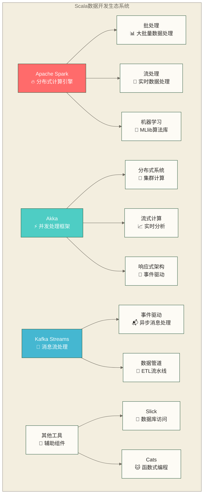

# Scala在数据开发中的应用 - 从理论到实战的完整指南

> [!abstract] 📋 本节概览
> - 🎯 学习目标：掌握Scala在企业级数据开发中的实际应用
> - 📚 前置知识：[[【技术与工具】/Scala/02-Scala集合框架与模式匹配|Scala集合框架与模式匹配]]
> - ⏱️ 预计用时：180分钟

## 🏗️ 为什么Scala是数据开发的黄金搭档？

想象一下，你要建造一座摩天大楼。传统的编程语言就像普通的建筑工具，而Scala就是一套精密的工程装备——既有Java的稳固基础，又有函数式编程的优雅设计。在数据开发的世界里，Scala就是这样一个完美的工具。

> [!tip] 💡 核心优势
> Scala凭借其独特的语言特性，在数据开发领域展现出强大优势：
> - **类型安全**：编译时就能发现数据结构错误
> - **函数式编程**：数据转换管道式处理
> - **JVM生态**：无缝集成Java大数据生态
> - **并发处理**：天生支持高并发数据处理

### 🎯 Scala数据开发生态全景



## 🔧 场景一：企业级ETL数据管道

数据ETL就像一座现代化的食品加工厂。原材料（原始数据）从各个供应商（数据源）送来，经过清洗、加工、包装（转换），最终成为可以直接使用的产品（清洁数据）。

> [!important] 🏭 ETL核心理念
> ETL不仅是数据搬运，更是数据价值提升的过程：
> - **Extract**：从多源头精准提取
> - **Transform**：按业务规则智能转换
> - **Load**：高效装载到目标系统

### 💼 实战案例：电商数据处理系统

```scala
import org.apache.spark.sql.{SparkSession, DataFrame}
import org.apache.spark.sql.functions._
import java.time.LocalDateTime

// 数据模型定义 - 就像设计产品规格
case class RawUserEvent(
  userId: Long,
  eventType: String,
  timestamp: String,
  productId: Option[Long],
  amount: Option[Double],
  sessionId: String
)

case class CleanUserEvent(
  userId: Long,
  eventType: EventType,
  timestamp: java.sql.Timestamp,
  productId: Option[Long],
  amount: Option[Double],
  sessionId: String,
  processed_at: java.sql.Timestamp
)

sealed trait EventType
case object Login extends EventType
case object Purchase extends EventType  
case object Browse extends EventType

class EcommerceETLPipeline {
  
  // Spark会话配置 - 就像配置工厂的生产线
  implicit val spark: SparkSession = SparkSession.builder()
    .appName("Ecommerce ETL Pipeline")
    .config("spark.serializer", "org.apache.spark.serializer.KryoSerializer")
    .config("spark.sql.adaptive.enabled", "true")
    .config("spark.sql.adaptive.coalescePartitions.enabled", "true")
    .getOrCreate()
  
  import spark.implicits._
  
  // 数据提取 - 从各个仓库收集原料
  def extractData(inputPath: String): DataFrame = {
    val rawData = spark.read
      .option("header", "true")
      .option("inferSchema", "true")  
      .option("timestampFormat", "yyyy-MM-dd HH:mm:ss")
      .csv(inputPath)
    
    println(s"✅ 成功提取 ${rawData.count()} 条原始记录")
    
    // 添加处理时间戳
    rawData.withColumn("extract_time", current_timestamp())
  }
  
  // 数据转换 - 核心的加工处理流程
  def transformData(rawData: DataFrame): DataFrame = {
    
    // 数据清洗：就像去除有害物质
    val cleanedData = rawData
      .filter($"userId".isNotNull && $"userId" > 0)           // 过滤无效用户ID
      .filter($"eventType".isNotNull)                         // 确保事件类型存在
      .filter($"timestamp".isNotNull)                         // 确保时间戳存在
      .dropDuplicates("userId", "eventType", "timestamp")     // 去除重复记录
    
    println(s"🧹 数据清洗完成，保留 ${cleanedData.count()} 条有效记录")
    
    // 数据标准化：就像按统一规格包装
    val standardizedData = cleanedData
      .withColumn("eventType_normalized", 
        when($"eventType" === "login", "LOGIN")
        .when($"eventType" === "purchase", "PURCHASE")
        .when($"eventType" === "browse", "BROWSE")
        .otherwise("UNKNOWN"))
      .withColumn("timestamp_parsed", 
        to_timestamp($"timestamp", "yyyy-MM-dd HH:mm:ss"))
      .withColumn("amount_clean", 
        when($"amount".isNull, 0.0).otherwise($"amount"))
    
    // 数据丰富化：就像添加营养成分
    val enrichedData = standardizedData
      .withColumn("hour_of_day", hour($"timestamp_parsed"))
      .withColumn("day_of_week", dayofweek($"timestamp_parsed"))
      .withColumn("user_segment",
        when($"amount_clean" > 1000, "高价值用户")
        .when($"amount_clean" > 100, "普通用户")
        .otherwise("新手用户"))
      .withColumn("session_duration_estimate",
        // 简单的会话时长估算
        when($"eventType_normalized" === "PURCHASE", 30)
        .when($"eventType_normalized" === "BROWSE", 5)  
        .otherwise(2))
    
    println(s"✨ 数据丰富化完成，添加了用户分段和时间特征")
    
    enrichedData
  }
  
  // 数据质量检查 - 质量控制部门
  def validateDataQuality(data: DataFrame): DataFrame = {
    val totalRecords = data.count()
    
    // 检查数据完整性
    val nullUserIds = data.filter($"userId".isNull).count()
    val nullTimestamps = data.filter($"timestamp_parsed".isNull).count()
    val invalidAmounts = data.filter($"amount_clean" < 0).count()
    
    // 计算质量分数
    val qualityScore = (totalRecords - nullUserIds - nullTimestamps - invalidAmounts).toDouble / totalRecords
    
    println(s"""
    |📊 数据质量报告:
    |总记录数: $totalRecords
    |空用户ID: $nullUserIds
    |空时间戳: $nullTimestamps  
    |无效金额: $invalidAmounts
    |质量分数: ${(qualityScore * 100).formatted("%.2f")}%
    """.stripMargin)
    
    if (qualityScore < 0.95) {
      throw new IllegalStateException(s"数据质量不达标: ${qualityScore * 100}% < 95%")
    }
    
    data
  }
  
  // 数据装载 - 产品包装和配送
  def loadData(processedData: DataFrame, outputPath: String): Unit = {
    // 按用户分段分区存储，提高查询效率
    processedData
      .coalesce(10)  // 控制输出文件数量，避免小文件问题
      .write
      .mode("overwrite")
      .partitionBy("user_segment", "day_of_week")  // 智能分区
      .parquet(outputPath)
    
    // 生成数据字典和统计信息
    val summary = processedData
      .groupBy("user_segment", "eventType_normalized")
      .agg(
        count("*").as("record_count"),
        avg("amount_clean").as("avg_amount"),
        max("timestamp_parsed").as("latest_activity")
      )
    
    summary.write
      .mode("overwrite")
      .json(s"$outputPath/summary")
    
    println(s"📦 数据成功装载到: $outputPath")
    println(s"📈 生成统计摘要: $outputPath/summary")
  }
  
  // 完整ETL流程编排
  def runPipeline(inputPath: String, outputPath: String): Unit = {
    try {
      println("🚀 开始ETL数据处理流程...")
      
      val startTime = System.currentTimeMillis()
      
      // Step 1: 提取
      val rawData = extractData(inputPath)
      
      // Step 2: 转换
      val transformedData = transformData(rawData)
      
      // Step 3: 验证
      val validatedData = validateDataQuality(transformedData)
      
      // Step 4: 装载
      loadData(validatedData, outputPath)
      
      val endTime = System.currentTimeMillis()
      val duration = (endTime - startTime) / 1000.0
      
      println(s"✅ ETL流程执行成功！用时: ${duration}秒")
      
    } catch {
      case ex: Exception =>
        println(s"❌ ETL流程执行失败: ${ex.getMessage}")
        ex.printStackTrace()
        throw ex
    }
  }
}
```

> [!example] 💼 使用示例
> ```scala
> // 创建ETL管道实例
> val etlPipeline = new EcommerceETLPipeline()
> 
> // 执行完整的ETL流程
> etlPipeline.runPipeline(
>   inputPath = "hdfs://namenode:9000/raw/user_events/",
>   outputPath = "hdfs://namenode:9000/processed/user_events/"
> )
> ```

## ⚡ 场景二：实时流式数据处理

实时数据流处理就像城市的交通管制系统。车辆（数据）持续不断地在道路上行驶，我们需要实时监控交通状况，及时发现拥堵（异常），并动态调整信号灯（处理策略）。

> [!note] 🌊 流处理核心概念
> - **无界数据流**：数据源源不断地产生
> - **低延迟处理**：毫秒到秒级的响应时间  
> - **状态管理**：维护历史信息进行分析
> - **容错恢复**：系统故障后自动恢复

### 🚗 实战案例：智能交通监控系统

```scala
import org.apache.spark.sql.SparkSession
import org.apache.spark.sql.streaming.{OutputMode, Trigger}
import org.apache.spark.sql.functions._
import org.apache.spark.sql.types._
import java.sql.Timestamp

// 交通数据模型
case class TrafficEvent(
  vehicleId: String,
  location: String,
  speed: Double,
  timestamp: Timestamp,
  eventType: String  // 进入、离开、违规等
)

case class TrafficAlert(
  location: String,
  alertType: String,
  severity: String,
  description: String,
  timestamp: Timestamp,
  affectedVehicles: Long
)

class TrafficStreamProcessor {
  
  implicit val spark: SparkSession = SparkSession.builder()
    .appName("Smart Traffic Monitoring")
    .config("spark.sql.streaming.checkpointLocation", "/tmp/traffic-checkpoint")
    .config("spark.sql.streaming.stateStore.maintenanceInterval", "60s")
    .getOrCreate()
  
  import spark.implicits._
  
  // 定义输入数据结构
  val trafficSchema = StructType(Array(
    StructField("vehicleId", StringType, false),
    StructField("location", StringType, false),
    StructField("speed", DoubleType, false),
    StructField("timestamp", TimestampType, false),
    StructField("eventType", StringType, false)
  ))
  
  def processTrafficStream(): Unit = {
    
    // 1. 从Kafka读取实时交通数据
    val rawTrafficStream = spark.readStream
      .format("kafka")
      .option("kafka.bootstrap.servers", "localhost:9092")
      .option("subscribe", "traffic-events")
      .option("startingOffsets", "latest")
      .option("failOnDataLoss", "false")  // 示例：允许部分数据丢失情形下继续运行，不保证数据完整性
      .load()
    
    // 2. 解析JSON数据
    val trafficEvents = rawTrafficStream
      .select(from_json($"value".cast("string"), trafficSchema).as("data"))
      .select("data.*")
      .as[TrafficEvent]
    
    // 3. 实时交通流量分析
    val trafficFlowAnalysis = trafficEvents
      .withWatermark("timestamp", "30 seconds")  // 处理延迟数据
      .groupBy(
        window($"timestamp", "2 minutes", "30 seconds"),  // 2分钟窗口，30秒滑动
        $"location"
      )
      .agg(
        count("*").as("vehicle_count"),
        avg("speed").as("avg_speed"),
        min("speed").as("min_speed"),
        max("speed").as("max_speed"),
        countDistinct("vehicleId").as("unique_vehicles")
      )
      .withColumn("congestion_level", 
        when($"avg_speed" < 20, "严重拥堵")
        .when($"avg_speed" < 40, "轻度拥堵")
        .when($"avg_speed" < 60, "缓慢通行")
        .otherwise("通畅"))
      .withColumn("traffic_density", $"vehicle_count" / 2.0)  // 每分钟密度
    
    // 4. 异常检测和告警
    val anomalyDetection = trafficEvents
      .withWatermark("timestamp", "1 minute")
      .groupBy(
        window($"timestamp", "5 minutes"),
        $"location"
      )
      .agg(
        avg("speed").as("avg_speed"),
        stddev("speed").as("speed_variance"),
        count("*").as("event_count")
      )
      .filter(
        $"avg_speed" < 10 ||           // 平均速度过低
        $"speed_variance" > 50 ||     // 速度波动过大  
        $"event_count" > 1000         // 车辆数量异常
      )
      .select(
        $"location",
        lit("TRAFFIC_ANOMALY").as("alertType"),
        when($"avg_speed" < 10, "HIGH")
        .when($"speed_variance" > 50, "MEDIUM")
        .otherwise("LOW").as("severity"),
        concat(
          lit("检测到交通异常: 平均速度="), $"avg_speed".cast("string"),
          lit(", 速度标准差="), $"speed_variance".cast("string"),
          lit(", 车辆数="), $"event_count".cast("string")
        ).as("description"),
        current_timestamp().as("timestamp"),
        $"event_count".as("affectedVehicles")
      )
      .as[TrafficAlert]
    
    // 5. 违章检测
    val violationDetection = trafficEvents
      .filter($"speed" > 80)  // 假设限速80
      .withWatermark("timestamp", "10 seconds")
      .groupBy(
        window($"timestamp", "1 minute"),
        $"location"
      )
      .agg(
        count("*").as("violation_count"),
        collect_list("vehicleId").as("violating_vehicles")
      )
      .filter($"violation_count" > 0)
      .select(
        $"location",
        lit("SPEED_VIOLATION").as("alertType"),
        lit("HIGH").as("severity"),
        concat(
          lit("发现"), $"violation_count".cast("string"),
          lit("起超速违章")
        ).as("description"),
        current_timestamp().as("timestamp"),
        $"violation_count".as("affectedVehicles")
      )
      .as[TrafficAlert]
    
    // 6. 输出流配置
    
    // 实时流量监控输出到控制台
    val flowMonitorQuery = trafficFlowAnalysis.writeStream
      .outputMode(OutputMode.Update())
      .format("console")
      .option("truncate", false)
      .trigger(Trigger.ProcessingTime("30 seconds"))
      .queryName("traffic-flow-monitor")
      .start()
    
    // 告警信息发送到Kafka
    val anomalyAlertQuery = anomalyDetection
      .select(to_json(struct($"*")).as("value"))
      .writeStream
      .format("kafka")
      .option("kafka.bootstrap.servers", "localhost:9092")
      .option("topic", "traffic-alerts")
      .option("checkpointLocation", "/tmp/anomaly-checkpoint")
      .trigger(Trigger.ProcessingTime("10 seconds"))
      .queryName("anomaly-alerts")
      .start()
    
    // 违章信息发送到执法部门
    val violationAlertQuery = violationDetection
      .select(to_json(struct($"*")).as("value"))
      .writeStream
      .format("kafka")
      .option("kafka.bootstrap.servers", "localhost:9092")
      .option("topic", "violation-alerts")
      .option("checkpointLocation", "/tmp/violation-checkpoint")
      .trigger(Trigger.ProcessingTime("5 seconds"))
      .queryName("violation-alerts")
      .start()
    
    // 历史数据存储
    val historicalDataQuery = trafficEvents
      .writeStream
      .format("delta")  // 使用Delta Lake存储
      .option("path", "/data/traffic/historical")
      .option("checkpointLocation", "/tmp/historical-checkpoint")
      .partitionBy("location")
      .trigger(Trigger.ProcessingTime("2 minutes"))
      .queryName("historical-data")
      .start()
    
    println("🚦 智能交通监控系统已启动...")
    println("📊 实时流量分析...")
    println("🚨 异常检测和告警...")
    println("📝 违章检测...")
    
    // 优雅关闭
    sys.ShutdownHookThread {
      println("🛑 正在关闭交通监控系统...")
      flowMonitorQuery.stop()
      anomalyAlertQuery.stop()
      violationAlertQuery.stop()
      historicalDataQuery.stop()
      spark.stop()
    }
    
    // 等待查询完成
    flowMonitorQuery.awaitTermination()
  }
}

// 数据生成器（用于测试）
class TrafficDataGenerator {
  
  def generateSampleData(): List[TrafficEvent] = {
    val locations = List("路口A", "路口B", "路口C", "高速入口", "市中心")
    val random = scala.util.Random
    
    (1 to 1000).map { i =>
      TrafficEvent(
        vehicleId = f"CAR$i%04d",
        location = locations(random.nextInt(locations.length)),
        speed = 20 + random.nextGaussian() * 15,  // 正态分布的速度
        timestamp = new Timestamp(System.currentTimeMillis()),
        eventType = if (random.nextDouble() < 0.1) "VIOLATION" else "NORMAL"
      )
    }.toList
  }
}
```

> [!warning] ⚠️ 生产环境注意事项
> 1. **检查点配置**：确保检查点目录的高可用性
> 2. **背压处理**：监控流处理的延迟和吞吐量
> 3. **内存管理**：合理配置Spark Streaming的内存参数
> 4. **故障恢复**：测试各种故障场景的恢复能力

## 📊 场景三：数据质量监控体系

数据质量监控就像食品安全检测实验室。每一批进来的"食材"（数据）都要经过严格的检测，确保没有"有害物质"（错误数据），符合"营养标准"（业务规则），才能放心"上餐桌"（投入使用）。

### 🔬 智能数据质量检测框架

```scala
import org.apache.spark.sql.{DataFrame, SparkSession, Column}
import org.apache.spark.sql.functions._
import org.apache.spark.sql.types._
import scala.collection.mutable.ListBuffer
import java.time.LocalDateTime

// 质量规则抽象
trait QualityRule {
  def name: String
  def description: String  
  def category: String
  def validate(df: DataFrame): QualityResult
  def autoFix(df: DataFrame): Option[DataFrame] = None  // 自动修复功能
}

// 质量检测结果
case class QualityResult(
  ruleName: String,
  category: String,
  passed: Boolean,
  severity: String,  // HIGH, MEDIUM, LOW
  message: String,
  affectedRows: Long,
  totalRows: Long,
  passRate: Double,
  recommendations: List[String] = List.empty
)

// 完整性检查规则
class CompletenessRule(columnName: String, threshold: Double = 1.0) extends QualityRule {
  override def name: String = s"Completeness_$columnName"
  override def description: String = s"检查列 '$columnName' 的完整性"
  override def category: String = "完整性"
  
  override def validate(df: DataFrame): QualityResult = {
    val totalRows = df.count()
    val nullRows = df.filter(col(columnName).isNull || col(columnName) === "").count()
    val completenessRate = (totalRows - nullRows).toDouble / totalRows
    
    val passed = completenessRate >= threshold
    val severity = if (completenessRate < 0.5) "HIGH"
                  else if (completenessRate < 0.8) "MEDIUM"  
                  else "LOW"
    
    QualityResult(
      ruleName = name,
      category = category,
      passed = passed,
      severity = severity,
      message = f"完整性: ${completenessRate * 100}%.2f%% (阈值: ${threshold * 100}%.1f%%)",
      affectedRows = nullRows,
      totalRows = totalRows,
      passRate = completenessRate,
      recommendations = if (!passed) List(
        s"建议检查数据源中 $columnName 字段的数据收集过程",
        "考虑添加默认值或数据修复逻辑"
      ) else List.empty
    )
  }
  
  override def autoFix(df: DataFrame): Option[DataFrame] = {
    // 简单的自动修复：用众数填充空值
    try {
      val mode = df.groupBy(columnName).count()
        .orderBy(desc("count"))
        .first()
        .getAs[String](columnName)
      
      Some(df.na.fill(mode, Array(columnName)))
    } catch {
      case _: Exception => None
    }
  }
}

// 唯一性检查规则
class UniquenessRule(columnNames: String*) extends QualityRule {
  override def name: String = s"Uniqueness_${columnNames.mkString("_")}"
  override def description: String = s"检查字段组合 [${columnNames.mkString(", ")}] 的唯一性"
  override def category: String = "唯一性"
  
  override def validate(df: DataFrame): QualityResult = {
    val totalRows = df.count()
    val distinctRows = df.select(columnNames.map(col): _*).distinct().count()
    val duplicateRows = totalRows - distinctRows
    val uniquenessRate = distinctRows.toDouble / totalRows
    
    val passed = duplicateRows == 0
    val severity = if (duplicateRows > totalRows * 0.1) "HIGH"
                  else if (duplicateRows > 0) "MEDIUM"
                  else "LOW"
    
    QualityResult(
      ruleName = name,
      category = category,
      passed = passed,
      severity = severity,
      message = s"发现 $duplicateRows 条重复记录，唯一性: ${(uniquenessRate * 100).formatted("%.2f")}%",
      affectedRows = duplicateRows,
      totalRows = totalRows,
      passRate = uniquenessRate,
      recommendations = if (!passed) List(
        "检查数据源是否存在重复数据插入",
        "考虑在ETL过程中添加去重逻辑",
        "建立唯一性约束或主键约束"
      ) else List.empty
    )
  }
  
  override def autoFix(df: DataFrame): Option[DataFrame] = {
    Some(df.dropDuplicates(columnNames))
  }
}

// 有效性检查规则
class ValidityRule(columnName: String, validationLogic: Column) extends QualityRule {
  override def name: String = s"Validity_$columnName"
  override def description: String = s"检查列 '$columnName' 的有效性"
  override def category: String = "有效性"
  
  override def validate(df: DataFrame): QualityResult = {
    val totalRows = df.count()
    val invalidRows = df.filter(!coalesce(validationLogic, lit(false))).count()
    val validityRate = (totalRows - invalidRows).toDouble / totalRows
    
    val passed = invalidRows == 0
    val severity = if (invalidRows > totalRows * 0.05) "HIGH"
                  else if (invalidRows > 0) "MEDIUM"
                  else "LOW"
    
    QualityResult(
      ruleName = name,
      category = category,
      passed = passed,
      severity = severity,
      message = s"发现 $invalidRows 条无效记录，有效性: ${(validityRate * 100).formatted("%.2f")}%",
      affectedRows = invalidRows,
      totalRows = totalRows,
      passRate = validityRate,
      recommendations = if (!passed) List(
        s"检查 $columnName 字段的输入验证规则",
        "加强数据输入时的格式验证",
        "建立数据清洗和标准化流程"
      ) else List.empty
    )
  }
}

// 一致性检查规则
class ConsistencyRule(
  ruleName: String,
  ruleDescription: String,
  checkLogic: DataFrame => (Long, Long)  // (违规记录数, 总记录数)
) extends QualityRule {
  override def name: String = ruleName
  override def description: String = ruleDescription
  override def category: String = "一致性"
  
  override def validate(df: DataFrame): QualityResult = {
    val (violationCount, totalCount) = checkLogic(df)
    val consistencyRate = (totalCount - violationCount).toDouble / totalCount
    
    val passed = violationCount == 0
    val severity = if (violationCount > totalCount * 0.02) "HIGH"
                  else if (violationCount > 0) "MEDIUM"
                  else "LOW"
    
    QualityResult(
      ruleName = name,
      category = category,
      passed = passed,
      severity = severity,
      message = s"发现 $violationCount 条不一致记录，一致性: ${(consistencyRate * 100).formatted("%.2f")}%",
      affectedRows = violationCount,
      totalRows = totalCount,
      passRate = consistencyRate,
      recommendations = if (!passed) List(
        "检查业务规则的实现逻辑",
        "确保跨系统数据的同步一致性",
        "建立数据一致性监控机制"
      ) else List.empty
    )
  }
}

// 数据质量监控引擎
class DataQualityEngine(spark: SparkSession) {
  
  import spark.implicits._
  
  private val rules = ListBuffer[QualityRule]()
  private val history = ListBuffer[QualityReport]()
  
  // 添加质量规则
  def addRule(rule: QualityRule): DataQualityEngine = {
    rules += rule
    this
  }
  
  def addRules(newRules: Seq[QualityRule]): DataQualityEngine = {
    rules ++= newRules
    this
  }
  
  // 执行全面质量检查
  def runQualityAssessment(
    df: DataFrame,
    datasetName: String = "Unknown Dataset"
  ): QualityReport = {
    
    println(s"🔍 开始数据质量评估: $datasetName")
    println(s"📊 待检查记录数: ${df.count()}")
    println(s"📋 质量规则数: ${rules.length}")
    
    val startTime = System.currentTimeMillis()
    
    // 顺序调用所有质量规则；各规则内部的Spark作业由Spark执行
    val results = rules.zipWithIndex.map { case (rule, index) =>
      println(s"  ⏳ [${index + 1}/${rules.length}] 执行规则: ${rule.name}")
      val result = rule.validate(df)
      val status = if (result.passed) "✅" else "❌"
      println(s"    $status ${rule.category}: ${result.message}")
      result
    }.toList
    
    val endTime = System.currentTimeMillis()
    val duration = (endTime - startTime) / 1000.0
    
    // 生成综合报告
    val report = QualityReport(
      datasetName = datasetName,
      timestamp = LocalDateTime.now(),
      totalRules = rules.length,
      totalRecords = df.count(),
      results = results,
      executionTimeSeconds = duration,
      overallScore = calculateOverallScore(results)
    )
    
    // 保存到历史记录
    history += report
    
    report
  }
  
  // 计算综合质量分数
  private def calculateOverallScore(results: List[QualityResult]): Double = {
    if (results.isEmpty) 0.0
    else {
      val weightedScores = results.map { result =>
        val weight = result.category match {
          case "完整性" => 0.3
          case "唯一性" => 0.25
          case "有效性" => 0.25
          case "一致性" => 0.2
          case _ => 0.1
        }
        result.passRate * weight
      }
      weightedScores.sum / results.groupBy(_.category).size
    }
  }
  
  // 自动修复数据问题
  def autoRepairData(df: DataFrame): (DataFrame, List[String]) = {
    var repairedDF = df
    val repairActions = ListBuffer[String]()
    
    rules.foreach { rule =>
      rule.autoFix(repairedDF) match {
        case Some(fixedDF) =>
          repairedDF = fixedDF
          repairActions += s"应用自动修复: ${rule.name}"
        case None =>
          repairActions += s"无法自动修复: ${rule.name}"
      }
    }
    
    (repairedDF, repairActions.toList)
  }
  
  // 生成质量趋势分析
  def analyzeQualityTrend(period: Int = 10): TrendAnalysis = {
    val recentReports = history.takeRight(period)
    
    if (recentReports.length < 2) {
      TrendAnalysis("数据不足", 0.0, List.empty)
    } else {
      val scores = recentReports.map(_.overallScore)
      val trend = scores.last - scores.head
      val trendDescription = if (trend > 0.05) "显著改善"
                           else if (trend > 0.01) "轻微改善"
                           else if (trend < -0.05) "显著恶化"
                           else if (trend < -0.01) "轻微恶化"
                           else "保持稳定"
      
      TrendAnalysis(
        trendDescription,
        trend,
        recentReports.map(r => (r.timestamp.toString, r.overallScore)).toList
      )
    }
  }
}

// 质量报告数据结构
case class QualityReport(
  datasetName: String,
  timestamp: LocalDateTime,
  totalRules: Int,
  totalRecords: Long,
  results: List[QualityResult],
  executionTimeSeconds: Double,
  overallScore: Double
) {
  
  def passedRules: Int = results.count(_.passed)
  def failedRules: Int = results.count(!_.passed)
  def highSeverityIssues: Int = results.count(_.severity == "HIGH")
  def mediumSeverityIssues: Int = results.count(_.severity == "MEDIUM")
  
  def printSummary(): Unit = {
    println(s"""
    |📋 数据质量评估报告
    |====================
    |📊 数据集: $datasetName
    |⏰ 评估时间: $timestamp
    |📏 数据记录: $totalRecords 条
    |🔍 检查规则: $totalRules 个
    |✅ 通过规则: $passedRules 个
    |❌ 失败规则: $failedRules 个
    |🔴 高危问题: $highSeverityIssues 个
    |🟡 中危问题: $mediumSeverityIssues 个
    |⭐ 综合得分: ${(overallScore * 100).formatted("%.2f")} 分
    |⏱️ 执行用时: ${executionTimeSeconds.formatted("%.2f")} 秒
    |
    |📋 问题详情:
    |${results.filter(!_.passed).map(r => 
      s"  • ${r.category} - ${r.ruleName}: ${r.message}"
    ).mkString("\n")}
    |
    |💡 改进建议:
    |${results.filter(!_.passed).flatMap(_.recommendations).distinct.map(r => 
      s"  • $r"
    ).mkString("\n")}
    """.stripMargin)
  }
  
  def isHealthy(threshold: Double = 0.8): Boolean = overallScore >= threshold
  
  def getWorstCategories(top: Int = 3): List[(String, Double)] = {
    results.groupBy(_.category)
      .mapValues(_.map(_.passRate).sum / _.length)
      .toList
      .sortBy(_._2)
      .take(top)
  }
}

case class TrendAnalysis(
  description: String,
  trendValue: Double,
  historicalData: List[(String, Double)]
)
```

> [!example] 📊 使用示例：电商订单数据质量检查
> ```scala
> // 创建质量监控引擎
> val qualityEngine = new DataQualityEngine(spark)
> 
> // 添加质量规则
> qualityEngine
>   .addRule(new CompletenessRule("order_id", 1.0))
>   .addRule(new CompletenessRule("customer_id", 0.95))
>   .addRule(new UniquenessRule("order_id"))
>   .addRule(new ValidityRule("amount", col("amount") > 0))
>   .addRule(new ValidityRule("email", col("email").rlike("^[A-Za-z0-9+_.-]+@[A-Za-z0-9.-]+\\.[A-Za-z]{2,}$")))
>   .addRule(new ConsistencyRule(
>     "Order_Customer_Consistency",
>     "检查订单与客户关系的一致性",
>     df => {
>       val violations = df.join(customerDF, Seq("customer_id"), "left")
>         .filter(col("customer_name").isNull).count()
>       (violations, df.count())
>     }
>   ))
> 
> // 执行质量评估
> val report = qualityEngine.runQualityAssessment(orderDF, "电商订单数据")
> report.printSummary()
> 
> // 自动修复数据问题
> val (repairedData, repairActions) = qualityEngine.autoRepairData(orderDF)
> println(s"修复操作: ${repairActions.mkString(", ")}")
> 
> // 质量趋势分析
> val trend = qualityEngine.analyzeQualityTrend()
> println(s"质量趋势: ${trend.description}")
> ```

## 🔗 学习连接

### 📖 本节要点回顾
- **企业ETL管道**：数据提取、转换、装载的完整流程
- **实时流处理**：高并发数据流的实时分析和处理  
- **数据质量监控**：全方位的数据质量检查和自动修复
- **性能优化**：Spark应用的调优策略和最佳实践

### 🎯 下一步学习路径
- **深入大数据技术**：[[【技术与工具】/Scala/04-Scala大数据技术栈教程|Scala大数据技术栈教程]] - Spark生态深度学习
- **流式计算进阶**：[[【技术与工具】/Scala/05-Scala数据处理和流式计算教程|Scala数据处理和流式计算教程]] - 复杂流处理场景
- **基础语法回顾**：[[【技术与工具】/Scala/01-Scala基础语法入门|Scala基础语法]] - 巩固语言基础

---

> [!success] 🎉 恭喜你完成数据开发实战！
> 
> 🏗️ **本节涉及的实践方向（掌握程度需通过运行、测试和项目实践检验）**：
> - 📊 **企业级ETL设计** - 构建可靠的数据管道
> - ⚡ **实时流处理** - 处理高并发数据流  
> - 🔍 **数据质量管控** - 确保数据可信度
> - 🚀 **性能优化技巧** - 让系统高效运行
> 
> 💡 **实践建议**：理论知识需要结合实际项目来深化理解。建议从小规模数据开始练习，逐步增加复杂度！