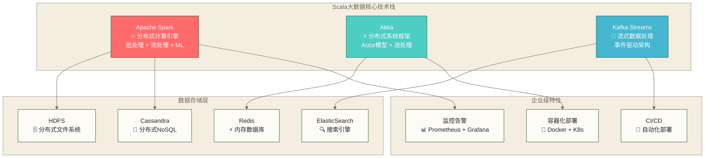

# Scala大数据技术栈教程 - Spark与Akka企业级应用

> [!abstract] 📋 本节概览
> - 🎯 学习目标：掌握Scala在企业级大数据技术栈中的应用
> - 📚 前置知识：[[【技术与工具】/Scala/03-Scala在数据开发中的应用|Scala在数据开发中的]]
> - ⏱️ 预计用时：240分钟

## 🏗️ Scala：大数据世界的建筑师

想象一下，你要建造一座智能城市。传统的编程语言就像普通的建筑工具，而Scala就是一套精密的工程设备——既有Java的稳固基础，又有函数式编程的优雅设计。在大数据的世界里，Scala不仅是Spark的母语，更是构建整个数据生态系统的完美选择。

> [!tip] 💡 为什么Scala是大数据的黄金搭档？
> - **天生分布式**：Actor模型天然支持并发和分布式
> - **类型安全**：编译时发现错误，运行时更稳定
> - **JVM生态**：无缝集成Java大数据生态圈
> - **函数式特性**：数据转换管道式处理更优雅

### 🌟 Scala大数据技术生态全景



## ⚡ Apache Spark：数据处理的超级引擎

Spark就像一座现代化的数据工厂，它可以同时处理海量的原材料（数据），通过不同的生产线（RDD、DataFrame、Dataset）加工成各种产品（分析结果），并可利用内存缓存加速适合的计算；实际执行仍可能包含磁盘读写、Shuffle和内存不足时的溢写。

> [!important] 🔥 Spark核心优势
> - **内存计算**：在适合缓存和迭代计算的工作负载中可能优于传统MapReduce，具体提升取决于数据规模、执行计划、资源配置和测试条件
> - **统一引擎**：批处理、流处理、机器学习一体化
> - **易用性**：丰富的API和SQL支持
> - **容错性**：自动故障恢复机制

### 🏭 企业级Spark应用架构

```scala
import org.apache.spark.{SparkConf, SparkContext}
import org.apache.spark.sql.{SparkSession, DataFrame, Dataset}
import org.apache.spark.sql.functions._
import org.apache.spark.storage.StorageLevel

// 企业级Spark应用的最佳实践
class EnterpriseSparkPlatform {
  
  // 生产环境优化配置 - 就像调校赛车引擎
  private val optimizedSparkConf = new SparkConf()
    .setAppName("Enterprise Data Processing Platform")
    // 序列化优化 - 让数据传输更快
    .set("spark.serializer", "org.apache.spark.serializer.KryoSerializer")
    .set("spark.kryoserializer.buffer.max", "512m")
    
    // 自适应查询执行 - 让Spark更智能
    .set("spark.sql.adaptive.enabled", "true")
    .set("spark.sql.adaptive.coalescePartitions.enabled", "true")
    .set("spark.sql.adaptive.skewJoin.enabled", "true")
    
    // 动态资源分配 - 按需使用集群资源
    .set("spark.dynamicAllocation.enabled", "true")
    .set("spark.dynamicAllocation.minExecutors", "2")
    .set("spark.dynamicAllocation.maxExecutors", "20")
    
    // 内存管理优化
    .set("spark.executor.memory", "4g")
    .set("spark.memory.fraction", "0.8")
    .set("spark.sql.execution.arrow.maxRecordsPerBatch", "20000")
  
  implicit val spark: SparkSession = SparkSession.builder()
    .config(optimizedSparkConf)
    .enableHiveSupport()  // 支持Hive元数据
    .getOrCreate()
  
  import spark.implicits._
  
  // 智能数据质量监控 - 就像工厂的质检系统
  class DataQualityAccumulator extends org.apache.spark.util.AccumulatorV2[String, scala.collection.mutable.Map[String, Long]] {
    private val _qualityMetrics = scala.collection.mutable.Map.empty[String, Long]
    
    override def isZero: Boolean = _qualityMetrics.isEmpty
    override def copy(): DataQualityAccumulator = {
      val acc = new DataQualityAccumulator
      acc._qualityMetrics ++= this._qualityMetrics
      acc
    }
    override def reset(): Unit = _qualityMetrics.clear()
    
    override def add(issue: String): Unit = {
      _qualityMetrics(issue) = _qualityMetrics.getOrElse(issue, 0L) + 1L
    }
    
    override def merge(other: org.apache.spark.util.AccumulatorV2[String, scala.collection.mutable.Map[String, Long]]): Unit = {
      other match {
        case acc: DataQualityAccumulator =>
          acc._qualityMetrics.foreach { case (key, value) =>
            _qualityMetrics(key) = _qualityMetrics.getOrElse(key, 0L) + value
          }
        case _ => throw new UnsupportedOperationException
      }
    }
    
    override def value: scala.collection.mutable.Map[String, Long] = _qualityMetrics
  }
  
  // 多数据源统一处理管道 - 就像多条河流汇成大海
  def createUnifiedDataPipeline(): DataFrame = {
    val qualityMonitor = new DataQualityAccumulator
    spark.sparkContext.register(qualityMonitor, "DataQualityMonitor")
    
    // 从多个数据源读取数据
    val salesData = readSalesData()
    val customerData = readCustomerData()
    val productData = readProductData()
    
    // 数据清洗和标准化 - 就像洗菜和切菜
    val cleanedSales = cleanSalesData(salesData, qualityMonitor)
    val enrichedData = enrichWithCustomerAndProduct(cleanedSales, customerData, productData)
    
    // 实时数据质量报告
    generateQualityReport(qualityMonitor)
    
    enrichedData
  }
  
  private def readSalesData(): DataFrame = {
    // 智能地从多种数据源读取
    val hdfsData = spark.read
      .option("mergeSchema", "true")  // 自动合并schema变化
      .option("recursiveFileLookup", "true")  // 递归查找文件
      .parquet("hdfs://namenode:9000/data/sales/")
    
    val dbData = spark.read
      .format("jdbc")
      .option("url", "jdbc:postgresql://db-server:5432/sales")
      .option("dbtable", "sales_transactions")
      .option("user", "spark_user")
      .option("password", "spark_password")
      .option("numPartitions", "10")  // 分区数上限；仅设置此项不会自动将该表拆分为并行读取分区
      .option("fetchsize", "1000")    // 批量获取
      .load()
    
    // 合并历史数据和实时数据
    hdfsData.unionByName(dbData, allowMissingColumns = true)
      .withColumn("data_source", 
        when($"create_time" > date_sub(current_date(), 1), "realtime")
        .otherwise("historical"))
  }
  
  private def readCustomerData(): DataFrame = {
    spark.read
      .format("org.apache.spark.sql.cassandra")
      .options(Map("table" -> "customers", "keyspace" -> "crm"))
      .load()
      .cache()  // 缓存小表用于join优化
  }
  
  private def readProductData(): DataFrame = {
    spark.read
      .format("org.elasticsearch.spark.sql")
      .load("products/product")
      .cache()
  }
  
  // 数据清洗：就像食品加工的质检流程
  private def cleanSalesData(df: DataFrame, qualityMonitor: DataQualityAccumulator): DataFrame = {
    df.mapPartitions { partition =>
      partition.map { row =>
        // 在每个分区内进行质量检查
        if (row.isNullAt(row.fieldIndex("customer_id"))) {
          qualityMonitor.add("missing_customer_id")
        }
        
        val amount = row.getAs[Double]("amount")
        if (amount < 0) {
          qualityMonitor.add("negative_amount")
        } else if (amount > 100000) {
          qualityMonitor.add("suspicious_high_amount")
        }
        
        row
      }
    }
    .filter($"customer_id".isNotNull && $"amount" > 0 && $"amount" < 100000)
    .withColumn("cleaned_amount", round($"amount", 2))
    .withColumn("transaction_date_clean", 
      to_date($"transaction_timestamp", "yyyy-MM-dd"))
  }
  
  // 数据丰富化：就像给菜品添加调料
  private def enrichWithCustomerAndProduct(
    sales: DataFrame,
    customers: DataFrame, 
    products: DataFrame
  ): DataFrame = {
    
    // 使用广播连接优化小表join
    val customersBC = broadcast(customers)
    val productsBC = broadcast(products)
    
    sales
      .join(customersBC, Seq("customer_id"), "left")
      .join(productsBC, Seq("product_id"), "left")
      .withColumn("customer_lifetime_value", 
        when($"customer_tier" === "VIP", $"amount" * 1.2)
        .when($"customer_tier" === "GOLD", $"amount" * 1.1)
        .otherwise($"amount"))
      .withColumn("profit_margin", $"amount" - $"product_cost")
      .withColumn("season", 
        when(month($"transaction_date_clean").isin(12, 1, 2), "WINTER")
        .when(month($"transaction_date_clean").isin(3, 4, 5), "SPRING")
        .when(month($"transaction_date_clean").isin(6, 7, 8), "SUMMER")
        .otherwise("AUTUMN"))
  }
  
  private def generateQualityReport(qualityMonitor: DataQualityAccumulator): Unit = {
    val metrics = qualityMonitor.value.toMap
    
    println("📊 数据质量监控报告:")
    metrics.foreach { case (issue, count) =>
      println(s"  ⚠️  $issue: $count 条记录")
    }
    
    // 将质量报告保存到监控系统
    val reportDF = metrics.toSeq.toDF("issue_type", "count")
      .withColumn("check_timestamp", current_timestamp())
    
    reportDF.write
      .mode("append")
      .format("delta")  // 使用Delta Lake保存版本历史
      .save("/monitoring/data_quality_reports")
  }
}
```

### 🌊 Spark Streaming：实时数据的指挥家

实时流处理就像城市交通的智能调度系统，源源不断的数据流就像车辆，我们需要实时分析交通状况，及时发现拥堵，动态调整信号灯。

> [!example] 💼 实战案例：智能电商推荐系统
> ```scala
> class RealtimeRecommendationEngine {
>   
>   implicit val spark: SparkSession = SparkSession.getActiveSession.get
>   import spark.implicits._
>   
>   // 用户行为事件流
>   case class UserBehaviorEvent(
>     userId: Long,
>     itemId: Long, 
>     eventType: String,  // view, click, purchase
>     timestamp: java.sql.Timestamp,
>     sessionId: String
>   )
>   
>   def buildRealtimeRecommendationPipeline(): Unit = {
>     // 从Kafka读取用户行为流
>     val behaviorStream = spark.readStream
>       .format("kafka")
>       .option("kafka.bootstrap.servers", "localhost:9092")
>       .option("subscribe", "user-behavior")
>       .option("startingOffsets", "latest")
>       .load()
>       .select(from_json($"value".cast("string"), getBehaviorSchema()).as("event"))
>       .select("event.*")
>       .as[UserBehaviorEvent]
>     
>     // 实时用户画像更新
>     val userProfiles = behaviorStream
>       .withWatermark("timestamp", "10 minutes")
>       .groupBy($"userId", window($"timestamp", "30 minutes", "5 minutes"))
>       .agg(
>         count("*").as("activity_count"),
>         countDistinct("itemId").as("unique_items"),
>         collect_list("eventType").as("behavior_sequence"),
>         sum(when($"eventType" === "purchase", 1).otherwise(0)).as("purchases")
>       )
>       .withColumn("user_activity_level",
>         when($"activity_count" > 50, "HIGH")
>         .when($"activity_count" > 20, "MEDIUM")
>         .otherwise("LOW"))
>     
>     // 实时推荐计算
>     val recommendations = userProfiles
>       .join(getItemSimilarityMatrix(), Seq("itemId"), "inner")
>       .groupBy($"userId")
>       .agg(
>         collect_list($"similar_items").as("recommended_items"),
>         avg($"similarity_score").as("recommendation_confidence")
>       )
>     
>     // 输出到多个目标
>     val kafkaOutput = recommendations
>       .select(to_json(struct($"*")).as("value"))
>       .writeStream
>       .format("kafka")
>       .option("kafka.bootstrap.servers", "localhost:9092")
>       .option("topic", "realtime-recommendations")
>       .option("checkpointLocation", "/checkpoints/recommendations")
>       .outputMode("update")
>       .start()
>     
>     kafkaOutput.awaitTermination()
>   }
> }
> ```

## 🎭 Akka：分布式系统的魔法师

Akka就像一个超大型的邮局系统，每个Actor都是一个邮递员，他们可以并行处理成千上万的邮件（消息），互不干扰，即使某个邮递员生病了（Actor故障），其他人还能继续工作，整个系统依然运转如常。

> [!note] 🌟 Actor模型核心思想
> - **一切皆Actor**：系统中的每个组件都是Actor
> - **消息传递**：Actor之间通过消息通信
> - **位置透明**：Actor可以在不同机器上运行
> - **容错设计**：Let it crash哲学

### 🏢 企业级Actor系统架构

```scala
import akka.actor.{Actor, ActorRef, ActorSystem, Props, Terminated}
import akka.pattern.{ask, pipe}
import akka.util.Timeout
import akka.routing.{BalancingPool, RoundRobinPool}
import scala.concurrent.{Future, ExecutionContext}
import scala.concurrent.duration._

// 大数据处理的Actor生态系统
object BigDataProcessingSystem {
  
  // 消息协议设计 - 就像邮局的标准信封格式
  sealed trait DataProcessingMessage
  case class ProcessBatch(batchId: String, data: List[String]) extends DataProcessingMessage
  case class BatchProcessed(batchId: String, result: ProcessingResult) extends DataProcessingMessage
  case class ProcessingFailed(batchId: String, error: String) extends DataProcessingMessage
  case class GetBatchStatus(batchId: String) extends DataProcessingMessage
  case class BatchStatus(batchId: String, status: String, progress: Double) extends DataProcessingMessage
  
  case class ProcessingResult(
    batchId: String,
    processedRecords: Int,
    errorRecords: Int,
    processingTimeMs: Long,
    qualityScore: Double
  )
  
  // 数据处理主管 - 就像工厂的总调度室
  class DataProcessingSupervisor extends Actor {
    implicit val ec: ExecutionContext = context.dispatcher
    implicit val timeout: Timeout = Timeout(30.seconds)
    
    // 创建工作者池 - 就像雇佣一队工人
    val workerPool: ActorRef = context.actorOf(
      BalancingPool(10).props(Props[DataProcessingWorker]),
      "data-workers"
    )
    
    // 创建监控Actor - 就像安排一个质检员
    val monitor: ActorRef = context.actorOf(
      Props[ProcessingMonitor], "monitor"
    )
    
    // 批次状态管理
    var batchStates = Map.empty[String, String]
    var batchResults = Map.empty[String, ProcessingResult]
    
    override def receive: Receive = {
      case ProcessBatch(batchId, data) =>
        batchStates = batchStates + (batchId -> "PROCESSING")
        val originalSender = sender()
        
        // 通知监控系统
        monitor ! ProcessBatch(batchId, data)
        
        // 分发任务给工作者池
        (workerPool ? ProcessBatch(batchId, data)).mapTo[DataProcessingMessage].onComplete {
          case Success(BatchProcessed(id, result)) =>
            batchStates = batchStates + (id -> "COMPLETED")
            batchResults = batchResults + (id -> result)
            monitor ! BatchProcessed(id, result)
            originalSender ! BatchProcessed(id, result)
            
          case Success(ProcessingFailed(id, error)) =>
            batchStates = batchStates + (id -> "FAILED")
            monitor ! ProcessingFailed(id, error)
            originalSender ! ProcessingFailed(id, error)
            
          case Failure(ex) =>
            batchStates = batchStates + (batchId -> "FAILED")
            originalSender ! ProcessingFailed(batchId, ex.getMessage)
        }
      
      case GetBatchStatus(batchId) =>
        val status = batchStates.getOrElse(batchId, "NOT_FOUND")
        val progress = calculateProgress(batchId, status)
        sender() ! BatchStatus(batchId, status, progress)
        
      case Terminated(actorRef) =>
        // 工作者失效时重启
        context.watch(context.actorOf(Props[DataProcessingWorker]))
    }
    
    private def calculateProgress(batchId: String, status: String): Double = {
      status match {
        case "PROCESSING" => 0.5
        case "COMPLETED" => 1.0
        case "FAILED" => 0.0
        case _ => 0.0
      }
    }
  }
  
  // 数据处理工作者 - 就像流水线上的工人
  class DataProcessingWorker extends Actor {
    implicit val ec: ExecutionContext = context.dispatcher
    
    override def receive: Receive = {
      case ProcessBatch(batchId, data) =>
        val startTime = System.currentTimeMillis()
        val originalSender = sender()
        
        try {
          // 模拟复杂的数据处理
          val processedData = processDataWithQualityCheck(data)
          val endTime = System.currentTimeMillis()
          
          val result = ProcessingResult(
            batchId = batchId,
            processedRecords = processedData.validRecords,
            errorRecords = processedData.errorRecords,
            processingTimeMs = endTime - startTime,
            qualityScore = processedData.qualityScore
          )
          
          originalSender ! BatchProcessed(batchId, result)
          
        } catch {
          case ex: Exception =>
            originalSender ! ProcessingFailed(batchId, ex.getMessage)
        }
    }
    
    private def processDataWithQualityCheck(data: List[String]): ProcessedBatchData = {
      val validRecords = data.filter(_.nonEmpty).map(cleanAndValidate)
      val errorCount = data.length - validRecords.length
      val qualityScore = validRecords.length.toDouble / data.length
      
      ProcessedBatchData(validRecords.length, errorCount, qualityScore)
    }
    
    private def cleanAndValidate(record: String): String = {
      // 数据清洗和验证逻辑
      record.trim.toUpperCase.filter(_.isLetterOrDigit)
    }
  }
  
  case class ProcessedBatchData(validRecords: Int, errorRecords: Int, qualityScore: Double)
  
  // 处理监控器 - 就像工厂的仪表盘
  class ProcessingMonitor extends Actor {
    var totalBatches = 0
    var completedBatches = 0
    var failedBatches = 0
    var totalProcessingTime = 0L
    var totalQualityScore = 0.0
    
    override def receive: Receive = {
      case ProcessBatch(_, _) =>
        totalBatches += 1
        
      case BatchProcessed(_, result) =>
        completedBatches += 1
        totalProcessingTime += result.processingTimeMs
        totalQualityScore += result.qualityScore
        
        // 如果质量分数太低，发出警告
        if (result.qualityScore < 0.8) {
          println(s"⚠️ 数据质量警告: 批次${result.batchId}质量分数仅${result.qualityScore}")
        }
        
      case ProcessingFailed(_, _) =>
        failedBatches += 1
        
      case "GET_METRICS" =>
        val avgProcessingTime = if (completedBatches > 0) 
          totalProcessingTime / completedBatches else 0L
        val avgQualityScore = if (completedBatches > 0)
          totalQualityScore / completedBatches else 0.0
          
        sender() ! Map(
          "total_batches" -> totalBatches,
          "completed_batches" -> completedBatches,
          "failed_batches" -> failedBatches,
          "success_rate" -> (completedBatches.toDouble / totalBatches * 100),
          "avg_processing_time_ms" -> avgProcessingTime,
          "avg_quality_score" -> avgQualityScore
        )
    }
  }
}
```

### 🌊 Akka Streams：数据流的艺术家

Akka Streams就像一个复杂的水利工程系统，数据像水流一样在管道中流动，经过不同的处理站点（操作符），最终流向目标地点。重要的是，这个系统还能自动调节流量，防止洪水（背压处理）。

```scala
import akka.stream.scaladsl._
import akka.stream.{ActorMaterializer, OverflowStrategy}
import akka.{Done, NotUsed}

class AdvancedDataStreamProcessor {
  
  implicit val system: ActorSystem = ActorSystem("StreamProcessing")
  implicit val materializer: ActorMaterializer = ActorMaterializer()
  implicit val ec: ExecutionContext = system.dispatcher
  
  // 复杂数据流处理管道 - 就像智能工厂的生产线
  def createIntelligentProcessingPipeline(): Unit = {
    
    // 数据源：模拟IoT设备数据流
    val iotDataSource: Source[SensorData, NotUsed] = Source
      .tick(100.millis, 100.millis, ())  // 每100ms产生一条数据
      .map(_ => generateSensorData())
      .throttle(1000, 1.second)  // 限流：每秒最多1000条
    
    // 数据预处理流：就像原料筛选
    val preprocessingFlow: Flow[SensorData, ValidatedSensorData, NotUsed] = 
      Flow[SensorData]
        .map(validateAndClean)
        .filter(_.isDefined)
        .map(_.get)
        .via(addTimestampAndEnrich)  // 添加时间戳和丰富化
    
    // 异常检测流：就像质检系统
    val anomalyDetectionFlow: Flow[ValidatedSensorData, AnomalyAlert, NotUsed] =
      Flow[ValidatedSensorData]
        .groupedWithin(100, 5.seconds)  // 批量处理：100条或5秒
        .mapAsync(4)(batch => detectAnomalies(batch))  // 并发异常检测
        .mapConcat(identity)  // 展平结果
    
    // 数据分流：就像分拣系统
    val partitioner = Partition[ValidatedSensorData](3, data => {
      data.data.sensorType match {
        case "TEMPERATURE" => 0
        case "HUMIDITY" => 1  
        case _ => 2
      }
    })
    
    // 温度数据处理流
    val temperatureFlow: Flow[ValidatedSensorData, ProcessedData, NotUsed] =
      Flow[ValidatedSensorData]
        .buffer(1000, OverflowStrategy.backpressure)
        .map(processTemperatureData)
        .async  // 异步边界，提高并行度
    
    // 湿度数据处理流  
    val humidityFlow: Flow[ValidatedSensorData, ProcessedData, NotUsed] =
      Flow[ValidatedSensorData]
        .buffer(1000, OverflowStrategy.dropTail)  // 缓冲区满时丢弃缓冲区尾部元素，再接收新元素
        .map(processHumidityData)
        .async
    
    // 其他数据处理流
    val otherDataFlow: Flow[ValidatedSensorData, ProcessedData, NotUsed] =
      Flow[ValidatedSensorData]
        .buffer(5000, OverflowStrategy.dropHead)  // 缓冲区满时丢弃缓冲区头部最旧元素，再接收新元素  
        .map(processOtherData)
        .async
    
    // 结果合并
    val merger = Merge[ProcessedData](3)
    
    // 多目标输出：就像产品分发到不同仓库
    val multiSink = Sink.combine(
      Sink.foreach[ProcessedData](saveToDatabase),    // 保存到数据库
      Sink.foreach[ProcessedData](sendToKafka),       // 发送到消息队列
      Sink.foreach[ProcessedData](updateRealTimeView) // 更新实时视图
    )(Broadcast[ProcessedData](_))
    
    // 构建完整的流处理图
    val processingGraph = RunnableGraph.fromGraph(GraphDSL.create() { implicit builder =>
      import GraphDSL.Implicits._
      
      // 定义图的各个节点
      val source = builder.add(iotDataSource)
      val preprocess = builder.add(preprocessingFlow)
      val partition = builder.add(partitioner)
      val merge = builder.add(merger)
      val sink = builder.add(multiSink)
      
      // 连接各个节点
      source ~> preprocess ~> partition.in
      
      partition.out(0) ~> temperatureFlow ~> merge.in(0)
      partition.out(1) ~> humidityFlow ~> merge.in(1)
      partition.out(2) ~> otherDataFlow ~> merge.in(2)
      
      merge.out ~> sink
      
      // 异常检测分支
      preprocess ~> anomalyDetectionFlow ~> Sink.foreach(handleAnomaly)
      
      ClosedShape
    })
    
    // 启动流处理
    val future: Future[Done] = processingGraph.run()
    
    future.onComplete {
      case Success(_) => println("✅ 流处理管道运行完成")
      case Failure(ex) => println(s"❌ 流处理管道失败: ${ex.getMessage}")
    }
  }
  
  // 错误恢复和重试机制
  def createResilientStream(): Unit = {
    val unreliableSource = Source(1 to 1000)
      .map { i =>
        if (i % 20 == 0) throw new RuntimeException(s"模拟错误 at $i")
        i
      }
    
    val resilientFlow = Flow[Int]
      .recover {
        case _: RuntimeException => -1  // 错误恢复值
      }
      .mapConcat { i =>
        if (i == -1) List.empty  // 过滤错误值
        else List(i)
      }
      .withAttributes(ActorAttributes.supervisionStrategy(_ => Supervision.Resume))
    
    unreliableSource
      .via(resilientFlow)
      .runWith(Sink.foreach(println))
  }
  
  // 背压处理示例
  def handleBackpressure(): Unit = {
    val fastProducer = Source(1 to 1000000)  // 快速生产者
    
    val slowConsumer = Sink.foreach[Int] { i =>
      Thread.sleep(10)  // 模拟慢速消费
      println(s"处理: $i")
    }
    
    // 使用缓冲和背压策略
    val bufferedFlow = Flow[Int]
      .buffer(10000, OverflowStrategy.backpressure)  // 缓冲区满时背压
      .async
    
    fastProducer
      .via(bufferedFlow)
      .to(slowConsumer)
      .run()
  }
  
  // 辅助方法
  private def generateSensorData(): SensorData = {
    SensorData(
      sensorId = scala.util.Random.nextInt(1000).toString,
      sensorType = List("TEMPERATURE", "HUMIDITY", "PRESSURE")(scala.util.Random.nextInt(3)),
      value = scala.util.Random.nextDouble() * 100,
      timestamp = System.currentTimeMillis()
    )
  }
  
  private def validateAndClean(data: SensorData): Option[SensorData] = {
    if (data.value >= 0 && data.value <= 150) Some(data) else None
  }
  
  private def addTimestampAndEnrich: Flow[SensorData, ValidatedSensorData, NotUsed] = {
    Flow[SensorData].map { data =>
      ValidatedSensorData(
        data = data,
        processingTimestamp = System.currentTimeMillis(),
        location = getLocationBySensorId(data.sensorId)
      )
    }
  }
  
  private def detectAnomalies(batch: Seq[ValidatedSensorData]): Future[Seq[AnomalyAlert]] = {
    Future {
      batch.filter(_.data.value > 80).map { data =>
        AnomalyAlert(
          sensorId = data.data.sensorId,
          alertType = "HIGH_VALUE",
          value = data.data.value,
          threshold = 80.0,
          timestamp = System.currentTimeMillis()
        )
      }
    }
  }
  
  private def processTemperatureData(data: ValidatedSensorData): ProcessedData = {
    ProcessedData(data.data.sensorId, "TEMPERATURE_PROCESSED", data.data.value)
  }
  
  private def processHumidityData(data: ValidatedSensorData): ProcessedData = {
    ProcessedData(data.data.sensorId, "HUMIDITY_PROCESSED", data.data.value)
  }
  
  private def processOtherData(data: ValidatedSensorData): ProcessedData = {
    ProcessedData(data.data.sensorId, "OTHER_PROCESSED", data.data.value)
  }
  
  private def getLocationBySensorId(sensorId: String): String = {
    s"Location_${sensorId.hashCode % 10}"
  }
  
  private def saveToDatabase(data: ProcessedData): Unit = {
    // 保存到数据库的逻辑
  }
  
  private def sendToKafka(data: ProcessedData): Unit = {
    // 发送到Kafka的逻辑
  }
  
  private def updateRealTimeView(data: ProcessedData): Unit = {
    // 更新实时视图的逻辑
  }
  
  private def handleAnomaly(alert: AnomalyAlert): Unit = {
    println(s"🚨 异常警告: 传感器${alert.sensorId}数值${alert.value}超过阈值${alert.threshold}")
  }
}

// 数据模型
case class SensorData(sensorId: String, sensorType: String, value: Double, timestamp: Long)
case class ValidatedSensorData(data: SensorData, processingTimestamp: Long, location: String)
case class ProcessedData(sensorId: String, processingType: String, value: Double)
case class AnomalyAlert(sensorId: String, alertType: String, value: Double, threshold: Double, timestamp: Long)
```

## 🔗 企业级系统集成

在企业环境中，系统集成就像建设一座智慧城市，需要将各种基础设施（数据库、消息队列、缓存、搜索引擎）有机地连接起来，让数据在它们之间自由流动。

> [!important] 🏢 企业级集成原则
> - **统一接口**：为不同数据源提供一致的访问方式
> - **容错设计**：单点故障不影响整体系统
> - **监控完备**：实时掌握各组件的健康状态
> - **弹性扩容**：根据负载动态调整资源

### 🌐 多数据源统一访问层

```scala
import org.apache.spark.sql.{SparkSession, DataFrame}
import redis.clients.jedis.{Jedis, JedisPool}
import java.util.Properties

// 数据访问抽象层 - 就像万能插座
trait UniversalDataConnector {
  def read(query: String): DataFrame
  def write(df: DataFrame, target: String): Unit
  def healthCheck(): Boolean
}

// PostgreSQL连接器
class PostgreSQLConnector(
  jdbcUrl: String,
  username: String,
  password: String
)(implicit spark: SparkSession) extends UniversalDataConnector {
  
  private val connectionProps = new Properties()
  connectionProps.put("user", username)
  connectionProps.put("password", password)
  connectionProps.put("driver", "org.postgresql.Driver")
  
  override def read(tableName: String): DataFrame = {
    spark.read
      .jdbc(jdbcUrl, tableName, connectionProps)
      .cache()  // 缓存热数据
  }
  
  override def write(df: DataFrame, tableName: String): Unit = {
    df.write
      .mode("append")
      .jdbc(jdbcUrl, tableName, connectionProps)
  }
  
  override def healthCheck(): Boolean = {
    try {
      val testDF = spark.read.jdbc(jdbcUrl, "(SELECT 1 as health_check) t", connectionProps)
      testDF.count() == 1
    } catch {
      case _: Exception => false
    }
  }
}

// Redis连接器 - 高速缓存管家
class RedisConnector(host: String, port: Int) extends UniversalDataConnector {
  
  private val jedisPool = new JedisPool(host, port)
  
  override def read(pattern: String): DataFrame = {
    // Redis数据转DataFrame需要特殊处理
    val jedis = jedisPool.getResource
    try {
      val keys = jedis.keys(pattern)
      val data = keys.asScala.map { key =>
        val value = jedis.get(key)
        (key, value)
      }.toSeq
      
      SparkSession.active.createDataFrame(data).toDF("key", "value")
    } finally {
      jedis.close()
    }
  }
  
  override def write(df: DataFrame, keyPrefix: String): Unit = {
    df.foreachPartition { partition =>
      val jedis = jedisPool.getResource
      try {
        partition.foreach { row =>
          val key = s"$keyPrefix:${row.getAs[String]("id")}"
          val value = row.json
          jedis.setex(key, 3600, value)  // 1小时过期
        }
      } finally {
        jedis.close()
      }
    }
  }
  
  override def healthCheck(): Boolean = {
    val jedis = jedisPool.getResource
    try {
      jedis.ping() == "PONG"
    } catch {
      case _: Exception => false
    } finally {
      jedis.close()
    }
  }
  
  // Redis特有的批量操作
  def batchWrite(data: Map[String, String], expireSeconds: Int = 3600): Unit = {
    val jedis = jedisPool.getResource
    try {
      val pipeline = jedis.pipelined()
      data.foreach { case (key, value) =>
        pipeline.setex(key, expireSeconds, value)
      }
      pipeline.sync()
    } finally {
      jedis.close()
    }
  }
}

// ElasticSearch连接器 - 全文搜索专家
class ElasticsearchConnector(
  hosts: String,
  index: String
)(implicit spark: SparkSession) extends UniversalDataConnector {
  
  // 配置ES连接
  spark.conf.set("es.nodes", hosts)
  spark.conf.set("es.port", "9200")
  spark.conf.set("es.index.auto.create", "true")
  spark.conf.set("es.mapping.id", "id")  // 指定文档ID字段
  
  override def read(query: String): DataFrame = {
    spark.read
      .format("org.elasticsearch.spark.sql")
      .option("es.query", query)
      .load(s"$index")
  }
  
  override def write(df: DataFrame, targetIndex: String): Unit = {
    df.write
      .format("org.elasticsearch.spark.sql")
      .mode("append")
      .save(s"$targetIndex")
  }
  
  override def healthCheck(): Boolean = {
    try {
      val testDF = spark.read
        .format("org.elasticsearch.spark.sql")
        .option("es.query", """{"query": {"match_all": {}}, "size": 1}""")
        .load(index)
      testDF.count() >= 0  // 能执行查询就说明连接正常
    } catch {
      case _: Exception => false
    }
  }
  
  // ES特有的全文搜索
  def fullTextSearch(searchTerm: String, fields: List[String]): DataFrame = {
    val queryJson = s"""
    {
      "query": {
        "multi_match": {
          "query": "$searchTerm",
          "fields": [${fields.map(f => s"\"$f\"").mkString(",")}]
        }
      }
    }
    """
    
    read(queryJson)
  }
}

// 统一数据处理平台 - 数据世界的指挥中心
class UnifiedDataPlatform(implicit spark: SparkSession) {
  
  private val postgresql = new PostgreSQLConnector(
    "jdbc:postgresql://db-server:5432/analytics",
    "data_user", "secure_password"
  )
  
  private val redis = new RedisConnector("cache-server", 6379)
  private val elasticsearch = new ElasticsearchConnector("search-cluster", "analytics")
  
  // 系统健康检查 - 就像医生给系统做体检
  def performHealthCheck(): Map[String, Boolean] = {
    Map(
      "PostgreSQL" -> postgresql.healthCheck(),
      "Redis" -> redis.healthCheck(),
      "Elasticsearch" -> elasticsearch.healthCheck(),
      "Spark" -> checkSparkHealth()
    )
  }
  
  private def checkSparkHealth(): Boolean = {
    try {
      val executors = spark.sparkContext.statusTracker.getExecutorInfos
      executors.count(_.isActive) > 0
    } catch {
      case _: Exception => false
    }
  }
  
  // 跨系统数据同步 - 就像城市各区域的信息同步
  def synchronizeData(): Unit = {
    println("🔄 开始跨系统数据同步...")
    
    // 从数据库读取核心数据
    val coreData = postgresql.read("core_business_data")
      .filter($"updated_at" > date_sub(current_date(), 1))  // 只同步最近更新的数据
    
    println(s"📊 读取到 ${coreData.count()} 条核心业务数据")
    
    // 数据预处理和丰富化
    val enrichedData = coreData
      .withColumn("sync_timestamp", current_timestamp())
      .withColumn("data_hash", sha2(concat_ws("|", $"id", $"name", $"amount"), 256))
      .cache()  // 缓存，因为要写入多个目标
    
    // 并行写入多个系统
    import scala.concurrent.ExecutionContext.Implicits.global
    
    val futures = List(
      // 更新搜索索引
      Future {
        elasticsearch.write(enrichedData, "business_data_realtime")
        println("✅ ElasticSearch同步完成")
      },
      
      // 更新缓存
      Future {
        redis.write(enrichedData, "business_data")
        println("✅ Redis缓存更新完成")
      },
      
      // 备份到数据仓库
      Future {
        enrichedData.write
          .mode("append")
          .partitionBy("sync_date")
          .parquet("hdfs://namenode:9000/warehouse/business_data_backup")
        println("✅ 数据仓库备份完成")
      }
    )
    
    // 等待所有操作完成
    import scala.concurrent.Await
    import scala.concurrent.duration._
    
    try {
      Await.result(Future.sequence(futures), 30.minutes)
      println("🎉 数据同步全部完成")
    } catch {
      case ex: Exception =>
        println(s"❌ 数据同步部分失败: ${ex.getMessage}")
    } finally {
      enrichedData.unpersist()  // 清理缓存
    }
  }
  
  // 智能数据路由 - 根据数据特性选择最优存储
  def intelligentDataRouting(df: DataFrame, dataType: String): Unit = {
    dataType match {
      case "REALTIME_METRICS" =>
        // 实时指标存入Redis，TTL设置为1小时
        redis.write(df, "metrics:realtime")
        println("📈 实时指标已缓存到Redis")
        
      case "SEARCHABLE_CONTENT" =>  
        // 可搜索内容存入ElasticSearch
        elasticsearch.write(df, "content_search")
        println("🔍 内容已索引到ElasticSearch")
        
      case "HISTORICAL_DATA" =>
        // 历史数据存入数据仓库
        df.write.mode("append").parquet("hdfs://namenode:9000/warehouse/historical")
        println("🗄️ 历史数据已存档")
        
      case "TRANSACTIONAL_DATA" =>
        // 事务数据存入PostgreSQL
        postgresql.write(df, "transactions")
        println("💳 事务数据已保存到数据库")
        
      case _ =>
        println(s"⚠️ 未知数据类型: $dataType，使用默认存储")
        df.write.mode("append").parquet("hdfs://namenode:9000/data/default")
    }
  }
}
```

## 🚀 生产环境部署与运维

在生产环境中，部署和运维就像管理一座现代化的智能工厂，需要考虑自动化、监控、扩容、容错等各个方面。

> [!example] 📦 Docker容器化最佳实践
> ```dockerfile
> # 多阶段构建，优化镜像大小
> FROM openjdk:11-jdk-slim as builder
> 
> # 安装SBT
> RUN apt-get update && apt-get install -y curl
> RUN curl -L https://github.com/sbt/sbt/releases/download/v1.5.0/sbt-1.5.0.tgz | tar -xz -C /opt
> ENV PATH="/opt/sbt/bin:$PATH"
> 
> # 复制源码并构建
> WORKDIR /app
> COPY . .
> RUN sbt clean assembly
> 
> # 运行时镜像
> FROM openjdk:11-jre-slim
> 
> # 创建应用用户
> RUN useradd -m -u 1000 appuser
> 
> # 复制应用JAR
> COPY --from=builder /app/target/scala-2.12/*-assembly-*.jar /app/app.jar
> 
> # 设置JVM参数
> ENV JAVA_OPTS="-Xmx4g -Xms2g -XX:+UseG1GC -XX:+UnlockExperimentalVMOptions"
> 
> # 健康检查
> HEALTHCHECK --interval=30s --timeout=10s --start-period=60s \
>   CMD curl -f http://localhost:8080/health || exit 1
> 
> USER appuser
> EXPOSE 8080
> 
> ENTRYPOINT ["sh", "-c", "java $JAVA_OPTS -jar /app/app.jar"]
> ```

### 📊 企业级监控体系

```scala
import io.micrometer.core.instrument.{MeterRegistry, Timer, Counter}
import io.micrometer.prometheus.{PrometheusConfig, PrometheusMeterRegistry}
import akka.http.scaladsl.Http
import akka.http.scaladsl.model._
import akka.http.scaladsl.server.Directives._

// 全方位监控系统 - 就像工厂的中控室
class ComprehensiveMonitoringSystem(implicit system: ActorSystem) {
  
  // Prometheus指标注册表
  private val meterRegistry: PrometheusMeterRegistry = 
    new PrometheusMeterRegistry(PrometheusConfig.DEFAULT)
  
  // 业务指标
  private val dataProcessingTimer: Timer = Timer.builder("data_processing_duration")
    .description("数据处理耗时")
    .register(meterRegistry)
  
  private val dataQualityGauge = meterRegistry.gauge("data_quality_score", 0.0)
  private val errorCounter: Counter = meterRegistry.counter("processing_errors_total")
  private val throughputCounter: Counter = meterRegistry.counter("records_processed_total")
  
  // 系统指标
  private val memoryUsageGauge = meterRegistry.gauge("jvm_memory_usage_ratio", 0.0)
  private val activeConnections = meterRegistry.gauge("database_connections_active", 0.0)
  
  // 记录数据处理性能
  def recordProcessingMetrics[T](operationName: String)(operation: => T): T = {
    val sample = Timer.start(meterRegistry)
    try {
      val result = operation
      sample.stop(dataProcessingTimer.tag("operation", operationName))
      result
    } catch {
      case ex: Exception =>
        errorCounter.increment(Map("operation" -> operationName, "error_type" -> ex.getClass.getSimpleName))
        sample.stop(dataProcessingTimer.tag("operation", operationName).tag("result", "error"))
        throw ex
    }
  }
  
  // 更新业务指标
  def updateBusinessMetrics(qualityScore: Double, recordsProcessed: Long): Unit = {
    meterRegistry.gauge("data_quality_score", qualityScore)
    throughputCounter.increment(recordsProcessed)
  }
  
  // 系统健康检查
  def performSystemHealthCheck(): HealthCheckResult = {
    val checks = Map(
      "jvm_memory" -> checkJVMMemory(),
      "database" -> checkDatabaseHealth(),
      "cache" -> checkCacheHealth(),
      "storage" -> checkStorageHealth(),
      "external_apis" -> checkExternalAPIs()
    )
    
    val overallHealthy = checks.values.forall(identity)
    val unhealthyServices = checks.filter(!_._2).keys.toList
    
    HealthCheckResult(
      status = if (overallHealthy) "HEALTHY" else "UNHEALTHY",
      checks = checks,
      unhealthyServices = unhealthyServices,
      timestamp = System.currentTimeMillis()
    )
  }
  
  private def checkJVMMemory(): Boolean = {
    val runtime = Runtime.getRuntime
    val usedMemory = runtime.totalMemory() - runtime.freeMemory()
    val maxMemory = runtime.maxMemory()
    val memoryUsageRatio = usedMemory.toDouble / maxMemory
    
    meterRegistry.gauge("jvm_memory_usage_ratio", memoryUsageRatio)
    
    memoryUsageRatio < 0.85  // 内存使用率超过85%认为不健康
  }
  
  private def checkDatabaseHealth(): Boolean = {
    try {
      // 模拟数据库连接检查
      Thread.sleep(10)  // 模拟查询延迟
      true
    } catch {
      case _: Exception => false
    }
  }
  
  private def checkCacheHealth(): Boolean = {
    try {
      // 模拟Redis连接检查
      true
    } catch {
      case _: Exception => false
    }
  }
  
  private def checkStorageHealth(): Boolean = {
    try {
      // 模拟HDFS连接检查
      true
    } catch {
      case _: Exception => false
    }
  }
  
  private def checkExternalAPIs(): Boolean = {
    try {
      // 模拟外部API健康检查
      true
    } catch {
      case _: Exception => false
    }
  }
  
  // 获取Prometheus格式指标
  def getPrometheusMetrics: String = meterRegistry.scrape()
  
  // 启动监控HTTP服务器
  def startMonitoringServer(host: String = "0.0.0.0", port: Int = 9090): Unit = {
    val routes = pathPrefix("monitoring") {
      concat(
        path("health") {
          get {
            val health = performSystemHealthCheck()
            val statusCode = if (health.status == "HEALTHY") 
              StatusCodes.OK else StatusCodes.ServiceUnavailable
            complete(statusCode, health.toJson)
          }
        },
        path("metrics") {
          get {
            complete(HttpEntity(ContentTypes.`text/plain(UTF-8)`, getPrometheusMetrics))
          }
        },
        path("ready") {
          get {
            // Kubernetes就绪性探针
            complete(StatusCodes.OK, "Ready")
          }
        },
        path("live") {
          get {
            // Kubernetes存活性探针
            complete(StatusCodes.OK, "Live")
          }
        }
      )
    }
    
    Http().bindAndHandle(routes, host, port)
    println(s"📊 监控服务器启动: http://$host:$port/monitoring")
  }
}

case class HealthCheckResult(
  status: String,
  checks: Map[String, Boolean],
  unhealthyServices: List[String],
  timestamp: Long
) {
  def toJson: String = {
    s"""
    {
      "status": "$status",
      "timestamp": $timestamp,
      "checks": {
        ${checks.map { case (k, v) => s""""$k": $v""" }.mkString(", ")}
      },
      "unhealthy_services": [${unhealthyServices.map(s => s""""$s"""").mkString(", ")}]
    }
    """
  }
}

// 自动化运维工具
class AutomatedOperations(monitoringSystem: ComprehensiveMonitoringSystem) {
  
  // 自动扩容决策
  def autoScalingDecision(): ScalingDecision = {
    val health = monitoringSystem.performSystemHealthCheck()
    
    // 基于健康状态做扩容决策
    val memoryPressure = !health.checks.getOrElse("jvm_memory", true)
    val unhealthyServiceCount = health.unhealthyServices.length
    
    (memoryPressure, unhealthyServiceCount) match {
      case (true, _) => ScalingDecision("SCALE_UP", "内存压力过大", 2)
      case (_, count) if count > 2 => ScalingDecision("SCALE_UP", s"$count个服务不健康", 1)
      case (false, 0) => ScalingDecision("HEALTHY", "系统运行正常", 0)
      case _ => ScalingDecision("MONITOR", "继续观察", 0)
    }
  }
  
  // 自动故障恢复
  def autoFailureRecovery(): Unit = {
    val health = monitoringSystem.performSystemHealthCheck()
    
    health.unhealthyServices.foreach {
      case "database" => 
        println("🔧 尝试重连数据库...")
        // 数据库重连逻辑
        
      case "cache" => 
        println("🔧 清理缓存连接池...")
        // 缓存重连逻辑
        
      case "storage" => 
        println("🔧 检查存储系统连接...")
        // 存储重连逻辑
        
      case service => 
        println(s"⚠️ 未知服务故障: $service")
    }
  }
}

case class ScalingDecision(
  action: String,
  reason: String,
  instances: Int
)
```

## 🔗 学习连接

### 📖 本节要点总结
- **Apache Spark**：内存计算引擎，批流一体化处理
- **Akka系统**：Actor模型，构建弹性分布式系统
- **企业集成**：多数据源统一访问，智能数据路由
- **生产运维**：容器化部署，全面监控体系

### 🎯 下一步学习
- **深入流式计算**：[[【技术与工具】/Scala/05-Scala数据处理和流式计算教程|Scala数据处理和流式计算教程]] - 复杂流处理场景
- **项目实战**：动手构建完整的大数据平台
- **性能调优**：深度优化Spark和Akka应用性能

---

> [!success] 🎉 已完成企业级大数据技术栈示例学习！
> 
> 🏗️ **本节涉及的能力方向，仍需通过可运行实现和测试验收**：
> - ⚡ **Spark进阶应用示例** - 内存计算和流处理
> - 🎭 **Akka分布式架构** - Actor模型和容错设计
> - 🌐 **系统集成能力** - 多数据源统一管理
> - 📊 **运维监控体系** - 生产环境最佳实践
> 
> 🚀 **继续前进**：可将本文作为企业级大数据平台设计与练习的起点；实际生产部署仍需补全依赖和实现、修正代码问题，并完成数据正确性、故障恢复、性能与安全测试。