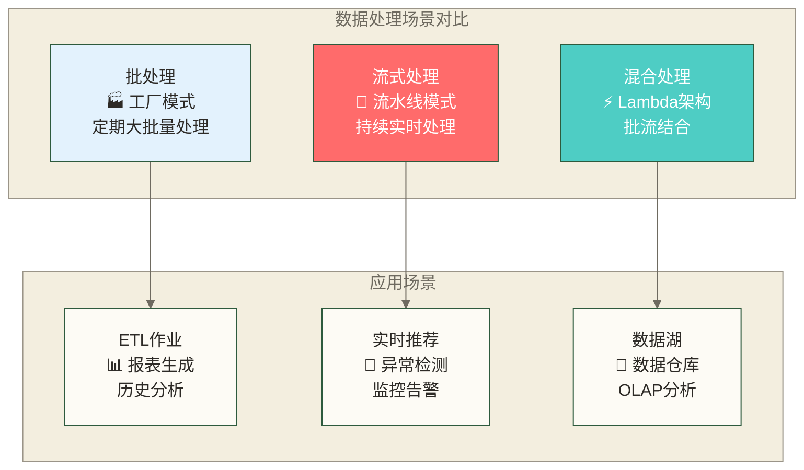

# Scala数据处理和流式计算教程 - 构建实时数据处理系统

> [!abstract] 📋 本节概览
> - 🎯 学习目标：掌握Scala流式计算和实时数据处理的完整技术栈
> - 📚 前置知识：[[【技术与工具】/Scala/04-Scala大数据技术栈教程|Scala大数据技术栈教程]]
> - ⏱️ 预计用时：300分钟

## 🌊 流式计算：数据世界的血液循环系统

想象现代城市的交通管理系统，车辆就像数据流源源不断地在道路上行驶，交通信号灯需要根据实时路况立即做出调整，而不是等一天结束后再统计今天的车流量。这就是流式计算的本质——实时处理永不停歇的数据流。

> [!tip] 🔥 流式计算核心价值
> - **实时响应**：毫秒级到秒级的数据处理延迟
> - **无限数据流**：处理永不结束的数据序列
> - **事件驱动**：基于数据到达立即触发处理
> - **有状态计算**：维护历史信息进行复杂分析

### ⚡ 流式计算 vs 批处理：选择合适的工具



## 🚀 Spark Streaming：批流统一的计算引擎

Spark Streaming就像一个智能的数据处理工厂，它将源源不断的数据流切分成小批次（微批处理），每个批次就像传送带上的一个工件，经过同样的处理流水线，最终产出结果。

> [!important] ⚡ Spark Streaming核心概念
> - **DStream**：离散化数据流，将连续流转换为批次序列
> - **微批处理**：将流处理转换为小规模批处理
> - **窗口操作**：在时间窗口内进行聚合计算
> - **检查点机制**：提供容错和状态恢复

### 🎯 实战项目：实时电商用户行为分析系统

```scala
import org.apache.spark.streaming._
import org.apache.spark.streaming.kafka010._
import org.apache.spark.streaming.kafka010.LocationStrategies.PreferConsistent
import org.apache.spark.streaming.kafka010.ConsumerStrategies.Subscribe
import org.apache.spark.sql.SparkSession
import org.json4s._
import org.json4s.jackson.JsonMethods._

// 实时电商分析系统 - 就像商场的智能监控系统
class RealtimeECommerceAnalyzer {
  
  implicit val formats = DefaultFormats
  
  // Spark配置 - 就像调试监控设备
  val spark = SparkSession.builder()
    .appName("Realtime E-commerce Analyzer")
    .config("spark.streaming.kafka.maxRatePerPartition", "1000")  // 限流
    .config("spark.streaming.backpressure.enabled", "true")       // 背压控制
    .config("spark.streaming.receiver.writeAheadLog.enable", "true") // 预写日志
    .getOrCreate()
  
  val ssc = new StreamingContext(spark.sparkContext, Seconds(5))  // 5秒微批处理
  ssc.checkpoint("hdfs://namenode:9000/checkpoints/ecommerce")   // 容错检查点
  
  // Kafka配置 - 就像安装数据接收天线
  val kafkaParams = Map[String, Object](
    "bootstrap.servers" -> "localhost:9092",
    "key.deserializer" -> classOf[StringDeserializer],
    "value.deserializer" -> classOf[StringDeserializer],
    "group.id" -> "ecommerce_analyzer",
    "auto.offset.reset" -> "latest",
    "enable.auto.commit" -> (false: java.lang.Boolean)
  )
  
  val topics = Array("user_behavior", "purchase_events", "product_views")
  
  // 用户行为事件模型
  case class UserBehaviorEvent(
    userId: String,
    sessionId: String,
    eventType: String,  // VIEW, CLICK, PURCHASE, ADD_TO_CART
    productId: String,
    category: String,
    price: Option[Double],
    timestamp: Long
  )
  
  case class UserSession(
    userId: String,
    sessionId: String,
    startTime: Long,
    endTime: Long,
    eventCount: Int,
    viewedProducts: Set[String],
    totalSpent: Double,
    converted: Boolean  // 是否最终购买
  )
  
  def startRealTimeAnalysis(): Unit = {
    
    // 创建Kafka数据流 - 就像打开数据水龙头
    val kafkaStream = KafkaUtils.createDirectStream[String, String](
      ssc,
      PreferConsistent,
      Subscribe[String, String](topics, kafkaParams)
    )
    
    // 解析JSON数据 - 就像理解顾客的行为语言
    val userBehaviorStream = kafkaStream
      .map(record => record.value())
      .map(parseUserBehaviorEvent)
      .filter(_.isDefined)
      .map(_.get)
    
    // 实时用户会话分析 - 就像跟踪每个顾客的购物路径
    analyzeUserSessions(userBehaviorStream)
    
    // 实时热门商品分析 - 就像发现当前最受欢迎的商品
    analyzeHotProducts(userBehaviorStream)
    
    // 实时异常检测 - 就像发现异常的购物行为
    detectAbnormalBehavior(userBehaviorStream)
    
    // 实时个性化推荐 - 就像智能导购员
    generateRealTimeRecommendations(userBehaviorStream)
    
    ssc.start()
    println("🚀 实时电商分析系统已启动...")
    ssc.awaitTermination()
  }
  
  // 解析用户行为事件
  private def parseUserBehaviorEvent(json: String): Option[UserBehaviorEvent] = {
    try {
      val parsed = parse(json)
      Some(UserBehaviorEvent(
        userId = (parsed \ "user_id").extract[String],
        sessionId = (parsed \ "session_id").extract[String],
        eventType = (parsed \ "event_type").extract[String],
        productId = (parsed \ "product_id").extract[String],
        category = (parsed \ "category").extract[String],
        price = (parsed \ "price").extractOpt[Double],
        timestamp = (parsed \ "timestamp").extract[Long]
      ))
    } catch {
      case _: Exception => None
    }
  }
  
  // 用户会话分析：就像分析每个顾客的完整购物旅程
  private def analyzeUserSessions(behaviorStream: DStream[UserBehaviorEvent]): Unit = {
    
    // 基于session_id分组，使用滑动窗口
    val sessionAnalysis = behaviorStream
      .window(Minutes(30), Minutes(5))  // 30分钟窗口，5分钟滑动
      .map(event => ((event.sessionId, event.userId), event))
      .groupByKey()
      .mapValues { events =>
        val eventList = events.toList.sortBy(_.timestamp)
        val startTime = eventList.head.timestamp
        val endTime = eventList.last.timestamp
        val totalSpent = eventList
          .filter(_.eventType == "PURCHASE")
          .flatMap(_.price)
          .sum
        val converted = eventList.exists(_.eventType == "PURCHASE")
        
        UserSession(
          userId = eventList.head.userId,
          sessionId = eventList.head.sessionId,
          startTime = startTime,
          endTime = endTime,
          eventCount = eventList.length,
          viewedProducts = eventList.map(_.productId).toSet,
          totalSpent = totalSpent,
          converted = converted
        )
      }
    
    // 输出会话分析结果
    sessionAnalysis.foreachRDD { rdd =>
      if (!rdd.isEmpty()) {
        val sessions = rdd.collect()
        val avgSessionDuration = sessions.map(s => s.endTime - s.startTime).sum / sessions.length / 1000.0
        val conversionRate = sessions.count(_.converted).toDouble / sessions.length * 100
        
        println(f"📊 会话分析 - 平均时长: ${avgSessionDuration}%.1f秒, 转化率: ${conversionRate}%.2f%%")
        
        // 将结果发送到Kafka供下游系统使用
        sendSessionAnalysisToKafka(sessions)
      }
    }
  }
  
  // 热门商品分析：就像实时统计店内最受关注的商品
  private def analyzeHotProducts(behaviorStream: DStream[UserBehaviorEvent]): Unit = {
    
    // 滑动窗口内的商品热度统计
    val productHeatMap = behaviorStream
      .window(Minutes(15), Minutes(3))  // 15分钟窗口，3分钟更新
      .filter(_.eventType != "PURCHASE")  // 排除购买，关注浏览和点击
      .map(event => (event.productId, 1))
      .reduceByKey(_ + _)
      .transform(rdd => rdd.sortBy(_._2, ascending = false))
    
    // 商品转化率分析
    val productConversionRate = behaviorStream
      .window(Minutes(15), Minutes(3))
      .map(event => (event.productId, event.eventType))
      .groupByKey()
      .mapValues { eventTypes =>
        val events = eventTypes.toList
        val totalViews = events.count(_ == "VIEW")
        val totalPurchases = events.count(_ == "PURCHASE") 
        val conversionRate = if (totalViews > 0) totalPurchases.toDouble / totalViews else 0.0
        (totalViews, totalPurchases, conversionRate)
      }
    
    // 合并热度和转化率数据
    val hotProductsAnalysis = productHeatMap.join(productConversionRate)
    
    hotProductsAnalysis.foreachRDD { rdd =>
      val topProducts = rdd.sortBy(_._2._1, ascending = false).take(10)
      if (topProducts.nonEmpty) {
        println("🔥 实时热门商品TOP10:")
        topProducts.foreach { case (productId, (heat, (views, purchases, conversionRate))) =>
          println(f"  商品$productId: 热度$heat, 浏览$views, 购买$purchases, 转化率${conversionRate * 100}%.2f%%")
        }
        
        // 热门商品数据推送到实时推荐系统
        updateHotProductsCache(topProducts)
      }
    }
  }
  
  // 异常行为检测：就像商场的智能安防系统
  private def detectAbnormalBehavior(behaviorStream: DStream[UserBehaviorEvent]): Unit = {
    
    // 用户异常行为检测
    val userBehaviorAnomalies = behaviorStream
      .window(Minutes(10), Minutes(2))  // 10分钟检测窗口
      .map(event => (event.userId, event))
      .groupByKey()
      .filter { case (userId, events) =>
        val eventList = events.toList
        // 异常规则：10分钟内超过100次操作
        val eventCount = eventList.length
        val uniqueProducts = eventList.map(_.productId).toSet.size
        val avgInterval = if (eventList.length > 1) {
          val sorted = eventList.sortBy(_.timestamp)
          val intervals = sorted.sliding(2).map { pair =>
            pair(1).timestamp - pair(0).timestamp
          }.toList
          intervals.sum / intervals.length
        } else Long.MaxValue
        
        // 异常判断逻辑
        eventCount > 100 ||  // 操作频率异常
        (eventCount > 20 && avgInterval < 100) ||  // 操作间隔异常短
        (uniqueProducts < eventCount * 0.1)  // 重复商品操作比例异常高
      }
    
    // 价格异常检测
    val priceAnomalies = behaviorStream
      .filter(_.eventType == "PURCHASE")
      .filter(_.price.isDefined)
      .window(Minutes(5), Minutes(1))
      .map(event => (event.category, event.price.get))
      .groupByKey()
      .filter { case (category, prices) =>
        val priceList = prices.toList
        if (priceList.length > 5) {
          val avgPrice = priceList.sum / priceList.length
          val maxPrice = priceList.max
          // 检测异常高价购买
          maxPrice > avgPrice * 5
        } else false
      }
    
    // 异常告警处理
    userBehaviorAnomalies.foreachRDD { rdd =>
      rdd.collect().foreach { case (userId, events) =>
        val eventCount = events.size
        println(s"🚨 用户行为异常: 用户$userId 在10分钟内产生${eventCount}次操作")
        sendAnomalyAlert("USER_BEHAVIOR", s"用户$userId行为异常", "HIGH")
      }
    }
    
    priceAnomalies.foreachRDD { rdd =>
      rdd.collect().foreach { case (category, prices) =>
        val maxPrice = prices.max
        val avgPrice = prices.sum / prices.size
        println(f"🚨 价格异常: 类别$category出现异常高价购买 ${maxPrice}%.2f (平均价格: ${avgPrice}%.2f)")
        sendAnomalyAlert("PRICE_ANOMALY", s"类别$category价格异常", "MEDIUM")
      }
    }
  }
  
  // 实时个性化推荐：就像每个顾客的专属导购
  private def generateRealTimeRecommendations(behaviorStream: DStream[UserBehaviorEvent]): Unit = {
    
    // 基于用户最近行为的协同过滤推荐
    val userProductInteractions = behaviorStream
      .window(Minutes(60), Minutes(10))  // 1小时行为窗口
      .filter(event => List("VIEW", "CLICK", "ADD_TO_CART").contains(event.eventType))
      .map(event => ((event.userId, event.productId), 1))
      .reduceByKey(_ + _)
      .map { case ((userId, productId), count) => (userId, (productId, count)) }
      .groupByKey()
    
    // 商品相似度计算（基于用户共同行为）
    val productSimilarity = userProductInteractions
      .flatMap { case (userId, products) =>
        val productList = products.toList
        // 为每对商品生成相似度对
        for {
          (product1, score1) <- productList
          (product2, score2) <- productList
          if product1 != product2
        } yield ((product1, product2), score1 * score2)
      }
      .reduceByKey(_ + _)
      .map { case ((product1, product2), similarity) => (product1, (product2, similarity)) }
      .groupByKey()
    
    // 为活跃用户生成推荐
    val activeUsers = behaviorStream
      .window(Minutes(5), Minutes(1))  // 最近5分钟的活跃用户
      .map(event => (event.userId, event.productId))
      .groupByKey()
      .filter(_._2.size >= 3)  // 至少有3次交互的用户
    
    val recommendations = activeUsers.join(userProductInteractions)
      .join(productSimilarity.map(p => (p._1, p._2)))
      .mapValues { case (((recentProducts, userHistory), productSims)) =>
        // 基于用户历史和商品相似度生成推荐
        val recentSet = recentProducts.toSet
        val recommendations = productSims.toList
          .filterNot(sim => recentSet.contains(sim._1))  // 排除最近已看过的
          .sortBy(-_._2)  // 按相似度降序
          .take(5)  // 推荐top5
        recommendations.map(_._1)
      }
    
    recommendations.foreachRDD { rdd =>
      rdd.collect().foreach { case (userId, recommendedProducts) =>
        if (recommendedProducts.nonEmpty) {
          println(s"💡 为用户$userId推荐商品: ${recommendedProducts.mkString(", ")}")
          sendRecommendationsToUser(userId, recommendedProducts)
        }
      }
    }
  }
  
  // 辅助方法
  private def sendSessionAnalysisToKafka(sessions: Array[UserSession]): Unit = {
    // 发送会话分析结果到Kafka
    println(s"📤 发送${sessions.length}条会话分析结果到Kafka")
  }
  
  private def updateHotProductsCache(topProducts: Array[(String, (Int, (Int, Int, Double)))]): Unit = {
    // 更新热门商品缓存
    println(s"🔄 更新热门商品缓存，共${topProducts.length}个商品")
  }
  
  private def sendAnomalyAlert(alertType: String, message: String, severity: String): Unit = {
    // 发送异常告警
    println(s"📢 [$severity] $alertType: $message")
  }
  
  private def sendRecommendationsToUser(userId: String, products: List[String]): Unit = {
    // 发送个性化推荐给用户
    println(s"📨 向用户$userId发送推荐: ${products.mkString(", ")}")
  }
}

// 启动应用
object RealtimeECommerceApp extends App {
  val analyzer = new RealtimeECommerceAnalyzer()
  analyzer.startRealTimeAnalysis()
}
```

## 🌟 Structured Streaming：下一代流处理引擎

如果说Spark Streaming是第一代流处理技术，那么Structured Streaming就是经过完全重新设计的第二代产品。它就像从传统的手工作坊升级到现代化的智能工厂。

> [!example] 💼 核心优势对比
> | 特性 | Spark Streaming | Structured Streaming |
> |------|-----------------|---------------------|
> | **编程模型** | DStream（RDD序列） | DataFrame/Dataset API |
> | **容错机制** | 检查点；WAL适用于接收器模式，Kafka Direct模式依赖Kafka日志与偏移管理 | 微批模式在可重放源及支持相应提交语义的目标端等条件下可实现端到端精确一次；连续处理为至少一次语义 |
> | **延迟** | 微批延迟取决于批次间隔、负载与处理时间 | 微批延迟取决于触发间隔与负载；连续处理可面向毫秒级低延迟，但仅支持受限的查询和源、目标端组合 |  
> | **状态管理** | updateStateByKey | 内置状态存储 |
> | **SQL支持** | 有限 | 完整SQL + Catalyst优化器 |

### 🎯 Structured Streaming实战：智能IoT监控系统

```scala
import org.apache.spark.sql.SparkSession
import org.apache.spark.sql.functions._
import org.apache.spark.sql.streaming.{OutputMode, Trigger}
import org.apache.spark.sql.types._

// 智能IoT设备监控系统 - 就像智慧城市的神经网络
class IntelligentIoTMonitoringSystem {
  
  val spark = SparkSession.builder()
    .appName("Intelligent IoT Monitoring")
    .config("spark.sql.streaming.checkpointLocation", "/checkpoints/iot")
    .config("spark.sql.streaming.stateStore.maintenanceInterval", "60s")
    .getOrCreate()
  
  import spark.implicits._
  
  // IoT传感器数据模型
  case class SensorReading(
    deviceId: String,
    deviceType: String,
    location: String,
    temperature: Double,
    humidity: Double,
    pressure: Double,
    batteryLevel: Int,
    timestamp: java.sql.Timestamp
  )
  
  case class DeviceAlert(
    deviceId: String,
    alertType: String,
    severity: String,
    message: String,
    value: Double,
    threshold: Double,
    timestamp: java.sql.Timestamp
  )
  
  // 传感器数据结构定义
  val sensorSchema = StructType(Array(
    StructField("device_id", StringType, false),
    StructField("device_type", StringType, false),
    StructField("location", StringType, false),
    StructField("temperature", DoubleType, false),
    StructField("humidity", DoubleType, false),  
    StructField("pressure", DoubleType, false),
    StructField("battery_level", IntegerType, false),
    StructField("timestamp", TimestampType, false)
  ))
  
  def startIoTMonitoring(): Unit = {
    
    // 从Kafka读取IoT数据流 - 就像安装传感器网络
    val iotDataStream = spark.readStream
      .format("kafka")
      .option("kafka.bootstrap.servers", "localhost:9092")
      .option("subscribe", "iot_sensors")
      .option("startingOffsets", "latest")
      .option("failOnDataLoss", "false")
      .load()
      .select(
        from_json($"value".cast("string"), sensorSchema).as("sensor_data"),
        $"timestamp".as("kafka_timestamp")
      )
      .select("sensor_data.*", "kafka_timestamp")
      .as[SensorReading]
    
    // 实时设备健康监控
    monitorDeviceHealth(iotDataStream)
    
    // 环境数据聚合分析
    analyzeEnvironmentalData(iotDataStream)
    
    // 预测性维护分析
    predictiveMaintenance(iotDataStream)
    
    // 异常模式检测
    detectAnomalousPatterns(iotDataStream)
    
    // 启动所有查询
    spark.streams.awaitAnyTermination()
  }
  
  // 设备健康监控：就像给每个设备配备专属医生
  private def monitorDeviceHealth(sensorStream: Dataset[SensorReading]): Unit = {
    
    // 设备状态实时监控
    val deviceHealthQuery = sensorStream
      .withWatermark("timestamp", "30 seconds")  // 30秒水印
      .groupBy(
        $"device_id",
        $"device_type",
        $"location",
        window($"timestamp", "5 minutes", "1 minute")  // 5分钟窗口，1分钟滑动
      )
      .agg(
        avg("temperature").as("avg_temperature"),
        avg("humidity").as("avg_humidity"),
        avg("pressure").as("avg_pressure"),
        min("battery_level").as("min_battery"),
        max("battery_level").as("max_battery"),
        count("*").as("reading_count"),
        stddev("temperature").as("temp_variance")
      )
      .withColumn("health_score", 
        when($"min_battery" < 20, 0.3)  // 电量低
        .when($"reading_count" < 10, 0.5)  // 数据上报频率低
        .when($"temp_variance" > 10, 0.6)  // 温度波动大
        .otherwise(1.0))  // 健康
      .withColumn("alert_level",
        when($"health_score" < 0.5, "CRITICAL")
        .when($"health_score" < 0.8, "WARNING")
        .otherwise("NORMAL"))
    
    // 输出设备健康状态
    val healthOutputStream = deviceHealthQuery.writeStream
      .outputMode(OutputMode.Update())
      .format("console")
      .option("truncate", false)
      .trigger(Trigger.ProcessingTime("30 seconds"))
      .queryName("device-health-monitor")
      .start()
    
    // 健康告警流
    val healthAlertsQuery = deviceHealthQuery
      .filter($"alert_level" =!= "NORMAL")
      .select(
        $"device_id",
        lit("DEVICE_HEALTH").as("alert_type"),
        $"alert_level".as("severity"),
        concat(lit("设备健康分数: "), $"health_score", 
               lit(", 电量: "), $"min_battery",
               lit("%")).as("message"),
        $"health_score".as("value"),
        lit(0.8).as("threshold"),
        current_timestamp().as("timestamp")
      )
      .as[DeviceAlert]
    
    healthAlertsQuery.writeStream
      .outputMode(OutputMode.Append())
      .format("kafka")
      .option("kafka.bootstrap.servers", "localhost:9092")
      .option("topic", "device_alerts")
      .option("checkpointLocation", "/checkpoints/health_alerts")
      .trigger(Trigger.ProcessingTime("10 seconds"))
      .start()
  }
  
  // 环境数据聚合分析：就像气象站的数据分析
  private def analyzeEnvironmentalData(sensorStream: Dataset[SensorReading]): Unit = {
    
    // 区域环境数据聚合
    val environmentalAnalysis = sensorStream
      .withWatermark("timestamp", "1 minute")
      .groupBy(
        $"location",
        window($"timestamp", "10 minutes", "2 minutes")  // 10分钟窗口
      )
      .agg(
        avg("temperature").as("avg_temp"),
        min("temperature").as("min_temp"), 
        max("temperature").as("max_temp"),
        avg("humidity").as("avg_humidity"),
        avg("pressure").as("avg_pressure"),
        count("*").as("sensor_count"),
        countDistinct("device_id").as("active_devices")
      )
      .withColumn("comfort_index",
        // 舒适度指数计算
        when($"avg_temp".between(20, 26) && $"avg_humidity".between(40, 60), "EXCELLENT")
        .when($"avg_temp".between(18, 28) && $"avg_humidity".between(30, 70), "GOOD")
        .when($"avg_temp".between(15, 30) && $"avg_humidity".between(25, 75), "FAIR")
        .otherwise("POOR"))
      .withColumn("air_quality_index",
        // 假设性的气压分档，仅用于演示条件表达式，不代表真实空气质量指数
        when($"avg_pressure" > 1020, "EXCELLENT")
        .when($"avg_pressure" > 1010, "GOOD")
        .when($"avg_pressure" > 1000, "MODERATE")
        .otherwise("POOR"))
    
    // 环境数据趋势分析
    val trendAnalysis = environmentalAnalysis
      .withColumn("temp_trend",
        when($"max_temp" - $"min_temp" > 10, "HIGH_VARIANCE")
        .when($"max_temp" - $"min_temp" > 5, "MODERATE_VARIANCE") 
        .otherwise("STABLE"))
      .withColumn("location_status",
        when($"comfort_index" === "POOR" || $"air_quality_index" === "POOR", "NEEDS_ATTENTION")
        .otherwise("NORMAL"))
    
    // 输出环境分析结果
    trendAnalysis.writeStream
      .outputMode(OutputMode.Update())
      .format("console")
      .option("truncate", false)
      .trigger(Trigger.ProcessingTime("1 minute"))
      .queryName("environmental-analysis")
      .start()
    
    // 将环境数据写入时序数据库用于历史分析
    environmentalAnalysis.writeStream
      .outputMode(OutputMode.Append())
      .format("delta")
      .option("path", "/data/environmental_analysis")
      .option("checkpointLocation", "/checkpoints/environmental_data")
      .partitionBy("location")
      .trigger(Trigger.ProcessingTime("2 minutes"))
      .start()
  }
  
  // 预测性维护：就像设备的健康管家
  private def predictiveMaintenance(sensorStream: Dataset[SensorReading]): Unit = {
    
    // 设备退化模式检测
    val deviceDegradationAnalysis = sensorStream
      .withWatermark("timestamp", "5 minutes")
      .groupBy($"device_id", $"device_type")
      .agg(
        // 使用滑动窗口统计
        collect_list(struct($"timestamp", $"battery_level", $"temperature")).as("readings")
      )
      .withColumn("degradation_indicators", 
        // 使用UDF计算退化指标
        calculateDegradationIndicators($"readings"))
      .filter($"degradation_indicators".isNotNull)
    
    // 维护预警生成
    val maintenanceAlerts = deviceDegradationAnalysis
      .withColumn("maintenance_urgency",
        when($"degradation_indicators.battery_degradation_rate" > 2.0, "URGENT")
        .when($"degradation_indicators.temperature_drift" > 5.0, "HIGH")
        .when($"degradation_indicators.data_quality_score" < 0.7, "MEDIUM")
        .otherwise("LOW"))
      .filter($"maintenance_urgency" =!= "LOW")
      .select(
        $"device_id",
        lit("PREDICTIVE_MAINTENANCE").as("alert_type"),
        $"maintenance_urgency".as("severity"),
        concat(
          lit("预计维护需求: "),
          $"maintenance_urgency",
          lit(", 电池退化率: "),
          $"degradation_indicators.battery_degradation_rate"
        ).as("message"),
        $"degradation_indicators.battery_degradation_rate".as("value"),
        lit(2.0).as("threshold"),
        current_timestamp().as("timestamp")
      )
      .as[DeviceAlert]
    
    maintenanceAlerts.writeStream
      .outputMode(OutputMode.Append())
      .format("kafka")
      .option("kafka.bootstrap.servers", "localhost:9092") 
      .option("topic", "maintenance_alerts")
      .option("checkpointLocation", "/checkpoints/maintenance")
      .trigger(Trigger.ProcessingTime("5 minutes"))
      .start()
  }
  
  // 异常模式检测：就像智能安防系统
  private def detectAnomalousPatterns(sensorStream: Dataset[SensorReading]): Unit = {
    
    // 统计异常检测
    val anomalyDetection = sensorStream
      .withWatermark("timestamp", "2 minutes")
      .groupBy(
        $"device_type",
        $"location", 
        window($"timestamp", "15 minutes", "3 minutes")
      )
      .agg(
        avg("temperature").as("avg_temp"),
        stddev("temperature").as("stddev_temp"),
        avg("humidity").as("avg_humidity"),
        stddev("humidity").as("stddev_humidity"),
        count("*").as("reading_count")
      )
      .withColumn("temp_z_scores", 
        // Z-score异常检测
        abs($"avg_temp" - 25) / ($"stddev_temp" + 0.1))  // 假设正常温度25度
      .withColumn("humidity_z_scores",
        abs($"avg_humidity" - 50) / ($"stddev_humidity" + 0.1))  // 假设正常湿度50%
      .withColumn("anomaly_score",
        $"temp_z_scores" + $"humidity_z_scores")
      .filter($"anomaly_score" > 3.0)  // 异常阈值
    
    // 时序异常检测
    val temporalAnomalies = sensorStream
      .withWatermark("timestamp", "1 minute")
      .withColumn("hour", hour($"timestamp"))
      .withColumn("day_of_week", dayofweek($"timestamp"))
      .groupBy($"device_id", $"hour", $"day_of_week")
      .agg(
        avg("temperature").as("historical_avg_temp"),
        stddev("temperature").as("historical_stddev_temp")
      )
      .join(
        sensorStream.withColumn("hour", hour($"timestamp"))
                   .withColumn("day_of_week", dayofweek($"timestamp")),
        Seq("device_id", "hour", "day_of_week")
      )
      .withColumn("temp_deviation",
        abs($"temperature" - $"historical_avg_temp") / ($"historical_stddev_temp" + 0.1))
      .filter($"temp_deviation" > 2.5)  // 偏离历史模式超过2.5个标准差
    
    // 输出异常检测结果
    anomalyDetection.writeStream
      .outputMode(OutputMode.Update())
      .format("console")
      .option("truncate", false)
      .trigger(Trigger.ProcessingTime("1 minute"))
      .queryName("anomaly-detection")
      .start()
      
    temporalAnomalies.writeStream
      .outputMode(OutputMode.Append())
      .format("console")
      .option("truncate", false)
      .trigger(Trigger.ProcessingTime("30 seconds"))
      .queryName("temporal-anomalies")
      .start()
  }
  
  // UDF：计算设备退化指标
  spark.udf.register("calculateDegradationIndicators", 
    (readings: Seq[Row]) => {
      if (readings.length < 10) null
      else {
        val sortedReadings = readings.sortBy(_.getAs[java.sql.Timestamp]("timestamp").getTime)
        val batteryLevels = sortedReadings.map(_.getAs[Int]("battery_level"))
        val temperatures = sortedReadings.map(_.getAs[Double]("temperature"))
        
        // 示例电量变化指标：按样本数归一化首尾差值，取绝对值后无法区分充电与放电，不代表真实电池退化率
        val batteryTrend = if (batteryLevels.length > 1) {
          (batteryLevels.last - batteryLevels.head).toDouble / batteryLevels.length
        } else 0.0
        
        // 温度漂移计算
        val tempVariance = if (temperatures.length > 5) {
          val mean = temperatures.sum / temperatures.length
          val variance = temperatures.map(t => math.pow(t - mean, 2)).sum / temperatures.length
          math.sqrt(variance)
        } else 0.0
        
        // 数据质量分数（基于数据完整性）
        val dataQualityScore = math.min(1.0, readings.length / 50.0)
        
        Map(
          "battery_degradation_rate" -> math.abs(batteryTrend),
          "temperature_drift" -> tempVariance,
          "data_quality_score" -> dataQualityScore
        )
      }
    })
}
```

## 🎯 Kafka + Scala：构建事件驱动架构

Kafka就像城市的交通枢纽，各种数据（乘客）从不同的地方来，需要转乘到不同的目的地。Kafka通过分区、持久化和副本机制支持消息传输与故障恢复；数据能否完整到达目标及故障时能否继续服务，取决于生产确认、副本配置、消费处理和下游写入方式。

> [!note] 🚀 Kafka核心优势
> - **高吞吐量**：单机百万级消息处理能力仅可作为待验证的容量假设，实际吞吐取决于消息大小、硬件、确认配置、副本数及工作负载
> - **持久化存储**：数据持久化到磁盘，支持重复消费
> - **水平扩展**：分区机制支持扩展，但扩展收益受分区分布、热点、消费者并行度及存储和网络瓶颈影响，不保证线性增长
> - **容错性**：副本机制支持故障恢复，数据安全仍取决于副本、确认及故障处理配置

### 🌊 Kafka Streams高级应用

```scala
import org.apache.kafka.streams.{KafkaStreams, StreamsBuilder, StreamsConfig, Topology}
import org.apache.kafka.streams.kstream._
import org.apache.kafka.streams.scala._
import org.apache.kafka.streams.scala.kstream._
import org.apache.kafka.common.serialization.Serdes
import java.time.Duration
import java.util.Properties

// 基于Kafka Streams的实时事件处理系统
class EventDrivenProcessingSystem {
  
  import Serdes._
  implicit val consumed: Consumed[String, String] = Consumed.`with`(String, String)
  implicit val produced: Produced[String, String] = Produced.`with`(String, String)
  
  // 事件模型
  case class UserEvent(
    userId: String,
    eventType: String,
    productId: String,
    timestamp: Long,
    metadata: Map[String, String]
  )
  
  case class OrderEvent(
    orderId: String,
    userId: String,
    productId: String,
    quantity: Int,
    amount: Double,
    timestamp: Long,
    status: String
  )
  
  case class InventoryEvent(
    productId: String,
    warehouseId: String,
    quantityChange: Int,
    currentStock: Int,
    timestamp: Long
  )
  
  def createEventProcessingTopology(): Topology = {
    val builder = new StreamsBuilder()
    
    // 定义输入流
    val userEvents: KStream[String, String] = builder.stream[String, String]("user_events")
    val orderEvents: KStream[String, String] = builder.stream[String, String]("order_events")
    val inventoryEvents: KStream[String, String] = builder.stream[String, String]("inventory_events")
    
    // 用户行为分析流
    processUserBehaviorStream(userEvents, builder)
    
    // 订单处理流
    processOrderStream(orderEvents, builder)
    
    // 库存管理流
    processInventoryStream(inventoryEvents, builder)
    
    // 跨流关联分析
    performCrossStreamAnalysis(userEvents, orderEvents, inventoryEvents, builder)
    
    builder.build()
  }
  
  // 用户行为分析流：就像分析顾客的购物路径
  private def processUserBehaviorStream(
    userEvents: KStream[String, String],
    builder: StreamsBuilder
  ): Unit = {
    
    // 用户会话分析
    val userSessions = userEvents
      .filter((_, value) => value.contains("\"event_type\":\"VIEW\""))
      .groupByKey()
      .windowedBy(TimeWindows.of(Duration.ofMinutes(30)))  // 30分钟固定时间窗口，并非按不活跃间隔划分的会话窗口
      .aggregate[String](
        () => "",  // 初始值
        (key, value, aggregate) => {
          // 聚合用户会话数据
          if (aggregate.isEmpty) value 
          else s"$aggregate|$value"
        }
      )
      .toStream
      .map { case (windowedKey, sessionData) =>
        val userId = windowedKey.key()
        val sessionSummary = analyzeUserSession(sessionData)
        (userId, sessionSummary)
      }
    
    // 输出用户会话分析结果
    userSessions.to("user_sessions")
    
    // 用户兴趣标签生成
    val userInterestTags = userEvents
      .filter((_, value) => !value.contains("\"event_type\":\"LOGOUT\""))
      .groupByKey()
      .windowedBy(TimeWindows.of(Duration.ofHours(24)))  // 24小时兴趣窗口
      .aggregate[String](
        () => "",
        (key, value, aggregate) => generateInterestTags(value, aggregate)
      )
      .toStream
      .filter((_, tags) => tags.nonEmpty)
    
    userInterestTags.to("user_interest_tags")
  }
  
  // 订单处理流：就像订单处理中心的流水线
  private def processOrderStream(
    orderEvents: KStream[String, String], 
    builder: StreamsBuilder
  ): Unit = {
    
    // 订单状态流处理
    val orderStatusUpdates = orderEvents
      .filter((_, value) => value.contains("\"status\""))
      .selectKey((_, value) => extractOrderId(value))
      .groupByKey()
      .aggregate[String](
        () => "",
        (key, value, aggregate) => updateOrderStatus(value, aggregate)
      )
      .toStream
      .filter((orderId, status) => status.contains("COMPLETED"))
    
    // 订单完成事件处理
    orderStatusUpdates.foreach { (orderId, orderData) =>
      println(s"📦 订单完成: $orderId")
      // 触发下游事件：发货、积分奖励等
    }
    
    // 异常订单检测
    val anomalousOrders = orderEvents
      .filter((_, value) => {
        val amount = extractAmount(value)
        amount > 10000.0 || amount < 0  // 异常金额检测
      })
      .map { (key, value) =>
        val orderId = extractOrderId(value)
        val alert = createOrderAlert(orderId, "AMOUNT_ANOMALY", value)
        (orderId, alert)
      }
    
    anomalousOrders.to("order_alerts")
    
    // 实时销售统计
    val salesMetrics = orderEvents
      .filter((_, value) => value.contains("\"status\":\"COMPLETED\""))
      .groupBy((_, value) => extractProductId(value))
      .windowedBy(TimeWindows.of(Duration.ofMinutes(5)))
      .aggregate[String](
        () => "0,0.0",  // count,amount
        (key, value, aggregate) => {
          val Array(count, totalAmount) = aggregate.split(",")
          val amount = extractAmount(value)
          s"${count.toInt + 1},${totalAmount.toDouble + amount}"
        }
      )
      .toStream
      .map { case (windowedKey, metrics) =>
        val productId = windowedKey.key()
        val Array(count, totalAmount) = metrics.split(",")
        val summary = s"""{"product_id":"$productId","sales_count":$count,"total_amount":$totalAmount}"""
        (productId, summary)
      }
    
    salesMetrics.to("sales_metrics")
  }
  
  // 库存管理流：就像智能仓库管理系统
  private def processInventoryStream(
    inventoryEvents: KStream[String, String],
    builder: StreamsBuilder
  ): Unit = {
    
    // 实时库存更新
    val currentStock = inventoryEvents
      .selectKey((_, value) => extractProductId(value))
      .groupByKey()
      .aggregate[Int](
        () => 0,
        (key, value, currentStock) => {
          val change = extractQuantityChange(value)
          currentStock + change
        }
      )
    
    // 低库存告警
    val lowStockAlerts = currentStock
      .toStream
      .filter((productId, stock) => stock < 10)  // 库存低于10个时告警
      .map { (productId, stock) =>
        val alert = s"""{"product_id":"$productId","current_stock":$stock,"alert_type":"LOW_STOCK"}"""
        (productId, alert)
      }
    
    lowStockAlerts.to("inventory_alerts")
    
    // 库存周转率分析
    val inventoryTurnover = inventoryEvents
      .groupByKey()
      .windowedBy(TimeWindows.of(Duration.ofDays(7)))  // 周库存周转分析
      .aggregate[String](
        () => "",
        (key, value, aggregate) => calculateTurnoverRate(value, aggregate)
      )
      .toStream
      .filter((_, turnoverData) => turnoverData.nonEmpty)
    
    inventoryTurnover.to("inventory_turnover")
  }
  
  // 跨流关联分析：就像多个系统的协同工作
  private def performCrossStreamAnalysis(
    userEvents: KStream[String, String],
    orderEvents: KStream[String, String],
    inventoryEvents: KStream[String, String],
    builder: StreamsBuilder
  ): Unit = {
    
    // 用户-订单关联分析
    val userOrderAnalysis = userEvents
      .selectKey((_, value) => extractUserId(value))
      .join(
        orderEvents.selectKey((_, value) => extractUserId(value))
      )(
        (userEvent, orderEvent) => analyzeUserOrderPattern(userEvent, orderEvent),
        JoinWindows.of(Duration.ofMinutes(10))  // 10分钟关联窗口
      )
    
    userOrderAnalysis.to("user_order_analysis")
    
    // 订单-库存关联检查
    val orderInventoryCheck = orderEvents
      .selectKey((_, value) => extractProductId(value))
      .leftJoin(
        inventoryEvents
          .selectKey((_, value) => extractProductId(value))
          .groupByKey()
          .aggregate[Int](
            () => 0,
            (key, value, stock) => stock + extractQuantityChange(value)
          )
          .toStream
      )(
        (orderEvent, currentStock) => {
          val requiredQuantity = extractOrderQuantity(orderEvent)
          val stockStatus = if (currentStock >= requiredQuantity) "SUFFICIENT" else "INSUFFICIENT"
          s"""{"order_event":$orderEvent,"stock_status":"$stockStatus","available_stock":$currentStock}"""
        }
      )
    
    orderInventoryCheck.to("order_inventory_check")
    
    // 实时业务指标聚合
    val businessMetrics = userEvents
      .merge(orderEvents)
      .merge(inventoryEvents)
      .groupBy((_, value) => getEventCategory(value))
      .windowedBy(TimeWindows.of(Duration.ofMinutes(1)))
      .count()
      .toStream
      .map { case (windowedKey, count) =>
        val category = windowedKey.key()
        val timestamp = windowedKey.window().start()
        val metric = s"""{"category":"$category","count":$count,"timestamp":$timestamp}"""
        (category, metric)
      }
    
    businessMetrics.to("business_metrics")
  }
  
  // 启动Kafka Streams应用
  def start(): Unit = {
    val props = new Properties()
    props.put(StreamsConfig.APPLICATION_ID_CONFIG, "event_driven_processing")
    props.put(StreamsConfig.BOOTSTRAP_SERVERS_CONFIG, "localhost:9092")
    props.put(StreamsConfig.DEFAULT_KEY_SERDE_CLASS_CONFIG, Serdes.String().getClass)
    props.put(StreamsConfig.DEFAULT_VALUE_SERDE_CLASS_CONFIG, Serdes.String().getClass)
    props.put(StreamsConfig.COMMIT_INTERVAL_MS_CONFIG, 1000)  // 1秒提交一次
    
    val topology = createEventProcessingTopology()
    val streams = new KafkaStreams(topology, props)
    
    // 优雅关闭处理
    sys.ShutdownHookThread {
      streams.close(Duration.ofSeconds(10))
    }
    
    streams.start()
    println("🚀 事件驱动处理系统已启动...")
    
    // 打印拓扑结构
    println("📊 处理拓扑结构:")
    println(topology.describe())
  }
  
  // 辅助方法 - 数据提取和处理
  private def analyzeUserSession(sessionData: String): String = {
    val events = sessionData.split("\\|")
    val sessionSummary = Map(
      "event_count" -> events.length,
      "session_duration" -> calculateSessionDuration(events),
      "page_views" -> events.count(_.contains("VIEW")),
      "interactions" -> events.count(_.contains("CLICK"))
    )
    sessionSummary.toString
  }
  
  private def generateInterestTags(event: String, existingTags: String): String = {
    // 简化的兴趣标签生成逻辑
    val categories = extractCategories(event)
    val newTags = categories.mkString(",")
    if (existingTags.isEmpty) newTags else s"$existingTags,$newTags"
  }
  
  private def extractOrderId(orderEvent: String): String = {
    // JSON解析提取订单ID
    "ORDER_" + orderEvent.hashCode.abs.toString
  }
  
  private def extractAmount(orderEvent: String): Double = {
    // 简化的金额提取
    scala.util.Random.nextDouble() * 1000
  }
  
  private def extractProductId(event: String): String = {
    // 简化的产品ID提取
    "PRODUCT_" + (event.hashCode.abs % 1000).toString
  }
  
  private def extractUserId(event: String): String = {
    // 简化的用户ID提取
    "USER_" + (event.hashCode.abs % 10000).toString
  }
  
  private def extractQuantityChange(inventoryEvent: String): Int = {
    // 简化的数量变化提取
    scala.util.Random.nextInt(20) - 10  // -10到10的变化
  }
  
  private def extractOrderQuantity(orderEvent: String): Int = {
    scala.util.Random.nextInt(5) + 1  // 1到5的数量
  }
  
  private def getEventCategory(event: String): String = {
    if (event.contains("user")) "USER_EVENT"
    else if (event.contains("order")) "ORDER_EVENT"
    else if (event.contains("inventory")) "INVENTORY_EVENT"
    else "OTHER_EVENT"
  }
  
  // 其他辅助方法...
  private def calculateSessionDuration(events: Array[String]): Long = 300L // 简化返回5分钟
  private def extractCategories(event: String): List[String] = List("电子产品", "服装")
  private def updateOrderStatus(value: String, aggregate: String): String = "COMPLETED"
  private def createOrderAlert(orderId: String, alertType: String, value: String): String = s"ALERT: $orderId"
  private def calculateTurnoverRate(value: String, aggregate: String): String = "CALCULATED"
  private def analyzeUserOrderPattern(userEvent: String, orderEvent: String): String = "ANALYZED"
}

// 启动应用
object EventDrivenApp extends App {
  val processor = new EventDrivenProcessingSystem()
  processor.start()
}
```

## 🏢 企业级流处理架构设计

在企业环境中，流处理系统就像一个复杂的神经网络，需要考虑可扩展性、容错性、监控性、安全性等多个维度。

> [!example] 🏗️ Lambda架构 vs Kappa架构
> ```mermaid
%%{init: {"theme":"base","themeVariables":{"fontFamily":"PingFang SC, -apple-system, Source Han Serif SC, serif","fontSize":"16px","background":"#FDFBF5","primaryColor":"#FDFBF5","primaryTextColor":"#2D2A26","primaryBorderColor":"#6E6A60","secondaryColor":"#E8EFE8","secondaryBorderColor":"#8FA890","secondaryTextColor":"#2D2A26","tertiaryColor":"#FDFBF5","tertiaryBorderColor":"#9A9488","tertiaryTextColor":"#6E6A60","lineColor":"#6E6A60","textColor":"#2D2A26","mainBkg":"#FDFBF5","nodeBorder":"#2D5A3D","clusterBkg":"#F3EEDF","clusterBorder":"#9A9488","edgeLabelBackground":"#FDFBF5"},"flowchart":{"htmlLabels":true,"curve":"basis","padding":20,"nodeSpacing":60,"rankSpacing":70,"useMaxWidth":false},"themeCSS":".node rect, .node polygon, .node circle { stroke-width: 1.5px; } .edgePath .path { stroke-width: 1.5px; } .cluster-label .nodeLabel, .cluster-label foreignObject { color: #2D2A26 !important; } .edgeLabel, .edgeLabel foreignObject { color: #2D2A26 !important; background-color: #FDFBF5; } .edgeLabel rect { fill: #FDFBF5; }"}}%%
flowchart TD
    subgraph "Lambda架构"
        A[数据源<br/>📊 实时数据流]
        B[批处理层<br/>🏭 Batch Layer]
        C[速度层<br/>⚡ Speed Layer] 
        D[服务层<br/>🌐 Serving Layer]
        E[批视图<br/>📋 Batch Views]
        F[实时视图<br/>⚡ Real-time Views]
        
        A --> B
        A --> C
        B --> E
        C --> F
        E --> D
        F --> D
    end
    
    subgraph "Kappa架构"
        G[数据源<br/>📊 实时数据流]
        H[流处理层<br/>🌊 Stream Processing]
        I[服务层<br/>🌐 Serving Layer]
        J[存储层<br/>💾 Storage Layer]
        
        G --> H
        H --> I
        H --> J
    end
```

### 🎯 生产级流处理平台

```scala
import akka.actor.ActorSystem
import akka.stream.ActorMaterializer
import akka.stream.scaladsl._
import akka.kafka.scaladsl.{Consumer, Producer}
import akka.kafka.{ConsumerSettings, ProducerSettings, Subscriptions}
import org.apache.kafka.clients.consumer.ConsumerConfig
import org.apache.kafka.clients.producer.ProducerRecord
import org.apache.kafka.common.serialization.{StringDeserializer, StringSerializer}
import scala.concurrent.Future
import scala.util.{Success, Failure}
import scala.concurrent.duration._

// 企业级流处理平台架构
class EnterpriseStreamProcessingPlatform(implicit system: ActorSystem) {
  
  implicit val materializer: ActorMaterializer = ActorMaterializer()
  implicit val ec = system.dispatcher
  
  // 配置管理
  case class StreamProcessingConfig(
    kafkaBootstrapServers: String,
    consumerGroupId: String,
    processingParallelism: Int,
    batchSize: Int,
    flushInterval: FiniteDuration,
    retryConfig: RetryConfig
  )
  
  case class RetryConfig(
    maxRetries: Int,
    backoffMin: FiniteDuration,
    backoffMax: FiniteDuration,
    randomFactor: Double
  )
  
  val config = StreamProcessingConfig(
    kafkaBootstrapServers = "kafka-cluster:9092",
    consumerGroupId = "enterprise_stream_processor",
    processingParallelism = 10,
    batchSize = 1000,
    flushInterval = 5.seconds,
    retryConfig = RetryConfig(3, 1.second, 30.seconds, 0.2)
  )
  
  // Kafka消费者配置
  val consumerSettings = ConsumerSettings(system, new StringDeserializer, new StringDeserializer)
    .withBootstrapServers(config.kafkaBootstrapServers)
    .withGroupId(config.consumerGroupId)
    .withProperty(ConsumerConfig.AUTO_OFFSET_RESET_CONFIG, "earliest")
    .withProperty(ConsumerConfig.ENABLE_AUTO_COMMIT_CONFIG, "false")
    .withProperty(ConsumerConfig.MAX_POLL_RECORDS_CONFIG, config.batchSize.toString)
  
  // Kafka生产者配置
  val producerSettings = ProducerSettings(system, new StringSerializer, new StringSerializer)
    .withBootstrapServers(config.kafkaBootstrapServers)
    .withProperty("acks", "all")  // 确保数据持久性
    .withProperty("retries", "3")
    .withProperty("batch.size", "16384")
    .withProperty("linger.ms", "10")
  
  // 企业级流处理管道
  def createEnterpriseStreamPipeline(): Unit = {
    
    // 多源数据接入
    val multiSourceStream = createMultiSourceStream()
    
    // 数据预处理和清洗
    val cleanedStream = multiSourceStream.via(createDataCleansingFlow())
    
    // 业务处理分支
    val processedStreams = createBusinessProcessingBranches(cleanedStream)
    
    // 数据质量监控
    val qualityMetrics = createDataQualityMonitoring(cleanedStream)
    
    // 结果输出到多个目标
    val sinkResults = createMultiTargetSinks(processedStreams, qualityMetrics)
    
    // 启动所有流处理
    sinkResults.foreach(_.onComplete {
      case Success(_) => println("✅ 流处理管道成功完成")
      case Failure(ex) => println(s"❌ 流处理管道失败: ${ex.getMessage}")
    })
  }
  
  // 多数据源流创建
  private def createMultiSourceStream(): Source[ProcessingMessage, _] = {
    
    // 主要业务数据流
    val primaryDataStream = Consumer
      .plainSource(consumerSettings, Subscriptions.topics("business_events"))
      .map(record => ProcessingMessage(
        id = record.key(),
        payload = record.value(),
        source = "primary",
        timestamp = System.currentTimeMillis(),
        partition = record.partition(),
        offset = record.offset()
      ))
    
    // 辅助数据流
    val auxiliaryDataStream = Consumer
      .plainSource(consumerSettings.withGroupId("auxiliary_consumer"), 
                  Subscriptions.topics("auxiliary_events"))
      .map(record => ProcessingMessage(
        id = record.key(),
        payload = record.value(),
        source = "auxiliary", 
        timestamp = System.currentTimeMillis(),
        partition = record.partition(),
        offset = record.offset()
      ))
    
    // 合并多个数据源
    Source.combine(primaryDataStream, auxiliaryDataStream)(Merge(_))
      .buffer(config.batchSize, OverflowStrategy.backpressure)
  }
  
  // 数据清洗流
  private def createDataCleansingFlow(): Flow[ProcessingMessage, CleanedMessage, _] = {
    Flow[ProcessingMessage]
      .mapAsync(config.processingParallelism) { message =>
        Future {
          // 数据验证和清洗
          if (isValidMessage(message)) {
            val cleanedPayload = cleanAndNormalizeData(message.payload)
            val enrichedData = enrichWithMetadata(cleanedPayload, message)
            
            CleanedMessage(
              id = message.id,
              originalMessage = message,
              cleanedPayload = cleanedPayload,
              enrichedData = enrichedData,
              processingTimestamp = System.currentTimeMillis(),
              qualityScore = calculateQualityScore(cleanedPayload)
            )
          } else {
            throw new IllegalArgumentException(s"Invalid message: ${message.id}")
          }
        }
      }
      .withAttributes(ActorAttributes.supervisionStrategy {
        case _: IllegalArgumentException => Supervision.Resume  // 跳过无效消息
        case _ => Supervision.Stop
      })
      .recover {
        case ex: Exception => 
          println(s"⚠️ 数据清洗错误: ${ex.getMessage}")
          CleanedMessage.error(ex.getMessage)
      }
  }
  
  // 业务处理分支创建
  private def createBusinessProcessingBranches(
    cleanedStream: Source[CleanedMessage, _]
  ): Map[String, Source[ProcessedResult, _]] = {
    
    // 创建分区器
    val partitioner = Partition[CleanedMessage](4, message => {
      message.enrichedData.get("category") match {
        case Some("order") => 0
        case Some("user") => 1
        case Some("product") => 2
        case _ => 3
      }
    })
    
    val graph = RunnableGraph.fromGraph(GraphDSL.create() { implicit builder =>
      import GraphDSL.Implicits._
      
      val partition = builder.add(partitioner)
      val orderProcessing = builder.add(createOrderProcessingFlow())
      val userProcessing = builder.add(createUserProcessingFlow()) 
      val productProcessing = builder.add(createProductProcessingFlow())
      val genericProcessing = builder.add(createGenericProcessingFlow())
      
      val orderSink = builder.add(Sink.asPublisher[ProcessedResult](fanout = false))
      val userSink = builder.add(Sink.asPublisher[ProcessedResult](fanout = false))
      val productSink = builder.add(Sink.asPublisher[ProcessedResult](fanout = false))
      val genericSink = builder.add(Sink.asPublisher[ProcessedResult](fanout = false))
      
      partition.out(0) ~> orderProcessing ~> orderSink
      partition.out(1) ~> userProcessing ~> userSink
      partition.out(2) ~> productProcessing ~> productSink
      partition.out(3) ~> genericProcessing ~> genericSink
      
      ClosedShape
    })
    
    Map(
      "order" -> Source.fromPublisher(graph.run()),
      "user" -> Source.fromPublisher(graph.run()),
      "product" -> Source.fromPublisher(graph.run()),
      "generic" -> Source.fromPublisher(graph.run())
    )
  }
  
  // 订单处理流
  private def createOrderProcessingFlow(): Flow[CleanedMessage, ProcessedResult, _] = {
    Flow[CleanedMessage]
      .groupedWithin(50, 2.seconds)  // 批量处理
      .mapAsync(1) { batch =>
        Future {
          // 订单业务逻辑处理
          val orderResults = batch.map { message =>
            processOrderMessage(message)
          }
          
          ProcessedResult(
            batchId = java.util.UUID.randomUUID().toString,
            processedCount = orderResults.length,
            results = orderResults.toList,
            processingType = "ORDER_PROCESSING",
            timestamp = System.currentTimeMillis()
          )
        }
      }
      .mapConcat(_.results)  // 展平批处理结果
  }
  
  // 用户处理流
  private def createUserProcessingFlow(): Flow[CleanedMessage, ProcessedResult, _] = {
    Flow[CleanedMessage]
      .map { message =>
        // 用户相关业务逻辑
        val userProfile = processUserMessage(message)
        ProcessedResult(
          batchId = message.id,
          processedCount = 1,
          results = List(userProfile),
          processingType = "USER_PROCESSING",
          timestamp = System.currentTimeMillis()
        )
      }
  }
  
  // 商品处理流
  private def createProductProcessingFlow(): Flow[CleanedMessage, ProcessedResult, _] = {
    Flow[CleanedMessage]
      .buffer(100, OverflowStrategy.backpressure)
      .map { message =>
        // 商品相关业务逻辑
        val productInfo = processProductMessage(message)
        ProcessedResult(
          batchId = message.id,
          processedCount = 1,
          results = List(productInfo),
          processingType = "PRODUCT_PROCESSING", 
          timestamp = System.currentTimeMillis()
        )
      }
  }
  
  // 通用处理流
  private def createGenericProcessingFlow(): Flow[CleanedMessage, ProcessedResult, _] = {
    Flow[CleanedMessage]
      .map { message =>
        val genericResult = processGenericMessage(message)
        ProcessedResult(
          batchId = message.id,
          processedCount = 1,
          results = List(genericResult),
          processingType = "GENERIC_PROCESSING",
          timestamp = System.currentTimeMillis()
        )
      }
  }
  
  // 数据质量监控
  private def createDataQualityMonitoring(
    cleanedStream: Source[CleanedMessage, _]
  ): Source[QualityMetric, _] = {
    cleanedStream
      .groupedWithin(1000, 1.minute)
      .map { batch =>
        val totalMessages = batch.length
        val highQualityMessages = batch.count(_.qualityScore > 0.8)
        val averageQualityScore = batch.map(_.qualityScore).sum / totalMessages
        val errorMessages = batch.count(_.isError)
        
        QualityMetric(
          timestamp = System.currentTimeMillis(),
          totalMessages = totalMessages,
          highQualityMessages = highQualityMessages,
          averageQualityScore = averageQualityScore,
          errorRate = errorMessages.toDouble / totalMessages,
          qualityTrend = calculateQualityTrend(averageQualityScore)
        )
      }
      .filter(_.errorRate > 0.05)  // 只报告错误率超过5%的情况
  }
  
  // 多目标数据输出
  private def createMultiTargetSinks(
    processedStreams: Map[String, Source[ProcessedResult, _]],
    qualityMetrics: Source[QualityMetric, _]
  ): List[Future[_]] = {
    
    val sinkFutures = processedStreams.map { case (streamType, source) =>
      // Kafka输出
      val kafkaFuture = source
        .map(result => new ProducerRecord[String, String](
          s"processed_${streamType.toLowerCase}", 
          result.batchId, 
          result.toJson
        ))
        .runWith(Producer.plainSink(producerSettings))
      
      // 数据库输出（批量）
      val dbFuture = source
        .groupedWithin(100, 10.seconds)
        .mapAsync(1)(batch => saveBatchToDatabase(batch, streamType))
        .runWith(Sink.ignore)
      
      // 缓存更新
      val cacheFuture = source
        .mapAsync(5)(result => updateCache(result, streamType))
        .runWith(Sink.ignore)
      
      List(kafkaFuture, dbFuture, cacheFuture)
    }.flatten.toList
    
    // 质量监控输出
    val qualityFuture = qualityMetrics
      .map(metric => new ProducerRecord[String, String](
        "data_quality_metrics",
        metric.timestamp.toString,
        metric.toJson
      ))
      .runWith(Producer.plainSink(producerSettings))
    
    sinkFutures :+ qualityFuture
  }
  
  // 数据模型
  case class ProcessingMessage(
    id: String,
    payload: String,
    source: String,
    timestamp: Long,
    partition: Int,
    offset: Long
  )
  
  case class CleanedMessage(
    id: String,
    originalMessage: ProcessingMessage,
    cleanedPayload: String,
    enrichedData: Map[String, String],
    processingTimestamp: Long,
    qualityScore: Double,
    isError: Boolean = false,
    errorMessage: Option[String] = None
  )
  
  object CleanedMessage {
    def error(message: String): CleanedMessage = CleanedMessage(
      id = "",
      originalMessage = null,
      cleanedPayload = "",
      enrichedData = Map.empty,
      processingTimestamp = System.currentTimeMillis(),
      qualityScore = 0.0,
      isError = true,
      errorMessage = Some(message)
    )
  }
  
  case class ProcessedResult(
    batchId: String,
    processedCount: Int,
    results: List[Any],
    processingType: String,
    timestamp: Long
  ) {
    def toJson: String = s"""{"batchId":"$batchId","processedCount":$processedCount,"type":"$processingType","timestamp":$timestamp}"""
  }
  
  case class QualityMetric(
    timestamp: Long,
    totalMessages: Int,
    highQualityMessages: Int,
    averageQualityScore: Double,
    errorRate: Double,
    qualityTrend: String
  ) {
    def toJson: String = s"""{"timestamp":$timestamp,"total":$totalMessages,"high_quality":$highQualityMessages,"avg_score":$averageQualityScore,"error_rate":$errorRate,"trend":"$qualityTrend"}"""
  }
  
  // 辅助处理方法
  private def isValidMessage(message: ProcessingMessage): Boolean = {
    message.payload.nonEmpty && message.id.nonEmpty
  }
  
  private def cleanAndNormalizeData(payload: String): String = {
    // 数据清洗和标准化逻辑
    payload.trim.toLowerCase
  }
  
  private def enrichWithMetadata(cleanedPayload: String, originalMessage: ProcessingMessage): Map[String, String] = {
    Map(
      "source" -> originalMessage.source,
      "partition" -> originalMessage.partition.toString,
      "category" -> extractCategory(cleanedPayload)
    )
  }
  
  private def calculateQualityScore(payload: String): Double = {
    // 简化的质量分数计算
    if (payload.length > 10) 0.9 else 0.5
  }
  
  private def extractCategory(payload: String): String = {
    if (payload.contains("order")) "order"
    else if (payload.contains("user")) "user"
    else if (payload.contains("product")) "product"
    else "generic"
  }
  
  private def processOrderMessage(message: CleanedMessage): Any = {
    Map("type" -> "order_processed", "id" -> message.id)
  }
  
  private def processUserMessage(message: CleanedMessage): Any = {
    Map("type" -> "user_processed", "id" -> message.id)
  }
  
  private def processProductMessage(message: CleanedMessage): Any = {
    Map("type" -> "product_processed", "id" -> message.id)
  }
  
  private def processGenericMessage(message: CleanedMessage): Any = {
    Map("type" -> "generic_processed", "id" -> message.id)
  }
  
  private def calculateQualityTrend(currentScore: Double): String = {
    if (currentScore > 0.8) "IMPROVING" else if (currentScore < 0.5) "DECLINING" else "STABLE"
  }
  
  private def saveBatchToDatabase(batch: Seq[ProcessedResult], streamType: String): Future[Unit] = {
    Future {
      // 批量保存到数据库的逻辑
      println(s"💾 保存${batch.length}条$streamType结果到数据库")
    }
  }
  
  private def updateCache(result: ProcessedResult, streamType: String): Future[Unit] = {
    Future {
      // 更新缓存的逻辑
      println(s"🔄 更新$streamType缓存: ${result.batchId}")
    }
  }
}

// 启动企业级流处理平台
object EnterpriseStreamApp extends App {
  implicit val system = ActorSystem("EnterpriseStreamProcessing")
  
  val platform = new EnterpriseStreamProcessingPlatform()
  platform.createEnterpriseStreamPipeline()
  
  println("🏢 企业级流处理平台已启动...")
}
```

## 🔗 学习连接

### 📖 本节重点回顾
- **流式计算基础**：理解实时数据处理的核心概念
- **Spark Streaming**：微批处理模式的流计算引擎
- **Structured Streaming**：下一代流处理技术
- **Kafka Streams**：轻量级流处理库
- **企业级架构**：生产环境的最佳实践

### 🎯 下一步学习建议
- **深入项目实践**：构建完整的实时数据处理平台
- **性能调优**：学习流处理系统的性能优化技巧
- **运维监控**：掌握生产环境的监控和运维

### 💡 实践建议
- 从小规模的流处理开始，逐步扩大到企业级应用
- 重点关注数据质量和系统容错性
- 建立完善的监控和告警机制

---

> [!success] 🎉 流式计算示例学习回顾
> 
> 🌊 **本节介绍了以下方向，掌握程度需通过代码修正、运行与故障恢复练习评估**：
> - ⚡ **Spark Streaming** - 微批处理模式示例
> - 🌟 **Structured Streaming** - 下一代流处理技术  
> - 📨 **Kafka Streams** - 轻量级流处理示例
> - 🏢 **企业级架构** - 面向生产需求的教学原型，尚不能直接用于生产部署
> 
> 🚀 **继续精进**：实时数据处理是大数据领域的核心能力，继续在实际项目中深化理解和应用！