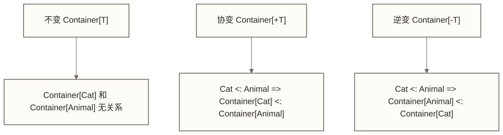

# Scala类型系统深度解析

> [!abstract] 学习目标
> - 理解 Scala 类型推断的工作方式及其在调试中的限制
> - 掌握协变（+T）与逆变（-T）的含义，能在 Spark 源码中识别它们
> - 了解隐式转换与隐式参数的正确使用场景，避免滥用
> - 理解类型类（Type Class）模式，这是 Scala 生态中的通用抽象方式
> - 了解泛型边界（上界/下界）的语法和用途
> - 对 Scala 2 与 Scala 3 的类型系统变化有初步认知

> [!quote] 核心洞察
> Scala 的类型系统是一把双刃剑：用好了，编译器就是你最好的队友，在运行前替你找出大量逻辑错误；用不好，类型推断失效的错误信息会让你抓狂。理解类型系统不是为了炫技，而是为了写出在大规模团队协作中不会踩雷的健壮代码。

---

## 目录

- [[#类型推断：让代码更简洁]]
- [[#协变与逆变：Spark源码里的秘密]]
- [[#隐式转换与隐式参数]]
- [[#类型类模式]]
- [[#泛型边界：上界与下界]]
- [[#Scala 2 vs Scala 3 的变化]]
- [[#类型安全在大数据开发中的实际价值]]

---

## 类型推断：让代码更简洁

Scala 编译器能根据上下文推断大多数表达式的类型，省去显式类型注解的麻烦。

### 基本推断

```scala
// 不需要写类型，编译器自动推断
val name = "Alice"           // String
val price = 99.9             // Double
val ids = List(1, 2, 3)      // List[Int]
val mapping = Map("a" -> 1)  // Map[String, Int]

// 函数返回值也可推断（但公共 API 建议显式声明）
def add(x: Int, y: Int) = x + y  // 推断返回类型为 Int
```

### 何时必须显式声明类型

```scala
// 1. 递归函数必须声明返回类型
def factorial(n: Int): BigInt =
  if (n <= 1) 1 else n * factorial(n - 1)

// 2. 重载方法必须声明参数类型

// 3. 当推断结果不是你想要的类型时
val x = 1       // Int，如果需要 Long
val y = 1L      // Long，需要字面量后缀
val z: Long = 1 // 或者显式注解

// 4. 公共 API（库方法、接口）建议显式声明，提高可读性
def processData(input: Dataset[Row]): Dataset[Row] = {
  // 显式声明让 API 契约更清晰
  input.filter(...)
}
```

### 类型推断失效时的调试技巧

```scala
// 链式操作中推断失败是常见痛点
val result = someList
  .map(x => x.someMethod())    // 如果 someMethod 返回类型不明确
  .filter(_.isValid)            // 这里可能报错，错误信息指向这行

// 调试方法：拆开链式，加中间类型注解
val step1: List[SomeType] = someList.map(x => x.someMethod())
val step2: List[SomeType] = step1.filter(_.isValid)
// 逐步确认每步的类型
```

---

## 协变与逆变：Spark源码里的秘密

这是 Scala 类型系统中最让初学者困惑的部分，但理解它能让你读懂 Spark 源码。

### 问题的起源

假设 `Cat` 是 `Animal` 的子类，那么 `List[Cat]` 是 `List[Animal]` 的子类吗？

在 Java 中，`List<Cat>` 和 `List<Animal>` 是完全不相关的类型（不变），这避免了一些类型安全问题。Scala 允许你通过 `+T` 和 `-T` 明确声明变型关系。

### 协变（+T）：子类关系可以传递

```scala
// 如果 B 是 A 的子类，那么 Container[B] 也是 Container[A] 的子类
class Container[+T](val value: T)

class Animal(val name: String)
class Cat(name: String) extends Animal(name)

val catContainer: Container[Cat] = new Container(new Cat("Whiskers"))
val animalContainer: Container[Animal] = catContainer  // 合法！协变允许这样做
```

**Spark RDD 的变型边界：RDD 的类型参数是不变的，不能将它作为协变容器示例。**

```scala
// Spark 的 RDD 定义（简化）
abstract class RDD[T] {
  def map[U](f: T => U): RDD[U]
  def filter(f: T => Boolean): RDD[T]
  // ...
}

// RDD 的类型参数是不变的，不能直接进行以下赋值：
val catRdd: RDD[Cat] = ...
// val animalRdd: RDD[Animal] = catRdd  // 编译错误
// 可以通过 map 显式将元素类型提升为 Animal：
val animalRdd: RDD[Animal] = catRdd.map(cat => (cat: Animal))
```

### 逆变（-T）：子类关系反转

```scala
// 如果 B 是 A 的子类，那么 Consumer[A] 是 Consumer[B] 的子类
trait Consumer[-T] {
  def consume(item: T): Unit
}

// 能处理 Animal 的消费者，自然能处理 Cat（Cat 是 Animal）
val animalConsumer: Consumer[Animal] = new Consumer[Animal] {
  def consume(item: Animal): Unit = println(item.name)
}
val catConsumer: Consumer[Cat] = animalConsumer  // 合法！
```

**Spark 中逆变的应用：**

```scala
// 函数类型 Function1[-T, +R] 是逆变的输入，协变的输出
// 这保证了函数可以安全地被子类型调用

val processAnimal: Animal => String = _.name
val processCat: Cat => String = processAnimal  // 合法，Animal 处理器可以处理 Cat
```

### 变型规则总结



| 标注 | 名称 | 记忆口诀 | 常见场景 |
|------|------|---------|---------|
| `[T]` | 不变 | 默认行为 | 可读可写的容器（如 Array） |
| `[+T]` | 协变 | 生产者，可以向上转型 | 协变的只读容器、返回值（如 List；RDD 不属于此类） |
| `[-T]` | 逆变 | 消费者，泛型实例的子类型关系与参数类型相反 | 消费者接口、函数输入参数、回调 |

---

## 隐式转换与隐式参数

隐式机制是 Scala 最强大也最容易被滥用的特性。

### 隐式参数：依赖注入的优雅方式

```scala
// 场景：Spark 中几乎所有操作都需要 SparkSession，但不想每次都显式传递
implicit val spark: SparkSession = SparkSession.builder()
  .appName("MyApp")
  .getOrCreate()

// 接受隐式参数的函数
def loadData(path: String)(implicit spark: SparkSession): DataFrame = {
  spark.read.parquet(path)
}

// 调用时不需要显式传入 spark，编译器自动从作用域找
val df = loadData("/data/sales/")
```

**Spark 中的重要隐式机制：提供 Encoder 实例**

```scala
import spark.implicits._  // 这行导入了大量隐式 Encoder

case class User(id: Long, name: String, age: Int)

// 能这样写是因为 import spark.implicits._ 提供了 Encoder[User]
val userDs: Dataset[User] = spark.read.json("/data/users").as[User]
```

### 隐式转换：扩展已有类型

```scala
// 为 String 添加方法（不修改 String 源码）
implicit class RichString(val s: String) extends AnyVal {
  def toSnakeCase: String =
    s.replaceAll("([A-Z])", "_$1").toLowerCase.stripPrefix("_")
}

// 现在所有 String 都有了 toSnakeCase 方法
"camelCaseString".toSnakeCase  // "camel_case_string"
"OrderAmount".toSnakeCase      // "order_amount"
```

### 隐式使用的最佳实践

> [!warning] 隐式机制的滥用警告
> 隐式转换看似方便，但过度使用会让代码变得难以追踪（"这个方法从哪来的？"）。在大型团队项目中，应当：
> - 隐式参数：推荐用于注入公共依赖（SparkSession、ExecutionContext、Logger）
> - 隐式转换：只用于为已有类型添加少量便利方法，不要用于复杂的类型转换逻辑
> - Scala 3 中需要 `using`/`given` 关键字显式标注，进一步减少隐式的"魔法感"

```scala
// 好的使用：注入公共依赖
def runQuery(sql: String)(implicit spark: SparkSession): DataFrame =
  spark.sql(sql)

// 避免的使用：隐式转换做复杂逻辑
// implicit def jsonStringToUser(s: String): User = ...  // 不推荐
```

---

## 类型类模式

类型类（Type Class）是函数式编程中实现多态的核心模式，比继承更灵活。

### 核心思想：事后扩展

面向对象通过继承实现多态，但继承要求在定义类时就确定关系。类型类允许为**已有类型**事后添加行为，无需修改原类。

```scala
// 定义类型类：描述"能被序列化为 JSON"这个能力
trait JsonSerializable[T] {
  def toJson(value: T): String
}

// 为 Int 实现这个类型类
implicit val intSerializable: JsonSerializable[Int] = new JsonSerializable[Int] {
  def toJson(value: Int): String = value.toString
}

// 为自定义类型实现
case class User(id: Long, name: String)
implicit val userSerializable: JsonSerializable[User] = new JsonSerializable[User] {
  def toJson(value: User): String =
    s"""{"id": ${value.id}, "name": "${value.name}"}"""
}

// 使用类型类约束的泛型函数
def serialize[T](value: T)(implicit s: JsonSerializable[T]): String =
  s.toJson(value)

// 上下文界定语法（更简洁）
def serialize2[T: JsonSerializable](value: T): String =
  implicitly[JsonSerializable[T]].toJson(value)

serialize(42)              // "42"
serialize(User(1L, "Bob")) // {"id": 1, "name": "Bob"}
```

### Spark 中的类型类：Encoder

Spark Dataset 的类型安全就是通过类型类实现的：

```scala
// Encoder[T] 是一个类型类，描述"如何将 T 序列化为 Spark 内部格式"
// 通过 import spark.implicits._ 引入内置的 Encoder 实现

def createDataset[T: Encoder](data: Seq[T]): Dataset[T] = {
  spark.createDataset(data)
}

// 编译器在编译时验证 T 是否有对应的 Encoder
// 如果没有，编译期报错，不会等到运行时才发现问题
```

---

## 泛型边界：上界与下界

泛型边界让你能够在保持类型安全的同时，对泛型参数施加限制。

### 上界（T <: A）：T 必须是 A 的子类型

```scala
// 上界：确保泛型参数具有某些方法
def findMax[T <: Comparable[T]](list: List[T]): Option[T] = list match {
  case Nil => None
  case _   => Some(list.max)
}

// 更 Scala 化的写法：使用 Ordering 类型类
def findMax2[T: Ordering](list: List[T]): Option[T] =
  if (list.isEmpty) None else Some(list.max)

findMax2(List(3, 1, 4, 1, 5, 9))  // Some(9)
findMax2(List("banana", "apple", "cherry"))  // Some("cherry")
```

**Spark 中的上界应用：**

```scala
// 以下示意函数为类型参数提供 Encoder 上下文界定；joinWith 的连接条件仍需显式给出
def joinDatasets[K: Encoder, V1: Encoder, V2: Encoder](
  ds1: Dataset[(K, V1)],
  ds2: Dataset[(K, V2)]
): Dataset[((K, V1), (K, V2))] = ds1.joinWith(ds2, ...)
// 若需要 Dataset[(K, (V1, V2))]，还需显式 map 重组字段；此处省略连接条件。
```

### 下界（T >: A）：T 必须是 A 的父类型

下界在实际开发中较少直接使用，但理解协变容器的 `prepend` 方法时需要它：

```scala
// List 的 :: 方法（简化）：允许向协变列表添加父类型元素
// def ::[B >: A](elem: B): List[B]

val cats: List[Cat] = List(new Cat("a"), new Cat("b"))
val animal: Animal = new Animal("generic")

// 向 List[Cat] 添加 Animal，结果类型提升为 List[Animal]
val animals: List[Animal] = animal :: cats
```

### 视图界定与上下文界定

```scala
// 上下文界定 T: Ordering（最常用，等价于隐式参数 implicit ord: Ordering[T]）
def sort[T: Ordering](list: List[T]): List[T] = list.sorted

// 多重约束
def processNumber[T: Numeric: Ordering](value: T): T = {
  val num = implicitly[Numeric[T]]
  val ord = implicitly[Ordering[T]]
  if (ord.gt(value, num.zero)) value else num.negate(value)
}
```

---

## Scala 2 vs Scala 3 的变化

Scala 3（Dotty）于 2021 年发布，对类型系统进行了重大改进。大数据从业者需要了解关键变化。

### 隐式机制的重构

```scala
// Scala 2：implicit 一个关键字承担太多职责
implicit val encoder: Encoder[User] = ...          // 隐式值
implicit def convert(s: String): Int = s.toInt     // 隐式转换
def process[T](x: T)(implicit ord: Ordering[T]) = ... // 隐式参数

// Scala 3：用不同关键字区分不同语义（更清晰）
given userEncoder: Encoder[User] = ...             // given 替代隐式值
given Conversion[String, Int] = _.toInt            // Conversion 类型
def process[T](x: T)(using ord: Ordering[T]) = ... // using 替代隐式参数
```

### 枚举（Enum）

```scala
// Scala 2：用 sealed trait + case object 模拟枚举
sealed trait Status
case object Active   extends Status
case object Inactive extends Status
case object Pending  extends Status

// Scala 3：原生枚举支持
enum Status:
  case Active, Inactive, Pending

// 带参数的枚举
enum Color(val code: String):
  case Red   extends Color("#FF0000")
  case Green extends Color("#00FF00")
  case Blue  extends Color("#0000FF")
```

### 联合类型与交叉类型

```scala
// Scala 3 新增：联合类型（OR）
def processInput(input: String | Int): String = input match {
  case s: String => s"字符串: $s"
  case i: Int    => s"整数: $i"
}

// 交叉类型（AND）
trait Readable:
  def read(): String

trait Writable:
  def write(s: String): Unit

def processStream(stream: Readable & Writable): Unit = {
  val content = stream.read()
  stream.write(content.toUpperCase)
}
```

### 当前生态现状（2026年）

| 方面 | 现状 |
|------|------|
| Spark | Spark 4.x 同时支持 Scala 2.13 和 Scala 3，但主流生产环境仍以 Scala 2.13 为主 |
| Flink | Java API 为主，Scala API 在 Flink 2.x 中已移为社区维护 |
| 新项目 | 建议评估是否需要 Scala 3，团队迁移成本不可忽视 |
| 学习优先级 | 先掌握 Scala 2 特性，Scala 3 语法了解为主 |

---

## 类型安全在大数据开发中的实际价值

最后，用具体案例说明类型系统为什么值得投入时间学习。

### 案例一：编译期捕获列名错误

```scala
// 弱类型方式（DataFrame API）：运行时才发现列名错误
val df = spark.read.parquet("/data/orders")
df.select("ordr_id", "amount")  // 列名拼写错误，运行时报 AnalysisException

// 强类型方式（Dataset API）：编译期就报错
case class Order(orderId: Long, amount: Double)
val ds: Dataset[Order] = spark.read.parquet("/data/orders").as[Order]
// ds.map(_.ordrId)  // 编译错误！没有 ordrId 字段，IDE 立即提示
ds.map(_.orderId)    // 正确
```

### 案例二：类型参数防止错误的聚合

```scala
// 利用类型系统区分不同含义的 Long
case class UserId(value: Long) extends AnyVal
case class OrderId(value: Long) extends AnyVal

def findUserOrders(userId: UserId): List[OrderId] = ???

// 以下代码会编译报错，防止把 orderId 当 userId 传入
val orderId = OrderId(12345L)
// findUserOrders(orderId)  // 编译错误！类型不匹配
findUserOrders(UserId(12345L))  // 正确
```

> [!note] 性能提示：AnyVal 的分配优化有适用条件
> `extends AnyVal` 可在部分使用场景中避免包装对象分配，但装箱、泛型使用等场景仍可能产生包装实例。在大数据场景中可用它区分业务类型，但不能据此保证所有调用路径都零开销。

### 案例三：隐式 Encoder 提供类型约束，但不保证所有序列化问题都在编译期发现

```scala
// 需要隐式 Encoder 的 API 在找不到对应实例时会编译失败；这不排除 Encoder 构造或数据转换阶段的运行时错误
case class ComplexMetric(
  timestamp: Long,
  value: Double,
  labels: Map[String, String]
)

// import spark.implicits._ 后，可尝试为 ComplexMetric 提供派生的 Encoder
// 字段类型是否受支持取决于 Spark 版本与所用 Encoder；不要无条件将 LocalDate 列为不支持的类型。
// 隐式解析成功不代表 Encoder 构造、外部数据模式匹配及运行时转换一定成功。
```

---

## 小结

| 特性 | 实用价值 | 推荐优先级 |
|------|---------|----------|
| 类型推断 | 减少样板代码，提高可读性 | 必须掌握 |
| 协变/逆变 | 读懂 Spark/Flink 源码 | 了解即可 |
| 隐式参数 | 注入 SparkSession 等公共依赖 | 必须掌握 |
| 隐式转换 | 扩展已有类型 | 谨慎使用 |
| 类型类 | 理解 Encoder/Ordering 等机制 | 进阶掌握 |
| 泛型边界 | 编写通用工具方法 | 进阶掌握 |
| Scala 3 新特性 | 了解演进方向 | 了解即可 |

### 延伸学习路径

- [[【技术与工具】/Scala/07-Scala函数式编程核心思想]] - 类型系统与函数式的结合
- [[【技术与工具】/Scala/09-Spark中的Scala最佳实践]] - 类型系统在 Spark 项目中的实际应用
- [[【技术与工具】/Scala/04-Scala大数据技术栈教程]] - 类型系统在 Spark/Flink 源码阅读中的应用

#Scala #类型系统 #泛型 #协变 #逆变 #隐式转换 #类型类 #Spark
