# Spark中的Scala最佳实践

> [!abstract] 学习目标
> - 理解Scala在Spark中执行JVM侧算子与类型化API的特点，以及性能比较的适用边界
> - 掌握 RDD/Dataset API 的 Scala 惯用写法
> - 学会识别并解决序列化问题（最常见的 Spark 坑）
> - 了解样例类（case class）作为 Spark 数据结构的优势
> - 掌握生产级 Spark Scala 代码的组织结构规范

> [!quote] 核心洞察
> 在 Spark 中使用 Scala，不只是语法层面的选择，而是获得与框架内核最深度的融合：类型化API的编译期检查、基于Encoder的数据编码，以及关系表达式与Catalyst优化器的配合；这些能力不意味着序列化零开销，也不保证任意Scala函数都能被Catalyst分析。理解这些优势的底层原因，才能写出真正高效的 Spark 代码。

---

## 目录

- [[#为什么Spark用Scala写性能最好]]
- [[#RDD API的Scala惯用写法]]
- [[#Dataset API：类型安全的首选]]
- [[#序列化问题：最常见的Spark坑]]
- #case class作为数据结构
- [[#隐式转换在SparkSQL中的应用]]
- #Scala集合 vs Spark集合的操作对应
- [[#生产级代码结构规范]]

---

## 为什么Spark用Scala写性能最好

Scala在Spark中的执行与类型化API具有工程特点，但是否更快取决于具体算子、数据结构和执行计划。

### 原因一：消除 JVM 调用开销

Spark 是用 Scala 写的。当你用 Scala 编写 UDF 和算子逻辑时，Scala 代码与 Spark 内核在同一 JVM 进程中，没有任何跨语言调用的开销。

而 Python 的 PySpark：
- 使用 Py4J 通过 socket 与 JVM 通信
- Python UDF 需要将数据序列化后传给 Python 进程执行，再序列化回来

```mermaid
%%{init: {"theme":"base","themeVariables":{"fontFamily":"PingFang SC, -apple-system, Source Han Serif SC, serif","fontSize":"16px","background":"#FDFBF5","primaryColor":"#FDFBF5","primaryTextColor":"#2D2A26","primaryBorderColor":"#6E6A60","secondaryColor":"#E8EFE8","secondaryBorderColor":"#8FA890","secondaryTextColor":"#2D2A26","tertiaryColor":"#FDFBF5","tertiaryBorderColor":"#9A9488","tertiaryTextColor":"#6E6A60","lineColor":"#6E6A60","textColor":"#2D2A26","mainBkg":"#FDFBF5","nodeBorder":"#2D5A3D","clusterBkg":"#F3EEDF","clusterBorder":"#9A9488","edgeLabelBackground":"#FDFBF5"},"flowchart":{"htmlLabels":true,"curve":"basis","padding":20,"nodeSpacing":60,"rankSpacing":70,"useMaxWidth":false},"themeCSS":".node rect, .node polygon, .node circle { stroke-width: 1.5px; } .edgePath .path { stroke-width: 1.5px; } .cluster-label .nodeLabel, .cluster-label foreignObject { color: #2D2A26 !important; } .edgeLabel, .edgeLabel foreignObject { color: #2D2A26 !important; background-color: #FDFBF5; } .edgeLabel rect { fill: #FDFBF5; }"}}%%
graph LR
    classDef default fill:#FDFBF5,stroke:#6E6A60,color:#2D2A26,stroke-width:1.5px
    classDef startend fill:#2D2A26,stroke:#2D2A26,color:#FDFBF5,font-weight:bold
    classDef decision fill:#F6EAD8,stroke:#C08A1A,color:#2D2A26,font-weight:bold
    classDef hub fill:#3B5A80,stroke:#3B5A80,color:#FDFBF5,font-weight:bold
    classDef io fill:#E5EAF0,stroke:#3B5A80,color:#2D2A26
    classDef accent fill:#A6432C,stroke:#A6432C,color:#FDFBF5,font-weight:bold
    classDef storage fill:#F3EEDF,stroke:#9A9488,color:#2D2A26
    A["Scala UDF"] -->|"直接调用"| B["Spark JVM执行引擎"]
    C["Python UDF"] -->|"序列化"| D["Python worker数据传输通路（非Py4J控制通路）"] -->|"反序列化"| B
    B -->|"序列化"| D -->|"反序列化"| C
    class A,B,C,D default
```



### 原因二：Catalyst 优化器深度集成

Spark 的 Catalyst 优化器能够分析和优化 Scala 编写的 Dataset/DataFrame 操作，但无法优化黑盒的 Python UDF（因为它看不到 Python 代码的语义）。

```scala
// Spark 可以优化这个查询（Catalyst 理解谓词下推）
import org.apache.spark.sql.functions._

val result = orders.toDF()
  .filter(col("amount") > 1000)  // 表达式可供Catalyst分析；是否下推取决于数据源与执行计划
  .select("orderId", "amount", "city")
  .groupBy("city")
  .agg(sum("amount").as("totalAmount"))

// Python UDF 阻断优化
// spark_df.withColumn("processed", my_python_udf(col("data")))
// Catalyst通常无法分析Python UDF内部语义，但仍可优化查询中其他可分析的关系表达式
```

### 原因三：Encoder 的高效序列化

Scala的case class可配合Spark的Encoder进行类型化编码，但仍存在编码与解码成本。“比通用的Java序列化快10倍以上、比Python pickle快更多”在本文中只能作为待测试假设，不能作为已证实结论；比较需限定数据结构、编码方式、运行环境和测量方法。

---

## RDD API的Scala惯用写法

虽然 Dataset API 是推荐方向，了解 RDD 的 Scala 惯用法依然必要。

### 基础变换操作

```scala
val sc = spark.sparkContext

// 从集合创建 RDD
val salesRdd = sc.parallelize(Seq(
  ("北京", 1200.0),
  ("上海", 3400.0),
  ("北京", 800.0),
  ("广州", 2200.0)
))

// Scala 惯用：使用模式匹配解构 tuple
val cityRevenue = salesRdd
  .mapValues(amount => amount * 1.0)    // 只变换值，保留键
  .reduceByKey(_ + _)                   // 按键聚合
  .sortBy(_._2, ascending = false)      // 按值降序

// 收集结果（触发 Action）
cityRevenue.collect().foreach {
  case (city, revenue) => println(f"$city: ¥$revenue%.2f")
}
```

### PairRDD 操作：连接与分组

```scala
case class Order(id: Long, userId: Long, amount: Double)
case class User(id: Long, name: String, tier: String)

val ordersRdd: RDD[Order] = ...
val usersRdd: RDD[User] = ...

// 转为 PairRDD 然后 join
val orderPairs: RDD[(Long, Order)] = ordersRdd.map(o => (o.userId, o))
val userPairs: RDD[(Long, User)]   = usersRdd.map(u => (u.id, u))

val enrichedOrders = orderPairs
  .join(userPairs)
  .map { case (userId, (order, user)) =>
    (user.name, user.tier, order.amount)
  }
```

### 广播变量：减少配置数据的重复分发

```scala
// 场景：将城市编码映射表广播到所有 executor
val cityCodeMap = Map(
  "BJ" -> "北京",
  "SH" -> "上海",
  "GZ" -> "广州"
)

// 广播变量：序列化一次，分发到各 executor，避免每条记录都触发网络传输
val broadcastMap = sc.broadcast(cityCodeMap)

val resultRdd = rawRdd.map { record =>
  val cityName = broadcastMap.value.getOrElse(record.cityCode, "未知城市")
  record.copy(cityName = cityName)
}
```

---

## Dataset API：类型安全的首选

对于新项目，应优先使用 Dataset API 而非 RDD。

### Dataset vs DataFrame vs RDD

```scala
// DataFrame = Dataset[Row]：无类型，灵活但不安全
val df: DataFrame = spark.read.parquet("/data/orders")
df.select("amount", "city")  // 运行时才知道列是否存在

// Dataset[T]：有类型，编译期安全
case class Order(orderId: Long, amount: Double, city: String, status: String)
val ds: Dataset[Order] = spark.read.parquet("/data/orders").as[Order]
ds.filter(_.amount > 1000)  // 编译期验证 amount 字段存在且为 Double
```

### Dataset 的典型数据处理流程

```scala
import spark.implicits._

// 输入模型
case class RawSale(
  saleId: String,
  productId: String,
  quantity: String,    // 原始数据通常是字符串
  unitPrice: String,
  saleDate: String,
  storeId: String
)

// 输出模型
case class ProcessedSale(
  saleId: String,
  productId: String,
  totalAmount: Double,
  saleDate: java.time.LocalDate,
  storeId: String
)

def processSales(rawDs: Dataset[RawSale]): Dataset[ProcessedSale] = {
  rawDs
    .filter(r => r.saleId.nonEmpty && r.quantity.nonEmpty)
    .flatMap { raw =>
      // flatMap + Try：解析失败的记录直接丢弃
      import scala.util.Try
      Try {
        ProcessedSale(
          saleId      = raw.saleId,
          productId   = raw.productId,
          totalAmount = raw.quantity.toInt * raw.unitPrice.toDouble,
          saleDate    = java.time.LocalDate.parse(raw.saleDate),
          storeId     = raw.storeId
        )
      }.toOption
    }
}
```

### 混合使用 Dataset 和 DataFrame

```scala
// Dataset 转 DataFrame：丢失类型信息，获得灵活性
val df: DataFrame = processedSaleDs.toDF()

// DataFrame 转 Dataset：获得类型安全，需要 schema 匹配
val backToDs: Dataset[ProcessedSale] = df.as[ProcessedSale]

// 实践建议：
// - 数据读入、清洗：DataFrame（灵活处理未知 schema）
// - 业务逻辑处理：Dataset（类型安全，IDE 支持好）
// - 聚合、报表：DataFrame + SparkSQL（Catalyst 优化最好）
```

---

## 序列化问题：最常见的Spark坑

序列化问题是 Spark 初学者最常遇到、最难调试的问题。

### 问题根源：闭包捕获了不可序列化的对象

```scala
// 错误示例：在闭包中引用了外部类的成员
class DataProcessor(val config: ProcessorConfig) {
  val connection = new DatabaseConnection(config.url)  // 数据库连接，不可序列化

  def process(rdd: RDD[String]): RDD[String] = {
    // 这个闭包会捕获 this（整个 DataProcessor 对象）
    // 而 DataProcessor 包含不可序列化的 connection
    rdd.map(line => connection.enrich(line))  // NotSerializableException!
  }
}
```

### 解决方案一：使用 @transient 排除不可序列化字段

```scala
class DataProcessor(val config: ProcessorConfig) extends Serializable {
  // @transient：告诉 JVM 序列化时跳过这个字段
  // transient lazy val：在每个 executor 上懒加载创建，不走序列化
  @transient lazy val connection = new DatabaseConnection(config.url)

  def process(rdd: RDD[String]): RDD[String] = {
    rdd.map(line => connection.enrich(line))  // 在反序列化后的对象实例中首次访问时创建，不保证每个executor仅一份；config也须可序列化
  }
}
```

### 解决方案二：使用单例对象（最推荐）

```scala
// 将重量级资源放在 object 中（JVM 单例，每个 executor 一份）
object ConnectionPool extends Serializable {
  @transient private lazy val pool = new HikariConnectionPool(getConfig())

  private def getConfig(): PoolConfig = {
    // 从广播变量或环境变量读取配置
    PoolConfig(url = System.getenv("DB_URL"))
  }

  def withConnection[T](f: Connection => T): T = {
    val conn = pool.getConnection()
    try f(conn) finally conn.close()
  }
}

// 在闭包中安全使用
rdd.mapPartitions { partition =>
  partition.map { record =>
    ConnectionPool.withConnection { conn =>
      // 使用连接处理记录
      conn.query(s"SELECT * FROM enrichment WHERE id = ${record.id}")
    }
  }
}
```

### 解决方案三：使用 mapPartitions 减少连接创建次数

```scala
// 错误：每条记录创建一次连接（极度低效）
rdd.map { record =>
  val conn = new DatabaseConnection(config.url)  // 每条记录都创建！
  val result = conn.query(record.id)
  conn.close()
  result
}

// 正确：每个分区创建一次连接
rdd.mapPartitions { records =>
  val conn = new DatabaseConnection(config.url)  // 每个分区只创建一次
  org.apache.spark.TaskContext.get().addTaskCompletionListener[Unit] { _ =>
    conn.close()
  }
  records.map(record => conn.query(record.id))
}
```

### case class 的天然序列化优势

```scala
// case class 自动实现 Serializable；这里的字段默认为val，但case class并不保证深层不可变，成员仍须可序列化
case class OrderRecord(
  orderId: Long,
  amount: Double,
  status: String
)

// 在闭包中安全使用 case class 实例
val threshold = OrderRecord(0L, 1000.0, "completed")  // 可安全序列化

rdd.filter { order =>
  order.amount > threshold.amount && order.status == threshold.status
}
```

---

## case class 作为数据结构

case class 是 Spark Scala 开发中最重要的语言特性之一。

### case class 的自动生成特性

```scala
case class SalesMetric(
  date: String,
  region: String,
  revenue: Double,
  orderCount: Int
)

// 自动生成以下内容：
// 1. toString：SalesMetric(2024-01-01, 北京, 10000.0, 50)
// 2. equals/hashCode：基于所有字段，保证 groupByKey 等操作正确
// 3. copy 方法：SalesMetric.copy(revenue = 12000.0)
// 4. apply 工厂方法：SalesMetric("2024-01-01", "北京", 10000.0, 50)
// 5. unapply（模式匹配支持）：case SalesMetric(date, region, _, _) => ...
// 6. Serializable：可在 Spark executor 间传输
```

### case class 在 Spark 操作中的实际应用

```scala
val metricsDs: Dataset[SalesMetric] = loadMetrics()

// 模式匹配解构
metricsDs.map {
  case SalesMetric(date, region, revenue, count) if revenue > 10000 =>
    SalesMetric(date, region, revenue * 1.1, count)  // 高收入区域加成
  case metric =>
    metric
}

// copy 方法修改部分字段
metricsDs.map(m => m.copy(revenue = m.revenue * 1.13))  // 加税

// 嵌套 case class
case class OrderItem(productId: String, qty: Int, price: Double)
case class Order(orderId: Long, userId: Long, items: Seq[OrderItem])

val orderDs: Dataset[Order] = ...
val allItems = orderDs.flatMap(_.items)  // 展平嵌套结构
```

---

## 隐式转换在SparkSQL中的应用

```scala
// import spark.implicits._ 背后的魔法
import spark.implicits._

// 1. RDD/Seq 转 Dataset
val data = Seq(("Alice", 30), ("Bob", 25))
val ds = data.toDS()  // Dataset[(String, Int)]，依赖隐式 toDS 方法

// 2. Column 操作的符号重载
import org.apache.spark.sql.functions._
val df = spark.read.parquet("/data/orders")
df.filter($"amount" > 1000 && $"status" === "completed")
// $"amount" 是通过隐式转换将字符串转为 Column 对象

// 3. 自定义隐式 Encoder（处理非标准类型）
import org.apache.spark.sql.Encoders
implicit val localDateEncoder = Encoders.kryo[java.time.LocalDate]

// 此Encoder针对Dataset[LocalDate]；不能据此保证Event的派生产品Encoder采用它作为字段编码器，须明确Spark版本及字段编码支持
case class Event(id: Long, date: java.time.LocalDate)
val eventDs: Dataset[Event] = spark.createDataset(Seq(
  Event(1L, java.time.LocalDate.now())
))
```

---

## Scala集合 vs Spark集合操作对应关系

| Scala 集合操作 | Spark RDD 对应 | Spark Dataset 对应 | 说明 |
|--------------|---------------|------------------|------|
| `map(f)` | `rdd.map(f)` | `ds.map(f)` | 一对一转换 |
| `filter(p)` | `rdd.filter(p)` | `ds.filter(p)` | 条件过滤 |
| `flatMap(f)` | `rdd.flatMap(f)` | `ds.flatMap(f)` | 一对多展开 |
| `groupBy(f)` | `rdd.groupBy(f)` | `ds.groupByKey(f)` | 分组（注意 shuffle） |
| `reduce(f)` | `rdd.reduce(f)` | `ds.reduce(f)` | 全局聚合（返回单值） |
| `foldLeft` | `rdd.aggregate` | 用 `agg` 方法替代 | 带初始值聚合 |
| `take(n)` | `rdd.take(n)` | `ds.take(n)` | 取前 N 条（触发 Action） |
| `toList` / `toArray` | `rdd.collect()` | `ds.collect()` | 全量收集（慎用！） |
| `sortBy(f)` | `rdd.sortBy(f)` | `ds.orderBy(col("字段名"))` | Dataset按Column表达式排序，不直接接受Scala排序函数f |
| `distinct` | `rdd.distinct()` | `ds.distinct()` | 去重 |
| `zip(other)` | `rdd.zip(other)` | 无通用按位置配对的直接对应API | RDD.zip要求分区数及对应分区记录数匹配；Dataset.join按连接条件匹配，不等同于按位置zip |

---

## 生产级代码结构规范

### 推荐的项目代码组织

| 路径 | 说明 |
|------|------|
| `jobs/SalesAggregationJob.scala` | 销售聚合作业入口 |
| `jobs/UserBehaviorJob.scala` | 用户行为作业入口 |
| `transformations/SalesTransformer.scala` | 销售数据转换（纯函数） |
| `transformations/UserTransformer.scala` | 用户数据转换（纯函数） |
| `models/InputModels.scala` | 输入数据结构（case class） |
| `models/OutputModels.scala` | 输出数据结构（case class） |
| `utils/SparkUtils.scala` | Spark工具类 |
| `utils/DateUtils.scala` | 日期工具类 |
| `config/AppConfig.scala` | 配置管理 |

### 作业入口的标准写法

```scala
// jobs/SalesAggregationJob.scala
object SalesAggregationJob {

  def main(args: Array[String]): Unit = {
    val config = AppConfig.load(args)

    val spark = SparkSession.builder()
      .appName(s"SalesAggregation-${config.date}")
      .config("spark.sql.shuffle.partitions", config.shufflePartitions)
      .getOrCreate()

    // 设置日志级别
    spark.sparkContext.setLogLevel("WARN")

    try {
      run(spark, config)
    } finally {
      spark.stop()
    }
  }

  def run(spark: SparkSession, config: AppConfig): Unit = {
    import spark.implicits._

    val rawSales = loadRawSales(spark, config.inputPath)
    val processed = SalesTransformer.process(rawSales)(spark)
    val aggregated = SalesTransformer.aggregate(processed, config.groupByFields)(spark)

    writeOutput(aggregated, config.outputPath)

    // 打印作业统计（输出到日志）
    println(s"处理完成：共 ${aggregated.count()} 条聚合记录")
  }

  private def loadRawSales(spark: SparkSession, path: String): Dataset[RawSale] = {
    import spark.implicits._
    spark.read
      .option("header", "true")
      .option("inferSchema", "false")  // 生产环境不用 inferSchema，明确指定 schema
      .schema(RawSale.sparkSchema)     // 在 companion object 中定义 schema
      .csv(path)
      .as[RawSale]
  }

  private def writeOutput(ds: Dataset[AggregatedSale], path: String): Unit = {
    ds.write
      .mode("overwrite")
      .partitionBy("date", "region")   // 按常用过滤字段分区
      .parquet(path)
  }
}
```

### Transformer 层：分离纯记录解析与Spark转换

```scala
// transformations/SalesTransformer.scala
object SalesTransformer {

  // 函数签名清晰：输入 Dataset[RawSale]，输出 Dataset[ProcessedSale]
  def process(rawDs: Dataset[RawSale])(implicit spark: SparkSession): Dataset[ProcessedSale] = {
    import spark.implicits._

    rawDs
      .filter(isValidRecord)
      .flatMap(parseRecord)
  }

  // 纯函数：易于单元测试
  private def isValidRecord(raw: RawSale): Boolean =
    raw.saleId.nonEmpty &&
    raw.quantity.nonEmpty &&
    raw.unitPrice.nonEmpty

  private def parseRecord(raw: RawSale): Option[ProcessedSale] = {
    import scala.util.Try
    Try {
      ProcessedSale(
        saleId      = raw.saleId,
        productId   = raw.productId,
        totalAmount = raw.quantity.toInt * raw.unitPrice.toDouble,
        saleDate    = java.time.LocalDate.parse(raw.saleDate),
        storeId     = raw.storeId
      )
    }.toOption
  }

  def aggregate(
    ds: Dataset[ProcessedSale],
    groupByFields: Seq[String]
  )(implicit spark: SparkSession): Dataset[AggregatedSale] = {
    import spark.implicits._
    import org.apache.spark.sql.functions._

    ds.groupBy(groupByFields.map(col): _*)
      .agg(
        sum("totalAmount").as("totalRevenue"),
        count("saleId").as("orderCount"),
        avg("totalAmount").as("avgOrderValue")
      )
      .as[AggregatedSale]
  }
}
```

> [!tip] 生产代码的黄金法则
> - 将单条记录校验与解析抽为无IO、无SparkSession依赖的纯函数，可独立单元测试；本例的Dataset转换与聚合仍依赖SparkSession，应在Spark测试环境中验证
> - Job 层负责协调：读取 -> 转换 -> 写入，不包含业务逻辑
> - case class 定义集中在 models 包，配套定义 schema 和 companion object 工厂方法

---

## 小结

| 最佳实践 | 具体做法 | 避免的反模式 |
|---------|---------|------------|
| 数据建模 | case class 作为数据结构 | 全程使用 Row/Map |
| 类型选择 | Dataset[T] 优先，必要时降级 DataFrame | 所有逻辑都用 RDD |
| 序列化 | @transient lazy val + object 单例 | 在闭包中引用不可序列化对象 |
| 代码组织 | jobs/transformations/models 分层 | 所有逻辑写在 main 方法里 |
| 错误处理 | flatMap + Try/Option | 在 map 中直接 try-catch |
| 测试 | 纯记录解析单测，Dataset转换与聚合使用Spark测试环境 | 只有集成测试 |

### 延伸学习路径

- [[【技术与工具】/Scala/07-Scala函数式编程核心思想]] - 函数式思想的基础
- [[【技术与工具】/Scala/08-Scala类型系统深度解析]] - 类型安全的深层原理
- [[【技术与工具】/Scala/10-Akka与流处理编程模型]] - 流式处理的 Scala 实践
- [[【技术与工具】/Scala/05-Scala数据处理和流式计算教程]] - 更多 Spark 实战案例

#Scala #Spark #最佳实践 #序列化 #Dataset #大数据 #代码规范
