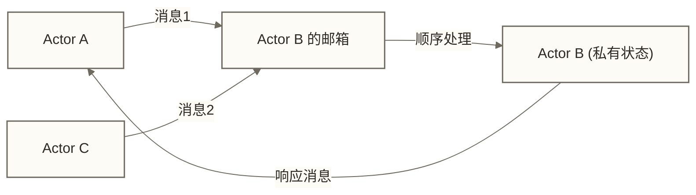
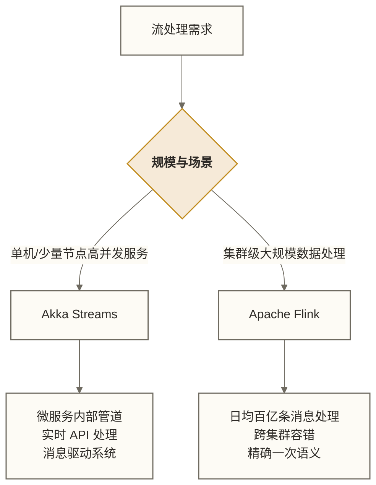
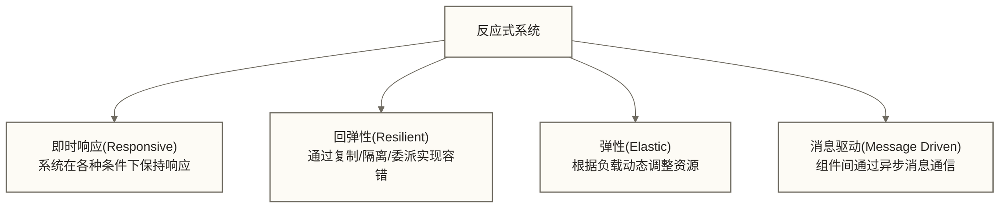

# Akka与流处理编程模型

> [!abstract] 学习目标
> - 理解 Actor 模型的核心思想及其在大数据场景的应用
> - 掌握 Akka Streams 的背压机制（Backpressure）原理
> - 能够区分 Akka Streams 与 Flink 的定位和适用场景
> - 了解反应式编程（Reactive Programming）的设计思想
> - 掌握从 Akka 思维迁移到 Flink 的关键概念映射

> [!quote] 核心洞察
> Akka 和 Flink 解决的是同类问题的不同规模：Akka 擅长在单个 JVM 进程内构建高并发、消息驱动的系统；Flink 擅长跨集群的有状态流处理。理解 Akka 的背压机制和状态管理，能让你更深刻地理解 Flink 为何如此设计。

---

## 目录

- [[#Actor模型：并发编程的另一条路]]
- [[#Akka核心概念与代码入门]]
- [[#Akka Streams与背压机制]]
- [[#Akka Streams vs Flink：定位差异]]
- [[#反应式编程的设计思想]]
- [[#Akka在大数据场景的实际应用]]
- [[#从Akka到Flink的思维迁移]]

---

## Actor模型：并发编程的另一条路

### 传统并发的问题

共享内存 + 锁是 Java 并发的主流模型，但它有根本性的缺陷：

- 锁的粒度难以把握（太粗：性能差；太细：死锁）
- 状态分散在多个对象中，难以追踪
- 一个线程崩溃可能污染共享状态

### Actor 模型的解法

Actor 模型（源自 1973 年 Carl Hewitt 的论文，Erlang 语言使其流行）的核心思想是：

> 万物皆 Actor。Actor 是拥有私有状态的独立计算单元，只通过消息传递与其他 Actor 通信，永远不共享内存。



**Actor 的三个基本行为（收到消息时）：**
1. 向其他 Actor 发送消息
2. 创建新的 Actor
3. 修改自己的私有状态（用于处理下一条消息）

### Actor 模型的并发安全保证

同一 Actor 的消息处理是串行的——每次只处理一条消息，但不同消息可能由不同线程处理。若可变状态封装在 Actor 内，且仅在消息处理过程中访问，通常无需为该状态加锁；共享可变消息、状态逃逸或外部异步回调直接修改状态仍可能破坏并发安全。

---

## Akka核心概念与代码入门

### 基础 Actor 定义

```scala
import akka.actor.typed.{ActorRef, Behavior}
import akka.actor.typed.scaladsl.Behaviors

// 定义消息协议（sealed trait + case class）
object OrderProcessor {
  sealed trait Command
  case class ProcessOrder(orderId: Long, amount: Double, replyTo: ActorRef[Response]) extends Command
  case class CancelOrder(orderId: Long, replyTo: ActorRef[Response]) extends Command

  sealed trait Response
  case class OrderAccepted(orderId: Long) extends Response
  case class OrderRejected(orderId: Long, reason: String) extends Response

  // Actor 行为定义
  def apply(): Behavior[Command] = processing(Map.empty)

  private def processing(
    activeOrders: Map[Long, Double]  // Actor 的私有状态
  ): Behavior[Command] =
    Behaviors.receive { (context, message) =>
      message match {
        case ProcessOrder(id, amount, replyTo) =>
          if (amount <= 0) {
            replyTo ! OrderRejected(id, "金额必须大于0")
            Behaviors.same  // 状态不变
          } else {
            context.log.info(s"接受订单 $id，金额 $amount")
            replyTo ! OrderAccepted(id)
            processing(activeOrders + (id -> amount))  // 更新状态，返回新行为
          }

        case CancelOrder(id, replyTo) =>
          if (activeOrders.contains(id)) {
            replyTo ! OrderAccepted(id)
            processing(activeOrders - id)  // 移除订单
          } else {
            replyTo ! OrderRejected(id, "订单不存在")
            Behaviors.same
          }
      }
    }
}
```

### Actor 系统的启动与通信

```scala
import akka.actor.typed.ActorSystem
import akka.actor.typed.scaladsl.AskPattern._
import scala.concurrent.duration._

object Main extends App {
  // 创建 Actor 系统
  val system = ActorSystem(OrderProcessor(), "OrderSystem")

  // 发送消息（tell 模式：fire and forget）
  // system ! OrderProcessor.CancelOrder(999L, ...)

  // Ask 模式：等待响应（带超时）
  import system.executionContext
  implicit val timeout = akka.util.Timeout(3.seconds)
  implicit val scheduler = system.scheduler

  val response = system.ask[OrderProcessor.Response](
    replyTo => OrderProcessor.ProcessOrder(1001L, 500.0, replyTo)
  )

  response.foreach {
    case OrderProcessor.OrderAccepted(id) => println(s"订单 $id 已接受")
    case OrderProcessor.OrderRejected(id, reason) => println(s"订单 $id 拒绝：$reason")
  }
}
```

### 监督策略：容错的结构化方式

```scala
// Akka 的"让它崩溃"哲学：不要防御性编程，让错误发生，父 Actor 负责重启
def supervisedProcessor(): Behavior[Command] =
  Behaviors.supervise(OrderProcessor())
    .onFailure[RuntimeException](SupervisorStrategy.restart)
    // 运行时异常：重启子 Actor，状态丢失
    .onFailure[IllegalArgumentException](SupervisorStrategy.stop)
    // 参数异常：停止子 Actor，需要人工干预
```

---

## Akka Streams与背压机制

### 背压（Backpressure）问题的来源

想象一个数据流场景：
- 生产者（Producer）每秒产生 10000 条消息
- 消费者（Consumer）每秒只能处理 1000 条消息

如果没有背压机制，消费者的内存会被消息填满，最终 OOM 崩溃。

背压的核心思想：**消费者告知生产者自己的处理能力，生产者按需生产**。

### Akka Streams 的三个核心组件

```mermaid
%%{init: {"theme":"base","themeVariables":{"fontFamily":"PingFang SC, -apple-system, Source Han Serif SC, serif","fontSize":"16px","background":"#FDFBF5","primaryColor":"#FDFBF5","primaryTextColor":"#2D2A26","primaryBorderColor":"#6E6A60","secondaryColor":"#E8EFE8","secondaryBorderColor":"#8FA890","secondaryTextColor":"#2D2A26","tertiaryColor":"#FDFBF5","tertiaryBorderColor":"#9A9488","tertiaryTextColor":"#6E6A60","lineColor":"#6E6A60","textColor":"#2D2A26","mainBkg":"#FDFBF5","nodeBorder":"#2D5A3D","clusterBkg":"#F3EEDF","clusterBorder":"#9A9488","edgeLabelBackground":"#FDFBF5"},"flowchart":{"htmlLabels":true,"curve":"basis","padding":20,"nodeSpacing":60,"rankSpacing":70,"useMaxWidth":false},"themeCSS":".node rect, .node polygon, .node circle { stroke-width: 1.5px; } .edgePath .path { stroke-width: 1.5px; } .cluster-label .nodeLabel, .cluster-label foreignObject { color: #2D2A26 !important; } .edgeLabel, .edgeLabel foreignObject { color: #2D2A26 !important; background-color: #FDFBF5; } .edgeLabel rect { fill: #FDFBF5; }"}}%%
graph LR
    classDef default fill:#FDFBF5,stroke:#6E6A60,color:#2D2A26,stroke-width:1.5px
    classDef startend fill:#2D2A26,stroke:#2D2A26,color:#FDFBF5,font-weight:bold
    classDef decision fill:#F6EAD8,stroke:#C08A1A,color:#2D2A26,font-weight:bold
    classDef hub fill:#3B5A80,stroke:#3B5A80,color:#FDFBF5,font-weight:bold
    classDef io fill:#E5EAF0,stroke:#3B5A80,color:#2D2A26
    classDef accent fill:#A6432C,stroke:#A6432C,color:#FDFBF5,font-weight:bold
    classDef storage fill:#F3EEDF,stroke:#9A9488,color:#2D2A26
    A["Source(源)"] -->|"数据流"| B["Flow(处理)"] -->|"数据流"| C["Sink(汇)"]
    C -->|"背压信号(需求量)"| B -->|"背压信号"| A
    class A,B,C default
```



```scala
import akka.actor.ActorSystem
import akka.stream.scaladsl._
import akka.stream._

implicit val system = ActorSystem("StreamSystem")
implicit val materializer = Materializer(system)

// Source：数据来源
val source: Source[Int, NotUsed] = Source(1 to 1000000)

// Flow：中间处理（可链式组合）
val processingFlow: Flow[Int, String, NotUsed] = Flow[Int]
  .filter(_ % 2 == 0)
  .map(n => s"processed-$n")
  .throttle(100, 1.second)  // 限速：每秒最多100条，背压自然产生

// Sink：数据汇
val consoleSink: Sink[String, Future[Done]] =
  Sink.foreach[String](msg => println(msg))

// 组装并运行流（背压自动处理）
val graph = source.via(processingFlow).to(consoleSink)
graph.run()
```

### 实际背压控制示例

```scala
import scala.concurrent.duration._

// 场景：从 Kafka 读取，写入数据库（数据库是瓶颈）
val kafkaSource: Source[KafkaRecord, _] = ???
val dbSink: Sink[ProcessedRecord, _] = ???

kafkaSource
  .mapAsync(parallelism = 4) { record =>
    // mapAsync 最多维持4个异步处理；继续接收和输出受并发槽位、结果顺序及下游需求约束，并非等待4个任务全部完成后才继续
    Future {
      ProcessedRecord(record.key, processHeavy(record.value))
    }
  }
  .buffer(size = 1000, OverflowStrategy.backpressure)
  // buffer 策略：
  // backpressure：缓冲满时向上游施加背压（推荐）
  // dropHead：丢弃最旧的消息
  // fail：缓冲满时流失败
  .runWith(dbSink)
```

### 背压的四种策略对比

| 策略 | 行为 | 适用场景 |
|------|------|---------|
| `backpressure` | 向上游施加压力，减缓生产速度 | 不允许丢数据的场景（推荐默认） |
| `dropHead` | 丢弃最旧的消息 | 实时性比完整性重要（如实时监控） |
| `dropTail` | 缓冲满时丢弃缓冲区尾部已有元素，再接收新元素 | 允许牺牲缓冲区尾部元素的场景；不等同于丢弃新到达元素 |
| `fail` | 缓冲满时流失败 | 需要报警处理的关键流 |

---

## Akka Streams vs Flink：定位差异

这是大数据从业者最常有的困惑。



| 对比维度 | Akka Streams | Apache Flink |
|---------|-------------|-------------|
| 部署规模 | 单 JVM 到少量节点 | 数十到数千节点集群 |
| 状态管理 | 需自行实现 | 内置 State Backend（RocksDB/内存） |
| 容错机制 | Actor 监督树 | Checkpoint + 精确一次语义 |
| 时间窗口 | 需手动实现 | 内置 EventTime/WaterMark 窗口 |
| 反压 | Reactive Streams 标准 | Credit-based 背压 |
| 适用场景 | 微服务、网关、IoT 设备端 | 数据平台、实时数仓、大规模 ETL |
| 开发复杂度 | 中（需理解 Actor 模型） | 高（需理解分布式流计算原理） |
| 生态集成 | Kafka、HTTP、WebSocket | Kafka、Hive、JDBC、几乎所有大数据组件 |

> [!note] 实际工作中的选型建议
> - 如果你在做**大数据平台**或**实时数仓**：选 Flink，Akka 不是这个场景的工具
> - 如果你在做**微服务架构**中的消息驱动系统，或**IoT 数据采集网关**：Akka 是很好的选择
> - 如果你在做 Flink 的**自定义 Source/Sink 连接器开发**：理解 Akka 的背压原理有直接帮助

---

## 反应式编程的设计思想

Akka 是 Reactive Systems（反应式系统）的实现之一。理解这个思想有助于理解 Flink 的设计。

### Reactive Manifesto 四大特征



### 反应式流标准（Reactive Streams）

Akka Streams、RxJava、Project Reactor 可通过各自支持的 Reactive Streams 接口互操作。Java 9 的 `java.util.concurrent.Flow` 提供了语义对应的接口，但其类型与 `org.reactivestreams` 接口不直接兼容，跨这两套接口连接时需要适配：

```scala
// Akka Streams Publisher 可以直接对接 RxJava Subscriber
// 这是因为它们遵循相同的 Reactive Streams 规范

import org.reactivestreams.Publisher
val publisher: Publisher[Int] = source.runWith(Sink.asPublisher(false))
// publisher 可以传给任何遵循 Reactive Streams 规范的消费者
```

---

## Akka在大数据场景的实际应用

### 应用场景一：高并发数据采集网关

```scala
// 场景：IoT 设备数据采集，每秒数万条消息，需要转发到 Kafka
import akka.http.scaladsl.Http
import akka.http.scaladsl.server.Directives._

object DataIngestionGateway {
  def route(kafkaProducer: ActorRef[KafkaProducerCommand]): Route =
    path("ingest") {
      post {
        entity(as[DeviceMetric]) { metric =>
          // tell 异步发送后立即返回202；此响应不代表Kafka已成功写入，可靠投递需另行设计确认与恢复机制
          kafkaProducer ! KafkaProducerCommand.Send(metric)
          complete(StatusCodes.Accepted, "已接收")
        }
      }
    }
}
```

### 应用场景二：Flink 自定义 Source 的内部实现

Flink 的一些 Source 连接器内部使用 Akka/Reactive Streams 来管理与外部系统的连接和背压：

```scala
// Flink 自定义 Source（Java API）的生命周期方法
// 内部可以使用 Akka 管理连接池
class CustomKafkaSource extends RichSourceFunction[Event] {
  @transient private var actorSystem: ActorSystem = _
  @transient private var streamRef: ActorRef[_] = _

  override def open(parameters: Configuration): Unit = {
    actorSystem = ActorSystem("SourceSystem")
    // 使用 Akka Actor 管理连接和重试逻辑
    streamRef = actorSystem.spawn(ConnectionManager(), "conn-manager")
  }

  override def close(): Unit = {
    actorSystem.terminate()
  }
}
```

### 应用场景三：微服务间的事件驱动通信

```scala
// 场景：订单服务 -> 库存服务 -> 物流服务的事件链
object OrderEventChain {
  // 每个服务是一个 Actor，通过消息传递协作
  // Actor 可配置监督策略处理失败，但重启不会自动重试导致失败的消息；业务重试与恢复需另行设计

  val orderActor: ActorRef[OrderCommand] = ???
  val inventoryActor: ActorRef[InventoryCommand] = ???
  val logisticsActor: ActorRef[LogisticsCommand] = ???

  // 事件驱动：订单创建 -> 发送 InventoryCheck 消息
  // 库存确认 -> 发送 CreateShipment 消息
  // 避免同步调用等待；是否发生级联失败仍取决于隔离、队列容量、超时与恢复策略
}
```

---

## 从Akka到Flink的思维迁移

如果你熟悉 Akka，迁移到 Flink 时可以这样建立概念映射：

| Akka 概念 | Flink 对应概念 | 关键区别 |
|----------|--------------|---------|
| Actor | Operator（算子） | Flink 算子可以无状态，也可以持有托管状态；Actor 通过行为和私有状态处理消息 |
| Actor 邮箱 | 算子间的网络缓冲区 | Flink 用 Credit-based 背压，不是消息队列 |
| Actor 私有状态 | Flink State | Flink State 有 Checkpoint 保证容错 |
| Actor 监督树 | Flink Task Manager 重启策略 | Flink 恢复粒度更粗（整个 Job 或 Region） |
| Akka Streams Source | Flink Source | Flink Source 支持 Watermark 生成 |
| Akka Streams Flow | Flink Transformation | Flink 有丰富的时间窗口算子 |
| Akka Streams Sink | Flink Sink | 部分 Flink Sink 可通过两阶段提交等机制实现精确一次，需结合检查点与下游事务能力 |
| BackpressureStrategy | Flink 内置背压 | Flink 背压是自动的，无需手动配置策略 |

### 迁移时的思维调整

```text
Akka 思维：我有一个状态机，通过消息驱动状态转移
Flink 思维：我有一个数据流，通过算子链进行转换和聚合

Akka 思维：失败了就重启 Actor，状态可能丢失
Flink 思维：启用并正确配置 Checkpoint 后可从检查点恢复；端到端精确一次还依赖可重放的数据源及支持相应提交语义的下游

Akka 思维：我要处理单个消息
Flink 思维：我要处理消息流，关注窗口内的聚合语义
```

---

## 小结

| 核心概念 | 一句话总结 | 工程价值 |
|---------|-----------|--------|
| Actor 模型 | 消息传递代替共享内存 | 串行消息处理与状态封装可减少锁需求；线程安全仍取决于状态访问边界 |
| 背压 | 消费者控制生产速度 | 通过需求反馈限制流内积压；不能单独保证无内存溢出或系统稳定 |
| Akka Streams | 声明式流处理，背压内置 | 构建高性能数据管道 |
| Reactive Manifesto | 即时响应/回弹/弹性/消息驱动 | 分布式系统的设计原则 |
| Akka vs Flink | 单机高并发 vs 集群流计算 | 场景选对工具，事半功倍 |

### 延伸学习路径

- [[【技术与工具】/Scala/09-Spark中的Scala最佳实践]] - Scala 在批处理中的应用
- [[【技术与工具】/Scala/11-Scala工程化与项目实战]] - 包含 Akka 项目的构建配置
- [[【技术与工具】/Scala/07-Scala函数式编程核心思想]] - 函数式思想与 Actor 模型的结合

#Scala #Akka #Actor模型 #流处理 #背压 #反应式编程 #Flink #大数据
