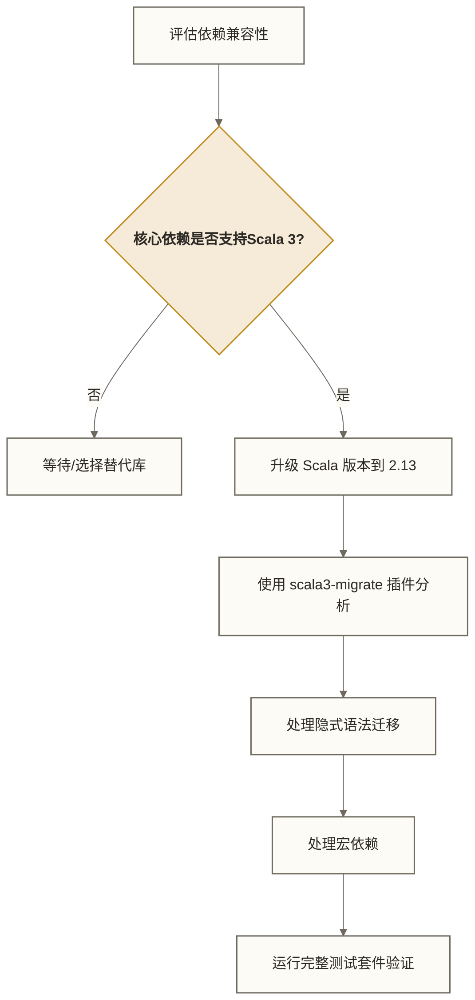

# Scala工程化与项目实战

> [!abstract] 学习目标
> - 掌握 SBT 构建工具的核心概念：多模块项目、依赖管理、打包部署
> - 了解 Scala 代码风格规范（scalafmt/scalafix）及其在团队中的落地方式
> - 熟练使用 ScalaTest 为大数据项目编写单元测试
> - 了解 Scala 2 到 Scala 3 迁移的实际挑战
> - 掌握面试高频题的核心考察点

> [!quote] 核心洞察
> 写 Scala 代码容易，工程化 Scala 项目难。真正区分初级和高级工程师的，不是语法本身，而是能否在团队中建立可维护、可测试、构建稳定的 Scala 工程体系。

---

## 目录

- [[#SBT构建工具详解]]
- [[#Scala代码风格规范]]
- [[#单元测试实战]]
- [[#Scala REPL在数据探索中的应用]]
- [[#Scala 2迁移到Scala 3的实际经验]]
- [[#面试高频题20道]]

---

## SBT构建工具详解

SBT（Simple Build Tool，虽然名字如此，实际不简单）是 Scala 生态的标准构建工具。

### 基础项目结构

| 路径 | 说明 |
|------|------|
| `build.sbt` | 主构建文件 |
| `project/build.properties` | SBT 版本声明 |
| `project/plugins.sbt` | SBT 插件 |
| `project/Dependencies.scala` | 依赖版本集中管理 |
| `src/main/scala/` | Scala 源码 |
| `src/main/resources/` | 配置文件 |
| `src/test/scala/` | 测试代码 |
| `src/test/resources/` | 测试配置 |
| `.scalafmt.conf` | 代码格式化配置 |

### build.sbt 核心配置

```scala
// build.sbt

// 项目基本信息
ThisBuild / organization := "com.company"
ThisBuild / scalaVersion := "2.13.12"
ThisBuild / version      := "1.0.0-SNAPSHOT"

// 编译器选项（大数据项目推荐配置）
ThisBuild / scalacOptions ++= Seq(
  "-deprecation",           // 使用废弃 API 时警告
  "-feature",               // 使用实验性特性时警告
  "-unchecked",             // 类型擦除相关警告
  "-Xlint",                 // 启用额外的 lint 检查
  "-Ywarn-unused:imports",  // 警告未使用的 import
  "-encoding", "UTF-8"
)

lazy val root = (project in file("."))
  .settings(
    name := "my-spark-project",
    // 依赖声明
    libraryDependencies ++= Dependencies.sparkDeps ++ Dependencies.testDeps,
    // 打包配置：生成 fat jar（包含所有依赖）
    assembly / assemblyMergeStrategy := {
      case PathList("META-INF", xs @ _*) => MergeStrategy.discard
      case "application.conf"            => MergeStrategy.concat
      case "reference.conf"              => MergeStrategy.concat
      case x                             => MergeStrategy.first
    },
    // fork 在独立 JVM 中运行测试；provided 依赖可用于编译和测试，但不纳入常规运行时依赖
    Test / fork := true,
    Test / javaOptions ++= Seq(
      "-Xmx2g",
      "-XX:+UseG1GC"
    )
  )
```

### 依赖管理的最佳实践

```scala
// project/Dependencies.scala
import sbt._

object Dependencies {
  // 统一版本号管理
  val sparkVersion    = "3.5.0"
  val scalaTestVersion = "3.2.17"
  val log4jVersion    = "2.20.0"

  // 按模块分组
  val sparkDeps = Seq(
    // provided：运行时由集群提供，打包时排除（避免 fat jar 过大）
    "org.apache.spark" %% "spark-core" % sparkVersion % "provided",
    "org.apache.spark" %% "spark-sql"  % sparkVersion % "provided",
    "org.apache.spark" %% "spark-streaming" % sparkVersion % "provided"
  )

  val testDeps = Seq(
    "org.scalatest"    %% "scalatest"      % scalaTestVersion % Test,
    // spark-testing-base：提供 SparkContext 的测试工具
    "com.holdenkarau"  %% "spark-testing-base" % s"${sparkVersion}_1.4.0" % Test
  )

  val utilDeps = Seq(
    "com.typesafe"  % "config"          % "1.4.3",
    "ch.qos.logback" % "logback-classic" % "1.4.11"
  )
}
```

### 多模块项目结构

大型 Spark 项目通常按业务域拆分模块：

```scala
// build.sbt（多模块版本）

lazy val common = (project in file("modules/common"))
  .settings(
    name := "common",
    libraryDependencies ++= Dependencies.sparkDeps
  )

lazy val salesAnalysis = (project in file("modules/sales-analysis"))
  .dependsOn(common)
  .settings(
    name := "sales-analysis",
    libraryDependencies ++= Dependencies.sparkDeps
  )

lazy val userBehavior = (project in file("modules/user-behavior"))
  .dependsOn(common)
  .settings(
    name := "user-behavior"
  )

// 根项目聚合所有模块
lazy val root = (project in file("."))
  .aggregate(common, salesAnalysis, userBehavior)
  .settings(
    name := "data-platform"
  )
```

### 常用 SBT 命令速查

```bash
sbt compile          # 编译
sbt test             # 运行所有测试
sbt "testOnly *SalesTransformerSpec"  # 运行特定测试
sbt assembly         # 打包 fat jar（需要 sbt-assembly 插件）
sbt "project sales-analysis" compile  # 切换到子模块
sbt reload           # 重新加载 build.sbt（修改构建文件后）
sbt dependencyTree   # 查看完整依赖树（排查冲突用）
sbt evicted          # 查看被覆盖的依赖版本
```

---

## Scala代码风格规范

### scalafmt：自动格式化

```hocon
# .scalafmt.conf

version = "3.7.14"
runner.dialect = scala213

# 最大行宽
maxColumn = 120

# 缩进
indent.main = 2
indent.caseSite = 2  # case 分支额外缩进

# 对齐（大数据代码中 case class 字段对齐可读性更好）
align.preset = more
align.tokens = [
  { code = "=>", owner = "Case" },
  { code = "=", owner = "(Defn.Val|Defn.Var|Term.Assign)" }
]

# import 排序
rewrite.rules = [SortImports, RedundantBraces]

# 换行策略
newlines.topLevelStatements = [before]
```

### scalafix：静态分析与自动修复

```scala
// .scalafix.conf

rules = [
  DisableSyntax,      // 禁止危险语法
  LeakingImplicitClassVal,  // 隐式类的 val 泄漏
  NoValInForComprehension,  // for 推导式中不用 val
  OrganizeImports    // 整理 import（按字母排序，删除未使用）
]

DisableSyntax.noVars = true        // 禁止使用 var
DisableSyntax.noThrows = true      // 禁止直接 throw（使用 Try/Either）
DisableSyntax.noNulls = true       // 禁止使用 null
```

### 团队规范的关键要点

```scala
// 1. 命名规范
class SalesAggregator          // 类：UpperCamelCase
object SalesAggregator         // 伴生对象：与类同名
def processOrders(): Unit      // 方法：lowerCamelCase
val maxRetryCount = 3          // 常量/字段：lowerCamelCase
type OrderId = Long            // 类型别名：UpperCamelCase

// 2. 大数据代码特定规范

// 避免在 Spark 算子中使用 println（Driver 端不显示）
// 使用 log 或 println 的结果收集到 Driver
rdd.foreach(println)  // 只在 Executor 上输出，Driver 看不到

// 推荐：用 log 记录，或 collect 后在 Driver 输出
val sample = rdd.take(10)
sample.foreach(record => logger.info(s"Sample: $record"))

// 3. Spark 特定风格
// Column 名称使用 $ 语法（来自 import spark.implicits._）
df.select($"user_id", $"amount")         // 推荐
df.select(col("user_id"), col("amount")) // 可以，但略冗长
df.select("user_id", "amount")           // 简洁的列名选择；与 $"column"、col("column") 一样，不提供列名的编译期校验
```

---

## 单元测试实战

### ScalaTest 的测试风格选择

```scala
// 推荐：FlatSpec（行为驱动，可读性好）
import org.scalatest.flatspec.AnyFlatSpec
import org.scalatest.matchers.should.Matchers

class SalesTransformerSpec extends AnyFlatSpec with Matchers {

  "SalesTransformer.parseRecord" should "return Some for valid input" in {
    val raw = RawSale("S001", "P001", "5", "100.0", "2024-01-15", "ST001")
    val result = SalesTransformer.parseRecord(raw)

    result shouldBe defined
    result.get.totalAmount shouldBe 500.0
  }

  it should "return None for invalid amount" in {
    val raw = RawSale("S002", "P002", "abc", "100.0", "2024-01-15", "ST001")
    SalesTransformer.parseRecord(raw) shouldBe None
  }

  it should "return None for negative quantity" in {
    val raw = RawSale("S003", "P003", "-1", "100.0", "2024-01-15", "ST001")
    SalesTransformer.parseRecord(raw) shouldBe None
  }
}
```

### Spark 单元测试：SparkTestBase

```scala
import org.apache.spark.sql.SparkSession
import org.scalatest.BeforeAndAfterAll
import org.scalatest.flatspec.AnyFlatSpec
import org.scalatest.matchers.should.Matchers

// 共享 SparkSession 的测试基类（测试套件内复用，避免反复创建）
trait SparkTestBase extends AnyFlatSpec with Matchers with BeforeAndAfterAll {

  @transient var spark: SparkSession = _

  override def beforeAll(): Unit = {
    super.beforeAll()
    spark = SparkSession.builder()
      .master("local[2]")  // 本地模式，2个线程
      .appName("UnitTest")
      .config("spark.sql.shuffle.partitions", "4")  // 测试用小值
      .config("spark.ui.enabled", "false")           // 关闭 UI
      .getOrCreate()
    spark.sparkContext.setLogLevel("ERROR")
  }

  override def afterAll(): Unit = {
    if (spark != null) spark.stop()
    super.afterAll()
  }
}

// 使用测试基类
class SalesAggregationJobSpec extends SparkTestBase {

  "SalesAggregationJob.aggregate" should "correctly sum revenue by city" in {
    val testSpark = spark
    import testSpark.implicits._

    val input = Seq(
      ProcessedSale("S1", 1000.0, java.time.LocalDate.of(2024, 1, 1), "北京"),
      ProcessedSale("S2", 2000.0, java.time.LocalDate.of(2024, 1, 1), "上海"),
      ProcessedSale("S3", 500.0,  java.time.LocalDate.of(2024, 1, 1), "北京")
    ).toDS()

    val result = SalesTransformer.aggregate(input, Seq("storeId"))(spark)
      .collect()
      .sortBy(_.storeId)

    result should have length 2
    result(0).storeId    shouldBe "上海"
    result(0).totalRevenue shouldBe 2000.0 +- 0.01  // 浮点数比较用 tolerance
    result(1).storeId    shouldBe "北京"
    result(1).totalRevenue shouldBe 1500.0 +- 0.01
  }
}
```

### 测试数据构造的最佳实践

```scala
// 测试辅助方法：构造默认数据，只修改需要测试的字段
object TestFixtures {
  def defaultRawSale(
    saleId:    String = "S001",
    productId: String = "P001",
    quantity:  String = "10",
    unitPrice: String = "100.0",
    saleDate:  String = "2024-01-15",
    storeId:   String = "ST001"
  ): RawSale = RawSale(saleId, productId, quantity, unitPrice, saleDate, storeId)
}

// 在测试中使用：只设置关心的字段
"parseRecord" should "reject empty saleId" in {
  val raw = TestFixtures.defaultRawSale(saleId = "")
  SalesTransformer.parseRecord(raw) shouldBe None
}
```

---

## Scala REPL在数据探索中的应用

Scala REPL（Read-Eval-Print Loop）是数据工程师快速验证逻辑的利器。

### spark-shell：交互式数据探索

```bash
# 启动 spark-shell（附带 Spark 上下文）
spark-shell --master local[*] \
  --driver-memory 4g \
  --conf spark.sql.shuffle.partitions=8

# 常用 spark-shell 技巧
```

```scala
// spark-shell 中的常用操作

// 1. 快速探索数据 schema
val df = spark.read.parquet("/data/orders/2024-01-*")
df.printSchema()
df.show(5, truncate = false)

// 2. 快速统计
df.describe("amount", "quantity").show()
df.select("status").distinct().show()

// 3. 测试 SQL 逻辑：将上面读取的 df 注册为临时视图
 df.createOrReplaceTempView("orders")
spark.sql("""
  SELECT city, COUNT(*) as cnt, SUM(amount) as total
  FROM orders
  WHERE date >= '2024-01-01'
  GROUP BY city
  ORDER BY total DESC
  LIMIT 10
""").show()

// 4. 测试自定义函数
import org.apache.spark.sql.functions.udf
val normalizeCity = udf((city: String) => city.trim.toLowerCase)
df.withColumn("city_normalized", normalizeCity($"city")).show(5)

// 5. 将结果存为临时文件便于检查
df.filter($"amount" > 10000).write.mode("overwrite").json("/tmp/large-orders")
```

### ammonite：更强大的 Scala REPL

```scala
// ammonite 支持直接导入 Maven 依赖，无需预先配置
import $ivy.`org.apache.spark::spark-sql:3.5.0`
import $ivy.`com.typesafe:config:1.4.3`

// 在 ammonite 中进行快速数据处理验证
val config = com.typesafe.config.ConfigFactory.load()
println(config.getString("database.url"))
```

---

## Scala 2迁移到Scala 3的实际经验

### 主要兼容性问题

以下以假设的 Scala 2 到 Scala 3 迁移场景说明兼容性检查点，不代表已提供的 2024-2025 年实际案例或问题频率统计：

**1. 隐式机制改写（工作量取决于项目及依赖）**

```scala
// Scala 2
implicit val userEncoder: Encoder[User] = ...
def process[T](x: T)(implicit enc: Encoder[T]) = ...

// Scala 3 等价写法
given userEncoder: Encoder[User] = ...
def process[T](x: T)(using enc: Encoder[T]) = ...

// 迁移工具：可评估 Scalafix 或 scala3-migrate 的适用规则；本文未提供启用配置，自动改写范围取决于具体工具、规则及代码，不能假定大部分隐式语法都可自动转换
```

**2. 宏（Macro）完全重写**

Scala 3 的宏系统与 Scala 2 完全不兼容。依赖 Scala 2 宏的库（如早期版本的 Circe、Shapeless）需要等待适配 Scala 3 的版本。

```scala
// 依赖宏的库必须等待 Scala 3 兼容版本
// 检查：https://scaladex.scala-lang.org/
```

**3. 越界的类型推断差异**

```scala
// Scala 3 的类型推断在某些边界情况下更严格
// 可能需要添加显式类型注解

// Scala 2 能推断，Scala 3 可能需要显式声明
val result: List[Animal] = List(new Cat(), new Dog())  // 需要显式类型
```

### 迁移策略



> [!warning] 大数据项目的迁移建议
> 对于 Spark 项目：迁移前应确认目标 Spark 发行版、Scala 二进制版本及第三方依赖的兼容性。本文未提供依据支持“Scala 3 支持仍处于预览阶段（2026年初）”这一判断；生产环境应选择目标发行版明确支持的 Scala 版本，不应仅凭本文升级到 Scala 3。

---

## 面试高频题20道

### 基础概念类（1-7题）

**Q1：val 和 var 的区别？在 Spark 中为什么优先使用 val？**

答：`val` 声明不可变引用，`var` 声明可变引用。在 Spark 中，`var` 在 executor 闭包内部的修改不会传播回 driver（因为每个 executor 有自己的副本），容易造成逻辑错误。`val` 禁止引用重新赋值，但不保证所引用的对象不可变；应避免依赖 executor 闭包中的修改更新 driver 状态，并使用返回值、聚合等方式传递结果。

**Q2：case class 和 普通 class 的区别？**

答：case class 自动生成：`equals/hashCode`（基于字段值）、`toString`、`copy`、`apply/unapply`（支持模式匹配）、实现 `Serializable`。在 Spark 中 case class 作为数据容器，这些特性都有直接价值。

**Q3：Option[T] 的作用？为何优于 null？**

答：Option 在类型层面显式表达"可能不存在"，强迫调用方处理空值情况，避免 `NullPointerException`。在 Spark executor 内部，NPE 会导致任务失败，Option 是更安全的替代方案。

**Q4：map 和 flatMap 的区别？**

答：`map(f: A => B): F[B]`，f 返回普通值。`flatMap(f: A => F[B]): F[B]`，f 返回同类型的容器，flatMap 会展平结果。在 Spark 中，`flatMap` 常用于：一行数据产生多条输出、解析可能失败（返回 Option）的场景。

**Q5：什么是尾递归？Scala 如何保证尾递归优化？**

答：尾递归指递归调用是函数的最后一个操作，编译器可将其优化为循环，避免栈溢出。Scala 用 `@tailrec` 注解强制编译器验证，如果实现不满足尾递归条件则编译报错。

**Q6：隐式转换的作用和风险？**

答：用于为已有类型添加方法（扩展方法），注入公共依赖（隐式参数）。风险：过度使用导致代码难以追踪，调试时难以判断方法从哪里来。最佳实践：只用于注入框架级依赖（SparkSession）和少量便利方法。

**Q7：for 推导式的本质是什么？**

答：`for { x <- A; y <- B } yield f(x, y)` 是 `A.flatMap(x => B.map(y => f(x, y)))` 的语法糖。只要类型实现了 `flatMap` 和 `map`，就可以使用 for 推导式（Option、Try、List、Future 等）。

### Spark 结合类（8-14题）

**Q8：RDD、DataFrame、Dataset 的区别和选择？**

答：RDD：最底层，无 schema，类型安全，无 Catalyst 优化。DataFrame：有 schema，Catalyst 全面优化，运行时类型安全。Dataset[T]：有 schema，类型化操作提供编译期类型检查，并可使用 Catalyst 优化；按字符串选择列等操作仍需运行时解析。需要类型化领域模型时可选 Dataset，主要进行 SQL 或结构化列运算时可选 DataFrame，不存在适用于所有新项目的最佳选择。

**Q9：Spark 序列化问题的根本原因和解决方案？**

答：根本原因：Spark 将闭包序列化后发送到 executor，闭包可能捕获了外部类的引用（包含不可序列化的字段）。解决方案：① `@transient lazy val` 标注不可序列化字段；② 将重量级对象放在 `object` 单例中（executor 本地初始化）；③ 使用广播变量传递大型共享数据。

**Q10：如何避免 Spark 的数据倾斜？**

答：① 广播 Join（小表广播，避免 Shuffle）；② 加盐（Salting）分散热点 Key；③ 增加 shuffle 分区数；④ 对倾斜 Key 单独处理，再 union 其他数据。

**Q11：import spark.implicits._ 引入了什么？**

答：主要引入：① `Encoder` 的隐式实例，支持 case class 转 Dataset；② `toDS()`/`toDF()` 扩展方法；③ `$"column"` 语法（Column 对象）；④ 常用类型（Int、String、Long 等）的 Encoder。

**Q12：case class 在 Spark 中的具体优势？**

答：① 自动序列化（实现 Serializable）；② 自动 Encoder 派生（通过 `import spark.implicits._`）；③ 模式匹配支持，Dataset 操作更简洁；④ `copy` 方法在 map 转换中方便修改部分字段；⑤ `equals` 基于值，`groupByKey` 等操作语义正确。

**Q13：Spark 中为什么不能在 RDD 操作内部嵌套 RDD 操作？**

答：SparkContext 不可序列化，而内部 RDD 操作的闭包会被序列化到 executor，导致 `SparkContext not serializable` 错误。解决方案：用 `mapPartitions` + 广播变量，或改用 Dataset join 替代嵌套 RDD 操作。

**Q14：collect() 的风险是什么？如何安全使用？**

答：`collect()` 将所有数据拉到 Driver 内存，数据量大时 Driver OOM。安全使用：① 先 `filter`/`limit` 缩小数据量；② 用 `take(n)` 替代 `collect()`；③ 只在确认数据量可控时使用（如聚合后的少量结果）。

### 类型系统类（15-17题）

**Q15：什么是协变？举一个 Spark 中的例子？**

答：协变（`+T`）：如果 `B <: A`，则 `Container[B] <: Container[A]`。Spark 的 `RDD[T]` 是不变的，不能直接把 `RDD[Cat]` 当作 `RDD[Animal]` 使用；协变示例可使用 `List[+T]`，使 `List[Cat]` 可作为 `List[Animal]` 使用。函数的输入是逆变的（`Function1[-T, +R]`），输出是协变的。

**Q16：什么是类型类（Type Class）模式？在 Spark 中的体现？**

答：类型类是一种"事后扩展"的多态模式，无需修改原类即可为其添加行为。Spark 中 `Encoder[T]` 是典型的类型类：`import spark.implicits._` 为常用类型提供了 Encoder 实例，用户也可以为自定义类型提供 Encoder，Spark 在编译期验证类型是否有对应 Encoder。

**Q17：`extends AnyVal` 有什么作用？**

答：符合值类限制的类可通过 `extends AnyVal` 包装底层值，在部分使用场景中避免包装对象分配。它可为相同底层类型的不同语义值（如 `UserId(Long)` vs `OrderId(Long)`）提供类型区分，但在泛型、数组或某些类型转换等场景中仍可能产生包装对象，不能保证无性能代价。

### 工程实践类（18-20题）

**Q18：大型 Spark Scala 项目如何组织代码结构？**

答：分层架构：① `jobs/`：作业入口（读取、协调、写入）；② `transformations/`：纯函数业务逻辑（可单测，无 IO）；③ `models/`：case class 数据模型；④ `config/`：配置管理；⑤ `utils/`：工具函数。关键原则：Transformer 层不依赖 SparkSession，使用隐式参数注入。

**Q19：如何为 Spark 作业编写高效的单元测试？**

答：① 提取纯函数到 Transformer 层，不依赖 Spark 的逻辑直接单测；② 需要 Spark 的测试用 `local[n]` 模式，关闭 UI，减少 shuffle 分区数；③ 测试数据用工厂方法构造，只设置关心的字段；④ 用 `+-` tolerance 比较浮点数；⑤ 测试类用 `BeforeAndAfterAll` 共享 SparkSession。

**Q20：SBT 的 `provided` scope 是什么？为什么 Spark 依赖要用 provided？**

答：`provided` 表示"编译时需要，运行时由环境提供"。Spark 依赖声明为 `provided` 是因为集群已经部署了 Spark，不需要再打包进 fat jar。如果不加 `provided`，fat jar 会包含完整的 Spark（几百 MB），且可能与集群版本冲突，导致 `ClassNotFoundException` 或版本冲突。

---

## 小结

| 工程化方面 | 关键工具 | 核心价值 |
|---------|---------|--------|
| 构建管理 | SBT + sbt-assembly | 多模块项目、fat jar 打包 |
| 代码风格 | scalafmt + scalafix | 团队统一风格、静态分析 |
| 单元测试 | ScalaTest + local Spark | 逻辑验证、回归防护 |
| 数据探索 | spark-shell / ammonite | 快速验证、原型开发 |
| 版本迁移 | scala3-migrate | 评估 Scala 3 迁移成本 |

### 延伸学习路径

- [[【技术与工具】/Scala/07-Scala函数式编程核心思想]] - 工程化的理论基础
- [[【技术与工具】/Scala/09-Spark中的Scala最佳实践]] - 工程规范在 Spark 中的落地
- [[【技术与工具】/Scala/10-Akka与流处理编程模型]] - SBT 多模块配置 Akka 项目

#Scala #SBT #工程化 #单元测试 #ScalaTest #面试 #项目实战 #大数据
