# Apache Spark学习路线图

Apache Spark是目前最流行的大数据分布式计算框架，被广泛应用于批处理、流处理、机器学习等场景。本文档提供完整的Spark学习路线图，帮助从基础到高级的系统化学习。

## 2026更新：Spark 4 与 AI 时代数据处理

截至 2026-05-18，Spark 官方下载页显示 4.1.0 为稳定版本，4.2.0 仍是 preview；因此学习上建议以 Spark 4.x 的范式变化为主线，而不是追逐 preview API。

建议在完成 DataFrame / Spark SQL 基础后阅读：

- [[【技术与工具】/Spark/25-Spark-4与AI时代数据处理|Spark 4与AI时代数据处理]]：从 SQL 表达力、Spark Connect、湖仓与 AI 数据底座理解 Spark 4.x。
- [[【技术与工具】/SQL/33-AI时代分析SQL实战|AI时代分析SQL实战]]：把 Spark SQL 放进 Agent 时代的分析 SQL 训练里。
- [[【技术与工具】/Python/41-从Pandas到Polars与DuckDB|从Pandas到Polars与DuckDB]]：理解本地轻量分析与分布式 Spark 的边界。

> [!tip] 学习判断
> 小数据先用 DuckDB / Polars 做快实验；数据量、并发、治理、调度、湖仓协作上来之后，再进入 Spark。

## 📊 学习路线架构图

```mermaid
%%{init: {"theme":"base","themeVariables":{"fontFamily":"PingFang SC, -apple-system, Source Han Serif SC, serif","fontSize":"16px","background":"#FDFBF5","primaryColor":"#FDFBF5","primaryTextColor":"#2D2A26","primaryBorderColor":"#6E6A60","secondaryColor":"#E8EFE8","secondaryBorderColor":"#8FA890","secondaryTextColor":"#2D2A26","tertiaryColor":"#FDFBF5","tertiaryBorderColor":"#9A9488","tertiaryTextColor":"#6E6A60","lineColor":"#6E6A60","textColor":"#2D2A26","mainBkg":"#FDFBF5","nodeBorder":"#2D5A3D","clusterBkg":"#F3EEDF","clusterBorder":"#9A9488","edgeLabelBackground":"#FDFBF5"},"flowchart":{"htmlLabels":true,"curve":"basis","padding":20,"nodeSpacing":60,"rankSpacing":70,"useMaxWidth":false},"themeCSS":".node rect, .node polygon, .node circle { stroke-width: 1.5px; } .edgePath .path { stroke-width: 1.5px; } .cluster-label .nodeLabel, .cluster-label foreignObject { color: #2D2A26 !important; } .edgeLabel, .edgeLabel foreignObject { color: #2D2A26 !important; background-color: #FDFBF5; } .edgeLabel rect { fill: #FDFBF5; }"}}%%
graph TB
    classDef default fill:#FDFBF5,stroke:#6E6A60,color:#2D2A26,stroke-width:1.5px
    classDef startend fill:#2D2A26,stroke:#2D2A26,color:#FDFBF5,font-weight:bold
    classDef decision fill:#F6EAD8,stroke:#C08A1A,color:#2D2A26,font-weight:bold
    classDef hub fill:#3B5A80,stroke:#3B5A80,color:#FDFBF5,font-weight:bold
    classDef io fill:#E5EAF0,stroke:#3B5A80,color:#2D2A26
    classDef accent fill:#A6432C,stroke:#A6432C,color:#FDFBF5,font-weight:bold
    classDef storage fill:#F3EEDF,stroke:#9A9488,color:#2D2A26
    A[Spark学习路线图] --> B[基础知识阶段]
    A --> C[核心编程阶段]
    A --> D[高级特性阶段]
    A --> E[实战应用阶段]

    B --> B1[分布式计算概念]
    B --> B2[Spark核心特性]
    B --> B3[生态架构]
    B --> B4[集群模式]
    B --> B5[环境搭建]

    C --> C1[RDD编程]
    C --> C2[DataFrame/Dataset]
    C --> C3[Spark SQL]
    C --> C4[数据读写]

    D --> D1[性能调优]
    D --> D2[缓存持久化]
    D --> D3[分区策略]
    D --> D4[监控调优]

    E --> E1[流处理]
    E1 --> E2[机器学习]
    E --> E3[图计算]
    E --> E4[项目实战]
    class A,B,C,D,E,B1,B2,B3,B4,B5,C1,C2,C3,C4,D1,D2,D3,D4,E1,E2,E3,E4 default
```



## 🎯 学习阶段规划

### 第一阶段：基础理论（参考安排：1-2周，需按已有基础和学习投入调整）

#### 核心目标
- 理解分布式计算基本概念
- 掌握Spark的核心特性和优势
- 了解Spark生态架构
- 熟悉不同部署模式

#### 学习内容
1. **[[【技术与工具】/Spark/01-分布式计算概念|分布式计算概念]]** - 分布式系统理论基础
2. **[[【技术与工具】/Spark/02-Spark核心特性|Spark核心特性]]** - RDD、DAG、惰性计算等核心概念
3. **[[【技术与工具】/Spark/03-Spark生态架构|Spark生态]]** - 各组件关系和应用场景
4. **[[【技术与工具】/Spark/04-Spark集群模式|Spark集群]]** - Standalone、YARN、Kubernetes部署
5. **[[【技术与工具】/Spark/05-Spark安装配置|Spark安装配置]]** - 环境搭建和基础配置

#### 技能检查点
- [ ] 能够解释分布式计算的基本概念
- [ ] 理解Spark与Hadoop的区别
- [ ] 掌握RDD、DataFrame、Dataset的概念
- [ ] 能够搭建Spark开发环境

### 第二阶段：核心编程（参考安排：2-3周，需按已有基础和学习投入调整）

#### 核心目标
- 掌握Spark核心API使用
- 能够编写基础的Spark应用程序
- 理解数据处理的最佳实践

#### 学习内容
1. **[[【技术与工具】/Spark/06-第一个Spark程序|第一个Spark程序]]** - Hello World到WordCount
2. **[[【技术与工具】/Spark/07-RDD编程基础|RDD]]** - RDD操作和转换
3. **[[【技术与工具】/Spark/08-DataFrame和Dataset|DataFrame和Dataset]]** - 结构化数据处理
4. **[[【技术与工具】/Spark/09-Spark SQL基础|Spark SQL]]** - SQL查询和数据分析
5. **[[【技术与工具】/Spark/10-数据读取与写入|数据读取与写入]]** - 多种数据源集成

#### 代码示例检查点
```scala
// 基础RDD操作
val data = sc.textFile("hdfs://path/to/file")
val words = data.flatMap(_.split(" "))
val wordCounts = words.map((_, 1)).reduceByKey(_ + _)

// DataFrame操作
import spark.implicits._
val df = spark.read.json("path/to/json")
df.select("name", "age").where($"age" > 21).show()

// Spark SQL
df.createOrReplaceTempView("people")
spark.sql("SELECT name, age FROM people WHERE age > 21").show()
```

#### 技能检查点
- [ ] 能够独立编写RDD程序
- [ ] 掌握DataFrame和Dataset API
- [ ] 熟练使用Spark SQL
- [ ] 了解常见数据格式处理

### 第三阶段：性能优化（参考安排：2-3周，需按已有基础和学习投入调整）

#### 核心目标
- 理解Spark性能瓶颈和调优策略
- 掌握缓存和持久化机制
- 学会分区调优和资源配置

#### 学习内容
1. **[[【技术与工具】/Spark/11-Spark性能调优|Spark性能调优]]** - 性能调优理论和实践
2. **[[【技术与工具】/Spark/12-缓存与持久化|缓存与持久化]]** - 存储级别和缓存策略
3. **[[【技术与工具】/Spark/13-分区调优|分区调优]]** - 数据分区和shuffle优化
4. **[[【技术与工具】/Spark/18-性能调优实战|性能调优]]** - 实际问题诊断和解决
5. **[[【技术与工具】/Spark/19-性能监控与调优|性能监控与调优]]** - 监控工具和性能分析

#### 性能调优检查点
```scala
// 缓存策略
val cachedRDD = rdd.cache()
val persistedDF = df.persist(StorageLevel.MEMORY_AND_DISK_SER)

// 分区调优
val repartitionedDF = df.repartition(200)
val coalescedRDD = rdd.coalesce(100)

// 广播变量
val broadcastVar = sc.broadcast(largeMap)
```

#### 技能检查点
- [ ] 能够分析Spark应用性能瓶颈
- [ ] 掌握缓存和持久化最佳实践
- [ ] 了解shuffle调优技巧
- [ ] 会使用Spark UI进行性能分析

### 第四阶段：高级特性（参考安排：3-4周，需按已有基础和学习投入调整）

#### 核心目标
- 掌握流处理编程模型
- 了解机器学习和图计算
- 学会企业级应用开发

#### 学习内容
1. **[[【技术与工具】/Spark/14-Spark Streaming流处理|Spark Streaming流处理]]** - 微批处理流计算
2. **[[【技术与工具】/Spark/15-Structured Streaming|Structured Streaming]]** - 结构化流处理
3. **[[【技术与工具】/Spark/16-MLlib机器学习|MLlib机器学习]]** - 分布式机器学习
4. **[[【技术与工具】/Spark/17-GraphX图计算|GraphX图计算]]** - 图数据处理
5. **[[【技术与工具】/Spark/22-企业级Spark应用|企业级Spark]]** - 生产环境最佳实践

#### 流处理示例
```scala
// Structured Streaming
val df = spark
  .readStream
  .format("kafka")
  .option("kafka.bootstrap.servers", "localhost:9092")
  .option("subscribe", "topic1")
  .load()

val query = df.writeStream
  .outputMode("append")
  .format("console")
  .start()
```

#### 技能检查点
- [ ] 能够开发实时流处理应用
- [ ] 掌握MLlib基础算法使用
- [ ] 了解图计算基本概念
- [ ] 具备企业级应用开发能力

### 第五阶段：项目实战（参考安排：4-6周，需按项目范围和学习投入调整）

#### 核心目标
- 完成端到端的大数据项目
- 积累项目实践经验；实际生产经验需通过真实部署、运维和故障处理获得
- 建立完整的技术栈

#### 实战项目
1. **[[【技术与工具】/Spark/20-批处理项目实战|批处理项目]]** - 离线数据处理项目
2. **[[【技术与工具】/Spark/21-实时计算项目|实时计算项目]]** - 实时数据分析系统
3. **综合项目** - 结合多种技术栈的完整解决方案

#### 项目技术栈

```mermaid
%%{init: {"theme":"base","themeVariables":{"fontFamily":"PingFang SC, -apple-system, Source Han Serif SC, serif","fontSize":"16px","background":"#FDFBF5","primaryColor":"#FDFBF5","primaryTextColor":"#2D2A26","primaryBorderColor":"#6E6A60","secondaryColor":"#E8EFE8","secondaryBorderColor":"#8FA890","secondaryTextColor":"#2D2A26","tertiaryColor":"#FDFBF5","tertiaryBorderColor":"#9A9488","tertiaryTextColor":"#6E6A60","lineColor":"#6E6A60","textColor":"#2D2A26","mainBkg":"#FDFBF5","nodeBorder":"#2D5A3D","clusterBkg":"#F3EEDF","clusterBorder":"#9A9488","edgeLabelBackground":"#FDFBF5"},"flowchart":{"htmlLabels":true,"curve":"basis","padding":20,"nodeSpacing":60,"rankSpacing":70,"useMaxWidth":false},"themeCSS":".node rect, .node polygon, .node circle { stroke-width: 1.5px; } .edgePath .path { stroke-width: 1.5px; } .cluster-label .nodeLabel, .cluster-label foreignObject { color: #2D2A26 !important; } .edgeLabel, .edgeLabel foreignObject { color: #2D2A26 !important; background-color: #FDFBF5; } .edgeLabel rect { fill: #FDFBF5; }"}}%%
graph LR
    classDef default fill:#FDFBF5,stroke:#6E6A60,color:#2D2A26,stroke-width:1.5px
    classDef startend fill:#2D2A26,stroke:#2D2A26,color:#FDFBF5,font-weight:bold
    classDef decision fill:#F6EAD8,stroke:#C08A1A,color:#2D2A26,font-weight:bold
    classDef hub fill:#3B5A80,stroke:#3B5A80,color:#FDFBF5,font-weight:bold
    classDef io fill:#E5EAF0,stroke:#3B5A80,color:#2D2A26
    classDef accent fill:#A6432C,stroke:#A6432C,color:#FDFBF5,font-weight:bold
    classDef storage fill:#F3EEDF,stroke:#9A9488,color:#2D2A26
    A[数据源] --> B[Kafka]
    B --> C[Spark Streaming]
    C --> D[Spark SQL]
    D --> E[机器学习]
    E --> F[结果存储]
    F --> G[可视化展示]

    H[批处理数据] --> I[Spark Batch]
    I --> J[数据仓库]
    J --> K[OLAP分析]
    class A,B,C,D,E,F,G,H,I,J,K default
```


## 🛠️ 技术栈要求

### 基础技能
- **编程语言**：Scala（推荐）、Python、Java
- **Linux基础**：命令行操作、脚本编写
- **数据库**：SQL基础、NoSQL了解

### 相关技术
- **存储系统**：[[【技术与工具】/Hadoop/03-HDFS分布式文件系统|Hadoop/HDFS分布式文件系统]]、对象存储
- **消息队列**：[[【技术与工具】/Kafka/02-Kafka架构概述|Kafka/Kafka]]
- **集群管理**：YARN、Kubernetes
- **监控工具**：Spark UI、Ganglia、Prometheus

## 📚 学习资源推荐

### 官方文档
- [Spark官方文档](https://spark.apache.org/docs/latest/)
- [Spark API文档](https://spark.apache.org/docs/latest/api/)

### 实践平台
- **本地开发**：IntelliJ IDEA + Scala插件
- **云平台**：AWS EMR、Azure HDInsight
- **容器化**：Docker + Kubernetes

### 数据集
- [Kaggle数据集](https://www.kaggle.com/datasets)
- [UC Irvine机器学习库](https://archive.ics.uci.edu/ml/)
- [NYC出租车数据](https://www1.nyc.gov/site/tlc/about/tlc-trip-record-data.page)

## ⚡ 学习建议

### 学习方法
1. **理论与实践结合**：每学完一个概念立即编码验证
2. **项目驱动学习**：选择感兴趣的实际问题进行解决
3. **源码阅读**：深入理解核心算法实现
4. **社区参与**：关注Spark社区动态和最佳实践

### 常见误区
- ❌ 忽略理论基础，直接上手编码
- ❌ 只学API使用，不理解底层原理
- ❌ 缺乏性能调优意识
- ❌ 不关注生产环境实践

### 进阶路径

```mermaid
%%{init: {"theme":"base","themeVariables":{"fontFamily":"PingFang SC, -apple-system, Source Han Serif SC, serif","fontSize":"16px","background":"#FDFBF5","primaryColor":"#FDFBF5","primaryTextColor":"#2D2A26","primaryBorderColor":"#6E6A60","secondaryColor":"#E8EFE8","secondaryBorderColor":"#8FA890","secondaryTextColor":"#2D2A26","tertiaryColor":"#FDFBF5","tertiaryBorderColor":"#9A9488","tertiaryTextColor":"#6E6A60","lineColor":"#6E6A60","textColor":"#2D2A26","mainBkg":"#FDFBF5","nodeBorder":"#2D5A3D","clusterBkg":"#F3EEDF","clusterBorder":"#9A9488","edgeLabelBackground":"#FDFBF5"},"flowchart":{"htmlLabels":true,"curve":"basis","padding":20,"nodeSpacing":60,"rankSpacing":70,"useMaxWidth":false},"themeCSS":".node rect, .node polygon, .node circle { stroke-width: 1.5px; } .edgePath .path { stroke-width: 1.5px; } .cluster-label .nodeLabel, .cluster-label foreignObject { color: #2D2A26 !important; } .edgeLabel, .edgeLabel foreignObject { color: #2D2A26 !important; background-color: #FDFBF5; } .edgeLabel rect { fill: #FDFBF5; }"}}%%
graph TB
    classDef default fill:#FDFBF5,stroke:#6E6A60,color:#2D2A26,stroke-width:1.5px
    classDef startend fill:#2D2A26,stroke:#2D2A26,color:#FDFBF5,font-weight:bold
    classDef decision fill:#F6EAD8,stroke:#C08A1A,color:#2D2A26,font-weight:bold
    classDef hub fill:#3B5A80,stroke:#3B5A80,color:#FDFBF5,font-weight:bold
    classDef io fill:#E5EAF0,stroke:#3B5A80,color:#2D2A26
    classDef accent fill:#A6432C,stroke:#A6432C,color:#FDFBF5,font-weight:bold
    classDef storage fill:#F3EEDF,stroke:#9A9488,color:#2D2A26
    A[Spark基础] --> B[大数据工程师]
    A --> C[数据科学家]
    A --> D[架构师]

    B --> B1[数据管道开发]
    B --> B2[ETL优化]
    B --> B3[平台建设]

    C --> C1[机器学习建模]
    C --> C2[特征工程]
    C --> C3[模型部署]

    D --> D1[技术选型]
    D --> D2[架构设计]
    D --> D3[团队管理]
    class A,B,C,D,B1,B2,B3,C1,C2,C3,D1,D2,D3 default
```


## 🎯 学习成果检验

### 基础水平
- 能够独立搭建Spark环境
- 掌握RDD、DataFrame基础操作
- 了解Spark核心概念

### 中级水平
- 能够进行性能调优
- 掌握流处理开发
- 具备问题排查能力

### 高级水平
- 能够设计大数据解决方案
- 具备企业级应用开发经验
- 能够指导团队技术实践

---

> [!tip] 学习提醒
> Spark是一个快速发展的技术，建议关注官方发布的新版本特性，并结合实际项目需求选择合适的版本进行深入学习。

## 📖 相关文档链接

- [[【技术与工具】/Hadoop/00-Hadoop学习路线图|Hadoop/Hadoop]] - Hadoop生态基础
- [[【技术与工具】/Kafka/00-Kafka学习路线图|Kafka/Kafka]] - 实时数据流处理
- [[【技术与工具】/Flink/00-Flink学习路线图|Flink/Flink]] - 流处理技术对比
- [[【数据治理与数据管理】/01-快速学习/02-实践方法/数据架构设计方法|核心基础/大数据]] - 架构设计参考