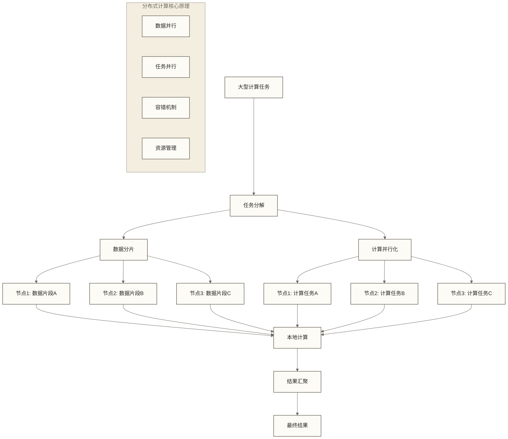
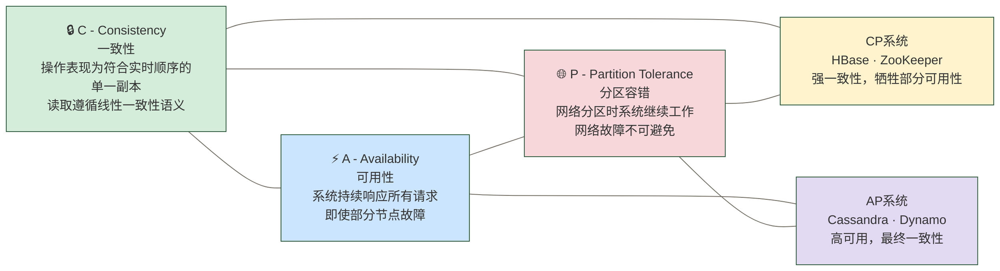
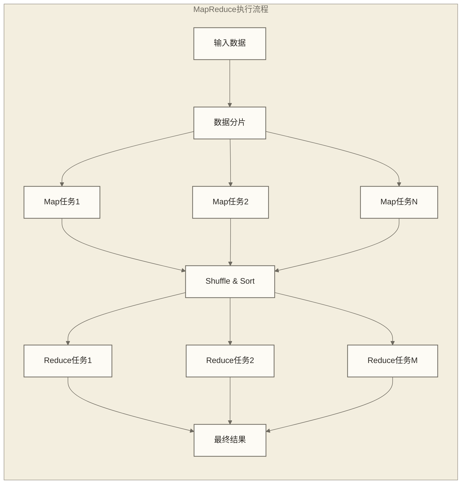
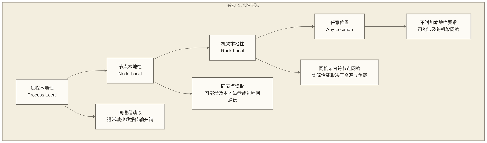

# 分布式计算概念与原理深度解析

分布式计算是现代大数据处理的基础，理解其核心概念对于掌握Spark至关重要。本文档深入介绍分布式计算的基本原理、挑战和解决方案，为后续Spark技术学习奠定理论基础。

## 分布式计算本质理解

### 核心概念深度解析

**分布式计算**代表了一种根本性的计算范式转变。传统的单机计算依赖于不断提升单一硬件的性能（垂直扩展），而分布式计算通过协调多台独立的计算机共同完成任务（水平扩展）。这种转变不仅仅是技术实现方式的改变，更是对计算问题分解和并行化思维的革命。

在分布式环境中，数据和计算被分散到多个节点上，每个节点都是一个相对独立的计算单元。这种架构带来的最大优势是**可扩展性** - 对于可分解并行的任务，添加节点可以扩大处理规模，但扩展能力仍受串行部分、通信开销、资源和系统设计限制。然而，这种优势伴随着复杂性的急剧增加：网络通信、数据一致性、故障处理等问题都需要精心设计的解决方案。



### 分布式计算的演进历程

分布式计算的发展经历了几个重要阶段，每个阶段都解决了特定的技术挑战：

**第一代：集群计算时代**
早期的分布式计算主要基于消息传递接口（MPI）和并行虚拟机（PVM）。这个阶段的特点是编程复杂度高，需要开发者手动管理节点间的通信和同步。虽然性能可以做到很高，但开发和维护成本巨大。

**第二代：网格计算兴起**
网格计算试图将分散在不同地理位置的计算资源整合成一个统一的计算平台。这个阶段引入了标准化的服务接口和资源发现机制，但仍然面临异构性和可靠性的挑战。

**第三代：MapReduce革命**
Google的MapReduce论文标志着现代大数据分布式计算的开始。它提出了一个简单而强大的编程模型，将复杂的分布式计算抽象为Map和Reduce两个阶段，极大降低了分布式编程的门槛。

**第四代：内存计算时代**
以Spark为代表的内存计算框架解决了MapReduce的性能瓶颈，通过内存缓存中间结果，大幅提升了迭代算法和交互式查询的性能。

## 分布式系统的根本挑战

### CAP定理的深层含义

CAP定理是分布式系统设计的基石理论，它揭示了分布式系统面临的根本性权衡。理解CAP定理不仅仅是记住三个字母的含义，更重要的是理解：发生网络分区时，系统无法同时保证线性一致性和对非故障节点请求的可用性；这一权衡不能简化为任意情况下任选两个属性。



**一致性（Consistency）的细分类型**：
- **强一致性**：在CAP语境中指线性一致性，即操作可视为按符合实时先后关系的顺序作用于单一副本，并不要求所有物理副本每时每刻都相同
- **弱一致性**：系统不保证何时所有节点达到一致状态
- **最终一致性**：系统保证在没有新更新的情况下，最终所有节点将达到一致状态

在实际系统中，一致性往往不是简单的二元选择，而是一个连续的谱系。HDFS通过写入管线管理数据副本，但故障处理和文件可见性具有具体语义，不能概括为写入时始终确保所有副本同步；而Cassandra提供了可调节的一致性级别，允许应用根据需要选择合适的一致性程度。

### 分布式系统的8个谬论深度解析

分布式系统的8个谬论反映了许多初学者对分布式环境的常见误解：

**1. 网络是可靠的**
现实中网络会出现延迟、丢包、重复传输、乱序到达等问题。优秀的分布式系统设计必须考虑网络的不可靠性，采用重试机制、超时检测、消息去重等策略。

**2. 延迟为零**  
网络通信的延迟是不可避免的物理现实。系统设计需要考虑延迟对用户体验和系统性能的影响，采用异步处理、本地缓存、数据预取等技术来减少延迟的影响。

**3. 带宽无限**
带宽是有限且昂贵的资源。高效的分布式系统需要优化数据传输，采用数据压缩、增量同步、智能路由等技术来减少带宽消耗。

**4-8. 其他谬论的影响**
其余五个谬论是：网络是安全的、网络拓扑不会变化、只有一个管理员、传输成本为零、网络是同构的。这些假设在实际系统中都不能被无条件接受。理解这些限制有助于做出更好的架构决策。

## 分布式计算模型深度分析

### MapReduce模型的设计智慧

MapReduce的成功不仅在于其简单性，更在于它对分布式计算本质的深刻洞察。它将复杂的分布式问题抽象为两个简单的函数式操作，但这种简化背后蕴含着深刻的设计思想。



**Map阶段的设计哲学**：
Map阶段体现了"分治"思想的精髓。通过将大数据集分解为独立的小块，每个Map任务可以并行处理，互不干扰。这种设计有几个关键优势：

- **无状态处理**：将Map函数设计为不依赖可变外部状态的确定性计算，有利于并行执行和失败重试，但框架并不自动保证用户函数是纯函数
- **数据本地性**：Map任务尽量在数据所在的节点执行，减少网络传输
- **容错简单**：如果Map任务失败，可以简单地在其他节点重新执行

**Shuffle阶段的技术挑战**：
Shuffle是MapReduce中最复杂的部分，需要将Map任务的输出按键重新分发到Reduce任务。这个过程涉及：

- **数据排序**：相同键的数据需要排序，便于Reduce处理
- **网络传输**：大量数据需要在节点间传输，容易成为性能瓶颈
- **内存管理**：需要在内存和磁盘之间智能地管理数据

**Reduce阶段的聚合艺术**：
Reduce阶段体现了"合并"的思想，但这种合并不是简单的数据拼接，而是有语义的聚合操作。优秀的Reduce函数设计需要考虑：

- **结合律**：操作顺序不应影响最终结果
- **交换律**：元素顺序不应影响结果（在某些场景下）
- **重试与副作用**：任务重试需要框架的输出提交机制及用户侧副作用控制；Reduce函数本身不必具有幂等性

一个经典的WordCount示例展示了按键聚合，其中求和具有结合律和交换律，但重复计入同一输入会改变结果，并不具有幂等性：

```python
# Map函数：分解文档为单词
def map_function(document):
    for word in document.split():
        emit(word, 1)  # 输出(word, 1)键值对

# Reduce函数：统计单词频率
def reduce_function(word, counts):
    return sum(counts)  # 对相同单词的计数求和
```

### 批处理vs流处理的本质区别

批处理和流处理代表了两种不同的数据处理哲学，理解它们的区别对于选择合适的技术架构至关重要。

| 维度 | 批处理 | 流处理 | 深层影响 |
|------|--------|--------|----------|
| **数据模型** | 有界数据集 | 无界数据流 | 影响算法设计和内存管理策略 |
| **时间语义** | 可按数据中的事件时间等字段分析 | 常需明确事件时间与处理时间 | 影响窗口计算和延迟数据处理 |
| **状态管理** | 聚合、连接等操作也可能需要状态或中间结果 | 有状态操作需管理跨事件状态，也存在无状态处理 | 影响容错设计和存储需求 |
| **容错策略** | 可重试失败任务或重算丢失分区，具体取决于框架 | 有状态框架常使用检查点、状态恢复及输入重放 | 影响恢复时间和资源开销 |

**批处理的适用场景**：
批处理适合处理历史数据分析、ETL作业、模型训练等对延迟要求不高但对吞吐量和资源利用率要求较高的场景。它的优势在于：
- 可以充分利用集群资源进行大规模并行计算
- 容错机制相对简单，失败后重新计算即可
- 相较于持续处理无界数据，状态生命周期通常更容易界定，但聚合、连接及迭代计算仍需考虑状态和中间结果管理

**流处理的适用场景**：
流处理适合实时监控、欺诈检测、推荐系统等对延迟敏感的场景。它的挑战在于：
- 需要处理无界数据，内存管理复杂
- 状态管理和一致性保证困难
- 需要处理乱序数据和延迟数据

## 分布式计算的性能法则

### 阿姆达尔定律的现实意义

阿姆达尔定律揭示了并行化的理论极限，但更重要的是它指导我们识别系统的性能瓶颈。

$Speedup = \frac{1}{(1-p) + \frac{p}{n}}$

n是处理器数，p是固定问题在单处理器基准运行时间中的可并行比例，1−p是串行比例；假设理想均分且忽略额外开销。

这个公式告诉我们几个重要的现实：

**串行部分的致命影响**：如果程序中有10%的部分无法并行化，即使使用无限多的处理器，最大加速比也只有10倍。这意味着：
- 在设计分布式系统时，必须尽可能减少串行操作
- 某些看似微不足道的串行部分可能成为整个系统的瓶颈
- 需要重新审视算法设计，寻找更好的并行化方案

**资源利用率的递减**：随着处理器数量增加，边际效用递减。实际系统中还要考虑通信开销、同步成本等因素，使得实际加速比远低于理论值。

### 古斯塔夫森定律的启发

古斯塔夫森定律提供了一个更乐观的视角：

$Speedup = n - α(n-1)$

n是处理器数，α是在扩大问题规模后的n处理器并行运行时间中测得的串行比例；它不是上一公式单处理器固定规模基准中的1−p。该公式也忽略额外并行开销。

它的核心观点是：随着计算资源的增加，我们可以处理更大规模的问题，而不是简单地加速固定大小的问题。这个观点对大数据处理特别有意义：

- **问题规模的可扩展性**：当我们有更多计算资源时，可以处理更大的数据集
- **弱扩展性vs强扩展性**：强扩展性关注固定问题的加速，弱扩展性关注问题规模增长时的性能保持
- **实际应用中的意义**：大多数大数据应用关心的是能否处理更大规模的数据，而不是加速处理小数据

## 数据本地性的重要性

数据本地性（Data Locality）是分布式计算性能优化的核心原则。在大数据环境中，数据移动的成本往往比计算成本更高。



**本地性优化策略**：

1. **计算向数据移动**：优先选择数据所在的节点进行计算
2. **数据布局优化**：根据访问模式优化数据在集群中的分布
3. **缓存策略**：在内存中缓存频繁访问的数据
4. **预取机制**：预先加载可能需要的数据

## 容错机制的设计哲学

分布式系统的容错设计体现了不同的哲学思想：

**被动容错vs主动容错**：
- 被动容错：等待故障发生后再处理，如检查点恢复
- 主动容错：通过数据复制、冗余计算等提前准备，降低故障对服务的影响，而非保证故障不发生

**快速恢复vs精确恢复**：
- 快速恢复：优先恢复服务，可能损失部分数据或精度
- 精确恢复：确保数据完整性，但恢复时间较长

**Spark的容错策略分析**：
Spark采用了基于血统（Lineage）的容错机制，这种设计有以下优势：
- **轻量级**：只需记录数据的生成过程，而不需要实际复制数据
- **分区重算**：在输入可重新读取且计算具有确定性等条件下，可以通过血统重算丢失分区；这不自动保证外部副作用的精确恢复
- **恢复策略选择**：应用可以结合计算成本与血统长度配置检查点；普通RDD血统机制不会自动按成本决定是否建立检查点

## Spark与传统方案的对比分析

### 相比MapReduce的核心改进

**内存计算革命**：
Spark最大的创新在于引入了内存计算模型。传统MapReduce在每个阶段都需要将中间结果写入磁盘，这在迭代算法中造成了巨大的性能瓶颈。Spark通过RDD的内存缓存，可以在多个操作间共享数据，大幅提升性能。

**编程模型的丰富化**：
MapReduce只提供了Map和Reduce两种操作，复杂的分析任务需要编写多个MapReduce作业。Spark提供了丰富的算子（如filter、join、groupBy等），使得复杂的数据处理逻辑可以在一个程序中完成。

**统一计算引擎**：
Spark不仅支持批处理，还统一了流处理、机器学习、图计算等多种计算模式，减少了数据在不同系统间的移动成本。

### 设计权衡的智慧

**内存vs持久性**：
Spark大量使用内存来提高性能，但这也带来了数据持久性的挑战。Spark的解决方案是血统机制 - 通过记录数据的计算过程来重构丢失的数据。

**易用性vs性能**：
Spark提供了高级的API（DataFrame、Dataset），使得开发更容易，但这些抽象层也可能带来性能开销。Spark通过Catalyst优化器来减少这种开销。

**通用性vs专用性**：
Spark试图成为一个通用的计算引擎，但在某些特定场景下，专用系统可能有更好的性能。这是架构设计中常见的权衡。

## 现代分布式计算趋势

### 云原生计算的兴起

云原生计算正在改变分布式系统的设计思路：
- **容器化**：提供轻量级、一致的运行环境
- **服务网格**：简化微服务间的通信和管理
- **自动扩缩容**：根据负载自动调整资源
- **无服务器计算**：进一步抽象基础设施

### 边缘计算的影响

边缘计算将计算能力推向数据源附近，这对传统的分布式计算模式提出了新的挑战：
- **延迟敏感性**：需要在延迟和精度之间找到平衡
- **资源异构性**：边缘设备的计算能力差异很大
- **连接不稳定性**：需要处理网络断断续续的情况

### 机器学习驱动的优化

现代分布式系统越来越多地使用机器学习来进行自动优化：
- **自动分区**：基于数据访问模式自动优化数据分布
- **智能调度**：根据历史性能数据优化任务调度
- **异常检测**：自动识别和处理系统异常

## 学习建议与实践指导

### 理论与实践的结合

理解分布式计算概念的最好方式是将理论与实践相结合：

1. **从小规模开始**：在单机环境中模拟分布式场景，理解基本概念
2. **逐步扩展**：从2-3个节点的小集群开始，观察分布式行为
3. **分析性能**：使用监控工具观察网络流量、内存使用、CPU利用率等指标
4. **故障模拟**：人为制造节点故障，观察系统的容错行为

### 常见误区避免

**过度分布式**：不是所有问题都需要分布式解决方案。小数据集使用分布式系统可能适得其反。

**忽视网络成本**：设计时必须考虑网络通信的开销，优化数据传输。

**错误的一致性假设**：分布式环境中的一致性和单机环境完全不同，需要重新理解。

### 深入学习路径

1. **理论基础**：深入学习分布式系统理论，推荐《分布式系统：概念与设计》
2. **算法理解**：掌握分布式算法，如一致性算法、选举算法等
3. **系统实践**：动手搭建和配置分布式系统
4. **性能调优**：学习监控和调优分布式系统性能
5. **前沿技术**：关注云原生、边缘计算等新兴技术

## 总结

分布式计算是现代大数据处理的基石，其核心思想是通过协调多台计算机来处理超出单机能力的计算任务。理解分布式计算的概念对于掌握Spark等现代大数据框架至关重要。

**关键理念**：
- 分布式计算通过水平扩展解决大规模计算问题
- CAP定理揭示了分布式系统设计的根本权衡
- 数据本地性是性能优化的核心原则
- 容错设计需要在恢复速度和数据一致性间平衡

**实践要点**：
- 理解并行化的局限性（阿姆达尔定律）
- 优化数据分布和访问模式
- 选择合适的一致性级别
- 设计有效的容错机制

通过深入理解这些概念，我们为学习Spark的具体实现和优化技巧奠定了坚实的理论基础。分布式计算不仅是一种技术，更是一种思维方式的转变，它要求我们从全局视角思考问题，在性能、一致性、可用性之间做出明智的权衡。

## 相关文档链接

- [[【技术与工具】/Spark/02-Spark核心特性|Spark核心特性]] - Spark如何实现分布式计算理念
- [[【技术与工具】/Hadoop/05-MapReduce编程模型|Hadoop/MapReduce编程]] - MapReduce详细实现
- [[【技术与工具】/Flink/04-Flink架构原理|Flink/Flink]] - 流计算架构设计
- [[【求职就业专题】/03-数据工程师求职全攻略/99-专属资源/分布式系统设计模式|核心基础/分布式系统]] - 分布式系统设计模式