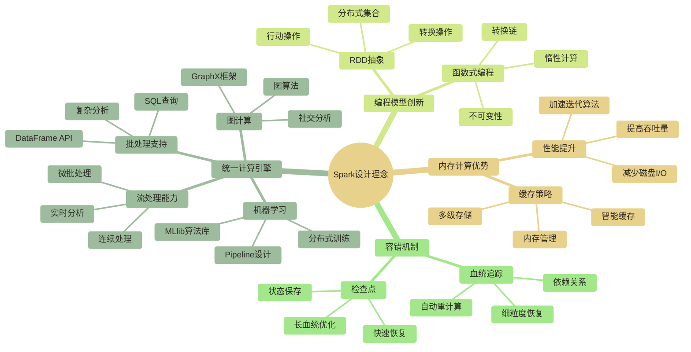
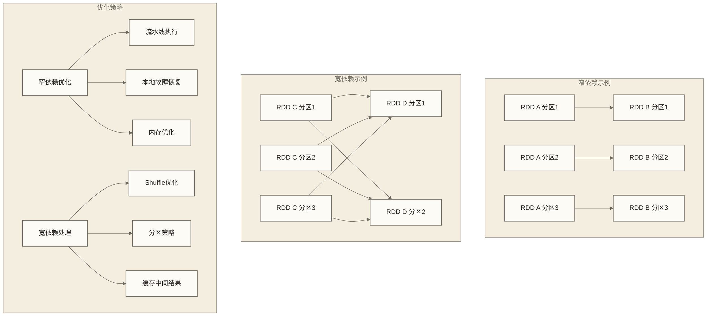
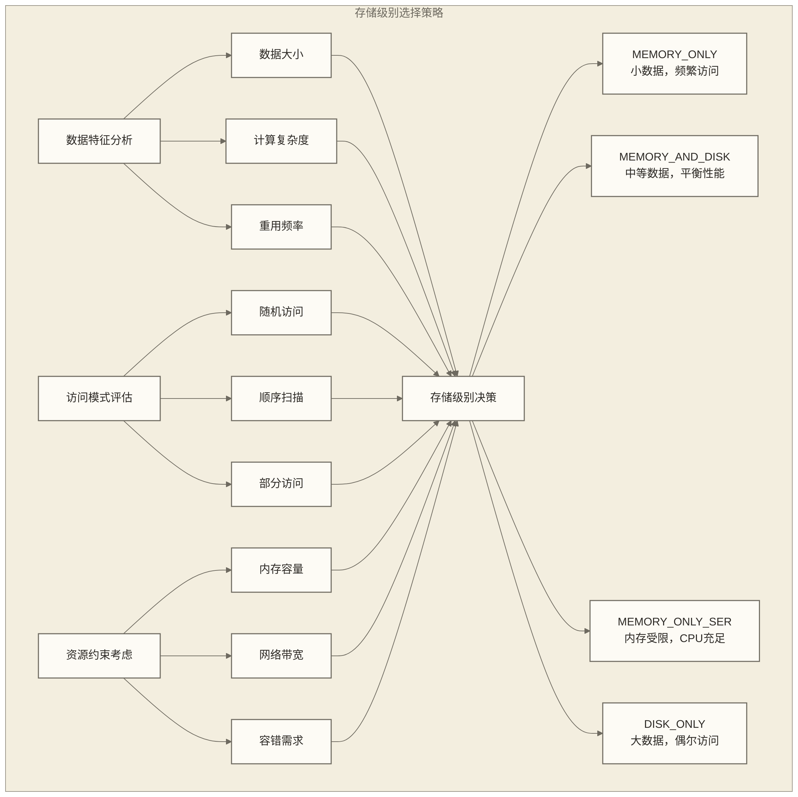
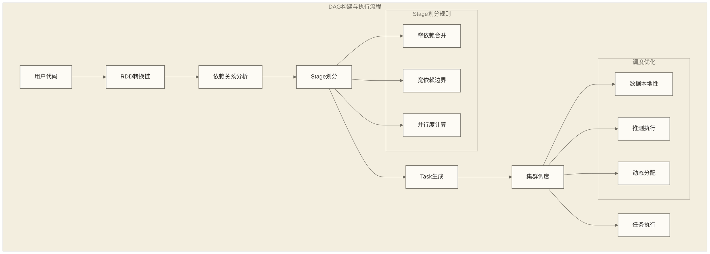
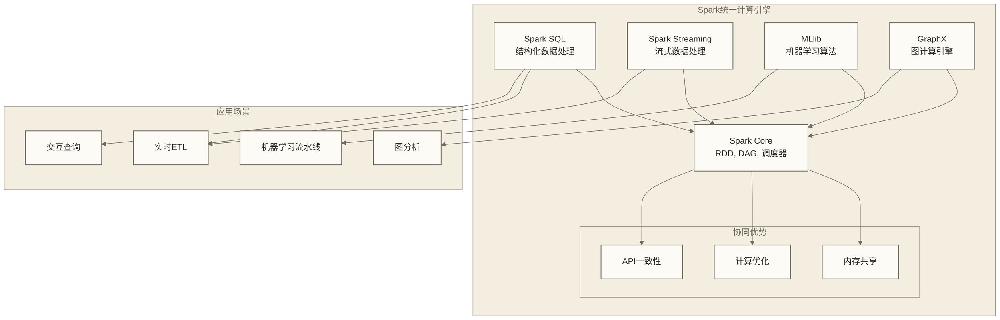

# Apache Spark核心特性深度解析

Apache Spark之所以能够成为大数据处理的事实标准，源于其独特的架构设计和核心特性。本文档深入分析Spark的关键技术特性及其背后的设计理念，帮助读者理解Spark为什么能够在性能和易用性方面都取得突破。

## Spark设计哲学与创新突破

### 设计哲学的演进

Spark的诞生代表了大数据处理思维的根本转变。在MapReduce时代，开发者需要将复杂的数据处理逻辑拆解为简单的Map和Reduce操作，这种约束虽然简化了分布式编程，但也限制了表达能力。Spark的设计哲学可以概括为：

**统一性**：提供统一的编程接口处理批处理、流处理、机器学习、图计算等不同类型的计算任务，避免数据在不同系统间的频繁移动。

**内存优先**：将计算结果尽可能保存在内存中，减少磁盘I/O开销，特别适合迭代算法和交互式查询。

**函数式编程**：采用函数式编程范式，通过不可变数据结构和转换操作，简化并行编程的复杂性。

**容错透明**：通过血统信息（Lineage）提供细粒度的容错能力，用户无需关心底层的故障处理机制。



## RDD：分布式数据抽象的革命

### RDD的概念本质

**弹性分布式数据集（Resilient Distributed Dataset）**是Spark最核心的抽象概念。理解RDD不仅仅是掌握一个数据结构，更是理解分布式计算的一种全新思维方式。

RDD的"弹性"体现在多个维度：
- **存储弹性**：数据可以存储在内存、磁盘，甚至是混合存储
- **容错弹性**：通过血统信息自动处理节点故障
- **计算弹性**：可以在不同的集群资源上动态调度执行
- **分区弹性**：支持动态的重新分区和数据重分布

**分布式**特性使得RDD能够跨越多个节点存储和处理数据，但对用户呈现统一的编程接口，屏蔽了分布式编程的复杂性。

**数据集**抽象让开发者能够像操作本地集合一样操作分布式数据，通过丰富的转换操作构建复杂的数据处理流水线。

### RDD的五大核心属性深度解析

#### 1. 分区列表的设计智慧

分区是RDD实现分布式并行计算的基础。每个分区代表数据的一个逻辑片段，可以在集群的不同节点上并行处理。

**分区数量的影响**：
- 分区过少：无法充分利用集群资源，限制并行度
- 分区过多：增加任务调度开销，可能导致小任务问题

**分区策略的选择**：
Spark支持多种分区策略，每种策略适用于不同的场景：
- **范围分区**：适合有序数据的范围查询
- **哈希分区**：适合键值对数据的随机访问
- **自定义分区**：根据业务逻辑定制分区规则

#### 2. 计算函数的设计原则

每个RDD都包含一个compute函数，定义了如何从输入分区计算输出数据。这个设计体现了函数式编程的核心思想：

**无副作用的设计建议**：计算逻辑应尽量避免修改外部状态；Spark不会自动保证用户函数无副作用，任务重试还可能重复执行副作用。
**确定性的设计建议**：为使血统重计算能够恢复一致结果，应使用可重现的输入和确定性计算逻辑；相同输入得到相同输出并非Spark对任意用户代码的保证。
**可组合性**：多个简单的compute函数可以组合成复杂的计算流水线

#### 3. 依赖关系的分类与优化

RDD之间的依赖关系是Spark进行优化和容错的基础。依赖关系分为两类：

**窄依赖（Narrow Dependencies）**：
- 父RDD的每个分区最多被一个子RDD分区使用
- 支持流水线优化，多个操作可以在同一个任务中执行
- 容错效率高，只需重计算失败分区的直接依赖

**宽依赖（Wide Dependencies）**：
- 父RDD的分区被多个子RDD分区使用
- 需要Shuffle操作重新分布数据
- 成为Stage的边界，影响任务调度策略



#### 4. 分区函数的业务价值

分区函数决定了键值对RDD中的数据如何分布到不同分区。合理的分区策略对性能有巨大影响：

**数据本地性优化**：将经常一起访问的数据放在相同或相邻的分区中
**负载均衡**：确保各分区的数据量和计算负载相对均衡
**Join优化**：使用相同分区策略的RDD可以进行本地Join，避免Shuffle

#### 5. 首选位置的调度优化

首选位置信息帮助Spark调度器选择最优的执行节点，实现数据本地性优化：

**进程本地性**：任务在数据所在的同一JVM进程中执行
**节点本地性**：任务在数据所在的同一物理节点上执行
**机架本地性**：任务在数据所在的同一机架内执行
**任意位置**：任务可以在集群的任何位置执行

### RDD操作的设计哲学

#### 转换操作的懒惰智慧

转换操作采用惰性执行策略，这种设计带来了多重优势：

**优化机会最大化**：延迟执行允许Spark分析整个转换链，进行全局优化
**资源利用最小化**：只有在需要结果时才执行计算，避免不必要的资源消耗
**容错成本最小化**：通过血统信息重计算，而不是维护中间状态

**常见转换操作的内在逻辑**：
- `map`：一对一转换，保持分区结构
- `filter`：数据筛选，可能改变分区大小但保持分区数量
- `flatMap`：一对多转换，适合处理嵌套数据结构
- `groupByKey`：按键分组，通常触发Shuffle操作
- `reduceByKey`：按键聚合，可以利用combiners进行本地预聚合

#### 行动操作的执行触发

行动操作是RDD计算的触发点，将惰性的转换链转化为实际的分布式计算任务：

**结果收集类操作**（如`collect`、`take`）：
- 将分布式数据收集到Driver节点
- 需要考虑Driver内存限制
- 适合小结果集或调试场景

**聚合类操作**（如`reduce`、`count`）：
- 在集群中并行计算，只返回最终结果
- 减少网络传输，提高效率
- 适合大数据集的统计计算

**输出类操作**（如`saveAsTextFile`）：
- 将结果保存到分布式存储系统
- 支持多种文件格式和存储系统
- 是ETL流水线的常见终点

## 内存计算：性能革命的技术基础

### 内存计算的理论基础

内存计算的核心价值在于打破了传统批处理中"计算-存储-计算"的循环模式。在MapReduce时代，每个作业的中间结果都必须写入磁盘，这在迭代算法中造成了巨大的性能瓶颈。

**磁盘I/O vs 内存访问的假设性数量级示例**：
- 假设机械硬盘随机访问延迟：~10ms
- 假设SSD随机访问延迟：~0.1ms
- 假设内存随机访问延迟：~0.0001ms

这些数字仅用于说明访问延迟的数量级差异，不作为硬件实测值。在上述假设下，机械硬盘与内存的延迟之比约为10万，SSD与内存之比约为1000；这些比值不能直接等同于Spark作业的加速倍数。迭代算法能否受益还取决于缓存命中、计算开销、序列化和网络通信。

### 内存管理的复杂性

虽然内存计算带来了巨大的性能提升，但也引入了新的挑战：

**内存容量限制**：
内存容量比磁盘小得多，需要智能的数据管理策略。Spark通过以下机制应对：
- **LRU淘汰策略**：当内存不足时，优先淘汰最久未使用的数据
- **溢出到磁盘**：支持内存和磁盘的混合存储策略
- **序列化存储**：通过序列化减少内存占用，但增加CPU开销

**垃圾回收压力**：
大量对象在内存中创建和销毁会给JVM垃圾回收器带来巨大压力。Spark的应对策略包括：
- **对象池化**：重用对象减少GC压力
- **堆外内存**：使用堆外内存存储数据，减少GC影响
- **代码生成**：通过代码生成避免对象创建

### 缓存策略的艺术

Spark提供了多种存储级别，每种级别都有其适用场景：



**存储级别的选择原则**：

1. **MEMORY_ONLY**：适合小数据集且频繁访问的场景
   - 优势：最快的访问速度
   - 劣势：内存不足时部分分区可能无法缓存或被淘汰，后续访问需要重新计算；这不等于源数据丢失

2. **MEMORY_AND_DISK**：最常用的存储级别
   - 优势：平衡了性能和可靠性
   - 劣势：磁盘溢出时性能下降

3. **MEMORY_ONLY_SER**：内存受限但CPU资源充足时的选择
   - 优势：节省内存空间
   - 劣势：增加序列化/反序列化开销

4. **带副本的存储级别**：关键数据的高可用保障
   - 优势：提供容错能力
   - 劣势：消耗额外的存储资源

## 惰性计算：优化机会的最大化

### 惰性计算的设计动机

惰性计算（Lazy Evaluation）是Spark性能优化的核心技术之一。这种设计模式延迟实际计算的执行，直到真正需要结果时才进行计算。

**为什么选择惰性计算**：

1. **全局优化机会**：通过分析整个转换链，Spark可以进行跨操作的优化
2. **避免不必要计算**：如果某些中间结果最终没有被使用，可以完全避免计算
3. **内存使用优化**：可以更精确地控制内存的使用时机和方式
4. **容错简化**：通过重新执行转换链来恢复数据，而不需要维护复杂的状态

### 优化技术的深度解析

#### Pipeline优化

Pipeline优化将多个窄依赖的操作合并到同一个任务中执行，减少中间数据的物化和网络传输：

```scala
// 原始操作链
val result = data
  .map(_.toUpperCase)      // 转换1
  .filter(_.length > 5)    // 转换2  
  .map(_.split(" "))       // 转换3
  .collect()

// 优化后的执行：三个操作在同一个任务中完成
```

**Pipeline优化的好处**：
- 减少数据序列化/反序列化次数
- 提高CPU缓存命中率
- 减少内存分配和垃圾回收

#### 谓词下推优化

当处理结构化数据时，Spark可以将过滤条件推送到数据源层面，减少需要传输和处理的数据量：

```scala
// 用户代码
val result = spark.read.parquet("large_dataset.parquet")
  .filter(col("status") === "active")
  .filter(col("amount") > 1000)
  .select("id", "name", "amount")

// 优化后：过滤条件被推送到Parquet读取层
// 只读取满足条件的数据块，大幅减少I/O
```

#### 常量折叠和死代码消除

编译时优化技术可以简化表达式和消除无用计算：

**常量折叠**：编译时计算常量表达式
```scala
// 原始代码
val result = data.filter(col("price") > 100 * 0.8)

// 优化后
val result = data.filter(col("price") > 80.0)
```

**死代码消除**：移除不会影响最终结果的计算
```scala
// 原始代码
val temp = data.map(expensive_function)  // 如果temp从未使用
val result = data.filter(simple_condition).collect()

// 若data为RDD且temp未触发行动操作，expensive_function不会执行；这是惰性求值，并非编译时移除用户函数
```

## DAG执行引擎：任务调度的智慧

### DAG的构建过程

有向无环图（DAG）是Spark作业执行计划的数学表示。理解DAG的构建过程对于优化Spark应用至关重要。



**Stage划分的核心原理**：

Stage是能够并行执行的任务集合。Spark根据以下规则划分Stage：
1. **窄依赖聚合**：连续的窄依赖操作会被合并到同一个Stage
2. **宽依赖分割**：每个宽依赖操作都会创建新的Stage边界
3. **并行度统一**：同一Stage内的所有任务具有相同的并行度

### 任务调度的层次结构

Spark采用了两级调度架构：

**DAGScheduler**（高级调度器）：
- 负责将DAG划分为Stage
- 处理Stage之间的依赖关系
- 管理任务的重试和容错

**TaskScheduler**（底层调度器）：
- 负责将任务分配到具体的执行节点
- 管理任务的执行监控和资源分配
- 处理任务级别的故障恢复

### 调度策略的优化机制

#### 数据本地性调度

Spark调度器会根据数据本地性级别选择最优的执行节点：

**本地性级别的优先级**：
1. **PROCESS_LOCAL**：数据在同一JVM进程中
2. **NODE_LOCAL**：数据在同一物理节点上
3. **RACK_LOCAL**：数据在同一机架内
4. **ANY**：数据可以在任何位置

**本地性调度的复杂性**：
- 需要平衡本地性和负载均衡
- 要考虑节点的当前负载情况
- 可能需要等待本地节点可用

#### 推测执行机制

推测执行（Speculative Execution）是处理集群中慢节点的重要机制：

**触发条件与可能原因**：
- 启用推测执行后，调度器依据任务完成比例、运行时长等配置判断是否启动副本；具体规则取决于Spark版本和配置
- 节点负载异常、硬件性能下降以及网络或磁盘I/O瓶颈可能造成慢任务，但这些现象本身不等同于直接触发条件

**执行策略**：
- 在其他节点启动相同任务的副本
- 使用最先完成的结果，杀死其他副本
- 避免整个作业被单个慢任务拖累

#### 动态资源分配

动态资源分配允许Spark应用根据工作负载自动调整执行器数量：

**扩容条件概述**：
- 启用动态资源分配并满足运行环境要求后，待调度任务持续积压可触发执行器申请，受积压超时及执行器数量上下限等配置约束
- 平均等待时间和资源利用率可辅助诊断，但不能单独视为默认扩容触发条件

**缩容条件概述**：
- 执行器持续空闲可触发回收，具体行为受空闲超时、缓存数据及Shuffle保留机制等配置影响
- 整体资源利用率下降或暂时没有活跃任务，并不保证立即缩容

## 统一计算引擎的架构优势

### 统一性的商业价值

Spark作为统一计算引擎的价值不仅仅在于技术统一，更在于为企业带来的商业价值：

**降低技术栈复杂性**：
- 减少需要维护的系统数量
- 统一的运维和监控体系
- 降低人员培训成本

**提高开发效率**：
- 一套API处理多种计算场景
- 减少系统间的数据迁移
- 简化数据流水线的设计

**优化资源利用**：
- 共享计算资源池
- 动态资源分配
- 避免资源孤岛

### 组件间的协同效应



**组件间的数据共享**：
不同组件可以共享相同的RDD或DataFrame，避免重复的数据读取和转换。例如，批处理作业的结果可以直接用于机器学习训练，而无需额外的ETL过程。

**优化器的共享**：
Catalyst优化器服务于Spark SQL及DataFrame、Dataset的结构化查询；其他组件通过这些接口执行的查询也可受益，但任意RDD函数和所有组件内部算法并不会因此自动获得同样的查询优化。

**执行引擎的统一**：
所有组件都使用相同的任务调度和执行机制，这简化了系统的管理和调优工作。

## 性能优化的系统性思考

### 性能瓶颈的识别

理解Spark的核心特性有助于我们系统性地识别和解决性能问题：

**CPU密集型vs I/O密集型**：
- CPU密集型：优化算法复杂度，增加并行度
- I/O密集型：优化数据本地性，减少数据传输

**内存使用模式**：
- 分析内存使用情况，选择合适的存储级别
- 监控GC性能，优化对象生命周期
- 考虑使用堆外内存存储

**网络通信优化**：
- 减少Shuffle操作的数据传输量
- 优化序列化性能
- 在一侧数据足够小且可安全装入Driver和Executor内存时，考虑广播Join或广播变量实现的查找，减少Join的数据传输

### 配置参数的系统性调优

Spark提供了众多配置参数，理解其背后的原理有助于进行有针对性的调优：

**执行器配置**：
- `spark.executor.memory`：平衡缓存和计算内存需求
- `spark.executor.cores`：考虑CPU和I/O的平衡
- `spark.executor.instances`：根据数据量和并行度设置

**内存配置**：
- `spark.memory.fraction`：调整Spark内存占JVM堆内存的比例
- `spark.memory.storageFraction`：平衡缓存和执行内存
- `spark.serializer`：选择高效的序列化器

**调度配置**：
- `spark.sql.adaptive.enabled`：启用自适应查询执行
- `spark.dynamicAllocation.enabled`：启用动态资源分配
- `spark.speculation`：启用推测执行

## 核心特性的实际应用指导

### 设计模式的应用

基于Spark核心特性，我们可以总结出一些通用的设计模式：

**缓存模式**：
```scala
// 对于需要多次访问的数据，及时缓存
val baseData = spark.read.parquet("large_dataset")
  .filter(commonCondition)
  .cache()

// 基于缓存数据进行多种分析
val analysis1 = baseData.groupBy("category").count()
val analysis2 = baseData.filter(specificCondition).collect()
```

**广播模式**：
```scala
// 对于小表Join大表的场景，使用广播
val smallTable = spark.read.table("dimension_table").collect()
val broadcastVar = spark.sparkContext.broadcast(smallTable.map(row => row.get(0) -> row).toMap)

val result = largeTable.map { row =>
  val key = row.getString(0)
  val dimension = broadcastVar.value.get(key)
  // 进行本地Join操作
}
```

**分区模式**：
```scala
// 对于频繁Join的表，使用相同的分区策略
val partitionedTable1 = table1.repartition(col("join_key"))
val partitionedTable2 = table2.repartition(col("join_key"))

// repartition本身会产生Shuffle；Join能否避免额外Shuffle取决于分区兼容性和实际物理执行计划
val joined = partitionedTable1.join(partitionedTable2, "join_key")
```

### 故障诊断的系统方法

理解Spark的核心特性也有助于故障诊断：

**内存相关问题**：
- OutOfMemoryError：检查缓存策略和数据倾斜
- GC压力：调整内存分配和序列化策略
- 数据溢出：优化分区和存储级别

**性能相关问题**：
- 任务倾斜：检查分区策略和数据分布
- Shuffle开销：优化Join策略和分区键选择
- 本地性差：检查数据布局和调度策略

## 发展趋势与未来展望

### 技术发展方向

Spark的核心特性在不断演进，以适应新的应用场景和技术要求：

**自适应优化**：
通过机器学习技术自动优化执行计划、资源分配、参数调优等，减少人工干预的需要。

**更细粒度的资源管理**：
支持更灵活的资源分配策略，包括CPU、内存、网络、存储的独立管理。

**云原生优化**：
针对云环境的特殊性进行优化，如容器化部署、弹性扩缩容、Spot实例的使用等。

### 生态系统的演进

**Delta Lake集成**：
与Delta Lake的深度集成提供了ACID事务、Schema演进、时间旅行等企业级功能。

**Kubernetes原生支持**：
在Kubernetes上的原生部署和管理，支持现代云原生架构。

**GPU加速**：
支持GPU加速的机器学习和深度学习工作负载，扩展Spark的应用范围。

## 学习建议与实践路径

### 渐进式学习策略

1. **理论基础**：深入理解RDD、DAG、内存计算等核心概念
2. **动手实践**：通过小规模实验验证理论理解
3. **性能优化**：学习识别和解决常见性能问题
4. **架构设计**：掌握基于Spark特性的系统架构设计
5. **生产实践**：在真实环境中应用和优化Spark应用

### 常见误区避免

**过度缓存**：不是所有数据都需要缓存，要根据访问模式决定
**忽视数据本地性**：数据分布对性能有重大影响，需要仔细设计
**配置参数盲目调优**：应该基于监控数据和性能分析进行有针对性的调优

## 总结

Spark的核心特性代表了分布式计算技术的重大突破，通过RDD抽象、内存计算、惰性执行、DAG优化等技术创新，Spark成功解决了传统大数据处理框架的性能瓶颈和易用性问题。

**关键技术创新**：
- **RDD抽象**：提供了优雅的分布式编程模型
- **内存计算**：大幅提升了迭代算法的性能
- **惰性计算**：最大化了优化机会
- **DAG执行引擎**：实现了智能的任务调度和优化
- **统一计算引擎**：降低了技术栈的复杂性

**实践价值**：
理解这些核心特性不仅有助于编写高效的Spark程序，更重要的是培养分布式系统的设计思维。在面对复杂的大数据处理挑战时，能够基于这些核心原理做出明智的技术选择和架构决策。

通过深入理解Spark的核心特性，我们为后续学习Spark的具体组件和优化技术奠定了坚实的理论基础。这些特性不仅影响着Spark本身的发展，也启发了整个大数据生态系统的技术演进方向。

## 相关文档链接

- [[【技术与工具】/Spark/01-分布式计算概念|分布式计算概念]] - 分布式计算理论基础
- [[【技术与工具】/Spark/07-RDD编程基础|RDD]] - RDD具体编程实践
- [[【技术与工具】/Spark/11-Spark性能调优|Spark性能调优]] - 基于核心特性的性能优化
- [[【技术与工具】/Spark/12-缓存与持久化|缓存与持久化]] - 内存计算深度应用