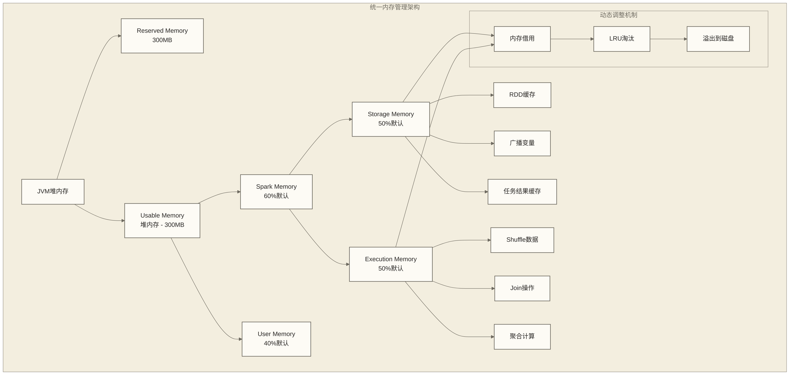
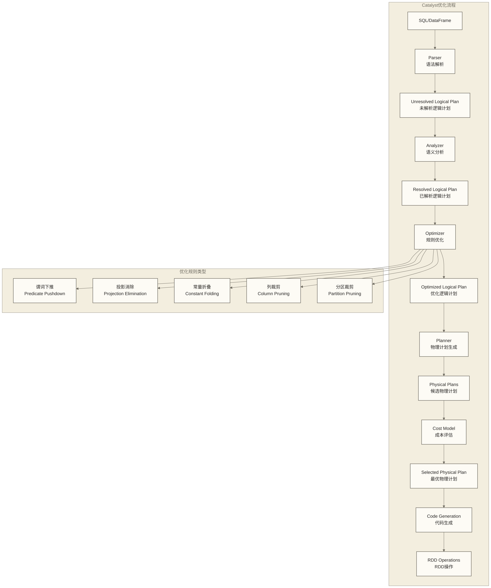
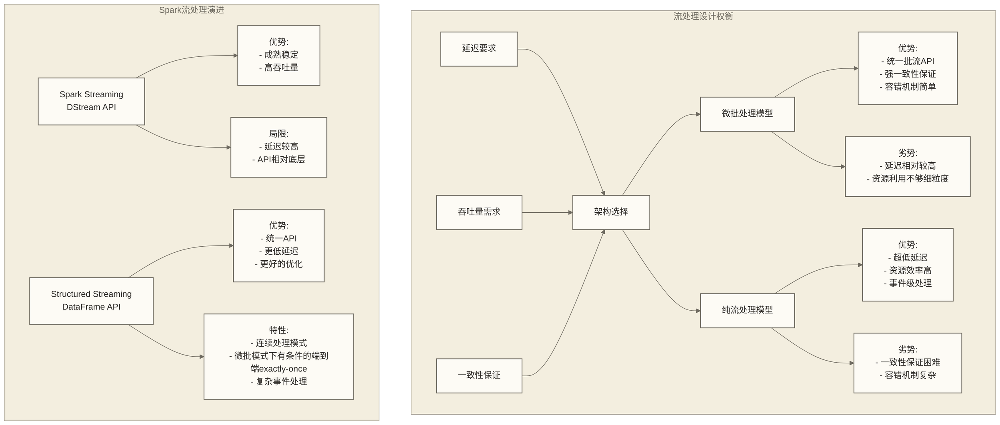
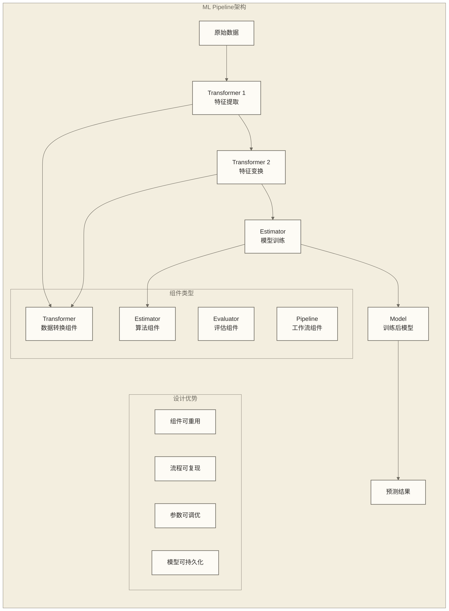
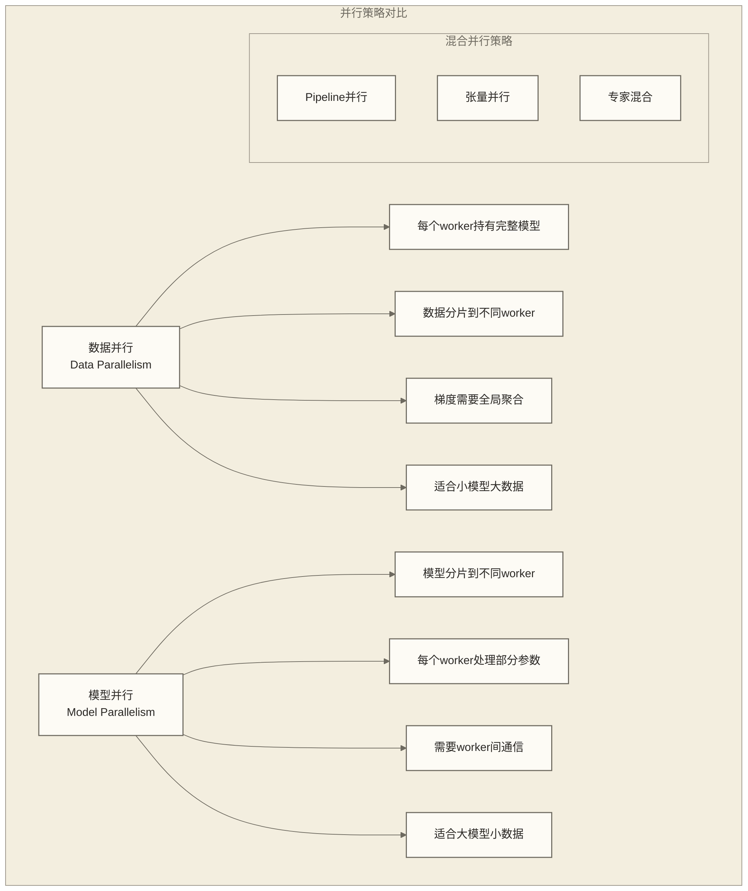
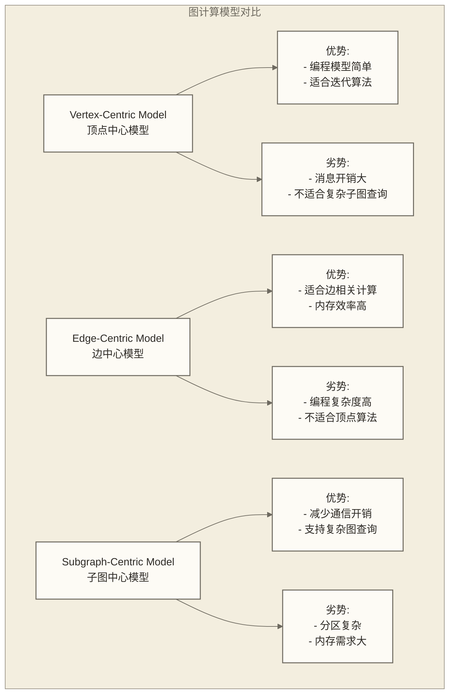
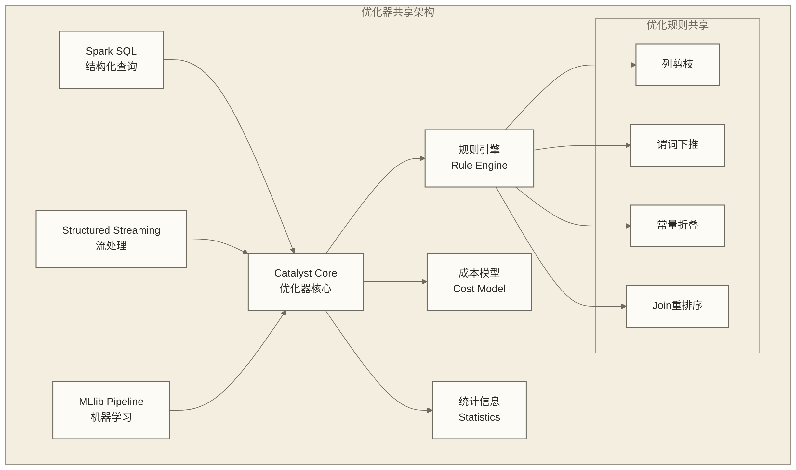
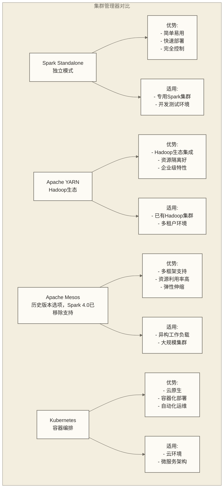
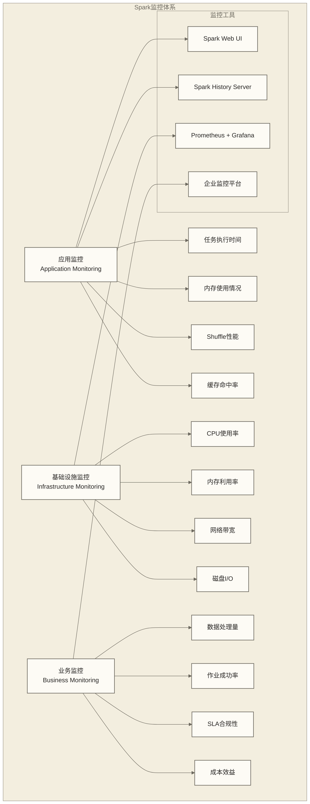

# Apache Spark生态架构深度解析

Apache Spark作为现代大数据处理的统一引擎，其生态架构设计体现了"统一性"和"模块化"的完美平衡。本文档深入分析Spark生态架构的设计理念、组件协同机制以及企业级应用的架构考量，帮助读者理解如何构建可靠、高效的大数据处理平台。

## 生态架构的设计哲学

### 统一计算引擎的愿景

Spark生态架构的核心理念是构建"一站式"的大数据处理平台。在Spark之前，大数据生态系统是高度碎片化的：批处理用Hadoop MapReduce，流处理用Storm，机器学习用Mahout，图计算用Giraph。这种碎片化带来了巨大的复杂性：

**技术栈复杂性**：
- 每个系统都有独特的API和编程模型
- 系统间数据传输需要复杂的ETL过程
- 运维团队需要掌握多种技术栈

**资源利用效率低**：
- 每个系统都需要独立的资源池
- 资源无法动态共享和调度
- 导致资源孤岛和利用率低下

**开发维护成本高**：
- 开发人员需要学习多种编程接口
- 系统集成复杂，调试困难
- 版本兼容性管理复杂

```mermaid
%%{init: {"theme":"base","themeVariables":{"fontFamily":"PingFang SC, -apple-system, Source Han Serif SC, serif","fontSize":"16px","background":"#FDFBF5","primaryColor":"#FDFBF5","primaryTextColor":"#2D2A26","primaryBorderColor":"#6E6A60","secondaryColor":"#E8EFE8","secondaryBorderColor":"#8FA890","secondaryTextColor":"#2D2A26","tertiaryColor":"#FDFBF5","tertiaryBorderColor":"#9A9488","tertiaryTextColor":"#6E6A60","lineColor":"#6E6A60","textColor":"#2D2A26","mainBkg":"#FDFBF5","nodeBorder":"#2D5A3D","clusterBkg":"#F3EEDF","clusterBorder":"#9A9488","edgeLabelBackground":"#FDFBF5"},"flowchart":{"htmlLabels":true,"curve":"basis","padding":20,"nodeSpacing":60,"rankSpacing":70,"useMaxWidth":false},"themeCSS":".node rect, .node polygon, .node circle { stroke-width: 1.5px; } .edgePath .path { stroke-width: 1.5px; } .cluster-label .nodeLabel, .cluster-label foreignObject { color: #2D2A26 !important; } .edgeLabel, .edgeLabel foreignObject { color: #2D2A26 !important; background-color: #FDFBF5; } .edgeLabel rect { fill: #FDFBF5; }"}}%%
graph TB
    classDef default fill:#FDFBF5,stroke:#6E6A60,color:#2D2A26,stroke-width:1.5px
    classDef startend fill:#2D2A26,stroke:#2D2A26,color:#FDFBF5,font-weight:bold
    classDef decision fill:#F6EAD8,stroke:#C08A1A,color:#2D2A26,font-weight:bold
    classDef hub fill:#3B5A80,stroke:#3B5A80,color:#FDFBF5,font-weight:bold
    classDef io fill:#E5EAF0,stroke:#3B5A80,color:#2D2A26
    classDef accent fill:#A6432C,stroke:#A6432C,color:#FDFBF5,font-weight:bold
    classDef storage fill:#F3EEDF,stroke:#9A9488,color:#2D2A26
    subgraph "传统碎片化架构"
        A1[MapReduce<br/>批处理] 
        A2[Storm<br/>流处理]
        A3[Mahout<br/>机器学习]
        A4[Giraph<br/>图计算]
        
        A1 --> B1[HDFS存储]
        A2 --> B2[消息队列]
        A3 --> B3[独立存储]
        A4 --> B4[图数据库]
        
        B1 -.-> ETL1[复杂ETL]
        B2 -.-> ETL1
        B3 -.-> ETL1
        B4 -.-> ETL1
        
        subgraph "问题"
            C1[技术栈复杂]
            C2[资源孤岛]
            C3[维护成本高]
        end
    end
    
    subgraph "Spark统一架构"
        D[Spark Core统一引擎]
        
        E1[Spark SQL<br/>结构化处理]
        E2[Spark Streaming<br/>流式处理] 
        E3[MLlib<br/>机器学习]
        E4[GraphX<br/>图计算]
        
        E1 --> D
        E2 --> D
        E3 --> D
        E4 --> D
        
        D --> F[统一存储层]
        
        subgraph "优势"
            G1[API统一]
            G2[资源共享]
            G3[维护简化]
        end
    end
    class A1,A2,A3,A4,B1,B2,B3,B4,ETL1,C1,C2,C3,D,E1,E2,E3,E4,F,G1,G2,G3 default
```

### 分层架构的设计智慧

Spark采用了经典的分层架构设计，每一层都有明确的职责和接口定义：

**应用层（Application Layer）**：
- 用户编写的具体业务逻辑
- 可以混合使用不同的Spark组件
- 通过统一的SparkSession进行资源管理

**API抽象层（API Abstraction Layer）**：
- 提供高级编程接口：SQL、DataFrame、Dataset
- 隐藏底层RDD的复杂性
- 支持多语言绑定：Scala、Java、Python、R

**执行引擎层（Execution Engine Layer）**：
- Catalyst查询优化器
- Tungsten执行引擎
- 代码生成和向量化执行

**调度与资源管理层（Scheduling & Resource Management）**：
- DAG调度器和任务调度器
- 与外部资源管理器集成（YARN、K8s；Mesos仅适用于仍支持它的历史版本，Spark 4.0已移除其支持）
- 动态资源分配和故障恢复

**存储抽象层（Storage Abstraction Layer）**：
- 支持多种数据源：HDFS、S3、数据库等
- 统一的数据读写接口
- 元数据管理和Schema演进支持

## Spark Core：生态系统的基石

### 核心引擎的职责边界

Spark Core作为整个生态系统的基石，其设计必须在功能完整性和模块独立性之间找到平衡。Core的核心职责包括：

**分布式计算抽象**：
- RDD：提供分布式数据集的编程抽象
- DAG：构建任务依赖图和执行计划
- 分区：数据分布和并行度管理

**任务调度与执行**：
- 两级调度架构：DAGScheduler和TaskScheduler
- 数据本地性优化
- 动态任务调度和负载均衡

**内存管理**：
- 统一内存管理器：平衡存储和执行内存
- 堆外内存支持
- 垃圾回收优化

**容错与恢复**：
- 基于血统的容错机制
- 检查点和持久化策略
- 推测执行和故障转移

### 内存管理的创新设计

Spark Core最重要的创新之一是统一内存管理器（Unified Memory Manager），它解决了传统固定内存分配的弊端：

**动态内存分配的优势**：

1. **自适应调整**：存储和执行内存可以根据实际需求动态借用
2. **避免内存浪费**：不再需要预先划分固定的内存区域
3. **提高资源利用率**：内存紧张时自动触发淘汰和溢出机制

**内存管理策略的演进**：
- **Spark 1.5之前**：固定的内存分区，容易导致资源浪费
- **Spark 1.6+**：统一内存管理，支持动态调整
- **Spark 3.0+**：增强的堆外内存管理，更好的GC控制

## Spark SQL：结构化数据处理革命

### Catalyst优化器的技术突破

Catalyst优化器是Spark SQL的核心，它将传统数据库的查询优化技术与大数据处理的特殊需求相结合，创造了一个可扩展的优化框架。

**优化规则的层次结构**：

**语法层优化**：
- 常量折叠：编译时计算常量表达式
- 死代码消除：移除不影响结果的计算
- 表达式简化：简化复杂的布尔和数学表达式

**逻辑层优化**：
- 谓词下推：将过滤条件推送到数据源
- 投影下推：只读取需要的列
- Join重排序：基于统计信息优化Join顺序

**物理层优化**：
- 分区裁剪：只扫描相关分区
- 索引利用：利用数据源的索引
- Join策略选择：根据数据大小选择合适的Join算法

### DataFrame和Dataset的设计理念

DataFrame和Dataset的引入标志着Spark从RDD时代向结构化数据处理时代的转变：

**DataFrame的价值主张**：
- **Schema信息**：提供结构化数据的类型信息，支持查询优化
- **SQL兼容**：支持标准SQL语法，降低学习成本
- **性能优化**：通过Catalyst优化器获得更好的性能
- **多语言支持**：统一的接口支持多种编程语言

**Dataset的类型安全**：
- **编译时检查**：在编译时发现类型错误
- **代码提示**：IDE可以提供更好的代码补全
- **运行时优化**：结合类型信息进行深度优化
- **函数式编程**：支持类型安全的函数式操作

**API设计的权衡考虑**：

| 特性 | RDD | DataFrame | Dataset |
|------|-----|----------|---------|
| **类型安全** | 编译时 | 运行时 | 编译时 |
| **性能优化** | 手动 | 自动 | 自动 |
| **开发效率** | 低 | 高 | 高 |
| **内存效率** | 一般 | 高 | 高 |
| **调试难度** | 低 | 中 | 低 |

## Spark Streaming：流处理的演进之路

### 流处理模型的设计挑战

实时流处理面临的核心挑战在于如何在延迟、吞吐量、一致性和容错性之间找到平衡。Spark采用了独特的微批处理模型来应对这些挑战。

### DStream vs Structured Streaming

**DStream的设计哲学**：
DStream（离散化流）将连续的数据流抽象为一系列微小的批次，每个批次是一个RDD。这种设计有以下考虑：

- **统一性**：流处理和批处理使用相同的计算引擎
- **容错性**：利用RDD的容错机制实现流处理的容错
- **一致性**：通过批次边界天然支持强一致性

**Structured Streaming的进化**：
Structured Streaming在DStream基础上进一步抽象，将流数据视为不断增长的表：

- **编程模型统一**：使用DataFrame/Dataset API处理流数据
- **端到端保证**：微批模式在使用可重放数据源、可靠检查点及支持相应提交语义的接收端等条件下，可实现端到端exactly-once；不能对任意源和接收端作无条件保证
- **延迟优化**：连续处理模式在支持的查询、数据源和接收端范围内可降低延迟，但采用at-least-once语义；毫秒级延迟取决于工作负载与部署条件
- **复杂查询**：支持流表Join、聚合、窗口等复杂操作

## MLlib：分布式机器学习的工程化实践

### ML Pipeline的设计模式

MLlib采用了Pipeline设计模式，这个设计模式源自scikit-learn，但在分布式环境下有了新的含义和挑战。

**Pipeline设计的工程价值**：

**组件化设计**：
- 每个组件都有明确的输入输出接口
- 组件可以独立测试和优化
- 支持组件的替换和升级

**参数管理**：
- 统一的参数设置和管理机制
- 支持参数网格搜索和自动调优
- 参数版本控制和追踪

**模型生命周期集成**：
- MLlib支持模型训练、验证及模型持久化，可作为部署流程的组成部分
- 模型版本管理和A/B测试需结合外部模型管理或服务平台实现
- 模型性能监控和漂移检测需结合外部监控及评估流程实现

### 分布式算法的实现挑战

在分布式环境下实现机器学习算法面临独特的挑战：

**数据分布挑战**：
- 数据倾斜可能导致训练不平衡
- 特征分布的统计信息需要全局计算
- 梯度计算需要考虑数据分区的影响

**通信开销优化**：
- 参数服务器模式 vs AllReduce模式
- 梯度压缩和稀疏化技术
- 异步更新 vs 同步更新的权衡

**收敛性保证**：
- 分布式环境下算法收敛性的理论保证
- 学习率调度策略的分布式适配
- 早停机制和收敛判断标准

**模型并行 vs 数据并行**：

## GraphX：图计算的分布式实现

### 图数据的分布式挑战

图数据的分布式处理面临独特的挑战，因为图的连通性使得数据无法简单地进行分区：

**图分割问题**：
- **边分割 vs 顶点分割**：不同的分割策略影响通信开销
- **负载均衡**：保证各分区的计算和存储负载均衡
- **局部性优化**：最小化跨分区的边数量

**内存效率问题**：
- 图数据的存储格式优化（CSR、COO等）
- 活跃顶点集合的管理
- 消息传递的内存开销控制

**计算模型的选择**：

### Pregel计算模型的实现

GraphX采用了Pregel计算模型，这是一个基于消息传递的分布式图计算框架：

**计算模型的核心要素**：
1. **超步（Superstep）**：计算以超步为单位，每个超步内所有顶点并行计算
2. **消息传递**：顶点间通过消息进行通信，消息在下一个超步中处理
3. **终止条件**：当没有消息需要发送或达到最大迭代次数时计算停止；达到迭代上限并不代表算法已经收敛

**实现优化技术**：
- **消息合并**：相同目标顶点的消息可以合并，减少网络开销
- **增量计算**：只对活跃顶点进行计算，跳过未发生变化的部分
- **检查点机制**：定期保存计算状态，支持故障恢复

## 组件间协同机制

### 数据格式的统一化

Spark生态系统的各个组件通过统一的数据格式实现无缝协作：

**内存格式统一**：
- **Tungsten内存格式**：紧凑的二进制格式，支持向量化操作
- **Arrow格式兼容**：与外部系统的数据交换标准
- **堆外内存管理**：减少GC压力，提高性能

**存储格式优化**：
- **列式存储**：Parquet、ORC等格式的原生支持
- **压缩算法**：智能压缩算法选择
- **Schema演进**：支持数据Schema的向前兼容

### 优化器的共享机制

Catalyst优化器不仅服务于Spark SQL，还为其他组件提供优化能力：

### 执行引擎的复用

各个组件都基于相同的执行引擎，这带来了多重好处：

**任务调度统一**：
- 同一个DAG调度器管理所有类型的任务
- 统一的资源分配和负载均衡策略
- 一致的容错和恢复机制

**内存管理统一**：
- 所有组件共享统一内存管理器
- 动态内存分配和回收
- 一致的溢出和缓存策略

**网络通信统一**：
- 统一的Shuffle服务
- 一致的序列化和压缩策略
- 统一的网络传输优化

## 部署架构与集成模式

### 集群管理器的选择策略

Spark支持多种集群管理器，每种都有其适用场景：

### 存储系统的集成策略

Spark的存储集成体现了"存储计算分离"的现代架构理念：

**传统存储集成**：
- **HDFS**：与Hadoop生态的紧密集成，支持数据本地性
- **HBase**：NoSQL数据库的实时读写
- **Hive**：数据仓库的元数据和存储集成

**云存储集成**：
- **Amazon S3**：云端对象存储，支持弹性扩缩容
- **Azure Blob Storage**：微软云存储服务
- **Google Cloud Storage**：谷歌云存储平台

**现代存储格式**：
- **Delta Lake**：支持ACID事务的数据湖格式
- **Apache Iceberg**：Netflix开源的表格式
- **Apache Hudi**：Uber开源的增量数据处理平台

## 性能优化的系统性考虑

### 跨组件优化策略

由于Spark各组件共享底层引擎，优化需要从系统角度进行考虑：

**数据流优化**：
- **避免不必要的序列化**：在组件间传递数据时保持内存格式
- **缓存共享**：多个组件可以共享缓存的数据
- **Pipeline融合**：将多个组件的操作合并到同一个执行计划中

**资源调度优化**：
- **动态资源分配**：根据工作负载自动调整资源
- **资源隔离**：不同类型作业的资源隔离策略
- **优先级调度**：结合集群管理器和调度策略实现作业优先级管理；SLA达成取决于容量、工作负载、资源隔离和运维保障，不能由优先级调度单独保证

**存储优化**：
- **数据分区策略**：根据查询模式优化分区
- **压缩算法选择**：根据数据特征选择压缩算法
- **索引和统计信息**：维护查询优化所需的元信息

### 监控和可观测性

企业级部署需要完善的监控体系：

## 企业级应用的架构考量

### 安全性设计

企业级Spark部署必须考虑全方位的安全性：

**认证和授权**：
- **Kerberos集成**：与企业域服务集成
- **LDAP支持**：统一用户管理
- **细粒度权限控制**：表级、列级、行级权限

**数据保护**：
- **传输加密**：SSL/TLS加密网络通信
- **存储加密**：数据静态加密存储
- **脱敏处理**：敏感数据的动态脱敏

**审计和合规**：
- **操作审计**：记录所有数据访问操作
- **数据血缘**：跟踪数据的来源和流向
- **合规报告**：满足GDPR、CCPA等法规要求

### 高可用性架构

企业级部署需要考虑各个层面的高可用性：

**应用层高可用**：
- **作业重试机制**：自动重试失败的作业
- **检查点恢复**：从检查点恢复流处理作业
- **多版本部署**：支持蓝绿部署和灰度发布

**集群层高可用**：
- **多主模式**：避免单点故障
- **自动故障转移**：快速切换到备用节点
- **数据副本管理**：保证数据的冗余存储

**基础设施高可用**：
- **多数据中心部署**：跨地域的容灾机制
- **网络冗余**：多路网络连接
- **存储高可用**：分布式存储系统的可靠性

### 多租户和资源隔离

企业环境中通常需要支持多个团队或项目共享Spark集群：

**资源隔离机制**：
- **队列管理**：FAIR或FIFO调度策略
- **资源配额**：限制每个租户的资源使用
- **优先级调度**：支持不同优先级的作业

**数据隔离策略**：
- **命名空间隔离**：不同租户使用独立的命名空间
- **访问权限控制**：基于角色的数据访问控制
- **数据加密隔离**：不同租户使用不同的加密密钥

## 技术发展趋势与未来展望

### 云原生化趋势

Spark正在向云原生方向发展，以适应现代云计算环境：

**容器化部署**：
- **Docker镜像优化**：精简镜像大小，提高启动速度
- **Kubernetes原生支持**：与K8s调度器深度集成
- **Serverless计算**：支持按需计算，降低成本

**云服务集成**：
- **托管服务**：AWS EMR、Azure HDInsight、GCP Dataproc
- **自动扩缩容**：根据负载自动调整资源
- **成本优化**：Spot实例、预留实例的智能使用

### 硬件加速支持

新硬件技术的发展为Spark带来了新的优化机会：

**GPU加速**：
- **机器学习加速**：RAPIDS cuDF与Spark的集成
- **CUDA内核**：直接调用CUDA进行计算加速
- **内存管理**：GPU内存与主内存的统一管理

**新型存储技术**：
- **NVMe SSD**：超高速存储设备的优化支持
- **持久化内存**：Intel Optane等新技术的支持
- **远程存储**：高速网络存储的优化

### 自动化和智能化

Spark正在向更智能的方向发展：

**自动优化**：
- **自适应查询执行**：根据运行时统计信息调整执行计划
- **参数自动调优**：基于历史数据自动优化配置参数
- **资源自动分配**：智能预测资源需求

**机器学习驱动优化**：
- **查询计划学习**：从历史查询中学习最优执行策略
- **异常检测**：自动识别性能异常和资源瓶颈
- **预测性维护**：预测系统故障和性能问题

## 学习建议与实践路径

### 渐进式学习策略

**第一阶段：基础理解**
1. 掌握Spark Core的核心概念
2. 理解各组件的职责分工
3. 学习基本的API使用

**第二阶段：深入实践**
1. 构建完整的数据处理流水线
2. 学习性能调优技巧
3. 掌握监控和故障排查

**第三阶段：架构设计**
1. 设计企业级Spark架构
2. 考虑安全性和高可用性
3. 规划多租户和资源管理

**第四阶段：生产优化**
1. 深度性能调优
2. 自动化运维实践
3. 成本优化策略

### 实践项目建议

**项目1：统一数据平台构建**
- 构建支持批流一体的数据处理平台
- 集成多种数据源和存储系统
- 实现统一的数据服务接口

**项目2：实时推荐系统**
- 使用Spark Streaming处理用户行为数据
- 使用MLlib训练推荐模型
- 实现实时模型更新和预测服务

**项目3：企业级数据湖**
- 基于Delta Lake构建现代数据湖
- 实现数据血缘和元数据管理
- 提供自服务数据分析能力

## 总结

Spark生态架构的成功在于其"统一性"和"模块化"的完美结合。通过共享底层计算引擎，各个组件可以无缝协作，同时又保持了各自的特色和优势。这种设计不仅简化了技术栈，还提高了开发效率和系统性能。

**核心设计理念**：
- **统一计算引擎**：所有组件共享相同的执行基础
- **分层架构**：清晰的职责分工和接口定义
- **优化器共享**：跨组件的查询优化能力
- **存储抽象**：支持多种存储系统的统一接口

**企业价值**：
- **降低复杂性**：统一的技术栈减少了学习和维护成本
- **提高效率**：组件间无缝协作，避免数据搬运
- **增强可靠性**：统一的容错和监控机制
- **支持创新**：快速构建复杂的数据处理应用

理解Spark生态架构的设计理念，有助于我们更好地使用各个组件，设计高效的大数据处理方案，并在企业环境中成功部署和运维Spark集群。随着云计算和新硬件技术的发展，Spark生态系统将继续演进，为大数据处理带来更多创新和价值。

## 相关文档链接

- [[【技术与工具】/Spark/02-Spark核心特性|Spark核心特性]] - 理解生态架构的技术基础
- [[【技术与工具】/Spark/09-Spark SQL基础|Spark SQL]] - SQL组件详细使用
- [[【技术与工具】/Spark/14-Spark Streaming流处理|Spark Streaming流处理]] - 流处理组件深入
- [[【技术与工具】/Spark/16-MLlib机器学习|MLlib机器学习]] - 机器学习组件实践
- [[【技术与工具】/Spark/17-GraphX图计算|GraphX图计算]] - 图计算组件应用