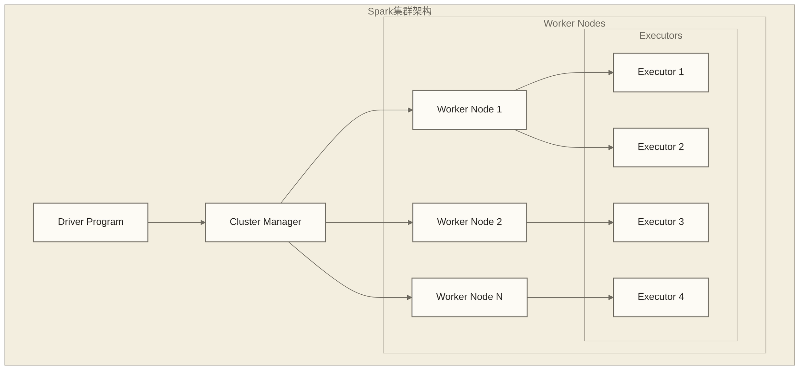
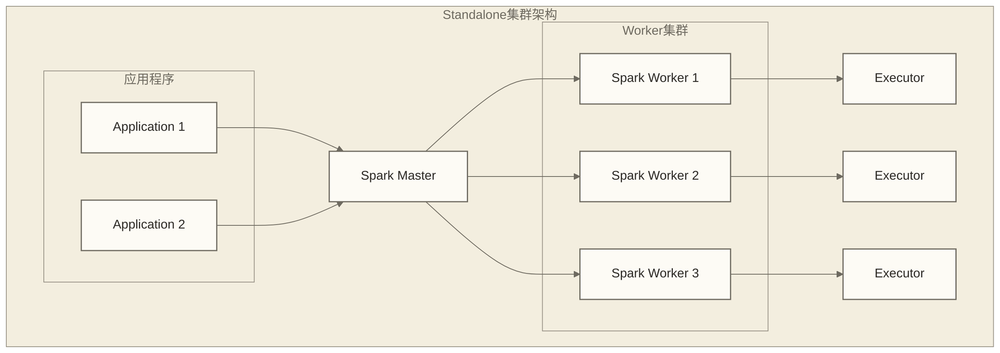
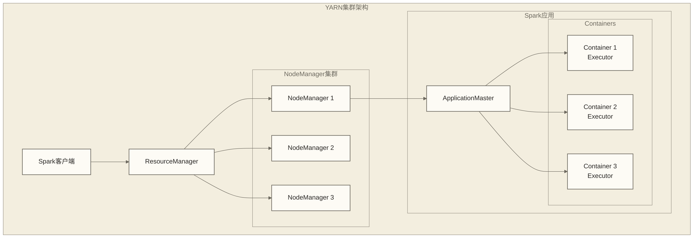
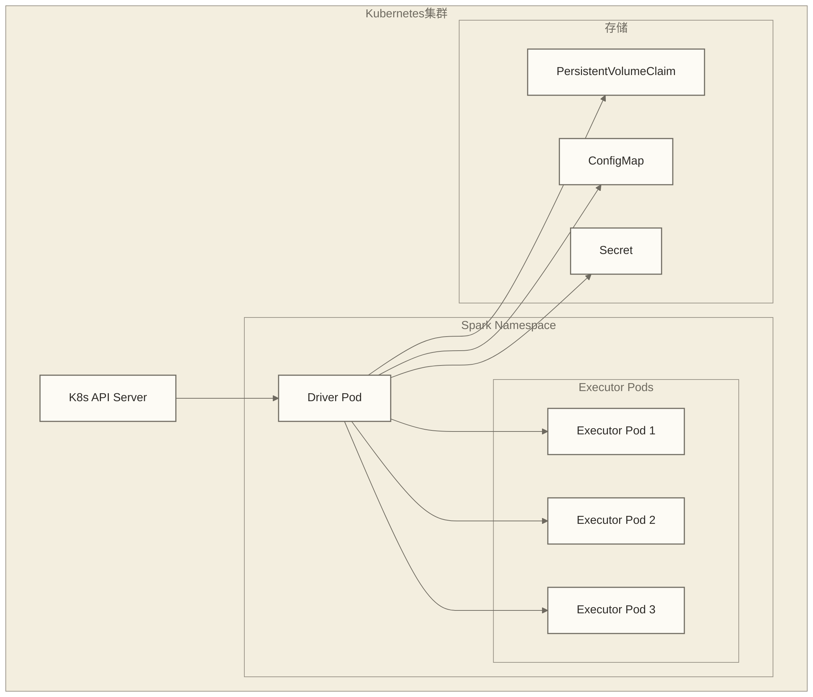
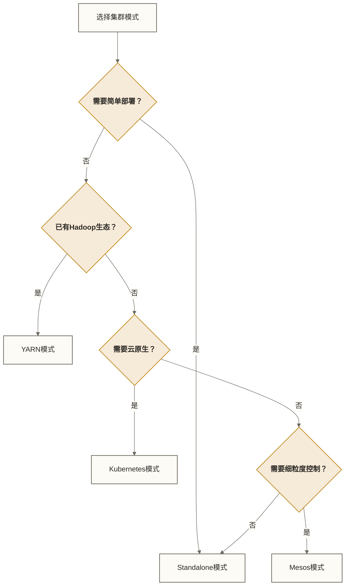

# Spark集群模式详解

## 概述

Apache Spark支持多种集群部署模式，每种模式都有其独特的架构设计和适用场景。理解这些集群模式对于在生产环境中部署和管理Spark应用至关重要。

## 集群模式架构

### Spark集群组件



### 核心组件说明

| 组件 | 作用 | 职责 |
|------|------|------|
| Driver | 驱动程序 | 执行main函数，创建SparkContext，调度任务 |
| Cluster Manager | 集群管理器 | 资源分配、节点管理 |
| Worker Node | 工作节点 | 运行Executor，管理本地资源 |
| Executor | 执行器 | 执行任务，缓存数据 |

## 1. Standalone集群模式

### 架构特点

Spark Standalone是Spark自带的简单集群管理器，提供了完整的分布式计算能力。



### 配置示例

#### Master节点配置

```bash
# spark-env.sh
export SPARK_MASTER_HOST=master-node
export SPARK_MASTER_PORT=7077
export SPARK_MASTER_WEBUI_PORT=8080
export SPARK_WORKER_MEMORY=4g
export SPARK_WORKER_CORES=4
```

#### Worker节点配置

```bash
# 启动Worker
./sbin/start-slave.sh spark://master-node:7077

# 或使用配置文件
# slaves文件
worker1
worker2
worker3
```

#### 高可用配置

```scala
// 连接多个Standalone Master的应用端配置；此片段不包含Master端ZooKeeper高可用配置
val conf = new SparkConf()
  .setAppName("StandaloneHA")
  .setMaster("spark://master1:7077,master2:7077")
  .set("spark.sql.adaptive.enabled", "true")

val spark = SparkSession.builder()
  .config(conf)
  .getOrCreate()
```

### 优缺点分析

**优点：**
- 部署简单，无需额外软件
- 完全由Spark控制
- 支持高可用

**缺点：**
- 功能相对简单
- 无法与其他框架共享资源
- 资源利用率可能不高

## 2. YARN集群模式

### 架构原理

YARN（Yet Another Resource Negotiator）是Hadoop的资源管理系统，支持两种部署模式。



### Client模式配置

```scala
// Client模式：Driver在客户端运行
val conf = new SparkConf()
  .setAppName("YarnClientMode")
  .setMaster("yarn")
  .set("spark.submit.deployMode", "client")
  .set("spark.executor.memory", "2g")
  .set("spark.executor.cores", "2")
  .set("spark.executor.instances", "4")

val spark = SparkSession.builder()
  .config(conf)
  .getOrCreate()
```

### Cluster模式配置

```bash
# 提交到YARN Cluster模式
spark-submit \
  --class com.example.SparkApp \
  --master yarn \
  --deploy-mode cluster \
  --executor-memory 2g \
  --executor-cores 2 \
  --num-executors 4 \
  --queue production \
  my-spark-app.jar
```

### 资源队列配置

```xml
<!-- capacity-scheduler.xml：队列配置片段，尚未列出所有队列容量 -->
<configuration>
  <property>
    <name>yarn.scheduler.capacity.resource-calculator</name>
    <value>org.apache.hadoop.yarn.util.resource.DominantResourceCalculator</value>
  </property>
  
  <property>
    <name>yarn.scheduler.capacity.root.queues</name>
    <value>default,spark,production</value>
  </property>
  
  <property>
    <name>yarn.scheduler.capacity.root.spark.capacity</name>
    <value>50</value>
  </property>
</configuration>
```

### 动态资源分配

```scala
val conf = new SparkConf()
  .set("spark.dynamicAllocation.enabled", "true")
  .set("spark.dynamicAllocation.minExecutors", "1")
  .set("spark.dynamicAllocation.maxExecutors", "20")
  .set("spark.dynamicAllocation.initialExecutors", "2")
  .set("spark.dynamicAllocation.executorIdleTimeout", "60s")
  .set("spark.shuffle.service.enabled", "true")
```

## 3. Kubernetes集群模式

### 现代容器化部署

Kubernetes为Spark提供了云原生的部署方式。



### Kubernetes部署配置

```yaml
# spark-rbac.yaml
apiVersion: v1
kind: ServiceAccount
metadata:
  name: spark
  namespace: spark-namespace
---
apiVersion: rbac.authorization.k8s.io/v1
kind: ClusterRoleBinding
metadata:
  name: spark-role
roleRef:
  apiGroup: rbac.authorization.k8s.io
  kind: ClusterRole
  name: edit
subjects:
- kind: ServiceAccount
  name: spark
  namespace: spark-namespace
```

### 提交Spark应用到Kubernetes

```bash
# 构建Spark镜像
./bin/docker-image-tool.sh -r docker.io/myrepo -t v3.4.0 build

# 提交应用
spark-submit \
  --master k8s://https://kubernetes-api-server:443 \
  --deploy-mode cluster \
  --name spark-pi \
  --class org.apache.spark.examples.SparkPi \
  --conf spark.executor.instances=3 \
  --conf spark.kubernetes.container.image=myrepo/spark:v3.4.0 \
  --conf spark.kubernetes.authenticate.driver.serviceAccountName=spark \
  --conf spark.kubernetes.namespace=spark-namespace \
  local:///opt/spark/examples/jars/spark-examples_2.12-3.4.0.jar
```

### Kubernetes资源配置

```yaml
# spark-config.yaml
apiVersion: v1
kind: ConfigMap
metadata:
  name: spark-config
data:
  spark-defaults.conf: |
    spark.kubernetes.container.image.pullPolicy=Always
    spark.kubernetes.executor.deleteOnTermination=true
    spark.sql.adaptive.enabled=true
    spark.sql.adaptive.coalescePartitions.enabled=true
    spark.serializer=org.apache.spark.serializer.KryoSerializer
```

## 4. Mesos集群模式

### 架构概述

Apache Mesos提供了细粒度的资源调度能力。

```scala
// Mesos集群配置
val conf = new SparkConf()
  .setAppName("MesosApp")
  .setMaster("mesos://mesos-master:5050")
  .set("spark.executor.memory", "2g")
  .set("spark.mesos.coarse", "true")  // 粗粒度模式

val spark = SparkSession.builder()
  .config(conf)
  .getOrCreate()
```

### 细粒度vs粗粒度模式

```scala
// 历史Mesos细粒度模式示例；是否支持及默认模式取决于目标Spark版本
val conf = new SparkConf()
  .set("spark.mesos.coarse", "false")
  .set("spark.mesos.executor.memoryFraction", "0.8")

// 粗粒度模式
val conf = new SparkConf()
  .set("spark.mesos.coarse", "true")
  .set("spark.executor.instances", "4")
```

## 集群模式对比

### 功能特性对比

| 特性 | Standalone | YARN | Kubernetes | Mesos |
|------|------------|------|------------|-------|
| 部署复杂度 | 简单 | 中等 | 复杂 | 复杂 |
| 资源隔离 | 基础 | 强 | 强 | 强 |
| 多租户 | 有限 | 优秀 | 优秀 | 优秀 |
| 动态分配 | 支持 | 优秀 | 支持 | 支持 |
| 容错性 | 好 | 优秀 | 优秀 | 优秀 |
| 监控 | 基础 | 丰富 | 丰富 | 丰富 |

### 选择指导



## 性能优化配置

### 通用优化参数

```scala
val conf = new SparkConf()
  // 序列化优化
  .set("spark.serializer", "org.apache.spark.serializer.KryoSerializer")
  .set("spark.kryoserializer.buffer.max", "256m")
  
  // 网络优化
  .set("spark.network.timeout", "300s")
  .set("spark.rpc.askTimeout", "300s")
  
  // 内存优化
  .set("spark.executor.memoryFraction", "0.8")
  .set("spark.storage.memoryFraction", "0.5")
  
  // 调度优化
  .set("spark.locality.wait", "3s")
  .set("spark.scheduler.mode", "FAIR")
```

### YARN特定优化

```bash
# Spark应用提交参数片段；不是yarn-site.xml配置，运行时还需指定应用入口
export SPARK_CONF_DIR=/etc/spark/conf
spark-submit \
  --conf spark.yarn.am.memory=1g \
  --conf spark.yarn.am.cores=2 \
  --conf spark.yarn.executor.memoryOverhead=512m \
  --conf spark.yarn.driver.memoryOverhead=512m \
  --conf spark.yarn.maxAppAttempts=3
```

### Kubernetes特定优化

```yaml
# 资源限制
spec:
  containers:
  - name: spark-executor
    resources:
      requests:
        memory: "2Gi"
        cpu: "1"
      limits:
        memory: "4Gi"
        cpu: "2"
```

## 监控和故障排查

### 集群监控指标

```scala
// 获取集群状态信息
val spark = SparkSession.builder().getOrCreate()
val sc = spark.sparkContext

// 监控指标
println(s"Application ID: ${sc.applicationId}")
println(s"Master URL: ${sc.master}")
println(s"Deploy Mode: ${sc.deployMode}")
println(s"Executor memory status (host:port): ${sc.getExecutorMemoryStatus}")
```

### 常见问题诊断

```bash
# YARN应用日志查看
yarn logs -applicationId application_1234567890_0001

# Kubernetes Pod日志
kubectl logs spark-driver-pod -n spark-namespace

# Standalone Master Web UI页面；不是应用REST接口
curl http://master-node:8080/
```

## 实战案例

### 多环境部署策略

```python
# Python环境配置脚本
import os
from pyspark.sql import SparkSession

def create_spark_session(env="local"):
    if env == "local":
        return SparkSession.builder \
            .appName("LocalDevelopment") \
            .master("local[*]") \
            .getOrCreate()
    
    elif env == "yarn":
        return SparkSession.builder \
            .appName("YarnProduction") \
            .master("yarn") \
            .config("spark.submit.deployMode", "cluster") \
            .config("spark.executor.memory", "4g") \
            .config("spark.executor.instances", "10") \
            .getOrCreate()
    
    elif env == "k8s":
        return SparkSession.builder \
            .appName("K8sProduction") \
            .master("k8s://https://kubernetes-api:443") \
            .config("spark.kubernetes.container.image", "myrepo/spark:latest") \
            .config("spark.executor.instances", "5") \
            .getOrCreate()

# 使用
spark = create_spark_session(os.getenv("SPARK_ENV", "local"))
```

## 最佳实践总结

### 部署建议

1. **开发环境**：使用Local或Standalone模式
2. **测试环境**：使用与生产相同的集群模式
3. **生产环境**：根据现有基础设施选择YARN或Kubernetes

### 配置优化

1. **资源规划**：合理分配内存和CPU资源
2. **网络配置**：优化网络超时和重试机制
3. **存储优化**：选择合适的存储级别和格式

### 运维管理

1. **监控告警**：建立完善的监控体系
2. **日志管理**：集中化日志收集和分析
3. **故障恢复**：制定故障恢复预案

## 相关链接

- [[【技术与工具】/Spark/03-Spark生态架构|Spark生态]]
- [[【技术与工具】/Spark/05-Spark安装配置|Spark安装配置]]
- [[【技术与工具】/Hadoop/09-YARN资源管理架构|Hadoop/YARN资源]]
- Kubernetes/容器编排

---

> [!tip] 学习建议
> 建议在实际环境中测试不同集群模式，理解各自的优势和限制，为生产环境选择最合适的部署方案。