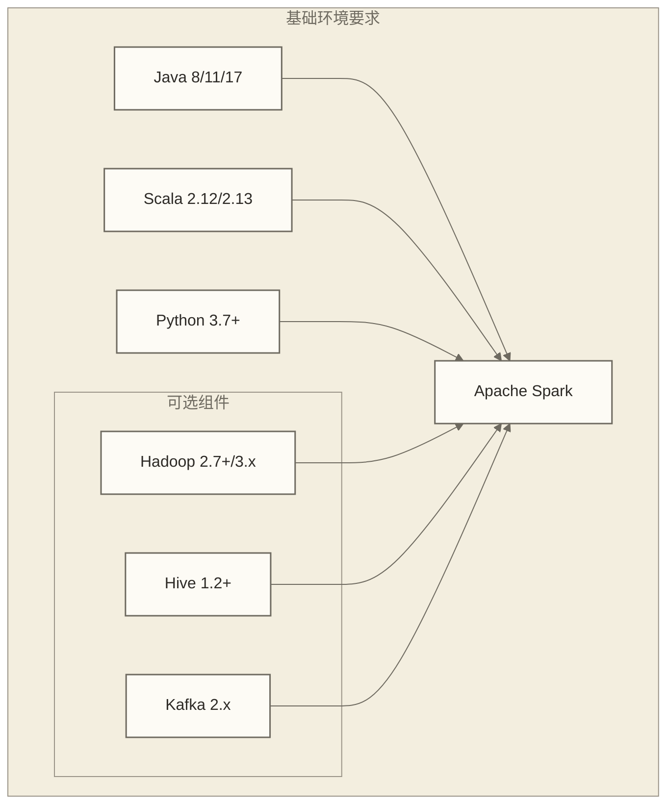
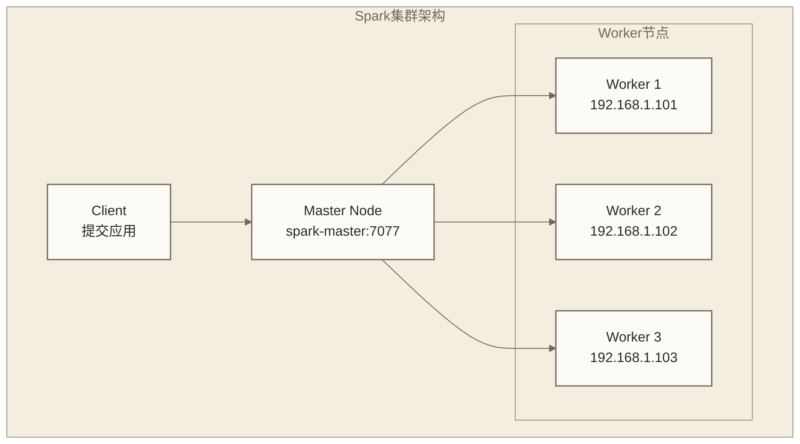

# Spark安装配置完全指南

## 概述

Apache Spark的正确安装和配置是构建高效大数据处理平台的基础。本指南介绍Spark在不同环境下的安装配置步骤和配置位置，单机示例限定于使用apt-get的Linux amd64环境及OpenJDK 11；集群部分是配置参考，尚不构成完整的生产部署流程。

## 系统要求

### 硬件要求

| 环境类型 | CPU | 内存 | 存储 | 网络 |
|----------|-----|------|------|------|
| 开发环境 | 2核+ | 4GB+ | 20GB+ | 1Gbps |
| 测试环境 | 4核+ | 8GB+ | 100GB+ | 1Gbps |
| 生产环境 | 8核+ | 32GB+ | 500GB+ | 10Gbps |

### 软件依赖



## 单机安装配置

### 1. Java环境配置

```bash
# 安装OpenJDK 11
sudo apt-get update
sudo apt-get install openjdk-11-jdk

# 配置JAVA_HOME
echo 'export JAVA_HOME=/usr/lib/jvm/java-11-openjdk-amd64' >> ~/.bashrc
echo 'export PATH=$JAVA_HOME/bin:$PATH' >> ~/.bashrc
source ~/.bashrc

# 验证安装
java -version
```

### 2. Scala环境配置（可选）

```bash
# 下载并安装Scala
wget https://downloads.lightbend.com/scala/2.12.15/scala-2.12.15.tgz
tar -xzf scala-2.12.15.tgz
sudo mv scala-2.12.15 /opt/scala

# 配置环境变量
echo 'export SCALA_HOME=/opt/scala' >> ~/.bashrc
echo 'export PATH=$SCALA_HOME/bin:$PATH' >> ~/.bashrc
source ~/.bashrc

# 验证安装
scala -version
```

### 3. Spark安装

```bash
# 下载Spark
wget https://archive.apache.org/dist/spark/spark-3.4.0/spark-3.4.0-bin-hadoop3.tgz

# 解压安装
tar -xzf spark-3.4.0-bin-hadoop3.tgz
sudo mv spark-3.4.0-bin-hadoop3 /opt/spark

# 配置环境变量
echo 'export SPARK_HOME=/opt/spark' >> ~/.bashrc
echo 'export PATH=$SPARK_HOME/bin:$SPARK_HOME/sbin:$PATH' >> ~/.bashrc
echo 'export PYSPARK_PYTHON=python3' >> ~/.bashrc
source ~/.bashrc

# 验证安装
spark-shell --version
```

### 4. 基础配置文件

#### spark-env.sh配置

```bash
# 复制配置模板
cd $SPARK_HOME/conf
cp spark-env.sh.template spark-env.sh

# 编辑配置文件
cat >> spark-env.sh << 'EOF'
#!/usr/bin/env bash

# Java环境
export JAVA_HOME=/usr/lib/jvm/java-11-openjdk-amd64

# Spark配置
export SPARK_MASTER_HOST=localhost
export SPARK_MASTER_PORT=7077
export SPARK_MASTER_WEBUI_PORT=8080

# Worker配置
export SPARK_WORKER_CORES=2
export SPARK_WORKER_MEMORY=2g
export SPARK_WORKER_PORT=7078
export SPARK_WORKER_WEBUI_PORT=8081

# Driver和Executor配置
export SPARK_DRIVER_MEMORY=1g
export SPARK_EXECUTOR_MEMORY=1g

# Python环境
export PYSPARK_PYTHON=python3
export PYSPARK_DRIVER_PYTHON=python3

# 历史服务器
export SPARK_HISTORY_OPTS="-Dspark.history.ui.port=18080 -Dspark.history.fs.logDirectory=/tmp/spark-events"
EOF
```

#### spark-defaults.conf配置

```bash
cp spark-defaults.conf.template spark-defaults.conf

cat >> spark-defaults.conf << 'EOF'
# Spark应用配置
spark.master                     local[*]
spark.eventLog.enabled           true
spark.eventLog.dir               /tmp/spark-events
spark.history.fs.logDirectory    /tmp/spark-events

# 序列化配置
spark.serializer                 org.apache.spark.serializer.KryoSerializer
spark.kryoserializer.buffer.max  256m

# 网络配置
spark.network.timeout            300s
spark.rpc.askTimeout            300s

# SQL配置
spark.sql.adaptive.enabled                    true
spark.sql.adaptive.coalescePartitions.enabled true
spark.sql.hive.metastore.sharedPrefixes       com.mysql.jdbc,org.postgresql,com.microsoft.sqlserver,oracle.jdbc

# UI配置
spark.ui.port                    4040
spark.ui.retainedJobs            1000
spark.ui.retainedStages          1000
EOF
```

#### log4j2.properties配置

```bash
cp log4j2.properties.template log4j2.properties

# 调整日志级别
sed -i 's/rootLogger.level = info/rootLogger.level = warn/' log4j2.properties
```

### 5. 启动验证

```bash
# 创建日志目录
mkdir -p /tmp/spark-events

# 启动Spark Shell测试
spark-shell

# 在Spark Shell中测试
scala> val data = spark.range(1000).toDF("number")
scala> data.count()
scala> data.show()
scala> :quit

# 启动Python Shell测试
pyspark

# 在PySpark中测试
>>> df = spark.range(1000).toDF("number")
>>> df.count()
>>> df.show()
>>> exit()
```

## 集群安装配置

### Standalone集群部署

#### 1. 集群规划



#### 2. 主节点配置

```bash
# spark-env.sh (Master节点)
cat >> $SPARK_HOME/conf/spark-env.sh << 'EOF'
# Master配置
export SPARK_MASTER_HOST=spark-master
export SPARK_MASTER_PORT=7077
export SPARK_MASTER_WEBUI_PORT=8080

# 集群配置
export SPARK_WORKER_INSTANCES=1
export SPARK_WORKER_CORES=8
export SPARK_WORKER_MEMORY=16g

# 高可用配置（可选）
export SPARK_DAEMON_JAVA_OPTS="-Dspark.deploy.recoveryMode=ZOOKEEPER -Dspark.deploy.zookeeper.url=zk1:2181,zk2:2181,zk3:2181 -Dspark.deploy.zookeeper.dir=/spark"
EOF

# slaves文件配置
cat > $SPARK_HOME/conf/slaves << 'EOF'
worker1
worker2
worker3
EOF
```

#### 3. Worker节点配置

```bash
# 在所有Worker节点执行
# spark-env.sh (Worker节点)
cat >> $SPARK_HOME/conf/spark-env.sh << 'EOF'
# Worker特定配置
export SPARK_MASTER_HOST=spark-master
export SPARK_WORKER_CORES=8
export SPARK_WORKER_MEMORY=16g
export SPARK_WORKER_PORT=7078
export SPARK_WORKER_WEBUI_PORT=8081

# 本地目录配置
export SPARK_LOCAL_DIRS=/data1/spark-tmp,/data2/spark-tmp
export SPARK_WORKER_DIR=/data1/spark-work
EOF

# 创建工作目录
sudo mkdir -p /data1/spark-tmp /data2/spark-tmp /data1/spark-work
sudo chown $USER:$USER /data1/spark-* /data2/spark-*
```

#### 4. 集群启动脚本

```bash
#!/bin/bash
# start-cluster.sh

# 启动Master
echo "Starting Spark Master..."
$SPARK_HOME/sbin/start-master.sh

# 等待Master启动
sleep 5

# 启动所有Workers
echo "Starting Spark Workers..."
$SPARK_HOME/sbin/start-slaves.sh

# 启动History Server
echo "Starting History Server..."
$SPARK_HOME/sbin/start-history-server.sh

echo "Spark cluster startup commands completed; verify Master, Workers and History Server before treating the cluster as healthy."
echo "Master UI: http://$(hostname):8080"
echo "History Server UI: http://$(hostname):18080"
```

### YARN集群配置

#### 1. Hadoop集成配置

```bash
# hadoop-env.sh
export HADOOP_CONF_DIR=/etc/hadoop/conf

# spark-env.sh
export HADOOP_CONF_DIR=/etc/hadoop/conf
export YARN_CONF_DIR=/etc/hadoop/conf
export SPARK_DIST_CLASSPATH=$($HADOOP_HOME/bin/hadoop classpath)
```

#### 2. YARN Shuffle Service

```xml
<!-- yarn-site.xml -->
<configuration>
  <property>
    <name>yarn.nodemanager.aux-services</name>
    <value>mapreduce_shuffle,spark_shuffle</value>
  </property>
  
  <property>
    <name>yarn.nodemanager.aux-services.spark_shuffle.class</name>
    <value>org.apache.spark.network.yarn.YarnShuffleService</value>
  </property>
  
  <property>
    <name>yarn.nodemanager.aux-services.spark_shuffle.classpath</name>
    <value>$SPARK_HOME/yarn/spark-3.4.0-yarn-shuffle.jar</value>
  </property>
</configuration>
```

#### 3. 动态资源分配配置

```bash
# spark-defaults.conf for YARN
cat >> $SPARK_HOME/conf/spark-defaults.conf << 'EOF'
# YARN配置
spark.master                        yarn
spark.submit.deployMode             cluster

# 动态资源分配
spark.dynamicAllocation.enabled                true
spark.dynamicAllocation.minExecutors           1
spark.dynamicAllocation.maxExecutors           50
spark.dynamicAllocation.initialExecutors       5
spark.dynamicAllocation.executorIdleTimeout    60s
spark.dynamicAllocation.schedulerBacklogTimeout 10s

# Shuffle服务
spark.shuffle.service.enabled       true
spark.shuffle.service.port          7337

# 资源配置
spark.executor.memory               4g
spark.executor.cores                2
spark.executor.memoryOverhead       512m
spark.driver.memory                 2g
spark.driver.memoryOverhead         256m
EOF
```

### Kubernetes部署配置

#### 1. 构建Spark镜像

```dockerfile
# Dockerfile
FROM openjdk:11-jre-slim

# 设置环境变量
ENV SPARK_HOME /opt/spark
ENV PATH $SPARK_HOME/bin:$PATH

# 安装依赖
RUN apt-get update && apt-get install -y \
    python3 \
    python3-pip \
    wget \
    && rm -rf /var/lib/apt/lists/*

# 下载并安装Spark
RUN wget -q https://archive.apache.org/dist/spark/spark-3.4.0/spark-3.4.0-bin-hadoop3.tgz \
    && tar -xzf spark-3.4.0-bin-hadoop3.tgz \
    && mv spark-3.4.0-bin-hadoop3 $SPARK_HOME \
    && rm spark-3.4.0-bin-hadoop3.tgz

# 复制配置文件
COPY spark-defaults.conf $SPARK_HOME/conf/
COPY log4j2.properties $SPARK_HOME/conf/

# 设置工作目录
WORKDIR $SPARK_HOME

# 暴露端口
EXPOSE 4040 7077 8080

CMD ["/opt/spark/bin/spark-class", "org.apache.spark.deploy.master.Master"]
```

#### 2. Kubernetes资源配置

```yaml
# spark-namespace.yaml
apiVersion: v1
kind: Namespace
metadata:
  name: spark-cluster

---
# spark-rbac.yaml
apiVersion: v1
kind: ServiceAccount
metadata:
  name: spark-service-account
  namespace: spark-cluster

---
apiVersion: rbac.authorization.k8s.io/v1
kind: ClusterRoleBinding
metadata:
  name: spark-cluster-role-binding
roleRef:
  apiGroup: rbac.authorization.k8s.io
  kind: ClusterRole
  name: edit
subjects:
- kind: ServiceAccount
  name: spark-service-account
  namespace: spark-cluster

---
# spark-configmap.yaml
apiVersion: v1
kind: ConfigMap
metadata:
  name: spark-config
  namespace: spark-cluster
data:
  spark-defaults.conf: |
    spark.kubernetes.container.image.pullPolicy=Always
    spark.kubernetes.executor.deleteOnTermination=true
    spark.sql.adaptive.enabled=true
    spark.serializer=org.apache.spark.serializer.KryoSerializer
    spark.ui.port=4040
    spark.kubernetes.executor.label.spark-app-selector=spark-app
```

#### 3. Helm Chart部署

```yaml
# values.yaml
image:
  repository: myregistry/spark
  tag: "3.4.0"
  pullPolicy: IfNotPresent

spark:
  master:
    replicas: 1
    resources:
      limits:
        cpu: "2"
        memory: "4Gi"
      requests:
        cpu: "1"
        memory: "2Gi"
    
  worker:
    replicas: 3
    resources:
      limits:
        cpu: "4"
        memory: "8Gi"
      requests:
        cpu: "2"
        memory: "4Gi"

service:
  type: LoadBalancer
  masterPort: 7077
  masterWebUIPort: 8080

persistence:
  enabled: true
  storageClass: "fast-ssd"
  size: "100Gi"
```

## 性能优化配置

### 1. JVM调优

```bash
# spark-env.sh JVM优化
export SPARK_DAEMON_JAVA_OPTS="
-XX:+UseG1GC
-XX:MaxGCPauseMillis=200
-XX:+UnlockExperimentalVMOptions
-XX:+UseStringDeduplication
-XX:+HeapDumpOnOutOfMemoryError
-XX:HeapDumpPath=/tmp/spark-heapdumps
"

# Executor选项写入spark-defaults.conf；以下GC日志语法适用于本文的OpenJDK 11
# 这些参数仅为调优示例，需按实际工作负载评估
cat >> "$SPARK_HOME/conf/spark-defaults.conf" << 'EOF'
spark.executor.extraJavaOptions -XX:+UseG1GC -XX:MaxGCPauseMillis=200 -XX:InitiatingHeapOccupancyPercent=35 -Xlog:gc*:stdout:time,uptime,level,tags
EOF
```

### 2. 网络优化配置

```bash
# spark-defaults.conf 网络优化
cat >> spark-defaults.conf << 'EOF'
# 网络优化
spark.network.timeout                   600s
spark.rpc.askTimeout                   600s
spark.sql.broadcastTimeout            600s

# Shuffle优化
spark.shuffle.compress                  true
spark.shuffle.spill.compress            true
spark.shuffle.file.buffer               64k
spark.reducer.maxSizeInFlight          96m

# IO优化
spark.local.dir                        /data1/spark-tmp,/data2/spark-tmp
spark.eventLog.compress                true
spark.eventLog.buffer.kb              100
EOF
```

### 3. 内存优化配置

```python
# 内存配置计算脚本
def calculate_spark_memory(total_memory_gb, num_executors):
    """
    计算Spark内存配置
    """
    # 预留系统内存
    system_memory = max(1, total_memory_gb * 0.1)
    available_memory = total_memory_gb - system_memory
    
    # 每个Executor的内存
    executor_memory = available_memory / num_executors
    
    # 预留Overhead
    memory_overhead = max(0.384, executor_memory * 0.1)
    executor_memory_final = executor_memory - memory_overhead
    
    return {
        'executor_memory': f"{int(executor_memory_final)}g",
        'executor_memory_overhead': f"{int(memory_overhead * 1024)}m",
        'driver_memory': "2g",
        'driver_memory_overhead': "512m"
    }

# 示例：64GB内存，8个Executors
config = calculate_spark_memory(64, 8)
print(config)
```

## 监控和维护配置

### 1. Metrics系统配置

```bash
# metrics.properties
cat > $SPARK_HOME/conf/metrics.properties << 'EOF'
# Enable JMX for all contexts
*.sink.jmx.class=org.apache.spark.metrics.sink.JmxSink

# Enable CSV sink for master
master.sink.csv.class=org.apache.spark.metrics.sink.CsvSink
master.sink.csv.period=1
master.sink.csv.unit=minutes
master.sink.csv.directory=/tmp/spark-metrics

# Enable Graphite sink (optional)
# *.sink.graphite.class=org.apache.spark.metrics.sink.GraphiteSink
# *.sink.graphite.host=graphite-server
# *.sink.graphite.port=2003
# *.sink.graphite.period=10
EOF
```

### 2. 日志管理配置

```xml
<?xml version="1.0" encoding="UTF-8"?>
<!-- XML格式示例：保存为log4j2.xml，不要覆盖log4j2.properties；使用前需通过Log4j2配置加载机制明确指定该XML文件。 -->
<Configuration>
  <Appenders>
    <Console name="console" target="SYSTEM_ERR">
      <PatternLayout pattern="%d{yy/MM/dd HH:mm:ss} %p %c{1}: %m%n"/>
    </Console>
    
    <RollingFile name="file" fileName="/var/log/spark/spark.log"
                 filePattern="/var/log/spark/spark.log.%i">
      <PatternLayout pattern="%d{yy/MM/dd HH:mm:ss} %p %c{1}: %m%n"/>
      <Policies>
        <SizeBasedTriggeringPolicy size="100MB"/>
      </Policies>
      <DefaultRolloverStrategy max="10"/>
    </RollingFile>
  </Appenders>
  
  <Loggers>
    <Root level="WARN">
      <AppenderRef ref="console"/>
      <AppenderRef ref="file"/>
    </Root>
    
    <!-- 调整特定包的日志级别 -->
    <Logger name="org.apache.spark.sql.execution.streaming" level="INFO"/>
    <Logger name="org.apache.hadoop" level="WARN"/>
    <Logger name="org.apache.hive" level="WARN"/>
  </Loggers>
</Configuration>
```

### 3. 健康检查脚本

```bash
#!/bin/bash
# spark-health-check.sh

SPARK_MASTER_URL="spark://spark-master:7077"
SPARK_MASTER_UI="http://spark-master:8080"

# 检查Master状态
check_master() {
    echo "Checking Spark Master..."
    if curl -s -o /dev/null -w "%{http_code}" $SPARK_MASTER_UI | grep -q "200"; then
        echo "✅ Master is running"
        return 0
    else
        echo "❌ Master is not accessible"
        return 1
    fi
}

# 检查Workers状态
check_workers() {
    echo "Checking Spark Workers..."
    worker_count=$(curl -fsS "$SPARK_MASTER_UI/json" | jq -er '[.workers[] | select(.state == "ALIVE")] | length') || {
        echo "❌ Unable to read Worker states"
        return 1
    }
    if [ "$worker_count" -gt 0 ]; then
        echo "✅ Found $worker_count active workers"
        return 0
    else
        echo "❌ No active workers found"
        return 1
    fi
}

# 检查历史服务器
check_history_server() {
    echo "Checking History Server..."
    if curl -s -o /dev/null -w "%{http_code}" http://spark-master:18080 | grep -q "200"; then
        echo "✅ History Server is running"
        return 0
    else
        echo "❌ History Server is not accessible"
        return 1
    fi
}

# 执行检查
check_master && check_workers && check_history_server
```

## 故障排查

### 常见问题诊断

```bash
#!/bin/bash
# spark-troubleshooting.sh

# 检查Java版本
echo "=== Java Version ==="
java -version

# 检查Spark配置
echo "=== Spark Configuration ==="
cat $SPARK_HOME/conf/spark-env.sh | grep -v "^#"

# 检查端口占用
echo "=== Port Usage ==="
netstat -tlnp | grep -E "(7077|8080|4040|18080)"

# 检查磁盘空间
echo "=== Disk Space ==="
df -h /tmp /var/log

# 检查内存使用
echo "=== Memory Usage ==="
free -h

# 检查进程状态
echo "=== Spark Processes ==="
ps aux | grep spark | grep -v grep
```

### 性能诊断工具

```python
# spark_diagnostics.py
from pyspark.sql import SparkSession
import time

def diagnose_spark_performance():
    """诊断Spark性能问题"""
    
    spark = SparkSession.builder \
        .appName("SparkDiagnostics") \
        .getOrCreate()
    
    sc = spark.sparkContext
    
    print("=== Spark Configuration ===")
    print(f"Spark Version: {spark.version}")
    print(f"Master: {sc.master}")
    print(f"App Name: {sc.appName}")
    print(f"Default Parallelism: {sc.defaultParallelism}")
    
    print("\n=== Resource Information ===")
    print("Executor Count: 请通过Spark UI的Executors页面查看；PySpark SparkContext不提供getExecutorIds()接口。")
    print(f"Executor Memory: {sc.getConf().get('spark.executor.memory')}")
    print(f"Executor Cores: {sc.getConf().get('spark.executor.cores')}")
    
    print("\n=== Performance Test ===")
    # 创建测试数据
    start_time = time.time()
    df = spark.range(1000000).toDF("id")
    df = df.withColumn("squared", df.id * df.id)
    count = df.count()
    end_time = time.time()
    
    print(f"Processed {count} records in {end_time - start_time:.2f} seconds")
    print(f"Count-test rate: {count / (end_time - start_time):.0f} records/second (count()不保证执行squared列计算，不代表完整转换任务吞吐率)")
    
    spark.stop()

if __name__ == "__main__":
    diagnose_spark_performance()
```

## 最佳实践总结

### 安装配置清单

- [ ] 确认Java版本兼容性
- [ ] 配置合适的内存和CPU资源
- [ ] 启用事件日志和历史服务器
- [ ] 配置适当的序列化方式
- [ ] 设置网络超时参数
- [ ] 启用自适应查询执行
- [ ] 配置监控和日志

### 生产环境建议

1. **资源规划**：合理分配内存，避免OOM
2. **网络配置**：优化网络参数，减少超时
3. **存储优化**：使用SSD，配置多个本地目录
4. **监控告警**：建立完善的监控体系
5. **备份恢复**：定期备份配置和数据

## 相关链接

- [[【技术与工具】/Spark/04-Spark集群模式|Spark集群]]
- [[【技术与工具】/Spark/06-第一个Spark程序|第一个Spark程序]]
- [[【技术与工具】/Hadoop/02-Hadoop环境搭建|Hadoop/Hadoop环境搭建]]
- Java/环境配置

---

> [!tip] 安装建议
> 建议先在单机环境熟悉Spark配置，再逐步扩展到集群环境，每个步骤都要进行充分测试。